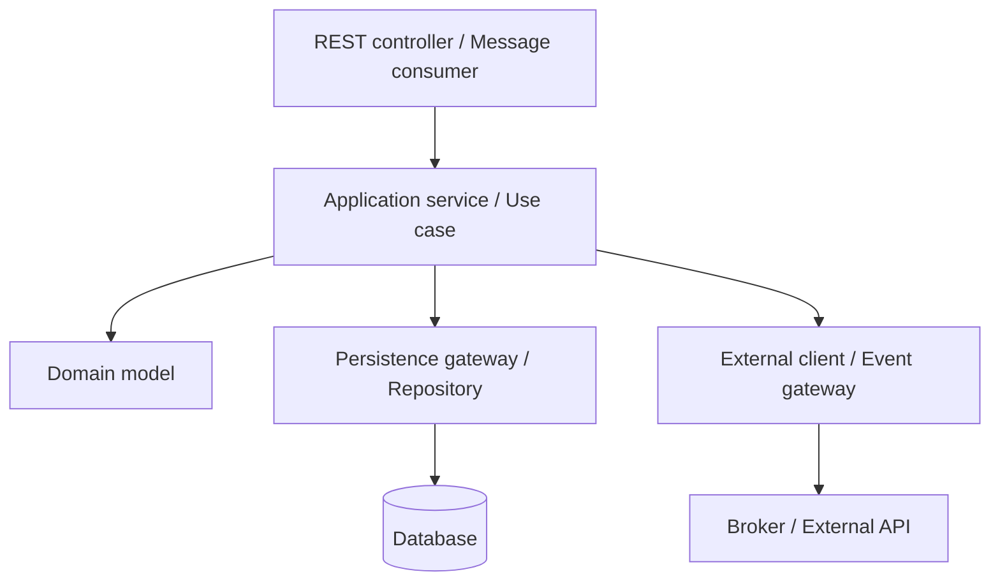
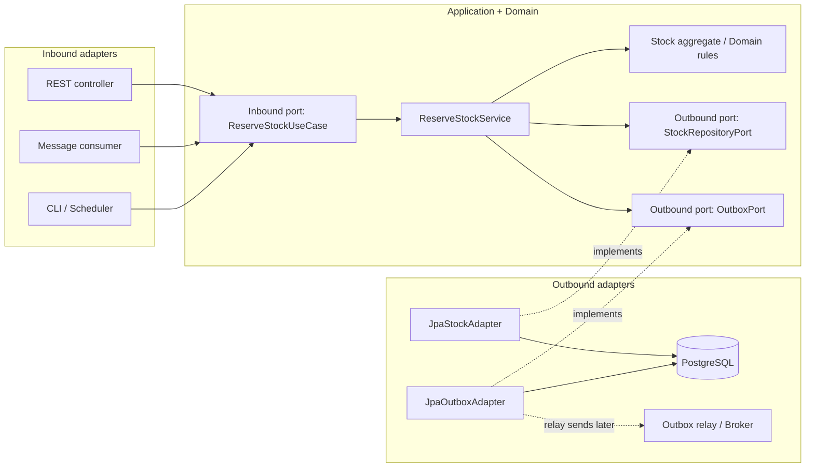
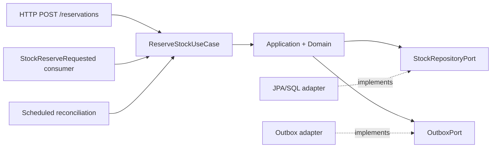

# Áp dụng kiến trúc phân lớp và Ports and Adapters trong từng microservice

## 1. Vì sao microservice vẫn cần kiến trúc nội bộ?

Microservices là một cách chia **hệ thống** thành các dịch vụ có trách nhiệm, dữ liệu, vòng đời triển khai và hợp đồng giao tiếp riêng. Tuy nhiên, việc một dịch vụ chạy trong một tiến trình hoặc container độc lập không nói lên cách tổ chức **mã nguồn bên trong** dịch vụ ấy.

Một dịch vụ có thể nhỏ về dung lượng code mà vẫn rất khó sửa nếu controller gọi trực tiếp database, quy tắc nghiệp vụ nằm rải rác trong câu truy vấn SQL, logic xử lý lỗi nằm ở mọi lớp, hoặc đổi nhà cung cấp message broker kéo theo sửa hàng loạt use case. Ngược lại, một dịch vụ được chia module và quản lý phụ thuộc rõ ràng thường dễ kiểm thử, triển khai và duy trì hơn.

Hai cách tổ chức hữu ích:

- **Layered Architecture (kiến trúc phân lớp):** chia mã nguồn theo vai trò như presentation, application, domain và infrastructure/persistence; quy định lớp nào được gọi lớp nào.
- **Ports and Adapters (Hexagonal Architecture):** đặt nghiệp vụ và các use case ở lõi, mô tả giao tiếp thông qua các interface (port), rồi gắn bộ chuyển đổi (adapter) cho REST, database, broker hoặc hệ thống ngoài.

Cả hai áp dụng **bên trong từng dịch vụ**, không đòi hỏi toàn bộ hệ thống phải dùng cùng một framework hoặc một mẫu package. Một microservice đơn giản có thể chỉ cần vài lớp rõ ràng; một dịch vụ sở hữu nghiệp vụ phức tạp có thể cần domain model và nhiều port. Điều quan trọng là **giữ logic nghiệp vụ, điều phối use case và chi tiết công nghệ ở đúng vị trí**.

### Mục tiêu học tập

Sau khi học mục này, người đọc có thể:

1. Phân biệt ranh giới microservice với ranh giới layer/module bên trong.
2. Vẽ được hướng phụ thuộc của kiến trúc phân lớp và Ports and Adapters.
3. Gắn responsibility cho REST controller, application service, domain, repository, message adapter và các thành phần kỹ thuật.
4. Thiết kế use case có thể chạy và kiểm thử mà không cần khởi động web server hoặc database thật.
5. Chọn kiến trúc vừa đủ phức tạp, nhận diện dấu hiệu phụ thuộc đảo chiều sai và cải tiến mã nguồn theo từng bước.

## 2. Ba loại ranh giới cần giữ tách biệt

| Ranh giới | Trả lời câu hỏi | Ví dụ |
| --- | --- | --- |
| Ranh giới dịch vụ | Dịch vụ chịu trách nhiệm năng lực nghiệp vụ nào, sở hữu dữ liệu nào? | Inventory sở hữu số lượng và reservation; Order sở hữu vòng đời đơn hàng |
| Ranh giới ứng dụng | Use case nào phối hợp những bước gì để đáp ứng lệnh nghiệp vụ? | ReserveStock, ReleaseReservation, GetAvailableStock |
| Ranh giới công nghệ | Hệ thống giao tiếp và lưu dữ liệu bằng gì? | HTTP/JSON, Kafka, PostgreSQL, Redis, gRPC |

Đừng dùng việc chia nhiều class/controller để thay thế việc xác định **bounded context**. Nếu Order và Inventory cùng cập nhật bảng stock, một sơ đồ package đẹp không bảo đảm quyền sở hữu dữ liệu. Cũng đừng nhầm “một layer = một microservice”: tách web layer, business layer và database layer thành các microservice riêng thường làm xuất hiện những lời gọi mạng chặt và trách nhiệm nghiệp vụ mơ hồ.

Nguyên tắc hữu dụng là: **đầu tiên xác định dịch vụ chịu trách nhiệm điều gì; sau đó tổ chức bên trong để thực hiện trách nhiệm ấy một cách dễ hiểu và kiểm thử được**.

## 3. Kiến trúc phân lớp trong một dịch vụ

### 3.1. Các lớp và trách nhiệm

Một cấu trúc thường gặp trong ứng dụng Java/Spring Boot:

| Lớp | Chứa gì? | Nên tránh |
| --- | --- | --- |
| Presentation / API | REST controller, DTO request/response, xác thực đầu vào, ánh xạ HTTP status | Quy tắc nghiệp vụ cốt lõi, SQL, thao tác transaction dài |
| Application / Use cases | Điều phối thao tác, kiểm tra quyền theo use case, transaction boundary, orchestration của domain và các phụ thuộc | Biến thành nơi chứa toàn bộ quy tắc của domain hoặc mã HTTP/JPA |
| Domain | Entity, value object, aggregate, domain service, bất biến và chuyển trạng thái | Import Spring MVC, JPA, broker client, HTTP response |
| Infrastructure | Repository implementation, ORM mapping, broker producer/consumer, REST client, filesystem, config | Tự quyết định chính sách nghiệp vụ vốn thuộc domain/application |

Sơ đồ luồng gọi đơn giản:



Đây là **sơ đồ luồng chạy**, chưa phải sơ đồ phụ thuộc ở thời điểm biên dịch. Nếu application trực tiếp import repository cụ thể dùng JPA, thay database sẽ ảnh hưởng tới lớp application. Với hệ thống nhỏ và đơn giản, điều này có thể là đánh đổi chấp nhận được; khi cần đổi adapter/test dễ dàng, nên chuyển sang port interface thuộc lõi.

### 3.2. Hai cách hiểu về phân lớp

**Layered truyền thống:** presentation gọi application/service; service gọi repository; repository giao tiếp database. Các dependency thường hướng từ layer cao đến layer thấp. Dễ tiếp cận, phù hợp nhiều CRUD service.

**Layered với dependency rule hướng vào lõi:** presentation và infrastructure phụ thuộc vào các interface/use case của application/domain, trong khi domain không biết adapter. Cách này gần với Clean Architecture và Ports and Adapters.

Tên package không quyết định kiến trúc. Một dự án có các thư mục controller/service/repository nhưng controller vẫn gọi repository trực tiếp ở mọi nơi thì các layer chỉ tồn tại trên danh nghĩa.

### 3.3. Một request đi qua những lớp nào?

Ví dụ API **POST /reservations**:

1. Controller nhận JSON, kiểm tra định dạng và thông số như quantity lớn hơn 0; chuyển thành command.
2. Application service thực thi use case ReserveStock và điều phối một transaction cục bộ.
3. Domain aggregate Stock quyết định có đủ hàng để reserve hay không và bảo vệ invariant.
4. Repository lưu thay đổi; outbox ghi thông điệp cần phát trong cùng transaction nếu thiết kế có phát sự kiện.
5. Controller chuyển kết quả use case thành HTTP 201/200/409/422, tùy hợp đồng API đã công bố.

**Điều cần giữ ổn định:** domain không phụ thuộc định dạng JSON hoặc HTTP status; controller không tự cập nhật stock.available bằng một câu SQL để bỏ qua invariant.

## 4. Ports and Adapters: dependency hướng về lõi

Ports and Adapters thường được mô tả bằng hình lục giác nhưng bản chất không phụ thuộc hình vẽ. **Application/domain là lõi**, giao tiếp với thế giới bên ngoài qua các hợp đồng do phía lõi định nghĩa.

- **Inbound port / driving port:** khả năng lõi cung cấp, thường là use case interface, ví dụ ReserveStockUseCase. REST controller, gRPC handler, CLI hoặc message consumer gọi port này.
- **Outbound port / driven port:** khả năng lõi cần từ môi trường, ví dụ StockRepositoryPort, ClockPort, PaymentGatewayPort. Adapter JPA, HTTP client hay in-memory fake thực hiện port này.
- **Inbound adapter:** chuyển giao thức ngoài thành command/use case; không đặt business invariant ở đây.
- **Outbound adapter:** chuyển lời gọi từ port sang công nghệ cụ thể, xử lý serialization, network, database mapping và lỗi kỹ thuật.



**Điểm dễ nhầm:** mũi tên cuộc gọi ở runtime và dependency trong code có thể ngược nhau. Application *gọi* repository port, nhưng chính adapter persistence *import và implement* interface đó. Do vậy source code của application không cần import JpaRepository, EntityManager hay WebClient.

### 4.1. Hướng phụ thuộc quan trọng hơn số lượng lớp

Một quy tắc dễ nhớ:

- **Domain** không import code từ application, HTTP controller, Spring Data, ORM hay message broker.
- **Application** import domain và các interface cần thiết; không import class adapter cụ thể.
- **Adapter** import use case/port hoặc domain type đủ để chuyển dữ liệu; adapter có thể dùng framework bên ngoài.
- **Composition root / configuration** nối implementation với interface bằng dependency injection.

Khi domain dùng thư viện Java tiêu chuẩn như BigDecimal, UUID, LocalDateTime/Instant tùy ngữ nghĩa, điều đó không làm hỏng dependency rule. Tránh biến quy tắc này thành nghi thức tạo interface cho mọi class: interface hữu ích khi nó biểu diễn ranh giới giao tiếp hoặc nhu cầu thay thế cụ thể.

## 5. Tổ chức thư mục/package bên trong microservice

Hai lựa chọn đều có thể hợp lý.

### 5.1. Package theo tầng kỹ thuật

```text
inventory-service/
  src/main/java/com/example/inventory/
    api/
      ReservationController.java
      ReservationRequest.java
    application/
      ReserveStockService.java
      ReserveStockCommand.java
    domain/
      Stock.java
      Reservation.java
    persistence/
      StockJpaRepository.java
      StockJpaEntity.java
    messaging/
      StockEventPublisher.java
```

Dễ bắt đầu, nhưng khi dịch vụ có nhiều năng lực nghiệp vụ, các package lớn như service, controller, repository có thể chứa hàng trăm class không liên quan.

### 5.2. Package theo feature, tách layer bên trong feature

```text
inventory-service/
  src/main/java/com/example/inventory/
    reservation/
      domain/
        Stock.java
        Reservation.java
      application/
        port/in/ReserveStockUseCase.java
        port/out/StockRepositoryPort.java
        port/out/ReservationRepositoryPort.java
        port/out/OutboxPort.java
        ReserveStockService.java
      adapter/in/web/
        ReservationController.java
      adapter/in/messaging/
        ReleaseReservationConsumer.java
      adapter/out/persistence/
        StockJpaAdapter.java
        StockJpaEntity.java
        ReservationJpaAdapter.java
        OutboxJpaAdapter.java
    availability/
      application/
      adapter/in/web/
      adapter/out/persistence/
    config/
      InventoryWiring.java
```

Đây là cách **package by feature** kết hợp Ports and Adapters. Nó phản ánh use case/domain rõ hơn, giảm số chỗ cần mở khi thay đổi một tính năng. Không bắt buộc mọi feature phải có đủ các folder; thư mục trống hoặc interface không có ý nghĩa chỉ làm mã khó đọc.

### 5.3. Chọn package nhỏ nhất phục vụ mục tiêu

Một microservice chỉ có vài endpoint CRUD, business rules đơn giản và chưa có nhu cầu thay thế persistence có thể dùng ba hoặc bốn package phân lớp. Khi domain bắt đầu chứa nhiều invariant, tích hợp ngoài, tác vụ bất đồng bộ hoặc yêu cầu kiểm thử nhanh, việc chuyển sang inbound/outbound port trở nên có giá trị.

Không cần tách mỗi port thành một module Maven/Gradle. Chỉ tách module biên dịch riêng khi muốn compiler hỗ trợ cưỡng chế dependency, đội ngũ quản lý nhiều bounded context hoặc cần kiểm soát phụ thuộc rõ hơn.

## 6. Ví dụ Java: use case ReserveStock bằng Ports and Adapters

Giả sử Inventory service nhận yêu cầu giữ một lượng hàng cho một đơn. Yêu cầu nghiệp vụ:

- Quantity phải dương.
- Không được giữ nhiều hơn lượng khả dụng.
- Một reservationId chỉ được xử lý một lần theo ý nghĩa nghiệp vụ.
- Cập nhật số lượng và ghi outbox phải **cùng commit** trong một database transaction.
- Broker nhận sự kiện StockReserved sau khi transaction thành công, thông qua outbox relay.

Các đoạn mã dưới đây minh họa **hợp đồng và phân công trách nhiệm**. Với một ứng dụng production, cần bổ sung persistence mappings, exception mapping, cấu hình transaction và xử lý cạnh tranh như mô tả bên dưới.

### 6.1. Domain không biết REST hay JPA

```java
package com.example.inventory.reservation.domain;

public final class Stock {
    private final String sku;
    private int available;

    public Stock(String sku, int available) {
        if (sku == null || sku.isBlank()) {
            throw new IllegalArgumentException("SKU required");
        }
        if (available < 0) {
            throw new IllegalArgumentException("Negative stock");
        }
        this.sku = sku;
        this.available = available;
    }

    public void reserve(int quantity) {
        if (quantity <= 0) {
            throw new IllegalArgumentException("Quantity must be positive");
        }
        if (available < quantity) {
            throw new InsufficientStockException(sku, quantity);
        }
        available -= quantity;
    }

    public String sku() {
        return sku;
    }

    public int available() {
        return available;
    }
}
```

Domain thực thi invariant **available không âm**. Nó không quan tâm request đến từ REST, message broker hay ứng dụng dòng lệnh. Ngoại lệ nghiệp vụ InsufficientStockException là một kiểu thuộc domain (định nghĩa riêng); adapter API sẽ chuyển sang mã phản hồi phù hợp.

### 6.2. Inbound port mô tả khả năng của ứng dụng

```java
package com.example.inventory.reservation.application.port.in;

public record ReserveStockCommand(
    String reservationId,
    String sku,
    int quantity
) {}

public record ReserveStockResult(
    String reservationId,
    String status
) {}

public interface ReserveStockUseCase {
    ReserveStockResult reserve(ReserveStockCommand command);
}
```

Lõi chỉ định command/result bằng các type độc lập giao thức. Không cho HTTP request DTO đi sâu xuống domain; nếu gRPC hoặc Kafka gọi cùng use case, chúng cũng chuyển payload về command nội bộ.

### 6.3. Outbound ports mô tả nhu cầu của use case

```java
package com.example.inventory.reservation.application.port.out;

import com.example.inventory.reservation.domain.Stock;
import java.util.Optional;

public interface StockRepositoryPort {
    Optional<Stock> findForUpdate(String sku);
    void save(Stock stock);
}

public interface ReservationRepositoryPort {
    boolean exists(String reservationId);
    void record(String reservationId, String sku, int quantity);
}

public interface OutboxPort {
    void append(String eventId, String type, String aggregateId,
                String payloadJson);
}
```

**findForUpdate** biểu đạt yêu cầu khóa/tránh ghi đè trong use case; JPA adapter quyết định cụ thể nên dùng pessimistic lock, optimistic version hay câu lệnh cập nhật nguyên tử. OutboxPort không hứa đã gửi thành công tới Kafka: nó chỉ ghi sự kiện chờ phát trong nguồn lưu trữ giao dịch cục bộ.

Các port trên nên có hợp đồng rõ về tình huống không tìm thấy, xung đột phiên bản, lỗi hạ tầng và nghĩa của transaction. Không để một port tên save() âm thầm gọi hệ thống ngoài không thể rollback.

### 6.4. Application service điều phối, domain quyết định luật

```java
package com.example.inventory.reservation.application;

import com.example.inventory.reservation.application.port.in.*;
import com.example.inventory.reservation.application.port.out.*;
import com.example.inventory.reservation.domain.Stock;

public final class ReserveStockService implements ReserveStockUseCase {
    private final StockRepositoryPort stocks;
    private final ReservationRepositoryPort reservations;
    private final OutboxPort outbox;

    public ReserveStockService(
        StockRepositoryPort stocks,
        ReservationRepositoryPort reservations,
        OutboxPort outbox
    ) {
        this.stocks = stocks;
        this.reservations = reservations;
        this.outbox = outbox;
    }

    @Override
    public ReserveStockResult reserve(ReserveStockCommand cmd) {
        if (cmd.reservationId() == null
                || cmd.reservationId().isBlank()) {
            throw new IllegalArgumentException("Reservation ID required");
        }

        // Lệnh gửi lại trả kết quả cũ theo cùng reservationId.
        if (reservations.exists(cmd.reservationId())) {
            return new ReserveStockResult(
                cmd.reservationId(), "ALREADY_RESERVED");
        }

        Stock stock = stocks.findForUpdate(cmd.sku())
            .orElseThrow(() -> new UnknownSkuException(cmd.sku()));

        stock.reserve(cmd.quantity());

        stocks.save(stock);
        reservations.record(
            cmd.reservationId(), cmd.sku(), cmd.quantity());

        String payload = StockReservedPayload.serialize(
            cmd.reservationId(), cmd.sku(), cmd.quantity());
        outbox.append(
            cmd.reservationId(), "StockReserved", cmd.sku(), payload);

        return new ReserveStockResult(
            cmd.reservationId(), "RESERVED");
    }
}
```

Trong đoạn này, **UnknownSkuException** và **StockReservedPayload** là hai type hỗ trợ cần hiện thực riêng. Hàm serialize có thể được thay bằng một abstraction cho event mapper, tránh để application biết định dạng JSON nếu có nhiều loại message. Chi tiết trình bày tách ra để làm rõ luồng phụ thuộc.

**Một lưu ý về cạnh tranh:** kiểm tra exists trước khi ghi **không đủ** bảo đảm chống trùng khi hai request cùng chạy đồng thời. Database cần unique constraint trên reservationId, cộng với lock/conditional update cho số lượng; nếu một transaction xung đột, toàn bộ thay đổi của transaction đó phải rollback và luồng gọi có thể đọc lại kết quả đã ghi. Cả stock update, reservation record và outbox record phải thuộc cùng transaction.

### 6.5. Inbound REST adapter chuyển HTTP thành command

```java
package com.example.inventory.reservation.adapter.in.web;

@RestController
@RequestMapping("/reservations")
public class ReservationController {
    private final ReserveStockUseCase useCase;

    public ReservationController(ReserveStockUseCase useCase) {
        this.useCase = useCase;
    }

    @PostMapping
    public ResponseEntity<ReservationResponse> reserve(
            @Valid @RequestBody ReservationRequest request) {

        ReserveStockResult result = useCase.reserve(
            new ReserveStockCommand(
                request.reservationId(),
                request.sku(),
                request.quantity()));

        ReservationResponse body = new ReservationResponse(
            result.reservationId(), result.status());
        return ResponseEntity.status(HttpStatus.CREATED).body(body);
    }
}
```

Trong mã thật, thêm imports Spring MVC/Validation và định nghĩa ReservationRequest/ReservationResponse. Controller kiểm tra cấu trúc JSON, required fields và convert type. Application/domain tiếp tục bảo vệ invariant nghiệp vụ, vì use case có thể được gọi từ message consumer chứ không chỉ REST.

Một Contract API có thể chọn 201 cho lần tạo mới và 200 cho idempotent replay; ví dụ trên dùng 201 để minh họa. Nếu muốn phân biệt rõ, result nên có một trường typed enum cho Created/AlreadyExists và adapter ánh xạ trạng thái tương ứng. Tránh hardcode chuỗi status xuyên các layer.

### 6.6. Outbound persistence adapter che JPA

Một adapter minh họa:

```java
package com.example.inventory.reservation.adapter.out.persistence;

@Repository
public class StockJpaAdapter implements StockRepositoryPort {
    private final EntityManager entityManager;

    public StockJpaAdapter(EntityManager entityManager) {
        this.entityManager = entityManager;
    }

    @Override
    public Optional<Stock> findForUpdate(String sku) {
        StockJpaEntity row = entityManager.find(
            StockJpaEntity.class,
            sku,
            LockModeType.PESSIMISTIC_WRITE);
        if (row == null) {
            return Optional.empty();
        }
        return Optional.of(new Stock(row.getSku(), row.getAvailable()));
    }

    @Override
    public void save(Stock stock) {
        StockJpaEntity row = entityManager.find(
            StockJpaEntity.class, stock.sku());
        row.setAvailable(stock.available());
    }
}
```

Ở đây StockJpaEntity là JPA entity quản lý persistence và Stock là domain object. Adapter chuyển dữ liệu giữa chúng. Tùy thiết kế, có thể dùng Spring Data repository hoặc SQL update có điều kiện. Ví dụ dùng khóa PESSIMISTIC_WRITE để minh họa ý định serialize các thay đổi liên quan đến cùng SKU.

**Không dùng riêng adapter này như một giao dịch hoàn chỉnh:** cần transaction bao quanh toàn bộ use case, và phải xác định cùng nguồn database/transaction manager. Khi tích hợp outbox nằm ở database khác, một @Transactional trên JPA không tự bảo đảm atomic commit xuyên hai nguồn.

### 6.7. Đặt transaction boundary

Có hai cách thông dụng:

- Đặt annotation transaction của framework ngay trên application service, chấp nhận application phụ thuộc nhẹ vào Spring để giảm lớp boilerplate.
- Giữ application là Java thuần và dùng **transactional decorator**/proxy ở infrastructure, rồi giao trách nhiệm commit/rollback cho adapter.

Ví dụ decorator:

```java
@Service
public class TransactionalReserveStockHandler
        implements ReserveStockUseCase {

    private final ReserveStockService delegate;

    public TransactionalReserveStockHandler(ReserveStockService delegate) {
        this.delegate = delegate;
    }

    @Override
    @Transactional
    public ReserveStockResult reserve(ReserveStockCommand command) {
        return delegate.reserve(command);
    }
}
```

Trong cấu hình dependency injection, controller phải nhận implementation đã được bao transaction; không vô tình inject trực tiếp delegate và bỏ qua transaction. Các adapter Stock, Reservation và Outbox phải tham gia cùng transaction database. Nếu dùng proxy của Spring, tránh self-invocation bypass proxy. Tùy framework có thể tạo transaction bằng programmatic TransactionTemplate tại composition root.

### 6.8. Gắn port với adapter qua composition root

```java
@Configuration
public class ReservationConfiguration {
    @Bean
    ReserveStockService reserveStockService(
            StockRepositoryPort stocks,
            ReservationRepositoryPort reservations,
            OutboxPort outbox) {
        return new ReserveStockService(stocks, reservations, outbox);
    }
}
```

Spring tạo StockJpaAdapter, ReservationJpaAdapter và OutboxJpaAdapter qua dependency injection nếu chúng được khai báo là bean. Controller nhận một ReserveStockUseCase, trong ví dụ này là transactional handler. Nếu có nhiều implementation interface, cần @Qualifier hoặc wiring tường minh để tránh ambiguity.

Tư tưởng cốt lõi: **framework khởi tạo dependency, còn domain quyết định nghiệp vụ**.

## 7. Ví dụ đơn giản hơn: layered CRUD vẫn có chỗ đứng

Không phải endpoint nào cũng cần entity giàu hành vi, ba outbound port và decorator. Ví dụ một service quản lý danh mục mã bưu chính nội bộ, chỉ có quy tắc tạo/sửa/xóa đơn giản, database cố định và không phát domain event. Một tổ chức phân lớp nhẹ có thể đủ:

```text
postal-code-service/
  api/PostalCodeController.java
  application/PostalCodeService.java
  domain/PostalCode.java
  persistence/PostalCodeRepository.java
```

Nguyên tắc giữ:

1. Controller làm nhiệm vụ HTTP/DTO, không truy vấn DB trực tiếp.
2. Service là nơi tổ chức use case, chứ không đơn thuần chuyển tiếp tất cả phương thức của repository một cách máy móc.
3. Quy tắc dữ liệu thuộc domain/value object hoặc một nơi được định nghĩa rõ.
4. Repository che các chi tiết truy cập dữ liệu đối với controller.
5. Khi xuất hiện nhiều database, message broker hoặc yêu cầu test không cần database, có thể trích ra các port thay vì viết lại toàn bộ.

Đừng tạo interface **IPostalCodeService** chỉ để interface gọi một implementation mà không có giá trị trao đổi, thử nghiệm hoặc phân tách phụ thuộc. Chọn abstraction khi có một ranh giới thật cần được bảo vệ.

## 8. Trách nhiệm kiểm tra dữ liệu và xử lý lỗi

### 8.1. Phân biệt ba lớp validation

| Loại validation | Vị trí phù hợp | Ví dụ |
| --- | --- | --- |
| Cú pháp/giao thức | Inbound adapter | JSON hợp lệ, trường bắt buộc, kiểu số, kích thước payload |
| Quy tắc của use case | Application | Người gọi có quyền reserve cho warehouse này, command đã xử lý, chính sách thao tác |
| Bất biến nghiệp vụ | Domain | Quantity dương; không cho tồn khả dụng âm; trạng thái chuyển hợp lệ |

Không phụ thuộc duy nhất vào Bean Validation trên REST DTO để bảo vệ domain: message consumer hoặc batch cũng phải tuân thủ quy tắc. Domain nên từ chối trạng thái không hợp lệ ngay cả khi được gọi trực tiếp trong unit test.

### 8.2. Chuyển lỗi qua ranh giới

- Domain ném lỗi có ý nghĩa như InsufficientStock, InvalidReservationState.
- Application có thể chuyển thành kết quả nghiệp vụ có kiểu rõ, hoặc tiếp tục để exception đi lên.
- REST adapter chuyển lỗi nghiệp vụ sang HTTP 409/422 hoặc mã phù hợp với API contract; không trả lỗi JPA thô.
- Messaging adapter quyết định retry, dead-letter, pause/alert hoặc acknowledgment theo loại lỗi và độ bảo đảm xử lý.
- Outbound adapter chuyển HTTP timeout, unique constraint, SQL state thành lỗi hạ tầng có chủ đích; không ngụy trang mọi lỗi thành “hết hàng”.

Phân biệt **business rejection** (yêu cầu không hợp lệ theo nghiệp vụ) với **technical failure** (database mất kết nối, broker không sẵn sàng). Business rejection thường không nên retry vô hạn, còn transient failure cần retry có backoff/idempotency.

## 9. Dữ liệu và transaction trong microservice

Microservices nên có **quyền sở hữu dữ liệu rõ**; mỗi dịch vụ quyết định và ghi nguồn dữ liệu của miền mình. Database-per-service là một mẫu triển khai hữu ích, nhưng ranh giới ownership quan trọng hơn việc có bao nhiêu máy chủ database.

Trong nội bộ một service:

- Một use case có thể dùng nhiều repository port cùng tham gia **một local transaction**.
- Domain aggregate bảo vệ các invariant cần đúng khi commit.
- Application điều phối thứ tự thao tác; persistence adapter quyết định cách mapping và concurrency control.
- Outbox record và thay đổi nghiệp vụ nên ghi trong cùng transaction nếu cần publish event một cách tin cậy.
- Sự kiện đã publish có thể bị giao lặp; consumer cần idempotent processing và theo dõi phiên bản/sự kiện khi cần.

Giữa các service:

- Không nên đẩy một ACID transaction cục bộ qua HTTP rồi giữ database lock chờ service khác.
- Business process dài nên có trạng thái trung gian, idempotency, timeout, retry có giới hạn và cơ chế bù trừ/đối soát khi phù hợp.
- API hoặc event là hợp đồng công khai; thay đổi schema cần kế hoạch tương thích.
- Outbound adapter **không tự quyết định** các bước saga hoặc chính sách hoàn tiền: application/process manager giữ trách nhiệm điều phối, domain bảo vệ các quy tắc của miền.

### 9.1. Transaction scope đúng với ranh giới dịch vụ

Trong ví dụ ReserveStock, ba bước ghi stock, reservation, outbox phải cùng commit. Nếu adapter outbox tự phát Kafka trước khi stock commit, bên nhận có thể thấy sự kiện cho một giao dịch cuối cùng bị rollback. Nếu stock đã commit rồi ứng dụng crash trước khi publish, hệ thống ngoài không nhận sự kiện. Cơ chế outbox giúp nối hai giai đoạn an toàn hơn, nhưng không tự tạo “exactly once” tuyệt đối.

Cần bảo đảm table outbox, reservation và stock ở cùng transaction manager khi dựa vào local atomicity. Trường hợp nhiều nguồn lưu trữ cần giao thức khác hoặc điều chỉnh yêu cầu nghiệp vụ.

## 10. Adapter cho HTTP, gRPC và message broker

Một use case có thể được kích hoạt từ nhiều kênh:



**Inbound adapter** chịu trách nhiệm giao thức và quy tắc giao nhận. Ví dụ message consumer cần:

1. Deserialize event và kiểm tra phiên bản schema.
2. Nhận diện messageId/correlationId và chuyển thành command.
3. Gọi inbound port.
4. Chỉ ack khi xử lý phù hợp với semantics của broker; phân loại lỗi retryable.
5. Không tự cập nhật database bên ngoài use case.

**Outbound adapter** chịu trách nhiệm timeout, serialization, retry policy ở mức giao tiếp, authentication với hệ thống ngoài và metrics của cuộc gọi. Chính sách có thể retry một command nghiệp vụ hay không phải phù hợp tính idempotent; adapter không được tự động lặp thao tác charge nếu không có idempotency key.

### 10.1. Đừng che đi sự khác biệt ngữ nghĩa giữa các kênh

REST request thường cần phản hồi trong vài trăm mili giây hoặc vài giây. Một event xử lý bất đồng bộ có thể cho phép delay, retry và dead-letter. Cả hai có thể gọi cùng use case nhưng **adapter phải giữ semantics riêng**.

Nếu một use case chỉ phù hợp với một loại trigger, không cần bắt ép mọi adapter dùng chung interface. Có thể thiết kế các inbound port khác nhau như StartReservation, ConfirmReservation và ReconcileReservation để thể hiện khả năng nghiệp vụ rõ hơn.

## 11. Kiểm thử theo ranh giới Ports and Adapters

Một lợi ích quan trọng là kiểm thử business logic không cần hệ thống phụ thuộc thật.

### 11.1. Domain unit test

```java
@Test
void cannotReserveMoreThanAvailable() {
    Stock stock = new Stock("SKU-1", 3);

    assertThrows(
        InsufficientStockException.class,
        () -> stock.reserve(4));

    assertEquals(3, stock.available());
}
```

Test này không mở HTTP server, không khởi tạo Spring Context và không nối PostgreSQL. Nó kiểm chứng invariant đúng nơi được bảo vệ.

### 11.2. Application service test với fake ports

```java
@Test
void reserveStockWritesReservationAndOutbox() {
    InMemoryStockRepository stocks =
        new InMemoryStockRepository(new Stock("SKU-1", 10));
    InMemoryReservationRepository reservations =
        new InMemoryReservationRepository();
    InMemoryOutbox outbox = new InMemoryOutbox();

    ReserveStockService useCase = new ReserveStockService(
        stocks, reservations, outbox);

    ReserveStockResult result = useCase.reserve(
        new ReserveStockCommand("R-100", "SKU-1", 2));

    assertEquals("RESERVED", result.status());
    assertEquals(8, stocks.get("SKU-1").available());
    assertTrue(reservations.exists("R-100"));
    assertEquals(1, outbox.size());
}
```

Các fake adapter là class test nhỏ implement cùng port, không cần mock mọi phương thức. Nhờ vậy có thể xác minh flow use case một cách nhanh chóng và lặp lại.

Tuy nhiên, fake in-memory không mô phỏng chính xác transaction isolation, unique constraint, locking hoặc lỗi network. Những thuộc tính đó cần kiểm thử tích hợp phù hợp.

### 11.3. Adapter integration test

Kiểm tra với database thật tương thích production hoặc Testcontainers:

- StockJpaAdapter mapping domain ↔ entity đúng.
- Một transaction commit cập nhật stock, reservation và outbox; rollback không lưu dở.
- Hai request cạnh tranh không làm số lượng âm hoặc tạo cùng reservationId hai lần.
- Unique constraint, lock, transaction timeout và migration hoạt động đúng.
- Truy vấn không vô tình tạo N+1 hoặc lock quá rộng.

Đối với HTTP adapter, dùng slice test để xác minh JSON, status, auth và error mapping. Với message adapter, kiểm tra schema, duplicate, retry/ack semantics và routing tới đúng inbound port.

### 11.4. Contract test ở ranh giới dịch vụ

Contract test giữa các microservice bảo đảm REST/gRPC/event schema tương thích và các bên hiểu cùng semantics. Đây là kiểm thử **giữa dịch vụ**, bổ sung cho unit/integration test bên trong. Không nên bắt mọi unit test khởi động toàn bộ hệ thống phân tán chỉ để kiểm chứng một invariant cục bộ.

## 12. Khi nào chọn Layered, khi nào chọn Ports and Adapters?

| Tình huống | Layered đơn giản | Ports and Adapters |
| --- | --- | --- |
| CRUD ít quy tắc, một persistence cố định | Thường đủ, ít boilerplate | Có thể chưa cần nhiều abstraction |
| Domain có nhiều invariant và chuyển trạng thái | Nên có domain layer rõ | Phù hợp để cô lập domain khỏi framework |
| Nhiều inbound channels: HTTP, event, batch | Cần ngăn lặp logic qua các controller/consumer | Inbound ports làm điểm dùng chung tự nhiên |
| Tích hợp nhiều database/API/broker | Service có thể bị dính SDK hạ tầng | Outbound ports giảm coupling tới SDK |
| Test logic không muốn khởi động môi trường | Có thể thực hiện nếu service ít phụ thuộc | Dễ tạo fake adapters và pure unit tests |
| Nhóm nhỏ, yêu cầu còn thay đổi liên tục | Dễ duy trì khi còn đơn giản | Chọn một số port có giá trị trước |
| Bắt buộc chuyển công nghệ hạ tầng | Cần chỉnh application nếu phụ thuộc class cụ thể | Thay adapter nếu port giữ semantics ổn định |
| Use case rất nhỏ, chỉ chuyển tiếp repository | Tổ chức 2–3 lớp có thể hợp lý | Dễ thành nhiều interface không cần thiết |

**Không có quy định microservice nào cũng phải dùng Hexagonal.** Phương án nên dựa trên độ phức tạp nghiệp vụ, số tích hợp ngoài, nhu cầu kiểm thử, quy mô nhóm và chi phí bảo trì.

Có thể bắt đầu bằng layered rồi tăng dần mức “hướng vào lõi” bằng việc trích interface ở những phụ thuộc thật sự cần thay thế.

## 13. Những anti-pattern thường gặp

### 13.1. Fat Controller

Controller gọi ORM, kiểm tra tồn kho, quyết định trạng thái đơn rồi gửi message. Hậu quả là REST trở thành trung tâm nghiệp vụ; khó tái sử dụng từ consumer và không có test domain thuần.

**Cách sửa:** controller chuyển DTO thành command, gọi use case; chuyển bất biến vào domain và kỹ thuật lưu/gửi vào adapter.

### 13.2. Anemic domain không chủ ý

Entity chỉ có getter/setter trong khi mọi quy tắc quan trọng nằm trong application service dài hàng nghìn dòng. Điều này làm invariant dễ bị bỏ qua qua các đường ghi khác nhau.

**Cách sửa:** chuyển các quy tắc bảo vệ trạng thái vào method domain có ý nghĩa như reserve, release, confirm, cancel. Tuy nhiên, với CRUD đơn giản, domain model mỏng cũng có thể hợp lý; không cần “ép” hành vi giả.

### 13.3. Domain import Spring/JPA/HTTP

Domain trả ResponseEntity, dùng @RestController hoặc phụ thuộc trực tiếp EntityManager. Khi kiểm thử luật nghiệp vụ phải khởi tạo framework, việc thay adapter gây tác động lớn.

**Cách sửa:** để domain biểu đạt ngữ nghĩa nghiệp vụ bằng type thuần; adapter chịu trách nhiệm chuyển đổi. Có thể chấp nhận một số annotation persistence nếu nhóm hiểu rõ trade-off và domain thật sự đơn giản, nhưng không nên vô tình làm lõi lệ thuộc toàn bộ ORM.

### 13.4. Interface ở sai nơi

Application import InventoryJpaRepository và adapter persistence có interface riêng; khi đổi database, application vẫn phải sửa.

**Cách sửa:** đặt outbound port trong application/domain phù hợp. Adapter implementation phụ thuộc interface, không phải ngược lại. Package names không phải bằng chứng; kiểm tra import thực tế.

### 13.5. Generic Repository hoặc Service khổng lồ

Một BaseRepository<T> hoặc GenericService<T> cố ép mọi use case vào CRUD, khiến những thao tác như reserve, settle, cancel phải vượt abstraction và rò rỉ điều kiện nghiệp vụ.

**Cách sửa:** dùng port theo nhu cầu use case: findForUpdate, appendOutbox, saveReservation, loadOutstandingPayments. Không nhất thiết mỗi entity cần CRUD đầy đủ.

### 13.6. Gọi HTTP ở trong domain entity

Một domain method tự gọi payment gateway để xác nhận đơn, biến quyết định nghiệp vụ thành thao tác mạng có timeout/partial failure.

**Cách sửa:** application service điều phối lời gọi qua PaymentPort; domain quyết định có được chuyển trạng thái theo kết quả không. Đối với quy trình dài, dùng process manager/saga phù hợp.

### 13.7. Transaction đi qua mạng

Giữ DB transaction rồi gọi API bên ngoài và chờ lâu. Điều này giữ khóa, giảm throughput, tăng deadlock và không thể rollback side effect ở phía nhận.

**Cách sửa:** tách local transaction và quy trình bất đồng bộ khi nghiệp vụ cho phép, bổ sung outbox/idempotency/reconciliation. Các invariant phải nguyên tử vẫn cần đặt gần nơi owner dữ liệu quyết định.

### 13.8. Adapter xuyên qua use case

Controller gọi thẳng repository hoặc một consumer tự UPDATE bảng vì “chỉ sửa một field”. Đây là cách phổ biến làm invariant bị thực thi không nhất quán giữa các kênh.

**Cách sửa:** mọi đường thay đổi trạng thái có ý nghĩa nghiệp vụ đi qua cùng use case/domain. Có thể có công cụ quản trị dữ liệu riêng, nhưng phải được kiểm soát rõ và không tạo đường ghi bí mật.

### 13.9. Quá nhiều lớp chuyển tiếp

Một HTTP controller gọi facade → manager → service → handler → delegate → repository, mỗi lớp chỉ trả lại cùng tham số. Mã khó điều hướng nhưng không tăng tính độc lập.

**Cách sửa:** giữ những lớp có trách nhiệm độc lập, bỏ wrapper chỉ chuyển tiếp nếu nó không cung cấp transaction, authorization, mapping hoặc khả năng test cần thiết.

## 14. Từng bước chuyển một service đang lẫn trách nhiệm

Giả sử dự án đang có một ReservationController trực tiếp gọi JpaRepository và publish Kafka. Có thể tiến hóa an toàn theo các bước:

1. **Chọn một use case quan trọng**, ví dụ ReserveStock, và ghi lại invariant, đường lỗi, dữ liệu mà nó sở hữu.
2. **Trích domain operation**: đưa kiểm tra số lượng và chuyển trạng thái vào Stock.reserve; viết unit test thuần.
3. **Tạo application service**: gom thứ tự xử lý trong ReserveStockService, trả về kết quả có nghĩa nghiệp vụ.
4. **Đưa controller về adapter**: chỉ parse/validate request, tạo command và map response.
5. **Trích outbound ports có giá trị**: trước tiên repository phụ thuộc công nghệ, rồi outbox/gateway nếu thực tế có yêu cầu.
6. **Chuyển JPA/Kafka vào adapter**: giữ mapping rõ; thiết lập dependency injection tại composition root.
7. **Xác định transaction boundary**: bảo đảm những ghi chép thuộc cùng local transaction thực sự commit/rollback cùng nhau.
8. **Kiểm chứng bằng test phù hợp**: unit domain, use case với fake, tích hợp JPA và API contract. Đo các chỉ số thay đổi/hiệu năng cần thiết.
9. **Lặp lại cho use case kế tiếp** khi có lợi ích cụ thể; không ép thay cấu trúc của toàn bộ service trong một lần.

Cần bảo đảm hành vi API và event cũ được giữ khi refactor bên trong. Các thay đổi nội bộ không tự động cho phép phá hợp đồng của client hoặc của microservice khác.

## 15. Vận hành và observability nằm ở đâu?

**Inbound adapter** là nơi tốt để tạo/carry correlation ID, ghi metrics request, xác thực/ủy quyền ở mức protocol và giới hạn payload. **Application** có thể tạo trace span cho từng use case và log sự kiện nghiệp vụ quan trọng ở mức phù hợp. **Outbound adapter** đo độ trễ database/broker/HTTP, timeout, retry và lỗi chuyển đổi.

Không chèn logger, tracer hoặc metrics SDK vào mọi entity domain chỉ vì muốn đo; có thể quan sát hành vi domain ở application boundary. Domain event nội bộ có thể được dùng để ghi audit hoặc phát outbox, với chính sách chính xác về dữ liệu nhạy cảm.

Bên cạnh layer, microservice cần các tính năng vận hành độc lập:

- Health checks và readiness không tiết lộ thông tin nhạy cảm.
- Timeout và circuit breaker cho outbound calls khi phù hợp.
- Cấu hình/secret tách khỏi domain và inject qua adapter.
- Idempotency cho các lệnh có side effect khi retry.
- SLO, trace, logs, metrics và cảnh báo tương ứng các use case quan trọng.
- Contract versioning, database migration và kế hoạch rollback.

Phần vận hành này hỗ trợ kiến trúc nội bộ nhưng không thay thế ranh giới nghiệp vụ tốt.

## 16. Mẫu quyết định kiến trúc cho một service

Trước khi chọn cấu trúc, ghi ngắn gọn:

| Câu hỏi | Dữ liệu/đáp án cần có |
| --- | --- |
| Service sở hữu nghiệp vụ gì? | Một hoặc vài bounded context/use case liên quan |
| Bất biến cốt lõi? | Điều kiện phải giữ và nơi kiểm tra nguyên tử |
| Kênh vào? | HTTP, gRPC, message, scheduler, CLI |
| Phụ thuộc ra ngoài? | Database, broker, cache, gateway, external API |
| Những phụ thuộc nào cần thay thế/test riêng? | Cơ sở để tạo outbound port |
| Độ phức tạp domain? | Số trạng thái, quy tắc, giao dịch và concurrency |
| Cần bảo đảm giao dịch nào? | Local transaction, outbox, idempotency, reconciliation |
| Trọng tâm test? | Pure domain test, fake port test, integration và contract test |
| Điểm cần độc lập trong tương lai? | Framework, DB, broker hoặc protocol |

Ví dụ quyết định:

> Inventory service có invariant không được reserve quá tồn, nhận HTTP và event, lưu PostgreSQL và phát StockReserved qua outbox. Chọn Ports and Adapters cho ReserveStock để bảo vệ domain khỏi HTTP/JPA/Kafka; tạo ba outbound ports StockRepository, ReservationRepository, Outbox; sử dụng transaction decorator bao toàn use case và unique constraint trên reservationId. Những endpoint chỉ đọc đơn giản có thể tiếp tục theo layered structure.

Đây là quyết định ở cấp **service**, không yêu cầu mọi service khác áp dụng y hệt nếu nhu cầu khác nhau.

## 17. Checklist triển khai

- [ ] Đã xác định rõ trách nhiệm nghiệp vụ và quyền sở hữu dữ liệu của service.
- [ ] Controller/consumer chủ yếu chuyển giao thức thành command và response.
- [ ] Các use case được đặt ở application, không bị nhân bản ở nhiều adapter.
- [ ] Domain bảo vệ invariant, không phụ thuộc trực tiếp HTTP/JPA/broker.
- [ ] Hướng import/dependency nhất quán với layered hoặc Ports and Adapters đã chọn.
- [ ] Outbound port thể hiện nhu cầu nghiệp vụ/ứng dụng, không rò rỉ chi tiết SDK.
- [ ] Adapter có chức năng chuyển đổi/lưu trữ/giao tiếp; không tự tạo chính sách nghiệp vụ riêng.
- [ ] Có transaction boundary rõ; không giả định @Transactional bảo đảm giao dịch xuyên nhiều service.
- [ ] Có cách giải quyết concurrency, unique constraint, idempotency và outbox ở những chỗ cần thiết.
- [ ] Lỗi nghiệp vụ và lỗi kỹ thuật được phân biệt, ánh xạ phù hợp ở từng inbound adapter.
- [ ] Domain/use case có thể unit test nhanh không cần HTTP server hoặc DB.
- [ ] Persistence/HTTP/message adapter có integration/contract test cho những thuộc tính quan trọng.
- [ ] Cấu trúc package đủ dễ tìm mã theo tính năng, không tạo lớp trung gian không có giá trị.
- [ ] Log/trace/metrics/timeout/secret được xử lý tại boundary thích hợp.
- [ ] API/event contract bên ngoài được bảo toàn khi refactor kiến trúc nội bộ.

## 18. Kết luận

**Microservices xác định ranh giới triển khai và quyền sở hữu nghiệp vụ; Layered Architecture hoặc Ports and Adapters xác định cách giữ mã nguồn bên trong ranh giới đó dễ hiểu, dễ kiểm thử và có thể thay đổi.**

Kiến trúc phân lớp là lựa chọn tốt khi dịch vụ đơn giản, ít tích hợp và trách nhiệm giữa controller, service và repository đã rõ. Ports and Adapters thích hợp khi business rules phức tạp, có nhiều kênh vào, nhiều phụ thuộc ra ngoài hoặc cần thay framework/persistence mà không ảnh hưởng tới lõi.

Bất kể chọn cách nào, hãy giữ **domain quyết định quy tắc**, **application điều phối use case**, **adapter xử lý công nghệ**, **transaction và dữ liệu có owner rõ ràng**. Số lượng package, interface và adapter chỉ là phương tiện; chất lượng của ranh giới thể hiện ở việc thay đổi một phần có làm những phần không liên quan phải sửa theo hay không.