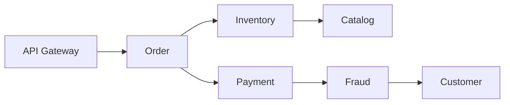
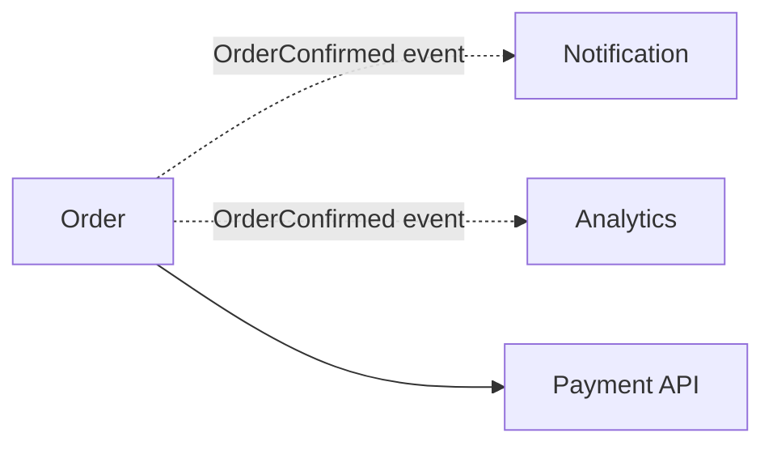
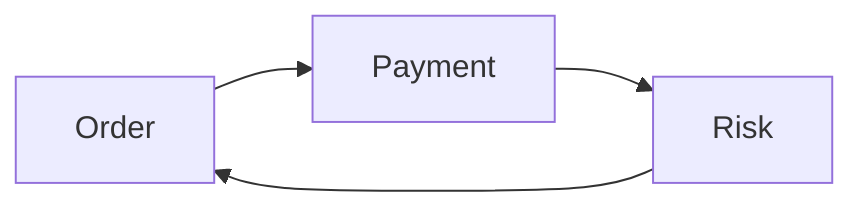
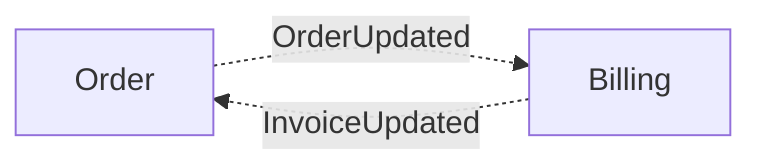
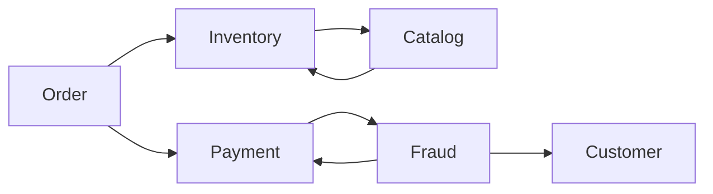
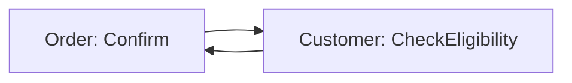
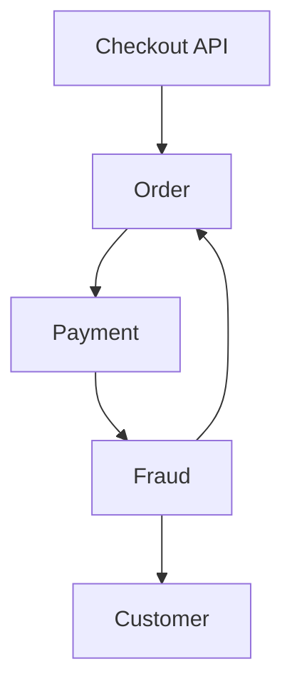
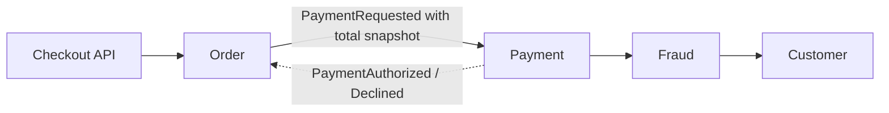
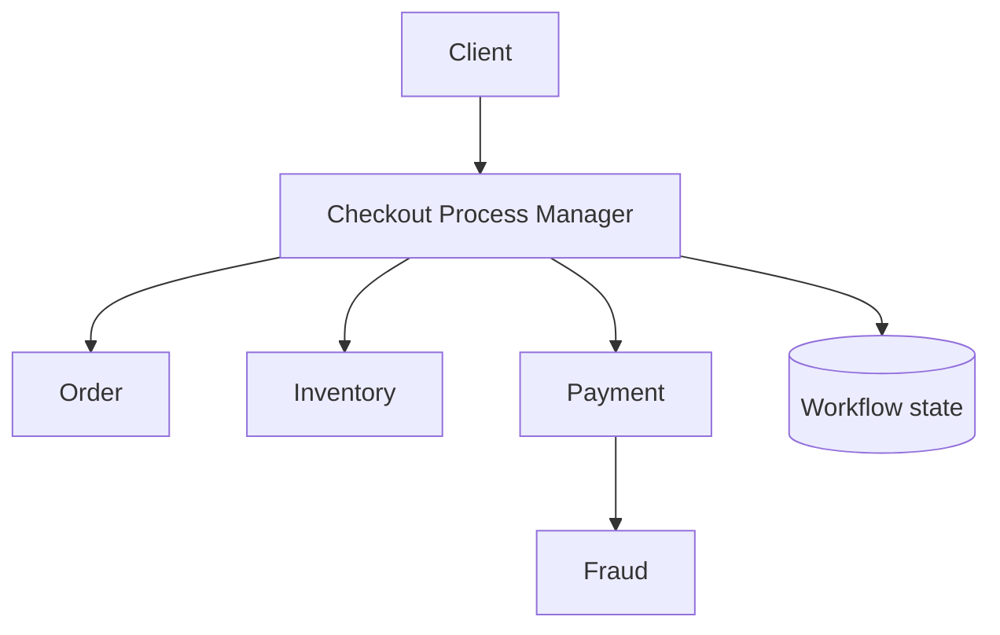
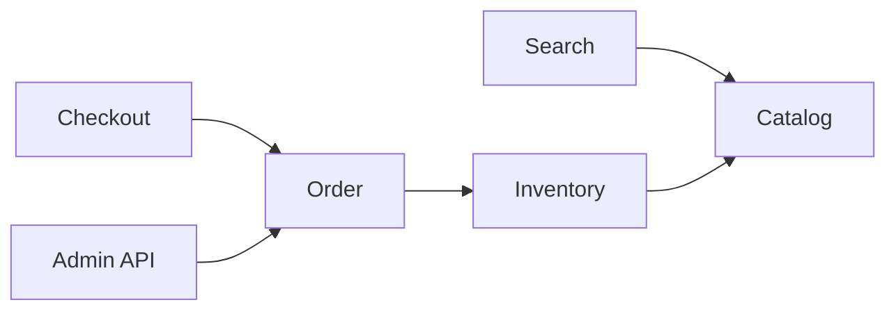

# Phân tích đồ thị gọi và nguy cơ phụ thuộc vòng trong Microservices

## 1. Mục tiêu của bài học

Trong hệ thống microservices, mỗi dịch vụ có thể độc lập về mã nguồn và triển khai nhưng vẫn phụ thuộc vào nhiều dịch vụ khác khi thực thi một yêu cầu nghiệp vụ. Một endpoint đơn giản ở API Gateway có thể kích hoạt chuỗi gọi Order → Inventory → Pricing → Promotion → Customer, rồi lại gọi Order. Độ phức tạp này thường khó nhận ra nếu chỉ đọc cấu trúc repository hoặc nhìn vào sơ đồ triển khai.

**Đồ thị gọi (service call graph)** thể hiện các dịch vụ và quan hệ giao tiếp giữa chúng. Phân tích đồ thị giúp trả lời:

1. Một yêu cầu đi qua những dịch vụ nào và có bao nhiêu lời gọi đồng bộ trên đường quan trọng?
2. Dịch vụ nào đang phụ thuộc vào dịch vụ nào về mặt runtime, dữ liệu, hợp đồng và triển khai?
3. Có tồn tại **chu trình phụ thuộc** như A → B → C → A hay không? Chu trình ấy là lời gọi đồng bộ, luồng sự kiện bất đồng bộ hay phụ thuộc mã nguồn?
4. Nếu một dịch vụ chậm hoặc không sẵn sàng, những yêu cầu và dịch vụ khác chịu ảnh hưởng gì?
5. Những cạnh nào có thể bỏ, đảo chiều, chuyển thành sự kiện, thay bằng projection, hoặc gom vào cùng một ranh giới nghiệp vụ?

Mục tiêu thực tế là tạo **bản đồ quan hệ giao tiếp có bằng chứng**, phát hiện điểm nghẽn và ưu tiên thiết kế lại các ranh giới gây phụ thuộc không cần thiết. Không phải mọi chu trình đều là lỗi; điều cần đánh giá là **mức độ coupling, khả năng khôi phục và hậu quả đối với nghiệp vụ**.

## 2. Khái niệm đồ thị gọi

### 2.1. Đồ thị có hướng

Biểu diễn hệ thống thành đồ thị có hướng G = (V, E):

- **V (vertices):** các đỉnh, thường là service, module hoặc operation, tùy cấp độ phân tích.
- **E (edges):** các cạnh có hướng; A → B nghĩa là A chủ động gọi hoặc tạo một phụ thuộc giao tiếp đến B theo định nghĩa của đồ thị.
- **Path (đường đi):** chuỗi cạnh nối từ điểm bắt đầu đến nơi được gọi.
- **Cycle (chu trình):** đường đi có hướng trở về đỉnh đã xuất phát, chẳng hạn A → B → C → A.
- **Strongly Connected Component, SCC:** một tập đỉnh mà từ bất kỳ đỉnh nào cũng có thể đi theo các cạnh có hướng tới mọi đỉnh khác trong tập. SCC có từ hai đỉnh trở lên là vùng chứa ít nhất một chu trình.
- **DAG (Directed Acyclic Graph):** đồ thị có hướng không chứa chu trình, có thể sắp xếp topo.

Ví dụ đồ thị:



Ở ví dụ này, Gateway phụ thuộc vào Order; Order phụ thuộc vào Inventory và Payment. **Đường đi từ Gateway tới Customer** có thể góp phần vào latency của request nếu các cạnh trên là lời gọi đồng bộ và kết quả Customer nằm trên critical path.

Một hệ thống lớn có thể có nhiều loại đồ thị. Cần định nghĩa đỉnh và cạnh ngay từ đầu để tránh nhầm kết luận.

### 2.2. Chọn đúng cấp độ đỉnh

| Cấp độ | Đỉnh đại diện | Dùng khi |
| --- | --- | --- |
| Service-level | Order, Payment, Inventory | Phân tích coupling giữa dịch vụ, blast radius, ownership |
| API operation-level | POST /orders, POST /payments/authorize | Tìm chu trình gọi thực tế theo endpoint; phân tích latency |
| Module/package-level | order.application, inventory.client | Tìm phụ thuộc compile-time trong cùng repository |
| Business-process-level | ReserveStock, AuthorizePayment, ConfirmOrder | Xem quy trình nghiệp vụ, trạng thái trung gian và compensation |
| Data dependency-level | Read/write một nguồn dữ liệu, event projection | Tìm shared database, truy vấn chéo và nguồn sự thật |

Không suy luận rằng một vòng trong business process luôn là một vòng request/response. Ví dụ một quy trình thanh toán có thể có bước retry hoặc compensation trở lại trạng thái trước; đó là logic nghiệp vụ có kiểm soát. Ngược lại, **một request A → B → A trước khi request ban đầu hoàn tất** là tín hiệu nguy hiểm hơn nhiều.

### 2.3. Loại cạnh quan trọng như hướng cạnh

Với mỗi cạnh, ít nhất nên ghi:

| Thuộc tính | Ví dụ | Ý nghĩa |
| --- | --- | --- |
| Source → Target | Order → Inventory | Caller và callee |
| Giao thức | HTTP, gRPC, Kafka event, AMQP | Cách truyền thông tin |
| Chế độ | Sync, async | Có chờ kết quả ngay không? |
| Operation / event | POST /reserve, StockReserved | Căn cứ xác định semantics |
| Tần suất | 120 requests/s | Độ nóng của cạnh |
| Độ trễ | p50 20 ms, p99 280 ms | Ảnh hưởng latency budget |
| Error / timeout rate | 0,3% / 0,1% | Đánh giá độ tin cậy |
| Retry | Tối đa 2 lần với backoff | Nguy cơ khuếch đại tải |
| Business criticality | Bắt buộc cho checkout | Tác động khi lỗi |
| Owner và hợp đồng | Inventory team, API v2 | Người chịu trách nhiệm và thay đổi |
| Cardinality / fan-out | 1 request gọi B 10 lần | Dấu hiệu chatty communication |

Đặt nhãn trên cạnh giúp tránh kết luận sai từ một sơ đồ chỉ có mũi tên.

## 3. Phân biệt các kiểu phụ thuộc

### 3.1. Phụ thuộc gọi đồng bộ

A gửi request tới B và đợi response trước khi tiếp tục. Khi B chậm, A có thể bị chiếm thread, connection, CPU hoặc ngân sách thời gian. Nếu B không sẵn sàng, A cần timeout, fallback hoặc trả lỗi.

Ví dụ Order gọi Inventory.reserve trước khi trả kết quả đặt hàng. Nếu nghiệp vụ yêu cầu biết ngay có giữ được hàng hay không, lời gọi này có lý do. Nhưng nếu Order gọi Pricing 20 lần để tính giá từng dòng đơn, đó có thể là coupling và fan-out không cần thiết.

### 3.2. Phụ thuộc bất đồng bộ qua broker

A phát event; B consume sau, thường không cần A chờ xử lý của B. Ví dụ OrderConfirmed → Notification và Analytics.

Quan hệ sự kiện cũng là một loại phụ thuộc, nhưng không nhất thiết tạo **runtime blocking dependency** giống HTTP. Nên vẽ cạnh loại khác hoặc đồ thị riêng:



Điểm cần phân tích là schema compatibility, event ordering, duplicate, lag, replay và vòng phát sự kiện, thay vì chỉ latency một request đồng bộ.

### 3.3. Phụ thuộc dữ liệu

A đọc trực tiếp database của B hoặc nhiều service cùng UPDATE một bảng. Điều này có thể không xuất hiện trong service-to-service tracing nhưng vẫn tạo coupling mạnh về schema, migration và ownership.

Nếu Order đọc trực tiếp bảng stock của Inventory, một sự thay đổi schema Inventory có thể làm Order hỏng dù không có API call. Đồ thị liên lạc qua HTTP vì vậy chưa đại diện đầy đủ cho đồ thị phụ thuộc kiến trúc.

### 3.4. Phụ thuộc build/deploy và thư viện

A sử dụng shared library của B hoặc phải deploy đồng thời với B khi hợp đồng thay đổi. Đây là coupling ở thời điểm biên dịch/triển khai. Có thể cần sơ đồ khác với đồ thị request runtime.

**Một hệ thống có đồ thị runtime không có chu trình vẫn có thể bị triển khai đồng loạt** nếu các hợp đồng không hỗ trợ phiên bản tương thích. Tương tự, hai service gọi lẫn nhau không nhất thiết phụ thuộc version tại compile-time nếu API có ranh giới ổn định.

## 4. Vì sao phụ thuộc vòng đáng quan tâm?

### 4.1. Vòng gọi đồng bộ có thể khuếch đại độ trễ và lỗi

Xét chu trình:



Một request vào Order gọi Payment; Payment gọi Risk; Risk lại hỏi Order để kiểm tra trạng thái. Nếu Risk gọi đúng một API Order chỉ đọc và được xử lý độc lập, chương trình không nhất thiết đệ quy vô hạn. Tuy nhiên, hệ thống giờ có một **vòng phụ thuộc runtime** khiến khó dự đoán đường đi, đặc biệt khi một endpoint có thể dẫn trở lại endpoint ban đầu.

Rủi ro gồm:

- **Request loop / recursion:** endpoint trả lời bằng cách gọi lại chuỗi ban đầu; không có điều kiện dừng hoặc token chống lặp sẽ tạo lời gọi mới liên tục.
- **Thread/connection starvation:** nhiều request chờ nhau, chiếm pool và làm tăng hàng đợi.
- **Timeout cascade:** một nút chậm khiến các caller trong vòng đều chờ, rồi timeout dây chuyền.
- **Retry storm:** mỗi tầng tự retry request khi timeout; số lần gọi có thể tăng gấp nhiều lần.
- **Deadlock nghiệp vụ:** A giữ một khóa hoặc trạng thái cần B xác nhận, trong khi B lại chờ A hoàn tất.
- **Khó cô lập sự cố:** nhiều nhóm cần cùng điều tra một request và khó rollback độc lập.
- **Khó triển khai độc lập:** thay đổi hợp đồng ở một service có thể yêu cầu phối hợp nâng cấp nhiều service còn lại.

Không phải mọi vòng đều gây ra tất cả các lỗi trên. Phải xem **operation cụ thể, trạng thái, concurrency, timeout và đường đi thực tế**.

### 4.2. Vòng bất đồng bộ có tính chất khác

Ví dụ:



Hai service phát sự kiện cho nhau có thể là một quy trình hợp lệ: Order thay đổi → Billing phát hành hóa đơn → Order lưu invoice reference. Nếu Order lại phát OrderUpdated không phân biệt thay đổi nào, Billing lại xử lý và phát InvoiceUpdated, hệ thống có thể tạo **event feedback loop**.

Để phân biệt vòng hợp lệ và vòng lỗi cần xem:

1. Event có biểu đạt **sự kiện đã xảy ra** hay là thông báo mơ hồ “object updated”?
2. Mỗi bước có làm thay đổi state đủ để kích hoạt event tiếp theo không?
3. Có state machine, version, idempotency, deduplication hoặc điều kiện dừng rõ không?
4. Event đến trùng, trễ, sai thứ tự thì quy trình có hội tụ không?
5. Có giới hạn retry, dead-letter và cảnh báo chuỗi xử lý bất thường không?

Bất đồng bộ giúp giảm chờ đợi tức thời nhưng **không tự loại bỏ coupling về dữ liệu, hợp đồng hoặc vòng sự kiện**.

## 5. Thu thập dữ liệu để dựng đồ thị gọi

Không nên tự suy luận toàn bộ đồ thị chỉ từ tài liệu kiến trúc. Cần kết hợp **bằng chứng tĩnh** và **quan sát runtime**.

### 5.1. Nguồn bằng chứng

- **Distributed tracing:** OpenTelemetry và các hệ thống lưu trace giúp xem parent/child spans giữa dịch vụ và các operation.
- **API Gateway và service mesh metrics:** kết nối source-destination, traffic, p95/p99, lỗi và timeout.
- **Access logs:** service, endpoint, correlation ID, thời gian, status và retry count nếu có.
- **Code search:** HTTP client, gRPC stub, service discovery, message producer/consumer, scheduler và wrapper gọi hệ thống ngoài.
- **Infrastructure config:** routing, DNS, ingress, egress policies, broker topic và subscription.
- **Schema/database access:** kết nối trực tiếp database và cross-schema query mà tracing có thể không hiển thị như service call.
- **Tài liệu API/event contract:** endpoint và event đang công khai, consumer, version và semantics.
- **Trao đổi với owner:** mục đích nghiệp vụ, đường lỗi và điều kiện cần chờ đồng bộ.

Tracing cho thấy **những đường đi đã được lấy mẫu trong thời gian quan sát**, không chứng minh mọi luồng có thể xảy ra đều đã xuất hiện. Code search có thể tìm cạnh không còn chạy. Vì vậy cần kết hợp nhiều nguồn và ghi rõ độ tin cậy của từng cạnh.

### 5.2. Phân biệt logical edge và physical edge

Một event từ Order đi qua Kafka đến Billing có thể được biểu diễn thành:

- **Sơ đồ hạ tầng:** Order → Broker → Billing.
- **Sơ đồ phụ thuộc nghiệp vụ:** Order --OrderConfirmed→ Billing.
- **Sơ đồ đồng bộ request:** không có cạnh Order → Billing nếu Order không chờ Billing xử lý.

Nếu trộn ba sơ đồ trên mà không gắn loại cạnh, một broker trung tâm có thể khiến mọi service trông như đang phụ thuộc lẫn nhau. Đây là nguồn gây **false positive** trong phân tích vòng.

### 5.3. Dữ liệu tối thiểu cho mỗi lần gọi

Một bảng quan sát có thể có các cột:

| Field | Ví dụ | Mục đích |
| --- | --- | --- |
| trace_id | t-123 | Gắn các span thuộc cùng yêu cầu |
| span_id / parent_span_id | s-3 / s-2 | Dựng cây lời gọi |
| source_service | order | Dịch vụ gọi |
| target_service | inventory | Dịch vụ được gọi |
| operation | POST /reservations | Phân biệt luồng nghiệp vụ |
| communication_type | sync-http | Cách phân tích coupling |
| start / duration | 10:00:00 / 48 ms | Critical path và bottleneck |
| outcome | 200 / timeout | Xác định đường lỗi |
| retry_attempt | 1 | Kiểm tra khuếch đại tải |
| business_flow | checkout | Gom theo use case |

Cần ẩn/redact credential, token, thông tin thanh toán và dữ liệu cá nhân trong trace/log; không đưa payload nhạy cảm vào nhãn có cardinality cao. Dùng identifiers ổn định và bảo vệ quyền truy cập dữ liệu quan sát.

## 6. Quy trình dựng và phân tích đồ thị

### Bước 1: Chọn phạm vi và khoảng thời gian

Xác định hệ thống, môi trường, nhóm use case (checkout, search, payment), thời gian quan sát và mức tải. Vẽ riêng các luồng hiếm như retry, batch hoặc disaster recovery nếu chúng không xuất hiện ở ngày thường.

### Bước 2: Chuẩn hóa tên đỉnh

Một dịch vụ có thể xuất hiện dưới nhiều tên pod, hostname, version hoặc service discovery alias. Quy về tên logic như Order, Payment, Inventory, nhưng vẫn giữ version/region/environment trong dữ liệu chi tiết để phân tích rollout.

### Bước 3: Chuẩn hóa cạnh

Tạo cạnh có hướng theo operation và loại kết nối. Gộp nhiều lần gọi thành một cạnh chỉ khi vẫn giữ được thống kê tần suất, latency, tỷ lệ lỗi và phân bố theo use case. Không chỉ lấy tổng thể trung bình: một cạnh có p50 rất thấp nhưng p99 cao vẫn có thể gây timeout nghiêm trọng.

### Bước 4: Phân tích lớp đồ thị khác nhau

Chạy ít nhất hai phân tích riêng:

- **Đồ thị đồng bộ:** HTTP/gRPC/những lời gọi phải chờ kết quả. Ưu tiên tìm chu trình có thể xảy ra trong cùng request, deep call chain và fan-out.
- **Đồ thị bất đồng bộ:** quan hệ producer-consumer theo event type. Ưu tiên tìm feedback loop, sai ownership và sự kiện phản ứng không hội tụ.

Nếu cần đánh giá khả năng deploy độc lập, thêm đồ thị phụ thuộc API/schema và shared database. Kết luận mỗi loại phụ thuộc phải dựa trên đồ thị phù hợp.

### Bước 5: Phát hiện SCC và chu trình

Tìm các strongly connected components trong đồ thị có hướng. SCC từ hai đỉnh hoặc self-loop là vùng cần xem xét. Sau đó mở chi tiết theo **operation và trace** để xác nhận chu trình có thể thực hiện thực tế hay chỉ là các cạnh ở các use case khác nhau.

### Bước 6: Tính đường đi, độ sâu và điểm nghẽn

Đối với mỗi entry point, xác định các đường đi quan trọng, fan-out và latency budget. Với đồ thị có chu trình, không tính “đường đi dài nhất” một cách ngây thơ vì có thể lặp vô hạn; có thể **co cụm SCC** thành một đỉnh để phân tích đồ thị ngưng tụ dạng DAG.

### Bước 7: Đề xuất thay đổi và kiểm chứng

Chọn các cạnh có chi phí phụ thuộc lớn nhất, xác định ownership dữ liệu và invariant, rồi thử một phương án tháo vòng. So sánh trace trước/sau về latency, error rate, retry count, số cạnh đồng bộ và số thay đổi cần phối hợp liên nhóm.

## 7. Phát hiện chu trình bằng thuật toán đồ thị

### 7.1. DFS với trạng thái ba màu

Với một đồ thị có hướng, có thể dùng DFS để tìm **back edge**:

- WHITE: đỉnh chưa thăm.
- GRAY: đỉnh đang nằm trong đường DFS hiện tại.
- BLACK: đỉnh đã duyệt xong.

Nếu đi từ u tới v và v đang GRAY, tồn tại chu trình có hướng. Vì v là tổ tiên trong ngăn xếp DFS, đường từ v đến u kết hợp cạnh u → v tạo một chu trình.

Pseudocode:

```text
for each vertex u:
    state[u] = WHITE

dfs(u):
    state[u] = GRAY
    for v in outgoingEdges(u):
        if state[v] == GRAY:
            report cycle through edge (u, v)
        else if state[v] == WHITE:
            dfs(v)
    state[u] = BLACK

for each vertex u:
    if state[u] == WHITE:
        dfs(u)
```

Độ phức tạp khi lưu adjacency list: **O(V + E)** về thời gian; bộ nhớ O(V) cho trạng thái và stack ngoài bộ nhớ của đồ thị. DFS đủ để trả lời có vòng hay không, nhưng nếu muốn phân nhóm tất cả nút tham gia phụ thuộc vòng, hãy dùng SCC.

### 7.2. Strongly Connected Components (Tarjan hoặc Kosaraju)

Tarjan duyệt đồ thị một lần, gán **index** và **lowlink** để gom các đỉnh có đường đi hai chiều thành SCC. Kosaraju sử dụng hai lần DFS và đồ thị đảo chiều. Cả hai chạy **O(V + E)**.

Ví dụ:



Các SCC có vòng là:

- {Inventory, Catalog}, vì có B → C và C → B.
- {Payment, Fraud}, vì có D → E và E → D.

Order và Customer đứng riêng trong các SCC một đỉnh (không self-loop), không thuộc vòng trong ví dụ này.

**Một SCC chỉ chứng minh tồn tại đường đi có hướng ở cấp độ mô hình.** Nó chưa chứng minh một request cụ thể thực sự chạy lặp vô hạn. Cần drill down đến operation và điều kiện điều khiển.

### 7.3. Mẫu Java tìm chu trình ở mức service

Đoạn dưới nhận adjacency map và trả về true khi tồn tại directed cycle. Nó phù hợp cho phân tích nhỏ trong script/CLI hoặc bước kiểm tra tự động:

```java
import java.util.*;

public final class CallGraphCycles {
    private static final int WHITE = 0;
    private static final int GRAY  = 1;
    private static final int BLACK = 2;

    public static boolean hasCycle(
            Map<String, List<String>> edges) {
        Map<String, Integer> state = new HashMap<>();
        Set<String> nodes = new HashSet<>(edges.keySet());

        for (List<String> targets : edges.values()) {
            nodes.addAll(targets);
        }

        for (String node : nodes) {
            if (state.getOrDefault(node, WHITE) == WHITE
                    && dfs(node, edges, state)) {
                return true;
            }
        }
        return false;
    }

    private static boolean dfs(
            String node,
            Map<String, List<String>> edges,
            Map<String, Integer> state) {
        state.put(node, GRAY);
        for (String next : edges.getOrDefault(
                node, Collections.emptyList())) {
            int s = state.getOrDefault(next, WHITE);
            if (s == GRAY) {
                return true;
            }
            if (s == WHITE && dfs(next, edges, state)) {
                return true;
            }
        }
        state.put(node, BLACK);
        return false;
    }

    public static void main(String[] args) {
        Map<String, List<String>> calls = Map.of(
            "Order", List.of("Inventory", "Payment"),
            "Inventory", List.of("Catalog"),
            "Catalog", List.of("Inventory"),
            "Payment", List.of("Fraud"),
            "Fraud", List.of()
        );

        System.out.println(hasCycle(calls)); // true
    }
}
```

Đoạn này phát hiện **có chu trình**, chưa liệt kê mọi SCC, chưa mang thông tin operation/traffic và dùng recursion nên với đồ thị cực sâu có thể phải dùng DFS iterative. Nó chỉ có ý nghĩa khi đầu vào được dựng đúng từ những cạnh đang cần phân tích (ví dụ chỉ cạnh sync).

### 7.4. Phân biệt phát hiện và xác minh

Không nên chạy thuật toán trên toàn bộ danh sách “A có gọi B” rồi khẳng định luôn có request loop. Có thể A gọi B ở use case X; B gọi A ở use case Y hoàn toàn độc lập. Ở mức service graph, cả hai tạo SCC, nhưng ở mức operation graph có thể không có vòng đang chạy trong một request.

Quy trình xác minh:

1. Từ SCC chọn một chu trình cụ thể.
2. Ghi source operation → target operation trên từng cạnh.
3. Tìm trace hoặc luồng code cho thấy các operation ấy nối tiếp được.
4. Xác định điều kiện dừng, retry, timeout và tài nguyên giữ trong lúc gọi.
5. Ghi mức rủi ro thực tế; tách **cycle present** khỏi **recursive execution proven**.

## 8. Phân tích latency: chiều sâu, fan-out và critical path

### 8.1. Chuỗi gọi nối tiếp

Giả sử API A gọi B (40 ms), B gọi C (70 ms), C gọi D (60 ms), và các công đoạn này bắt buộc nối tiếp. Chỉ riêng thời gian chờ hạ nguồn đã khoảng 170 ms, chưa kể xử lý cục bộ, mạng, queue và serialization.

Khi mỗi dịch vụ lần lượt gọi thêm dịch vụ khác, **p99 end-to-end** có thể xấu hơn nhiều so với số liệu p50 của từng dịch vụ. Không cộng các percentile như một đẳng thức thống kê; cần đo critical path trên trace đại diện và phân phối của toàn request.

### 8.2. Fan-out song song

A gọi B, C và D song song. Trong trường hợp chờ **tất cả** hoàn thành, latency phần chờ gần với lời gọi chậm nhất cộng overhead. Nhưng độ tin cậy end-to-end có thể thấp hơn từng thành phần, vì lỗi của bất kỳ dependency bắt buộc nào cũng làm request thất bại.

Nếu các lời gọi độc lập có xác suất thành công lần lượt 99%, 99,5% và 99,8%, xác suất cả ba cùng thành công xấp xỉ tích của ba xác suất (khoảng 98,31%). Đây chỉ là minh họa dưới giả định độc lập; lỗi thực tế thường tương quan do mạng, vùng triển khai hoặc database dùng chung.

### 8.3. Chatty communication và N+1 cross-service calls

Ví dụ Order gọi Catalog.getProduct cho từng order line. Đơn có 40 dòng sinh 40 lời gọi đồng bộ. Khi một màn hình liệt kê 100 đơn, nếu ứng dụng lặp lại cách này sẽ phát sinh hàng nghìn requests.

Hướng khắc phục tùy nhu cầu:

- **Batch API:** tra cứu nhiều product ID trong một request.
- **Snapshot nghiệp vụ:** lưu tên/giá đã chốt trong order line khi tạo đơn.
- **Read projection:** tổng hợp dữ liệu đọc từ event.
- **Cải thiện ownership:** đưa quy tắc nghiệp vụ trở về service sở hữu dữ liệu, tránh gọi qua lại để thực hiện một quyết định đơn giản.

Không phải mọi lời gọi nhiều lần đều là lỗi, nhưng fan-out lớn trên critical path cần được đo.

### 8.4. Latency budget và timeout

Nếu yêu cầu end-to-end có deadline 800 ms, các lời gọi downstream phải nhận **deadline còn lại** thay vì mỗi tầng tự chờ 800 ms. Một chuỗi A → B → C mà mỗi nơi timeout 5 giây có thể làm người dùng đợi lâu hơn nhiều so với mong muốn.

Cần:

- Propagate deadline/cancellation khi protocol hỗ trợ.
- Đặt timeout theo latency budget và tính chất dependency.
- Retry có giới hạn, chỉ khi an toàn/idempotent, với backoff và jitter.
- Circuit breaker, bulkhead, queue limit hoặc load shedding ở nơi thích hợp.
- Không retry hàng loạt ở mọi tầng nếu một tầng đã có retry.
- Không biến circuit breaker thành giải pháp thay thế việc bỏ vòng kiến trúc không hợp lý.

## 9. Các chu trình nguy hiểm thường gặp

### 9.1. Chu trình kiểm tra quyền hoặc dữ liệu



Order gọi Customer kiểm tra khách hợp lệ; Customer lại gọi Order để xác nhận lịch sử mua ngay trong cùng tiến trình. Nếu endpoint Order được gọi lại phụ thuộc vào Customer, có nguy cơ recursion.

**Cách xử lý:** xác định nơi sở hữu quyết định. Customer có thể cung cấp eligibility dựa trên dữ liệu của mình và snapshot sự kiện trước đó; Order có thể kiểm tra rule thuộc Order. Nếu cần dữ liệu từ nhiều miền, cân nhắc một application-level process hoặc read model phù hợp với yêu cầu độ mới.

### 9.2. Chu trình giữ dữ liệu rồi chờ giao dịch khác

Inventory mở transaction, khóa stock row, sau đó gọi Order; Order cần xác nhận thông tin bằng cách gọi Inventory trong khi transaction đầu chưa kết thúc. Điều này có thể gây lock contention hoặc timeout, ngay cả khi không có deadlock ở runtime language.

**Cách xử lý:** đặt invariant tại owner, giới hạn transaction vào một database và không giữ lock qua network call. Với quy trình xuyên service, dùng trạng thái trung gian cùng cơ chế điều phối có giới hạn.

### 9.3. Chu trình retry dây chuyền

A gọi B, B gọi C; khi C timeout, B retry 3 lần, A cũng retry 3 lần. Một yêu cầu ở A có thể sinh tới 9 nỗ lực gọi C, chưa tính retry từ gateway hoặc client khác. Nếu cạnh C → A cũng tồn tại, vòng retry và saturation có thể càng nghiêm trọng.

**Cách xử lý:** chỉ định tầng thực hiện retry, dùng deadline tổng, exponential backoff + jitter, retry budget và idempotency key; đo retry amplification.

### 9.4. Chu trình sự kiện không hội tụ

Catalog phát ProductChanged; Search cập nhật index rồi phát SearchIndexUpdated; Catalog thấy event ấy và ghi lại bản ghi Product khiến ProductChanged lại được phát, dù nội dung không đổi.

**Cách xử lý:** phân biệt sự kiện miền với sự kiện vận hành; chỉ phát khi state có thay đổi có ý nghĩa; idempotent consumer, version guard, event correlation/causation, và kiểm soát hướng dữ liệu chủ. Event không nên tự phát lại cùng một sự kiện chỉ vì nhận thông báo cập nhật.

### 9.5. Vòng phụ thuộc triển khai

Service A phụ thuộc schema v2 từ B, B phụ thuộc schema v2 từ C và C chỉ chạy khi A v2 có mặt. Mặc dù mỗi service có pipeline riêng, nâng cấp không thể hoàn thành độc lập.

**Cách xử lý:** expand/contract migration, hợp đồng tương thích ngược, consumer-driven contract tests, versioned event schemas và quy tắc thời gian chuyển đổi. Có thể cần tách lại trách nhiệm nếu luôn phải thay đổi ba service cùng lúc.

## 10. Ví dụ thực tế: Checkout, Payment và Fraud

Hệ thống giả định:

- Order giữ trạng thái đơn hàng.
- Payment xử lý authorization/payment attempts.
- Fraud đánh giá rủi ro của khoản thanh toán.
- Customer lưu hồ sơ người dùng.

Ban đầu, nhóm thiết kế:



**Vòng Payment → Fraud → Order → Payment** có thể xuất hiện nếu endpoint Fraud gọi Order.calculateTotal, và endpoint này lại yêu cầu Payment.quoteFee. Hệ thống lúc đó không còn một nơi quyết định rõ về dữ liệu phục vụ kiểm tra gian lận.

### 10.1. Phân tích trách nhiệm và dữ liệu

| Thao tác | Ai sở hữu dữ liệu/quyết định? | Cách giao tiếp khả thi |
| --- | --- | --- |
| Xác định tổng đơn sau ưu đãi | Order/Pricing theo mô hình domain | Chốt một snapshot có phiên bản trước bước thanh toán |
| Đánh giá rủi ro | Fraud | Fraud nhận payment context đủ dữ liệu; chỉ tra Customer nếu cần |
| Thực hiện ủy quyền | Payment | Payment gọi gateway qua outbound adapter |
| Xác nhận trạng thái đơn | Order | Xử lý PaymentAuthorized/Declined có idempotency |
| Cập nhật lịch sử khách | Customer hoặc projection | Theo event đã commit, không gọi ngược vào chuỗi đang giữ transaction |

### 10.2. Một phương án tháo vòng



Trong phương án này:

1. Order quyết định tổng tiền và tạo snapshot bất biến cho payment attempt.
2. Payment nhận context đủ cho Fraud, không yêu cầu Fraud gọi ngược Order để hoàn thành quyết định.
3. Fraud đánh giá dữ liệu cần thiết từ Customer hoặc bản sao/feature store có ownership và độ mới rõ.
4. Payment trả kết quả hoặc phát event cho Order tùy yêu cầu đồng bộ/bất đồng bộ.
5. Order cập nhật trạng thái và hiển thị Pending/Confirmed/Rejected đúng semantics.

**Lưu ý:** cạnh sự kiện Payment → Order vẫn xuất hiện trong đồ thị tương tác nghiệp vụ hai chiều. Tuy nhiên, nếu Payment không chờ Order khi đang xử lý lệnh và không còn chuỗi request đệ quy, **vòng chờ đồng bộ đã được tháo**. Cần dùng hai kiểu đường khác nhau khi phân tích.

### 10.3. Phương án thay thế: process manager

Nếu checkout là một quy trình dài có nhiều bước, có thể tạo **CheckoutProcess** làm application-level orchestrator:



Process manager điều phối lệnh, lưu trạng thái và xử lý lỗi/compensation. Các domain service không tự gọi vòng qua nhau để hỏi “bước tiếp theo là gì”.

Không biến orchestrator thành một **God Service** sở hữu mọi invariant. Order vẫn sở hữu trạng thái đơn, Inventory giữ invariant tồn kho, Payment chống thu trùng; process manager chịu trách nhiệm **tiến trình liên miền**, không thay các luật cục bộ của domain.

## 11. Các chiến lược tháo vòng phụ thuộc

### 11.1. Di chuyển quyết định về nơi sở hữu invariant

Nếu A phải gọi B để hỏi một quy tắc nhưng B lại gọi A lấy dữ liệu cho quy tắc ấy, hãy xem ai là owner thật của quyết định và dữ liệu. Tập trung phép kiểm tra ở một service, công bố command/query có ý nghĩa nghiệp vụ và giảm vòng hỏi đáp.

### 11.2. Truyền context hoặc snapshot cần thiết

Khi B cần một tập dữ liệu bất biến tại thời điểm A thực hiện command, có thể truyền **snapshot có phiên bản** qua request hoặc event. Ví dụ Payment nhận orderId, amount, currency, pricingVersion và metadata cần thiết.

Chỉ truyền thông tin thực sự cần, có xác thực, phân quyền và giới hạn dữ liệu nhạy cảm. Không sao chép toàn bộ aggregate một cách tùy tiện hoặc coi snapshot luôn đúng cho mọi nghiệp vụ.

### 11.3. Tạo read model/projection

Nếu A thường xuyên gọi B chỉ để đọc dữ liệu cho hiển thị hoặc tính toán phi giao dịch, A có thể dùng một read model cập nhật bằng event. Cần quy định:

- Ai là **source of truth**.
- Độ trễ cho phép và cách biểu đạt dữ liệu cũ.
- Khi event trễ/mất thứ tự thì cập nhật thế nào.
- Rebuild, backfill và reconciliation ra sao.
- Luật nào vẫn bắt buộc truy vấn owner theo dữ liệu mới nhất.

Read model giảm coupling đồng bộ, nhưng đổi lấy chi phí sao chép và eventual consistency.

### 11.4. Dùng event bất đồng bộ cho phản ứng sau khi commit

A phát DomainEvent sau thay đổi đã commit; B xử lý độc lập. Với yêu cầu phát tin bền vững, dùng transactional outbox và consumer idempotency.

Không biến mọi lời gọi thành event chỉ để “xóa mũi tên” khỏi đồ thị. Có use case cần kết quả ngay, và một luồng event dài không quản lý trạng thái có thể khó hiểu hơn synchronous API.

### 11.5. Tái cấu trúc service boundary

Nếu hai service luôn gọi qua lại để hoàn thành cùng một invariant, cùng thay đổi code và cùng release, cân nhắc gộp chúng thành một ranh giới nghiệp vụ hoặc chuyển phần logic sang owner đúng. Đây có thể là một lựa chọn tốt hơn so với thêm broker, cache hoặc cơ chế saga phức tạp.

Không gộp chỉ vì nhìn thấy SCC: nếu một service cần nhiều dữ liệu đọc ở nơi khác nhưng domain độc lập và hợp đồng ổn định, thay đổi read path có thể đủ.

### 11.6. Tách inbound/outbound ports bên trong service

Ports and Adapters giúp quản lý **phụ thuộc mã nguồn nội bộ**: use case phụ thuộc port interface, adapter thực hiện HTTP/database/broker. Nó làm code dễ kiểm thử và thay công nghệ.

Tuy nhiên, đảo chiều dependency ở code **không tự xóa vòng request runtime**. Nếu A vẫn gọi B rồi B gọi A, việc đặt tên interface thành PaymentPort hay OrderPort không làm mất chu trình. Phải thay đổi flow/ownership thực tế.

## 12. Đánh giá rủi ro của một SCC

Sau khi tìm thấy SCC, ưu tiên xử lý dựa trên các câu hỏi có thể đo:

| Tiêu chí | Rủi ro thấp hơn | Rủi ro cao hơn |
| --- | --- | --- |
| Loại cạnh | Sự kiện bất đồng bộ, phản ứng có điều kiện | Gọi sync và chờ nhau trên cùng critical path |
| Tần suất | Luồng hiếm, đã giới hạn | Hot path có traffic lớn |
| Độ sâu | Vài bước, không thể recurse | Chuỗi dài, có thể gọi lại operation cũ |
| Timeout/retry | Deadline và retry budget rõ | Mỗi tầng tự timeout/retry lâu |
| Bảo vệ invariant | Owner rõ, transaction cục bộ | Nhiều service phải commit/lock cùng lúc |
| Điều kiện dừng | State machine, idempotency, version guard | Event loop hoặc recursion không giới hạn |
| Blast radius | Có fallback và bulkhead | Lỗi một service kéo theo nhiều service |
| Ownership | Team và hợp đồng rõ | Thay đổi/triển khai phải phối hợp thường xuyên |
| Quan sát | Trace xuyên dịch vụ, metrics, alert | Không lần được source của recursion |

Có thể gán mức **Cao / Trung bình / Thấp** để điều phối backlog, nhưng không dùng một tổng điểm máy móc thay cho hậu quả nghiệp vụ. Một vòng có thể xảy ra trong luồng thanh toán, dù ít request, vẫn cần ưu tiên vì tác dụng phụ tài chính.

## 13. Những chỉ số giúp kiểm chứng thay đổi

| Chỉ số | Ý nghĩa |
| --- | --- |
| Số SCC chứa vòng trong đồ thị sync | Diện tích phụ thuộc vòng có thể cần phân tích |
| Số operation-path chứng minh có vòng | Loại bỏ false positive từ graph ở cấp service |
| Call depth trên critical path | Độ sâu yêu cầu phải đi qua |
| Fan-out trung bình và p95 | Số cuộc gọi phát sinh từ một request |
| Retry amplification | Tổng downstream attempts / số request gốc |
| End-to-end p95/p99 | Tác động người dùng của latency |
| Timeout/circuit-open rate | Mức độ bất ổn trên các cạnh |
| Số release phải phối hợp | Độ độc lập triển khai thực tế |
| Event lag/duplicate/replay | Rủi ro và tải của luồng async |
| Recovery time sau sự cố | Khả năng cô lập và phục hồi |

Chỉ số **số chu trình giảm** chưa đủ chứng minh kiến trúc tốt hơn. Có thể xóa một vòng sync nhưng thêm queue lag không chấp nhận được hoặc chuyển một invariant quan trọng thành eventual consistency không an toàn. Đánh giá cả tác động nghiệp vụ và vận hành.

### 13.1. Phân tích critical path theo traces

Một trace có nhiều span song song. Để tìm latency bottleneck, cần xem chuỗi phụ thuộc **thực sự chặn phản hồi**, không cộng tất cả span durations vì thời gian song song bị đếm trùng. Parent spans cũng có thể bao gồm thời gian của child spans.

Khi một lời gọi bị retry, tách thời gian chờ, backoff, queue và network. Một dịch vụ có self-time nhỏ nhưng wait-time lớn thường là nơi triệu chứng xuất hiện, chưa chắc là nơi gây lỗi gốc.

## 14. Phân tích blast radius khi dịch vụ bị lỗi

Đồ thị gọi giúp ước lượng vùng ảnh hưởng bằng cách tìm **các caller ngược chiều** từ dịch vụ lỗi.

Ví dụ:



Nếu Catalog bị chậm:

- Search bị ảnh hưởng trực tiếp.
- Inventory có thể bị ảnh hưởng nếu nó cần gọi Catalog sync.
- Order và Checkout có thể bị ảnh hưởng gián tiếp qua Inventory.
- Admin API cũng có thể bị ảnh hưởng nếu endpoint mà nó gọi đi vào nhánh Inventory.

Tuy nhiên, reverse reachability chỉ cho biết **khả năng ảnh hưởng theo cấu trúc**. Để xác định tác động thực cần phân biệt required/optional edge, fallback, cache, circuit breaker, traffic và operation cụ thể.

Nên thêm các annotation:

- **Required:** dependency không có thì request thất bại.
- **Optional:** có thể bỏ qua hoặc trả dữ liệu giảm chất lượng.
- **Cached:** có thể dùng dữ liệu cũ trong thời hạn cho phép.
- **Async:** request hiện tại không cần chờ, nhưng business process có thể chậm.
- **Bulkhead:** lỗi được giới hạn trong một pool/tài nguyên.

Phân tích này giúp thiết kế graceful degradation và ưu tiên SLO cho dependency trung tâm.

## 15. Thiết kế một sơ đồ giao tiếp dễ đọc

Với hệ thống lớn, một đồ thị có hàng trăm nút và hàng nghìn cạnh sẽ khó đọc. Nên dùng cấu trúc nhiều tầng:

1. **System context:** các bounded context lớn, người dùng và hệ thống ngoài.
2. **Service graph:** các service và loại sync/async/data dependency.
3. **Critical flow:** một use case như checkout, tập trung vào operation/path thực tế.
4. **Trace detail:** các span, retry, timeout, latency và kết quả của một request.
5. **SCC view:** chỉ hiển thị các cụm có vòng và các cạnh liên quan.

Quy ước thị giác có thể dùng:

- Nét liền cho sync request/response.
- Nét đứt cho event hoặc thông điệp async.
- Ghi rõ event type hoặc endpoint trên cạnh.
- Nêu rõ dữ liệu được đọc từ đâu nếu có shared database.
- Đánh dấu owner ở nhóm service, không để broker thành owner nghiệp vụ.
- Dùng màu hoặc độ dày theo mức tải/rủi ro nếu công cụ hỗ trợ, nhưng luôn kèm nhãn rõ.

**Không vẽ tất cả event consumer thành lời gọi sync.** Người đọc có thể suy diễn sai latency và dependency.

## 16. Áp dụng vào CI/CD và kiểm tra kiến trúc

Một khi tổ chức có sơ đồ service dependencies, có thể đưa một số rule vào kiểm tra tự động:

- Cảnh báo khi một service có thêm outbound dependency mới.
- Phát hiện directed cycle mới trong tập cạnh sync đã khai báo.
- Cảnh báo độ sâu vượt ngưỡng với các use case có latency budget cứng.
- Phát hiện service gọi trực tiếp database của service khác nếu có chính sách cấm.
- Chạy contract tests khi thay API/event schema.
- So sánh dependency manifest trước/sau release để nhận diện coupling tăng.

Ví dụ một manifest minh họa:

```yaml
services:
  order:
    synchronous:
      - inventory
      - payment
    publishes:
      - OrderConfirmed
  inventory:
    synchronous:
      - catalog
  payment:
    synchronous:
      - fraud
  fraud:
    synchronous: []
    consumes:
      - PaymentRiskRequested
```

Công cụ phân tích có thể dựng graph sync từ khóa synchronous và chạy DFS/SCC. Nhưng manifest chỉ là tài liệu khai báo: phải so sánh với tracing/code để phát hiện cạnh chưa được khai báo. Cảnh báo nên dẫn tới đánh giá nguyên nhân, không tự động cấm mọi chu trình mà chưa phân loại.

### 16.1. Chính sách phù hợp từng mức trưởng thành

**Mức cơ bản:** duy trì sơ đồ các service chính và vài use case quan trọng, review khi thêm dependency.

**Mức trung gian:** tự động trích xuất tracing/metrics, đánh dấu SCC, track critical path và fan-out, quan sát trước/sau refactor.

**Mức nâng cao:** kết hợp kiến trúc đã khai báo với runtime graph, đặt ngưỡng riêng cho checkout/payment/search, kiểm tra contract và dependency mới trong pipeline, cảnh báo thay đổi blast radius lớn.

Quy tắc càng tự động càng cần **ngữ nghĩa đúng**. Một event feedback loop có điều kiện không thể được đánh giá chỉ bằng thuật toán tìm SCC chung.

## 17. Quy trình xử lý một vòng phụ thuộc đã phát hiện

Giả sử dashboard hiển thị SCC {Order, Inventory, Catalog}.

**Bước 1: Xác nhận loại vòng.** Lọc riêng những cạnh sync trong môi trường production; xem operation và các trace liên quan.

**Bước 2: Tái dựng đường gọi cụ thể.** Ví dụ POST /orders → POST /inventory/reserve → GET /catalog/product → GET /orders/customer-price. Xác minh endpoint cuối có thể dẫn tới bước đầu không, hay chỉ là một API độc lập.

**Bước 3: Xác định thứ thực sự cần từ mỗi cạnh.** Inventory gọi Catalog để lấy gì? Sự thật nào bắt buộc mới nhất và dữ liệu nào có thể nằm trong command/snapshot?

**Bước 4: Xác định invariant và owner.** Nếu Inventory cần quy tắc stock, quy tắc ở Inventory. Nếu giá thuộc Pricing/Catalog, Order có thể chốt phiên bản giá trước khi reserve; Inventory không nên gọi vòng hỏi tính tổng đơn.

**Bước 5: Đề xuất tối đa vài phương án khả thi.** Ví dụ truyền snapshot, dùng projection, đưa quy tắc vào đúng owner hoặc gom hai phần nghiệp vụ có giao dịch nguyên tử.

**Bước 6: Phân tích đường lỗi.** Thử timeout sau khi downstream thành công, duplicate request, dữ liệu stale, rollback/compensation và release không đồng bộ.

**Bước 7: Thử nghiệm trên lát cắt nhỏ.** Thay đổi một đường đi, quan sát latency p95/p99, số calls, retry và lỗi. Giữ hợp đồng tương thích với client.

**Bước 8: Cập nhật dependency graph và tài liệu.** Ghi rõ vòng nào đã loại bỏ, vòng nào được chấp nhận có kiểm soát và ai sở hữu rủi ro còn lại.

Không bắt đầu bằng việc “thêm message broker” trước khi biết phụ thuộc nào thật sự cần thiết. Broker chỉ thay đổi cách truyền thông tin; các invariant và quyền sở hữu vẫn phải được giải quyết.

## 18. Những ngộ nhận và anti-pattern

### “Mỗi service độc lập triển khai nên không thể có phụ thuộc vòng”

Độc lập build/deploy không đồng nghĩa không có runtime dependency. Service A vẫn có thể gọi B trong khi B gọi A. Phải phân tích biểu đồ giao tiếp thực tế.

### “Cứ thấy A ↔ B là cần gộp service”

Hai service có thể có hai use case hoàn toàn độc lập hoặc có một vòng event hợp lệ. Cần kiểm tra operation, điều kiện, ownership và tác động thực tế trước khi quyết định.

### “Chuyển toàn bộ HTTP thành Kafka là hết vòng”

Graph sync có thể ít cạnh hơn, nhưng nếu các consumer cứ phản ứng và phát sự kiện cho nhau thì feedback loop vẫn tồn tại. Eventual consistency, message duplicate và lag cũng trở thành bài toán mới.

### “Circuit breaker giải quyết mọi phụ thuộc vòng”

Circuit breaker giới hạn thời gian/tần suất gọi một dependency đang lỗi, nhưng không chữa kiến trúc mà endpoint cần gọi trở lại chính chuỗi ban đầu để hoàn thành invariant.

### “SCC lớn nhất luôn là thứ cần sửa trước”

SCC nhiều nút nhưng ít chạy có thể ít rủi ro hơn một vòng hai nút xuất hiện ở mọi checkout và gây timeout. Ưu tiên dựa trên criticality, traffic, latency, lỗi và khả năng sửa.

### “Đồ thị chỉ cần nhìn từ code import”

Một service client có thể gọi qua cấu hình, service mesh, SDK động, broker và database dùng chung. Code import không thể hiện đầy đủ runtime graph, còn runtime tracing có thể bỏ sót nhánh hiếm.

### “Không có vòng thì hệ thống chắc chắn nhanh và tin cậy”

Một DAG A → B → C → D → E vẫn có thể có độ trễ cao và lỗi lan truyền. Phân tích depth, fan-out, timeout, retry, bottleneck và availability song song với chu trình.

### “Nếu A gọi B thì B có trách nhiệm quyết định phần nghiệp vụ của A”

Gọi để nhận dữ liệu không đồng nghĩa chuyển ownership. Business invariant phải được bảo vệ ở bounded context thích hợp. Nhiều vòng xuất hiện khi service hỏi nhau quá nhiều để ra cùng một quyết định.

## 19. Mẫu ghi nhận một phụ thuộc vòng

| Trường | Ví dụ |
| --- | --- |
| ID / tên | CYCLE-CHECKOUT-01 |
| Phạm vi | Production / checkout flow |
| Đỉnh | Order, Payment, Fraud |
| Cạnh chi tiết | Order.confirm → Payment.authorize → Fraud.evaluate → Order.getOrder |
| Loại cạnh | Sync HTTP/gRPC |
| Có trace xác nhận? | Có/Không và trace ID mẫu |
| Tần suất và tải | 45% request checkout đi qua; 80 rps |
| Hậu quả | p99 tăng khi Fraud chậm, timeout cascade |
| Owner | Nhóm Order/Payment/Fraud |
| Invariant liên quan | Tổng tiền Order, idempotent authorization |
| Nguyên nhân | Fraud lấy dữ liệu từ Order qua đường đã phụ thuộc Payment |
| Phương án | Chuyển order snapshot vào Payment/Fraud; giảm chuỗi sync |
| Trade-off | Snapshot có thể cũ; quy tắc phải xác định thời điểm giá có hiệu lực |
| Chỉ số sau thay đổi | p99 checkout, retry count, fail rate, số đường vòng có xác nhận |
| Trạng thái | Discovered / Designed / Mitigated / Accepted |

Thông số là **ví dụ minh họa**. Trong báo cáo dự án, thay bằng số liệu quan sát và dẫn nguồn trace/dashboard tương ứng.

## 20. Checklist khi review mô hình giao tiếp

- [ ] Đã chọn rõ cấp độ đồ thị: service, operation, process hay dependency dữ liệu.
- [ ] Cạnh sync, async, database và deploy dependency được phân loại.
- [ ] Có bằng chứng runtime/tracing cho các critical flows; ghi rõ phần chưa quan sát.
- [ ] Có thống kê fan-out, call depth, latency, timeout, retry và lỗi theo operation.
- [ ] Đã phát hiện SCC hoặc chu trình có hướng trên graph phù hợp.
- [ ] Với SCC quan trọng, đã xác minh có request loop thực sự hay chỉ là vòng ở cấp service.
- [ ] Có phân tích trạng thái giao dịch, lock và invariant khi một chu trình chạm vào đường ghi.
- [ ] Các vòng event có guard/idempotency/version/điều kiện dừng rõ.
- [ ] Có kế hoạch timeout, deadline propagation và retry budget tại các cạnh sync bắt buộc.
- [ ] Từng service có dữ liệu/decision owner rõ; tránh shared write và cross-service DB access tùy tiện.
- [ ] Đã xem xét snapshot, batch API, projection, event hoặc process manager trước khi thêm lời gọi mới.
- [ ] Blast radius và khả năng graceful degradation của dependency quan trọng được hiểu rõ.
- [ ] Có phương án xác nhận cải thiện bằng p95/p99, error rate, retry amplification và chi phí vận hành.
- [ ] Graph và contract được cập nhật khi thay đổi service boundary hoặc communication pattern.

## 21. Bài tập thực hành

**Bối cảnh:** ứng dụng bán hàng có các cạnh đồng bộ sau:

- Checkout → Order
- Order → Inventory
- Inventory → Catalog
- Catalog → Pricing
- Pricing → Order
- Order → Payment
- Payment → Fraud

Ngoài ra, Order phát OrderConfirmed để Notification và Analytics xử lý bất đồng bộ.

**Yêu cầu:**

1. Dựng directed graph chỉ gồm các cạnh đồng bộ.
2. Xác định một SCC có chu trình; liệt kê đường đi từ Order trở lại Order.
3. Giả sử Pricing gọi Order chỉ để lấy coupon và tổng tiền đang chờ xác nhận. Xác định dữ liệu nào nên được chốt trước và ai là owner.
4. Đề xuất thay đổi một cạnh để bỏ vòng sync; mô tả trade-off về dữ liệu mới nhất, tính đúng đắn và độ trễ.
5. Dựng riêng graph event cho Notification/Analytics và giải thích vì sao không cộng chúng vào latency của response checkout nếu Order không chờ consumer xử lý.
6. Nêu những chỉ số tracing cần kiểm tra trước và sau thay đổi.

**Gợi ý giải:**

- Chu trình sync là Order → Inventory → Catalog → Pricing → Order; SCC chứa bốn service này nếu các cạnh đều thực tồn.
- Nếu Order đã chốt một pricing snapshot phù hợp nghiệp vụ, Pricing không cần gọi ngược vào một endpoint Order để tái tạo quyết định trong cùng request. Có thể thay cạnh Pricing → Order bằng dữ liệu đã xác nhận được truyền theo command hoặc chuyển responsibility.
- Inventory không nên phải biết toàn bộ quy trình tính tiền nếu nhiệm vụ chỉ là giữ hàng; phân tích xem cạnh Inventory → Catalog thật sự cần gì.
- Các event OrderConfirmed → Notification/Analytics có thể được phát sau commit qua outbox và xử lý độc lập, miễn business flow chấp nhận độ trễ và có xử lý duplicate.
- Kết quả kỳ vọng là **giảm độ sâu và phụ thuộc đồng bộ có ảnh hưởng**, không chỉ thay màu mũi tên trên sơ đồ.

## 22. Kết luận

Đồ thị gọi cho thấy **hệ thống thực sự phụ thuộc vào nhau thế nào khi vận hành**. Chu trình A → B → C → A là tín hiệu cần điều tra vì nó có thể làm tăng latency, đẩy lỗi qua nhiều service, tạo vòng retry, gây tranh chấp tài nguyên và làm giảm khả năng thay đổi độc lập.

Phân tích tốt cần **phân biệt sync với async, gọi thực tế với phụ thuộc khai báo, service-level SCC với operation-level request loop**, rồi kết hợp thông tin nghiệp vụ, quyền sở hữu dữ liệu và đo đạc runtime để đưa ra quyết định.

Để tháo vòng, hãy tập trung vào nguyên nhân: điều chỉnh ownership của quyết định, truyền snapshot có chủ đích, xây read projection, đổi sang event khi semantics cho phép, dùng process manager cho luồng dài hoặc gộp các trách nhiệm quá gắn chặt. Giữ timeout, retry budget, idempotency và tracing như cơ chế bảo vệ vận hành. **Kiến trúc giao tiếp tốt là kiến trúc mà luồng gọi có thể giải thích được, trạng thái lỗi có thể kiểm soát và một thay đổi không buộc các service không liên quan phải đổi theo.**