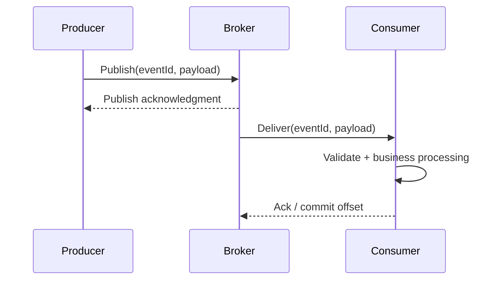
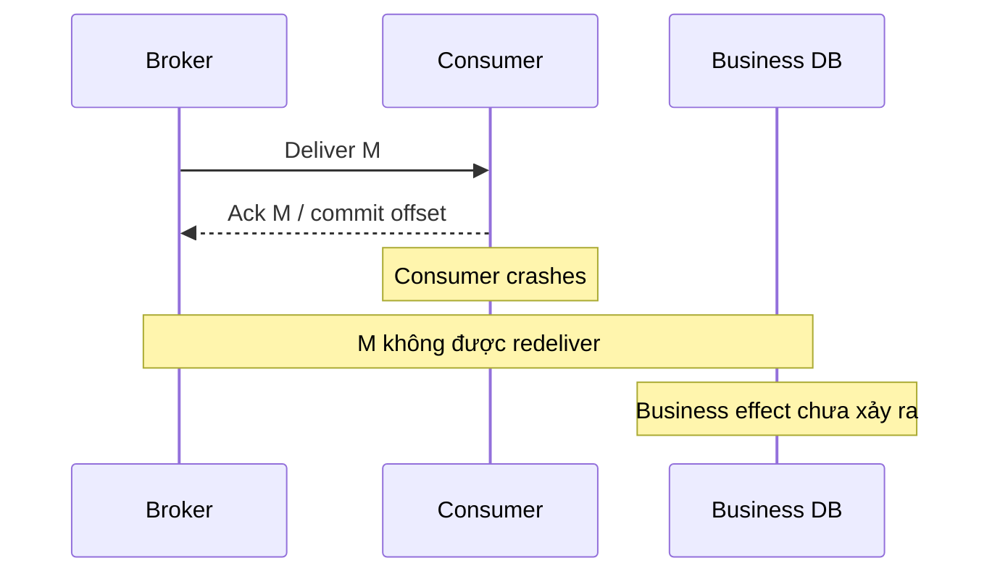
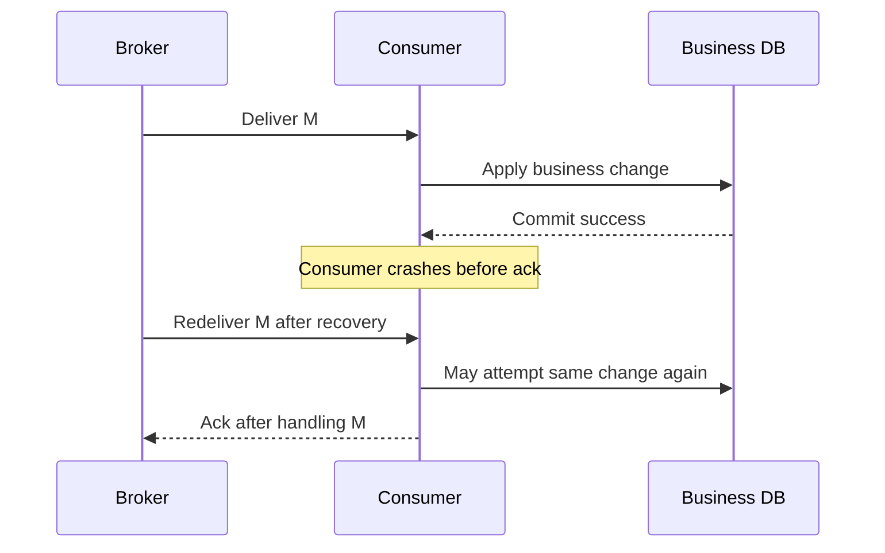
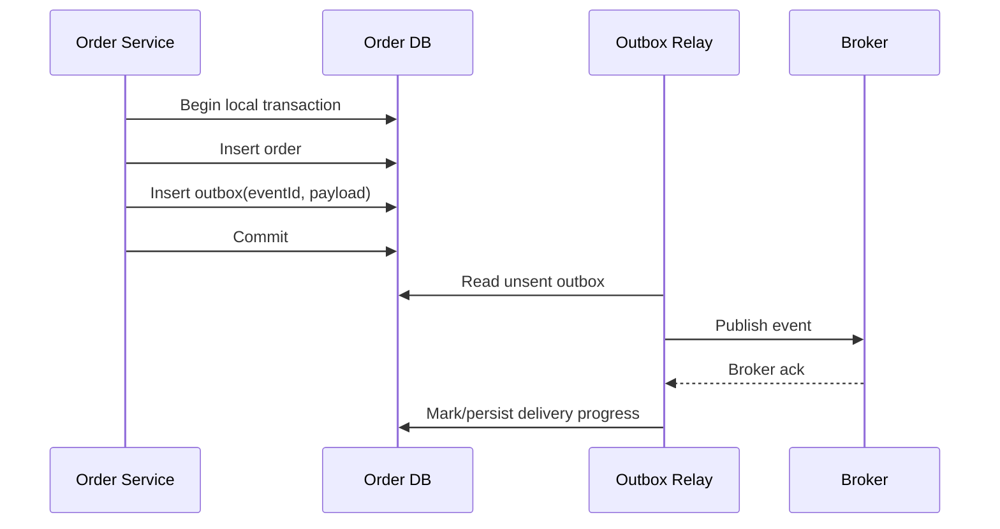
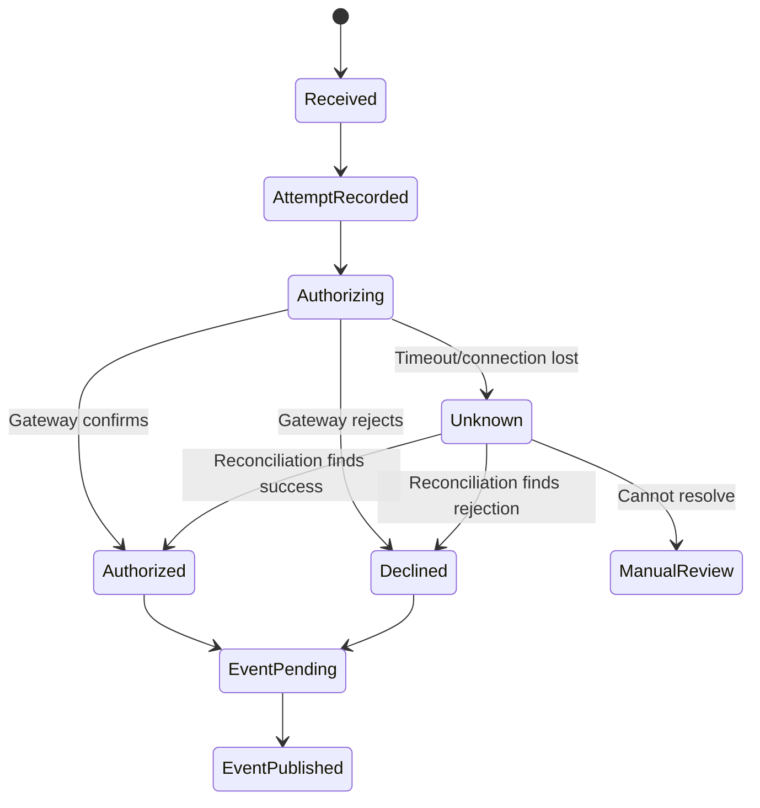

# Ngữ nghĩa phân phối At-Most-Once và At-Least-Once trong giao tiếp bất đồng bộ

## 1. Bối cảnh và mục tiêu

Trong kiến trúc microservices, một dịch vụ có thể phát thông điệp đến message broker để dịch vụ khác xử lý sau. Cách giao tiếp này giúp giảm phụ thuộc đồng bộ, làm phẳng đỉnh tải và hỗ trợ những quy trình kéo dài. Tuy nhiên, việc gửi thông điệp qua mạng luôn có các tình huống không chắc chắn: producer gửi xong nhưng không nhận được xác nhận, consumer xử lý xong rồi mất kết nối trước khi xác nhận, broker khởi động lại hoặc consumer nhận một thông điệp nhiều lần.

Vì vậy, khi thiết kế giao tiếp bất đồng bộ, cần xác định **ngữ nghĩa phân phối (delivery semantics)**: một thông điệp có thể được cố gắng giao cho consumer bao nhiêu lần trong phạm vi và các điều kiện được hệ thống cam kết.

Hai ngữ nghĩa thường gặp là:

- **At-most-once — tối đa một lần:** hệ thống không cố giao lại cùng một thông điệp theo cơ chế đã xét sau khi lần giao/tiêu thụ được ghi nhận. Thông điệp có thể không đến hoặc không được xử lý thành công.
- **At-least-once — ít nhất một lần:** hệ thống có thể giao lại nếu chưa chắc lần trước đã được xử lý/xác nhận. Khi các điều kiện về lưu trữ, retry, thời hạn giữ thông điệp và khả năng phục hồi được đáp ứng, nó hướng tới việc thông điệp cuối cùng được giao ít nhất một lần, nhưng **có thể bị giao trùng**.

Điều quan trọng hơn thuật ngữ là phân biệt **giao thông điệp**, **xử lý nghiệp vụ** và **tác dụng phụ bên ngoài**. At-least-once không tự bảo đảm một đơn hàng chỉ được tạo một lần hoặc khách chỉ bị trừ tiền một lần.

### Kết quả cần đạt

Sau bài này, người đọc có thể:

1. Giải thích sự khác nhau giữa at-most-once và at-least-once, cùng hệ quả mất hoặc trùng thông điệp.
2. Xác định ảnh hưởng của thời điểm acknowledgment/commit offset khi consumer gặp sự cố.
3. Hiểu vai trò của producer retry, độ bền broker, thời hạn lưu thông điệp và consumer idempotency.
4. Chọn ngữ nghĩa theo rủi ro nghiệp vụ, khả năng xử lý lặp và chi phí vận hành.
5. Thiết kế luồng consumer có local transaction, deduplication/inbox, retry, dead-letter và đối soát.
6. Tránh nhầm ngữ nghĩa phân phối của broker với bảo đảm exactly-once của toàn business workflow.

## 2. Mô hình cơ bản: Producer → Broker → Consumer

Một sơ đồ tối giản:



Các bước này không phải một transaction nguyên tử duy nhất.

- **Producer** tạo thông điệp, có thể chờ broker xác nhận đã chấp nhận hoặc ghi bền vững thông điệp.
- **Broker** giữ và phân phối thông điệp theo các cam kết cấu hình, ví dụ persistence, replication và retention.
- **Consumer** nhận, xử lý rồi xác nhận đã tiêu thụ, hoặc không xác nhận khi xảy ra lỗi.
- **Nguồn dữ liệu nghiệp vụ** có thể là database riêng của consumer; broker không tự biết transaction trong database đã commit hay chưa.
- **Tác dụng phụ ngoài hệ thống**, như gửi email hoặc gọi payment gateway, có thể thành công trước khi consumer gửi acknowledgment.

Một lỗi mạng có thể xảy ra **giữa bất kỳ hai bước nào**. Chính các “khoảng hở không nguyên tử” quyết định hệ thống có khả năng mất hay giao trùng thông điệp.

## 3. Hiểu đúng ba tầng bảo đảm khác nhau

Trong tài liệu kiến trúc nên ghi rõ **cam kết đang nói tới tầng nào**:

| Tầng | Câu hỏi thực sự | Ví dụ |
| --- | --- | --- |
| Producer → Broker | Broker có nhận và lưu được thông điệp không? Producer có retry không? | Publish OrderPlaced, chờ broker ack |
| Broker → Consumer | Nếu consumer chết trước khi ack, thông điệp có được giao lại không? | Consumer nhận message, xử lý rồi basicAck hoặc commit offset |
| Consumer → Business effect | Cùng một thông điệp đến hai lần có tạo tác dụng phụ hai lần không? | Hai lần trừ tồn kho, gửi hai email, charge hai lần |

Một hệ thống có thể dùng **at-least-once delivery** từ broker nhưng đạt **effectively-once business effect** cho một loại thao tác nhờ idempotency và transaction cục bộ. Ngược lại, broker không giao trùng vẫn không cứu được lỗi producer phát hai sự kiện khác ID cho cùng một yêu cầu nghiệp vụ, hoặc người dùng nhấn “Thanh toán” hai lần.

Do đó, cần tách ba khái niệm:

- **Message identity:** cùng một bản tin logic được nhận lại, giữ nguyên eventId/messageId.
- **Business operation identity:** cùng một yêu cầu hoặc tác vụ nghiệp vụ, ví dụ paymentRequestId, reservationId, orderId + operationType.
- **Delivery attempt identity:** từng lần broker thực tế gửi đến consumer, có thể có attempt number hoặc delivery tag khác nhau.

Hai eventId khác nhau vẫn có thể đại diện cho **cùng một thao tác nghiệp vụ** nếu upstream phát trùng. Deduplication theo eventId và idempotency theo business key giải quyết các nhóm lỗi khác nhau.

## 4. At-most-once: có thể mất, không chủ động giao lại

### 4.1. Định nghĩa có điều kiện

At-most-once có nghĩa rằng trong phạm vi cơ chế giao thông điệp đang xét, **một thông điệp được giao hoặc thử xử lý tối đa một lần**. Nếu xảy ra sự cố sau khi cơ chế đánh dấu thông điệp đã tiêu thụ, không có redelivery để bù lại.

Cách thực hiện phổ biến:

- Consumer xác nhận/commit offset **trước** khi hoàn tất xử lý.
- Hoặc broker loại bỏ thông điệp ngay khi giao, không có cơ chế acknowledgment/requeue phù hợp.
- Hoặc producer không retry khi gửi không thành công/không rõ kết quả, với đánh đổi có thể làm mất thông điệp.

At-most-once không phải lời hứa rằng **mỗi nghiệp vụ sẽ chỉ chạy một lần trong toàn hệ thống**. Nếu producer tạo hai bản tin độc lập từ cùng một thao tác, consumer vẫn có thể thấy hai bản tin. Nó chỉ nói về giới hạn phân phối theo phạm vi, định danh và cơ chế được định nghĩa.

### 4.2. Timeline: ack trước, xử lý sau



Nếu consumer crash sau ack nhưng trước khi ghi dữ liệu, **thông điệp có thể mất về mặt nghiệp vụ**. Broker đã ghi nhận việc tiêu thụ nên không tự giao lại.

Tương tự, nếu xử lý thất bại do bug, consumer đã ack trước thì không còn cơ hội tự động xử lý lại, trừ khi ứng dụng có hệ thống lưu trữ/replay độc lập.

### 4.3. Khi nào at-most-once có thể chấp nhận?

- Metrics, telemetry hoặc log có tần suất cao, cho phép mất vài điểm dữ liệu.
- Cập nhật UI không thiết yếu và nguồn dữ liệu có thể được refresh lại.
- Thông báo trạng thái thoáng qua, chẳng hạn vị trí con trỏ hay “đang gõ”, trong môi trường có thể chịu mất.
- Những sự kiện có thể tái tạo đầy đủ từ nguồn dữ liệu chính và việc mất một bản tin không phá invariant.

**Không nên mặc định dùng at-most-once** cho giao dịch tài chính, đơn hàng, điều chỉnh tồn kho, cấp quyền hoặc tác vụ bắt buộc có audit trail. Ở những trường hợp đó, mất thông điệp có thể tạo ra trạng thái nghiệp vụ sai mà không được phát hiện.

### 4.4. Đánh đổi

Ưu điểm thường gặp: đường xử lý đơn giản, ít redelivery/retry, phù hợp dữ liệu có giá trị thấp. Nhưng “không có duplicate do redelivery” phải đánh đổi với **nguy cơ bỏ sót**.

At-most-once không bảo đảm thấp latency trong mọi trường hợp, cũng không tự bảo đảm độ chính xác. Chi phí thấp hay cao phụ thuộc loại broker, dữ liệu, volume và cách giám sát.

## 5. At-least-once: ưu tiên không bỏ sót, chấp nhận trùng

### 5.1. Định nghĩa có điều kiện

At-least-once cho phép **giao lại** một thông điệp khi hệ thống chưa nhận được xác nhận xử lý đáng tin cậy. Mục tiêu là thông điệp cuối cùng được giao ít nhất một lần, miễn là broker còn giữ được nó, chưa hết retention/TTL hoặc retry policy, consumer/broker có thể khôi phục và không tồn tại lỗi vĩnh viễn không được xử lý.

Từ “at-least-once” **không nên hiểu như bảo đảm tuyệt đối vô hạn**. Một thông điệp bị xóa do retention, DLQ policy, lỗi lưu trữ không thể phục hồi hoặc mất trước khi broker xác nhận nhận bền vững vẫn có thể không đi đến business effect mong muốn.

### 5.2. Timeline: xử lý trước, ack sau



**Khoảng hở quan trọng:** database đã commit, nhưng broker không nhìn thấy acknowledgment. Broker phải giả định consumer chưa xử lý và có thể giao lại. Nếu logic nghiệp vụ không idempotent, cùng tác dụng phụ có thể được thực hiện lần thứ hai.

Đây không phải bug của broker. Đó là **hành vi đúng theo ngữ nghĩa at-least-once** trước một tình huống không thể phân biệt “chưa xử lý” với “đã xử lý nhưng ack bị mất”.

### 5.3. Nguyên tắc cốt lõi

Với at-least-once:

1. **Giữ message identity ổn định** qua retry/redelivery.
2. **Không ack trước khi durable business processing hoặc ghi nhận xử lý có thể phục hồi hoàn tất.**
3. **Consumer phải idempotent**, hoặc có cơ chế nhận diện trùng gắn với transaction.
4. **Retry có kiểm soát** với backoff, giới hạn, phân loại lỗi và khả năng chuyển DLQ.
5. **Có phương án đối soát** đối với những bước liên quan external side effect.
6. **Có observability** về retry, consumer lag, age, DLQ, duplicate và lỗi xử lý.

## 6. Bảng so sánh At-Most-Once và At-Least-Once

| Tiêu chí | At-most-once | At-least-once |
| --- | --- | --- |
| Mục tiêu chính | Tránh redelivery một bản tin theo phạm vi cấu hình | Tránh bỏ sót bằng cách cho phép redelivery |
| Thông điệp có thể mất? | Có | Vẫn có nếu vi phạm điều kiện bảo đảm/retention hoặc có lỗi không phục hồi |
| Thông điệp có thể giao trùng? | Không do cơ chế redelivery trong phạm vi đang xét | Có, và phải xem là bình thường |
| Ack/commit offset | Thường trước khi xử lý xong | Sau khi xử lý bền vững |
| Consumer crash sau khi nhận | Có thể làm mất message | Thường dẫn tới redelivery nếu chưa ack |
| Yêu cầu idempotency | Vẫn hữu ích để chống producer duplicate | Rất quan trọng để tránh effect trùng |
| Chi phí vận hành | Có thể thấp hơn, ít replay | Cần retry, deduplication, DLQ và theo dõi |
| Dữ liệu phù hợp | Telemetry không bắt buộc chính xác từng điểm | Nhiều domain events, command và workflow quan trọng |
| Hệ quả nổi bật | Dữ liệu bị thiếu | Xử lý lặp nếu không có cơ chế bảo vệ |

**Lựa chọn không có nghĩa chọn giữa “an toàn” và “không an toàn” theo một nhãn duy nhất.** Cần đánh giá mất dữ liệu hay xử lý trùng gây hậu quả gì, có thể đối soát hay không và ngân sách vận hành.

## 7. Bốn thời điểm crash cần nhớ

Xét một consumer nhận message M, cập nhật database và gửi ack.

| Sự cố | Nếu ack trước xử lý | Nếu ack sau commit |
| --- | --- | --- |
| Crash trước khi nhận M | Tùy broker còn giữ M | Tùy broker còn giữ M |
| Crash sau khi nhận nhưng trước khi DB commit | M có thể mất nếu ack đã được ghi nhận | M có thể giao lại |
| DB commit rồi crash trước ack | Nếu ack đã ghi nhận: không redeliver | M có thể giao lại: **phải idempotent** |
| Ack thành công rồi crash | Không redeliver | Không redeliver; business effect cần đã bền vững |

Với commit offset Kafka, cần nhớ offset ghi nhận **tiến độ tiêu thụ của group**, không phải transaction trong database bên ngoài. Với AMQP/RabbitMQ, manual ack xác nhận việc xử lý delivery theo channel, nhưng không tự commit transaction ở database của ứng dụng.

Một câu hỏi kiểm tra thiết kế hữu ích:

> “Nếu database đã thay đổi rồi mà consumer chết trước khi broker biết điều đó, lần chạy tiếp theo có làm điều nguy hiểm không?”

Nếu câu trả lời là “có thể trừ tiền hoặc tồn kho lần nữa”, hệ thống chưa an toàn để xử lý at-least-once ở quy trình đó.

## 8. Producer cũng có thể tạo trùng hoặc mất thông điệp

Phân phối không chỉ là chuyện consumer. Producer và broker có các điểm bất định riêng.

### 8.1. Không retry khi publish không rõ kết quả

Producer gửi message tới broker; mạng timeout trước khi producer nhận ack. Hai tình huống đều có thể xảy ra:

- Broker **chưa nhận hoặc chưa ghi** message.
- Broker **đã nhận và ghi**, nhưng ack trả về bị mất.

Nếu producer quyết định không retry, có thể bỏ sót message. Nếu retry ngay, có thể tạo message trùng, tùy broker/producer có hỗ trợ idempotent publishing và phạm vi bảo đảm hay không.

### 8.2. Retry publish và giữ business/event identity

Khi dùng retry, không tạo eventId mới cho mỗi lần gửi của **cùng một sự kiện logic**, trừ khi semantics thực sự xem đó là sự kiện mới. Việc giữ eventId, aggregateId, version và một business key phù hợp giúp consumer nhận diện bản tin trùng.

Một hệ thống publish có thể kết hợp:

- Broker producer acknowledgment đủ mạnh cho yêu cầu độ bền.
- Replication/persistence thích hợp.
- Producer idempotence nếu công nghệ hỗ trợ.
- Transactional outbox để tránh “DB commit nhưng message chưa publish”.
- Retry với backoff và quan sát lỗi vĩnh viễn.

Mỗi cơ chế xử lý một khoảng hở khác nhau; một cơ chế không tự thay thế những cơ chế còn lại.

### 8.3. Transactional outbox

Tình huống thường gặp:

1. Order service ghi đơn hàng vào DB.
2. Order service publish OrderPlaced.
3. App crash giữa hai bước.

Nếu DB commit thành công nhưng publish chưa xảy ra, downstream không biết về đơn mới. Nếu publish trước rồi DB rollback, downstream lại thấy một đơn không tồn tại.

Outbox giải quyết khoảng hở **trong cùng database transaction**:



Relay có thể crash sau khi broker nhận nhưng trước khi đánh dấu bản ghi outbox đã phát; nó có thể publish lại **cùng một event**. Vì vậy outbox kết hợp tự nhiên với **at-least-once publishing** và consumer idempotency.

Không diễn giải outbox như bảo đảm exactly-once end-to-end. Nó bảo đảm thay đổi nghiệp vụ và ý định phát thông điệp được lưu cùng nhau khi cùng local transaction, còn quá trình relay vẫn có thể thực hiện nhiều lần.

## 9. Consumer idempotency: cùng message, kết quả nghiệp vụ không đổi

### 9.1. Định nghĩa

Một thao tác được gọi là **idempotent** nếu việc áp dụng lại theo cùng định danh và điều kiện không làm thay đổi hiệu ứng nghiệp vụ sau lần thành công đầu tiên.

Ví dụ:

- “Đặt trạng thái đơn O-123 thành CONFIRMED nếu đang PENDING” có thể được thiết kế idempotent.
- “Giảm tồn kho đi 2 đơn vị” **không** idempotent nếu thực hiện lại không có bảo vệ.
- “Ghi nhận reservation R-100 một lần” có thể idempotent khi có unique constraint và transaction phù hợp.
- “Gửi email” là một external side effect; không trở thành idempotent chỉ vì listener có kiểm tra một flag đơn giản.

Cần phân biệt:

- **Idempotency by state:** kiểm tra state machine, version hoặc điều kiện cập nhật.
- **Idempotency by key:** lưu messageId hoặc businessOperationId đã xử lý.
- **Idempotency by external provider:** truyền idempotency key tới cổng thanh toán hay API ngoài nếu họ hỗ trợ.

### 9.2. Định danh phải ổn định và đúng phạm vi

EventId có thể dùng để chống xử lý trùng cùng event. Nhưng nếu hai event khác ID đều chứa command “reserve 2 units for reservation R-100”, chỉ dedup eventId vẫn có thể tạo hai reservation. Khi đó cần unique constraint theo **reservationId**, tức định danh thao tác nghiệp vụ.

Một khóa idempotency tốt cần:

1. Phân biệt hai thao tác thực sự khác nhau.
2. Giữ nguyên qua retry/redelivery của cùng thao tác.
3. Có phạm vi rõ: tenant, consumer, aggregate hoặc business operation.
4. Có chính sách TTL/retention phù hợp thời gian có thể nhận trùng.
5. Không để payload thay đổi dưới cùng một khóa mà vẫn bị coi là yêu cầu giống hệt, nếu điều đó có thể gây lỗi.

Ví dụ dùng (tenantId, reservationId) làm khóa duy nhất cho yêu cầu giữ hàng; nếu nhận lại với quantity khác, trả lỗi xung đột hoặc cần quy tắc reconciliation cụ thể, không âm thầm bỏ qua.

### 9.3. Transactional inbox / processed_messages

Cách phổ biến để xử lý at-least-once trên database quan hệ:

- Có bảng ghi nhận thông điệp đã xử lý, với khóa duy nhất theo consumer và messageId.
- Trong **cùng local transaction** với cập nhật nghiệp vụ, ghi dấu message đã xử lý.
- Nếu một bản tin trùng đến, unique constraint xác định đã xử lý và không lặp business effect.
- Chỉ ack broker **sau khi transaction commit thành công**.

Lược đồ minh họa:

```sql
CREATE TABLE processed_message (
    consumer_name VARCHAR(100) NOT NULL,
    message_id    VARCHAR(150) NOT NULL,
    processed_at  TIMESTAMP NOT NULL DEFAULT CURRENT_TIMESTAMP,
    PRIMARY KEY (consumer_name, message_id)
);

CREATE TABLE reservation (
    reservation_id VARCHAR(150) PRIMARY KEY,
    sku            VARCHAR(100) NOT NULL,
    quantity       INTEGER NOT NULL,
    status         VARCHAR(30) NOT NULL
);
```

Ở đây unique constraint trên processed_message giải quyết **trùng delivery**; unique constraint trên reservation giải quyết **trùng business command**. Đó là hai tầng bảo vệ bổ sung nhau.

## 10. Luồng xử lý at-least-once an toàn với database

### 10.1. Pseudocode độc lập framework

```text
function onMessage(message):
    validate message identity, schema and business key

    begin local DB transaction
        try insert processed_message(consumerName, messageId)
        if insert says "duplicate":
            rollback/finish duplicate path safely
            ack message
            return

        load business aggregate with appropriate concurrency control
        validate state transition / business operation idempotency
        apply business change
        persist aggregate and any outgoing outbox events
    commit local DB transaction

    ack message
```

Pseudocode này minh họa ý tưởng, chưa thể hiện toàn bộ nhánh lỗi. Trong nhiều database, **unique constraint violation khiến transaction hiện tại bị đánh dấu failed**; không được tiếp tục thực hiện SQL như thể giao dịch vẫn bình thường. Có thể dùng cách insert-if-not-exists/ON CONFLICT DO NOTHING (theo database), rollback rồi đọc lại, hoặc chiến lược xử lý exception ở transaction riêng phù hợp.

Những yêu cầu kỹ thuật quan trọng:

- Không xử lý business change rồi mới đánh dấu dedup **ở transaction khác**.
- Không chỉ kiểm tra tồn tại bằng SELECT rồi INSERT mà không có unique constraint; hai consumer đồng thời có thể cùng thấy “chưa xử lý”.
- Không ack broker trước local commit.
- Với external side effect, lưu **ý định gọi ngoài** bằng outbox/command record rồi thực thi riêng; không thể rollback nhà cung cấp ngoài bằng rollback database.
- Khi ghi nhận duplicate, chỉ ack nếu chứng cứ durable cho thấy **đã xử lý thành công** hoặc workflow đang được tiếp tục an toàn; không nhầm “đang xử lý” với “đã xong”.

### 10.2. Ví dụ Java/Spring Boot: service xử lý transactional

Đoạn ví dụ sau dùng ý tưởng SQL insert-if-absent cho bảng processed_message (adapter hiện thực bằng cơ chế hỗ trợ ở database). Consumer vẫn nhận message thông qua listener.

```java
public record StockReservedEvent(
    String eventId,
    String reservationId,
    String sku,
    int quantity
) {}

public interface ProcessedMessageStore {
    // Trả true khi đã insert duy nhất trong transaction hiện tại.
    // Trả false khi (consumer, eventId) đã tồn tại.
    boolean tryInsert(String consumer, String eventId);
}

public interface ReservationRepository {
    boolean existsByReservationId(String reservationId);
    void create(String reservationId, String sku, int quantity);
}

@Service
public class StockReservationHandler {
    private static final String CONSUMER = "fulfillment";

    private final ProcessedMessageStore processed;
    private final ReservationRepository reservations;

    public StockReservationHandler(
        ProcessedMessageStore processed,
        ReservationRepository reservations
    ) {
        this.processed = processed;
        this.reservations = reservations;
    }

    @Transactional
    public void handle(StockReservedEvent event) {
        boolean firstDelivery = processed.tryInsert(
            CONSUMER, event.eventId());

        if (!firstDelivery) {
            return; // Đã commit thành công từ lần xử lý trước.
        }

        if (!reservations.existsByReservationId(
                event.reservationId())) {
            reservations.create(
                event.reservationId(),
                event.sku(),
                event.quantity());
        }
    }
}
```

**Điều kiện để ví dụ có ý nghĩa:** processed và reservations phải dùng **cùng transaction manager và nguồn lưu trữ hỗ trợ atomic commit**; bảng reservation có unique constraint trên reservationId; lỗi xung đột request/payload phải được xác định chính sách xử lý. Một SELECT existsByReservationId không thay thế unique constraint hoặc kiểm soát concurrency.

Nếu nghiệp vụ không chỉ “create once” mà còn có nhiều trạng thái, nên dùng state machine và optimistic locking để bảo vệ các transition hợp lệ, không đơn giản “nếu tồn tại thì bỏ qua” trong mọi trường hợp.

### 10.3. Adapter nhận message và acknowledgment

```text
onBrokerDelivery(envelope, ackHandle):
    event = deserializeAndValidate(envelope)

    try:
        transactionalHandler.handle(event)
        ackHandle.ack()          // chỉ sau khi handle commit
    catch TransientFailure:
        retryOrNackWithBackoff()
    catch PermanentBusinessOrSchemaFailure:
        sendToDLQWithEvidenceThenAckOrNackAccordingToPolicy()
```

Cần biết semantics cụ thể của broker và framework:

- Một số listener container chỉ ack khi method return thành công; một số dùng manual ack.
- Message batch có thể chia sẻ offset/range; commit tiến độ sai thứ tự có thể làm mất những message chưa xử lý.
- Nếu consumer có nhiều luồng và xử lý song song, phải quản lý thứ tự, partition ownership và ack position cẩn thận.
- Không coi “đã gọi ack()” là broker chắc chắn đã ghi nhận; mất kết nối có thể làm message được redeliver.

**Ack sau commit không tự loại bỏ duplicate**. Nó chuyển ưu tiên từ “có thể mất” sang “có thể trùng”, do đó phải kết hợp idempotency.

## 11. Kafka: commit offset ảnh hưởng như thế nào?

Apache Kafka thường theo dõi tiến độ consumer group bằng offset theo topic-partition. Với một consumer đọc nhiều record từ partition, việc commit offset N có nghĩa group xem những record trước N là đã được tiêu thụ theo ngữ nghĩa của ứng dụng.

### 11.1. At-most-once trên Kafka

Một cách điển hình là **commit offset trước khi xử lý record**:

```text
poll records
commit offsets covering those records
process records
```

Nếu crash sau commit trước xử lý, record không tự được đọc lại bởi group từ offset đã commit. Điều này tạo at-most-once theo phạm vi group/partition/offset được xét. Mất thông điệp về mặt nghiệp vụ là đánh đổi có chủ ý.

Tự động commit offset theo chu kỳ **không bảo đảm at-most-once hoặc at-least-once đúng như ý muốn nếu code không kiểm soát thời điểm xử lý và commit**. Cần xem cấu hình, vị trí poll, xử lý batch và commit thực tế.

### 11.2. At-least-once trên Kafka

Một cách điển hình:

```text
poll records
for each record in ordered processing scope:
    perform durable processing
commit offset after successful processing
```

Nếu consumer crash trước khi commit offset, các record đã xử lý nhưng chưa ghi nhận tiến độ có thể được đưa tới consumer khác trong cùng group sau rebalance, hoặc tới chính consumer đó sau khởi động lại.

Điểm cần lưu ý:

- Offset **N+1** thường được commit sau khi đã xử lý thành công record có offset N trong partition; tránh off-by-one.
- Với batch, không commit vượt qua record chưa xử lý hoặc record thất bại mà không có chính sách bù.
- Khi rebalance, consumer có thể mất quyền sở hữu partition; cần xử lý pending work/ack theo cơ chế framework.
- Với xử lý song song, offset không thể tùy tiện commit chỉ vì một record phía sau đã xong trong khi record phía trước còn lỗi.
- Kafka retention, compaction, broker durability và cấu hình producer ảnh hưởng khả năng khôi phục, nằm ngoài riêng logic commit offset.

### 11.3. Kafka producer idempotence và transactions không đồng nghĩa mọi thứ exactly-once

Kafka có cơ chế idempotent producer và transaction hỗ trợ bảo đảm mạnh cho một số pipeline **đọc từ Kafka → xử lý → ghi lại Kafka**, kết hợp với việc commit consumer offsets trong transaction Kafka theo cấu hình phù hợp.

Tuy nhiên:

- Kafka transaction **không tự bao phủ PostgreSQL, email gateway hay API thanh toán bên ngoài**.
- Consumer dùng isolation/read_committed có thể tránh đọc record từ transaction Kafka đã abort trong luồng tương ứng.
- Khi consumer cập nhật database ngoài Kafka, vẫn phải giải quyết transaction boundary, duplicate delivery và idempotency.
- “Exactly once” phải luôn nêu rõ **đối tượng và phạm vi**: record trong topic, state store, database hay một business side effect.

Vì vậy, tránh dùng một câu chung “bật exactly-once ở broker là xong vấn đề trùng giao dịch”.

## 12. RabbitMQ/AMQP: manual ack và redelivery

Trong mô hình queue của RabbitMQ, producer publish message, broker giao cho consumer và consumer xác nhận bằng acknowledgment. Trường hợp cơ bản:

- **Auto-ack:** broker xem delivery đã được chấp nhận mà không đợi business processing hoàn tất. Consumer crash sau khi nhận có thể mất xử lý; phù hợp hơn với trường hợp chấp nhận mất.
- **Manual ack:** consumer chỉ basicAck sau khi công việc thành công. Nếu channel/connection đóng khi còn unacked delivery, message thường được requeue/redeliver theo ngữ nghĩa và cấu hình queue.
- **basicNack/basicReject:** có thể từ chối và chọn requeue hay không; cần chính sách rõ để tránh vòng lặp nạp lại vô hạn.
- **Prefetch:** giới hạn số delivery chưa ack mỗi consumer/channel, ảnh hưởng backpressure và fairness.

Ví dụ minh họa:

```text
delivery = receiveFromQueue()
try:
    durableProcessWithIdempotency(delivery.message)
    basicAck(delivery.deliveryTag)
catch TransientFailure:
    routeForDelayedRetryOrNackAccordingToPolicy()
catch PoisonMessage:
    routeToDeadLetterForInvestigation()
```

Cách dùng requeue, dead-letter exchange, quorum queue, publisher confirms và persistence phụ thuộc cấu hình RabbitMQ thực tế. Không giả định rằng manual ack tự bảo đảm message tồn tại sau mọi loại sự cố broker; độ bền queue/message và replication là phần riêng của thiết kế.

Nếu một consumer nhận cùng message hai lần, **deliveryTag có thể thay đổi giữa các lần giao**. Không dùng deliveryTag làm khóa dedup nghiệp vụ; hãy dùng eventId hoặc businessOperationId trong payload/headers.

## 13. Retry, backoff và dead-letter không được thiếu

### 13.1. Phân loại lỗi

| Loại lỗi | Ví dụ | Hướng xử lý |
| --- | --- | --- |
| Transient infrastructure | DB connection reset, broker tạm mất, HTTP 503 | Retry có backoff và giới hạn, giữ idempotency |
| Permanent invalid payload | Schema không hợp lệ, thiếu trường bắt buộc | Không retry nóng vô hạn; lưu thông tin vào DLQ/nhóm xử lý |
| Business rejection | Không đủ hàng, transition trạng thái không hợp lệ | Ghi nhận kết quả nghiệp vụ, không tự xem là lỗi tạm |
| Unknown outcome | Timeout sau khi gọi gateway; không biết đã charge chưa | Reconcile bằng khóa cũ trước khi hành động lại |
| Programming bug | NullPointerException do dữ liệu hợp lệ ngoài dự kiến | Cách ly message, cảnh báo, sửa code rồi replay có kiểm soát |

**Retry vô hạn** trên cùng message lỗi vĩnh viễn sẽ gây hot loop, nghẽn partition/queue, hao CPU và che khuất message khỏe mạnh.

### 13.2. Retry policy nên chỉ định cụ thể

- Số lần thử tối đa hoặc giới hạn theo thời gian.
- Khoảng chờ tăng dần và jitter để tránh thundering herd.
- Phân biệt lỗi tạm thời với lỗi vĩnh viễn.
- Tác động đến thứ tự message và key/partition.
- Khi hết retry: DLQ, retry topic, quarantine, alert hoặc trạng thái nghiệp vụ cần xử lý.
- Cách replay mà không tạo trùng business effect.
- Timeout và deadline của cả quy trình, không để mỗi tầng retry độc lập vô giới hạn.

### 13.3. Dead-letter queue không phải “đã xử lý xong”

Đưa message sang DLQ chỉ chuyển vấn đề sang một chỗ quản lý được; business effect dự kiến vẫn có thể chưa xảy ra. Cần:

1. Lưu eventId, payload đã xử lý an toàn, lỗi và thời điểm.
2. Gắn correlationId/causationId để truy vết.
3. Giới hạn dữ liệu nhạy cảm và phân quyền truy cập.
4. Có quy trình sửa lỗi, replay và quyết định khi nào bỏ qua hợp lệ.
5. Theo dõi độ tuổi lớn nhất trong DLQ, số message chưa giải quyết và SLA.
6. Sau replay, bảo đảm idempotent consumer tiếp tục tránh xử lý lặp.

Không đánh dấu “exactly once” chỉ vì message đã được ack sau khi đưa DLQ: đó là **kết thúc delivery attempt**, không nhất thiết là hoàn tất nghiệp vụ.

## 14. At-least-once và xử lý side effect bên ngoài

Tính nguyên tử cục bộ có giới hạn.

Ví dụ consumer nhận PaymentRequested:

1. Gọi payment gateway.
2. Gateway đã authorize thành công.
3. Consumer crash trước khi lưu kết quả vào DB và ack.
4. Broker giao lại message.

Nếu listener gọi gateway lần nữa bằng **khóa mới**, khách có thể bị authorization/charge lặp. Kể cả có inbox đánh dấu message xử lý trong DB, nếu đánh dấu trước rồi crash sau khi external call hoặc ngược lại, không thể có một transaction ACID chung tự nhiên bao trùm gateway và DB của bạn.

### 14.1. Thiết kế an toàn hơn

- Tạo **payment attempt ID / idempotency key** ổn định cho một business operation.
- Ghi trạng thái attempt và khóa vào DB trước khi gọi gateway theo quy trình có thể phục hồi.
- Gửi cùng idempotency key qua retry nếu gateway hỗ trợ.
- Khi timeout không rõ kết quả, **query/reconcile theo khóa cũ**, không phát request mới bằng khóa khác.
- Ghi trạng thái PaymentAuthorized/Declined trong local transaction rồi outbox event cho downstream.
- Có chính sách xử lý ngoại lệ khi nhà cung cấp không hỗ trợ idempotency hoặc API tra cứu trạng thái.

### 14.2. Sơ đồ trạng thái minh họa



Điểm then chốt: **Unknown không tương đương Failed**. Nếu không biết gateway đã xử lý hay chưa, tự động “thử lại như một yêu cầu mới” có thể gây tác dụng phụ lặp.

### 14.3. “Exactly-once business effect” cần định nghĩa cụ thể

Với một thao tác ghi thuần database, unique business key và local transaction có thể giúp đạt hiệu ứng một lần dù message đến nhiều lần. Với API ngoài, hiệu ứng một lần phụ thuộc cả vào **idempotency contract của provider** hoặc một cơ chế đối soát.

Nên viết yêu cầu như sau: “Mỗi reservationId chỉ được tạo một reservation hợp lệ; message StockReserveRequested có thể giao lại; consumer dùng unique constraint và transaction.” Cách viết này kiểm chứng được hơn câu “dịch vụ xử lý exactly once”.

## 15. Ordering, concurrency và duplicate liên quan thế nào?

At-least-once/at-most-once là một trục độc lập với **thứ tự xử lý**.

Giả sử có hai events của một đơn:

- OrderConfirmed(version=5).
- OrderCancelled(version=6).

Nếu consumer nhận version 6 trước version 5, bản tin cũ không được đưa trạng thái đơn quay về Confirmed. Cần state machine và version check, hoặc thiết kế partition key/serialization hợp lý.

**Duplicate + out-of-order** có thể xảy ra đồng thời; dedup theo messageId chỉ xử lý duplicate, không tự xử lý thứ tự.

Các kỹ thuật liên quan:

- Partition/group messages theo aggregateId khi cần giữ thứ tự trong phạm vi partition.
- Dùng version/sequence number và optimistic concurrency.
- Bảo vệ transition theo state machine.
- Buffer hoặc loại bỏ stale messages theo chính sách.
- Với consumer song song, tránh commit/ack vượt các message trước chưa thành công.
- Không giả định broker toàn hệ thống có thứ tự tổng quát; nhiều broker chỉ có ordering trong một phạm vi nhất định.

Cần phân biệt **sự kiện không còn hợp lệ** với **bản tin hỏng**. Một event cũ có thể được bỏ qua an toàn nếu consumer chứng minh trạng thái đã tiến xa hơn, trong khi message có payload lỗi cần quan sát riêng.

## 16. Chọn delivery semantics theo nghiệp vụ

### 16.1. Tình huống A: telemetry không thiết yếu

Một service ghi CPU gauge mỗi vài giây. Mất một điểm đo không làm hỏng nghiệp vụ, có thể lấy điểm mới ngay sau đó.

Có thể dùng at-most-once hoặc pipeline cho phép drop theo sampling/backpressure. Mục tiêu chính là hiệu năng và giới hạn tài nguyên, không phải tái phát mọi điểm đo.

Dù vậy, nếu dữ liệu được dùng cho billing hoặc compliance, giả định “mất một điểm không sao” không còn đúng.

### 16.2. Tình huống B: gửi email thông báo

OrderConfirmed event kích hoạt email:

- Nếu gửi trùng, người dùng khó chịu; nếu mất, có thể mất thông báo quan trọng.
- At-least-once giúp có retry khi provider tạm lỗi.
- Cần unique notification intent theo event/business key, trạng thái gửi và chính sách idempotency của nhà cung cấp nếu có.
- Không có idempotency provider thì vẫn có khoảng hở “email đã gửi nhưng DB chưa ghi”; có thể cần chấp nhận xác suất gửi trùng, dùng reconciliation hoặc giới hạn retry phù hợp.

Đừng tuyên bố “gửi đúng một email” chỉ vì message broker dùng manual ack.

### 16.3. Tình huống C: trừ tồn kho

Inventory consumer nhận ReserveStockRequested(reservationId, sku, quantity).

At-least-once là lựa chọn hợp lý nếu yêu cầu giữ hàng không được bỏ mất. Dùng unique reservationId và local transaction để bảo đảm không trừ tồn hai lần; invariant available >= quantity phải được bảo vệ dưới concurrency bằng atomic conditional update, lock hoặc version.

Nếu không thể giữ hàng, trả business rejection, không retry mãi như lỗi hạ tầng.

### 16.4. Tình huống D: thanh toán và sổ cái

Payment service nên nhận event/command đáng tin cậy, nhưng điều bắt buộc hơn là **business-operation idempotency**, ledger invariants, audit và reconciliation. Chọn at-least-once cho vận chuyển thường chỉ là một phần; DB/payment gateway phải chống xử lý trùng ở nơi phát sinh tác dụng phụ.

### 16.5. Ma trận quyết định

| Nghiệp vụ | Mất thông điệp | Xử lý trùng | Hướng ưu tiên |
| --- | --- | --- | --- |
| Telemetry sampling | Có thể chấp nhận | Có thể gây tăng đếm nếu không xử lý | Có thể cân nhắc at-most-once |
| Cache invalidation | Có thể chấp nhận tùy TTL/rebuild | Thường ít nguy hại | At-least-once hoặc cơ chế tự phục hồi |
| Notification | Có thể gây bỏ sót liên lạc | Có thể gây gửi trùng | At-least-once + dedup intent + chính sách provider |
| Inventory reservation | Nguy hiểm | Nguy hiểm | At-least-once + business key + atomic DB |
| Payment authorization | Nguy hiểm | Rất nguy hiểm | Durable workflow + idempotency + reconciliation |
| Analytics aggregation | Gây sai số | Gây đếm trùng | At-least-once + dedup/version nếu đòi độ chính xác |

Bảng chỉ là **hướng phân tích**, không thay quyết định theo SLA, pháp lý, thời gian lưu trữ, khả năng replay, chi phí sai số và các giao thức cụ thể.

## 17. Quan sát và đo lường delivery semantics

Để biết hệ thống vận hành theo thiết kế, nên theo dõi:

| Chỉ số | Ý nghĩa |
| --- | --- |
| publish_success / publish_error | Tỷ lệ broker chấp nhận message và lỗi producer |
| producer_retry_count | Tần suất gửi lại, dấu hiệu mạng/broker bất ổn |
| delivery_attempt_count | Số lần thử giao tới consumer |
| consumer_processing_success/error | Tỷ lệ xử lý thành công/thất bại |
| duplicate_detected_count | Số message/business key bị dedup; không nên luôn bằng 0 |
| consumer_lag / oldest_message_age | Mức backlog và nguy cơ chậm quá SLA |
| ack/commit failures | Tình trạng không chắc chắn về tiến độ tiêu thụ |
| DLQ depth / oldest_DLQ_age | Công việc đã cách ly chưa được giải quyết |
| retry amplification | Tổng attempts / business operations duy nhất |
| business_invariant_violation | Số trường hợp xử lý trùng gây sai nghiệp vụ |
| reconciliation_backlog | Tác vụ cần đối soát trạng thái chưa rõ |

Một event được xử lý trùng rồi được **bỏ qua an toàn** là dấu hiệu cơ chế idempotency hoạt động, không nhất thiết là lỗi phải làm mọi giá về 0. Mục tiêu là **không có business effect sai**, trong khi vẫn nhìn thấy những sự cố làm tăng redelivery.

### Correlation và logging

Thông điệp nên mang metadata như eventId, eventType, aggregateId, occurredAt, correlationId, causationId, schemaVersion và businessOperationId nếu phù hợp. Tránh lộ token, PII hay payload thanh toán trong log/metric labels.

Log nên phân biệt:

- First delivery, processing committed.
- Duplicate delivery, already processed.
- Transient error, retry scheduled.
- Permanent failure, quarantined/DLQ.
- Unknown external outcome, awaiting reconciliation.

Nhờ vậy, người vận hành biết đang có **duplicate vô hại**, **message thất bại** hay **nghiệp vụ chưa hoàn tất**.

## 18. Kiểm thử tình huống crash và redelivery

Chỉ test luồng thành công là chưa đủ. Cần kiểm thử có chủ đích ở những điểm không nguyên tử.

### 18.1. Các kịch bản thiết yếu

1. **Crash trước khi lưu dữ liệu:** message được redeliver trong at-least-once, nghiệp vụ cuối cùng vẫn hoàn tất.
2. **Crash sau DB commit trước ack:** message nhận lại nhưng không nhân đôi reservation/ledger entry.
3. **Hai consumer nhận cùng business operation:** unique constraint và concurrency control vẫn giữ invariant.
4. **Producer publish timeout sau broker commit:** retry có thể diễn ra; consumer không tạo hiệu ứng trùng.
5. **Schema invalid/poison message:** không tạo vòng retry vô hạn; message được cách ly và có thông báo.
6. **DB lỗi tạm thời:** consumer không ack như thành công; retry sau khôi phục.
7. **Gateway trả Unknown:** quy trình không tạo attempt mới vô điều kiện; đối soát theo khóa cũ.
8. **Out-of-order events:** version/state guard ngăn trạng thái đi lùi.
9. **Consumer rebalance/restart:** xử lý an toàn khi partition/queue ownership đổi.
10. **DLQ replay:** bản tin được chạy lại mà không gây side effect lặp.

### 18.2. Ví dụ bảng kết quả mong muốn

| Test | Delivery attempts | Business effect mong đợi |
| --- | --- | --- |
| Normal processing | 1 | 1 reservation |
| Crash trước commit | Có thể 2+ | Sau phục hồi: 1 reservation |
| Crash sau commit, trước ack | Có thể 2+ | Vẫn chỉ 1 reservation |
| Giao cùng eventId 5 lần | 5 | 1 reservation |
| Hai eventId, cùng reservationId | 2 | 1 reservation hoặc lỗi xung đột có kiểm soát |
| Không đủ hàng | 1 hoặc theo workflow | 0 reservation; business rejection rõ |
| Poison message | Retry hữu hạn | 0 effect; DLQ + cảnh báo |
| Payment timeout không rõ kết quả | Có thể nhiều attempt xử lý message | Không tạo charge mới bằng key mới trước khi đối soát |

Kiểm thử nên dùng công nghệ gần production cho phần transaction/concurrency, ví dụ database thật qua Testcontainers và broker tương ứng trong môi trường kiểm thử. Fake/in-memory hữu ích cho domain rule nhưng không tái hiện đầy đủ locking, broker ack hay network failures.

## 19. Một quy trình thiết kế consumer đáng tin cậy

### Bước 1: Xác định business effect

Viết một câu cụ thể: “Mỗi reservationId chỉ tạo một reservation”, “Mỗi paymentAttemptId tối đa một authorization thực tế theo hợp đồng provider”, hoặc “Mỗi notification intent có một trạng thái xử lý theo chính sách”.

### Bước 2: Chọn message identity và business key

Đảm bảo ID ổn định qua retry. Định nghĩa phạm vi tenant/consumer/operation. Có quy tắc nếu nhận cùng key nhưng payload khác.

### Bước 3: Xác định độ bền và thời hạn

Broker lưu message đến khi nào, retention/TTL ra sao, có replication không, producer xác nhận ở mức nào, có thể replay từ đâu và giới hạn phục hồi bao lâu?

### Bước 4: Chọn ack/offset policy

Nếu yêu cầu at-least-once thì acknowledge sau durable processing; nếu chấp nhận mất và muốn at-most-once, đặt cơ chế tiến độ tương ứng. Với batch/concurrency, xác định rõ ranh giới tiến độ và lỗi.

### Bước 5: Thiết kế local transaction

Dùng unique constraint cho business key, dedup/inbox cho message identity, domain invariant và transaction atomic. Ghi outbound events qua outbox khi cần.

### Bước 6: Xử lý external side effects

Không gọi gateway ngoài bằng khóa mới khi kết quả lần cũ chưa rõ. Dùng idempotency provider, lưu trạng thái bền vững và có reconciliation.

### Bước 7: Thiết kế retry và DLQ

Phân loại transient/permanent, giới hạn attempts, backoff, jitter, retention, replay process và alert. Tham chiếu deadline của toàn workflow.

### Bước 8: Kiểm thử điểm crash

Dừng tiến trình ngay sau DB commit và trước ack; mô phỏng producer ack loss, duplicate, rebalance, out-of-order, DLQ replay và concurrency.

### Bước 9: Đo lường trong vận hành

Theo dõi duplicate rate, retry, backlog, DLQ, reconciliation và số trường hợp vi phạm business invariant. Đảm bảo có runbook khôi phục.

## 20. Các anti-pattern thường gặp

### 20.1. “At-least-once nghĩa là broker không bao giờ mất message”

Sai. Cần xem broker durability, producer ack, retention, policy, DLQ và khả năng phục hồi. Giao lại còn phụ thuộc việc message vẫn tồn tại và consumer cuối cùng xử lý được.

### 20.2. “Ack sau xử lý là exactly-once”

Sai. Crash sau DB commit và trước ack vẫn có thể gây redelivery. Nếu không có idempotency, cùng effect có thể được thực hiện hai lần.

### 20.3. “Đã dedup theo eventId thì mọi thao tác đều an toàn”

Không đủ. Hai eventId khác nhau có thể đại diện cho cùng business command, hoặc effect ngoài hệ thống có một trạng thái chưa rõ. Cần bảo vệ ở cả business key và side-effect boundary.

### 20.4. “SELECT để kiểm tra trùng là đủ”

Không đúng khi có concurrency. Hai tiến trình có thể cùng SELECT không thấy bản ghi rồi cùng ghi. Unique constraint, transaction isolation và xử lý xung đột là lớp bảo vệ thực.

### 20.5. “Retry càng nhiều càng tốt”

Retry không giới hạn làm backlog, duplicate, nóng broker và hệ thống downstream quá tải. Dùng retry budget, backoff, jitter và DLQ/reconciliation.

### 20.6. “Tất cả lỗi đều phải retry”

Payload sai schema hoặc business rejection không tự biến thành thành công sau nhiều lần thử. Phải phân biệt lỗi vĩnh viễn, lỗi nghiệp vụ và lỗi tạm thời.

### 20.7. “Không cần lo mất message vì có event sourcing”

Event sourcing giải quyết lưu sự kiện miền ở một nguồn được thiết kế cho mục tiêu đó, nhưng producer/broker/consumer pipeline vẫn cần cơ chế publish, checkpoint, replay, idempotency và xử lý lỗi. Không tự động bảo đảm mọi external side effect.

### 20.8. “Bật Kafka transactions là database và email cùng đúng một lần”

Transaction Kafka không bao phủ tất cả external systems. Cần xác định biên exactly-once thực tế và xử lý external effects bằng contract riêng.

### 20.9. “Đưa DLQ là hoàn tất nghiệp vụ”

DLQ chỉ là nơi lưu công việc không thể xử lý hiện tại. Nếu invoice chưa tạo hoặc stock chưa giữ thì nghiệp vụ vẫn còn thiếu, trừ khi có quy tắc từ chối/huỷ rõ.

### 20.10. “At-most-once không bao giờ tạo kết quả trùng”

At-most-once theo message delivery không ngăn producer phát hai thông điệp độc lập, hai người dùng gửi cùng lệnh hoặc hai service cạnh tranh tạo effect. Business idempotency vẫn có thể cần.

## 21. Bài tập thực hành

### Bài 1: Phân biệt mất và trùng

Một consumer xử lý OrderConfirmed bằng cách tạo bản ghi invoice rồi ack message.

**Tình huống A:** consumer ack trước khi INSERT invoice, sau đó crash.

**Tình huống B:** consumer INSERT invoice và commit, crash trước ack.

Hãy trả lời:

1. Tình huống nào có nguy cơ mất invoice? Tình huống nào có nguy cơ tạo invoice hai lần?
2. Nếu chuyển sang at-least-once, cần khóa nào để bảo vệ invoice?
3. Có thể dùng unique(orderId, invoiceType) hay một business key khác không? Cần điều kiện về nghiệp vụ nào?
4. Vì sao ghi processed_messages ở transaction khác với INSERT invoice không đủ?

**Gợi ý:** A có nguy cơ mất xử lý; B có thể redeliver sau commit. Nếu invoice có unique business key phù hợp và cả cập nhật/inbox nằm trong local transaction, nhận lại không cần tạo invoice thứ hai.

### Bài 2: Producer timeout

Producer publish PaymentRequested rồi timeout khi chờ broker acknowledgment. Nó không biết broker đã lưu message hay chưa.

Hãy đề xuất:

- Giữ eventId và paymentAttemptId ra sao khi retry?
- Có outbox không, transaction nào ghi outbox?
- Consumer dedup theo eventId hay paymentAttemptId?
- Nếu gateway trả Unknown, bước đối soát và idempotency key là gì?

**Gợi ý:** giữ cùng event identity qua retry cùng một sự kiện; bảo vệ paymentAttemptId như business operation và không đổi khóa khi kết quả bên ngoài chưa rõ.

### Bài 3: Consumer với hai message bị đảo thứ tự

Billing nhận InvoicePaid(version=8) trước InvoiceIssued(version=7). Một message cũ được redeliver thêm hai lần.

Hãy thiết kế state machine/version guard để tránh lùi trạng thái, đồng thời phân biệt event cũ, event trùng và event sai quy tắc cần quan sát.

### Bài 4: Chọn semantics cho ba luồng

Cho ba luồng: “CPU telemetry mỗi giây”, “đặt chỗ khan hiếm”, “gửi email marketing có thể bỏ qua”. Hãy chọn semantics theo chấp nhận mất/trùng, nêu khóa idempotency và chính sách DLQ/retention nếu có. Không có một đáp án chung cho cả ba vì giá trị và hậu quả khác nhau.

## 22. Checklist triển khai trong dự án Microservices

- [ ] Tài liệu nói rõ **tầng** áp dụng ngữ nghĩa: producer→broker, broker→consumer hay business effect.
- [ ] Đã phân tích hậu quả của cả **mất** và **trùng** message.
- [ ] Broker durability, replication, retention và producer acknowledgment phù hợp SLA.
- [ ] Message có eventId ổn định; có businessOperationId khi cần.
- [ ] Producer retry giữ nguyên identity của cùng logical event.
- [ ] Có outbox nếu nghiệp vụ DB commit và phát event phải đi cùng nhau.
- [ ] Consumer ack/commit offset đúng thời điểm cho semantics đã chọn.
- [ ] At-least-once consumer có idempotency bằng unique key và transaction phù hợp.
- [ ] Mọi business invariant vẫn được bảo vệ khi có xử lý đồng thời và nhận trùng.
- [ ] Không nhầm eventId dedup với business-operation dedup.
- [ ] Side effect bên ngoài có idempotency key hoặc reconciliation khả thi.
- [ ] Có retry giới hạn, backoff, jitter, timeout/deadline và chính sách DLQ.
- [ ] Không commit offset vượt record chưa xử lý thành công trong batch/parallel flow.
- [ ] Có version/state guard nếu message có thể đến không đúng thứ tự.
- [ ] Tích hợp logging/tracing/metrics cho duplicate, retry, lag và DLQ.
- [ ] Đã chạy test crash **sau DB commit, trước ack** và test producer retry.
- [ ] Có runbook để replay/khôi phục bản tin mà không lặp business effect.
- [ ] Tuyên bố “exactly once” (nếu có) ghi rõ phạm vi và điều kiện, không suy diễn cho toàn hệ thống.

## 23. Tổng kết

Sự khác biệt cốt lõi là:

- **At-most-once:** ưu tiên tránh redelivery; **có thể bỏ sót** khi xử lý hoặc xác nhận gặp sự cố.
- **At-least-once:** ưu tiên có cơ hội giao lại; **có thể nhận trùng** nếu xử lý xong nhưng acknowledgment không được ghi nhận.

Trong microservices, at-least-once thường được chọn cho nhiều quy trình nghiệp vụ quan trọng, nhưng nó chỉ đáng tin khi có **idempotent consumer, business key ổn định, transaction boundary rõ, producer/outbox phù hợp, retry/DLQ có kiểm soát và reconciliation cho external side effects**. At-most-once có chỗ đứng với dữ liệu không bắt buộc đầy đủ và chi phí redelivery không đáng bỏ ra.

**Thiết kế đúng không bắt đầu bằng việc chọn một nhãn delivery semantics. Nó bắt đầu bằng việc xác định lỗi mất hay xử lý trùng sẽ phá quy tắc nghiệp vụ nào, rồi thiết kế những ranh giới giao dịch và khả năng khôi phục để quy tắc ấy vẫn được giữ.**