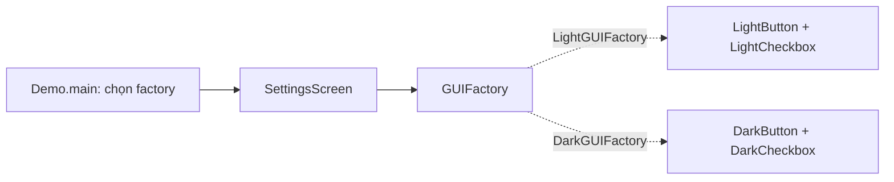

# Phạm vi bài học, kiến thức Java cần có và kết quả học tập mong đợi

## 1. Bài học này đặt nền tảng cho điều gì?

**Abstract Factory** là một mẫu thiết kế khởi tạo (*Creational Design Pattern*) trong lập trình hướng đối tượng. Mẫu này cung cấp một **giao diện để tạo các họ đối tượng có liên quan hoặc phụ thuộc lẫn nhau**, trong khi mã sử dụng sản phẩm không phải chỉ định lớp triển khai cụ thể.

Bài học thuộc chương **Tổng quan** của chủ đề học **Abstract Factory trong Design Pattern**. Mục tiêu ở đây là giúp bạn hiểu **mình sẽ học gì, cần biết Java đến mức nào và phải làm được những gì sau khi học**. Những phần sau đi sâu vào thiết kế hợp đồng, cài đặt, vòng đời và đánh đổi; bạn chưa cần nắm hết các chủ đề đó để bắt đầu.

Một ví dụ gần gũi là ứng dụng có hai bộ giao diện **Light** và **Dark**. Mỗi bộ cần các thành phần phù hợp với nhau, chẳng hạn một `Button` và một `Checkbox`.

| Loại sản phẩm | Họ Light | Họ Dark |
|---|---|---|
| Button | `LightButton` | `DarkButton` |
| Checkbox | `LightCheckbox` | `DarkCheckbox` |

Ứng dụng cần tạo **cả một bộ sản phẩm tương thích**: khi chọn Dark, nút và ô chọn đều phải theo Dark. Thay vì để từng màn hình tự chọn `new DarkButton(...)` hay `new DarkCheckbox(...)`, ta có thể giao trách nhiệm đó cho một `DarkGUIFactory`. Màn hình nhận đối tượng dưới các kiểu chung `Button` và `Checkbox`, nên không cần biết tên lớp thực tế.

Từ ví dụ này, có ba khái niệm nền tảng:

- **Loại sản phẩm (*product type*)**: một vai trò mà client cần, như `Button` hoặc `Checkbox`.
- **Họ sản phẩm (*product family*)**: tập hợp các biến thể được thiết kế để làm việc nhất quán với nhau, như bộ Light hoặc bộ Dark.
- **Factory**: đối tượng đảm nhận việc cung cấp các loại sản phẩm thuộc một họ; factory Light và factory Dark có thể cùng tuân theo một hợp đồng tạo sản phẩm.

**Câu hỏi trung tâm của khóa học:** Làm thế nào để thay toàn bộ họ đối tượng đang dùng mà không phải thay đổi logic của các thành phần sử dụng chúng?

## 2. Phạm vi kiến thức sẽ học

Trong chủ đề này, bạn sẽ đi từ việc nhận diện vấn đề đến triển khai và đánh giá Abstract Factory. Các nhóm kiến thức chính gồm:

| Nhóm nội dung | Bạn sẽ tìm hiểu | Kỹ năng sau khi học |
|---|---|---|
| **Bản chất và động cơ** | Vì sao tạo nhiều sản phẩm liên quan bằng constructor trực tiếp có thể làm client phụ thuộc implementation | Nhận biết khi nào nên cân nhắc Abstract Factory |
| **Cấu trúc và cộng tác** | `AbstractFactory`, `ConcreteFactory`, `AbstractProduct`, `ConcreteProduct`, client và cách chúng tương tác | Giải thích được sơ đồ lớp và đường đi của lời gọi tạo sản phẩm |
| **Thiết kế interface** | Phương thức của factory trả về product interface, contract chung và tính nhất quán của họ | Định nghĩa API tạo sản phẩm an toàn về kiểu |
| **Hiện thực Java** | `interface`, `implements`, `@Override`, constructor, đa hình và tiêm factory cho client | Viết chương trình có từ hai họ sản phẩm trở lên |
| **Tái cấu trúc mã cũ** | Gom thao tác tạo cùng họ vào concrete factory rồi trích xuất abstract factory | Chuyển mã nhiều nhánh `new` sang phụ thuộc abstraction |
| **Vòng đời và tài nguyên** | Tạo mới, chia sẻ, cache, trạng thái mutable và trách nhiệm đóng tài nguyên | Lựa chọn cách quản lý sản phẩm phù hợp |
| **Chi phí và đánh đổi** | Số interface, lớp, factory khi thêm họ hoặc thêm loại sản phẩm | Ước lượng tác động của việc mở rộng cấu trúc |
| **Kiểm thử và thực hành** | Kiểm tra contract, đúng họ, client độc lập với concrete class | Chứng minh thiết kế đáp ứng yêu cầu bằng ví dụ và test |

Những nội dung trên cùng phục vụ một mục tiêu: **giảm phụ thuộc vào lớp cụ thể khi hệ thống cần nhiều họ sản phẩm tương thích**. Abstract Factory không nhằm thay thế mọi constructor hoặc mọi factory đơn lẻ trong chương trình.

### Những điều chưa nằm trong trọng tâm ban đầu

Để giữ đường học rõ ràng, bạn **chưa cần**:

- Nắm chi tiết các thư viện GUI như JavaFX, Swing, Android UI hoặc trình dựng giao diện web.
- Hiểu sâu framework dependency injection như Spring; có thể bắt đầu bằng truyền factory qua constructor.
- Biết trước tất cả mẫu thiết kế GoF. So sánh với Factory Method, Builder hoặc các cách tạo đơn giản sẽ dễ hơn sau khi hiểu Abstract Factory.
- Thành thạo đa luồng, cache phân tán hoặc object pool; chúng là các vấn đề bổ sung khi sản phẩm có trạng thái hoặc tài nguyên phức tạp.
- Tạo một kiến trúc plugin hoàn chỉnh hoặc hệ thống sản xuất quy mô lớn ngay trong bài đầu.

Ví dụ của chủ đề sẽ chủ yếu mô phỏng sản phẩm bằng Java thuần, để việc đánh giá đúng hay sai phụ thuộc vào **hợp đồng và cách tổ chức đối tượng**, không phụ thuộc thư viện bên ngoài.

## 3. Kiến thức Java cần có trước khi bắt đầu

Bạn nên đọc và sửa được mã Java hướng đối tượng đơn giản, biết biên dịch và chạy một lớp có `main`. Bảng sau chia rõ mức độ cần thiết.

| Kiến thức | Mức độ | Cách dùng trong Abstract Factory |
|---|---|---|
| Biến, kiểu dữ liệu, phương thức, điều kiện | **Bắt buộc** | Truyền tham số, xử lý lựa chọn họ sản phẩm |
| Class, object và constructor | **Bắt buộc** | Hiểu `new DarkButton(...)` thực sự khởi tạo gì |
| `interface` và `implements` | **Bắt buộc** | Định nghĩa `GUIFactory`, `Button`, `Checkbox` và lớp triển khai |
| `@Override` và chữ ký phương thức | **Bắt buộc** | Kiểm tra concrete factory/product hiện thực đúng contract |
| Đa hình (*polymorphism*) | **Bắt buộc** | Gán `new DarkGUIFactory()` cho biến kiểu `GUIFactory` |
| `private`, `final` và đóng gói | **Nên biết** | Giữ chi tiết triển khai và trạng thái của product |
| Truyền phụ thuộc qua constructor | **Nên biết** | Client nhận factory thay vì tự tạo concrete product |
| Ngoại lệ như `IllegalArgumentException` | **Nên biết** | Quy định cách xử lý cấu hình hoặc đầu vào không hợp lệ |
| `record`, `enum`, `switch expression` | **Có thể học thêm** | Rút gọn mô hình dữ liệu và chọn factory trong Java hiện đại |
| Generics, collections, thread safety | **Chưa bắt buộc** | Có ích khi thiết kế cache, registry hoặc quản lý tài nguyên về sau |

### Tự kiểm tra ba kiến thức quan trọng nhất

**Một: phân biệt class và interface.** Bạn cần hiểu `Button` có thể mô tả khả năng sử dụng sản phẩm, còn `DarkButton` cài đặt khả năng đó:

```java
interface Button {
    String render();
}

final class DarkButton implements Button {
    @Override
    public String render() {
        return "Dark button";
    }
}
```

**Hai: hiểu đa hình.** Lời gán dưới đây hợp lệ vì `DarkButton` triển khai `Button`:

```java
Button button = new DarkButton();
System.out.println(button.render()); // Dark button
```

Biến `button` có **kiểu khai báo** là `Button`; đối tượng thực tế có **kiểu runtime** là `DarkButton`. Phương thức `render()` được gọi theo implementation của đối tượng.

**Ba: hiểu constructor injection ở mức cơ bản.** Client có thể nhận một interface thông qua constructor:

```java
final class Screen {
    private final Button button;

    Screen(Button button) {
        this.button = button;
    }

    void show() {
        System.out.println(button.render());
    }
}

// Một thành phần bên ngoài chọn implementation:
Screen screen = new Screen(new DarkButton());
screen.show();
```

Trong Abstract Factory, ý tưởng tương tự được áp dụng cho **factory**: thay vì truyền sẵn một nút, client có thể nhận một `GUIFactory` để yêu cầu nhiều sản phẩm thuộc cùng họ khi cần.

Nếu bạn thấy còn khó ở ba ví dụ nhỏ này, nên ôn lại interface, constructor và đa hình trước khi viết một factory có nhiều phương thức.

## 4. Ví dụ nhập môn: hai họ sản phẩm, một client

Ví dụ sau đủ để chạy độc lập với **Java 17+**. Nó dùng `Button` và `Checkbox` làm **AbstractProduct**, `GUIFactory` làm **AbstractFactory**, hai concrete factory tạo hai họ Light/Dark và `SettingsScreen` làm client.

Đặt toàn bộ đoạn mã vào file **`Demo.java`**:

```java
// AbstractProduct A
interface Button {
    String render();
}

// AbstractProduct B
interface Checkbox {
    String render();
}

// AbstractFactory
interface GUIFactory {
    Button createButton(String text);
    Checkbox createCheckbox(boolean checked);
}

// ConcreteProducts thuộc họ Light
record LightButton(String text) implements Button {
    @Override
    public String render() {
        return "Light button: " + text;
    }
}

record LightCheckbox(boolean checked) implements Checkbox {
    @Override
    public String render() {
        return "Light checkbox: " + checked;
    }
}

// ConcreteProducts thuộc họ Dark
record DarkButton(String text) implements Button {
    @Override
    public String render() {
        return "Dark button: " + text;
    }
}

record DarkCheckbox(boolean checked) implements Checkbox {
    @Override
    public String render() {
        return "Dark checkbox: " + checked;
    }
}

// Mỗi ConcreteFactory tạo đủ các loại sản phẩm của cùng họ
final class LightGUIFactory implements GUIFactory {
    @Override
    public Button createButton(String text) {
        return new LightButton(text);
    }

    @Override
    public Checkbox createCheckbox(boolean checked) {
        return new LightCheckbox(checked);
    }
}

final class DarkGUIFactory implements GUIFactory {
    @Override
    public Button createButton(String text) {
        return new DarkButton(text);
    }

    @Override
    public Checkbox createCheckbox(boolean checked) {
        return new DarkCheckbox(checked);
    }
}

// Client chỉ dùng abstraction, không biết tên concrete products
final class SettingsScreen {
    private final GUIFactory factory;

    SettingsScreen(GUIFactory factory) {
        this.factory = factory;
    }

    void show() {
        Button save = factory.createButton("Lưu");
        Checkbox notifications = factory.createCheckbox(true);
        System.out.println(save.render());
        System.out.println(notifications.render());
    }
}

// Điểm khởi tạo ứng dụng quyết định họ sản phẩm
public class Demo {
    public static void main(String[] args) {
        GUIFactory factory = new DarkGUIFactory();
        new SettingsScreen(factory).show();

        factory = new LightGUIFactory();
        new SettingsScreen(factory).show();
    }
}
```

Biên dịch và chạy trong thư mục chứa `Demo.java`:

```powershell
javac -encoding UTF-8 Demo.java
java Demo
```

Kết quả mong đợi:

```text
Dark button: Lưu
Dark checkbox: true
Light button: Lưu
Light checkbox: true
```

### Đọc chương trình theo đúng vai trò

1. `GUIFactory` khai báo **hai loại sản phẩm cần tạo** thông qua `createButton` và `createCheckbox`.
2. Hai phương thức factory trả về **`Button`** và **`Checkbox`**, không buộc client biết các lớp Light/Dark.
3. `DarkGUIFactory` trả `DarkButton` và `DarkCheckbox`; `LightGUIFactory` trả hai sản phẩm Light.
4. `SettingsScreen` nhận `GUIFactory` qua constructor, rồi dùng những phương thức chung để làm việc.
5. `Demo.main` là **điểm lựa chọn factory**. Khi chuyển từ Dark sang Light, mã của `SettingsScreen` giữ nguyên.



**Điều ví dụ muốn chứng minh:** một client dùng được nhiều họ sản phẩm **mà không phải sửa các lời gọi tạo và sử dụng sản phẩm**. Ở chương trình lớn hơn, factory được chọn dựa vào cấu hình, tham số chạy hoặc cơ chế tiêm phụ thuộc; vai trò của client vẫn như cũ.

**Giới hạn của ví dụ:** `render()` chỉ trả chuỗi; đây không phải code tạo widget đồ họa. Các `record` trong ví dụ chứa dữ liệu bất biến và factory tạo mới mỗi lần gọi. Abstract Factory không bắt buộc tất cả concrete product phải là `record`, bất biến hoặc luôn cấp phát mới.

## 5. Các câu hỏi cốt lõi cần giải đáp trong quá trình học

Khi đọc ví dụ ban đầu, hãy chú ý từng câu hỏi sau. Chúng giúp phân biệt việc hiểu cú pháp Java với việc hiểu **lý do tồn tại của mẫu thiết kế**.

### Vì sao không để client gọi `new`?

Một ứng dụng rất nhỏ hoàn toàn có thể gọi constructor trực tiếp. Abstract Factory phát huy giá trị khi có **nhiều họ**, nhiều loại sản phẩm liên quan và nhiều client cần dùng các bộ sản phẩm đó. Nếu từng client tự chọn `new DarkButton` và `new DarkCheckbox`, khi thêm họ HighContrast sẽ phải sửa điều kiện và constructor tại nhiều nơi.

Với Abstract Factory, việc chọn lớp cụ thể được tập trung ở concrete factory. Phần lớn client chỉ làm việc qua hợp đồng đã có.

### Vì sao phải có cả product interface?

Giả sử `GUIFactory.createButton()` trả về `DarkButton`. Khi ấy client vẫn phụ thuộc vào lớp Dark ở kiểu dữ liệu và API sử dụng. Trả về `Button` giúp client sử dụng chung các biến thể Light/Dark với kiểm tra kiểu của Java.

### Vì sao gọi là một *họ* sản phẩm?

Một concrete factory phải tạo những sản phẩm được thiết kế để **đi cùng nhau**. `DarkGUIFactory` trả `DarkButton` và `LightCheckbox` có thể vẫn đúng kiểu Java nếu cả hai implements các product interface, nhưng sai yêu cầu nhất quán giao diện. Đó là lỗi ở **hợp đồng nghiệp vụ của họ sản phẩm**, không phải lỗi cú pháp.

### Khi nào Abstract Factory không phù hợp?

Nếu chương trình chỉ có một loại sản phẩm, ít biến thể và không có yêu cầu tạo một bộ sản phẩm tương thích, dùng constructor, một factory method hoặc một strategy đơn giản có thể dễ hiểu hơn. Abstract Factory mang thêm interface và lớp; lợi ích phải tương xứng với nhu cầu thay thế họ sản phẩm.

### Thêm họ mới và thêm loại sản phẩm khác gì nhau?

Với hai loại `Button` và `Checkbox`, thêm họ **HighContrast** thường cần thêm concrete products và một concrete factory. Hợp đồng `GUIFactory` và mã `SettingsScreen` có thể giữ nguyên.

Ngược lại, thêm **loại sản phẩm mới** như `Dialog` cần thêm product interface, phương thức `createDialog()` trong `GUIFactory` và các concrete dialog cho từng họ. Các concrete factory hiện hữu cũng phải được cập nhật. Đây là một đánh đổi quan trọng của pattern mà bạn sẽ tập ước lượng.

## 6. Kết quả học tập mong đợi

Kết quả học tập cần **quan sát và kiểm chứng được**. Khi hoàn thành chủ đề, bạn nên đạt những năng lực sau:

| Mã | Kết quả học tập | Minh chứng có thể kiểm tra |
|---|---|---|
| **LO1 — Nhận diện** | Phân biệt họ sản phẩm, loại sản phẩm và dấu hiệu cần Abstract Factory | Vẽ đúng ma trận Light/Dark × Button/Checkbox; giải thích vì sao các sản phẩm trong một họ phải tương thích |
| **LO2 — Giải thích cấu trúc** | Nêu đúng vai trò AbstractFactory, ConcreteFactory, AbstractProduct, ConcreteProduct và Client | Gắn đúng vai trò cho các kiểu trong mã hoặc sơ đồ |
| **LO3 — Thiết kế contract** | Viết factory interface trả về product interface phù hợp | `GUIFactory` khai báo các phương thức tạo `Button` và `Checkbox`, không trả về các lớp Light/Dark |
| **LO4 — Hiện thực Java** | Xây dựng ít nhất hai concrete factory, mỗi factory tạo đủ sản phẩm thuộc một họ | Chương trình Java biên dịch, chạy và cho kết quả Light/Dark nhất quán |
| **LO5 — Tái cấu trúc** | Chuyển mã client đang chọn constructor trực tiếp sang nhận factory qua abstraction | Client không còn nhánh chọn concrete product; hành vi trước/sau được giữ |
| **LO6 — Mở rộng** | Thêm một họ sản phẩm mới mà không thay logic client | Thêm HighContrast và chỉ thay nơi đăng ký/chọn factory nếu contract vẫn đủ |
| **LO7 — Kiểm tra** | Phát hiện factory trả sai họ hoặc sản phẩm không đúng contract | Có kiểm thử đúng loại, đúng họ, kết quả và trạng thái khi cần |
| **LO8 — Đánh giá** | Nhận xét chi phí interface/lớp, vòng đời và thời điểm không nên dùng pattern | Giải thích được đánh đổi khi thêm họ, thêm loại sản phẩm hoặc chia sẻ instance |

Bạn **không cần thuộc lòng mọi tên lớp trong ví dụ**. Điều quan trọng là có thể thay Button/Checkbox bằng một bộ sản phẩm khác (ví dụ `QueryBuilder` và `TypeMapper` cho mỗi hệ cơ sở dữ liệu) và vẫn áp dụng đúng mối quan hệ **loại sản phẩm ↔ họ sản phẩm ↔ factory**.

## 7. Lộ trình học và cách tự kiểm tra tiến độ

Một trình tự học hữu ích là:

1. **Hiểu vấn đề:** vẽ các họ và loại sản phẩm; xác định vì sao client không nên tự ghép các concrete product.
2. **Nắm cấu trúc:** tìm vai trò của từng interface và class trong sơ đồ, rồi lần theo một lời gọi `factory.createButton(...)`.
3. **Viết một họ:** implement đầy đủ các concrete product cho họ Dark và concrete factory tương ứng.
4. **Viết họ thứ hai:** thêm Light, giữ nguyên client và kiểm tra khả năng thay thế.
5. **Thực hành refactor:** bắt đầu từ một client có điều kiện tạo sản phẩm trực tiếp; đưa việc chọn factory ra ngoài.
6. **Mở rộng và kiểm thử:** thêm họ HighContrast, thử cả đầu vào hợp lệ và không hợp lệ.
7. **Đánh giá:** tính số lớp/interface tăng thêm, xác định đối tượng nào cần tạo mới hoặc có thể dùng lại, cân nhắc có đáng dùng pattern không.

Bạn có thể tự đánh giá ở mỗi chặng bằng câu hỏi ngắn:

| Sau chặng | Câu hỏi tự kiểm tra |
|---|---|
| Hiểu vấn đề | `Button` và `DarkButton` khác nhau ở vai trò nào? |
| Nắm cấu trúc | `GUIFactory` được client gọi để tạo sản phẩm, còn `Button` được dùng để làm gì? |
| Viết factory | Nếu `DarkGUIFactory.createCheckbox()` trả `LightCheckbox`, điều gì sai? |
| Refactor | Vị trí nào trong ứng dụng nên chọn `LightGUIFactory` hoặc `DarkGUIFactory`? |
| Mở rộng | Thêm một họ mới có bắt buộc sửa `SettingsScreen` không? Vì sao? |
| Đánh giá | Có một loại sản phẩm duy nhất và chỉ một họ cố định, có cần Abstract Factory không? |

Đừng dùng số lượng class đã tạo làm thước đo duy nhất. Một thiết kế tốt còn phải **đúng hợp đồng, đúng họ, dễ kiểm thử và có phạm vi phụ thuộc rõ ràng**.

## 8. Bài tập định hướng đầu vào

Trước khi học sâu, thử tự làm ba bài tập nhỏ. Chúng giúp xác định kiến thức Java và cách hiểu pattern hiện tại của bạn.

### Bài tập A — Đọc mã và xác định vai trò

Từ ví dụ `Demo.java` ở phần 4, hãy ghi tên:

- Một AbstractFactory.
- Hai AbstractProduct.
- Một ConcreteFactory.
- Hai ConcreteProduct do factory đó tạo.
- Một Client chỉ phụ thuộc vào abstraction.

<details>
<summary>Gợi ý đáp án</summary>

- AbstractFactory: `GUIFactory`.
- AbstractProduct: `Button` và `Checkbox`.
- ConcreteFactory: `DarkGUIFactory`.
- ConcreteProduct: `DarkButton` và `DarkCheckbox`.
- Client: `SettingsScreen`.

</details>

### Bài tập B — Kiểm tra hiểu biết về Java

Xét đoạn mã:

```java
GUIFactory factory = new DarkGUIFactory();
Button button = factory.createButton("OK");
System.out.println(button.render());
```

Trả lời: kiểu khai báo của `factory` và `button` là gì? Concrete class nào được sử dụng khi chương trình chạy? Vì sao lời gọi `button.render()` hợp lệ?

<details>
<summary>Gợi ý đáp án</summary>

- `factory` có kiểu khai báo `GUIFactory`, nhưng tham chiếu tới `DarkGUIFactory`.
- `button` có kiểu khai báo `Button`; trong ví dụ này, factory tạo `DarkButton`.
- `render()` là phương thức có trong product interface `Button`, nên Java cho phép gọi mà không cần ép kiểu về `DarkButton`.

</details>

### Bài tập C — Dự đoán tác động của việc thêm họ

Giả sử hệ thống cần bổ sung **HighContrast** với Button và Checkbox. Hãy liệt kê những kiểu mới dự kiến và những thành phần hiện tại có thể giữ nguyên.

<details>
<summary>Gợi ý đáp án</summary>

Theo cấu trúc một implementation cho mỗi ô của ma trận, cần ba kiểu mới: `HighContrastButton`, `HighContrastCheckbox` và `HighContrastGUIFactory`. Các interface `GUIFactory`, `Button`, `Checkbox` cùng mã `SettingsScreen` vẫn có thể giữ nguyên; nơi cấu hình/chọn factory cần biết họ HighContrast mới.

</details>

## 9. Checklist trước khi chuyển sang phần triển khai chi tiết

- [ ] Tôi phân biệt được **loại sản phẩm** (`Button`) và **biến thể thuộc một họ** (`DarkButton`).
- [ ] Tôi hiểu vì sao một concrete factory cần cung cấp **đủ các sản phẩm liên quan** thuộc cùng họ.
- [ ] Tôi đọc được cú pháp `interface`, `implements`, `@Override`, constructor và lời gọi phương thức trong Java.
- [ ] Tôi hiểu biến kiểu `GUIFactory` có thể tham chiếu đến `DarkGUIFactory` hoặc `LightGUIFactory`.
- [ ] Tôi hiểu vì sao factory interface nên trả về **product interface**.
- [ ] Tôi có thể xác định nơi **chọn factory** và nơi **sử dụng factory** trong ví dụ.
- [ ] Tôi giải thích được một trường hợp dùng Abstract Factory có ích và một trường hợp nó có thể quá phức tạp.
- [ ] Tôi biết đầu ra mong đợi của quá trình học là **mã chạy được, hợp đồng nhất quán, kiểm thử được và giải thích được đánh đổi**.

**Ghi nhớ:** Bước đầu của việc học Abstract Factory không phải học thuộc khuôn mẫu UML. Hãy nắm **các loại sản phẩm**, **các họ sản phẩm tương thích** và **hai hợp đồng tạo/sử dụng**: `GUIFactory` tạo ra `Button` và `Checkbox`, còn client dùng những sản phẩm đó qua interface. Khi đã thành thạo class, interface và đa hình trong Java, bạn có nền tảng để triển khai, mở rộng, tái cấu trúc và đánh giá Abstract Factory một cách có chủ đích.

