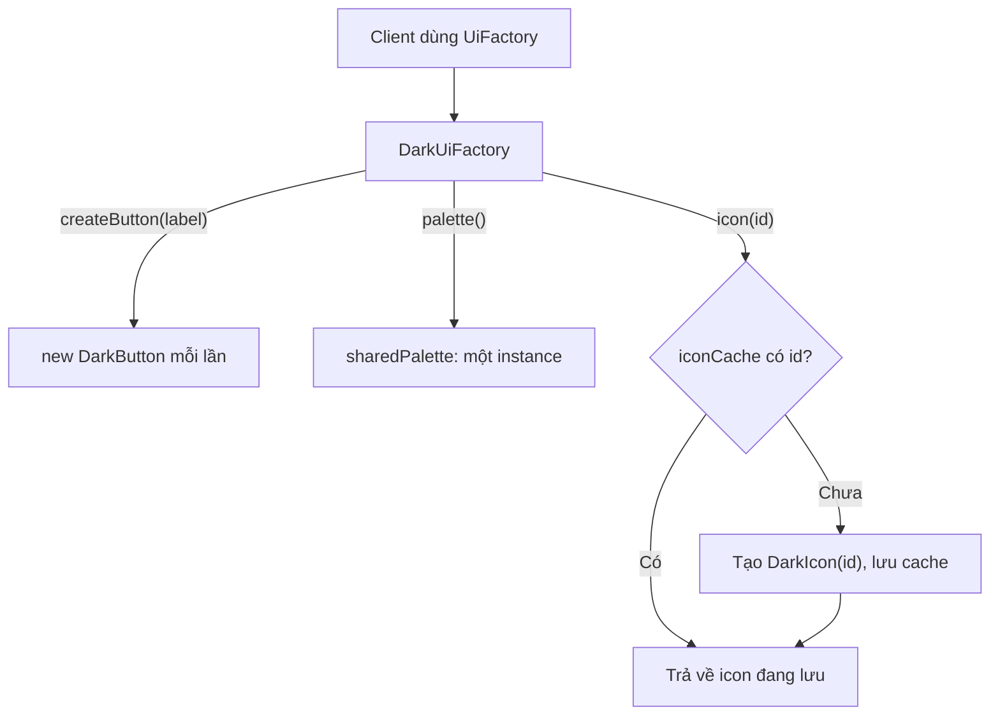

# Phân biệt tạo mới, dùng lại và cache sản phẩm trong cùng một factory

## Mục tiêu

Trong **Abstract Factory**, một factory cung cấp các cách tạo ra **một họ sản phẩm có liên quan** (ví dụ: nút bấm, bảng màu và biểu tượng của giao diện Dark). Mẫu thiết kế này quy định cách client yêu cầu sản phẩm qua các abstraction; nó **không bắt buộc mọi lời gọi phải cấp phát một đối tượng mới**. Chính sách vòng đời của từng sản phẩm là quyết định thiết kế riêng, miễn tuân thủ contract mà client được hứa hẹn.

Sau bài này, bạn có thể:

- Phân biệt **tạo mới**, **dùng lại một instance** và **cache theo khóa**, kể cả ý nghĩa của identity (`==`) và trạng thái.
- Chọn chính sách phù hợp cho các sản phẩm khác nhau **trong cùng một concrete factory**.
- Xác định chủ sở hữu tài nguyên, thời điểm giải phóng, giới hạn cache và các rủi ro khi chia sẻ đối tượng.

## 1. Ba chính sách vòng đời khác nhau ở đâu?

Giả sử `DarkUiFactory` tạo ra các sản phẩm thuộc cùng họ giao diện tối:

- `createButton("Save")`: mỗi lần trả về một nút mới vì nút có trạng thái tương tác riêng.
- `palette()`: luôn trả về một bảng màu bất biến của factory, vì mọi client có thể đọc chung.
- `icon("save")`: lần đầu tạo icon cho khóa `save`; các lần gọi tiếp theo với cùng khóa nhận lại icon đã cache.

| Tiêu chí | Tạo mới (*new per call*) | Dùng lại (*shared instance*) | Cache (*keyed reuse*) |
|---|---|---|---|
| Quy tắc trả về | Một instance mới cho mỗi lần gọi | Một instance đã có, thường cố định theo factory | Tra theo khóa; trúng cache thì dùng lại, trượt thì tạo và lưu |
| Điều kiện dùng phù hợp | Có trạng thái độc lập, có quyền sở hữu riêng | Không đổi trạng thái hoặc có thể chia sẻ an toàn | Kết quả có thể chia sẻ và việc tạo/tải lại đủ tốn kém |
| Identity khi gọi hai lần | Thường khác nhau | Giống nhau trong cùng phạm vi chia sẻ | Giống nhau nếu **cùng khóa, cache còn hiệu lực** |
| Số lượng instance | Tăng theo số lần tạo | Thường một instance mỗi factory/phạm vi | Tối đa theo số khóa đang được giữ |
| Bộ nhớ/tài nguyên | Nhiều instance đang hoạt động | Giữ một instance lâu dài | Tốn bộ nhớ theo số mục; cần giới hạn hoặc loại bỏ |
| Bên quản lý vòng đời điển hình | Client nhận sản phẩm | Factory/container | Factory/cache |

**Lưu ý về thuật ngữ:** cache cũng là một hình thức *dùng lại*. Trong bài này, “dùng lại” chỉ trường hợp chia sẻ một instance xác định, còn “cache” nhấn mạnh cơ chế **tra cứu theo khóa, tạo lười và vô hiệu hóa**. Singleton, shared instance và object pool cũng không đồng nghĩa: pool thường *cho mượn rồi thu hồi* những đối tượng hữu hạn, còn cache thường giữ kết quả để trả lại khi yêu cầu trùng khóa.

## 2. Ví dụ Java: ba chính sách trong một Abstract Factory

Contract công khai cho phép client làm việc với họ sản phẩm `Button`, `Palette`, `Icon` mà không phụ thuộc lớp Dark cụ thể:

```java
interface UiFactory {
    Button createButton(String label); // Mới mỗi lần
    Palette palette();                  // Dùng chung trong factory
    Icon icon(String id);               // Cache theo id
}

interface Button {
    void click();
    int clickCount();
}

interface Palette {
    String background();
    String foreground();
}

interface Icon {
    String id();
    String source();
}
```

Một concrete factory của họ Dark có thể triển khai cả ba chiến lược. Đoạn dưới đây là ví dụ hoàn chỉnh chạy với **Java 17+**; dữ liệu `source` chỉ mô phỏng đường dẫn tài nguyên icon để dễ quan sát cơ chế cache.

```java
import java.util.concurrent.ConcurrentHashMap;
import java.util.concurrent.ConcurrentMap;

interface UiFactory {
    Button createButton(String label);
    Palette palette();
    Icon icon(String id);
}

interface Button {
    void click();
    int clickCount();
}

interface Palette {
    String background();
    String foreground();
}

interface Icon {
    String id();
    String source();
}

final class DarkButton implements Button {
    private final String label;
    private int clicks;

    DarkButton(String label) {
        this.label = label;
    }

    @Override
    public void click() {
        clicks++;
        System.out.println("Dark button '" + label + "': " + clicks);
    }

    @Override
    public int clickCount() {
        return clicks;
    }
}

// record giữ dữ liệu bất biến: phù hợp để chia sẻ.
record DarkPalette(String background, String foreground)
        implements Palette {}

record DarkIcon(String id, String source) implements Icon {}

final class DarkUiFactory implements UiFactory {
    // Tạo một lần cho chính instance factory này.
    private final Palette sharedPalette =
            new DarkPalette("#202124", "#FFFFFF");

    // Cache tách biệt cho từng instance factory.
    private final ConcurrentMap<String, Icon> iconCache =
            new ConcurrentHashMap<>();

    @Override
    public Button createButton(String label) {
        return new DarkButton(label);
    }

    @Override
    public Palette palette() {
        return sharedPalette;
    }

    @Override
    public Icon icon(String id) {
        if (id == null || id.isBlank()) {
            throw new IllegalArgumentException("Icon id must not be blank");
        }
        return iconCache.computeIfAbsent(
                id,
                key -> new DarkIcon(key, "assets/dark/" + key + ".svg")
        );
    }
}

public class Demo {
    public static void main(String[] args) {
        UiFactory factory = new DarkUiFactory();

        Button first = factory.createButton("Save");
        Button second = factory.createButton("Save");
        first.click();
        System.out.println(first != second);           // true
        System.out.println(second.clickCount());        // 0

        System.out.println(factory.palette()
                == factory.palette());                  // true

        System.out.println(factory.icon("save")
                == factory.icon("save"));               // true
        System.out.println(factory.icon("save")
                != factory.icon("open"));               // true
    }
}
```

Ở đây `DarkButton` là đối tượng có trạng thái (`clicks`), nên mỗi nút phải độc lập. `DarkPalette` và `DarkIcon` là các `record` bất biến, có thể chia sẻ an toàn. `ConcurrentHashMap` bảo vệ thao tác tra cứu/thêm mục cache khi nhiều luồng gọi factory; tính an toàn của **chính sản phẩm được cache** vẫn phải được bảo đảm riêng.

Factory thứ hai như `LightUiFactory` có thể triển khai **cùng interface `UiFactory`** nhưng tạo `LightButton`, `LightPalette`, `LightIcon`. Nhờ đó client đổi cả họ sản phẩm bằng cách đổi factory, trong khi chính sách vòng đời của từng loại vẫn do concrete factory kiểm soát. Cache icon bên trong `DarkUiFactory` chỉ chứa icon Dark, giúp tránh lẫn sản phẩm Dark/Light.

### Minh họa luồng trả về



**Điều code minh họa chưa làm:** cache đang giữ mọi khóa mãi cho đến khi factory không còn được tham chiếu. Đây là ví dụ về *cơ chế*, chưa phải cấu hình cache dùng cho hệ thống có tập khóa rất lớn hoặc tài nguyên cần đóng.

## 3. Chọn chính sách từ đặc điểm của sản phẩm

### A. Tạo mới khi trạng thái phải độc lập

Một sản phẩm như button, form, request context hoặc transaction có thể mang dữ liệu riêng của người dùng/lần sử dụng. Nếu factory trả cùng một instance, client này có thể nhìn thấy hoặc làm thay đổi trạng thái của client khác.

- Dùng `new` trên mỗi lần gọi nếu mỗi yêu cầu phải có dữ liệu riêng hoặc có vòng đời riêng.
- Không cache các đối tượng đang thay đổi theo phiên, request hoặc transaction bằng khóa quá rộng.
- Nếu tạo đối tượng tốn kém nhưng buộc phải có trạng thái tách biệt, cân nhắc *object pool* với cơ chế mượn/trả và reset trạng thái; đừng biến cache thành pool ngầm.

Ví dụ sai: cache `Button` theo nhãn `"Save"`. Hai màn hình cùng tên nút có thể chia sẻ số lần click, trạng thái disabled hoặc listener ngoài ý muốn.

### B. Dùng lại khi một giá trị có thể chia sẻ ổn định

Bảng màu hoặc cấu hình bất biến có thể được tạo ở constructor factory rồi cấp lại cho mọi client. Một shared instance có thể tốt hơn cache khi sản phẩm **không có khóa biến thể** và luôn dùng cùng một cấu hình trong phạm vi factory.

- Xác định rõ **phạm vi chia sẻ**: một factory instance, một request, một tenant, hay toàn ứng dụng.
- Ưu tiên kiểu bất biến (ví dụ `record` chứa các giá trị bất biến), hoặc bảo đảm đồng bộ hóa nếu cần dùng chung đối tượng mutable.
- Không mặc định mọi thứ được dùng lại đều là Singleton toàn ứng dụng: hai instance `DarkUiFactory` trong ví dụ có hai `sharedPalette` khác nhau.

### C. Cache khi có các biến thể theo khóa

Icon `save`, template biên dịch, metadata schema hoặc kết quả phân tích cấu hình thường có nhiều biến thể; việc tải, giải mã hay xây dựng lại có thể tốn thời gian. Cache trả lại kết quả nếu khóa giống nhau và kết quả vẫn hợp lệ.

Một cache đúng cần làm rõ:

1. **Khóa:** khóa phải chứa *mọi thông tin ảnh hưởng đến kết quả*. Nếu icon phụ thuộc tên, kích thước, ngôn ngữ, theme, version thì chỉ dùng `id` có thể sai. Khi factory cố định theme Dark, có thể bỏ theme khỏi khóa **trong cache riêng của factory Dark**.
2. **Giá trị:** nên là bất biến hoặc thread-safe; không chia sẻ đối tượng có mutable state chỉ dành cho một client.
3. **Phạm vi:** cache sống theo factory, request hay ứng dụng? Hai factory có thể cần cache khác nhau để không rò dữ liệu giữa theme/tenant.
4. **Hết hạn:** cấu hình thay đổi, asset cập nhật hoặc yêu cầu tải lại thì cần invalidation, TTL, giới hạn kích thước hay version của khóa.
5. **Lỗi:** không nên biến một thất bại tải tài nguyên tạm thời thành giá trị hợp lệ được cache mãi.

Nếu icon thật phụ thuộc thêm `scale` và `locale`, khóa có thể là:

```java
record IconKey(String id, int scale, String locale) {}

// Ví dụ: ConcurrentMap<IconKey, Icon> iconCache
// Chỉ dùng id khi scale và locale đã cố định trong phạm vi factory.
```

**Hiệu năng thực tế:** cache có lợi khi chi phí tạo/tải và tần suất gọi lặp đủ lớn để bù bộ nhớ, lookup, đồng bộ hóa và chi phí invalidation. Đừng thêm cache chỉ vì gọi `new` trông có vẻ tốn kém; hãy đo thời gian, số lần hit/miss và dung lượng.

## 4. Ai sở hữu sản phẩm và khi nào giải phóng?

Abstract Factory mô tả cách cung cấp sản phẩm, nhưng **không tự định nghĩa quyền sở hữu tài nguyên**. Contract API cần trả lời ai được `close()`, ai giữ tham chiếu và khi nào sản phẩm hết hiệu lực.

| Trường hợp | Chủ sở hữu thường gặp | Kết thúc vòng đời |
|---|---|---|
| Mỗi lần tạo mới, có tài nguyên đóng được | Client nhận sản phẩm | Client `close()` sau khi sử dụng, thường bằng `try-with-resources` |
| Shared instance do factory quản lý | Factory hoặc DI container | Factory/container đóng một lần khi kết thúc scope |
| Sản phẩm được cache do factory quản lý | Cache/factory | Evict/invalidate và đóng khi chắc chắn không còn ai sử dụng; dọn cache khi factory đóng |
| Đối tượng mượn từ pool | Pool | Client **trả về pool** sau khi dùng; pool quyết định đóng tài nguyên gốc |

Ví dụ với kết nối cơ sở dữ liệu: không cache **một connection đang có transaction** rồi đưa cho mọi client. Nếu cần dùng lại kết nối, dùng connection pool quản lý việc mượn/trả; transaction phải độc lập. Tương tự, nếu factory cache đối tượng `AutoCloseable`, tránh để client tùy ý đóng shared object mà client khác vẫn đang dùng.

Một số nguyên tắc thực thi:

- Factory có cache tài nguyên cần một cơ chế hủy rõ ràng, chẳng hạn `close()` hoặc lifecycle hook do container gọi.
- Nếu sản phẩm vẫn còn được client sử dụng, **eviction không đồng nghĩa được đóng ngay**; có thể cần reference counting, lease, hoặc chính sách không đóng trong khi còn người mượn.
- Nếu factory có thể bị đóng khi còn người gọi, phải xác định hành vi sau `close()` (thường từ chối yêu cầu mới) và xử lý an toàn việc đóng trùng.
- Không trả reference tới tài nguyên dùng chung thuộc scope ngắn hơn vòng đời của client (ví dụ cache trong request nhưng giữ reference sang request sau).

## 5. Tính đúng đắn khi có nhiều luồng và khi cấu hình đổi

`ConcurrentHashMap.computeIfAbsent` phù hợp để minh họa cache đơn giản: việc thêm giá trị theo khóa là nguyên tử đối với map; nhiều lời gọi đồng thời cùng khóa thường nhận lại cùng giá trị được lưu. Tuy nhiên:

- Chỉ có map thread-safe **không có nghĩa** mọi method của sản phẩm cached thread-safe. Sản phẩm mutable vẫn cần đồng bộ hoặc cô lập.
- Hàm tạo giá trị cho `computeIfAbsent` nên ngắn, không có side effect nguy hiểm, không cập nhật đệ quy chính map; có thể thử tạo lại khi lần trước thất bại hoặc không lưu được giá trị.
- Cache không giới hạn có thể tăng bộ nhớ liên tục. Hệ thống thật thường dùng thư viện cache có `maximumSize`, TTL, thống kê hit/miss và chính sách loại bỏ.
- Nếu theme, asset hoặc cấu hình ảnh hưởng tới sản phẩm thay đổi, cần **tạo factory mới**, thay khóa bằng version mới hoặc chủ động invalidate cache. Không được tiếp tục cấp kết quả cũ như thể còn hợp lệ.
- Nếu constructor của cached product tải file, gọi mạng hay nắm handle, cần cân nhắc timeout, lỗi và cơ chế đóng/thu hồi tài nguyên khi evict.

Đặc biệt, **đừng biến identity thành logic nghiệp vụ**. `factory.icon("save") == factory.icon("save")` đúng trong ví dụ khi cùng cache còn hiệu lực, nhưng client nên so sánh các giá trị nghiệp vụ hoặc sử dụng hành vi của `Icon`. Nếu một ngày factory đổi sang cache có TTL, hai lần gọi cách xa nhau có thể trả hai instance khác nhau nhưng vẫn có cùng ý nghĩa.

## 6. Những lỗi thiết kế thường gặp

| Lỗi | Hậu quả | Cách sửa |
|---|---|---|
| Cache sản phẩm mutable theo khóa không đủ cụ thể | Rò trạng thái giữa người dùng/lần gọi | Tạo mới hoặc xác định khóa và phạm vi tách biệt thật sự |
| Dùng shared instance cho tài nguyên không thread-safe | Race condition, dữ liệu sai | Bất biến, đồng bộ hóa hoặc cấp instance riêng |
| Cache theo `id` dù kết quả còn phụ thuộc theme/version | Trả sai họ sản phẩm hoặc dữ liệu cũ | Đưa dependency vào khóa, tách cache theo concrete factory, invalidate |
| Giữ cache vô hạn | Tăng heap, giữ tài nguyên quá lâu | Giới hạn dung lượng/TTL/eviction và đo hit/miss |
| Client đóng một shared/cached resource | Client khác nhận đối tượng đã đóng | Quy định ownership; factory/pool quản lý việc giải phóng |
| Chỉ kiểm tra `==` để kết luận chức năng đúng | Test quá phụ thuộc chiến lược tối ưu | Kiểm thử đồng thời **nội dung, trạng thái độc lập, họ sản phẩm và vòng đời** |

## 7. Cách tự kiểm tra thiết kế

Với một interface Abstract Factory, hãy tự trả lời bốn câu hỏi cho **từng method**, không áp cùng một chính sách lên toàn bộ factory:

1. Sản phẩm có trạng thái riêng của từng client hay không? Nếu có, ưu tiên tạo mới.
2. Sản phẩm có thể chia sẻ an toàn và chỉ có một biến thể trong scope hiện tại hay không? Nếu có, dùng lại một instance.
3. Có nhiều biến thể xác định được bằng khóa và việc tạo lại có chi phí đáng kể hay không? Nếu có, cân nhắc cache có giới hạn/invalidation.
4. Ai giữ, ai đóng và sản phẩm còn dùng được đến thời điểm nào? Viết rõ contract trước khi client bắt đầu giữ tham chiếu lâu dài.

Trong ví dụ, có thể xác minh ba tính chất chính: hai button mới không chia sẻ `clickCount`; palette trả cùng giá trị nhất quán của họ Dark; icon cùng khóa được dùng lại, khác khóa cho ra icon tương ứng. Khi mở rộng sang `LightUiFactory`, xác minh mọi sản phẩm do factory đó cấp đều thuộc họ Light.

**Kết luận:** Abstract Factory chịu trách nhiệm giữ client độc lập với **họ sản phẩm cụ thể**. Còn **tạo mới, dùng lại hay cache** là các chính sách vòng đời có thể cùng tồn tại bên trong một factory, tùy trạng thái, chi phí, phạm vi chia sẻ và quyền sở hữu tài nguyên của từng loại sản phẩm.

