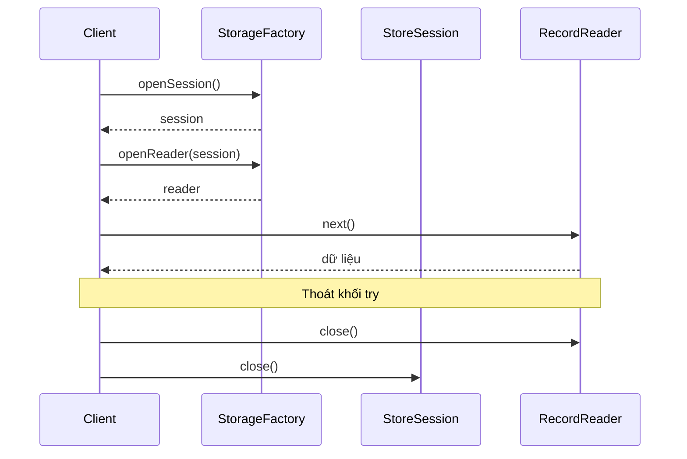

# Kết hợp AutoCloseable và try-with-resources với sản phẩm quản lý tài nguyên

Trong **Abstract Factory**, client có thể nhận nhiều loại sản phẩm từ một factory đã chọn: kết nối, phiên làm việc, bộ đọc dữ liệu, bộ ghi dữ liệu hoặc đối tượng truy cập dịch vụ. Khi các sản phẩm này giữ **tài nguyên hữu hạn** như file handle, socket, connection hoặc phiên giao dịch, tạo đúng họ sản phẩm mới chỉ là một nửa bài toán. Client còn phải **giải phóng tài nguyên đúng thời điểm và đúng thứ tự**, kể cả khi có ngoại lệ.

Java cung cấp hai công cụ phù hợp:

- **`AutoCloseable`**: hợp đồng cho đối tượng có thao tác `close()`.
- **`try-with-resources`**: cú pháp Java tự gọi `close()` cho những tài nguyên đã được khởi tạo thành công khi thoát khỏi khối `try`, dù kết thúc bình thường hay do ngoại lệ.

Bài học thuộc phần **Vòng đời và tài nguyên** của chủ đề Abstract Factory. Trọng tâm là kết hợp **factory tạo các sản phẩm tương thích** với **quyền sở hữu và vòng đời của tài nguyên** mà những sản phẩm đó quản lý.

## 1. Factory chịu trách nhiệm tạo; ai chịu trách nhiệm đóng?

Một factory có thể chọn được họ sản phẩm phù hợp, nhưng **không mặc nhiên sở hữu mọi instance được tạo ra mãi mãi**. Vì vậy, hợp đồng API phải trả lời hai câu hỏi độc lập:

1. **Ai tạo sản phẩm?** Ví dụ, `LocalStorageFactory` tạo `LocalSession` và `LocalRecordReader`.
2. **Ai chịu trách nhiệm gọi `close()` và khi nào?** Ví dụ, service mở phiên để xử lý một yêu cầu và đóng phiên khi yêu cầu hoàn tất.

Một nguyên tắc dễ áp dụng là: **thành phần mở hoặc nhận quyền sở hữu tài nguyên phải sắp xếp việc đóng tài nguyên trong phạm vi nó kiểm soát**. Nếu một service nhận đối tượng dùng chung do hệ thống quản lý, service không nên tự đóng đối tượng đó nếu hợp đồng chưa trao quyền sở hữu.

| Đối tượng | Ví dụ | Cách quản lý vòng đời thường gặp |
| --- | --- | --- |
| Factory không giữ tài nguyên | `LocalStorageFactory` chỉ biết tạo sản phẩm | Có thể tái sử dụng; không cần `close()` chỉ vì nó là factory |
| Sản phẩm giữ tài nguyên | `StoreSession` giữ phiên truy cập dữ liệu | Đối tượng mở phiên đóng phiên trong phạm vi một tác vụ |
| Sản phẩm phụ thuộc sản phẩm khác | `RecordReader` hoạt động trên `StoreSession` | Đóng reader **trước** session |
| Factory sở hữu tài nguyên dài hạn | Factory giữ thread pool, connection pool hoặc transport | Factory có thể cũng là `AutoCloseable`; thành phần **sở hữu factory** quyết định khi nào đóng |

Từng API thực tế có thể quy định quyền sở hữu khác nhau. Đừng suy diễn rằng factory luôn phải đóng mọi thứ nó tạo ra hoặc mọi đối tượng implements `AutoCloseable` đều được phép đóng bởi bất kỳ nơi sử dụng nào.

## 2. AutoCloseable biểu diễn hợp đồng đóng tài nguyên

`AutoCloseable` khai báo phương thức `close()`:

```java
public interface AutoCloseable {
    void close() throws Exception;
}
```

Một sản phẩm quản lý tài nguyên có thể kế thừa interface này, nhưng **nên thu hẹp kiểu ngoại lệ** theo nhu cầu thực tế. Chẳng hạn, sản phẩm I/O dùng `IOException`:

```java
import java.io.IOException;

interface StoreSession extends AutoCloseable {
    boolean isOpen();

    @Override
    void close() throws IOException;
}

interface RecordReader extends AutoCloseable {
    String next() throws IOException;

    @Override
    void close() throws IOException;
}
```

Nhờ vậy, client dùng `StoreSession` và `RecordReader` có thể khai báo hoặc xử lý `IOException` thay vì phải xử lý `Exception` quá rộng. Interface `Closeable` của `java.io` cũng mở rộng `AutoCloseable` và khai báo `close() throws IOException`; nó phù hợp với nhiều loại tài nguyên I/O, nhưng không bắt buộc đối với mọi sản phẩm của Abstract Factory.

**Điểm quan trọng:** triển khai `AutoCloseable` không tự làm đối tượng được đóng. Tài nguyên chỉ được đóng khi bên sử dụng gọi `close()` trực tiếp hoặc đặt đối tượng vào cấu trúc `try-with-resources` thích hợp.

## 3. Chọn một họ sản phẩm, quản lý nhiều vòng đời phụ thuộc nhau

Giả sử ứng dụng đọc dữ liệu từ hai môi trường lưu trữ: **Local** và **Remote**. Mỗi họ cần một `StoreSession` để mở phiên và một `RecordReader` để đọc bản ghi trong phiên đó.

| Loại sản phẩm | Họ Local | Họ Remote | Phụ thuộc vòng đời |
| --- | --- | --- | --- |
| `StoreSession` | `LocalSession` | `RemoteSession` | Cần sống trong suốt tác vụ |
| `RecordReader` | `LocalRecordReader` | `RemoteRecordReader` | Chỉ sử dụng được khi session tương ứng vẫn mở |
| Concrete factory | `LocalStorageFactory` | `RemoteStorageFactory` | Tạo đúng cặp sản phẩm thuộc cùng một họ |

Abstract factory được định nghĩa bằng các loại sản phẩm trừu tượng:

```java
interface StorageFactory {
    StoreSession openSession() throws IOException;
    RecordReader openReader(StoreSession session) throws IOException;
}
```

Thiết kế ở đây cho reader nhận session như một tham số. Điều đó cho phép factory kiểm tra reader và session thuộc **cùng một họ**, đồng thời làm rõ rằng reader **phụ thuộc vòng đời của session**.



Vì `RecordReader` được tạo sau `StoreSession`, nên cần **đóng reader trước** rồi mới đóng session. `try-with-resources` đảm bảo việc gọi `close()` theo **thứ tự ngược với thứ tự khai báo tài nguyên**.

## 4. Ví dụ Java hoàn chỉnh: Abstract Factory + try-with-resources

Ví dụ sau tạo hai họ Local và Remote **giả lập** để quan sát vòng đời rõ ràng; các lớp không thực sự mở file hay tạo kết nối mạng. Một ứng dụng thực có thể thay logic in thông báo bằng cách làm việc với file, JDBC hoặc HTTP client.

```java
import java.io.IOException;

public class ResourceLifecycleDemo {
    // Abstract products: mỗi sản phẩm sở hữu tài nguyên có close().
    interface StoreSession extends AutoCloseable {
        boolean isOpen();

        @Override
        void close() throws IOException;
    }

    interface RecordReader extends AutoCloseable {
        String next() throws IOException;

        @Override
        void close() throws IOException;
    }

    // Abstract Factory: tạo các sản phẩm thuộc cùng một họ.
    interface StorageFactory {
        StoreSession openSession() throws IOException;
        RecordReader openReader(StoreSession session) throws IOException;
    }

    // Hai session thuộc hai họ khác nhau.
    static final class LocalSession implements StoreSession {
        private boolean open = true;

        LocalSession() {
            System.out.println("Mở phiên Local");
        }

        public boolean isOpen() {
            return open;
        }

        public void close() {
            if (open) {
                open = false;
                System.out.println("Đóng phiên Local");
            }
        }
    }

    static final class RemoteSession implements StoreSession {
        private boolean open = true;

        RemoteSession() {
            System.out.println("Mở phiên Remote");
        }

        public boolean isOpen() {
            return open;
        }

        public void close() {
            if (open) {
                open = false;
                System.out.println("Đóng phiên Remote");
            }
        }
    }

    // Reader không sở hữu session: reader chỉ đóng tài nguyên của chính nó.
    static final class LocalRecordReader implements RecordReader {
        private final LocalSession session;
        private boolean open = true;

        LocalRecordReader(LocalSession session) {
            this.session = session;
            System.out.println("Mở reader Local");
        }

        public String next() throws IOException {
            ensureUsable(open, session);
            return "Dữ liệu Local: bản ghi 1";
        }

        public void close() {
            if (open) {
                open = false;
                System.out.println("Đóng reader Local");
            }
        }
    }

    static final class RemoteRecordReader implements RecordReader {
        private final RemoteSession session;
        private boolean open = true;

        RemoteRecordReader(RemoteSession session) {
            this.session = session;
            System.out.println("Mở reader Remote");
        }

        public String next() throws IOException {
            ensureUsable(open, session);
            return "Dữ liệu Remote: bản ghi 1";
        }

        public void close() {
            if (open) {
                open = false;
                System.out.println("Đóng reader Remote");
            }
        }
    }

    private static void ensureUsable(
            boolean readerOpen, StoreSession session) throws IOException {
        if (!readerOpen || !session.isOpen()) {
            throw new IOException("Reader hoặc session đã đóng");
        }
    }

    // Mỗi concrete factory tạo đúng một cột của ma trận.
    static final class LocalStorageFactory implements StorageFactory {
        public StoreSession openSession() {
            return new LocalSession();
        }

        public RecordReader openReader(StoreSession session) {
            if (!(session instanceof LocalSession) || !session.isOpen()) {
                throw new IllegalArgumentException(
                    "Local reader cần Local session đang mở");
            }
            return new LocalRecordReader((LocalSession) session);
        }
    }

    static final class RemoteStorageFactory implements StorageFactory {
        public StoreSession openSession() {
            return new RemoteSession();
        }

        public RecordReader openReader(StoreSession session) {
            if (!(session instanceof RemoteSession) || !session.isOpen()) {
                throw new IllegalArgumentException(
                    "Remote reader cần Remote session đang mở");
            }
            return new RemoteRecordReader((RemoteSession) session);
        }
    }

    // Client chỉ làm việc với abstract factory và abstract products.
    static void readOnce(StorageFactory factory) throws IOException {
        try (StoreSession session = factory.openSession();
             RecordReader reader = factory.openReader(session)) {
            System.out.println(reader.next());
        }
    }

    public static void main(String[] args) throws IOException {
        StorageFactory factory = args.length > 0
                && "remote".equalsIgnoreCase(args[0])
            ? new RemoteStorageFactory()
            : new LocalStorageFactory();

        readOnce(factory);
    }
}
```

Lưu tệp thành `ResourceLifecycleDemo.java`, sau đó chạy:

```bash
javac -encoding UTF-8 ResourceLifecycleDemo.java
java ResourceLifecycleDemo
```

Kết quả với họ Local:

```text
Mở phiên Local
Mở reader Local
Dữ liệu Local: bản ghi 1
Đóng reader Local
Đóng phiên Local
```

Đổi lệnh chạy thành `java ResourceLifecycleDemo remote` để quan sát cùng một thứ tự mở/đóng với họ Remote. Phần `readOnce()` **không cần sửa** khi đổi họ vì nó chỉ biết `StorageFactory`, `StoreSession` và `RecordReader`.

Hai điểm thiết kế cần quan sát:

- **Tương thích theo họ:** `LocalStorageFactory` không chấp nhận `RemoteSession` trong `openReader()`. Ứng dụng thực có thể sử dụng kiểu dữ liệu hoặc ranh giới module chặt hơn; kiểm tra `instanceof` ở đây chủ yếu để minh họa trường hợp trộn họ.
- **Vòng đời theo quan hệ phụ thuộc:** `readOnce()` sở hữu hai tài nguyên trong cùng phạm vi `try`. `RecordReader` không đóng `StoreSession` vì phía ngoài đang sở hữu session; nếu cả hai tự đóng cùng một tài nguyên, quyền sở hữu trở nên mơ hồ.

## 5. try-with-resources thực hiện những gì khi có lỗi?

Hãy xét cách khai báo:

```java
try (StoreSession session = factory.openSession();
     RecordReader reader = factory.openReader(session)) {
    System.out.println(reader.next());
}
```

Trình tự xử lý phụ thuộc vào thời điểm phát sinh lỗi:

| Thời điểm lỗi | Tài nguyên đã khởi tạo thành công | Hành vi đóng |
| --- | --- | --- |
| `openSession()` ném ngoại lệ trước khi trả về session | Chưa có tài nguyên nào được gán cho biến của `try` | `try-with-resources` không có session để đóng; `openSession()` phải tự dọn dẹp tài nguyên trung gian đã lấy trước lúc lỗi |
| `openReader(session)` ném ngoại lệ | `session` | Java tự gọi `session.close()` |
| `reader.next()` ném ngoại lệ | `session`, `reader` | Java gọi `reader.close()`, sau đó `session.close()` |
| Khối `try` kết thúc bình thường | `session`, `reader` | Java vẫn đóng cả hai theo thứ tự ngược |
| `close()` của reader ném ngoại lệ | `session`, `reader` | Java vẫn tiếp tục gọi `session.close()`; quy tắc ngoại lệ được mô tả bên dưới |

Điều này lý giải vì sao nên khai báo **tài nguyên phụ thuộc sau tài nguyên mà nó cần**. Cú pháp tự đóng theo thứ tự ngược có thể bảo vệ đúng quan hệ reader → session.

### Ngoại lệ khi đang xử lý và ngoại lệ khi đóng

Nếu khối `try` ném ngoại lệ và thao tác `close()` cũng ném ngoại lệ, Java giữ **ngoại lệ từ khối xử lý làm ngoại lệ chính**, còn ngoại lệ lúc đóng được đính kèm thành **suppressed exception**. Có thể xem chúng qua `Throwable.getSuppressed()`.

```java
try (AutoCloseable resource = () -> {
    throw new IOException("Lỗi khi đóng");
}) {
    throw new IOException("Lỗi khi đọc");
} catch (Exception error) {
    System.out.println("Chính: " + error.getMessage());
    for (Throwable suppressed : error.getSuppressed()) {
        System.out.println("Khi đóng: " + suppressed.getMessage());
    }
}
```

Kết quả:

```text
Chính: Lỗi khi đọc
Khi đóng: Lỗi khi đóng
```

Trong trường hợp **không có lỗi ở phần xử lý**, lỗi từ `close()` có thể trở thành ngoại lệ chính. Nếu nhiều tài nguyên cùng lỗi khi đóng, một lỗi đóng là ngoại lệ chính và những lỗi đóng còn lại có thể được đính kèm. Khi ghi log hoặc chẩn đoán sự cố, đừng chỉ nhìn thông điệp của ngoại lệ chính mà bỏ qua suppressed exceptions.

### Giới hạn của việc khởi tạo một phần

`try-with-resources` chỉ tự đóng **những giá trị tài nguyên đã được khởi tạo và đưa vào danh sách tài nguyên thành công**. Nếu `openReader()` mở một socket nội bộ rồi thất bại **trước khi trả về reader**, Java chưa có đối tượng reader nào để đóng. Bản thân `openReader()` phải thu hồi socket đó trong nhánh lỗi.

Tương tự, constructor hoặc phương thức khởi tạo của sản phẩm phải làm sạch những tài nguyên đã cấp phát trước khi ném ngoại lệ. **Factory không thể đẩy toàn bộ trách nhiệm dọn dẹp lỗi khởi tạo sang client**.

## 6. Quyền sở hữu, phạm vi và factory có trạng thái

Trong ứng dụng thật, **vòng đời của factory** và **vòng đời của sản phẩm** có thể rất khác nhau:

- Một factory không giữ tài nguyên có thể được tái sử dụng lâu dài; từng request tạo và đóng session riêng.
- Một factory giữ connection pool có thể sống suốt vòng đời ứng dụng; từng request chỉ mượn và trả connection về pool.
- Một factory giữ transport hoặc executor riêng có thể phải implement `AutoCloseable` để tắt tài nguyên khi **chủ sở hữu của factory** kết thúc hoạt động.

Nếu factory sở hữu tài nguyên cần đóng, có thể định nghĩa một hợp đồng riêng:

```java
interface ManagedStorageFactory extends StorageFactory, AutoCloseable {
    @Override
    void close() throws IOException;
}
```

Khi **chính một service tạo và sở hữu factory** trong phạm vi ngắn, service có thể đặt cả factory vào `try-with-resources` và đóng factory **sau** những sản phẩm đang sử dụng nó. Ngược lại, nếu factory được inject và dùng chung toàn ứng dụng, một request **không được tự đóng factory** vì có thể làm các request khác ngừng hoạt động.

Quy tắc hữu ích là xác định ba điều trong hợp đồng của mỗi sản phẩm: **ai sở hữu**, **khi nào hết hiệu lực**, và **đóng nó có ảnh hưởng đến tài nguyên chia sẻ hay không**. Đối với connection pool, `connection.close()` thường mang nghĩa **trả kết nối về pool** thay vì đóng kết nối vật lý ngay; cần tuân theo hợp đồng của thư viện cụ thể.

## 7. Các lỗi thiết kế thường gặp

### Trả về một sản phẩm đang phụ thuộc vào session đã đóng

Đoạn sau có vấn đề:

```java
// Minh họa lỗi; method này không nên dùng.
static RecordReader openBad(StorageFactory factory) throws IOException {
    try (StoreSession session = factory.openSession()) {
        return factory.openReader(session);
    } // session bị đóng trước khi caller có thể đọc từ reader.
}
```

Reader trả về vẫn tham chiếu session đã đóng và caller còn không được hướng dẫn sở hữu reader ra sao. Giải pháp đơn giản nhất là **thực hiện việc đọc ngay trong phạm vi `try`** rồi trả về dữ liệu đã tách khỏi tài nguyên:

```java
static String readValue(StorageFactory factory) throws IOException {
    try (StoreSession session = factory.openSession();
         RecordReader reader = factory.openReader(session)) {
        return reader.next();
    }
}
```

Nếu bắt buộc phải trả về reader sống lâu hơn, cần thiết kế một đối tượng sở hữu **cả reader lẫn session**, định nghĩa thứ tự đóng rõ ràng và cho caller biết trách nhiệm đóng đối tượng bao đó.

### Đóng tài nguyên được mượn hoặc đóng hai lần

Nếu một method chỉ được **mượn** `StoreSession` từ caller, method không nên đặt session vào `try-with-resources` trừ khi hợp đồng trao lại quyền sở hữu. Đóng session tại một helper có thể khiến caller đang dùng session gặp lỗi. Việc hỗ trợ `close()` gọi nhiều lần mà không lỗi (*idempotent*) là đặc tính hữu ích, nhưng **không nên coi đó là lý do để bỏ qua thiết kế ownership**: không phải mọi tài nguyên đều có hành vi đóng lặp giống nhau.

### Lưu session dùng chung trong singleton factory mà không quản lý đồng thời

Một factory tồn tại lâu dài không có nghĩa các session nó tạo ra cũng nên tồn tại lâu dài. Nếu giữ cùng một session dùng chung cho nhiều request, cần chứng minh session có thể chia sẻ an toàn, không bị đóng giữa chừng và có hợp đồng về thread safety. Với các session gắn với yêu cầu hoặc giao dịch, cách thông thường là **tạo trong phạm vi request và đóng ở cuối request**.

### Nhầm việc chọn đúng họ với quản lý vòng đời đúng

`RemoteStorageFactory` có thể tạo đúng `RemoteSession` và `RemoteRecordReader`, nhưng ứng dụng vẫn rò rỉ tài nguyên nếu quên đóng. Ngược lại, đóng đủ hai sản phẩm cũng không sửa được lỗi trộn `LocalSession` và `RemoteRecordReader`. **Tương thích sản phẩm** và **quản lý tài nguyên** là hai hợp đồng cần được thực thi đồng thời.

### Che mất lỗi trong close()

Một implementation `close()` nuốt mọi ngoại lệ có thể khiến client tưởng tài nguyên đã được giải phóng thành công. Trong trường hợp giải phóng thất bại có ý nghĩa nghiệp vụ hoặc vận hành, hãy chọn cách báo lỗi hoặc ghi nhận lỗi rõ ràng theo hợp đồng của tài nguyên. Tránh ném ngoại lệ mới từ `finally` theo cách làm mất ngoại lệ gốc; dùng `try-with-resources` giúp giữ lại thông tin suppressed exceptions.

## 8. Liên hệ với các API Java thực tế

Những loại JDBC như `Connection`, `PreparedStatement` và `ResultSet` đều hỗ trợ `AutoCloseable`. Một luồng đọc dữ liệu có thể giữ ba tài nguyên trong các phạm vi lồng nhau:

```java
// Giả sử dataSource và orderId đã được cung cấp.
try (java.sql.Connection connection = dataSource.getConnection();
     java.sql.PreparedStatement statement =
         connection.prepareStatement("SELECT id FROM orders WHERE id = ?")) {

    statement.setLong(1, orderId);

    try (java.sql.ResultSet rows = statement.executeQuery()) {
        while (rows.next()) {
            System.out.println(rows.getLong("id"));
        }
    } // đóng ResultSet trước.
} // đóng PreparedStatement, sau đó Connection.
```

Đây là ví dụ **quản lý tài nguyên**, không có nghĩa `DataSource` tự nó luôn là triển khai của mẫu Abstract Factory. Khi hệ thống dùng Abstract Factory để chọn **một họ adapter truy cập dữ liệu**, các sản phẩm do factory tạo có thể áp dụng đúng nguyên tắc `AutoCloseable` và `try-with-resources` như trên.

Trong một giao dịch cần `commit()` hoặc `rollback()`, **đóng connection không nên được dùng làm cơ chế thay thế xử lý giao dịch một cách có chủ đích**. Cần quản lý kết quả giao dịch theo hợp đồng của JDBC và thư viện; `try-with-resources` chỉ bảo đảm nỗ lực đóng tài nguyên khi thoát phạm vi.

## 9. Checklist thiết kế và kiểm thử

Trước khi kết thúc thiết kế Abstract Factory có sản phẩm quản lý tài nguyên, hãy kiểm tra:

1. **Hợp đồng sản phẩm:** loại nào cần `AutoCloseable` hoặc `Closeable`? `close()` có thể ném ngoại lệ nào?
2. **Phạm vi sở hữu:** client đang sở hữu sản phẩm hay chỉ mượn? Factory có tài nguyên dùng chung cần một chủ sở hữu khác không?
3. **Quan hệ phụ thuộc:** tài nguyên nào phải được tạo trước, đóng sau? Thứ tự khai báo trong `try-with-resources` đã phù hợp chưa?
4. **Trường hợp khởi tạo lỗi:** phương thức factory có dọn sạch tài nguyên đã cấp phát bên trong nhưng chưa trả về được không?
5. **Lỗi trong sử dụng:** khi đọc/ghi ném ngoại lệ, tất cả tài nguyên đã mở có được đóng, và suppressed exceptions có thể được quan sát không?
6. **Tính nhất quán của họ:** cùng một factory có trả đúng bộ sản phẩm tương thích về cấu hình, phiên bản và ngữ cảnh phiên làm việc không?
7. **Sau khi đóng:** hành vi gọi phương thức lần nữa có được xác định rõ (ném lỗi, không cho phép hay trả kết quả đặc biệt) không?
8. **Tài nguyên chia sẻ và đa luồng:** có nguy cơ một request đóng session, factory hoặc pool đang được request khác sử dụng không?

Đối với ví dụ ở phần 4, có thể thiết kế các kịch bản kiểm thử có ý nghĩa: đọc thành công từ Local và Remote; đọc sau khi reader hoặc session đã đóng; thử truyền Remote session vào Local factory; gây lỗi khi tạo reader để xác nhận session vẫn được đóng; gây lỗi trong `next()` và `close()` để xác nhận thứ tự đóng và suppressed exceptions.

## 10. Bài tập vận dụng

Một ứng dụng xuất báo cáo có hai họ sản phẩm: **CSV** và **JSON**. Mỗi họ cung cấp một `ReportWriter` và một `ReportAttachment` cần phối hợp về định dạng; cả hai nắm giữ tài nguyên đầu ra. `ReportAttachment` ghi vào luồng do `ReportWriter` mở.

Hãy xác định:

1. Những interface sản phẩm nào nên mở rộng `AutoCloseable`?
2. Abstract factory cần những phương thức tạo nào để giữ các sản phẩm cùng họ?
3. Nếu attachment sử dụng luồng của writer nhưng **không sở hữu luồng**, khi đóng attachment có nên đóng luôn writer không?
4. Client nên khai báo writer và attachment theo thứ tự nào trong `try-with-resources`?
5. Nếu tạo attachment thất bại sau khi writer đã mở thành công, ai sẽ đóng writer?

**Hướng giải:** cả hai sản phẩm quản lý tài nguyên nên có hợp đồng đóng nếu chúng sở hữu trạng thái cần giải phóng; factory có hai phương thức tạo tương ứng, triển khai theo họ CSV/JSON. Khởi tạo writer **trước** attachment để Java đóng attachment **trước** writer. Attachment không tự đóng writer nếu chỉ mượn luồng; `try-with-resources` của client sẽ đóng writer khi tạo attachment thất bại. Những handle mà phương thức tạo attachment đã mở nhưng chưa trả về phải được phương thức ấy tự dọn dẹp.

## Tổng kết

Trong Abstract Factory, chọn đúng concrete factory giúp client lấy các **sản phẩm thuộc cùng một họ**. Khi những sản phẩm này quản lý tài nguyên, hãy kết hợp `AutoCloseable` với `try-with-resources` để xác định rõ phạm vi sở hữu, đảm bảo thao tác đóng khi thoát phạm vi và giải phóng theo **thứ tự ngược với khởi tạo**.

**Nguyên tắc cốt lõi:** tạo một bộ sản phẩm tương thích, sử dụng chúng trong đúng phạm vi và đóng từng tài nguyên theo quan hệ phụ thuộc. Factory chịu trách nhiệm dọn sạch tài nguyên đã cấp phát nhưng **chưa trả về thành công**; client hoặc thành phần đã nhận quyền sở hữu chịu trách nhiệm đóng các sản phẩm đã nhận. Nhờ hai hợp đồng đó, thiết kế vừa tránh trộn họ sản phẩm, vừa hạn chế rò rỉ tài nguyên và lỗi vòng đời.
