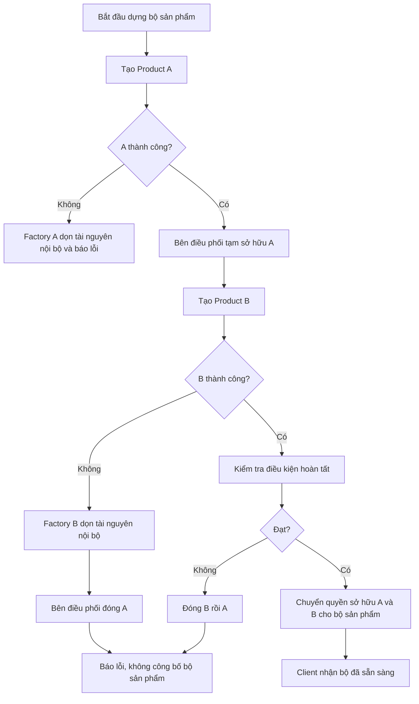

# Xử lý thất bại khi chỉ một phần các sản phẩm trong họ được tạo thành công

## 1. Vấn đề: một họ sản phẩm có thể được tạo dang dở

**Abstract Factory** cung cấp cho client một tập sản phẩm có liên quan, cùng thuộc một họ (product family). Trong những ví dụ đơn giản, factory thường chỉ gọi constructor và trả về các đối tượng nhẹ. Nhưng ở hệ thống thực, một sản phẩm có thể chiếm giữ **socket, kết nối cơ sở dữ liệu, luồng dữ liệu, file handle, session hoặc tài nguyên hệ điều hành**.

Giả sử ứng dụng cần hai sản phẩm cùng họ:

- `DataConnection`: kết nối tới một dịch vụ dữ liệu.
- `EventSubscriber`: đăng ký nhận sự kiện tương ứng với dịch vụ đó.

Client chỉ có thể vận hành khi **cả hai** sản phẩm đã sẵn sàng và tương thích. Quy trình có thể gặp lỗi:

```text
1. factory.createConnection()  -> thành công, đã mở socket
2. factory.createSubscriber()  -> thất bại, không đăng ký được sự kiện
3. Client chưa có bộ sản phẩm hoàn chỉnh
```

Nếu bỏ qua kết nối từ bước 1, socket có thể vẫn mở, dẫn đến **rò rỉ tài nguyên**. Nếu đưa kết nối đã tạo cho client rồi để client hoạt động như thể cả họ đã sẵn sàng, hệ thống có thể rơi vào **trạng thái khởi tạo một phần** khó kiểm soát.

Đây là bài toán vòng đời và tài nguyên: **ai sở hữu những đối tượng tạo thành công, ai giải phóng chúng khi bước sau lỗi, và lúc nào quyền sở hữu được chuyển sang client?**

> **Nguyên tắc:** Một nhóm sản phẩm cần hoạt động cùng nhau chỉ được công bố là *sẵn sàng* sau khi mọi thành phần bắt buộc được tạo và kiểm tra thành công. Nếu quy trình dừng giữa chừng, phải xử lý các tài nguyên đã cấp phát trước đó theo hợp đồng sở hữu rõ ràng.

Trong bài này, “tạo cả họ thành công” nghĩa là hoàn tất **bộ sản phẩm mà một client cần cho một lần sử dụng**, không nhất thiết là tạo toàn bộ mọi vai trò được định nghĩa trong AbstractFactory cho cả ứng dụng.

## 2. Có hai cấp thất bại khác nhau

| Cấp thất bại | Ví dụ | Thành phần chịu trách nhiệm dọn dẹp |
| --- | --- | --- |
| **Bên trong một phương thức factory** | `createSubscriber()` đã mở socket phụ rồi lỗi khi đăng ký | Chính `ConcreteFactory` hoặc thành phần xây dựng subscriber phải dọn phần tài nguyên mà nó chưa bàn giao |
| **Giữa các phương thức factory** | `createConnection()` đã trả về một kết nối, sau đó `createSubscriber()` ném lỗi | Bộ điều phối khởi tạo nhóm sản phẩm phải đóng connection đã nhận nếu nó đang sở hữu connection đó |

Phân biệt hai cấp này rất quan trọng. Người gọi `createSubscriber()` **không thể dọn một tài nguyên nội bộ mà phương thức chưa từng trả về**. Ngược lại, `createSubscriber()` thông thường **không biết** bên gọi đã tạo một `DataConnection` trước đó. Muốn tránh rò rỉ phải xử lý đúng ở **cả hai ranh giới**.

### 2.1. Lỗi bên trong một sản phẩm

Một phương thức tạo có thể thực hiện nhiều thao tác:

```text
acquire socket -> authenticate -> subscribe -> return subscriber
                                    |
                              lỗi tại đây
```

Nếu `subscribe` lỗi, phương thức phải giải phóng socket đã lấy. Quy tắc hợp lý là: **hoặc trả về một sản phẩm ở trạng thái hợp lệ và chuyển quyền sở hữu cho bên gọi, hoặc thất bại và dọn các tài nguyên tạm mà nó sở hữu**. Đây là hợp đồng riêng của thao tác tạo sản phẩm.

### 2.2. Lỗi khi lắp ghép nhiều sản phẩm

Ngay cả khi từng phương thức tạo tuân thủ quy tắc trên, toàn bộ quy trình vẫn có thể lỗi sau sản phẩm thứ nhất:



Trình tự **đóng theo thứ tự ngược với thứ tự cấp phát** thường phù hợp khi thành phần được tạo sau phụ thuộc vào thành phần trước. Tuy nhiên, nếu có quan hệ phụ thuộc khác, thứ tự dọn dẹp phải dựa trên **đồ thị phụ thuộc tài nguyên** thực tế.

## 3. Quyền sở hữu tài nguyên là một phần của hợp đồng

Trước khi viết xử lý ngoại lệ, cần xác định **đối tượng nào có quyền và nghĩa vụ gọi `close()`**.

| Tình huống | Ai sở hữu? | Hành vi khi lỗi |
| --- | --- | --- |
| ConcreteFactory vừa mở một socket tạm để xây dựng sản phẩm | ConcreteFactory | Đóng socket nếu chưa trả sản phẩm thành công |
| Factory đã trả về một sản phẩm `AutoCloseable` mới và chuyển quyền sở hữu | Bên gọi factory | Bên gọi đóng nếu bước lắp ghép tiếp theo thất bại |
| Bộ điều phối đã hoàn tất mọi sản phẩm và bàn giao một `ProductBundle` | `ProductBundle` hoặc owner được chỉ định rõ | `ProductBundle.close()` đóng các sản phẩm theo hợp đồng |
| Factory chỉ trả về tham chiếu đến một kết nối dùng chung từ pool | Pool hoặc thành phần quản lý chia sẻ, tùy hợp đồng | Bên nhận chỉ *release* lease nếu được giao; không tự đóng tài nguyên dùng chung tùy ý |
| Một sản phẩm không sở hữu tài nguyên, chỉ là mô hình dữ liệu bất biến | Có thể không cần quản lý vòng đời | Không thêm `close()` chỉ để phục vụ mẫu thiết kế |

**Abstract Factory không tự xác định quyền sở hữu hay vòng đời.** Một interface như `createConnection(): Connection` chưa cho biết phương thức trả về connection mới, lease mượn từ pool hay singleton. Vì vậy, khi sản phẩm có tài nguyên, hợp đồng phải nêu rõ: **new/borrowed/shared**, thời hạn sử dụng, khả năng chia sẻ, cách hoàn trả và quy tắc đóng.

Đặc biệt, đừng cho mỗi client tự `close()` một tài nguyên singleton dùng chung. Nếu cần chia sẻ, hãy dùng cơ chế quản lý riêng như reference counting, pool lease hoặc một owner có vòng đời dài hơn.

## 4. Chiến lược an toàn: tạo nhóm theo nguyên tắc “tất cả hoặc không công bố”

Một cách tổ chức là dùng **bộ điều phối khởi tạo** nhận một `AbstractFactory` và dựng `ProductBundle`:

1. Chọn **một concrete factory** cho bộ sản phẩm cần tạo, bảo đảm các vai trò thuộc cùng họ.
2. Tạo sản phẩm đầu tiên, giữ quyền sở hữu tạm.
3. Tạo lần lượt các sản phẩm tiếp theo và kiểm tra điều kiện bắt buộc.
4. Nếu bất kỳ bước nào thất bại, đóng những tài nguyên đã nhận theo thứ tự phù hợp; giữ ngoại lệ gốc.
5. Chỉ sau khi thành công toàn bộ mới bàn giao quyền sở hữu cho `ProductBundle`, rồi cho phép client sử dụng.

Điều này mang lại tính **nguyên tử ở ranh giới công bố đối tượng**: client hoặc nhận bộ hoàn chỉnh, hoặc nhận lỗi. Nó **không mặc nhiên là giao dịch nguyên tử đối với các hệ thống bên ngoài**; một yêu cầu mạng đã gửi hoặc tài nguyên từ xa đã đăng ký có thể cần thao tác bù riêng.

### Vì sao phải phân biệt giữ tạm và bàn giao?

Một lỗi hay gặp là:

```java
try (Button button = factory.createButton();
     Checkbox checkbox = factory.createCheckbox()) {
    return new WidgetSet(button, checkbox);
}
```

Đoạn mã này **đóng cả `checkbox` và `button` ngay trước khi trả về**, bởi `try-with-resources` luôn đóng tài nguyên khi rời khối `try`, kể cả khi `return`. Client có thể nhận được một `WidgetSet` chứa tài nguyên đã đóng. Cần có cơ chế **chuyển quyền sở hữu** (ownership transfer) hoặc thiết kế API trả về một bundle do chính factory xây dựng, với bảo đảm cleanup nội bộ.

## 5. Ví dụ Java đầy đủ: cleanup khi sản phẩm thứ hai thất bại

Ví dụ mô phỏng một họ widget có `Button` và `Checkbox`. Mỗi widget sở hữu một `Lease` cần được đóng. `UIFactory` là hợp đồng Abstract Factory; `ThemeFactory` là một concrete factory được cấu hình cho một họ. Để dễ quan sát, `Lease` in thông báo mở/đóng thay vì cấp phát socket thực.

```java
// Lưu thành PartialFamilyFailureDemo.java
import java.io.IOException;
import java.util.Objects;

public class PartialFamilyFailureDemo {

    interface Button extends AutoCloseable {
        String label();
        @Override
        void close();
    }

    interface Checkbox extends AutoCloseable {
        String label();
        @Override
        void close();
    }

    interface UIFactory {
        Button createButton() throws IOException;
        Checkbox createCheckbox() throws IOException;
    }

    // Tài nguyên minh họa: chỉ được đóng một lần.
    static final class Lease implements AutoCloseable {
        private final String name;
        private boolean closed;

        Lease(String name) {
            this.name = name;
            System.out.println("open " + name);
        }

        @Override
        public void close() {
            if (!closed) {
                closed = true;
                System.out.println("close " + name);
            }
        }
    }

    static final class DemoButton implements Button {
        private final String family;
        private final Lease lease;

        DemoButton(String family, Lease lease) {
            this.family = family;
            this.lease = lease;
        }

        public String label() { return family + " button"; }
        public void close() { lease.close(); }
    }

    static final class DemoCheckbox implements Checkbox {
        private final String family;
        private final Lease lease;

        DemoCheckbox(String family, Lease lease) {
            this.family = family;
            this.lease = lease;
        }

        public String label() { return family + " checkbox"; }
        public void close() { lease.close(); }
    }

    // ConcreteFactory: tạo các sản phẩm thuộc cùng một họ.
    static final class ThemeFactory implements UIFactory {
        private final String family;
        private final boolean failCheckbox;

        ThemeFactory(String family, boolean failCheckbox) {
            this.family = family;
            this.failCheckbox = failCheckbox;
        }

        @Override
        public Button createButton() {
            return new DemoButton(family, new Lease(family + " button"));
        }

        @Override
        public Checkbox createCheckbox() throws IOException {
            Lease lease = new Lease(family + " checkbox");

            try {
                // Mô phỏng lỗi SAU khi đã cấp phát tài nguyên nội bộ.
                if (failCheckbox) {
                    throw new IOException("checkbox initialization failed");
                }
                return new DemoCheckbox(family, lease);
            } catch (IOException | RuntimeException failure) {
                // Chưa trả về sản phẩm: factory vẫn sở hữu lease này.
                lease.close();
                throw failure;
            }
        }
    }

    // Guard giữ tài nguyên tạm cho đến khi chuyển quyền sở hữu.
    static final class Guard<T extends AutoCloseable>
            implements AutoCloseable {
        private final T value;
        private boolean transferred;

        Guard(T value) {
            this.value = Objects.requireNonNull(value);
        }

        T get() { return value; }

        void transferOwnership() {
            transferred = true;
        }

        @Override
        public void close() throws Exception {
            if (!transferred) {
                value.close();
            }
        }
    }

    // Kết quả chỉ xuất hiện khi cả hai sản phẩm đã tạo thành công.
    static final class WidgetSet implements AutoCloseable {
        private final Button button;
        private final Checkbox checkbox;
        private boolean closed;

        private WidgetSet(Button button, Checkbox checkbox) {
            this.button = button;
            this.checkbox = checkbox;
        }

        static WidgetSet open(UIFactory factory) throws Exception {
            try (Guard<Button> button =
                    new Guard<>(factory.createButton())) {
                try (Guard<Checkbox> checkbox =
                        new Guard<>(factory.createCheckbox())) {
                    WidgetSet set =
                            new WidgetSet(button.get(), checkbox.get());

                    // Chuyển quyền sở hữu sau khi bộ sản phẩm hoàn tất.
                    button.transferOwnership();
                    checkbox.transferOwnership();
                    return set;
                }
            }
        }

        void show() {
            if (closed) {
                throw new IllegalStateException("WidgetSet already closed");
            }
            System.out.println(button.label() + " + " + checkbox.label());
        }

        @Override
        public void close() throws Exception {
            if (closed) {
                return;
            }
            closed = true;

            // Try-with-resources đóng checkbox trước, rồi button.
            // Nếu cả hai close lỗi, lỗi sau sẽ được gắn suppressed.
            try (Button b = button; Checkbox c = checkbox) {
                // Không cần thao tác trong thân try.
            }
        }
    }

    public static void main(String[] args) throws Exception {
        System.out.println("=== SUCCESS ===");
        try (WidgetSet widgets =
                WidgetSet.open(new ThemeFactory("Modern", false))) {
            widgets.show();
        }

        System.out.println("=== FAILURE ===");
        try (WidgetSet widgets =
                WidgetSet.open(new ThemeFactory("Modern", true))) {
            widgets.show();
        } catch (IOException failure) {
            System.out.println("failed: " + failure.getMessage());
        }
    }
}
```

Biên dịch và chạy bằng JDK:

```bash
javac PartialFamilyFailureDemo.java
java PartialFamilyFailureDemo
```

Đầu ra dự kiến:

```text
=== SUCCESS ===
open Modern button
open Modern checkbox
Modern button + Modern checkbox
close Modern checkbox
close Modern button
=== FAILURE ===
open Modern button
open Modern checkbox
close Modern checkbox
close Modern button
failed: checkbox initialization failed
```

### Đọc kỹ hai đường thực thi

**Đường thành công:** factory tạo cả hai widget. Sau khi tạo `WidgetSet`, hai `Guard` ngừng sở hữu tài nguyên; `WidgetSet` trở thành owner và được client dùng trong `try-with-resources`. Khi client hoàn thành, `WidgetSet.close()` đóng checkbox rồi button.

**Đường thất bại:** `ThemeFactory.createCheckbox()` đã mở lease cho checkbox nhưng không tạo được sản phẩm hợp lệ, nên **factory đóng lease này**. Ngoại lệ thoát ra khỏi `WidgetSet.open()`; `Guard<Button>` tự đóng sản phẩm thứ nhất. Không có `WidgetSet` nào được trả về cho client.

**Tại sao cần `Guard`?** Nó biểu diễn rõ hai trạng thái sở hữu: *tạm giữ để rollback* và *đã bàn giao*. Trong triển khai khác, có thể dùng cơ chế cleanup stack, scope manager, resource registry hoặc một phương thức `createBundle()` chịu trách nhiệm tương đương.

**Giới hạn của ví dụ:** `Lease.close()` được thiết kế không ném lỗi và `WidgetSet` không hỗ trợ thao tác đồng thời. Trong hệ thống thực, cần xử lý thêm lỗi khi cleanup, luồng đồng thời và những sản phẩm được mượn hoặc chia sẻ. `transferOwnership()` chỉ phù hợp khi sản phẩm thực sự được bàn giao cho bundle, không dùng bừa cho kết nối của pool.

## 6. Giữ ngoại lệ gốc khi cleanup cũng thất bại

Giả sử `createSubscriber()` thất bại, sau đó `connection.close()` cũng ném ngoại lệ. Nếu code cleanup ném lỗi mới và che mất lỗi ban đầu, việc chẩn đoán sẽ khó hơn.

Trong Java, `try-with-resources` giữ **ngoại lệ ở thân `try`** làm ngoại lệ chính, đồng thời gắn các lỗi xảy ra khi đóng tài nguyên vào danh sách **suppressed exceptions**.

```java
try (DataConnection connection = factory.createConnection()) {
    EventSubscriber subscriber = factory.createSubscriber();
    // Tiếp tục cấu hình; nếu thất bại, connection vẫn được đóng.
} catch (Exception failure) {
    System.err.println("Primary error: " + failure.getMessage());
    for (Throwable cleanupError : failure.getSuppressed()) {
        System.err.println("Cleanup error: " + cleanupError.getMessage());
    }
    throw failure;
}
```

Đây là **đoạn minh họa xử lý ngoại lệ**; `DataConnection`/`EventSubscriber` chỉ là tên vai trò giả định, không phải các lớp thuộc ví dụ Java hoàn chỉnh ở trên. Trong mã thật, nếu `subscriber` đã được tạo và sở hữu tài nguyên, nó cũng phải được đăng ký để đóng khi bước cấu hình phía sau thất bại. Không thể chỉ quản lý `connection` rồi bỏ qua những tài nguyên khác.

Khi cleanup thủ công, có thể giữ nguyên ngoại lệ gốc:

```java
try {
    secondProduct = factory.createSecond();
} catch (Exception original) {
    try {
        firstProduct.close();
    } catch (Exception cleanupError) {
        original.addSuppressed(cleanupError);
    }
    throw original;
}
```

**Không nuốt lỗi cleanup một cách âm thầm.** Nó có thể là dấu hiệu kết nối chưa được giải phóng, giao dịch chưa rollback hoặc tài nguyên bên ngoài chưa được thu hồi. Cần ghi nhận và xử lý theo mức độ quan trọng, nhưng đừng để lỗi dọn dẹp vô tình che mất nguyên nhân chính.

## 7. Chọn chiến lược khi chỉ tạo được một phần

| Chiến lược | Khi phù hợp | Điều kiện cần lưu ý |
| --- | --- | --- |
| **Fail fast và cleanup** | Các sản phẩm bắt buộc phải đi cùng nhau | Không bàn giao bộ chưa hoàn tất; giải phóng phần đã tạo |
| **Rollback/compensation** | Tạo sản phẩm có tác động lên hệ thống ngoài: tạo session, đăng ký topic, giữ tài nguyên từ xa | Xác định thao tác bù; ghi nhận nếu bù không thành công |
| **Retry có kiểm soát** | Lỗi tạm thời, có thể thử lại an toàn | Kiểm soát idempotency, thời hạn chờ, số lần thử và tài nguyên còn sót từ lần trước |
| **Fallback sang họ khác** | Có họ thay thế đáp ứng hợp đồng nghiệp vụ | Dọn bộ cũ, chọn lại **cả factory** rồi tạo lại nhóm; không trộn tùy tiện sản phẩm từ hai họ |
| **Degraded mode** | Một số sản phẩm thực sự tùy chọn | Hợp đồng client phải mô tả rõ năng lực có/không; không giả vờ một sản phẩm bắt buộc đã tồn tại |

### Retry đúng cách

Ví dụ, `createConnection()` thành công nhưng `createSubscriber()` thất bại do timeout. Nếu thử lại cả bộ, hãy bảo đảm **kết nối cũ đã được đóng hoặc hoàn trả**. Nếu đã gửi một yêu cầu đăng ký lên server mà timeout trước lúc nhận phản hồi, server **có thể đã hoàn tất đăng ký**. Khi đó, retry thiếu idempotency key có thể tạo đăng ký trùng.

Không nên tự động retry mọi lỗi. Lỗi cấu hình, quyền truy cập hoặc schema không phù hợp thường không biến mất chỉ vì lặp lại. Với lỗi mạng tạm thời, nên đặt **giới hạn số lần, backoff, timeout tổng và cơ chế hủy** phù hợp với hệ thống.

### Fallback phải theo nguyên bộ

Giả sử `PrimaryFactory` tạo connection thành công nhưng không tạo được subscriber. Nếu dùng `BackupFactory.createSubscriber()` trong khi giữ connection từ Primary, hai sản phẩm có thể dùng giao thức, tài khoản hoặc môi trường khác nhau. Một lựa chọn an toàn hơn là **đóng connection Primary, chọn BackupFactory rồi thử tạo lại cả bộ**. Chỉ dùng kết hợp nếu có hợp đồng tương thích rõ ràng, không suy luận từ kiểu interface giống nhau.

### Khi nào chấp nhận bộ chưa hoàn chỉnh?

Nếu một thành phần chỉ hỗ trợ tính năng phụ, ví dụ `MetricsReporter` tùy chọn, hệ thống có thể vẫn hoạt động khi tạo reporter thất bại. Nhưng API cần thể hiện sự khác biệt này, chẳng hạn năng lực có thể vắng mặt, và có chính sách logging/monitoring. Đừng để một client yêu cầu subscriber bắt buộc nhưng nhận về `null` rồi âm thầm tiếp tục.

## 8. “Rollback” tài nguyên không luôn giống giao dịch cơ sở dữ liệu

Việc đóng một socket thường có thể giải phóng tài nguyên cục bộ. Nhưng có các tác động **không thể đảo ngược hoàn toàn** chỉ bằng `close()`:

- Một thông điệp đã được gửi đến hệ thống ngoài.
- Một subscription đã được tạo trên server, dù client chưa nhận xác nhận.
- Một khoản tiền đã được ghi nhận hoặc một công việc bất đồng bộ đã được kích hoạt.
- Một file đã được công bố hoặc dữ liệu đã được cập nhật.

Với những tác động như vậy, cần phân biệt:

1. **Cleanup cục bộ:** đóng file, socket, connection hoặc giải phóng bộ nhớ/tài nguyên của tiến trình.
2. **Rollback có giao dịch thực:** dùng khả năng transaction của hệ thống nếu được cung cấp và phù hợp.
3. **Compensation:** gọi API hủy, thu hồi đăng ký, gửi lệnh đảo hoặc đối soát để khắc phục thao tác đã thực hiện.
4. **Khôi phục có trạng thái:** với workflow dài hoặc chạy phân tán, ghi nhận những bước đã xong để có thể retry hoặc bù sau khi tiến trình bị dừng.

Vì vậy, **“tất cả hoặc không công bố” chỉ bảo đảm client không nhận bộ đối tượng chưa hoàn tất**. Nó không hứa rằng mọi hiệu ứng ở hệ thống ngoài đều được đảo ngược. Thiết kế cần nêu rõ mức bảo đảm mình thực sự cung cấp.

## 9. Vòng đời, đồng thời và hủy giữa chừng

### 9.1. Chốt một họ cho toàn bộ lần khởi tạo

Khi cấu hình có thể thay đổi trong lúc chạy, cần tránh gọi `factoryProvider.current()` riêng cho từng sản phẩm. Lựa chọn họ có thể thay đổi giữa hai lần gọi và tạo ra hai đối tượng không tương thích.

```java
UIFactory selected = factoryProvider.current();
WidgetSet widgets = WidgetSet.open(selected);
```

Việc chốt tham chiếu factory chỉ có tác dụng nếu **factory giữ lựa chọn họ ổn định trong lần khởi tạo**. Nếu bản thân factory thay đổi trạng thái hoặc dùng các cấu hình biến thiên, nên tạo một phiên cấu hình bất biến cho lần dựng bộ sản phẩm.

### 9.2. Tránh công bố đối tượng quá sớm

Không lưu `Button` vào singleton, đăng ký event listener hoặc gửi nó đến callback bên ngoài **trước khi tất cả sản phẩm bắt buộc sẵn sàng**. Nếu bước sau thất bại, những nơi đã giữ tham chiếu có thể tiếp tục truy cập một đối tượng bị đóng trong quá trình rollback.

Nếu cần đăng ký đối tượng với hệ thống ngoài trong lúc tạo, hãy xác định rõ thao tác **hủy đăng ký** khi thất bại. Ưu tiên dựng xong rồi mới công bố khi kiến trúc cho phép.

### 9.3. Khởi tạo bất đồng bộ

Khi hai sản phẩm được tạo song song (ví dụ hai `CompletableFuture`), lỗi của một nhánh **không có nghĩa nhánh còn lại đã dừng**. Một nhánh có thể vẫn đang tạo tài nguyên, hoàn thành muộn hoặc cần hủy/cleanup.

Do đó phải phối hợp ba việc: biết nhánh nào đã tạo tài nguyên, chờ hoặc hủy an toàn những nhánh chưa kết thúc, và đóng các kết quả thành công nếu cuối cùng cả nhóm thất bại. Chỉ `cancel()` một future **không tự bảo đảm** tác vụ và tài nguyên bên dưới đã được giải phóng.

### 9.4. Tránh đóng trùng và tranh chấp

Trong ví dụ, `WidgetSet.close()` có cờ `closed` để tránh đóng lặp trong luồng đơn. Cờ boolean đó **không làm API an toàn khi có nhiều luồng gọi `close()` đồng thời**. Với môi trường đa luồng, cần cơ chế đồng bộ hoặc trạng thái nguyên tử thích hợp, đồng thời đảm bảo tác vụ đang dùng tài nguyên không chạy sau khi chúng đã đóng.

## 10. Kiểm thử các đường thất bại

Kiểm thử thành công đơn thuần không phát hiện được rò rỉ khi tạo dang dở. Có thể dùng fake factory và fake resource đếm số lần acquire/release, rồi chủ động gây lỗi ở từng bước.

| Tình huống kiểm thử | Kỳ vọng |
| --- | --- |
| Sản phẩm thứ nhất thất bại trước khi được trả về | Factory tự dọn tài nguyên nội bộ; không có bundle được công bố |
| Thứ nhất thành công, thứ hai thất bại sau khi mở tài nguyên tạm | Factory đóng tài nguyên của thứ hai; bộ điều phối đóng thứ nhất |
| Cả hai thành công | Bundle sở hữu cả hai; client đóng một lần khi kết thúc |
| Có bước kiểm tra bổ sung thất bại sau khi tạo cả hai | Đóng sản phẩm thứ hai rồi thứ nhất; không trả bundle |
| Cleanup thứ hai hoặc thứ nhất ném lỗi | Giữ lỗi khởi tạo chính; thu thập thông tin về lỗi cleanup |
| Retry sau một lần thất bại | Không tái sử dụng tài nguyên đã đóng; không làm trùng tác động không idempotent |
| Fallback sang factory khác | Không giữ sót sản phẩm của họ cũ khi tạo họ mới |
| Hủy hoặc timeout khi tạo bất đồng bộ | Các nhánh còn chạy được phối hợp; kết quả tạo muộn vẫn được cleanup |
| Gọi `close()` lặp lại | Không đóng nguồn tài nguyên hai lần, theo hợp đồng vòng đời đã công bố |

Trong test, có thể dùng bộ đếm:

```java
// Ý tưởng kiểm thử, không phải chương trình độc lập:
assert createdCount == closedCount;     // Sau trường hợp khởi tạo thất bại
assert exposedBundleCount == 0;         // Client không nhận bộ chưa hoàn tất
assert primaryFailure != null;          // Lý do lỗi được giữ lại
```

Với kết nối pool hoặc tài nguyên dùng chung, **đếm số lần cấp phát bằng số lần close không phải tiêu chí đúng**; thay vào đó, hãy kiểm tra số lease được mượn và được trả, số tham chiếu còn giữ hoặc metric do owner cung cấp.

## 11. Checklist thiết kế và vận hành

Trước khi đưa một họ sản phẩm có tài nguyên vào sử dụng, hãy trả lời:

1. **Đâu là tập sản phẩm bắt buộc để client hoạt động?** Có sản phẩm nào được phép vắng mặt không?
2. **Mỗi phương thức tạo cam kết gì khi thất bại?** Nó có dọn phần tài nguyên nội bộ chưa bàn giao không?
3. **Ai sở hữu sản phẩm đã trả về?** Là client, bundle, pool hay một manager dùng chung?
4. **Khi tạo sản phẩm thứ hai/thứ ba thất bại, ai đóng các sản phẩm đã tạo trước?**
5. **Thứ tự cleanup** có phù hợp với quan hệ phụ thuộc giữa các sản phẩm không?
6. **Khi cleanup cũng lỗi, ngoại lệ ban đầu và lỗi cleanup được lưu lại ra sao?**
7. **Khi nào công bố bundle cho client?** Có khả năng một tham chiếu bị lộ trước khi bộ sản phẩm sẵn sàng không?
8. **Retry, fallback hoặc cancellation** có tạo lại cả bộ nhất quán và xử lý các hiệu ứng bên ngoài không?
9. **Có kiểm thử lỗi ở từng điểm tạo**, kể cả tài nguyên tạm bị cấp phát trước khi ném ngoại lệ không?

## Ghi nhớ

Khi Abstract Factory tạo một họ sản phẩm có tài nguyên, thất bại ở sản phẩm thứ hai không thể khiến sản phẩm thứ nhất bị bỏ quên. **ConcreteFactory phải dọn tài nguyên mà một phương thức tạo chưa bàn giao; bộ điều phối phải dọn những sản phẩm đã nhận nếu cả bộ không hoàn tất; bundle nhận quyền sở hữu chỉ sau khi khởi tạo thành công.** Dùng `try-with-resources`, cơ chế bàn giao quyền sở hữu và kiểm thử đường lỗi để bảo đảm cleanup. Với tác động từ xa, cần thêm rollback/compensation và chính sách retry phù hợp; việc không công bố một bộ dang dở không đồng nghĩa mọi thay đổi bên ngoài đã được đảo ngược.
