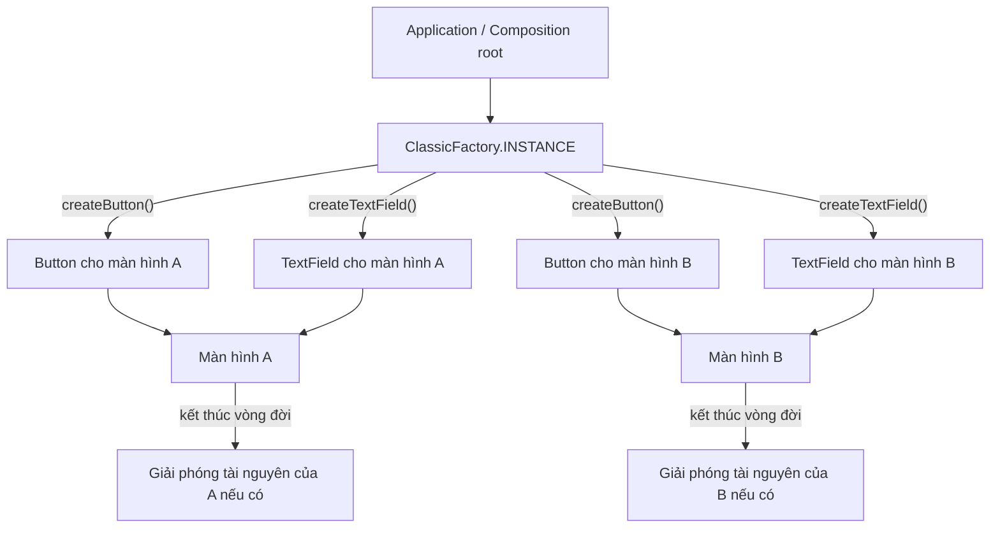

# Phân biệt Abstract Factory với Singleton và tránh mặc định chia sẻ mọi sản phẩm

## 1. Hai mẫu thiết kế giải quyết hai câu hỏi khác nhau

**Abstract Factory** và **Singleton** đều thuộc nhóm mẫu thiết kế khởi tạo (creational design patterns), nhưng chúng không giải quyết cùng một vấn đề.

- **Abstract Factory** trả lời: *Làm thế nào để tạo các loại sản phẩm có liên quan thuộc cùng một họ, trong khi client chỉ biết các interface trừu tượng?*
- **Singleton** trả lời: *Làm thế nào để kiểm soát việc chỉ có một instance của một lớp trong một phạm vi xác định, đồng thời cung cấp điểm truy cập tới instance ấy?*

Ví dụ, một hệ thống giao diện có hai họ sản phẩm:

| Vai trò sản phẩm | Họ Classic | Họ Touch |
| --- | --- | --- |
| `Button` | `ClassicButton` | `TouchButton` |
| `TextField` | `ClassicTextField` | `TouchTextField` |

Một `UIFactory` có thể công bố:

```java
interface UIFactory {
    Button createButton();
    TextField createTextField();
}
```

`ClassicFactory` tạo các sản phẩm Classic; `TouchFactory` tạo các sản phẩm Touch. Đó là **trách nhiệm chọn họ** của Abstract Factory.

Nhưng khi gọi `classicFactory.createTextField()` hai lần, có nên nhận **cùng một đối tượng** hay **hai đối tượng độc lập**? Đây là câu hỏi về **vòng đời, quyền sở hữu và khả năng chia sẻ**, không thể trả lời chỉ từ tên pattern Abstract Factory.

> **Điểm mấu chốt:** Một concrete factory có thể được dùng chung như Singleton trong khi **mỗi lần gọi phương thức tạo vẫn trả về sản phẩm mới**. Dùng chung factory không đồng nghĩa dùng chung mọi sản phẩm mà factory tạo ra.

## 2. Tách bốn khái niệm thường bị gộp làm một

| Khái niệm | Câu hỏi cần trả lời | Ví dụ |
| --- | --- | --- |
| **Họ sản phẩm** (*family*) | Những sản phẩm nào phải được lựa chọn nhất quán? | ClassicButton đi cùng ClassicTextField |
| **Số instance factory** | Có bao nhiêu đối tượng chịu trách nhiệm tạo sản phẩm? | Một `ClassicFactory` bất biến được chia sẻ |
| **Số instance sản phẩm** | Mỗi lần gọi `create...()` tạo mới hay trả lại đối tượng cũ? | Mỗi màn hình nhận một `ClassicTextField` mới |
| **Phạm vi sở hữu** (*scope/ownership*) | Ai dùng, ai thay đổi trạng thái và ai giải phóng sản phẩm? | Màn hình sở hữu widget; application sở hữu factory |

Những quyết định này có thể độc lập. Một factory dùng chung có thể tạo ra các sản phẩm riêng theo request, trả về một cấu hình bất biến được cache, hoặc cấp phát một *lease* từ pool. Một factory cũng có thể được tạo riêng cho từng tenant nếu nó chứa cấu hình đặc thù tenant.

### Singleton không mặc nhiên là “một đối tượng duy nhất toàn hệ thống”

Trong Java, tính duy nhất của một Singleton phụ thuộc vào **phạm vi triển khai**. Ví dụ, một instance tĩnh thường được chia sẻ trong một class loader; nhiều tiến trình JVM, nhiều class loader hoặc nhiều DI container có thể có các instance riêng. `@Singleton` hoặc scope singleton của framework cũng thường có ý nghĩa trong phạm vi container quản lý.

Vì vậy, khi nói một factory “là Singleton”, cần nêu **một instance trong phạm vi nào**, thay vì suy luận nó là instance duy nhất trên mọi server hoặc mọi tenant.

## 3. Sai lầm: factory là Singleton nên sản phẩm cũng phải Singleton

Một cách làm có vấn đề là lưu luôn những widget có trạng thái vào trường của factory:

```java
// Phác thảo anti-pattern: shared mutable product.
final class BadClassicFactory implements UIFactory {
    static final BadClassicFactory INSTANCE = new BadClassicFactory();

    private final Button oneButton = new ClassicButton();
    private final TextField oneField = new ClassicTextField();

    private BadClassicFactory() {}

    public Button createButton() {
        return oneButton;
    }

    public TextField createTextField() {
        return oneField;
    }
}
```

Nếu `TextField` lưu nội dung người dùng đã nhập và `Button` lưu trạng thái nhấn, hai màn hình nhận sản phẩm từ factory này có thể cùng giữ **một đối tượng có thể thay đổi**. Hệ quả có thể là:

1. Màn hình A gõ `"An"`; màn hình B thấy cùng giá trị, dù cần trạng thái riêng.
2. Màn hình A vô hiệu hóa nút; màn hình B cũng bị ảnh hưởng ngoài ý muốn.
3. Hai luồng cập nhật cùng một widget có thể tạo ra race condition nếu widget không được thiết kế để dùng đồng thời.
4. Nếu một màn hình gọi `close()` trên sản phẩm dùng chung, những màn hình khác có thể tiếp tục dùng tài nguyên đã đóng.

Lỗi không nằm ở việc factory có một instance. Lỗi là **chính sách chia sẻ sản phẩm** không phù hợp với trạng thái, quyền sở hữu và vòng đời của client.

Trong ví dụ này, nếu hai màn hình cần trạng thái nhập liệu độc lập, cách phù hợp hơn là:

```java
final class ClassicFactory implements UIFactory {
    static final ClassicFactory INSTANCE = new ClassicFactory();

    private ClassicFactory() {}

    public Button createButton() {
        return new ClassicButton();
    }

    public TextField createTextField() {
        return new ClassicTextField();
    }
}
```

**Một factory được chia sẻ, nhiều sản phẩm độc lập:** các phương thức tạo mới bảo vệ sự tách biệt trạng thái giữa các màn hình, dù chúng vẫn thuộc cùng họ Classic.

## 4. Khi nào nên chia sẻ factory, khi nào nên chia sẻ sản phẩm?

| Đối tượng | Có thể dùng chung khi | Không nên mặc định dùng chung khi |
| --- | --- | --- |
| **ConcreteFactory** | Bất biến hoặc không có trạng thái; an toàn khi nhiều client gọi đồng thời; không giữ dữ liệu riêng của từng request | Factory có cấu hình thay đổi theo người dùng, tenant, phiên hoặc chứa trạng thái khởi tạo không an toàn đồng thời |
| **Sản phẩm bất biến** | Không có trạng thái riêng của client; dữ liệu đã xây dựng xong và an toàn để chia sẻ | Sản phẩm có danh tính/ngữ cảnh truy cập riêng hoặc tài nguyên vòng đời ngắn |
| **Sản phẩm có trạng thái thay đổi** | Có chủ đích chia sẻ một trạng thái chung và thiết kế đồng bộ/ownership phù hợp | Text field, giỏ hàng, transaction, editor hoặc session độc lập theo client |
| **Sản phẩm giữ tài nguyên** | Có owner và giao thức thuê/trả hoặc chia sẻ rõ ràng | Nhiều client cùng đóng socket, file, connection hay handle không có hợp đồng sở hữu |
| **Tài nguyên trong pool** | Pool quản lý đối tượng vật lý và cấp phát các lease theo quy tắc | Client tự giữ và tái sử dụng tùy tiện một handle đã trả về pool |

**Không có quy tắc “Abstract Factory luôn tạo mới” hay “Abstract Factory luôn cache”.** Hợp đồng `create...` chỉ rõ *loại sản phẩm được trả về*; chính sách mới/cũ, trạng thái và cách giải phóng cần được mô tả riêng nếu ảnh hưởng đến client.

### Factory có thể là Singleton nhưng vẫn cần bất biến

Một factory dùng chung có thể giữ các phụ thuộc bất biến như bộ quy tắc tạo widget, cấu hình đã chốt hoặc template không thay đổi. Nếu nó chứa `currentTheme` rồi tự đổi từ Classic sang Touch khi các luồng đang dựng màn hình, ngay cả việc giữ một tham chiếu factory cũng không bảo đảm các sản phẩm được tạo thuộc cùng họ.

Thay vì đặt “họ hiện tại” dạng mutable global state trong một Singleton, thường nên **chọn một concrete factory tương ứng với họ** ở ranh giới khởi động rồi cấp factory đó cho client trong suốt lần dựng bộ sản phẩm.

## 5. Ví dụ Java hoàn chỉnh: dùng chung ConcreteFactory, tách trạng thái sản phẩm

Chương trình sau mô phỏng hai họ `Classic` và `Touch`. `ClassicFactory.INSTANCE` và `TouchFactory.INSTANCE` đều là factory dùng chung theo cách triển khai bằng `enum`. Mỗi lần `createButton()` hoặc `createTextField()` vẫn tạo một đối tượng mới. Mỗi màn hình có trạng thái nhấn nút và nội dung nhập riêng.

```java
// Lưu thành FactoryVsSingletonDemo.java
public class FactoryVsSingletonDemo {

    interface Button {
        String family();
        void click();
        int clicks();
    }

    interface TextField {
        String family();
        void setText(String text);
        String text();
    }

    interface UIFactory {
        Button createButton();
        TextField createTextField();
    }

    // Các sản phẩm Classic lưu trạng thái RIÊNG từng instance.
    static final class ClassicButton implements Button {
        private int count;

        public String family() { return "Classic"; }
        public void click() { count++; }
        public int clicks() { return count; }
    }

    static final class ClassicTextField implements TextField {
        private String value = "";

        public String family() { return "Classic"; }
        public void setText(String text) { value = text; }
        public String text() { return value; }
    }

    // Các sản phẩm Touch tương tự nhưng thuộc họ khác.
    static final class TouchButton implements Button {
        private int count;

        public String family() { return "Touch"; }
        public void click() { count++; }
        public int clicks() { return count; }
    }

    static final class TouchTextField implements TextField {
        private String value = "";

        public String family() { return "Touch"; }
        public void setText(String text) { value = text; }
        public String text() { return value; }
    }

    // Enum được dùng để có một factory instance cho mỗi họ
    // trong phạm vi nạp lớp; factory không giữ trạng thái client.
    enum ClassicFactory implements UIFactory {
        INSTANCE;

        public Button createButton() {
            return new ClassicButton();
        }

        public TextField createTextField() {
            return new ClassicTextField();
        }
    }

    enum TouchFactory implements UIFactory {
        INSTANCE;

        public Button createButton() {
            return new TouchButton();
        }

        public TextField createTextField() {
            return new TouchTextField();
        }
    }

    static final class ProfileScreen {
        private final Button saveButton;
        private final TextField nameField;

        ProfileScreen(UIFactory factory) {
            saveButton = factory.createButton();
            nameField = factory.createTextField();
        }

        void inputName(String name) {
            nameField.setText(name);
        }

        void save() {
            saveButton.click();
        }

        boolean sharesFieldWith(ProfileScreen other) {
            return nameField == other.nameField;
        }

        String describe() {
            return saveButton.family()
                    + " button clicks=" + saveButton.clicks()
                    + ", " + nameField.family()
                    + " field text=" + nameField.text();
        }
    }

    public static void main(String[] args) {
        UIFactory sharedFactory = ClassicFactory.INSTANCE;
        ProfileScreen screenA = new ProfileScreen(sharedFactory);
        ProfileScreen screenB = new ProfileScreen(sharedFactory);

        screenA.inputName("An");
        screenA.save();
        screenB.inputName("Binh");

        System.out.println("Factory shared: "
                + (sharedFactory == ClassicFactory.INSTANCE));
        System.out.println("TextField shared: "
                + screenA.sharesFieldWith(screenB));
        System.out.println("A: " + screenA.describe());
        System.out.println("B: " + screenB.describe());

        ProfileScreen touch = new ProfileScreen(TouchFactory.INSTANCE);
        touch.inputName("Chi");
        System.out.println("Touch: " + touch.describe());
    }
}
```

Biên dịch và chạy với JDK:

```bash
javac FactoryVsSingletonDemo.java
java FactoryVsSingletonDemo
```

Kết quả dự kiến:

```text
Factory shared: true
TextField shared: false
A: Classic button clicks=1, Classic field text=An
B: Classic button clicks=0, Classic field text=Binh
Touch: Touch button clicks=0, Touch field text=Chi
```

**Điều cần quan sát:** `screenA` và `screenB` cùng dùng `ClassicFactory.INSTANCE`, nhưng không cùng dùng một `ClassicTextField`. Mỗi màn hình có dữ liệu và bộ đếm nút riêng. `TouchFactory.INSTANCE` cung cấp họ khác mà `ProfileScreen` không phải đổi thuật toán sử dụng.

Trong ví dụ, `ClassicFactory` và `TouchFactory` không giữ trạng thái mutable nên có thể được dùng lại. **Các concrete product có trạng thái mutable**, vì vậy không nên dùng chung chúng giữa những màn hình độc lập. Chương trình không thực hiện truy cập đồng thời; nếu widget có thể được dùng từ nhiều luồng, cần thêm quy tắc đồng bộ hoặc giới hạn sử dụng theo luồng.

## 6. Sơ đồ vòng đời: factory sống lâu hơn những sản phẩm nó tạo



Factory có thể tồn tại trong toàn bộ thời gian chạy ứng dụng; màn hình A và B có thể xuất hiện, biến mất ở những thời điểm khác nhau. **Vòng đời của factory không quy định vòng đời của sản phẩm.** Nếu các widget giữ tài nguyên, từng màn hình hoặc một owner được xác định phải giải phóng tài nguyên của chính mình.

Ngược lại, nếu factory cũng sở hữu resource pool dùng chung, vòng đời của pool thường gắn với factory hoặc application manager. Khi đó, đóng một widget chỉ nên **trả lease về pool** theo hợp đồng, không tự đóng cả pool.

## 7. Các chính sách tạo sản phẩm có thể nằm sau cùng một AbstractFactory

| Chính sách | Ví dụ | Yêu cầu từ hợp đồng |
| --- | --- | --- |
| **New instance mỗi lần gọi** | `createTextField()` tạo ô nhập có trạng thái riêng | Client được quyền giữ/truy cập trạng thái riêng; nếu `AutoCloseable` thì biết ai đóng |
| **Shared immutable** | `createThemeSpec()` trả về thông số màu bất biến được dùng chung | Đảm bảo bất biến và an toàn khi nhiều client đọc |
| **Scoped instance** | `createSessionContext()` trong một phiên người dùng | Xác định scope và không để lộ dữ liệu sang phiên khác |
| **Pooled/leased resource** | `createConnection()` cấp kết nối từ pool | Phân biệt đối tượng mượn và tài nguyên vật lý; quy tắc trả lease rõ ràng |
| **Lazy initialization** | Tạo renderer lớn khi lần đầu có yêu cầu | Khởi tạo an toàn khi nhiều luồng truy cập, xử lý lỗi khi tạo |
| **Cached product** | Một codec không trạng thái và bất biến | Khóa cache đúng biến thể; không cache nhầm sản phẩm mang state của client |

Một `ConcreteFactory` có thể **kết hợp nhiều chính sách**. Chẳng hạn, `createCodec()` trả về một codec bất biến dùng chung, còn `createTransaction()` trả về một transaction mới cho mỗi lần gọi. Quy tắc này hoàn toàn phù hợp nếu các sản phẩm đáp ứng đúng hợp đồng và bảo đảm tương thích của cùng họ.

### Ví dụ chia sẻ có chủ đích đối tượng bất biến

```java
final class ThemeSpec {
    final String accent;

    ThemeSpec(String accent) {
        this.accent = accent;
    }
}

final class ClassicThemeSpecs {
    static final ThemeSpec SHARED = new ThemeSpec("blue");

    private ClassicThemeSpecs() {}
}
```

Trong ví dụ này, `ThemeSpec` có trường `final` kiểu `String` bất biến và không công bố setter; các client có thể dùng chung thông tin `accent` an toàn theo mục đích sử dụng. Điều đó **không kéo theo** việc phải chia sẻ widget `TextField` có dữ liệu đầu vào mutable.

Nếu một đối tượng có trường `final` nhưng tham chiếu tới `List` có thể thay đổi, `final` **không tự biến toàn bộ đối tượng thành bất biến sâu**. Trước khi cache/chia sẻ, phải xét trạng thái có thể thay đổi của các đối tượng mà nó tham chiếu.

## 8. Hai lỗi vòng đời đặc biệt nguy hiểm

### 8.1. Singleton factory giữ sản phẩm theo người dùng trong trường dùng chung

```java
// Anti-pattern: cache sản phẩm stateful theo một khóa chung.
class UnsafeFactory implements UIFactory {
    private TextField cachedField;

    public TextField createTextField() {
        if (cachedField == null) {
            cachedField = new ClassicTextField();
        }
        return cachedField;
    }

    public Button createButton() {
        return new ClassicButton();
    }
}
```

Với `UnsafeFactory` dùng chung, nội dung ô nhập của người dùng A có thể xuất hiện ở màn hình của B. Đồng thời, code khởi tạo lười như trên chưa được đồng bộ; hai luồng có thể cùng đi vào nhánh `cachedField == null`, tạo nhiều đối tượng bất ngờ và gây race condition.

Cách xử lý là **không cache sản phẩm chứa trạng thái riêng**, hoặc cache theo scope/owner chính xác nếu bài toán thực sự yêu cầu. Với sản phẩm bất biến và được phép dùng chung, phải thiết kế cơ chế công bố an toàn và chiến lược cache phù hợp.

### 8.2. Nhiều client cùng `close()` một tài nguyên chia sẻ

Giả sử factory trả về cùng một `SocketClient` và hai màn hình đều cho rằng mình sở hữu nó. Khi màn hình A đóng, B có thể gặp lỗi dù chưa kết thúc. Ngược lại, nếu không ai đóng vì nghĩ “Singleton sẽ tự tồn tại”, tài nguyên có thể bị rò rỉ.

Quy tắc tốt là **chỉ rõ một owner** hoặc sử dụng một **lease** có chính sách thuê/trả:

```text
Ứng dụng quản lý ResourcePool
    |
    +-- Màn hình A mượn Lease A -- trả Lease A khi kết thúc
    |
    +-- Màn hình B mượn Lease B -- trả Lease B khi kết thúc
    |
    +-- Ứng dụng đóng Pool khi shutdown
```

Một lease riêng không nhất thiết tương đương một kết nối vật lý riêng; pool quyết định cơ chế sử dụng. Client cần thực hiện đúng quy tắc trả tài nguyên trong hợp đồng và không đóng đối tượng chủ sở hữu chung của người khác.

## 9. Phân biệt một singleton factory với singleton *product*

Có thể tách hai cách triển khai:

```java
// Singleton FACTORY, nhưng trả về product mới.
class PerUseFactory implements UIFactory {
    static final PerUseFactory INSTANCE = new PerUseFactory();

    public Button createButton() {
        return new ClassicButton();
    }

    public TextField createTextField() {
        return new ClassicTextField();
    }
}
```

```java
// Factory trả về PRODUCT dùng chung theo hợp đồng.
// Chỉ thích hợp nếu product an toàn để chia sẻ.
class SharedCodecFactory {
    private static final StatelessCodec CODEC = new StatelessCodec();

    StatelessCodec createCodec() {
        return CODEC;
    }
}
```

`StatelessCodec` ở ví dụ thứ hai là **tên lớp minh họa**, giả định codec bất biến, không giữ trạng thái theo request và được thiết kế thread-safe. Khối mã này không tự đứng độc lập; khác với chương trình Java hoàn chỉnh ở phần 5.

Những gì cần kiểm tra không phải “có dùng Singleton hay không”, mà là:

- **Factory có thể chia sẻ an toàn không?** Có chứa cấu hình mutable, trạng thái request, tenant hoặc tài nguyên bị nhiều luồng truy cập không?
- **Product có thể chia sẻ an toàn không?** Có mang trạng thái người dùng, buffer, transaction, phiên hoặc dữ liệu nhạy cảm không?
- **Product sống bao lâu?** Ai giữ tham chiếu, ai dọn dẹp, và nó có được tái sử dụng sau khi đã đóng không?
- **Hai lần gọi `create...` có hứa hai instance khác nhau không?** Nếu client dựa vào điều này, hợp đồng API phải nói rõ.

## 10. Chọn scope đúng khi dùng dependency injection

Nhiều hệ thống dùng DI container thay vì tự viết `INSTANCE`. Cần phân biệt **scope của factory** với **scope của từng sản phẩm**:

| Scope | Dùng khi | Nguy cơ cần kiểm soát |
| --- | --- | --- |
| **Application singleton** | Factory bất biến, stateless hoặc quản lý dịch vụ chung an toàn | Không giữ biến `currentUser`, `currentTheme` hay session mutable toàn cục |
| **Request/session scoped** | Factory hoặc product chứa dữ liệu đặc thù request/phiên | Không truyền sản phẩm đã hết vòng đời sang request khác |
| **Prototype/per invocation** | Widget, transaction, builder hoặc command có state riêng | Phải có owner quản lý cleanup nếu đối tượng giữ tài nguyên |
| **Pool/lease** | Kết nối có chi phí tạo cao nhưng cho phép tái sử dụng có kiểm soát | Chỉ trả về pool theo hợp đồng; không dùng sau release |

Với nhiều DI framework, inject một object kiểu prototype trực tiếp vào singleton **không tự bảo đảm** mỗi lần gọi trên singleton sẽ nhận prototype mới; cần provider/factory hoặc cơ chế tra cứu theo request mà framework hỗ trợ.

Nếu có nhiều tenant, một `ConcreteFactory` dùng chung toàn cục và tự đọc `currentTenant` mutable có thể tạo sản phẩm bằng nhầm cấu hình. Hãy chốt **họ và cấu hình tenant trong đúng phạm vi**, chẳng hạn tạo factory bất biến theo tenant hoặc chuyển tenant context qua cơ chế rõ ràng, tránh dựa vào biến global thay đổi giữa các lời gọi.

## 11. Chiến lược kiểm thử

Các kiểm thử cần kiểm tra **họ**, **identity**, **trạng thái** và **vòng đời**. Những khẳng định này kiểm tra các thuộc tính khác nhau:

| Kiểm thử | Điều cần chứng minh |
| --- | --- |
| Gọi factory Classic tạo `Button` và `TextField` | Hai sản phẩm thuộc cùng họ và thực hiện đúng hợp đồng |
| Gọi `createTextField()` hai lần | Nếu hợp đồng yêu cầu state riêng, hai kết quả phải là **hai instance độc lập** |
| Cập nhật nội dung ô nhập A | Nội dung ô B không thay đổi ngoài ý muốn |
| Dùng một factory từ nhiều luồng | Không làm sai họ, không rò rỉ dữ liệu, không xuất hiện race condition ở state factory |
| Đóng một product có tài nguyên | Không làm sản phẩm khác đang hoạt động bị đóng theo ngoài hợp đồng |
| Đổi cấu hình giữa những request | Không tái sử dụng product được tạo cho tenant/họ trước nếu không tương thích |
| Trả tài nguyên vào pool | Lease không còn được sử dụng sau khi trả, pool vẫn quản lý tài nguyên chung |

Ví dụ một kiểm thử ý tưởng (các lớp thuộc chương trình `FactoryVsSingletonDemo` ở phần 5):

```java
FactoryVsSingletonDemo.UIFactory factory =
        FactoryVsSingletonDemo.ClassicFactory.INSTANCE;

FactoryVsSingletonDemo.TextField a = factory.createTextField();
FactoryVsSingletonDemo.TextField b = factory.createTextField();
assert a != b; // Chỉ đúng khi hợp đồng yêu cầu instance riêng.

a.setText("A");
assert b.text().equals("");
```

Nếu chạy Java assertions, cần bật `-ea`; trong dự án thực, dùng assertion của framework kiểm thử sẽ rõ ràng hơn. Việc `a != b` **không luôn là yêu cầu bắt buộc** cho mọi Abstract Factory: với codec bất biến được chia sẻ, kiểm thử phải tập trung vào hành vi đúng và không có trạng thái liên request.

## 12. Checklist trước khi quyết định chia sẻ

1. Factory đang quyết định **họ sản phẩm** nào? Những phương thức `create...` có cùng trả về họ đó không?
2. Factory được dùng chung trong phạm vi **nào**: JVM/class loader, DI container, ứng dụng, tenant hay request?
3. Factory có **mutable state** cần đồng bộ hoặc chứa dữ liệu theo người dùng/phiên không?
4. Mỗi sản phẩm có **trạng thái riêng** hay bất biến, không trạng thái?
5. Client có quyền kỳ vọng **một instance mới mỗi lần gọi** không? Hợp đồng đã ghi rõ chưa?
6. Sản phẩm có giữ **tài nguyên cần giải phóng** không? Ai là owner và ai thực hiện release?
7. Khi chia sẻ, việc gọi phương thức đồng thời hoặc `close()` từ một client có ảnh hưởng client khác không?
8. Cache/pool có phân biệt **họ, tenant, phiên bản và scope** cần thiết không?
9. Các kiểm thử có bao phủ cả **dùng chung factory** lẫn **tách biệt trạng thái sản phẩm** không?

## Ghi nhớ

**Abstract Factory giải quyết việc chọn và tạo các sản phẩm thuộc cùng họ; Singleton giải quyết số lượng instance của một lớp trong một phạm vi.** Hai pattern có thể phối hợp: một `ConcreteFactory` bất biến được dùng chung nhưng vẫn tạo **sản phẩm mới theo mỗi lần sử dụng**. Chỉ chia sẻ sản phẩm khi trạng thái, mức an toàn đồng thời, quyền sở hữu và vòng đời của chúng thực sự cho phép. Đừng suy diễn rằng factory là Singleton thì mọi sản phẩm nó tạo ra cũng phải là Singleton.
