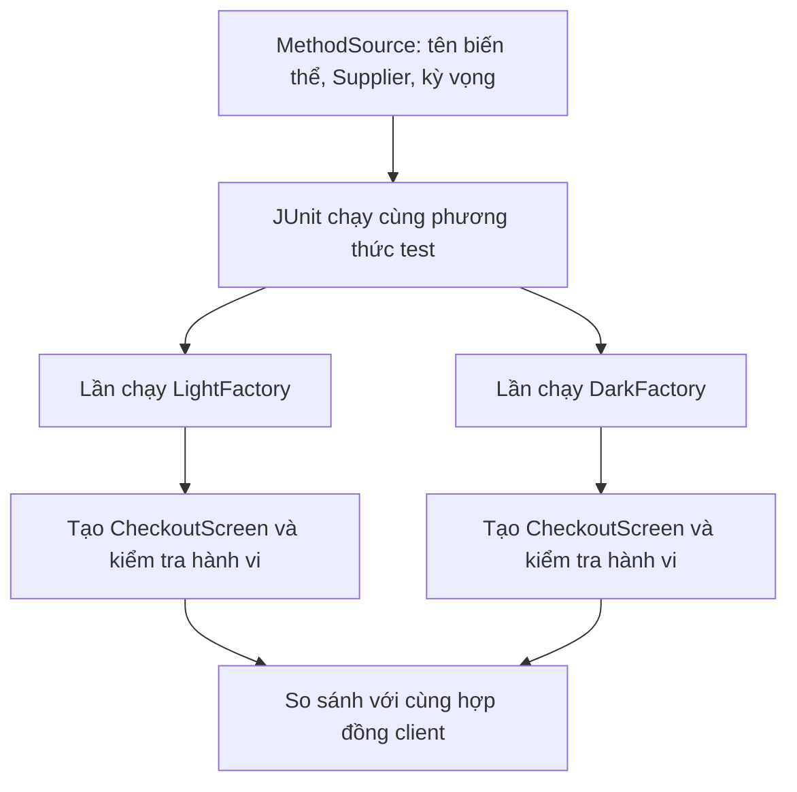

# Viết kiểm thử tham số hóa để chạy cùng hành vi client với nhiều factory

## 1. Mục tiêu: một bộ kiểm thử hành vi cho mọi họ sản phẩm

Trong **Abstract Factory**, client làm việc qua các **abstract product** và nhận các sản phẩm từ một **abstract factory**. Nhiều **concrete factory** có thể tạo ra những họ đối tượng khác nhau nhưng vẫn thực hiện chung một hợp đồng. Vì thế, một kỳ vọng quan trọng là:

> Cùng một logic client phải hoạt động đúng với mọi concrete factory hợp lệ mà ứng dụng hỗ trợ.

Ví dụ, màn hình thanh toán có một nút xác nhận và một ô chọn đồng ý điều khoản. Ứng dụng hỗ trợ giao diện **Light** và **Dark**. Dù chọn họ giao diện nào, màn hình vẫn phải tuân theo quy tắc:

- Khi người dùng **chưa đồng ý điều khoản**, không được xác nhận thanh toán.
- Sau khi đồng ý, thao tác xác nhận được cho phép.
- Nếu bỏ chọn lại, thao tác xác nhận phải tiếp tục bị từ chối.
- Nút và ô chọn được hiển thị theo **cùng họ** sản phẩm.

Viết hai bộ kiểm thử riêng gần như giống hệt nhau cho `LightFactory` và `DarkFactory` sẽ gây lặp mã và dễ bỏ sót trường hợp. **Kiểm thử tham số hóa** (*parameterized testing*) giúp diễn đạt một lần hành vi cần kiểm tra rồi chạy lại với nhiều bộ tham số factory.

Bài này sử dụng **Java 17 và JUnit Jupiter 5**. `@ParameterizedTest` định nghĩa một phương thức kiểm thử được chạy nhiều lần; `@MethodSource` cấp dữ liệu, bao gồm cả đối tượng factory hoặc hàm tạo factory. Đây là một kỹ thuật kiểm thử Abstract Factory, **không phải thành phần bắt buộc của mẫu thiết kế**.

## 2. Phân biệt hai điều cần kiểm tra

Trước khi viết test, cần tách hai câu hỏi:

| Câu hỏi | Ví dụ | Cách kiểm tra |
| --- | --- | --- |
| **Client có giữ nguyên quy tắc nghiệp vụ?** | Khi chưa đồng ý điều khoản thì `confirm()` phải báo lỗi, ở cả Light lẫn Dark | Chạy **cùng một test** với mọi factory |
| **Mỗi factory có tạo đúng họ sản phẩm không?** | `LightFactory` phải cung cấp nút Light và ô chọn Light | Kiểm tra kết quả mang đặc trưng của từng họ hoặc viết contract test ở cấp factory |

Hai nhóm kiểm tra bổ sung cho nhau. Nếu chỉ kiểm tra nút và ô chọn có đúng màu, ta chưa biết màn hình có áp dụng quy tắc thanh toán đúng không. Nếu chỉ kiểm tra điều kiện đồng ý, ta có thể bỏ sót lỗi `LightFactory` tạo nhầm `DarkCheckbox`.

Một cách tổ chức hữu ích là **dùng chung một danh sách các factory** cho cả hai nhóm kiểm thử, nhưng phân biệt rõ phần kỳ vọng giống nhau và phần kỳ vọng tùy biến thể.

## 3. Sơ đồ luồng kiểm thử tham số hóa



Ở đây, `Supplier<UiFactory>` là một hàm **tạo factory mới khi cần**. Dùng supplier thay vì chia sẻ sẵn một đối tượng factory có trạng thái giúp các lần chạy độc lập hơn; mỗi test cũng phải tạo một client mới để tránh việc trạng thái ô chọn còn sót lại từ test trước.

## 4. Mã ứng dụng mẫu: hai factory, một client

Đặt mã sau trong `src/main/java/FactoryTestingDemo.java`. Để bài học độc lập và dễ chạy, tất cả kiểu đều là lớp hoặc interface lồng trong một lớp. Các sản phẩm chỉ mô phỏng widget bằng chuỗi; không có thanh toán thật.

```java
import java.util.Objects;

public final class FactoryTestingDemo {

    private FactoryTestingDemo() {}

    // Abstract product: nút thanh toán.
    interface Button {
        String render();
        String click();
    }

    // Abstract product: ô đồng ý điều khoản.
    interface Checkbox {
        String render();
        void setChecked(boolean checked);
        boolean isChecked();
    }

    // Abstract factory: một bộ sản phẩm giao diện tương thích.
    interface UiFactory {
        Button createButton();
        Checkbox createCheckbox();
    }

    // ===== Họ sản phẩm LIGHT =====

    static final class LightButton implements Button {
        @Override
        public String render() {
            return "[Light/Button]";
        }

        @Override
        public String click() {
            return "PAYMENT_REQUESTED";
        }
    }

    static final class LightCheckbox implements Checkbox {
        private boolean checked;

        @Override
        public String render() {
            return "[Light/Checkbox:" + (checked ? "on" : "off") + "]";
        }

        @Override
        public void setChecked(boolean checked) {
            this.checked = checked;
        }

        @Override
        public boolean isChecked() {
            return checked;
        }
    }

    static final class LightFactory implements UiFactory {
        @Override
        public Button createButton() {
            return new LightButton();
        }

        @Override
        public Checkbox createCheckbox() {
            return new LightCheckbox();
        }
    }

    // ===== Họ sản phẩm DARK =====

    static final class DarkButton implements Button {
        @Override
        public String render() {
            return "[Dark/Button]";
        }

        @Override
        public String click() {
            return "PAYMENT_REQUESTED";
        }
    }

    static final class DarkCheckbox implements Checkbox {
        private boolean checked;

        @Override
        public String render() {
            return "[Dark/Checkbox:" + (checked ? "on" : "off") + "]";
        }

        @Override
        public void setChecked(boolean checked) {
            this.checked = checked;
        }

        @Override
        public boolean isChecked() {
            return checked;
        }
    }

    static final class DarkFactory implements UiFactory {
        @Override
        public Button createButton() {
            return new DarkButton();
        }

        @Override
        public Checkbox createCheckbox() {
            return new DarkCheckbox();
        }
    }

    // ===== Client nghiệp vụ =====

    static final class CheckoutScreen {
        private final Button payButton;
        private final Checkbox acceptTerms;

        CheckoutScreen(UiFactory factory) {
            Objects.requireNonNull(factory, "factory");
            this.payButton = Objects.requireNonNull(
                factory.createButton(), "payButton"
            );
            this.acceptTerms = Objects.requireNonNull(
                factory.createCheckbox(), "acceptTerms"
            );
        }

        String render() {
            return payButton.render() + " | " + acceptTerms.render();
        }

        void acceptTerms(boolean accepted) {
            acceptTerms.setChecked(accepted);
        }

        String confirm() {
            if (!acceptTerms.isChecked()) {
                throw new IllegalStateException(
                    "Phải đồng ý điều khoản trước khi thanh toán"
                );
            }
            return payButton.click();
        }
    }
}
```

Một vài điểm cần chú ý:

- `CheckoutScreen` không nhắc đến `LightButton`, `DarkCheckbox` hoặc tên biến thể. Nó chỉ sử dụng `Button`, `Checkbox` và `UiFactory`.
- Cả hai factory cung cấp đủ hai sản phẩm thuộc **cùng họ**. Đây là giả định mà bộ contract test cần kiểm chứng.
- `Checkbox` có trạng thái được chọn hoặc bỏ chọn. Vì vậy, **không nên tái sử dụng cùng một `CheckoutScreen` giữa các test**.
- Giá trị `"PAYMENT_REQUESTED"` chỉ biểu diễn một sự kiện giả lập. Trong hệ thống thực, có thể xác minh lời gọi tới một cổng thanh toán giả (*fake payment gateway*) thay vì gọi thanh toán thật.
- `Objects.requireNonNull` giúp phát hiện sớm factory thiếu sản phẩm; việc kiểm thử đúng họ sản phẩm vẫn cần các assertion riêng.

## 5. Viết JUnit 5 @ParameterizedTest với @MethodSource

Đặt mã dưới đây trong `src/test/java/FactoryTestingDemoTest.java`. Hai test dùng chung phương thức `factories()` để chạy cả Light và Dark.

```java
import static org.junit.jupiter.api.Assertions.assertEquals;
import static org.junit.jupiter.api.Assertions.assertThrows;

import java.util.function.Supplier;
import java.util.stream.Stream;

import org.junit.jupiter.params.ParameterizedTest;
import org.junit.jupiter.params.provider.Arguments;
import org.junit.jupiter.params.provider.MethodSource;

public class FactoryTestingDemoTest {

    // Mỗi bộ gồm tên biến thể, hàm tạo factory và nhãn họ kỳ vọng.
    static Stream<Arguments> factories() {
        return Stream.of(
            Arguments.of(
                "light",
                (Supplier<FactoryTestingDemo.UiFactory>)
                    FactoryTestingDemo.LightFactory::new,
                "Light"
            ),
            Arguments.of(
                "dark",
                (Supplier<FactoryTestingDemo.UiFactory>)
                    FactoryTestingDemo.DarkFactory::new,
                "Dark"
            )
        );
    }

    @ParameterizedTest(name = "{0}: hành vi xác nhận thanh toán")
    @MethodSource("factories")
    void sameClientBehaviorForEveryFactory(
            String variant,
            Supplier<FactoryTestingDemo.UiFactory> factorySupplier,
            String expectedFamily) {

        FactoryTestingDemo.CheckoutScreen screen =
            new FactoryTestingDemo.CheckoutScreen(
                factorySupplier.get()
            );

        // Chưa đồng ý: cấm xác nhận.
        assertThrows(IllegalStateException.class, screen::confirm);

        // Đồng ý: thao tác được cho phép ở mọi biến thể.
        screen.acceptTerms(true);
        assertEquals("PAYMENT_REQUESTED", screen.confirm());

        // Thu hồi đồng ý: lại phải từ chối.
        screen.acceptTerms(false);
        assertThrows(IllegalStateException.class, screen::confirm);
    }

    @ParameterizedTest(name = "{0}: sản phẩm thuộc đúng họ")
    @MethodSource("factories")
    void productsFromFactoryRenderConsistentFamily(
            String variant,
            Supplier<FactoryTestingDemo.UiFactory> factorySupplier,
            String expectedFamily) {

        FactoryTestingDemo.CheckoutScreen screen =
            new FactoryTestingDemo.CheckoutScreen(
                factorySupplier.get()
            );

        assertEquals(
            "[" + expectedFamily + "/Button] | ["
                + expectedFamily + "/Checkbox:off]",
            screen.render()
        );

        screen.acceptTerms(true);

        assertEquals(
            "[" + expectedFamily + "/Button] | ["
                + expectedFamily + "/Checkbox:on]",
            screen.render()
        );
    }
}
```

### Vì sao chọn @MethodSource?

`@CsvSource` rất tiện cho chuỗi, số và các kiểu có thể chuyển đổi từ chuỗi. Nhưng ở bài toán này, test cần **một factory cụ thể hoặc một hàm có thể tạo factory**. `@MethodSource` cho phép trả về một `Stream<Arguments>` chứa `Supplier<UiFactory>`, đồng thời truyền kèm nhãn biến thể và giá trị kỳ vọng.

`@ParameterizedTest(name = "{0}: ...")` hiển thị tên trường hợp bằng tham số đầu tiên. Điều này giúp biết ngay họ nào gây lỗi, chẳng hạn `dark: sản phẩm thuộc đúng họ`, thay vì chỉ nhìn thấy tên phương thức kiểm thử.

Phương thức `factories()` ở đây là `static`, phù hợp với quy tắc mặc định của JUnit Jupiter: phương thức cung cấp dữ liệu nằm cùng lớp với test thường phải là static, trừ khi lớp test dùng vòng đời `PER_CLASS`.

Hai tham số `variant` và `expectedFamily` có vai trò khác nhau: `variant` tạo tên trường hợp dễ đọc; `expectedFamily` dùng cho assertion đặc trưng của họ. Trong phương thức kiểm tra **hành vi client**, chúng không quyết định logic kiểm tra — cùng quy tắc được áp dụng cho mọi factory.

### Mỗi test thực sự được chạy mấy lần?

Với hai dòng dữ liệu Light và Dark, JUnit tạo **bốn lượt chạy**:

| Phương thức kiểm thử | Factory Light | Factory Dark |
| --- | --- | --- |
| `sameClientBehaviorForEveryFactory` | 1 lượt | 1 lượt |
| `productsFromFactoryRenderConsistentFamily` | 1 lượt | 1 lượt |

Mỗi lượt gọi `factorySupplier.get()` để nhận factory mới, sau đó tạo một `CheckoutScreen` mới. Nhờ thế, trạng thái `Checkbox` không bị chia sẻ giữa các lượt kiểm thử.

## 6. Chạy ví dụ bằng Maven

Có thể đặt cấu trúc dự án như sau:

```text
abstract-factory-tests/
├── pom.xml
└── src/
    ├── main/java/FactoryTestingDemo.java
    └── test/java/FactoryTestingDemoTest.java
```

Một `pom.xml` tối thiểu cho ví dụ Java 17 và JUnit 5:

```xml
<?xml version="1.0" encoding="UTF-8"?>
<project xmlns="http://maven.apache.org/POM/4.0.0"
         xmlns:xsi="http://www.w3.org/2001/XMLSchema-instance"
         xsi:schemaLocation="http://maven.apache.org/POM/4.0.0
         https://maven.apache.org/xsd/maven-4.0.0.xsd">
    <modelVersion>4.0.0</modelVersion>
    <groupId>example</groupId>
    <artifactId>abstract-factory-tests</artifactId>
    <version>1.0-SNAPSHOT</version>

    <properties>
        <maven.compiler.release>17</maven.compiler.release>
        <project.build.sourceEncoding>UTF-8</project.build.sourceEncoding>
    </properties>

    <dependencies>
        <dependency>
            <groupId>org.junit.jupiter</groupId>
            <artifactId>junit-jupiter</artifactId>
            <version>5.11.4</version>
            <scope>test</scope>
        </dependency>
    </dependencies>

    <build>
        <plugins>
            <plugin>
                <groupId>org.apache.maven.plugins</groupId>
                <artifactId>maven-compiler-plugin</artifactId>
                <version>3.13.0</version>
            </plugin>
            <plugin>
                <groupId>org.apache.maven.plugins</groupId>
                <artifactId>maven-surefire-plugin</artifactId>
                <version>3.5.2</version>
            </plugin>
        </plugins>
    </build>
</project>
```

Từ thư mục chứa `pom.xml`, chạy:

```bash
mvn test
```

Nếu các class được lưu đúng đường dẫn và môi trường có JDK 17/Maven, kết quả mong đợi là **4 lần chạy và 0 lỗi** (không tính các lượt kiểm thử khác nếu dự án có thêm test). Các phiên bản dependency ở trên là phiên bản ví dụ có thể cố định cho bài học; dự án thực tế có thể dùng phiên bản đã được kiểm chứng trong build của mình.

> Hướng dẫn này mô tả cách chạy độc lập để người học thực hành. Việc soạn bài không bao gồm chạy Maven hoặc thực thi kiểm thử trong workspace học liệu.

## 7. Cách phát hiện lỗi khi một factory trộn họ sản phẩm

Giả sử có lỗi ở `DarkFactory`:

```java
// Phản ví dụ: thay đổi sai trong DarkFactory.
@Override
public Checkbox createCheckbox() {
    return new LightCheckbox(); // Sai họ.
}
```

Khi đó:

- `sameClientBehaviorForEveryFactory` **vẫn có thể PASS**, vì `LightCheckbox` cũng hỗ trợ chọn và bỏ chọn, và client vẫn chặn xác nhận khi chưa đồng ý.
- `productsFromFactoryRenderConsistentFamily` với nhãn `Dark` sẽ **FAIL**, vì kết quả thực tế có `[Light/Checkbox:off]` thay vì `[Dark/Checkbox:off]`.

Từ đó thấy rõ **hai lớp bảo đảm**: test hành vi client chứng minh quy tắc nghiệp vụ không phụ thuộc biến thể; test hợp đồng họ sản phẩm giúp phát hiện việc factory tạo bộ đối tượng không nhất quán.

Không cần ép test nghiệp vụ kiểm tra kiểu cụ thể qua `instanceof DarkCheckbox`. Làm vậy khiến test phụ thuộc quá sâu vào lớp triển khai. Trong ví dụ, chuỗi render là đầu ra quan sát được; ở hệ thống thực, có thể kiểm tra DOM, kiểu thông điệp, định dạng kết quả hoặc đặc tính tương thích mà sản phẩm cam kết cung cấp.

Một lỗi khác: nếu `LightCheckbox.setChecked(true)` không cập nhật trạng thái, lượt test hành vi của Light sẽ FAIL ở bước xác nhận. Do đó, test tham số hóa có thể phát hiện các lỗi **có ảnh hưởng tới client**, dù nguyên nhân nằm trong concrete product.

## 8. Cách bổ sung factory mới mà không nhân bản test

Giả sử ứng dụng thêm họ **High Contrast** với `HighContrastButton`, `HighContrastCheckbox` và `HighContrastFactory` thực hiện các interface sẵn có. Khi các lớp này đã được triển khai, ta chỉ cần bổ sung vào `factories()`:

```java
Arguments.of(
    "high-contrast",
    (Supplier<FactoryTestingDemo.UiFactory>)
        FactoryTestingDemo.HighContrastFactory::new,
    "HighContrast"
)
```

Đoạn trên là phần bổ sung **sau khi đã tạo** `HighContrastFactory`; nó không tự chạy với mã mẫu chỉ có Light/Dark. Hai phương thức test vẫn giữ nguyên, nhưng giờ mỗi phương thức chạy ba lượt.

Đây chính là giá trị của kiểm thử tham số hóa: **mở rộng ma trận biến thể mà không sao chép quy tắc kiểm thử**. Mỗi khi thêm concrete factory, nên xem việc bổ sung nó vào nguồn dữ liệu test là một phần của tiêu chí hoàn thành triển khai.

Tuy nhiên, danh sách viết thủ công có thể bỏ sót factory mới. Với hệ thống có registry cấu hình, có thể tạo nguồn tham số từ **danh sách factory được đăng ký chính thức**, miễn là các đối tượng test không dùng hạ tầng bên ngoài một cách ngẫu nhiên. Với ứng dụng lớn, có thể đặt contract test trong lớp cơ sở hoặc utility riêng và để từng module provider tự đăng ký tập factory của nó.

## 9. Những tình huống dễ làm test thiếu tin cậy

### 9.1. Chia sẻ trạng thái giữa các lượt chạy

Sai lầm điển hình là một `static CheckoutScreen` được dùng cho mọi trường hợp. Nếu một lượt test đã bật `acceptTerms(true)`, lượt sau có thể khởi đầu trong trạng thái đã đồng ý, dẫn đến kết quả phụ thuộc thứ tự chạy.

**Cách xử lý:** khởi tạo client và mọi đối tượng có trạng thái **bên trong lượt test**. Nếu factory giữ cache hoặc trạng thái, dùng `Supplier<UiFactory>` để tạo factory mới cho mỗi lượt; thêm cleanup thích hợp khi client mở file, socket hoặc kết nối.

### 9.2. Để test tự chọn factory theo tên chuỗi

Đoạn sau đặt lại logic lựa chọn vào test:

```java
UiFactory factory = variant.equals("light")
    ? new LightFactory()
    : new DarkFactory();
```

Cách này thường trùng lặp với logic ứng dụng và có thể vô tình bỏ qua một biến thể. Nên chuyển trực tiếp `Supplier<UiFactory>` từ `@MethodSource`. Nếu mục tiêu là kiểm tra **bộ chọn factory**, hãy viết test riêng cho hàm chọn dựa trên cấu hình, bao gồm trường hợp không hợp lệ.

### 9.3. Một assertion chung không đủ để khẳng định đúng họ

Nếu chỉ viết:

```java
assertEquals("PAYMENT_REQUESTED", screen.confirm());
```

sau khi đã đồng ý, test vẫn có thể PASS ngay cả khi factory tạo nhầm checkbox khác họ. Cần bổ sung một phép kiểm có **giá trị quan sát được theo từng biến thể**, hoặc kiểm thử hợp đồng factory độc lập.

### 9.4. Kỳ vọng quá chặt vào chi tiết triển khai

Một test muốn bảo vệ quy tắc nghiệp vụ không nên kiểm tra tất cả class name, lệnh `new`, số lần gọi constructor hay chi tiết CSS không nằm trong hợp đồng. Có thể đổi cách render giao diện mà nghiệp vụ vẫn đúng. Hãy tách rõ:

- Test **hành vi chung của client**: quy tắc nào phải giữ nguyên?
- Test **hợp đồng product family**: kết quả nào phải cùng định dạng/họ?
- Test **chi tiết component**: giao diện hay thuật toán render của từng sản phẩm có đúng không?

### 9.5. Dùng chung môi trường thật trong unit test

Nếu factory trả về các SDK gọi storage, queue hoặc dịch vụ thanh toán, chạy cùng test với nhiều factory có thể gây tác dụng phụ, tốn chi phí và tạo lỗi không ổn định do mạng. Khi đó nên dùng **in-memory fake** hoặc các adapter kiểm thử trong unit test; test tích hợp cho từng nhà cung cấp cần tài nguyên và cơ chế dọn dẹp riêng.

## 10. Mở rộng kỹ thuật kiểm thử: từ ví dụ đến sản phẩm thực

### 10.1. Test contract cho mỗi họ sản phẩm

Đối với các abstract product phức tạp, có thể viết một bộ contract test chung cho từng interface:

| Contract | Câu hỏi cần kiểm chứng |
| --- | --- |
| `Button` | Khi click, có phát đúng sự kiện hoặc yêu cầu được mô tả không? |
| `Checkbox` | Trạng thái chọn/bỏ chọn có tuân theo hợp đồng không? |
| `UiFactory` | Có tạo đủ sản phẩm không null và thuộc cùng họ không? |
| `CheckoutScreen` | Có giữ đúng quy tắc nghiệp vụ với mọi factory không? |

Đây là các cấp độ khác nhau. Không nên để một test tích hợp duy nhất gánh hết mọi loại lỗi, vì khi FAIL sẽ khó khoanh vùng nguyên nhân.

### 10.2. Kiểm thử theo bảng trường hợp

Với client có nhiều trạng thái hoặc hành vi, có thể lập ma trận:

| Factory | Trạng thái đồng ý | Hành động | Kỳ vọng |
| --- | --- | --- | --- |
| Light | Chưa đồng ý | Xác nhận | Bị từ chối |
| Light | Đã đồng ý | Xác nhận | Được phép |
| Dark | Chưa đồng ý | Xác nhận | Bị từ chối |
| Dark | Đã đồng ý | Xác nhận | Được phép |

Các dòng trong bảng có thể được tạo bằng cách kết hợp danh sách factory với tập trạng thái. Tuy nhiên, **không cần tạo mọi tổ hợp** nếu nhiều trường hợp không bổ sung giá trị kiểm thử; ưu tiên những bất biến và đường đi nghiệp vụ quan trọng.

### 10.3. Thông báo lỗi dễ đọc

Để biết test hỏng ở biến thể nào, đặt tên trường hợp với `@ParameterizedTest(name = "{0}: ...")`. Nếu test có nhiều điều kiện cùng một lượt và lỗi khó hiểu, có thể dùng `assertAll(...)` hoặc thông báo assertion mang tên biến thể. Tránh quá nhiều assertion không liên quan trong một test khiến việc xác định nguyên nhân trở nên khó khăn.

### 10.4. Test factory không thay cho kiểm thử tương tác thật

Test được viết với các concrete product đơn giản không chứng minh giao diện người dùng thật hoạt động với chuột, bàn phím, accessibility hay môi trường trình duyệt. Cũng như vậy, fake adapter của cloud không thể chứng minh SDK thật đã xác thực và truyền dữ liệu đúng. Mỗi dự án cần bổ sung integration/UI test ở ranh giới phù hợp.

## 11. Bài tập thực hành

Một ứng dụng xuất báo cáo hỗ trợ hai họ:

- `HtmlReportFactory` tạo `TextRenderer` và `TableRenderer` dùng HTML.
- `MarkdownReportFactory` tạo `TextRenderer` và `TableRenderer` dùng Markdown.

Lớp `ReportClient` nhận `ReportFactory` và xây cùng một báo cáo bán hàng ở mọi định dạng.

Hãy thực hiện các bước:

1. Định nghĩa interface `ReportFactory` và hai abstract product cần thiết.
2. Viết `@MethodSource` cung cấp tên biến thể, `Supplier<ReportFactory>` và một vài kỳ vọng về định dạng.
3. Viết **một** `@ParameterizedTest` xác nhận cả hai factory giữ nguyên tiêu đề, số hàng dữ liệu và tổng doanh thu trong báo cáo.
4. Viết **một** `@ParameterizedTest` khác xác nhận văn bản và bảng đều thuộc đúng định dạng của factory được chọn.
5. Cố tình sửa `MarkdownReportFactory` để trả về `HtmlTableRenderer`. Dự đoán test nào phải FAIL, giải thích lý do.
6. Khi thêm `PdfReportFactory`, chỉ ra phần nào của bộ kiểm thử cần bổ sung và phần nào có thể dùng lại; chú ý PDF không thể được so sánh như chuỗi văn bản thông thường.

**Tự đánh giá:** nếu một factory mới được thêm vào nguồn tham số, cả bộ kiểm tra hành vi client có chạy với factory đó mà không sửa nội dung từng phương thức test không? Nếu có, cấu trúc kiểm thử đã đi đúng hướng.

---

**Ghi nhớ:** trong Abstract Factory, các concrete factory **khác cách tạo ra cả họ sản phẩm**, còn client phụ thuộc vào **hợp đồng chung**. Kiểm thử tham số hóa bằng `@ParameterizedTest` và `@MethodSource` cho phép tái sử dụng cùng các kịch bản hành vi trên nhiều factory, đồng thời vẫn kiểm tra được kết quả đặc trưng để phát hiện các sản phẩm bị trộn họ.
