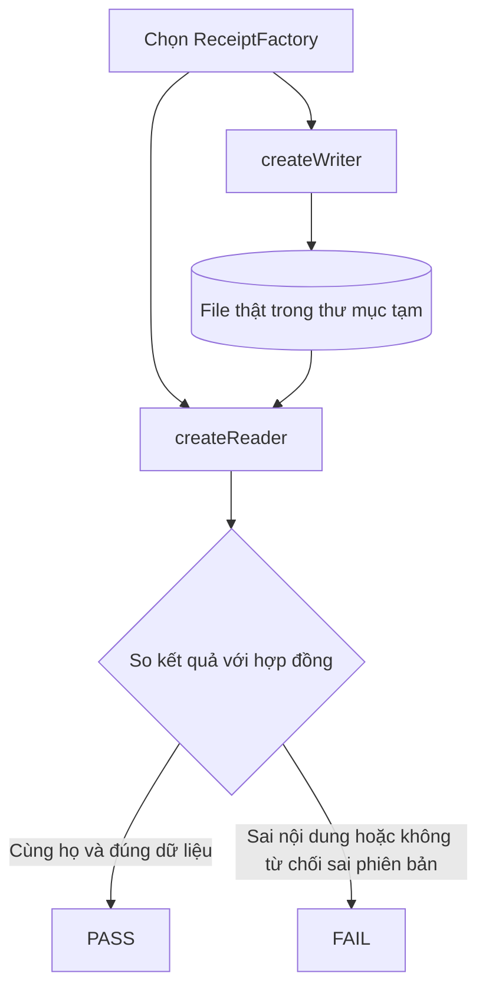
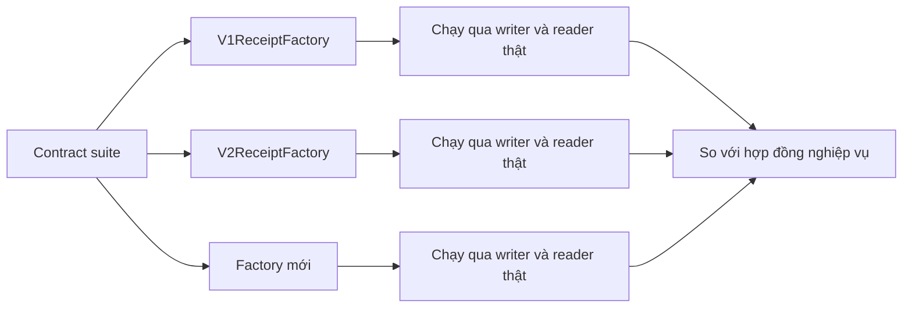

# Kiểm thử tích hợp cho các cặp sản phẩm cần tương thích về ngữ nghĩa

Trong **Abstract Factory**, mỗi concrete factory tạo một **họ sản phẩm** được thiết kế để cộng tác. Tuy nhiên, việc factory trả về các đối tượng có đúng interface chưa chứng minh rằng chúng **hiểu cùng định dạng, đơn vị, phiên bản, trạng thái hoặc ngữ cảnh nghiệp vụ**. Một cặp sản phẩm có thể biên dịch được nhưng trao đổi dữ liệu sai, trả kết quả không đúng hoặc chỉ thất bại khi đã chạy qua nhiều bước.

Vì vậy, phần **Kiểm thử** của chủ đề Abstract Factory cần có **kiểm thử tích hợp cho các cặp sản phẩm cần tương thích về ngữ nghĩa** (*semantic compatibility*). Mục tiêu là khởi tạo các sản phẩm thật qua concrete factory, cho chúng **tương tác qua một ranh giới thực tế** rồi xác minh kết quả, dữ liệu trung gian và các tình huống lỗi theo một hợp đồng thống nhất.

Bài này dùng ví dụ hai cặp `ReceiptWriter` và `ReceiptReader` của giao thức V1/V2. Chúng ghi và đọc biên lai qua **file thật**; kiểm thử sử dụng JUnit 5 và thư mục tạm do JUnit quản lý. Từ ví dụ này có thể áp dụng cùng tư duy cho adapter thanh toán, truy cập dữ liệu, giao diện hoặc các bộ sản phẩm khác.

## 1. Vì sao kiểm thử từng sản phẩm riêng lẻ chưa đủ?

Giả sử hệ thống có hai interface:

```java
interface ReceiptWriter {
    void write(Path file, Receipt receipt) throws IOException;
}

interface ReceiptReader {
    Receipt read(Path file) throws IOException;
}
```

Nếu `V1Writer` tạo file và `V1Reader` đọc lại file đó, chúng phải **đồng ý về định dạng** và **giữ nguyên ý nghĩa dữ liệu**. Ví dụ, giá trị `amountMinor = 125075` phải được hiểu là **125.075 đơn vị nhỏ nhất của đồng tiền**, không phải một số tiền đã bị nhân hoặc chia thêm.

Kiểm thử đơn vị độc lập có thể chứng minh `V1Writer` gọi được `write(...)` và `V1Reader` gọi được `read(...)` với dữ liệu giả. Nhưng khi tích hợp, hai sản phẩm còn phải đáp ứng một hợp đồng chung:

| Tầng cần kiểm tra | Ví dụ | Cách phát hiện |
| --- | --- | --- |
| **Tương thích kiểu** | `write(Path, Receipt)` và `read(Path)` đúng chữ ký | Compiler, kiểm tra interface |
| **Tương thích định dạng** | Reader nhận biết phiên bản và thứ tự các trường mà Writer đã ghi | Kiểm thử qua file/dữ liệu truyền thực |
| **Tương thích ngữ nghĩa** | ID, số tiền theo đơn vị nhỏ nhất và mã tiền tệ được giữ đúng ý nghĩa | Đối chiếu với giá trị kỳ vọng độc lập |
| **Hợp đồng lỗi** | Reader từ chối file sai phiên bản, thiếu dữ liệu hoặc dư dữ liệu | Kiểm thử âm (*negative test*) |
| **Tương thích theo họ** | Hai sản phẩm tạo từ cùng factory thực sự phối hợp được | Chạy cùng một bộ kiểm thử cho **mọi concrete factory** |

Trong Abstract Factory, **factory là điểm lựa chọn họ**, còn **kiểm thử tích hợp là nơi xác nhận các sản phẩm của họ đó thật sự cộng tác đúng**. Cần kiểm tra hành vi qua các interface trừu tượng mà client sử dụng, không chỉ kiểm tra tên lớp cụ thể.

## 2. Thiết lập hợp đồng tích hợp và ma trận cặp sản phẩm

Giả sử hệ thống lưu biên lai với ba trường:

- `id`: mã biên lai, có thể chứa ký tự Unicode.
- `amountMinor`: số tiền **nguyên theo đơn vị nhỏ nhất** (không phải số thực).
- `currency`: mã tiền tệ gồm ba chữ cái viết hoa, ví dụ `VND`.

Cả V1 và V2 đều phải phục hồi **đúng ba giá trị này**. Điểm khác nhau nằm ở cấu trúc file:

| Thuộc tính | Họ V1 | Họ V2 |
| --- | --- | --- |
| Dấu nhận diện | Số nguyên `0x52563121` (tương ứng “RV1!” theo byte ASCII) | `0x52563221` (“RV2!”) |
| Thứ tự trường | `id` → `amountMinor` → `currency` | `currency` → `id` → `amountMinor` |
| Mã hóa chuỗi trong ví dụ Java | `DataOutputStream.writeUTF` | `DataOutputStream.writeUTF` |
| Sản phẩm tạo từ factory | `V1ReceiptWriter` + `V1ReceiptReader` | `V2ReceiptWriter` + `V2ReceiptReader` |
| Hợp đồng đọc sai phiên bản | Từ chối file V2 | Từ chối file V1 |

**Lưu ý về mã hóa:** `writeUTF` của `DataOutputStream` sử dụng dạng **modified UTF-8** riêng của Java, có tiền tố độ dài, chứ không phải file văn bản UTF-8 thông thường. Trong ví dụ, cả hai phía dùng đúng định dạng này. Hệ thống liên thông với ngôn ngữ khác cần đặc tả chuẩn truyền dữ liệu rõ ràng hơn.

Từ hợp đồng trên, lập **ma trận kiểm thử tương thích**:

| Writer ↓ / Reader → | Reader V1 | Reader V2 |
| --- | --- | --- |
| Writer V1 | **Thành công:** giữ nguyên biên lai | **Từ chối:** sai phiên bản |
| Writer V2 | **Từ chối:** sai phiên bản | **Thành công:** giữ nguyên biên lai |

Ma trận này có ý nghĩa **vì hợp đồng của ví dụ cố ý không cho phép tương thích chéo**. Với một giao thức có chính sách tương thích ngược, ô `Writer V1 → Reader V2` có thể phải **thành công**; khi đó kiểm thử phải diễn đạt chính sách tương thích ngược ấy. Không nên mặc định “khác họ là phải thất bại” trong mọi hệ thống.



## 3. Các bất biến ngữ nghĩa phải được phát biểu trước khi viết test

Đừng chỉ viết `assertNotNull(reader.read(file))` hay `assertInstanceOf(...)`. Trước khi kiểm thử, cần có những **khẳng định nghiệp vụ có thể quan sát được**:

1. **Bảo toàn dữ liệu:** Với biên lai hợp lệ `r`, đọc lại file do writer **cùng họ** ghi phải cho ra biên lai có `id`, `amountMinor` và `currency` bằng `r`.
2. **Bảo toàn đơn vị:** `amountMinor` không bị chuyển từ đơn vị nhỏ nhất sang đơn vị chính, làm tròn hoặc chuyển sang kiểu số thực ngoài hợp đồng.
3. **Nhận diện định dạng:** Mỗi reader chấp nhận file theo phiên bản được hỗ trợ và từ chối dữ liệu không thuộc phiên bản đó.
4. **Đầy đủ dữ liệu:** Thiếu trường hoặc có byte ngoài cấu trúc quy định phải bị báo lỗi, nếu hợp đồng yêu cầu từ chối.
5. **Không rò rỉ tài nguyên:** Writer và Reader đóng luồng file kể cả khi gặp lỗi. Kiểm thử dùng file tạm độc lập để kiểm soát trạng thái giữa các lần chạy.
6. **Thay thế factory:** Cùng một phép thử hợp đồng có thể chạy cho `V1ReceiptFactory` và `V2ReceiptFactory` mà không sửa logic kiểm thử.

Một hợp đồng thử nghiệm đơn giản có thể viết như sau:

```text
Với mọi concrete factory F và biên lai hợp lệ r:
  F.createWriter().write(file, r)
  actual = F.createReader().read(file)
  actual.id == r.id
  actual.amountMinor == r.amountMinor
  actual.currency == r.currency
```

**Hạn chế của phép thử vòng đi rồi quay lại (*round-trip*):** Writer và Reader có thể mắc **cùng một lỗi đối xứng** mà phép thử vẫn pass. Ví dụ, Writer nhân số tiền lên 100 còn Reader chia 100 thì kết quả cuối bằng ban đầu, nhưng file không tuân thủ hợp đồng liên thông. Vì vậy, cần thêm **kiểm tra cấu trúc file theo một chuẩn kỳ vọng độc lập** hoặc **golden fixture** được tạo từ một hệ thống/đặc tả đáng tin cậy.

## 4. Ví dụ Java: bộ sản phẩm thật để kiểm thử tích hợp

Mã dưới đây định nghĩa hai họ sản phẩm, các interface, dữ liệu mẫu và bài kiểm thử JUnit 5 trong cùng một tệp `ReceiptFamilyIntegrationTest.java`. Việc đặt lớp phụ trợ ngay trong test giúp ví dụ **tự chứa**; trong dự án thật, các implementation nên nằm ở mã sản phẩm và bài test chỉ import chúng.

Các sản phẩm ghi/đọc qua `java.nio.file.Files` và `DataInputStream`/`DataOutputStream` thật, không mock các thao tác I/O. Do đó bài test quan sát được **quá trình writer → file → reader**, một ranh giới tích hợp cụ thể. Một bài test trên file hệ thống cục bộ vẫn chưa chứng minh tích hợp với server, cloud storage, database hay đối tác bên ngoài.

```java
import org.junit.jupiter.api.Test;
import org.junit.jupiter.api.io.TempDir;

import java.io.BufferedInputStream;
import java.io.BufferedOutputStream;
import java.io.DataInputStream;
import java.io.DataOutputStream;
import java.io.IOException;
import java.nio.file.Files;
import java.nio.file.Path;
import java.nio.file.StandardOpenOption;
import java.util.Arrays;
import java.util.List;
import java.util.Objects;

import static org.junit.jupiter.api.Assertions.*;

class ReceiptFamilyIntegrationTest {
    @TempDir
    Path directory;

    static final int V1_MAGIC = 0x52563121;
    static final int V2_MAGIC = 0x52563221;

    // Dữ liệu nghiệp vụ: số tiền luôn ở đơn vị nhỏ nhất.
    static final class Receipt {
        final String id;
        final long amountMinor;
        final String currency;

        Receipt(String id, long amountMinor, String currency) {
            if (id == null || id.trim().isEmpty()) {
                throw new IllegalArgumentException("ID không hợp lệ");
            }
            if (amountMinor < 0) {
                throw new IllegalArgumentException("Số tiền âm");
            }
            if (currency == null || !currency.matches("[A-Z]{3}")) {
                throw new IllegalArgumentException("Mã tiền tệ không hợp lệ");
            }
            this.id = id;
            this.amountMinor = amountMinor;
            this.currency = currency;
        }

        @Override
        public boolean equals(Object value) {
            if (this == value) return true;
            if (!(value instanceof Receipt)) return false;
            Receipt other = (Receipt) value;
            return amountMinor == other.amountMinor
                    && id.equals(other.id)
                    && currency.equals(other.currency);
        }

        @Override
        public int hashCode() {
            return Objects.hash(id, amountMinor, currency);
        }
    }

    // Abstract products và Abstract Factory.
    interface ReceiptWriter {
        void write(Path file, Receipt receipt) throws IOException;
    }

    interface ReceiptReader {
        Receipt read(Path file) throws IOException;
    }

    interface ReceiptFactory {
        String family();
        ReceiptWriter createWriter();
        ReceiptReader createReader();
    }

    static final class V1ReceiptFactory implements ReceiptFactory {
        public String family() { return "V1"; }
        public ReceiptWriter createWriter() { return new V1ReceiptWriter(); }
        public ReceiptReader createReader() { return new V1ReceiptReader(); }
    }

    static final class V2ReceiptFactory implements ReceiptFactory {
        public String family() { return "V2"; }
        public ReceiptWriter createWriter() { return new V2ReceiptWriter(); }
        public ReceiptReader createReader() { return new V2ReceiptReader(); }
    }

    static final class V1ReceiptWriter implements ReceiptWriter {
        public void write(Path file, Receipt receipt) throws IOException {
            Objects.requireNonNull(receipt);
            try (DataOutputStream out = new DataOutputStream(
                    new BufferedOutputStream(Files.newOutputStream(
                            file, StandardOpenOption.CREATE_NEW)))) {
                out.writeInt(V1_MAGIC);
                out.writeUTF(receipt.id);
                out.writeLong(receipt.amountMinor);
                out.writeUTF(receipt.currency);
            }
        }
    }

    static final class V2ReceiptWriter implements ReceiptWriter {
        public void write(Path file, Receipt receipt) throws IOException {
            Objects.requireNonNull(receipt);
            try (DataOutputStream out = new DataOutputStream(
                    new BufferedOutputStream(Files.newOutputStream(
                            file, StandardOpenOption.CREATE_NEW)))) {
                out.writeInt(V2_MAGIC);
                out.writeUTF(receipt.currency);
                out.writeUTF(receipt.id);
                out.writeLong(receipt.amountMinor);
            }
        }
    }

    static final class V1ReceiptReader implements ReceiptReader {
        public Receipt read(Path file) throws IOException {
            try (DataInputStream in = new DataInputStream(
                    new BufferedInputStream(Files.newInputStream(file)))) {
                requireVersion(in.readInt(), V1_MAGIC);
                String id = in.readUTF();
                long amountMinor = in.readLong();
                String currency = in.readUTF();
                requireEndOfFile(in);
                return validReceipt(id, amountMinor, currency);
            }
        }
    }

    static final class V2ReceiptReader implements ReceiptReader {
        public Receipt read(Path file) throws IOException {
            try (DataInputStream in = new DataInputStream(
                    new BufferedInputStream(Files.newInputStream(file)))) {
                requireVersion(in.readInt(), V2_MAGIC);
                String currency = in.readUTF();
                String id = in.readUTF();
                long amountMinor = in.readLong();
                requireEndOfFile(in);
                return validReceipt(id, amountMinor, currency);
            }
        }
    }

    static void requireVersion(int actual, int expected) throws IOException {
        if (actual != expected) {
            throw new IOException("Sai phiên bản định dạng biên lai");
        }
    }

    static void requireEndOfFile(DataInputStream in) throws IOException {
        if (in.read() != -1) {
            throw new IOException("Dữ liệu thừa sau biên lai");
        }
    }

    static Receipt validReceipt(
            String id, long amountMinor, String currency) throws IOException {
        try {
            return new Receipt(id, amountMinor, currency);
        } catch (IllegalArgumentException error) {
            throw new IOException("Dữ liệu biên lai không hợp lệ", error);
        }
    }

    static List<ReceiptFactory> allFactories() {
        return Arrays.asList(
                new V1ReceiptFactory(),
                new V2ReceiptFactory());
    }

    // Test 1: tích hợp writer -> file thật -> reader cùng họ.
    @Test
    void allFamiliesPreserveReceiptSemantics() throws IOException {
        List<Receipt> samples = Arrays.asList(
                new Receipt("HD-001", 125075L, "VND"),
                new Receipt("ĐƠN-đặc-biệt", 0L, "VND"),
                new Receipt("PAY-42", 999999999L, "USD"));

        for (ReceiptFactory factory : allFactories()) {
            int index = 0;
            for (Receipt expected : samples) {
                Path file = directory.resolve(
                        factory.family() + "-" + index++ + ".bin");
                factory.createWriter().write(file, expected);

                assertTrue(Files.size(file) > 0, factory.family());
                Receipt actual = factory.createReader().read(file);
                assertEquals(expected.id, actual.id);
                assertEquals(expected.amountMinor, actual.amountMinor);
                assertEquals(expected.currency, actual.currency);
                assertEquals(expected, actual, factory.family());
            }
        }
    }

    // Test 2: kiểm tra độc lập schema trên đĩa của V1.
    @Test
    void v1WriterFollowsPublishedWireContract() throws IOException {
        Path file = directory.resolve("v1-contract.bin");
        new V1ReceiptFactory().createWriter()
                .write(file, new Receipt("HD-001", 125075L, "VND"));

        try (DataInputStream raw = new DataInputStream(
                Files.newInputStream(file))) {
            assertEquals(V1_MAGIC, raw.readInt());
            assertEquals("HD-001", raw.readUTF());
            assertEquals(125075L, raw.readLong());
            assertEquals("VND", raw.readUTF());
            assertEquals(-1, raw.read());
        }
    }

    // Test 3: kiểm tra độc lập schema trên đĩa của V2.
    @Test
    void v2WriterFollowsPublishedWireContract() throws IOException {
        Path file = directory.resolve("v2-contract.bin");
        new V2ReceiptFactory().createWriter()
                .write(file, new Receipt("HD-001", 125075L, "VND"));

        try (DataInputStream raw = new DataInputStream(
                Files.newInputStream(file))) {
            assertEquals(V2_MAGIC, raw.readInt());
            assertEquals("VND", raw.readUTF());
            assertEquals("HD-001", raw.readUTF());
            assertEquals(125075L, raw.readLong());
            assertEquals(-1, raw.read());
        }
    }

    // Test 4: không được chấp nhận ghép cặp sai phiên bản.
    @Test
    void crossFamilyReadersRejectUnsupportedFiles() throws IOException {
        Receipt sample = new Receipt("HD-001", 125075L, "VND");
        ReceiptFactory v1 = new V1ReceiptFactory();
        ReceiptFactory v2 = new V2ReceiptFactory();

        Path v1File = directory.resolve("from-v1.bin");
        v1.createWriter().write(v1File, sample);
        assertThrows(IOException.class,
                () -> v2.createReader().read(v1File));

        Path v2File = directory.resolve("from-v2.bin");
        v2.createWriter().write(v2File, sample);
        assertThrows(IOException.class,
                () -> v1.createReader().read(v2File));
    }

    // Test 5: từ chối file bị cắt và file có dữ liệu thừa.
    @Test
    void damagedWireDataDoesNotBecomeValidReceipt() throws IOException {
        Path truncated = directory.resolve("truncated.bin");
        try (DataOutputStream out = new DataOutputStream(
                Files.newOutputStream(truncated))) {
            out.writeInt(V1_MAGIC); // Thiếu id, số tiền, tiền tệ.
        }
        assertThrows(IOException.class,
                () -> new V1ReceiptReader().read(truncated));

        Path trailing = directory.resolve("trailing.bin");
        new V1ReceiptWriter().write(
                trailing, new Receipt("HD-001", 125075L, "VND"));
        Files.write(trailing, new byte[] {42}, StandardOpenOption.APPEND);
        assertThrows(IOException.class,
                () -> new V1ReceiptReader().read(trailing));
    }
}
```

Đặt file trong `src/test/java/` của một dự án Java đã cấu hình **JUnit Jupiter (JUnit 5)**. Với Maven và plugin chạy JUnit 5 được cấu hình, có thể chạy riêng bài kiểm thử bằng:

```bash
mvn -Dtest=ReceiptFamilyIntegrationTest test
```

Ví dụ sử dụng các API Java có trong Java 8 trở lên; cấu hình JUnit Jupiter, công cụ build và phiên bản JDK cần phù hợp với dự án. Không cần tạo file mẫu bằng tay vì `@TempDir` cung cấp thư mục riêng cho từng lần chạy test theo vòng đời do JUnit quản lý.

**Điểm cốt lõi của test tích hợp này:** mỗi concrete factory tạo **hai sản phẩm thật**; writer ghi dữ liệu ra **file thật**, reader đọc lại; test kiểm tra **giá trị nghiệp vụ**, **schema trên đĩa** và **khả năng từ chối dữ liệu sai hợp đồng**. Việc cả hai cùng implement interface chưa đủ để làm những test trên pass.

## 5. Đừng bỏ qua kiểm tra dựa trên một nguồn kỳ vọng độc lập

Một lỗi đáng chú ý khi kiểm thử cặp writer/reader là **hai sản phẩm đồng thời hiểu sai hợp đồng theo cùng một cách**. Ví dụ:

```text
Hợp đồng: amountMinor = 125075 phải được ghi trực tiếp.
Writer lỗi: ghi 125075 * 100.
Reader lỗi: đọc dữ liệu rồi chia 100.
Round-trip: vẫn trả 125075 nên test chỉ so đầu ra có thể PASS.
File thực tế: không đúng định dạng đã thỏa thuận.
```

Do đó, **Test 2 và Test 3** không đọc file bằng chính reader đang được kiểm tra; chúng dùng `DataInputStream` để so từng trường theo định dạng đã công bố. Đây là một dạng **oracle độc lập ở mức cấu trúc**, giúp giảm nguy cơ hai bên cùng sai rồi “tự xác nhận” lẫn nhau.

Khi tích hợp với hệ thống khác, có thể dùng:

| Loại oracle | Nguồn kỳ vọng | Dùng khi nào? |
| --- | --- | --- |
| **Golden fixture** | File chuẩn được xác nhận từ tài liệu giao thức hoặc phía đối tác | Có đặc tả byte/JSON/schema ổn định |
| **Đối chiếu trường** | Bảng dữ liệu nghiệp vụ gốc và kết quả được đọc | Cần kiểm tra mã, đơn vị, trạng thái, định danh |
| **Triển khai tham chiếu** | Bộ đọc/ghi độc lập đã được kiểm chứng | Có nhiều implementation phải liên thông |
| **Kiểm thử hợp đồng bên ngoài** | Sandbox hoặc dịch vụ thật của đối tác | Hệ thống phụ thuộc API, auth, trạng thái từ bên ngoài |
| **Bất biến xuyên suốt** | Quy tắc nghiệp vụ có thể kiểm chứng, như không tăng tổng tiền khi hoàn tiền | Luồng gồm nhiều thao tác liên quan |

Oracle càng phụ thuộc vào **cùng một đoạn mã** của cả writer lẫn reader thì nguy cơ “cùng sai mà vẫn pass” càng cao. Một test có ý nghĩa cần xác nhận dữ liệu trung gian và kết quả theo hợp đồng được thống nhất **ngoài hai implementation đang kiểm thử**.

## 6. Thiết kế một bộ contract test dùng lại cho mọi họ sản phẩm

Thêm concrete factory mới không nên đồng nghĩa với viết lại tất cả bài kiểm thử. Ví dụ ở phần 4 sử dụng vòng lặp qua `allFactories()`, lấy từng cặp sản phẩm qua **`ReceiptFactory`** để kiểm tra cùng một hợp đồng.

Khi dự án có nhiều họ, có thể tổ chức test thành hai lớp:

1. **Contract suite chung:** kiểm tra mọi factory đều cung cấp đúng cặp sản phẩm, giữ nguyên dữ liệu nghiệp vụ, xử lý dữ liệu hợp lệ và báo lỗi cho những trường hợp bắt buộc.
2. **Bài test riêng theo biến thể:** kiểm tra định dạng, chức năng, cấu hình hoặc lỗi đặc thù của một nhà cung cấp/phiên bản.

Ví dụ, khi thêm `V3ReceiptFactory`, hãy đưa nó vào danh sách nhà cung cấp factory và bổ sung những oracle về schema V3. Nếu V3 được yêu cầu đọc cả V2, hãy sửa **ma trận tương thích** để thể hiện ô V2 → V3 là thành công, rồi bổ sung trường hợp kiểm thử đó.

Một số dự án sử dụng `@ParameterizedTest` hoặc `@TestFactory` của JUnit 5 để tạo báo cáo độc lập theo từng biến thể. Đó là cách tổ chức test; **giá trị thật của test vẫn nằm ở các bất biến ngữ nghĩa**, dữ liệu thực, điều kiện lỗi và oracle kiểm tra.



### Trường hợp chỉ có một interface nhưng nhiều lớp

Nếu ứng dụng chỉ cần một `ReceiptWriter` và không có sản phẩm khác phải phối hợp, Simple Factory hoặc dependency injection có thể đủ. **Kiểm thử cặp sản phẩm** trở nên quan trọng khi có ít nhất hai loại sản phẩm mà hành vi của sản phẩm này là đầu vào, trạng thái hoặc điều kiện sử dụng của sản phẩm kia.

## 7. Các tình huống tích hợp thực tế cần kiểm thử thêm

Đối với cặp sản phẩm làm việc với database, message broker, REST API hoặc giao dịch, hợp đồng còn rộng hơn việc đọc lại dữ liệu:

| Cặp sản phẩm | Bất biến ngữ nghĩa cần xác minh | Ranh giới tích hợp phù hợp |
| --- | --- | --- |
| `ChargeGateway` + `RefundGateway` | Hoàn tiền đúng giao dịch, currency, số tiền, merchant và trạng thái; không hoàn vượt số tiền cho phép | Sandbox nhà cung cấp hoặc hệ thống kiểm thử tích hợp hỗ trợ trạng thái thật |
| `DataWriter` + `DataReader` | Schema, timezone, encoding, precision và transaction visibility nhất quán | Database/driver thực trong môi trường test |
| `EventPublisher` + `EventConsumer` | Event type, schema version, ordering, idempotency và correlation ID phù hợp | Broker và serializer/consumer thật |
| `UiButton` + `UiDialog` | Theme, trạng thái disabled, focus, accessibility và hành vi tương tác phù hợp | Component/integration test trong môi trường UI |
| `RequestSigner` + `RequestVerifier` | Quy ước canonicalization, thuật toán, key ID, timestamp và phạm vi xác thực phù hợp | Luồng ký và xác minh thật với khóa kiểm thử |

Với **adapter thanh toán**, ví dụ, chỉ khẳng định `refund(transactionId)` trả thành công là chưa đủ. Cần dùng một charge được tạo qua đúng cặp sản phẩm, xác nhận currency/amount/account và đối chiếu trạng thái với sandbox hoặc nguồn dữ liệu tham chiếu. Những trạng thái như lỗi mạng, timeout, retry và duplicate request phải có quy tắc kiểm thử riêng.

Với **hệ thống bất đồng bộ**, không nên dùng `Thread.sleep(...)` dài và hy vọng event xuất hiện. Dùng công cụ đồng bộ, polling có timeout và điều kiện hoàn thành rõ ràng. Test cần kiểm tra **trạng thái cuối** và bất biến nghiệp vụ, không chỉ việc API đã nhận một yêu cầu.

## 8. Tách bạch kiểm thử đơn vị, kiểm thử tích hợp và end-to-end

| Mức kiểm thử | Cái gì được chạy thật? | Nó trả lời câu hỏi nào? |
| --- | --- | --- |
| Unit test | Một writer, reader hoặc factory riêng lẻ; dependency có thể được giả lập | Logic cục bộ của một sản phẩm có đúng không? |
| **Integration test** | **Hai hoặc nhiều sản phẩm thật** cùng làm việc qua file, database, broker, API hoặc ranh giới quan sát được | Các sản phẩm có cộng tác đúng theo hợp đồng ngữ nghĩa không? |
| End-to-end test | Luồng nghiệp vụ từ điểm vào đến các đầu ra chính của hệ thống | Toàn bộ hệ thống có đáp ứng yêu cầu người dùng không? |

Ví dụ JUnit ở phần 4 là **kiểm thử tích hợp trong phạm vi file I/O cục bộ**. Nó không phải end-to-end test cho một hệ thống xuất biên lai hoàn chỉnh và cũng không thay thế kiểm thử tương tác với đối tác thật.

Nếu thay cả writer lẫn reader bằng mock trả về sẵn kết quả theo kịch bản, test chỉ chứng minh **cách client gọi mock**, chưa chứng minh hai implementation thực sự tương thích. Có thể dùng mock cho những dependency **không liên quan** đến tương tác đang được đánh giá, như telemetry hay gửi email, để test vẫn tập trung và chạy ổn định.

## 9. Tính ổn định, dữ liệu và dọn dẹp môi trường kiểm thử

Kiểm thử tích hợp thường dễ thất bại không ổn định (*flaky*) nếu chia sẻ trạng thái, phụ thuộc thời gian hoặc tài nguyên ngoài. Một số nguyên tắc:

- **Cô lập dữ liệu:** dùng thư mục tạm, schema/database test riêng hoặc ID duy nhất; không dùng chung một giao dịch đang được test khác sửa.
- **Chọn fixture đại diện:** ngoài dữ liệu bình thường, kiểm tra Unicode, giá trị rỗng hợp lệ, tiền lớn, định dạng lỗi và các giới hạn được đặc tả. Với số tiền, dùng kiểu số nguyên theo đơn vị nhỏ nhất khi hợp đồng quy định như vậy.
- **Kiểm soát vòng đời:** dùng `try-with-resources` để đóng stream, connection, session; dùng fixture/teardown để thu hồi tài nguyên theo đúng quyền sở hữu.
- **Không phụ thuộc thứ tự:** mỗi test tự thiết lập trạng thái của nó, không chờ test khác chạy trước.
- **Timeout rõ ràng:** với hệ thống mạng/bất đồng bộ, chờ có giới hạn và thông báo lỗi đủ thông tin để chẩn đoán.
- **Phân biệt lỗi sản phẩm với lỗi môi trường:** sự cố sandbox, chứng chỉ, DNS hoặc quyền truy cập phải có log và điều kiện kiểm tra phù hợp; không bỏ qua mọi lỗi dưới danh nghĩa test không ổn định.

Trong mã ví dụ, `@TempDir` tránh để các file test từ lần chạy trước ảnh hưởng lần chạy sau. Đối với database hoặc broker thực, chiến lược tương ứng có thể là tạo schema/topic riêng, dùng container test và dọn dẹp sau khi test. Những thao tác này phải có giới hạn để không đụng vào dữ liệu thật.

## 10. Sai lầm thường gặp khi kiểm thử tương thích ngữ nghĩa

### Chỉ khẳng định lớp trả về là đúng kiểu

`assertTrue(factory.createReader() instanceof ReceiptReader)` chỉ kiểm tra interface. Nó không chứng minh reader hiểu file mà writer cùng factory tạo ra. Cần chạy **luồng cộng tác** và so kết quả theo hợp đồng.

### Chỉ thực hiện round-trip rồi kết luận đã đúng chuẩn

Hai sản phẩm cùng lỗi có thể phục hồi đúng dữ liệu nội bộ nhưng không liên thông với hệ thống khác. Cần thêm golden fixture, oracle theo schema và kiểm chứng với triển khai tham chiếu nếu có.

### Dùng toàn mock cho cặp sản phẩm đang kiểm tra

Mock `ReceiptWriter` và `ReceiptReader` giúp kiểm thử logic điều phối của client, nhưng không kiểm tra định dạng hay việc truyền dữ liệu thực. Trong integration test, hãy giữ **các sản phẩm thuộc cặp đang đánh giá là implementation thật**.

### Mặc định mọi cặp khác họ đều phải lỗi

Một số giao thức có yêu cầu backward compatibility; cặp từ hai phiên bản khác nhau vẫn có thể hợp lệ. Cần định nghĩa chính sách tương thích rồi lập ma trận expected PASS/REJECT. Không mã hóa kết luận dựa trên tên lớp.

### Không kiểm tra trường hợp thất bại

Một cặp sản phẩm có thể hoạt động khi dữ liệu hợp lệ nhưng âm thầm bỏ qua dữ liệu thừa, giải mã sai ký tự hoặc trả kết quả thiếu trường. Kiểm thử negative paths phải dựa trên yêu cầu rõ ràng và xác nhận loại lỗi có thể sử dụng để chẩn đoán.

### Test phụ thuộc hạ tầng dùng chung mà không quản lý trạng thái

Dữ liệu từ những lần chạy trước, đồng hồ hệ thống, cơ chế retry hoặc môi trường bên ngoài có thể tạo kết quả thất thường. Thiết kế test theo phạm vi độc lập, có dọn dẹp và dùng điều kiện chờ rõ ràng.

## 11. Bài tập vận dụng: cặp thu tiền và hoàn tiền

Một nền tảng thương mại điện tử hỗ trợ hai nhà cung cấp **Provider A** và **Provider B**. Mỗi concrete `PaymentFactory` tạo:

- `ChargeGateway`: tạo giao dịch thu tiền.
- `RefundGateway`: hoàn tiền cho một giao dịch đã thu.

Các interface đều nhận mã giao dịch kiểu `String` và số tiền kiểu `long`, nhưng giao dịch của A **không được** hoàn qua B. Số tiền trong hợp đồng là **đơn vị nhỏ nhất**, và mỗi giao dịch gắn với một **merchant account** cùng **môi trường**.

Hãy thiết kế một bộ kiểm thử tích hợp có các trường hợp:

1. Dùng cùng một factory để thu tiền rồi hoàn một phần; xác minh giao dịch, số tiền còn lại, currency và merchant account.
2. Thử dùng `ChargeGateway` của A với `RefundGateway` của B; xác minh cơ chế từ chối theo chính sách nghiệp vụ.
3. Thử hoàn hai lần cùng một request ID; xác minh **quy tắc idempotency** của provider (nếu được hỗ trợ) thay vì tự giả định một hành vi.
4. Thử timeout/response không rõ kết quả; kiểm tra cơ chế truy vấn trạng thái và tránh hoàn trùng ngoài ý muốn.
5. Kiểm tra đối chiếu số tiền bằng **nguồn trạng thái đáng tin cậy** từ sandbox, không chỉ dựa vào hai adapter có thể cùng sai đơn vị.

**Hướng giải:** tạo giao dịch test qua `PaymentFactory` của A hoặc B, cho các gateway thật tương tác trong sandbox có thể kiểm tra trạng thái, ghi lại ID/amount/currency/merchant, đối chiếu sau mỗi thao tác và dọn dẹp dữ liệu theo chính sách sandbox. Dùng chung contract suite cho cả hai concrete factory; bổ sung các bài test đặc thù cho quy tắc từng provider. Cách làm này kiểm tra **hành vi cộng tác** chứ không chỉ khả năng thay thế kiểu dữ liệu.

## 12. Checklist trước khi hoàn thành bài kiểm thử tích hợp

1. Có xác định **cặp hoặc nhóm sản phẩm phải cộng tác** và **phạm vi họ** được lựa chọn hay chưa?
2. Có mô tả rõ **đơn vị dữ liệu, định dạng, phiên bản, trạng thái, ngữ cảnh và lỗi** được cam kết hay chưa?
3. Test có tạo **sản phẩm thật qua concrete factory**, thay vì chỉ xác minh mock hoặc tên lớp không?
4. Test có đi qua **ranh giới tích hợp thật** của tác vụ (file, database, broker, API, UI) không?
5. Có xác nhận **kết quả nghiệp vụ cuối cùng** và **dữ liệu trung gian** bằng oracle độc lập không?
6. Có test trường hợp sai họ, dữ liệu hỏng, trạng thái sai, timeout/retry **theo đúng chính sách hỗ trợ** không?
7. Có cùng một **contract suite** áp dụng cho mọi factory và bài test riêng khi biến thể yêu cầu không?
8. Có cô lập fixture, quản lý tài nguyên và dọn dẹp để test lặp lại đáng tin cậy không?

## Tổng kết

Trong Abstract Factory, các sản phẩm **cùng kiểu** có thể không **cùng ngữ nghĩa**. Kiểm thử tích hợp phải cho các sản phẩm thật do factory tạo ra **trao đổi dữ liệu hoặc trạng thái qua ranh giới thực**, rồi đối chiếu với hợp đồng nghiệp vụ và định dạng.

Một bộ test vững chắc gồm **round-trip hoặc luồng cộng tác thành công**, **oracle độc lập** để phát hiện lỗi hai chiều, **ma trận tương thích** cho cặp cùng/khác họ, và **kiểm thử tình huống lỗi**. Khi giữ các bài test này như một hợp đồng chung cho mọi concrete factory, việc thêm họ sản phẩm mới trở nên an toàn hơn: client có thể thay factory trong khi vẫn có bằng chứng thực nghiệm rằng các sản phẩm của họ mới phối hợp đúng.
