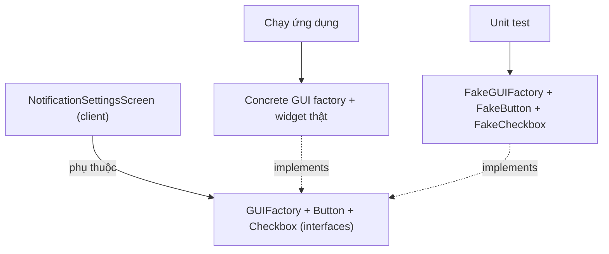
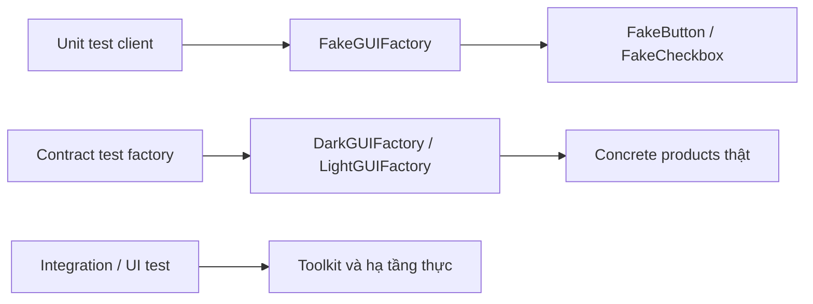

# Dùng fake factory và fake product để kiểm thử client độc lập với hạ tầng

## 1. Mục tiêu của bài học

Trong mẫu thiết kế **Abstract Factory** thuộc nhóm *Creational Design Patterns*, client tạo và sử dụng một **họ sản phẩm liên quan** thông qua các interface. Cách thiết kế đó đặc biệt hữu ích khi kiểm thử: thay vì khởi động giao diện thật, truy cập dịch vụ bên ngoài hoặc nạp thư viện hạ tầng, test có thể truyền vào client một **fake factory** tạo ra những **fake product** đơn giản trong bộ nhớ.

Bài học thuộc chương **Kiểm thử** của chủ đề **Abstract Factory trong Design Pattern**. Sau khi học, bạn có thể:

- Nhận diện ranh giới phụ thuộc giữa **client**, **AbstractFactory**, **AbstractProduct** và các implementation gắn với hạ tầng.
- Xây dựng một **fake factory** triển khai đúng factory interface và cung cấp đủ **fake product** của các loại mà client cần.
- Dùng fake product để trả dữ liệu có kiểm soát, ghi nhận lời gọi và kiểm tra kết quả mà không cần GUI toolkit hoặc hệ thống bên ngoài.
- Kiểm thử cả nhánh thành công, nhánh khác điều kiện và các thao tác mà client đã yêu cầu sản phẩm thực hiện.
- Hiểu điều fake unit test **chứng minh được** và điều cần kiểm tra riêng bằng **contract test/integration test** trên concrete factory thật.

Ví dụ dùng **Java 17+**, không cần thư viện test hoặc framework DI. Phần kiểm tra được chạy bằng các hàm assertion đơn giản trong `main`. Bạn có thể chuyển cùng ý tưởng sang JUnit sau khi hiểu luồng kiểm thử.

## 2. Vì sao dùng Abstract Factory giúp kiểm thử dễ hơn?

Giả sử một màn hình cài đặt thông báo phải tạo:

1. Một `Checkbox` “Nhận thông báo”, có trạng thái được chọn hoặc chưa chọn.
2. Một `Button` “Lưu”; nút chỉ được bật khi checkbox đang được chọn.

Ứng dụng thực có thể dùng Swing, JavaFX hoặc một thư viện UI khác. Nếu client trực tiếp tạo widget của toolkit, bài test client có thể phải khởi tạo môi trường đồ họa, xử lý event loop hoặc chịu ảnh hưởng của hệ điều hành.

Một dạng phụ thuộc chặt vào hạ tầng:

```java
// Minh họa vấn đề: client tạo widget hạ tầng trực tiếp.
final class HardToTestScreen {
    void show() {
        javax.swing.JCheckBox box =
                new javax.swing.JCheckBox("Nhận thông báo");
        javax.swing.JButton button =
                new javax.swing.JButton("Lưu");

        button.setEnabled(box.isSelected());
        // Các bước tiếp theo còn phụ thuộc giao diện Swing.
    }
}
```

Đoạn trên không sai cú pháp Java, nhưng muốn kiểm thử riêng **quyết định bật/tắt nút**, ta phải làm việc với các lớp Swing dù logic thực chất chỉ cần hai hành vi: đọc trạng thái checkbox và đặt trạng thái nút.

Với Abstract Factory, ta định nghĩa những interface thể hiện đúng nhu cầu đó:

```java
interface Button {
    void setEnabled(boolean enabled);
    void render();
}

interface Checkbox {
    boolean isChecked();
    void render();
}

interface GUIFactory {
    Button createButton(String label);
    Checkbox createCheckbox(String label, boolean initiallyChecked);
}
```

Client chỉ nhìn thấy `GUIFactory`, `Button` và `Checkbox`. Khi chạy ứng dụng, composition root có thể truyền một `SwingGUIFactory` hoặc một concrete factory tương ứng hạ tầng thật. Khi chạy unit test, ta truyền `FakeGUIFactory`.



**Nguyên tắc thiết kế cần thấy rõ:** client **không biết** mình đang nhận product thật hay product fake; nó chỉ gọi các hành vi trên product interface. Đây là khả năng thay thế implementation mà Abstract Factory hỗ trợ.

## 3. Phân biệt fake factory, fake product và các test double khác

Trong bài này, **fake factory** là một implementation nhỏ của `GUIFactory` dùng trong test; nó **tạo và trả các fake product**, thay vì tạo widget thực. Fake product là đối tượng triển khai `Button` hoặc `Checkbox`, hoạt động hoàn toàn trong bộ nhớ.

| Thành phần | Trong ứng dụng thật | Trong unit test |
|---|---|---|
| AbstractFactory | `GUIFactory` | **Vẫn là `GUIFactory`** |
| AbstractProduct A | `Button` | **Vẫn là `Button`** |
| AbstractProduct B | `Checkbox` | **Vẫn là `Checkbox`** |
| ConcreteFactory | `SwingGUIFactory` hoặc factory của toolkit khác | `FakeGUIFactory` |
| ConcreteProduct A | Widget nút thật/adapter của nó | `FakeButton` |
| ConcreteProduct B | Widget ô chọn thật/adapter của nó | `FakeCheckbox` |
| Client | `NotificationSettingsScreen` | **Chính client đó**, không thay thuật toán |

Một số thuật ngữ kiểm thử gần nhau:

- **Stub:** trả về dữ liệu định sẵn, thường không lưu lịch sử tương tác.
- **Fake:** có triển khai tối giản nhưng hoạt động được, thường sử dụng dữ liệu trong bộ nhớ; ví dụ một checkbox giả có trạng thái `checked`.
- **Spy:** ghi nhận các lần gọi và tham số để test có thể kiểm tra.
- **Mock:** đối tượng có kỳ vọng tương tác được cấu hình và xác minh, thường do framework hỗ trợ.

Một fake product có thể **đồng thời ghi nhận lời gọi** để phục vụ phép kiểm tra, tức mang một số đặc điểm của spy. Mục tiêu không phải tranh luận tên gọi mà là giữ implementation test **đủ nhỏ, có kiểm soát và không sử dụng hạ tầng thật**.

Fake factory khác với một fake product riêng lẻ: nếu chỉ fake `Button` mà client tự tạo `new SwingCheckbox(...)`, unit test vẫn còn phụ thuộc toolkit. Factory giúp thay **trọn bộ sản phẩm** mà client cần.

## 4. Client cần kiểm thử

Đây là logic nghiệp vụ mẫu: nếu thông báo đang được chọn thì nút “Lưu” được bật; nếu chưa được chọn thì nút bị vô hiệu hóa.

```java
import java.util.Objects;

final class NotificationSettingsScreen {
    private final GUIFactory factory;

    NotificationSettingsScreen(GUIFactory factory) {
        this.factory = Objects.requireNonNull(factory, "factory");
    }

    void show(boolean initiallyChecked) {
        Checkbox notifications = factory.createCheckbox(
                "Nhận thông báo", initiallyChecked);
        Button save = factory.createButton("Lưu");

        save.setEnabled(notifications.isChecked());

        notifications.render();
        save.render();
    }
}
```

Ở đây:

- Client nhận **`GUIFactory` qua constructor**. Đây là cách tiêm phụ thuộc đơn giản, không cần DI framework.
- Client yêu cầu hai **loại sản phẩm** qua factory, không gọi constructor của sản phẩm thật.
- Logic cần kiểm tra là `save.setEnabled(notifications.isChecked())`.
- Client gọi `render()` để yêu cầu mỗi sản phẩm hiển thị.
- Client không biết giao diện là Light, Dark, Swing, JavaFX hay fake.

Ta muốn xác minh ba nhóm hành vi: **tạo đúng sản phẩm với đúng tham số**, **đặt trạng thái nút đúng theo checkbox** và **yêu cầu hiển thị mỗi sản phẩm**. Không cần kiểm tra pixel hay khởi động giao diện thật để chứng minh những việc này.

## 5. Xây dựng FakeButton và FakeCheckbox

### 5.1. FakeButton: lưu trạng thái và ghi nhận lệnh

`FakeButton` phải triển khai đúng `Button`. Nó có thể lưu lần gọi gần nhất của `setEnabled` và số lần được render:

```java
final class FakeButton implements Button {
    final String label;
    boolean enabled;
    int setEnabledCalls;
    int renderCalls;

    FakeButton(String label) {
        this.label = label;
    }

    @Override
    public void setEnabled(boolean enabled) {
        this.enabled = enabled;
        setEnabledCalls++;
    }

    @Override
    public void render() {
        renderCalls++;
    }
}
```

Trong test, sau khi gọi client, ta có thể kiểm tra:

- `label` là `"Lưu"`.
- `setEnabledCalls == 1`.
- `enabled` đúng với trạng thái checkbox.
- `renderCalls == 1`.

Fake không cần vẽ nút. Nó chỉ cần đáp ứng những hành vi client thực sự sử dụng.

### 5.2. FakeCheckbox: cung cấp dữ liệu đầu vào có kiểm soát

`FakeCheckbox` lưu trạng thái `checked` và ghi nhận client đã đọc trạng thái bao nhiêu lần:

```java
final class FakeCheckbox implements Checkbox {
    final String label;
    final boolean checked;
    int isCheckedCalls;
    int renderCalls;

    FakeCheckbox(String label, boolean checked) {
        this.label = label;
        this.checked = checked;
    }

    @Override
    public boolean isChecked() {
        isCheckedCalls++;
        return checked;
    }

    @Override
    public void render() {
        renderCalls++;
    }
}
```

Với fake này, test chọn được hai trường hợp:

- `checked = true`: nút “Lưu” phải bật.
- `checked = false`: nút “Lưu” phải tắt.

Vì trạng thái được cấp qua constructor, test không phụ thuộc vào sự kiện click, thời điểm chạy event loop hoặc trạng thái ngầm của toolkit. `isCheckedCalls` còn giúp biết client có đọc checkbox hay không.

## 6. FakeGUIFactory: thay cả họ sản phẩm

Factory giả triển khai **chính interface production client đang dùng**, không phát minh một interface chỉ dành cho test:

```java
final class FakeGUIFactory implements GUIFactory {
    int buttonCreates;
    int checkboxCreates;

    FakeButton lastButton;
    FakeCheckbox lastCheckbox;

    @Override
    public Button createButton(String label) {
        buttonCreates++;
        lastButton = new FakeButton(label);
        return lastButton;
    }

    @Override
    public Checkbox createCheckbox(
            String label, boolean initiallyChecked) {
        checkboxCreates++;
        lastCheckbox =
                new FakeCheckbox(label, initiallyChecked);
        return lastCheckbox;
    }
}
```

Fake factory có hai nhiệm vụ:

1. **Cung cấp sản phẩm có thể dùng được:** mọi kết quả đều triển khai product interface tương ứng.
2. **Tạo điểm quan sát cho test:** test giữ biến kiểu `FakeGUIFactory`, có thể xem `lastButton`, `lastCheckbox` và số lần khởi tạo.

Client vẫn nhận biến kiểu `GUIFactory`; chỉ code test biết cấu trúc nội bộ của fake. Nhờ vậy, việc bổ sung trường đếm hoặc lịch sử trong fake không buộc sửa mã client.

**Phạm vi fake:** ta tạo một `FakeGUIFactory` mới trong mỗi ca test, nên các bộ đếm và tham chiếu không bị rò từ ca test này sang ca khác. Trong ví dụ này mỗi lời gọi `create...` tạo một fake product mới, phù hợp với phép kiểm tra đơn giản. Nếu API sản phẩm thực cam kết dùng lại hoặc quản lý tài nguyên, fake và phép kiểm tra cần phản ánh **đúng hợp đồng vòng đời** đó.

## 7. Ví dụ Java 17 chạy độc lập: kiểm thử hai nhánh của client

Đoạn mã sau là chương trình **đầy đủ**. Đặt nguyên vẹn vào `Demo.java`. Toàn bộ test chạy trong bộ nhớ và **không khởi tạo bất kỳ widget hạ tầng nào**.

```java
import java.util.Objects;

// AbstractProduct A
interface Button {
    void setEnabled(boolean enabled);
    void render();
}

// AbstractProduct B
interface Checkbox {
    boolean isChecked();
    void render();
}

// AbstractFactory
interface GUIFactory {
    Button createButton(String label);
    Checkbox createCheckbox(
            String label, boolean initiallyChecked);
}

// Client cần kiểm thử
final class NotificationSettingsScreen {
    private final GUIFactory factory;

    NotificationSettingsScreen(GUIFactory factory) {
        this.factory = Objects.requireNonNull(factory, "factory");
    }

    void show(boolean initiallyChecked) {
        Checkbox notifications = factory.createCheckbox(
                "Nhận thông báo", initiallyChecked);
        Button save = factory.createButton("Lưu");

        save.setEnabled(notifications.isChecked());
        notifications.render();
        save.render();
    }
}

// FakeProduct A
final class FakeButton implements Button {
    final String label;
    boolean enabled;
    int setEnabledCalls;
    int renderCalls;

    FakeButton(String label) {
        this.label = label;
    }

    @Override
    public void setEnabled(boolean enabled) {
        this.enabled = enabled;
        setEnabledCalls++;
    }

    @Override
    public void render() {
        renderCalls++;
    }
}

// FakeProduct B
final class FakeCheckbox implements Checkbox {
    final String label;
    final boolean checked;
    int isCheckedCalls;
    int renderCalls;

    FakeCheckbox(String label, boolean checked) {
        this.label = label;
        this.checked = checked;
    }

    @Override
    public boolean isChecked() {
        isCheckedCalls++;
        return checked;
    }

    @Override
    public void render() {
        renderCalls++;
    }
}

// FakeFactory: tạo trọn bộ FakeProduct theo các interface
final class FakeGUIFactory implements GUIFactory {
    int buttonCreates;
    int checkboxCreates;
    FakeButton lastButton;
    FakeCheckbox lastCheckbox;

    @Override
    public Button createButton(String label) {
        buttonCreates++;
        lastButton = new FakeButton(label);
        return lastButton;
    }

    @Override
    public Checkbox createCheckbox(
            String label, boolean initiallyChecked) {
        checkboxCreates++;
        lastCheckbox = new FakeCheckbox(
                label, initiallyChecked);
        return lastCheckbox;
    }
}

public class Demo {
    static void check(boolean condition, String message) {
        if (!condition) {
            throw new AssertionError(message);
        }
    }

    static void verifyClient(boolean initiallyChecked) {
        // Arrange: một fake factory mới cho mỗi ca test.
        FakeGUIFactory fake = new FakeGUIFactory();
        NotificationSettingsScreen client =
                new NotificationSettingsScreen(fake);

        // Act: chạy chính logic client cần kiểm thử.
        client.show(initiallyChecked);

        // Assert: factory được gọi với đúng loại và số lượng.
        check(fake.buttonCreates == 1,
                "Must create exactly one button");
        check(fake.checkboxCreates == 1,
                "Must create exactly one checkbox");
        check(fake.lastButton != null,
                "Fake button was not created");
        check(fake.lastCheckbox != null,
                "Fake checkbox was not created");

        // Assert: dữ liệu gửi vào factory được giữ nguyên.
        check("Lưu".equals(fake.lastButton.label),
                "Wrong button label");
        check("Nhận thông báo".equals(fake.lastCheckbox.label),
                "Wrong checkbox label");
        check(fake.lastCheckbox.checked == initiallyChecked,
                "Wrong checkbox initial state");

        // Assert: client đã áp dụng đúng quy tắc nghiệp vụ.
        check(fake.lastButton.enabled == initiallyChecked,
                "Button enabled state differs from checkbox");
        check(fake.lastButton.setEnabledCalls == 1,
                "Button state must be set once");
        check(fake.lastCheckbox.isCheckedCalls == 1,
                "Client must read checkbox state once");

        // Assert: client yêu cầu hiển thị cả hai sản phẩm.
        check(fake.lastButton.renderCalls == 1,
                "Button must be rendered once");
        check(fake.lastCheckbox.renderCalls == 1,
                "Checkbox must be rendered once");
    }

    public static void main(String[] args) {
        verifyClient(true);
        System.out.println("PASS: checked -> button enabled");

        verifyClient(false);
        System.out.println("PASS: unchecked -> button disabled");

        System.out.println("PASS: all client tests");
    }
}
```

Biên dịch và chạy bằng JDK:

```powershell
javac -encoding UTF-8 Demo.java
java Demo
```

Kết quả mong đợi:

```text
PASS: checked -> button enabled
PASS: unchecked -> button disabled
PASS: all client tests
```

Nếu một phép kiểm tra thất bại, `check(...)` ném `AssertionError`, chương trình dừng và báo vị trí lỗi. Điều này đủ để minh họa cách tổ chức **Arrange – Act – Assert** mà không cần phụ thuộc JUnit hoặc Mockito.

### Vì sao nên chạy cả hai nhánh?

Nếu chỉ kiểm tra `initiallyChecked = true`, một implementation lỗi luôn bật nút có thể vẫn khiến test thành công. Khi chạy thêm `false`, phép kiểm tra sẽ phát hiện nút bị bật dù checkbox chưa được chọn.

Tương tự, nếu test chỉ kiểm tra `buttonCreates == 1`, client có thể tạo đúng nút nhưng không truyền đúng nhãn hoặc không cập nhật trạng thái. Fake product giúp quan sát **hành vi sau khi factory trả sản phẩm**, chứ không chỉ quan sát việc gọi factory.

## 8. Cách đọc các assertion cho đúng

Một bài kiểm thử client với fake factory thường có ba nhóm assertion:

| Nhóm | Câu hỏi kiểm tra | Ví dụ |
|---|---|---|
| **Tương tác tạo sản phẩm** | Client yêu cầu những loại sản phẩm nào? | `buttonCreates == 1` và `checkboxCreates == 1` |
| **Tham số và đầu ra qua contract** | Client truyền dữ liệu nào và xử lý kết quả ra sao? | Nhãn `"Lưu"`, `initiallyChecked`; nút bật/tắt đúng |
| **Tương tác với fake product** | Client đã thực hiện đúng hành vi trên sản phẩm chưa? | `setEnabledCalls == 1`, `renderCalls == 1` |

**Đừng kiểm tra quá mức chi tiết cài đặt.** Nếu contract chỉ cần “client đưa nút về trạng thái đúng”, việc buộc `setEnabled` phải được gọi chính xác một lần có thể khiến test giòn khi logic hợp lệ đổi thành hai lệnh idempotent. Bộ đếm trong ví dụ có ích để minh họa; trong code thật, hãy ưu tiên các assertion gắn với **hành vi bắt buộc**.

Cũng cần phân biệt:

- `fake.lastButton.enabled == initiallyChecked` kiểm tra **kết quả quan sát được trên fake**.
- `fake.lastButton.setEnabledCalls == 1` kiểm tra **mẫu tương tác** của client.

Hai điều này có thể kiểm tra ở các mức chặt khác nhau tùy contract. Một số ứng dụng cần xác minh chính xác số lần gửi lệnh (ví dụ giao dịch hoặc side effect); ứng dụng khác chỉ cần trạng thái cuối cùng.

## 9. Vì sao cách kiểm thử này độc lập với hạ tầng?

Trong chương trình đầy đủ:

- Không có `new SwingButton(...)`, `new JFrame(...)`, kết nối cơ sở dữ liệu hoặc lời gọi mạng.
- `NotificationSettingsScreen` không import lớp widget của toolkit; nó chỉ nhận `GUIFactory` và dùng product interface.
- `FakeGUIFactory` tự tạo cả `FakeButton` lẫn `FakeCheckbox` và giữ trạng thái trong bộ nhớ.
- Test kiểm soát đầu vào (`true` hoặc `false`) và kiểm tra phản ứng của client.
- Không có sự kiện click thật, event loop, render pixel hoặc phụ thuộc trạng thái máy người chạy test.

Đây là một **unit test của client**. Nó chứng minh rằng **khi các sản phẩm tuân thủ hợp đồng đã nêu**, client yêu cầu đúng sản phẩm và xử lý trạng thái checkbox để điều khiển nút.

Nó **không chứng minh** một `SwingGUIFactory`, `DarkGUIFactory` hoặc factory production khác đã hoạt động đúng: các implementation đó không được chạy. Đặc biệt, fake không xác nhận màu, layout, tài nguyên thật, timing của UI thread hoặc khả năng tiếp cận của widget.

### Đối chiếu phạm vi test

| Mục tiêu | Test với fake factory/product | Test với concrete factory thật |
|---|---|---|
| Logic client gọi đúng phương thức factory | **Phù hợp** | Có thể kiểm tra nhưng thường tốn công hơn |
| Logic client đặt đúng trạng thái nút | **Phù hợp** | Cũng có thể xác minh |
| Client không cần khởi tạo toolkit trong unit test | **Phù hợp** | Không phải mục tiêu |
| Factory thật tạo đúng toàn bộ họ Dark/Light | **Không đủ** | **Cần contract/integration test** |
| Widget thật hiển thị, nhận sự kiện hoặc đóng tài nguyên | **Không đủ** | Cần kiểm thử tích hợp/UI phù hợp |
| Tương thích giữa hai sản phẩm thật của cùng họ | **Không đủ** | Cần kiểm thử riêng trên concrete family |

Vì vậy, fake giúp **cô lập trách nhiệm client**. Các bài kiểm thử khác tiếp tục đảm nhận trách nhiệm **triển khai factory** và **hạ tầng thật**.

## 10. Kết hợp fake unit test với contract test cho họ sản phẩm

Abstract Factory còn mang cam kết rằng **mỗi concrete factory cung cấp các loại sản phẩm của cùng một họ tương thích**. Fake unit test không tự chứng minh điều đó.

Giả sử có `DarkGUIFactory` triển khai `GUIFactory`, tạo hai adapter widget của toolkit. Bạn cần một **bộ kiểm tra contract** chạy trên factory thật để xác minh:

1. `createButton("Lưu")` trả một `Button` hợp lệ.
2. `createCheckbox("Nhận thông báo", false)` trả một `Checkbox` hợp lệ với trạng thái ban đầu đúng.
3. Các product đó đều thuộc họ Dark theo quy ước theme của hệ thống.
4. `setEnabled(false)` và `isChecked()` có ý nghĩa tương thích với contract.
5. Nếu sản phẩm có tài nguyên cần đóng, vòng đời và quyền sở hữu được xử lý đúng.

Sơ đồ các lớp kiểm thử bổ trợ:



Trong unit test, fake factory cho phép xác minh logic client mà **không khởi chạy hạ tầng**. Trong contract/integration test, dùng implementation thật để phát hiện các lỗi bị fake che khuất: ví dụ factory Dark lại trả Checkbox có style Light, phương thức `render()` làm sai trạng thái, hoặc widget chỉ được phép thao tác trên UI thread.

Không nên biến fake thành một bản sao phức tạp của widget thật. Càng sao chép nhiều logic production vào fake, nguy cơ test chỉ xác nhận **lỗi giống nhau ở cả hai nơi** càng lớn.

## 11. Các lỗi thiết kế và kiểm thử thường gặp

### 11.1. Fake factory trả đối tượng không đúng product interface

```java
// Kém: client mất thông tin kiểu sản phẩm.
interface WeakGUIFactory {
    Object createButton(String label);
}
```

Nếu test phải ép kiểu `(FakeButton) factory.createButton(...)` trong client, abstraction đã bị đặt sai. Factory interface phải trả `Button`; code test có thể giữ biến kiểu `FakeGUIFactory` để kiểm tra trạng thái nội bộ fake, còn client không biết fake class.

### 11.2. Fake chỉ cấp một loại sản phẩm

Nếu client cần cả `Button` và `Checkbox` nhưng factory giả chỉ trả `Button` và `null` cho checkbox, test thường thất bại vì thiếu dependency giả, thay vì kiểm tra logic client. Fake factory phải đáp ứng **đầy đủ contract** mà client đang sử dụng.

### 11.3. Test khẳng định chính fake của mình mà chưa chạy client

```java
FakeGUIFactory fake = new FakeGUIFactory();
Button button = fake.createButton("Lưu");

// Phép kiểm tra dưới đây không chứng minh client đã làm gì.
if (button == null) {
    throw new AssertionError("Button is missing");
}
```

Thay vì tự gọi factory để kiểm tra, test phải tạo **`NotificationSettingsScreen(fake)` rồi chạy `show(...)`**, sau đó quan sát những gì client đã yêu cầu và xử lý.

### 11.4. Client vẫn tự tạo concrete product

```java
// Kém: có nhận factory nhưng vẫn tự tạo sản phẩm thật.
void show() {
    Button save = new DarkButton("Lưu");
    // ...
}
```

Một fake factory không thể thay constructor cố định trong client. Cần chuyển toàn bộ thao tác tạo sản phẩm liên quan sang factory và **tiêm factory vào client**.

### 11.5. Sử dụng một fake dùng chung cho mọi test

Một singleton fake có bộ đếm và trạng thái mutable có thể bị test trước làm thay đổi kết quả test sau. Hãy cấp **fake mới cho từng ca test**, hoặc có cơ chế reset minh bạch trước mỗi ca. Ví dụ ở phần 7 khởi tạo `new FakeGUIFactory()` trong mỗi lần gọi `verifyClient(...)`.

### 11.6. Tin rằng unit test với fake đã kiểm tra được UI thật

FakeButton chỉ tăng `renderCalls`, hoàn toàn không vẽ ảnh. Unit test có thể PASS dù adapter thật không hiển thị được. Hãy đặt phần kiểm tra thật vào lớp integration/UI test riêng và xác định đúng mức bảo đảm của từng loại test.

### 11.7. Fake chứa quá nhiều logic

Nếu FakeCheckbox phải tự mô phỏng toàn bộ event loop, theme, keyboard focus và thread scheduling, test sẽ khó đọc và khó bảo trì. Hãy xem lại **contract mà client cần**, phân tách trách nhiệm ở product interface và chỉ đưa vào fake những hành vi cần thiết để kiểm chứng logic client.

## 12. Mở rộng kỹ thuật kiểm thử khi client phức tạp hơn

### Thử các nhánh điều kiện và lỗi

Khi client có thêm quy tắc, ví dụ chưa đồng ý điều khoản thì không cho lưu, hãy đưa các trạng thái đó vào fake product hoặc thông qua tham số factory, rồi xây dựng **bảng trường hợp kiểm thử**. Mỗi ca cần có input, hành vi mong đợi và assertion cụ thể.

| Trạng thái checkbox | Trạng thái nút mong đợi | Kết quả test |
|---|---|---|
| `true` | Enabled | Nút được bật |
| `false` | Disabled | Nút bị vô hiệu hóa |

Khi có ngoại lệ thật từ factory (ví dụ không tạo được sản phẩm do cấu hình), một fake riêng có thể chủ động ném ngoại lệ để kiểm tra client xử lý đúng contract. Không nên giả định mọi factory đều được phép trả `null`; chỉ kiểm tra điều đó nếu API đã định nghĩa rõ.

### Dùng JUnit 5 khi dự án đã có

Bài này dùng `main` để không cần thư viện bên ngoài. Nếu dự án đã có JUnit 5, bạn có thể chuyển `verifyClient(true)` và `verifyClient(false)` thành các ca `@Test` hoặc một `@ParameterizedTest`. Cấu trúc **Arrange – Act – Assert** và cách tiêm fake factory vẫn giữ nguyên.

Ví dụ rút gọn (đoạn này **cần JUnit 5 và các lớp ở phần 7**, không chạy độc lập):

```java
import static org.junit.jupiter.api.Assertions.assertEquals;
import org.junit.jupiter.params.ParameterizedTest;
import org.junit.jupiter.params.provider.ValueSource;

class NotificationSettingsScreenTest {
    @ParameterizedTest
    @ValueSource(booleans = {true, false})
    void saveButtonFollowsNotificationCheckbox(boolean checked) {
        FakeGUIFactory fake = new FakeGUIFactory();

        new NotificationSettingsScreen(fake).show(checked);

        assertEquals(checked, fake.lastButton.enabled);
        assertEquals(1, fake.buttonCreates);
        assertEquals(1, fake.checkboxCreates);
    }
}
```

Trong dự án thực, có thể tách fake ra package kiểm thử để nó không trở thành một dependency production. Ví dụ một file ở phần 7 đặt chung các lớp chỉ nhằm **minh họa luồng chạy độc lập**.

### Kiểm tra thứ tự gọi khi thực sự cần

Nếu thứ tự có ý nghĩa về nghiệp vụ, fake có thể ghi sự kiện vào `List<String>`, chẳng hạn `"create-checkbox"`, `"read-checkbox"`, `"set-button-enabled"`. Sau khi chạy client, test so sánh chuỗi sự kiện mong đợi. Chỉ thêm kiểm tra này khi **thứ tự là một phần hợp đồng**; nếu không, các phép kiểm tra kết quả sẽ ít giòn hơn.

### Dùng fake cho những họ sản phẩm khác

Nguyên tắc áp dụng tương tự nếu họ sản phẩm không phải GUI:

- Một `ReportFactory` cấp `ReportWriter` và `ChartRenderer`: fake ghi dữ liệu báo cáo trong bộ nhớ, không ghi file hoặc gọi dịch vụ.
- Một `DatabaseDialectFactory` cấp `QueryBuilder` và `TypeMapper`: fake trả kết quả xác định để kiểm tra client ghép query, không kết nối database.
- Một `CloudFactory` cấp `StorageClient` và `QueueClient`: fake product giữ danh sách các thao tác trong bộ nhớ, không gửi yêu cầu mạng.

Những ví dụ trên chỉ hợp lý nếu các sản phẩm thực sự là **một họ phối hợp** và có chung factory contract. Không nên dùng Abstract Factory chỉ vì muốn tạo một fake cho từng dependency đơn lẻ.

## 13. Bài tập thực hành

**Bài 1 — Phát hiện bug bằng nhánh `false`.** Trong `NotificationSettingsScreen.show`, cố ý đổi:

```java
save.setEnabled(notifications.isChecked());
```

thành:

```java
save.setEnabled(true);
```

Chạy lại test. Dự đoán ca nào thất bại và vì sao. Sau đó hoàn tác thay đổi.

**Bài 2 — Kiểm tra sai tham số.** Thử sửa client thành `factory.createButton("Xác nhận")` thay vì `"Lưu"`. Phép kiểm tra nào trong fake phát hiện lỗi này? Có cần khởi tạo GUI thật không?

**Bài 3 — Thêm hành vi Checkbox.** Bổ sung `void setChecked(boolean checked)` vào product interface `Checkbox`, triển khai nó trong `FakeCheckbox` và thêm logic client bật trạng thái theo một sự kiện đầu vào. Cần kiểm tra những thay đổi trạng thái nào và vì sao fake nên lưu trạng thái riêng cho từng instance?

**Bài 4 — Viết test cho một fake factory khác.** Giả sử màn hình chỉ quan tâm hai product interface `Label` và `Dialog`, với một `DialogFactory` cung cấp cả hai. Hãy thiết kế một fake factory trả hai fake product, cho phép client gọi `show` và ghi nhận lần gọi mà không dùng GUI toolkit. Xác định ít nhất một nhánh logic cần kiểm tra.

<details>
<summary>Gợi ý đáp án</summary>

- **Bài 1:** Ca `verifyClient(true)` vẫn có thể PASS vì nút đang được bật đúng như mong đợi; `verifyClient(false)` phải FAIL ở assertion kiểm tra trạng thái nút.
- **Bài 2:** Assertion `"Lưu".equals(fake.lastButton.label)` phát hiện nhãn không đúng. Không cần GUI thật.
- **Bài 3:** Cần kiểm tra trạng thái trước/sau của Checkbox và lệnh cập nhật nút tương ứng. Fake mới cho mỗi test tránh rò trạng thái.
- **Bài 4:** FakeFactory triển khai đúng `DialogFactory`, trả đối tượng implements `Label`/`Dialog`, lưu những hành vi mà client gọi; test thực thi chính client rồi mới kiểm tra.

</details>

## 14. Checklist trước khi hoàn thành bài

- [ ] Client nhận **AbstractFactory** qua constructor hoặc tham số; không trực tiếp tạo concrete product.
- [ ] Factory interface trả đúng **product interface** cho từng loại.
- [ ] Fake factory triển khai đủ phương thức factory mà client sử dụng.
- [ ] Fake product triển khai đúng hành vi quan sát được và dữ liệu đầu vào cần thiết.
- [ ] Mỗi ca test có fake độc lập, kiểm soát đầu vào và ghi nhận kết quả.
- [ ] Test **chạy client thật** qua fake, sau đó mới thực hiện assertion.
- [ ] Có ít nhất hai trường hợp bao phủ các nhánh điều kiện quan trọng.
- [ ] Assertion gắn với hợp đồng và hành vi cần kiểm chứng, tránh ràng buộc chi tiết vô nghĩa.
- [ ] Không dùng kết quả unit test với fake để kết luận concrete factory hoặc hạ tầng production đã đúng.
- [ ] Có kế hoạch kiểm tra riêng contract của từng họ sản phẩm thật và các tích hợp cần thiết.

**Ghi nhớ:** **fake factory** cho phép thay cả cách tạo **một họ fake product**, còn **fake product** cho phép trả dữ liệu và quan sát hành vi mà client thực hiện. Nhờ Abstract Factory và các product interface, test kiểm tra được logic client **độc lập với GUI, mạng hoặc hạ tầng bên ngoài**. Để bảo đảm hệ thống thực hoạt động đúng, hãy bổ sung kiểm thử contract và tích hợp cho các concrete factory/product production.

