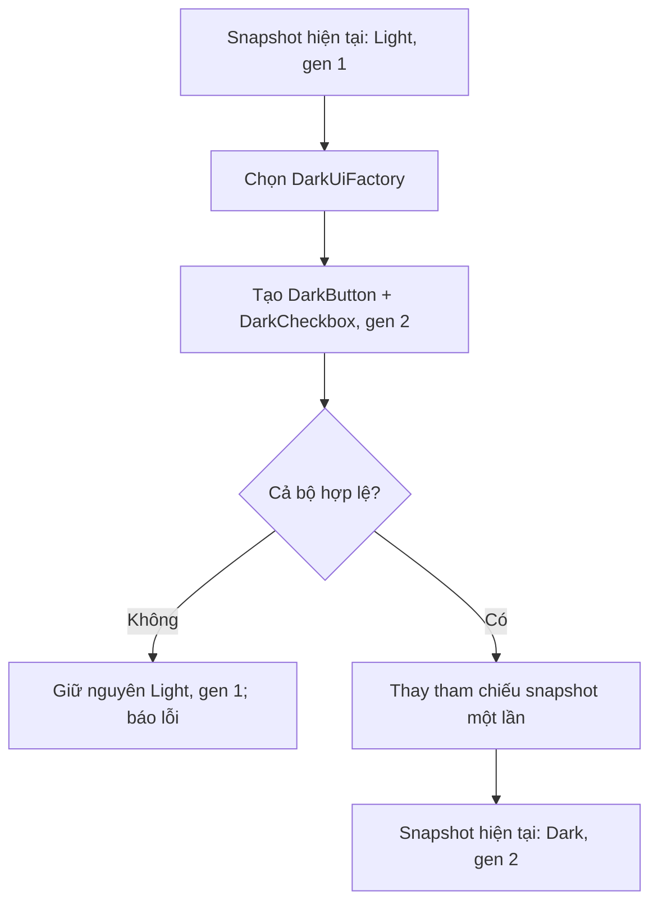

# Kiểm thử đổi biến thể và bảo đảm sản phẩm cũ không bị kết hợp với họ mới

**Chương:** Kiểm thử  
**Chuyên đề:** `SOFTWARE_DESIGN_DESIGN_PATTERN_CREATIONAL_ABSTRACT_FACTORY` — Học về abstract factory trong design pattern.

## Mục tiêu học tập

Sau bài học, bạn có thể:

- Xác định lỗi **trộn họ sản phẩm** khi ứng dụng chuyển từ một biến thể của Abstract Factory sang biến thể khác, ví dụ từ Light sang Dark.
- Phân biệt **đúng kiểu Java** với **đúng họ sản phẩm tại cùng thời điểm sử dụng**.
- Thiết kế kiểm thử cho các luồng `Light → Dark`, `Dark → Light`, chuyển đổi lặp lại, cấu hình không hợp lệ và factory tạo sản phẩm sai họ.
- Tổ chức việc chuyển đổi bằng cách **tạo trọn bộ mới, xác minh, rồi thay bộ hiện tại** thay vì cập nhật từng thành phần rời rạc.
- Giải thích giới hạn của snapshot trong ứng dụng UI đa luồng, callback bất đồng bộ và tài nguyên có vòng đời riêng.

## 1. Vấn đề chỉ xuất hiện khi đổi biến thể

Giả sử ứng dụng Java có một màn hình cài đặt gồm hai loại sản phẩm:

- `Button`: nút “Lưu”.
- `Checkbox`: ô chọn “Nhận thông báo”.

Ứng dụng hỗ trợ hai họ giao diện:

| Họ giao diện | Sản phẩm `Button` | Sản phẩm `Checkbox` | Factory |
| --- | --- | --- | --- |
| Light | `LightButton` | `LightCheckbox` | `LightUiFactory` |
| Dark | `DarkButton` | `DarkCheckbox` | `DarkUiFactory` |

Một concrete factory tạo một **bộ sản phẩm tương thích**. Khi màn hình ở Light, cả hai sản phẩm cần thuộc Light. Khi chuyển sang Dark, cả hai cần chuyển thành sản phẩm của Dark.

Nếu chỉ kiểm thử **màn hình Light vừa khởi tạo** và **màn hình Dark vừa khởi tạo** riêng biệt, ta vẫn có thể bỏ sót lỗi trong **quá trình chuyển đổi**:

```text
Trước:              Trong lúc đổi:          Sau (mong muốn):
LightButton         DarkButton              DarkButton
LightCheckbox       LightCheckbox  <- lỗi   DarkCheckbox
```

Ví dụ, mã sau biên dịch bình thường:

```java
// Phản ví dụ: cập nhật dần từng field; phụ thuộc vào các lớp đã khai báo.
button = new DarkButton();
// Một lần render hoặc callback có thể chạy ở đây.
checkbox = new DarkCheckbox();
```

Trong khoảng giữa hai phép gán, màn hình chứa **DarkButton và LightCheckbox**. Không có lỗi kiểu dữ liệu vì cả hai vẫn thực hiện đúng interface `Button` và `Checkbox`. Nhưng quy tắc **cùng họ** đã bị phá vỡ. Nếu thao tác thứ hai ném lỗi, trạng thái trộn có thể tồn tại lâu hơn cả một khung hình.

Mục tiêu kiểm thử của bài này không chỉ là “factory nào tạo được product”, mà còn là:

> **Một lượt sử dụng màn hình phải lấy toàn bộ sản phẩm từ cùng một biến thể và cùng một thế hệ lắp ráp; khi đổi biến thể thất bại, không được để lại bộ sản phẩm nửa cũ nửa mới.**

Đây là **invariant của ứng dụng**, không phải điều mà Java tự suy ra từ interface.

## 2. Chọn đúng đơn vị cần giữ nhất quán

Trong bài học, **một snapshot màn hình** là đơn vị nhất quán. Nó chứa:

| Thuộc tính | Ý nghĩa | Điều kiện kiểm tra |
| --- | --- | --- |
| `theme` | Họ sản phẩm được chọn | Light hoặc Dark |
| `generation` | Phiên bản lắp ráp của bộ sản phẩm | Cả hai sản phẩm phải mang cùng số thế hệ |
| `button` | Sản phẩm thuộc loại `Button` | Khác `null`; đúng họ và thế hệ |
| `checkbox` | Sản phẩm thuộc loại `Checkbox` | Khác `null`; đúng họ và thế hệ |

**Family/theme** và **generation** là hai ý niệm khác nhau. Khi chuyển `Light → Dark → Light`:

- Họ ở lần đầu và lần cuối đều là Light.
- Nhưng bộ sản phẩm lần cuối là **thế hệ mới**, không nên bị nhầm với các object Light đã có trước đó.

Generation trong bài là metadata minh họa cho **một lần lắp ráp**, không phải thuộc tính bắt buộc của Abstract Factory. Với ứng dụng thực, có thể dùng một snapshot object, ID phiên render hoặc cấu trúc sở hữu vòng đời khác để bảo đảm các thành phần thuộc cùng một đợt cập nhật.

**Phạm vi nhất quán phải được xác định rõ.** Nếu chỉ một màn hình cần đồng nhất theme, không nhất thiết toàn bộ ứng dụng dùng chung một instance factory. Một cửa sổ khác có thể dùng theme khác nếu nghiệp vụ cho phép. Nhưng **trong một lượt render của cùng màn hình**, không được vô tình trộn thành phần từ hai họ.

## 3. Bốn lớp kiểm thử bổ sung cho nhau

| Lớp kiểm thử | Câu hỏi cần trả lời | Ví dụ phát hiện lỗi |
| --- | --- | --- |
| **Factory contract test** | Mỗi `UiFactory` tạo đầy đủ sản phẩm đúng họ không? | `DarkUiFactory` trả về `LightCheckbox` |
| **Transition test** | Khi đổi biến thể, cả bộ sản phẩm được thay thống nhất không? | `Button` đổi trước, `Checkbox` còn cũ |
| **Failure/rollback test** | Nếu tạo hoặc kiểm tra bộ mới lỗi, bộ hiện tại có còn nguyên không? | Factory mới trả `null` sau khi button đã tạo |
| **Integration/lifecycle test** | UI thực tế có hiển thị nhất quán khi render, có callback bất đồng bộ hoặc đổi theme nhanh không? | Callback từ màn hình Light cũ vẽ lên Dark mới |

Các lớp kiểm thử này **không thay thế nhau**. Một concrete factory trả đúng hai sản phẩm Dark không đảm bảo màn hình đã đổi cả hai thành phần cùng lúc. Ngược lại, một cơ chế đổi snapshot tốt cũng không sửa được factory vốn tạo nhầm LightCheckbox khi đang quảng bá họ Dark.

## 4. Thiết kế chuyển đổi: chuẩn bị, kiểm tra, công bố

Một cấu trúc dễ kiểm thử là tạo **một đối tượng snapshot bất biến** chứa trọn bộ sản phẩm. Luồng chuyển đổi gồm ba bước:

1. **Prepare:** chọn `UiFactory` của họ đích và tạo **toàn bộ** sản phẩm mới.
2. **Validate:** kiểm tra khác `null`, đúng họ, đúng thế hệ và những điều kiện hợp đồng cần thiết.
3. **Publish/commit:** chỉ sau khi validation thành công, thay **một tham chiếu snapshot** để các lượt đọc tiếp theo nhìn thấy bộ mới đầy đủ.



Điểm quan trọng: **cập nhật tham chiếu là một thao tác**, không phải cập nhật từng field của `Button` và `Checkbox`. Một lượt sử dụng phải **lấy snapshot đúng một lần**, rồi dùng các sản phẩm bên trong snapshot đó.

Đoạn sau vẫn có thể làm trộn thế hệ dù hệ thống dùng snapshot:

```java
// Không nên: đọc từ nguồn hiện tại hai lần trong cùng một lượt render.
Button oldOrNewButton = controller.snapshot().button();
// Có thể xảy ra chuyển theme giữa hai lần đọc.
Checkbox oldOrNewCheckbox = controller.snapshot().checkbox();
```

Cách đúng là:

```java
// Một lần đọc cho một lượt xử lý.
ScreenSnapshot snapshot = controller.snapshot();
Button button = snapshot.button();
Checkbox checkbox = snapshot.checkbox();
```

Như vậy, ngay cả khi một luồng khác thay snapshot sau lần đọc, hai sản phẩm trong lượt đang thực hiện vẫn cùng thuộc **một snapshot đã được xác minh**. Lượt đó có thể hoàn tất với bộ cũ; điều này khác với việc **trộn hai bộ**.

## 5. Ví dụ Java 8 hoàn chỉnh: kiểm thử chuyển Light ↔ Dark

Ví dụ dưới đây mô phỏng UI bằng chuỗi, không cần thư viện giao diện. Mỗi product mang `Theme` và `generation` **không đổi**. `ScreenSnapshot` xác thực cặp sản phẩm ngay lúc xây dựng. `ScreenController` dùng `AtomicReference<ScreenSnapshot>` để thay toàn bộ snapshot sau khi bộ mới đã hợp lệ.

Chương trình còn có `BrokenDarkFactory` cố tình tạo một DarkButton và một LightCheckbox để minh họa **kiểm thử chuyển đổi thất bại nhưng trạng thái cũ được giữ nguyên**.

Lưu **toàn bộ mã** vào file `ThemeTransitionTestDemo.java` (Java 8 trở lên):

```java
import java.util.Objects;
import java.util.concurrent.atomic.AtomicReference;

enum Theme {
    LIGHT, DARK
}

// Metadata bất biến: giúp ví dụ kiểm tra cùng họ và thế hệ.
interface FamilyProduct {
    Theme theme();
    long generation();
}

interface Button extends FamilyProduct {
    String render(String label);
}

interface Checkbox extends FamilyProduct {
    String render(String label, boolean checked);
}

// Abstract Factory tạo hai loại sản phẩm cùng một họ.
interface UiFactory {
    Theme theme();
    Button createButton(long generation);
    Checkbox createCheckbox(long generation);
}

abstract class BaseFamilyProduct implements FamilyProduct {
    private final Theme theme;
    private final long generation;

    BaseFamilyProduct(Theme theme, long generation) {
        this.theme = Objects.requireNonNull(theme, "theme");
        if (generation <= 0) {
            throw new IllegalArgumentException("generation phải dương");
        }
        this.generation = generation;
    }

    @Override
    public final Theme theme() {
        return theme;
    }

    @Override
    public final long generation() {
        return generation;
    }
}

// Họ Light.
final class LightButton extends BaseFamilyProduct implements Button {
    LightButton(long generation) {
        super(Theme.LIGHT, generation);
    }

    @Override
    public String render(String label) {
        return "[LIGHT gen " + generation() + "] Button: " + label;
    }
}

final class LightCheckbox extends BaseFamilyProduct implements Checkbox {
    LightCheckbox(long generation) {
        super(Theme.LIGHT, generation);
    }

    @Override
    public String render(String label, boolean checked) {
        return "[LIGHT gen " + generation() + "] Checkbox: " + label
                + (checked ? " [x]" : " [ ]");
    }
}

final class LightUiFactory implements UiFactory {
    @Override
    public Theme theme() {
        return Theme.LIGHT;
    }

    @Override
    public Button createButton(long generation) {
        return new LightButton(generation);
    }

    @Override
    public Checkbox createCheckbox(long generation) {
        return new LightCheckbox(generation);
    }
}

// Họ Dark.
final class DarkButton extends BaseFamilyProduct implements Button {
    DarkButton(long generation) {
        super(Theme.DARK, generation);
    }

    @Override
    public String render(String label) {
        return "[DARK gen " + generation() + "] Button: " + label;
    }
}

final class DarkCheckbox extends BaseFamilyProduct implements Checkbox {
    DarkCheckbox(long generation) {
        super(Theme.DARK, generation);
    }

    @Override
    public String render(String label, boolean checked) {
        return "[DARK gen " + generation() + "] Checkbox: " + label
                + (checked ? " [x]" : " [ ]");
    }
}

final class DarkUiFactory implements UiFactory {
    @Override
    public Theme theme() {
        return Theme.DARK;
    }

    @Override
    public Button createButton(long generation) {
        return new DarkButton(generation);
    }

    @Override
    public Checkbox createCheckbox(long generation) {
        return new DarkCheckbox(generation);
    }
}

// Factory lỗi: chữ ký interface hợp lệ nhưng trộn họ sản phẩm.
final class BrokenDarkFactory implements UiFactory {
    @Override
    public Theme theme() {
        return Theme.DARK;
    }

    @Override
    public Button createButton(long generation) {
        return new DarkButton(generation);
    }

    @Override
    public Checkbox createCheckbox(long generation) {
        return new LightCheckbox(generation); // Sai họ!
    }
}

// Snapshot được tạo hoàn chỉnh và bất biến.
final class ScreenSnapshot {
    private final Theme theme;
    private final long generation;
    private final Button button;
    private final Checkbox checkbox;

    ScreenSnapshot(
            Theme theme, long generation, Button button, Checkbox checkbox) {
        this.theme = Objects.requireNonNull(theme, "theme");
        if (generation <= 0) {
            throw new IllegalArgumentException("generation phải dương");
        }
        this.button = Objects.requireNonNull(button, "button");
        this.checkbox = Objects.requireNonNull(checkbox, "checkbox");

        if (button.theme() != theme || checkbox.theme() != theme) {
            throw new IllegalArgumentException("Sản phẩm trộn họ");
        }
        if (button.generation() != generation
                || checkbox.generation() != generation) {
            throw new IllegalArgumentException("Sản phẩm trộn thế hệ");
        }
        this.generation = generation;
    }

    Theme theme() {
        return theme;
    }

    long generation() {
        return generation;
    }

    Button button() {
        return button;
    }

    Checkbox checkbox() {
        return checkbox;
    }

    String render() {
        return button.render("Lưu") + System.lineSeparator()
                + checkbox.render("Nhận thông báo", true);
    }
}

// Mọi lượt đọc dùng một snapshot. Việc đổi theme được tuần tự hóa.
final class ScreenController {
    private final AtomicReference<ScreenSnapshot> current;

    ScreenController(UiFactory initialFactory) {
        current = new AtomicReference<>(assemble(initialFactory, 1));
    }

    private static ScreenSnapshot assemble(UiFactory factory, long generation) {
        Objects.requireNonNull(factory, "factory");
        Theme theme = Objects.requireNonNull(factory.theme(), "factory.theme");
        Button button = factory.createButton(generation);
        Checkbox checkbox = factory.createCheckbox(generation);
        // Chưa thay trạng thái hiện tại trước khi kiểm tra xong.
        return new ScreenSnapshot(theme, generation, button, checkbox);
    }

    synchronized void changeTo(UiFactory nextFactory) {
        ScreenSnapshot before = current.get();
        ScreenSnapshot candidate =
                assemble(nextFactory, before.generation() + 1);
        // Chỉ công bố cả bộ khi candidate hợp lệ.
        current.set(candidate);
    }

    ScreenSnapshot snapshot() {
        return current.get();
    }

    String render() {
        ScreenSnapshot snapshot = current.get(); // Chỉ đọc một lần!
        return snapshot.render();
    }
}

// Kiểm thử tự chứa: không dùng framework, báo lỗi bằng AssertionError.
public final class ThemeTransitionTestDemo {
    private static void check(boolean condition, String message) {
        if (!condition) {
            throw new AssertionError(message);
        }
    }

    private static void verifySnapshot(ScreenSnapshot snapshot) {
        check(snapshot != null, "snapshot null");
        check(snapshot.button() != null, "button null");
        check(snapshot.checkbox() != null, "checkbox null");
        check(snapshot.button().theme() == snapshot.theme(),
                "button sai họ");
        check(snapshot.checkbox().theme() == snapshot.theme(),
                "checkbox sai họ");
        check(snapshot.button().generation() == snapshot.generation(),
                "button sai thế hệ");
        check(snapshot.checkbox().generation() == snapshot.generation(),
                "checkbox sai thế hệ");
    }

    public static void main(String[] args) {
        ScreenController controller = new ScreenController(new LightUiFactory());

        // 1. Trạng thái khởi tạo.
        ScreenSnapshot light1 = controller.snapshot();
        verifySnapshot(light1);
        check(light1.theme() == Theme.LIGHT && light1.generation() == 1,
                "khởi tạo Light lỗi");
        System.out.println("PASS: LIGHT gen 1");

        // 2. Light -> Dark: thay cả bộ, snapshot cũ không bị biến đổi.
        controller.changeTo(new DarkUiFactory());
        ScreenSnapshot dark2 = controller.snapshot();
        verifySnapshot(dark2);
        verifySnapshot(light1);
        check(dark2.theme() == Theme.DARK && dark2.generation() == 2,
                "chuyển Dark lỗi");
        check(light1.theme() == Theme.LIGHT && light1.generation() == 1,
                "snapshot Light cũ bị thay đổi");
        check(light1 != dark2, "phải tạo một snapshot mới");
        System.out.println("PASS: DARK gen 2; snapshot LIGHT cũ vẫn nguyên");

        // 3. Factory lỗi: không được công bố bộ trộn họ.
        boolean rejected = false;
        try {
            controller.changeTo(new BrokenDarkFactory());
        } catch (IllegalArgumentException expected) {
            rejected = true;
        }
        check(rejected, "factory sai họ phải bị từ chối");
        check(controller.snapshot() == dark2,
                "khi lỗi phải giữ nguyên snapshot trước đó");
        System.out.println("PASS: từ chối trộn họ; vẫn DARK gen 2");

        // 4. Dark -> Light sau một lần chuyển đổi lỗi.
        controller.changeTo(new LightUiFactory());
        ScreenSnapshot light3 = controller.snapshot();
        verifySnapshot(light3);
        check(light3.theme() == Theme.LIGHT && light3.generation() == 3,
                "chuyển lại Light lỗi");
        System.out.println("PASS: LIGHT gen 3");

        // 5. Đổi qua lại nhiều lần, không có snapshot nửa cũ nửa mới.
        for (int i = 0; i < 100; i++) {
            UiFactory factory =
                    i % 2 == 0 ? new DarkUiFactory() : new LightUiFactory();
            controller.changeTo(factory);
            ScreenSnapshot snapshot = controller.snapshot();
            verifySnapshot(snapshot);
            check(snapshot.theme() == factory.theme(), "sai theme vòng lặp");
        }
        System.out.println("PASS: 100 lần chuyển đổi giữ nhất quán");

        // Một lượt render dùng cả hai sản phẩm trong cùng snapshot.
        System.out.println(controller.render());
    }
}
```

### Chạy thử

Lưu mã vào `ThemeTransitionTestDemo.java`, rồi chạy:

```bash
javac -encoding UTF-8 ThemeTransitionTestDemo.java
java ThemeTransitionTestDemo
```

Đầu ra dự kiến:

```text
PASS: LIGHT gen 1
PASS: DARK gen 2; snapshot LIGHT cũ vẫn nguyên
PASS: từ chối trộn họ; vẫn DARK gen 2
PASS: LIGHT gen 3
PASS: 100 lần chuyển đổi giữ nhất quán
[LIGHT gen 103] Button: Lưu
[LIGHT gen 103] Checkbox: Nhận thông báo [x]
```

Vì sau `LIGHT gen 3`, vòng lặp bắt đầu bằng Dark và thực hiện đúng 100 lần nên kết thúc ở Light, thế hệ `103`. Mục đích của kết quả là kiểm tra **hai dòng render cùng theme và generation**, không phải kiểm tra màu sắc giao diện thật.

### Phân tích các bảo đảm của ví dụ

1. **Không trộn họ:** constructor `ScreenSnapshot` từ chối khi `button.theme()` hoặc `checkbox.theme()` khác theme đã chọn.
2. **Không trộn thế hệ:** một `LightButton` từ thế hệ 1 không thể đi cùng một `LightCheckbox` của thế hệ 3 dù cả hai đều là Light.
3. **Chuyển đổi thất bại giữ trạng thái cũ:** `assemble()` tạo trọn bộ mới trước lời gọi `current.set(candidate)`. Khi `BrokenDarkFactory` làm validation thất bại, `current` vẫn trỏ đến snapshot trước đó.
4. **Không thấy trạng thái nửa cũ nửa mới khi đọc một snapshot:** `AtomicReference.set()` công bố một tham chiếu hoàn chỉnh; `snapshot()` hoặc `render()` lấy tham chiếu đó một lần rồi dùng cả hai thành phần.
5. **Tuần tự hóa các lần đổi:** `synchronized changeTo(...)` ngăn hai yêu cầu chuyển đổi gọi đồng thời tạo thế hệ trùng nhau trong ví dụ.

**Phạm vi bảo đảm cần hiểu đúng:** `AtomicReference` chỉ giúp công bố và đọc **một snapshot object** nhất quán. Nó không tự khiến framework UI thực hiện mọi thao tác DOM/Swing/JavaFX trên cùng một frame, không hủy các callback cũ và cũng không đóng tài nguyên gắn với widget đã thay thế. Những hành vi đó cần cơ chế tích hợp riêng.

## 6. Lập ma trận kiểm thử chuyển biến thể

Một bộ test đổi theme nên bao phủ **trạng thái trước → thao tác → trạng thái sau**, thay vì chỉ gọi `createButton()` và `createCheckbox()` độc lập:

| Tình huống | Kỳ vọng sau khi xử lý | Lỗi được phát hiện |
| --- | --- | --- |
| Khởi tạo bằng Light | Button/Checkbox đều Light, cùng thế hệ | Một thành viên bị tạo nhầm Dark |
| Light → Dark | Bộ mới đều Dark, thế hệ tăng | Chỉ thay Button hoặc chỉ thay Checkbox |
| Dark → Light | Bộ mới đều Light, thế hệ tăng | Bị cache product Dark không đúng chỗ |
| Light → Dark → Light | Light mới không bị nhầm với Light cũ | Tái sử dụng object đã hết vòng đời |
| Factory Dark trả LightCheckbox | Không công bố bộ sai; giữ nguyên snapshot cũ | Vi phạm hợp đồng concrete factory |
| Factory trả `null` hoặc ném exception | Không cập nhật trạng thái hiện tại | Công bố bộ chưa hoàn chỉnh |
| Yêu cầu chuyển đổi lặp lại | Mỗi snapshot được quan sát phải tự nhất quán | Cập nhật rời rạc hoặc mất đồng bộ |
| Hai yêu cầu đổi theme gần nhau | Kết quả cuối theo chính sách thứ tự rõ ràng | Race condition / kết quả cũ ghi đè mới |
| Plugin/theme không tồn tại | Báo lỗi theo chính sách; không trộn fallback | Chọn product từ hai nguồn khác nhau |

Các phép thử nên dùng **một contract test chung** cho mỗi concrete factory (`LightUiFactory`, `DarkUiFactory`, và các họ thêm sau này), rồi dùng **transition tests** để kiểm tra chính quá trình thay bộ đang sử dụng. Trong hệ thống thật, cần test thêm trạng thái checked/unchecked, focus, disabled và các style tokens theo đặc tả.

## 7. Hai loại lỗi liên quan đến cache và trạng thái

### 7.1. Cache product cũ khiến bộ mới bị pha trộn

Ví dụ, một cache chỉ lưu theo loại sản phẩm:

```java
// Phản ví dụ ở mức ý tưởng: cache không phân biệt theme/đời sống.
Map<String, Object> cache = new HashMap<>();
cache.put("checkbox", new LightCheckbox(1));
// Sau khi chuyển sang Dark, tra cache vẫn có thể trả LightCheckbox.
```

Nếu dùng cache, khóa cache và vòng đời đối tượng phải phản ánh **những chiều làm thay đổi tính tương thích** (như theme, version, tenant hoặc generation khi có ý nghĩa). Không nên dùng cache chung cho sản phẩm stateful của nhiều màn hình hoặc người dùng.

Trong ví dụ chạy được, `ScreenSnapshot` sẽ từ chối `LightCheckbox(1)` khi lắp vào snapshot Dark thế hệ 2. Đó là một **cổng kiểm tra cuối**; cấu trúc cache đúng vẫn cần được thiết kế độc lập.

### 7.2. State của màn hình khác state của product

Giả sử người dùng đã tick “Nhận thông báo” trước khi đổi theme. Có hai lựa chọn tùy ứng dụng:

- **State tách khỏi widget:** trạng thái checked nằm trong model/view-model; tạo bộ UI mới rồi render theo state hiện có.
- **State nằm trong widget:** trước khi thay snapshot cần đọc state cũ và chuyển nó sang widget mới một cách có kiểm soát.

Không nên tái sử dụng một `LightCheckbox` chỉ để giữ state khi màn hình đã chuyển sang Dark. Cách đó giữ object của **họ cũ** trong bộ mới. Kiểm thử nên xác nhận **state nghiệp vụ cần thiết được bảo toàn** mà **sản phẩm hiển thị vẫn thuộc họ mới**.

Trong ví dụ console, `Checkbox.render(label, checked)` nhận trạng thái dưới dạng tham số; product không giữ biến `checked`. Nhờ vậy bài có thể tập trung vào họ và thế hệ. Với widget thực có state, cần kiểm tra thêm hành vi tương ứng.

## 8. Đổi biến thể trong ứng dụng đa luồng và UI thật

`ScreenController` minh họa ranh giới chuyển đổi an toàn **ở mức object graph**. Nhưng các công nghệ UI có quy tắc luồng và vòng đời riêng:

- **Swing:** thao tác cập nhật component phải tuân thủ Event Dispatch Thread (EDT).
- **JavaFX:** thay đổi scene graph của UI phải tuân thủ JavaFX Application Thread.
- **UI web:** render state có thể được lập lịch và commit trong một cơ chế riêng; callback bất đồng bộ có thể tới sau khi theme hoặc màn hình đã đổi.

Một ví dụ lỗi ở mức ý tưởng:

```text
T0: Màn hình Light bắt đầu yêu cầu tải dữ liệu.
T1: Người dùng chuyển sang Dark; màn hình Dark mới được dựng.
T2: Callback từ yêu cầu T0 hoàn tất, cố sửa một widget Light cũ
    hoặc ghi đè state hiển thị của màn hình Dark.
```

Để kiểm thử, cần xác định chính sách đối với tác vụ đang chạy:

1. **Hủy** tác vụ/callback cũ khi màn hình hoặc theme thay đổi nếu phù hợp.
2. **Đánh dấu generation/request ID** để kết quả bất đồng bộ chỉ được áp dụng vào phiên phù hợp.
3. **Cập nhật trên UI thread** đúng với framework.
4. **Đóng/giải phóng widget hoặc resource cũ** sau khi không còn thao tác đang dùng.

Ví dụ pseudocode dùng generation:

```java
// Minh họa logic trong callback, không thuộc file demo hoàn chỉnh.
long requestedGeneration = controller.snapshot().generation();
loadDataAsync(result -> {
    ScreenSnapshot now = controller.snapshot();
    if (now.generation() != requestedGeneration) {
        return; // Bỏ kết quả của thế hệ màn hình cũ.
    }
    // Tiếp tục cập nhật thông qua cơ chế UI thread / dispatcher phù hợp.
});
```

So sánh generation trước khi commit có thể chưa đủ nếu trạng thái thay đổi **ngay sau phép kiểm tra**. Trong hệ UI đa luồng, thao tác kiểm tra và cập nhật cần nằm trong một **đơn vị điều phối được kiểm soát** (ví dụ dispatch lên UI thread rồi kiểm tra lại trước commit, hoặc dùng cơ chế compare-and-set/transaction phù hợp). Đoạn mã chỉ diễn đạt ý tưởng phòng callback cũ, không phải giải pháp đồng bộ hoàn chỉnh.

### Phân biệt không trộn họ với “không còn sản phẩm cũ ở bộ nhớ”

Khi `current` đổi sang Dark, một lượt xử lý đã lấy snapshot Light từ trước **có thể vẫn đang dùng snapshot Light hoàn chỉnh**. Điều đó không vi phạm invariant “không trộn sản phẩm cũ với họ mới”. Cần phân biệt:

- **Coherent read:** một lượt đọc thấy một snapshot tự nhất quán.
- **Current snapshot:** những lượt đọc mới thấy snapshot vừa được công bố.
- **Retirement/disposal:** các đối tượng cũ chỉ được giải phóng khi không còn lượt sử dụng hợp lệ hoặc tài nguyên cần đóng.

Không nên giải phóng resource của snapshot cũ quá sớm nếu callback/render đang sử dụng nó. Với UI thật, cách quản lý vòng đời có thể dựa trên cơ chế lifecycle/disposal của framework.

## 9. Những phép kiểm thử có thể bổ sung bằng framework test

Chương trình ở mục 5 dùng `AssertionError` để dễ chạy không phụ thuộc thư viện. Trong dự án thực, có thể tổ chức tests theo JUnit 5 (đoạn dưới là **mẫu định hướng**, không phải phần của file demo tự chứa):

```java
// Pseudocode minh họa ý tưởng với JUnit 5 và các kiểu đã định nghĩa.
@Test
void switchToDarkReplacesWholeFamily() {
    ScreenController controller = new ScreenController(new LightUiFactory());

    controller.changeTo(new DarkUiFactory());
    ScreenSnapshot snapshot = controller.snapshot();

    assertEquals(Theme.DARK, snapshot.button().theme());
    assertEquals(Theme.DARK, snapshot.checkbox().theme());
    assertEquals(snapshot.generation(), snapshot.button().generation());
    assertEquals(snapshot.generation(), snapshot.checkbox().generation());
}

@Test
void invalidFactoryMustNotPublishPartialSnapshot() {
    ScreenController controller = new ScreenController(new LightUiFactory());
    ScreenSnapshot before = controller.snapshot();

    assertThrows(IllegalArgumentException.class,
            () -> controller.changeTo(new BrokenDarkFactory()));
    assertSame(before, controller.snapshot());
}
```

Muốn dùng đoạn này trong dự án thực tế, cần thêm dependency/import JUnit 5 và bố trí class test, package visibility theo convention. Tên `assertSame` nhấn mạnh sau lỗi, controller giữ **chính cùng một snapshot object**, không chỉ tạo lại một snapshot trông giống bộ cũ.

Đối với công việc chuyển theme bất đồng bộ, nên bổ sung integration test có bộ lập lịch điều khiển được hoặc fake callback để chủ động tạo thứ tự sự kiện `T0/T1/T2`. Những stress test chạy nhiều luồng có thể hỗ trợ tìm lỗi nhưng **không chứng minh tuyệt đối** hệ thống không có race condition; cần kết hợp nguyên tắc thiết kế đồng bộ và kiểm thử có thứ tự xác định.

## 10. Lỗi thường gặp khi kiểm thử thay họ

| Cách làm thiếu sót | Vì sao rủi ro? | Cách cải thiện |
| --- | --- | --- |
| Chỉ test màn hình Dark được tạo trực tiếp | Bỏ qua đường chuyển từ Light và trạng thái cũ. | Test cả trước, trong và sau khi chuyển. |
| Chỉ kiểm tra `instanceof Button` / `Checkbox` | Đúng interface chưa chứng minh cùng họ. | Kiểm tra family/invariant ở mức ngữ nghĩa. |
| Test hai field bằng cách đọc “hiện tại” hai lần | Bản thân test có thể ghép hai snapshot khác nhau. | Đọc một snapshot một lần rồi kiểm tra toàn bộ. |
| Chuyển một field trước rồi một field sau | Có thể hiển thị trạng thái nửa cũ nửa mới. | Tạo bộ đầy đủ, xác minh, thay tham chiếu snapshot. |
| Khi đổi thất bại vẫn giữ Button mới | Bộ hiển thị bị trộn và lỗi khó khôi phục. | Không commit nếu bất kỳ sản phẩm nào không hợp lệ. |
| Cache chỉ dựa trên loại sản phẩm | Trả về product sai theme/generation. | Định nghĩa cache key/lifecycle theo hợp đồng. |
| Khi đổi theme vẫn tái sử dụng widget có state | Trộn họ hoặc rò rỉ state giữa màn hình. | Tách state khỏi view hoặc chuyển state có kiểm soát. |
| Giả định `AtomicReference` tự giải quyết toàn bộ UI | Không quản lý callback, framework thread hay disposal. | Test thêm vòng đời và cơ chế commit UI. |
| Chỉ nhìn màu sắc screenshot | Có thể bỏ sót lỗi generation, callback hoặc hành vi. | Kết hợp contract, transition và integration tests. |

## 11. Bài luyện tập và tự kiểm tra

**Câu 1.** `LightButton` và `DarkCheckbox` cùng triển khai đúng hai interface tương ứng. Vì sao màn hình dùng cả hai vẫn bị xem là sai?

**Gợi ý đáp án:** Kiểu dữ liệu hợp lệ không chứng minh **quy tắc tương thích cùng họ**. Màn hình yêu cầu một bộ sản phẩm nhất quán, nhưng hai thành viên thuộc các họ khác nhau.

**Câu 2.** Vì sao test `Light → Dark` chưa đủ để kiểm tra trường hợp `Light → Dark → Light`?

**Gợi ý đáp án:** Lần quay về Light có thể lấy nhầm sản phẩm Light từ thế hệ ban đầu (do cache hoặc tham chiếu cũ). Cần kiểm tra cả **họ** và **thế hệ/vòng đời** theo hợp đồng ứng dụng.

**Câu 3.** Trong `ScreenController.changeTo()`, nếu `factory.createCheckbox()` ném exception thì snapshot hiện tại có bị thay không?

**Gợi ý đáp án:** Không. `assemble()` tạo và kiểm tra sản phẩm trước `current.set(candidate)`. Exception xảy ra trước commit nên snapshot hiện tại vẫn nguyên. Ví dụ không xử lý giải phóng resource được tạo dở; ứng dụng thực phải có chính sách cleanup khi chuẩn bị bộ mới thất bại.

**Câu 4.** Một lượt render đã lấy snapshot Light, sau đó có luồng khác chuyển current snapshot sang Dark. Lượt render dùng snapshot Light đầy đủ có phải “trộn họ” không?

**Gợi ý đáp án:** Không, nếu lượt đó chỉ dùng các sản phẩm Light trong snapshot đã lấy. Nó có thể hiển thị nội dung cũ tùy cơ chế UI, nhưng khác với việc ghép Button Light với Checkbox Dark trong một lượt xử lý.

**Câu 5.** Kiểm tra `generation` trong callback có đủ đảm bảo mọi cập nhật bất đồng bộ an toàn không?

**Gợi ý đáp án:** Chưa. Cần kiểm tra và commit dưới cơ chế điều phối phù hợp để tránh thay đổi trạng thái ngay sau phép kiểm tra; đồng thời quản lý hủy tác vụ, UI thread và tài nguyên cũ.

**Bài thực hành A.** Thêm `NullDarkFactory` tạo `DarkButton` nhưng trả `null` cho `Checkbox`. Kiểm tra `changeTo(...)` bị từ chối, snapshot trước vẫn giữ nguyên và generation không tăng sau lần lỗi.

**Bài thực hành B.** Thêm `StaleDarkFactory` trả `DarkButton` đúng generation nhưng `DarkCheckbox` mang generation cũ. Xác minh constructor `ScreenSnapshot` phát hiện “Sản phẩm trộn thế hệ”.

**Bài thực hành C.** Thay vòng lặp 100 lần bằng một test có hai luồng: một luồng liên tục thay theme, luồng khác liên tục đọc **một snapshot mỗi lượt** và kiểm tra invariant. Sau đó giải thích vì sao phép thử này chỉ là kiểm thử hỗ trợ, không phải bằng chứng toán học rằng mọi interleaving đều đúng.

## Kết luận

Với **Abstract Factory**, kiểm thử không chỉ xác nhận từng factory tạo đúng `Button` và `Checkbox`, mà còn phải xác nhận **luồng chuyển biến thể** không vô tình giữ sản phẩm cũ bên cạnh sản phẩm thuộc họ mới. Một chiến lược rõ ràng là tạo **trọn bộ sản phẩm**, xác minh **cùng họ và cùng thế hệ**, rồi mới công bố **một snapshot bất biến** cho client. Các test `Light → Dark → Light`, factory lỗi, rollback, chuyển đổi lặp lại và callback cũ giúp kiểm soát rủi ro mà test khởi tạo đơn lẻ không thấy. Trong UI thật, cơ chế snapshot phải đi cùng chính sách UI thread, state, vòng đời và kiểm tra tích hợp; bảo đảm object graph nhất quán là nền tảng, không phải lời hứa rằng mọi tương tác bất đồng bộ đã tự động an toàn.
