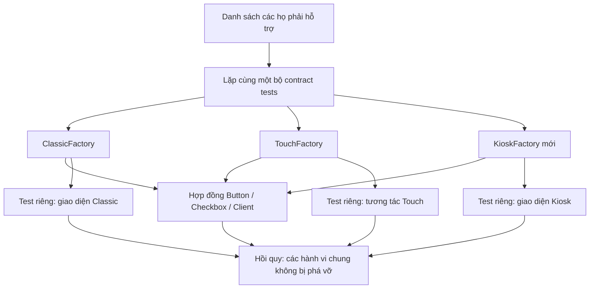

# Tránh khẳng định quá chặt tên lớp cụ thể và bổ sung kiểm thử hồi quy khi thêm họ

## 1. Vấn đề kiểm thử thường gặp với Abstract Factory

Trong mẫu thiết kế khởi tạo **Abstract Factory**, client sử dụng các sản phẩm thông qua interface, còn **ConcreteFactory** quyết định lớp cụ thể của từng vai trò sản phẩm trong một họ. Vì vậy, kiểm thử cần xác nhận **hành vi và khả năng phối hợp** mà client dựa vào, không chỉ xác nhận tên lớp được tạo.

Giả sử ứng dụng có ba họ giao diện: **Classic**, **Touch** và **Kiosk**. Mỗi họ cung cấp hai vai trò:

| Vai trò | Classic | Touch | Kiosk |
| --- | --- | --- | --- |
| `Button` | Nút theo giao diện Classic | Nút cho màn hình cảm ứng | Nút trên thiết bị kiosk |
| `Checkbox` | Ô chọn Classic | Ô chọn Touch | Ô chọn Kiosk |
| Concrete factory | `ClassicFactory` | `TouchFactory` | `KioskFactory` |

Một client như `SettingsScreen` chỉ cần yêu cầu `factory.createButton()` và `factory.createCheckbox()`. Client kỳ vọng các vai trò hoạt động đúng và thuộc cùng họ, **không cần biết chính xác concrete class** đứng sau mỗi sản phẩm.

Vậy nếu kiểm thử viết:

```java
Button button = new ClassicFactory().createButton();
assertEquals("ClassicButton", button.getClass().getSimpleName());
```

thì có vấn đề gì? Kiểm thử này buộc tên lớp `ClassicButton` trở thành một phần của kỳ vọng, mặc dù client **không sử dụng tên lớp**. Nếu sau này lập trình viên đổi tên thành `DesktopButton`, dùng decorator, proxy hoặc thay bằng một implementation tương đương, kiểm thử sẽ thất bại dù hành vi mà client cần vẫn đúng.

Đó là **kiểm thử gắn quá chặt với chi tiết triển khai** (*over-specification*). Nó có thể phát hiện thay đổi mã nhưng lại tạo ra nhiều cảnh báo sai khi tái cấu trúc, trong khi vẫn có khả năng bỏ sót lỗi về hành vi hoặc trộn họ sản phẩm.

> **Nguyên tắc:** Viết khẳng định theo **hợp đồng ổn định mà client quan sát được**. Chỉ khẳng định tên/kiểu lớp cụ thể nếu danh tính lớp thực sự là yêu cầu của API hoặc tích hợp.

## 2. Phân biệt điều phải đúng với cách đang được triển khai

### 2.1. Chi tiết triển khai dễ thay đổi

Những kiểm thử sau thường quá chặt đối với một client chỉ dùng `Button`:

```java
assertEquals(ClassicButton.class, button.getClass());
assertEquals("ClassicButton", button.getClass().getSimpleName());
assertTrue(button.toString().contains("ClassicButton"));
```

Các câu trên kiểm tra tên lớp, chính xác class runtime hoặc biểu diễn debug. Nếu hợp đồng công khai chỉ yêu cầu `Button.click()` phát sinh hành động `SAVE`, chúng **không đo được điều quan trọng nhất**.

Thay vào đó, một kiểm thử theo hợp đồng có thể là:

```java
Button button = factory.createButton();
assertNotNull(button);
assertEquals(Action.SAVE, button.click());
```

`assertEquals` và `assertNotNull` ở hai đoạn này là cú pháp minh họa cho **JUnit**, không phải các lời gọi thuộc chương trình Java độc lập ở phần 5. Cốt lõi là đổi từ kiểm tra *class nào được tạo* sang kiểm tra *sản phẩm làm gì*.

### 2.2. Hợp đồng cần kiểm tra ở nhiều lớp

| Mức hợp đồng | Câu hỏi kiểm thử | Ví dụ khẳng định hữu ích |
| --- | --- | --- |
| **Vai trò sản phẩm** | Factory có cung cấp đủ `Button`, `Checkbox` không? | Không trả `null`, mỗi sản phẩm dùng được qua interface |
| **Hành vi sản phẩm** | Sản phẩm có tuân thủ ý nghĩa của thao tác? | `click()` phát sinh `SAVE`; `toggle()` đảo trạng thái đúng |
| **Tính nhất quán theo họ** | Các vai trò có thuộc biến thể đã chọn? | Mọi sản phẩm của `KioskFactory` tuân thủ hợp đồng Kiosk |
| **Phối hợp sản phẩm** | Các sản phẩm hoạt động cùng nhau đúng không? | Client dùng nút và ô chọn mà không phải phân nhánh theo concrete class |
| **Vòng đời và trạng thái** | Có bị chia sẻ trạng thái ngoài ý muốn? | Hai ô chọn độc lập khi hợp đồng yêu cầu tạo mới cho mỗi màn hình |
| **Lỗi và biên** | Điều gì xảy ra khi đầu vào sai hoặc tạo một sản phẩm thất bại? | Báo lỗi theo hợp đồng, không công bố bộ sản phẩm dùng dở |

Không cần tất cả họ có hình thức hiển thị giống nhau. Ví dụ, **kích thước nút Kiosk có thể khác nút Classic**. Bộ kiểm thử chung nên kiểm tra ý nghĩa hành động `SAVE`, còn kích thước hoặc khả năng tương tác cảm ứng là **yêu cầu riêng của họ Kiosk**, nên có kiểm thử riêng.

### 2.3. Khi nào khẳng định lớp cụ thể là hợp lý?

Không có quy tắc “cấm tuyệt đối `instanceof` hoặc `getClass()` trong test”. Chúng có ích nếu:

- API tích hợp **bắt buộc** nhận một subclass/concrete class xác định, ví dụ một thư viện bên ngoài kiểm tra class runtime.
- Một factory có **hợp đồng ánh xạ lớp cụ thể** được công bố rõ và việc thay class được xem là breaking change.
- Kiểm thử một **adapter, serializer hoặc cơ chế reflection** có yêu cầu rõ về kiểu được tạo.
- Cần test nội bộ cục bộ cho một constructor hoặc lớp cụ thể, khác với bộ kiểm thử hành vi chung của client.

Trong các trường hợp đó, hãy **giới hạn khẳng định kiểu lớp ở kiểm thử tích hợp/ánh xạ thích hợp**, không lan truyền nó vào mọi test của client. `instanceof` cũng không tự kiểm tra các hành vi mà sản phẩm phải thực hiện.

## 3. Bộ kiểm thử hợp đồng dùng chung cho mọi họ

Một cách mạnh để kiểm tra Abstract Factory là định nghĩa **bộ kiểm thử hợp đồng** (*contract test suite*) rồi áp dụng cùng các quy tắc cho **tất cả concrete factory**.

Giả sử `Button` có thể `click()` để trả về `Action.SAVE`; `Checkbox` có thể `toggle()` trạng thái chọn. Các hành vi cần ổn định:

1. `createButton()` và `createCheckbox()` trả về đối tượng không `null`.
2. Hai sản phẩm mang đúng **họ mong đợi** theo lựa chọn factory của từng ca kiểm thử.
3. `Button.click()` thực hiện ý nghĩa `SAVE` ở mọi họ.
4. `Checkbox.toggle()` chuyển `false → true → false`.
5. Nếu hợp đồng nói mỗi ô chọn có trạng thái riêng, thay đổi một ô chọn không làm ô chọn khác bị thay đổi.
6. Client có thể dùng cả hai sản phẩm mà không cần biết tên concrete class.

Mỗi quy tắc phải được rút ra từ **hợp đồng sản phẩm thực sự có hiệu lực**. Không nên kiểm tra `a != b` cho mọi loại sản phẩm theo thói quen: một codec bất biến có thể được chia sẻ hợp lệ. Với ô chọn có trạng thái riêng từng màn hình ở ví dụ này, yêu cầu tạo mới lại có ý nghĩa.

### Không để factory tự “chấm điểm” chính nó

Nếu test viết:

```java
assertEquals(factory.familyId(), factory.createButton().familyId());
```

thì hai giá trị đều có thể đến từ cùng một hiện thực sai. Chẳng hạn, `KioskFactory` bị viết nhầm để trả cả `ClassicButton` và báo `familyId() = CLASSIC`; phép so sánh vẫn có thể đúng.

Đối với bài kiểm thử theo họ, hãy truyền vào **giá trị kỳ vọng được khai báo độc lập**, ví dụ `verifyFamily(KIOSK, new KioskFactory())`. Khi ấy sản phẩm Classic lọt vào Kiosk có thể bị phát hiện.

Tuy nhiên, `familyId()` cũng chỉ là **metadata**; nó có thể bị khai báo sai. Các test hành vi, tích hợp và kiểm tra giao thức/dữ liệu vẫn cần thiết để xác nhận tính tương thích thật.

## 4. Kiểm thử theo hai tầng: phần chung và phần riêng



**Tầng 1 — Contract tests chung:** chạy với mọi factory được hỗ trợ. Các test này không được phụ thuộc vào `ClassicButton`, `TouchCheckbox` hoặc tên của concrete product khác.

**Tầng 2 — Tests theo biến thể:** kiểm tra khác biệt thực sự cần thiết: kích thước vùng chạm của Touch, độ tương phản của Kiosk, trình tự phím của Classic, hoặc định dạng protocol đặc thù. Ở tầng này có thể kiểm tra các giá trị cụ thể vì đó là **hợp đồng riêng của biến thể**.

Điều quan trọng là không biến contract tests chung thành một bản sao của test riêng Classic. Nếu test mặc định rằng mọi nút đều có CSS class `classic-button` hoặc pixel size của Classic, khi thêm Kiosk nó thất bại không phải vì Kiosk sai mà vì **kỳ vọng được chọn sai tầng**.

## 5. Ví dụ Java hoàn chỉnh: một bộ kiểm thử lặp qua ba họ

Ví dụ sau chạy được bằng JDK, không cần JUnit. Phương thức `check(...)` ném `AssertionError` khi hợp đồng bị vi phạm; khác với từ khóa `assert` của Java, nó **không phụ thuộc tùy chọn `-ea`**.

Ba concrete factory là Classic, Touch và Kiosk. Mỗi họ có implementation cho hai vai trò, nhưng bộ kiểm thử **không có phép so sánh tên concrete class**.

```java
// Lưu thành FamilyContractTestDemo.java
import java.util.Objects;

public class FamilyContractTestDemo {
    enum Family { CLASSIC, TOUCH, KIOSK }
    enum Action { SAVE }

    interface Button {
        Family family();
        Action click();
    }

    interface Checkbox {
        Family family();
        boolean isSelected();
        void toggle();
    }

    interface WidgetFactory {
        Button createButton();
        Checkbox createCheckbox();
    }

    // Implementation chung cho hành vi thay đổi trạng thái ô chọn.
    static abstract class StatefulCheckbox implements Checkbox {
        private boolean selected;

        @Override
        public boolean isSelected() {
            return selected;
        }

        @Override
        public void toggle() {
            selected = !selected;
        }
    }

    static final class ClassicButton implements Button {
        public Family family() { return Family.CLASSIC; }
        public Action click() { return Action.SAVE; }
    }

    static final class ClassicCheckbox extends StatefulCheckbox {
        public Family family() { return Family.CLASSIC; }
    }

    static final class TouchButton implements Button {
        public Family family() { return Family.TOUCH; }
        public Action click() { return Action.SAVE; }
    }

    static final class TouchCheckbox extends StatefulCheckbox {
        public Family family() { return Family.TOUCH; }
    }

    // Họ bổ sung sau: Kiosk.
    static final class KioskButton implements Button {
        public Family family() { return Family.KIOSK; }
        public Action click() { return Action.SAVE; }
    }

    static final class KioskCheckbox extends StatefulCheckbox {
        public Family family() { return Family.KIOSK; }
    }

    static final class ClassicFactory implements WidgetFactory {
        public Button createButton() { return new ClassicButton(); }
        public Checkbox createCheckbox() { return new ClassicCheckbox(); }
    }

    static final class TouchFactory implements WidgetFactory {
        public Button createButton() { return new TouchButton(); }
        public Checkbox createCheckbox() { return new TouchCheckbox(); }
    }

    static final class KioskFactory implements WidgetFactory {
        public Button createButton() { return new KioskButton(); }
        public Checkbox createCheckbox() { return new KioskCheckbox(); }
    }

    // Client chỉ sử dụng các interface, không biết tên concrete class.
    static final class SettingsScreen {
        private final Button saveButton;
        private final Checkbox notifications;

        SettingsScreen(WidgetFactory factory) {
            Objects.requireNonNull(factory, "factory");
            saveButton = Objects.requireNonNull(
                    factory.createButton(), "saveButton");
            notifications = Objects.requireNonNull(
                    factory.createCheckbox(), "notifications");
        }

        Action toggleAndSave() {
            notifications.toggle();
            return saveButton.click();
        }

        boolean notificationsEnabled() {
            return notifications.isSelected();
        }
    }

    // Composition root hoặc registry: ánh xạ tên họ sang factory.
    static WidgetFactory selectFactory(Family family) {
        switch (family) {
            case CLASSIC: return new ClassicFactory();
            case TOUCH: return new TouchFactory();
            case KIOSK: return new KioskFactory();
            default:
                throw new IllegalArgumentException(
                        "Unsupported family: " + family);
        }
    }

    static void check(boolean ok, String explanation) {
        if (!ok) {
            throw new AssertionError(explanation);
        }
    }

    // Cùng một bộ test áp dụng cho MỌI concrete factory.
    static void verifyContract(Family expected, WidgetFactory factory) {
        Button button = Objects.requireNonNull(
                factory.createButton(), "Button must exist");
        Checkbox first = Objects.requireNonNull(
                factory.createCheckbox(), "Checkbox must exist");

        // Giá trị expected đến từ ca test, không đọc từ factory.
        check(button.family() == expected,
                "Wrong button family for " + expected);
        check(first.family() == expected,
                "Wrong checkbox family for " + expected);

        // Hợp đồng hành vi, không kiểm tra tên class runtime.
        check(button.click() == Action.SAVE,
                "Button action must be SAVE");
        check(!first.isSelected(), "Checkbox initially unchecked");
        first.toggle();
        check(first.isSelected(), "Checkbox must become checked");
        first.toggle();
        check(!first.isSelected(), "Checkbox must become unchecked");

        // Ở đây hợp đồng yêu cầu ô chọn theo từng màn hình,
        // nên hai lần tạo phải có trạng thái độc lập.
        Checkbox second = factory.createCheckbox();
        check(second != null, "Second checkbox must exist");
        check(second.family() == expected,
                "Wrong second checkbox family");
        check(second != first, "Checkbox instances must be separate");
        first.toggle();
        check(!second.isSelected(),
                "Checkbox state leaked between instances");

        SettingsScreen screen = new SettingsScreen(factory);
        check(screen.toggleAndSave() == Action.SAVE,
                "Screen failed to save");
        check(screen.notificationsEnabled(),
                "Screen failed to toggle notifications");
    }

    // Cố ý sai để chứng minh test có thể phát hiện trộn họ.
    static final class BrokenKioskFactory implements WidgetFactory {
        public Button createButton() { return new KioskButton(); }

        public Checkbox createCheckbox() {
            return new ClassicCheckbox(); // Sai họ dù đúng interface!
        }
    }

    public static void main(String[] args) {
        int count = 0;
        for (Family family : Family.values()) {
            verifyContract(family, selectFactory(family));
            System.out.println("PASS: " + family);
            count++;
        }
        System.out.println("Checked " + count + " families");

        boolean detected = false;
        try {
            verifyContract(Family.KIOSK, new BrokenKioskFactory());
        } catch (AssertionError failure) {
            detected = true;
            System.out.println("Detected mismatch: "
                    + failure.getMessage());
        }
        check(detected, "Broken factory escaped regression test");
    }
}
```

Biên dịch và chạy:

```bash
javac FamilyContractTestDemo.java
java FamilyContractTestDemo
```

Kết quả dự kiến:

```text
PASS: CLASSIC
PASS: TOUCH
PASS: KIOSK
Checked 3 families
Detected mismatch: Wrong checkbox family for KIOSK
```

### Đọc ví dụ theo mục tiêu hồi quy

- `verifyContract(expected, factory)` là **một bộ kiểm thử chung**. Khi thêm `KioskFactory`, không phải sao chép rồi đổi tên các khẳng định cho riêng Kiosk.
- `expected` được đưa vào riêng từ ca test. Nếu `KioskFactory` trả sai `ClassicCheckbox`, bộ test phát hiện thay vì tin giá trị được factory tự báo.
- Client `SettingsScreen` được kiểm thử qua **hành động và trạng thái quan sát được**; bộ test không cần truy cập `KioskButton` hay `ClassicCheckbox`.
- Việc kiểm tra `second != first` chỉ đúng vì **hợp đồng của ví dụ yêu cầu mỗi checkbox có trạng thái riêng**. Nó không phải luật chung của Abstract Factory.
- `Family.values()` giúp khi thêm một hằng enum mới, vòng lặp kiểm thử sẽ yêu cầu `selectFactory(...)` hỗ trợ họ đó. Tuy nhiên, nếu có một factory mới mà **không đăng ký vào enum/registry**, vòng lặp sẽ không tự tìm thấy nó.

Chương trình minh họa cách phát hiện một lỗi phổ biến; nó **không chứng minh mọi khía cạnh tương thích**. Trong hệ thống thật, cần bổ sung test tương tác, dữ liệu, lỗi, vòng đời và những yêu cầu đặc thù mỗi họ.

## 6. Quy trình bổ sung một họ mới mà không mất kiểm thử hồi quy

Giả sử hệ thống ban đầu có Classic và Touch; nay cần thêm Kiosk. Quy trình nên tách thành **mở rộng triển khai** và **xác minh không phá vỡ hợp đồng**:

1. **Chốt các bất biến chung:** ghi rõ mọi `Button` phải phát hành hành động `SAVE`, mọi `Checkbox` có cách đổi trạng thái như đã định, và sản phẩm được chọn đúng họ.
2. **Tạo concrete products mới:** triển khai `KioskButton`, `KioskCheckbox` theo các interface hiện có.
3. **Tạo `KioskFactory`:** cung cấp đủ mọi vai trò bắt buộc; tránh trả sản phẩm Classic chỉ để “lấp chỗ trống” nếu chúng không tương thích.
4. **Đăng ký họ mới trong composition root/registry:** cập nhật danh sách họ hỗ trợ và factory tương ứng; không để một concrete factory tồn tại nhưng bị bỏ sót khỏi kiểm thử.
5. **Chạy lại bộ contract tests với *tất cả* họ:** Classic, Touch và Kiosk. Việc thêm họ mới không được làm thay đổi các kỳ vọng hành vi chung.
6. **Viết test riêng cho Kiosk:** kiểm tra những đặc thù thật sự là yêu cầu Kiosk, như phạm vi thao tác, độ tương phản hoặc khả năng điều hướng.
7. **Chạy test client và tích hợp:** client được cấu hình bằng `KioskFactory` phải chạy mà không thêm các nhánh `if (kiosk)` rải rác.
8. **Chạy hồi quy/CI:** bao gồm unit, contract, integration và các test trực quan cần thiết theo hệ thống; quan sát cả họ cũ và mới.

### Ma trận hồi quy khi thêm Kiosk

| Nhóm kiểm thử | Classic | Touch | Kiosk | Kỳ vọng |
| --- | :---: | :---: | :---: | --- |
| Factory trả đủ vai trò bắt buộc | ✓ | ✓ | ✓ | Không trả `null` hoặc bỏ sót phương thức |
| Hành vi chung `Button`/`Checkbox` | ✓ | ✓ | ✓ | Giữ nguyên hợp đồng |
| Các sản phẩm thuộc đúng họ | ✓ | ✓ | ✓ | Không trộn biến thể |
| Client chỉ dùng abstract interfaces | ✓ | ✓ | ✓ | Cùng một kịch bản client hoạt động |
| Trạng thái/vòng đời theo hợp đồng | ✓ | ✓ | ✓ | Không chia sẻ sai state, xử lý cleanup đúng |
| Yêu cầu hiển thị/tương tác riêng | Theo Classic | Theo Touch | Theo Kiosk | Không ép mọi họ có cùng hình thức |

**Đừng chỉ chạy các test mới của Kiosk.** Nếu quá trình thêm một vai trò sản phẩm hay thay đổi interface ảnh hưởng tất cả factory, hồi quy trên Classic và Touch sẽ bắt được các thay đổi vô tình phá vỡ hợp đồng trước đó.

## 7. Tránh để bộ kiểm thử hồi quy bỏ sót một họ

Một bộ contract tests tốt **chỉ có giá trị với những factory thực sự được đưa vào danh sách test**. Các rủi ro thường gặp:

- Đã tạo `KioskFactory` nhưng quên đăng ký nó trong `FactoryRegistry` hoặc nguồn dữ liệu parameterized test.
- Danh sách trong test tự lấy từ **một registry bị thiếu phần tử**, nên test vẫn xanh trong khi một factory không bao giờ được chạy.
- Bộ test chỉ gọi `new ClassicFactory()` mặc dù ứng dụng đã có nhiều họ.
- Sử dụng `default: return new ClassicFactory()` khi enum có họ mới, khiến lỗi đăng ký bị che giấu.

Biện pháp nên cân nhắc:

1. Dùng **một danh sách họ được hỗ trợ có chủ đích** (enum hoặc cấu hình được kiểm soát) làm đầu vào cho contract tests.
2. Yêu cầu việc bổ sung họ luôn đi kèm **đăng ký factory và ca test riêng** trong quy trình review.
3. Nếu hệ thống dùng plugin discovery, so sánh danh sách họ được công bố với những factory thực tế đã được nạp, thay vì chỉ test một tập hard-code ngầm định.
4. Cho phép test **thất bại rõ ràng** khi chưa có mapping cho một họ, thay vì âm thầm dùng factory mặc định.
5. Báo cáo số lượng và danh tính các họ đã chạy ở CI để phát hiện thiếu coverage dễ dàng hơn.

Nếu danh sách họ hỗ trợ được lấy từ đúng cùng nguồn cấu hình đang cần kiểm chứng, hãy có một **đối chứng độc lập** (ví dụ danh sách tính năng được công bố hoặc cấu hình triển khai) để tránh tình trạng “thiếu cả ở ứng dụng lẫn test nhưng vẫn xanh”.

## 8. Không viết test theo một biểu diễn thay đổi tự do

### 8.1. Tên lớp, tên package, thứ tự gọi nội bộ

Trừ khi hợp đồng yêu cầu, đừng khẳng định:

```java
assertEquals("com.example.ui.ClassicButton",
             button.getClass().getName());
verify(factory).createButton(); // Mọi client đều phải gọi đúng 1 lần?
```

Số lần gọi factory **có thể** là một phần hợp đồng nếu cần kiểm soát cấp phát tài nguyên. Nhưng nếu chỉ quan tâm màn hình thực hiện thao tác `SAVE` đúng, bắt buộc gọi chính xác một lần có thể làm test hỏng khi hệ thống thay sang lazy initialization, caching hoặc prefetch hợp lệ.

### 8.2. Nội dung hiển thị và snapshot

Nếu một họ được phép khác về cách render, không nên lấy snapshot của Classic làm chuẩn cho Touch/Kiosk. Có thể kiểm tra:

- **Phần chung:** nhãn hành động không bị mất, trạng thái chọn được phản ánh đúng, điều hướng hoạt động.
- **Phần riêng:** kích thước vùng chạm, màu tương phản, quy chuẩn accessibility của họ được chọn.

Snapshot hoặc visual regression tests hữu ích khi hình thức hiển thị **thật sự là yêu cầu được kiểm soát**. Khi dùng, cần baseline riêng cho từng họ/môi trường và cơ chế review thay đổi có chủ đích. Không biến mọi khác biệt hình ảnh hợp lệ thành lỗi hợp đồng chung.

### 8.3. Lỗi có thể xảy ra dù mọi class đúng tên

Ví dụ `KioskCheckbox` có đúng tên lớp nhưng `toggle()` luôn để `selected=false`. Test `getClass().getSimpleName()` vẫn xanh; test hành vi sẽ thất bại. Ngược lại, một adapter `AccessibleCheckboxDecorator` thực hiện đúng hợp đồng có thể bị test tên lớp từ chối dù client sử dụng bình thường.

Vì thế cần hỏi mỗi khi thêm một assertion: **“Đây là yêu cầu observable của client hay chỉ là cách mã hiện đang được viết?”**

## 9. Chọn đúng cấp kiểm thử để giảm trùng lặp

| Cấp | Mục tiêu | Nên tránh |
| --- | --- | --- |
| **Unit test concrete product** | Các quy tắc, biên và hành vi riêng của `Button`, `Checkbox` | Coi tên class là bằng chứng cho hành vi |
| **Contract test cho AbstractFactory** | Tất cả factory đều cung cấp đủ vai trò, đúng họ và hợp đồng chung | Viết một tập assertion khác nhau cho mỗi họ dù cùng yêu cầu |
| **Client unit test** | `SettingsScreen` dùng đúng abstraction và hành vi | Buộc client phải tạo `ClassicButton` thật hoặc biết implementation |
| **Integration test** | Sản phẩm trong cùng họ phối hợp đúng với giao thức/tài nguyên thực | Chỉ dùng mock mà không có test tích hợp cần thiết |
| **Regression test theo họ mới** | Họ mới thỏa hợp đồng; họ cũ không bị phá khi mở rộng | Chỉ kiểm tra họ mới mà bỏ qua Classic/Touch |
| **Visual/UI test** | Những thuộc tính trình bày và tương tác có ý nghĩa | Dùng pixel/snapshot của một họ áp cho mọi họ |

Trong unit test của client, có thể truyền một `FakeFactory` trả các sản phẩm giả theo interface, giúp kiểm tra client độc lập với UI toolkit hoặc constructor. Nhưng fake **không thay thế** contract test của các concrete factory thật; cả hai cấp phục vụ mục tiêu khác nhau.

Đối với hệ thống có đa phiên bản dữ liệu hoặc giao thức, việc kiểm tra `family()` chỉ phát hiện một phần sai sót. Cần thêm kiểm thử trao đổi dữ liệu và quy tắc nghiệp vụ thực, bao gồm trường hợp sai phiên bản hoặc không tương thích.

## 10. Checklist trước khi chấp nhận một họ mới

1. Những hành vi nào là **hợp đồng chung** cho tất cả họ? Các assertion có phản ánh đúng những hành vi đó không?
2. Có assertion nào dựa vào **`getClass()`, `getSimpleName()`, tên package, `toString()` hoặc thứ tự triển khai nội bộ** mà client không quan sát không?
3. Những yêu cầu **riêng của họ mới** có test riêng, thay vì bị nhét vào bộ contract tests chung không?
4. Tất cả concrete factory hiện được hỗ trợ có **nằm trong danh sách kiểm thử** không? Có cách nào phát hiện factory chưa được đăng ký không?
5. Khi thêm họ, suite có chạy lại **mọi họ cũ** để kiểm tra hồi quy không?
6. Test có kiểm tra đúng **vai trò, hành vi, tính tương thích và vòng đời** theo hợp đồng không?
7. Giá trị **họ mong đợi** được xác định độc lập với factory đang được kiểm thử chưa?
8. Có dùng fake để test client nhưng vẫn dùng **factory thật trong contract/integration tests** không?
9. Có test phủ định cho việc trộn họ, lỗi cấu hình hoặc hành vi sai mà chỉ kiểm tra tên class sẽ bỏ sót không?
10. Khi thay đổi implementation hợp lệ (đổi tên class, thêm decorator, cache immutable product), test có tiếp tục đúng không?

## Ghi nhớ

Kiểm thử Abstract Factory nên bảo vệ **hợp đồng sản phẩm và khả năng phối hợp của cả họ**, không khóa chặt client vào tên concrete class. Hãy viết **một bộ contract tests chung**, chạy cho mọi factory được hỗ trợ, và tách riêng test cho khác biệt có chủ đích của từng biến thể. Khi thêm một họ mới, phải đăng ký nó vào tập kiểm thử, xác minh hành vi của họ mới **và chạy hồi quy các họ cũ**. Tên lớp có thể thay đổi; những hành vi mà client được hứa mới là điều bộ kiểm thử cần giữ ổn định.
