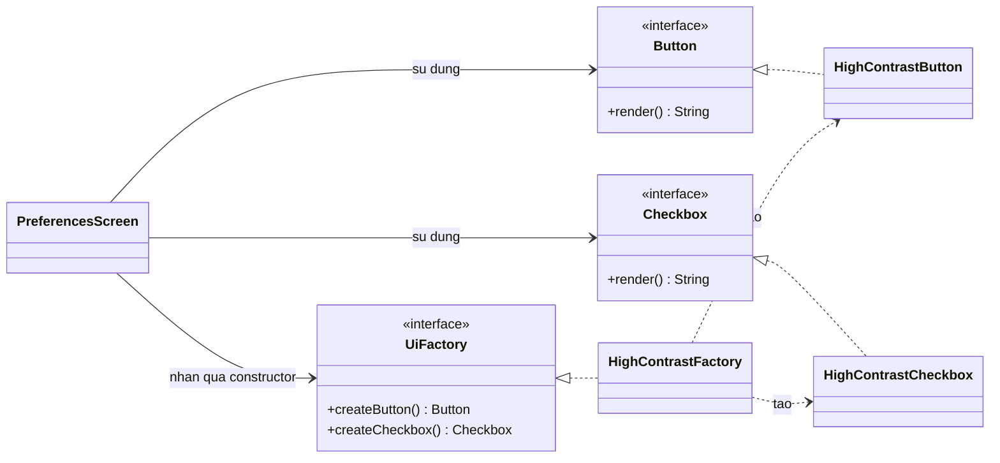

# Thêm họ HighContrast vào ma trận sản phẩm của ví dụ Java

**Chương:** Thêm họ sản phẩm  
**Chuyên đề:** `SOFTWARE_DESIGN_DESIGN_PATTERN_CREATIONAL_ABSTRACT_FACTORY` — Học về abstract factory trong design pattern.

## Mục tiêu học tập

Sau bài này, bạn có thể:

- Phân biệt **loại sản phẩm** (ví dụ `Button`, `Checkbox`) với **họ sản phẩm** (ví dụ `Light`, `Dark`, `HighContrast`).
- Thêm họ `HighContrast` vào một hệ thống Java đang sử dụng **Abstract Factory** mà không thêm nhánh chọn giao diện vào từng màn hình.
- Xác định chính xác phần mã phải mở rộng, kiểm tra tính đồng bộ của các sản phẩm và nhận ra chi phí khi số loại sản phẩm tăng.
- Hiểu vì sao kiểu dáng tương phản cao là một yêu cầu thiết kế giao diện cần kiểm chứng, chứ không chỉ là đổi tên lớp.

## 1. Đặt vấn đề: mở rộng theo chiều họ sản phẩm

Giả sử ứng dụng Java có màn hình cài đặt với hai loại thành phần giao diện: nút bấm (`Button`) và ô chọn (`Checkbox`). Ban đầu, ứng dụng hỗ trợ hai họ kiểu dáng `Light` và `Dark`. Mỗi họ cung cấp **đủ cả hai loại thành phần** và chúng phải nhất quán về màu chữ, màu nền, đường viền, trạng thái được chọn và trạng thái nhận tiêu điểm.

Một yêu cầu mới xuất hiện: người dùng cần chế độ **HighContrast** để dễ phân biệt văn bản, đường viền và dấu chọn. Ta muốn thêm họ này mà không sửa logic của màn hình cài đặt.

Ma trận sản phẩm sau khi mở rộng là:

| Họ sản phẩm (factory cụ thể) | `Button` | `Checkbox` |
| --- | --- | --- |
| `Light` (`LightFactory`) | `LightButton` | `LightCheckbox` |
| `Dark` (`DarkFactory`) | `DarkButton` | `DarkCheckbox` |
| **`HighContrast` (`HighContrastFactory`)** | **`HighContrastButton`** | **`HighContrastCheckbox`** |

Đọc ma trận **theo cột** để thấy các loại sản phẩm có cùng giao diện lập trình; đọc **theo hàng** để thấy một họ gồm những sản phẩm phối hợp được với nhau. Thêm `HighContrast` là **thêm một hàng**, không phải thêm một cột.

Trong Abstract Factory:

- **Abstract products** là các giao diện `Button` và `Checkbox`.
- **Abstract factory** là giao diện `UiFactory` khai báo `createButton()` và `createCheckbox()`.
- **Concrete products** là các lớp như `HighContrastButton` và `HighContrastCheckbox`.
- **Concrete factory** là `HighContrastFactory`, chịu trách nhiệm tạo đúng các sản phẩm thuộc họ mới.
- **Client** là `PreferencesScreen`, chỉ biết các giao diện trừu tượng.

## 2. Quy tắc mở rộng và sơ đồ quan hệ

Một lần chọn factory phải quyết định kiểu dáng cho **toàn bộ màn hình**. Nếu nút bấm được tạo từ `HighContrastFactory` còn ô chọn lấy từ `DarkFactory`, giao diện có thể trở nên thiếu nhất quán. Client vì thế nhận **một** `UiFactory` và yêu cầu mọi sản phẩm thông qua factory đó.



Các lớp `Light*` và `Dark*` cũng triển khai đúng những giao diện tương ứng; sơ đồ chỉ tập trung vào họ mới để dễ theo dõi. Đường phụ thuộc quan trọng là `PreferencesScreen → UiFactory`, thay vì `PreferencesScreen → HighContrastButton`.

## 3. Ví dụ Java hoàn chỉnh

Ví dụ dùng `render()` để **in mô tả thuộc tính hiển thị ra console**, giúp quan sát sự khác biệt giữa các họ mà không phụ thuộc thư viện giao diện. Đây là mô hình minh họa cấu trúc Abstract Factory, không phải bộ điều khiển giao diện hay chứng nhận khả năng truy cập thực tế.

Lưu toàn bộ mã dưới đây vào tệp **`AbstractFactoryHighContrastDemo.java`**. Mã dùng cú pháp Java 8 trở lên.

```java
import java.util.Locale;

// 1. Hai loại sản phẩm: client chỉ phụ thuộc vào các interface này.
interface Button {
    String render();
}

interface Checkbox {
    String render();
}

// 2. Hợp đồng cho MỌI họ sản phẩm.
interface UiFactory {
    Button createButton();
    Checkbox createCheckbox();
}

// 3. Họ Light hiện có.
final class LightButton implements Button {
    @Override
    public String render() {
        return "Button[Light]: bg=#FFFFFF, fg=#111111, border=1px #777777";
    }
}

final class LightCheckbox implements Checkbox {
    @Override
    public String render() {
        return "Checkbox[Light]: bg=#FFFFFF, fg=#111111, mark=#111111, border=1px #777777";
    }
}

final class LightFactory implements UiFactory {
    @Override
    public Button createButton() {
        return new LightButton();
    }

    @Override
    public Checkbox createCheckbox() {
        return new LightCheckbox();
    }
}

// 4. Họ Dark hiện có.
final class DarkButton implements Button {
    @Override
    public String render() {
        return "Button[Dark]: bg=#202124, fg=#FFFFFF, border=1px #888888";
    }
}

final class DarkCheckbox implements Checkbox {
    @Override
    public String render() {
        return "Checkbox[Dark]: bg=#202124, fg=#FFFFFF, mark=#FFFFFF, border=1px #888888";
    }
}

final class DarkFactory implements UiFactory {
    @Override
    public Button createButton() {
        return new DarkButton();
    }

    @Override
    public Checkbox createCheckbox() {
        return new DarkCheckbox();
    }
}

// 5. Hai sản phẩm MỚI thuộc cùng họ HighContrast.
final class HighContrastButton implements Button {
    @Override
    public String render() {
        return "Button[HighContrast]: bg=#000000, fg=#FFFFFF, "
             + "border=3px #FFFF00, focus=3px #00FFFF";
    }
}

final class HighContrastCheckbox implements Checkbox {
    @Override
    public String render() {
        return "Checkbox[HighContrast]: bg=#000000, fg=#FFFFFF, "
             + "mark=#FFFF00, border=3px #FFFF00, focus=3px #00FFFF";
    }
}

// 6. Factory MỚI trả về đúng cặp sản phẩm HighContrast.
final class HighContrastFactory implements UiFactory {
    @Override
    public Button createButton() {
        return new HighContrastButton();
    }

    @Override
    public Checkbox createCheckbox() {
        return new HighContrastCheckbox();
    }
}

// 7. Client không cần biết lớp cụ thể của các thành phần.
final class PreferencesScreen {
    private final Button saveButton;
    private final Checkbox notificationsCheckbox;

    PreferencesScreen(UiFactory factory) {
        this.saveButton = factory.createButton();
        this.notificationsCheckbox = factory.createCheckbox();
    }

    String render() {
        return saveButton.render() + System.lineSeparator()
             + notificationsCheckbox.render();
    }
}

// 8. Composition root: chọn factory một lần, tại ranh giới ứng dụng.
public final class AbstractFactoryHighContrastDemo {
    private static UiFactory factoryFor(String theme) {
        switch (theme.trim().toLowerCase(Locale.ROOT)) {
            case "light":
                return new LightFactory();
            case "dark":
                return new DarkFactory();
            case "high-contrast":
                return new HighContrastFactory();
            default:
                throw new IllegalArgumentException("Unknown theme: " + theme);
        }
    }

    public static void main(String[] args) {
        String theme = args.length == 0 ? "high-contrast" : args[0];
        UiFactory factory = factoryFor(theme);
        PreferencesScreen screen = new PreferencesScreen(factory);
        System.out.println(screen.render());
    }
}
```

### Chạy và quan sát

Trong thư mục chứa tệp Java:

```bash
javac -encoding UTF-8 AbstractFactoryHighContrastDemo.java
java AbstractFactoryHighContrastDemo high-contrast
```

Kết quả dự kiến:

```text
Button[HighContrast]: bg=#000000, fg=#FFFFFF, border=3px #FFFF00, focus=3px #00FFFF
Checkbox[HighContrast]: bg=#000000, fg=#FFFFFF, mark=#FFFF00, border=3px #FFFF00, focus=3px #00FFFF
```

Thay đối số bằng `light` hoặc `dark` để thấy cùng `PreferencesScreen` sử dụng các họ khác nhau. Đối số không được hỗ trợ, chẳng hạn `blue`, tạo `IllegalArgumentException` thay vì âm thầm phối trộn giao diện. Nếu không truyền đối số, ví dụ chọn `high-contrast` để tiện quan sát tính năng mới.

## 4. Thực tế đã thay đổi những đâu?

Nếu dự án trước đó đã có `Button`, `Checkbox`, `UiFactory`, `LightFactory`, `DarkFactory` và `PreferencesScreen`, quy trình bổ sung họ `HighContrast` gồm:

1. **Xác định toàn bộ abstract products:** ở đây là `Button` và `Checkbox`. Một họ mới phải có hiện thực cho từng loại trong hợp đồng của factory.
2. **Tạo sản phẩm cụ thể:** viết `HighContrastButton implements Button` và `HighContrastCheckbox implements Checkbox`, bảo đảm chúng cùng dùng quy tắc tương phản cao.
3. **Tạo factory cụ thể:** viết `HighContrastFactory implements UiFactory` và triển khai **đủ** `createButton()` lẫn `createCheckbox()`.
4. **Đăng ký lựa chọn tại điểm khởi tạo:** thêm nhánh `high-contrast` trong `factoryFor()` (hoặc đăng ký trong cấu hình/DI container của ứng dụng thực tế).
5. **Kiểm tra cặp sản phẩm và khả năng hiển thị:** chạy với ba chủ đề, xác nhận không trộn họ và không làm hỏng hai họ cũ.

Điểm quan trọng: `PreferencesScreen` **không có** `if (theme.equals("high-contrast"))` hay lời gọi `new HighContrastButton()`. Lớp này chỉ nhận `UiFactory`. Nhờ vậy, thêm một **họ mới** thường không đòi hỏi sửa các client hiện có. Điểm chọn factory của ứng dụng vẫn cần biết cách ánh xạ cấu hình `high-contrast` sang `HighContrastFactory`.

Trong mã thực tế, mỗi lớp có thể nằm trong tệp riêng và được tổ chức theo package. Việc đặt cùng một tệp ở đây chỉ nhằm giúp chạy thử trọn vẹn mà không phải tạo nhiều tệp phụ.

## 5. Vì sao phải thêm đủ cả họ?

Giả sử chỉ tạo `HighContrastButton` rồi tái sử dụng `DarkCheckbox` trong `HighContrastFactory`:

```java
// Phản ví dụ: factory khai báo HighContrast nhưng trộn sản phẩm Dark.
final class MixedHighContrastFactory implements UiFactory {
    public Button createButton() { return new HighContrastButton(); }
    public Checkbox createCheckbox() { return new DarkCheckbox(); } // Sai ý đồ của họ
}
```

Đoạn này **vẫn biên dịch** vì `DarkCheckbox` thỏa interface `Checkbox`, nhưng vi phạm tính nhất quán về trải nghiệm: ô chọn không còn dùng quy ước viền và dấu chọn tương phản cao. Abstract Factory giúp tập trung trách nhiệm lựa chọn họ vào một nơi; bản thân hệ kiểu Java **không tự chứng minh** các sản phẩm trả về thuộc cùng một họ về mặt ngữ nghĩa.

Do đó cần kiểm tra hợp đồng ở hai mức:

| Mức kiểm tra | Câu hỏi | Cách kiểm chứng |
| --- | --- | --- |
| Kiểu dữ liệu | Các factory trả về đủ `Button` và `Checkbox`? | Trình biên dịch kiểm tra `implements UiFactory`. |
| Quy ước họ sản phẩm | Factory `HighContrast` có thực sự tạo cả hai sản phẩm HighContrast? | Unit test, kiểm tra lớp cụ thể hoặc các thuộc tính đầu ra. |
| Trải nghiệm người dùng | Chữ, dấu chọn, viền và focus có phân biệt rõ? | Xem trên giao diện thật; kiểm tra bàn phím, trạng thái và độ tương phản. |
| Tương thích ngược | Hai họ `Light` và `Dark` còn hoạt động như cũ? | Chạy lại các tình huống của cả hai họ. |

Ví dụ dùng chữ trắng `#FFFFFF` trên nền đen `#000000` (tỷ lệ tương phản lý thuyết 21:1 cho hai màu đó), viền vàng dày và tín hiệu focus màu cyan để diễn đạt mục đích của `HighContrast`. Một giao diện thực tế còn cần kiểm tra trạng thái hover/disabled/checked, khả năng điều hướng bằng bàn phím, tên truy cập của thành phần, độ phân biệt dưới các thiết lập hệ điều hành và cách công nghệ hỗ trợ đọc nội dung. **Không thể kết luận toàn bộ giao diện đạt tiêu chuẩn accessibility chỉ từ các chuỗi mô tả trong ví dụ.**

## 6. Chiều mở rộng dễ và chiều mở rộng tốn công

Abstract Factory phù hợp khi có **nhiều loại sản phẩm phải đi cùng nhau**, đồng thời ứng dụng thường bổ sung các họ hoàn chỉnh.

- **Thêm một họ** (`HighContrast`): thêm một lớp factory cụ thể và một lớp sản phẩm cho mỗi abstract product đang có; thường giữ nguyên `UiFactory`, `Button`, `Checkbox` và các client.
- **Thêm một loại sản phẩm** (ví dụ `Dialog`): phải bổ sung `createDialog()` vào `UiFactory`, tạo interface `Dialog` và triển khai `LightDialog`, `DarkDialog`, `HighContrastDialog`; sau đó cập nhật **mọi** factory cụ thể. Đây là thay đổi theo cột của ma trận, có ảnh hưởng rộng hơn.

Với **m** họ và **n** loại sản phẩm, cách cài đặt tách lớp như ví dụ thường có khoảng **m × n lớp sản phẩm cụ thể**, cộng thêm các factory. Số lượng lớp tăng là chi phí đánh đổi cho khả năng thay cả họ một cách nhất quán.

Nếu ứng dụng chỉ đổi vài giá trị màu sắc mà không có các nhóm đối tượng cần tạo đồng bộ, một `Theme`/`ColorPalette` hoặc bộ design tokens có thể đơn giản hơn. Abstract Factory phát huy giá trị rõ nhất khi các sản phẩm có hiện thực, hành vi hoặc quy tắc khởi tạo khác nhau theo họ.

## 7. Các lỗi thường gặp khi tích hợp HighContrast

| Lỗi | Hệ quả | Cách xử lý |
| --- | --- | --- |
| Tạo sản phẩm mới nhưng quên `HighContrastFactory` | Ứng dụng không có điểm tạo cả họ | Thêm factory triển khai đầy đủ `UiFactory`. |
| Tạo `HighContrastButton` trực tiếp trong `PreferencesScreen` | Client phụ thuộc lớp cụ thể, khó đổi họ | Chỉ tạo sản phẩm qua factory được inject. |
| Factory trả về `HighContrastButton` và `DarkCheckbox` | Các thành phần hiển thị lệch quy ước | Kiểm thử tính nhất quán ở mức factory. |
| Chọn theme riêng ở từng widget | Cùng màn hình có thể dùng nhiều họ | Chọn một factory tại composition root. |
| Thêm họ mới nhưng không cập nhật cấu hình chọn factory | Người dùng không thể kích hoạt chế độ mới | Đăng ký `high-contrast` tại nơi ánh xạ theme. |
| Chỉ đổi màu chữ mà bỏ qua focus/selected/disabled | Khó thao tác dù độ tương phản văn bản cao | Kiểm tra đủ trạng thái trên giao diện chạy thật. |

## 8. Bài tự kiểm tra

1. Nếu `UiFactory` có thêm `createSlider()`, bạn phải thay đổi những lớp nào để bảo toàn hợp đồng? **Gợi ý:** đây là thêm *loại sản phẩm*, nên mọi factory cụ thể đều phải được cập nhật.
2. Vì sao `HighContrastFactory` có thể trả về `DarkCheckbox` mà trình biên dịch vẫn chấp nhận? **Gợi ý:** kiểu trả về đúng `Checkbox`, nhưng quy ước cùng họ là ràng buộc ngữ nghĩa.
3. Khi người dùng chọn `high-contrast`, nên đặt logic phân nhánh ở `PreferencesScreen`, trong từng widget hay ở điểm khởi tạo ứng dụng? **Đáp án:** tại điểm khởi tạo (ví dụ `factoryFor()`), rồi truyền một `UiFactory` vào client.
4. Hãy thử tạo `HighContrastDialog` khi bổ sung loại sản phẩm `Dialog`. Bạn cần cập nhật những factory nào? **Đáp án:** `LightFactory`, `DarkFactory`, `HighContrastFactory` và interface `UiFactory`.

## Kết luận

Trong bài toán **Thêm họ sản phẩm**, yêu cầu “thêm HighContrast” được chuyển thành một thao tác rõ ràng: **bổ sung một hàng vào ma trận sản phẩm**. Ta tạo `HighContrastButton`, `HighContrastCheckbox` và `HighContrastFactory`, sau đó cho ứng dụng lựa chọn factory mới tại điểm khởi tạo. `PreferencesScreen` vẫn làm việc với `Button`, `Checkbox` và `UiFactory` như trước. Đây là lợi ích cốt lõi của Abstract Factory khi cần tạo các sản phẩm thuộc **cùng một họ tương thích** và đổi cả họ mà không sửa logic client.
