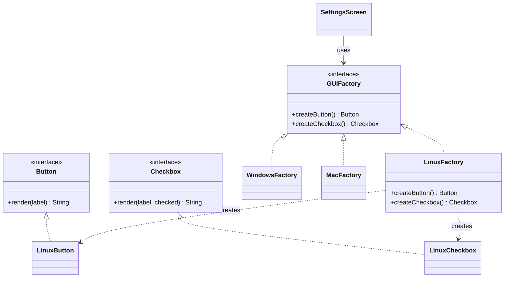

# Hiện thực đầy đủ các ConcreteProduct và ConcreteFactory của họ mới

Trong module `SOFTWARE_DESIGN_DESIGN_PATTERN_CREATIONAL_ABSTRACT_FACTORY` — **Học về abstract factory trong design pattern** — việc **thêm một họ sản phẩm (product family)** là tình huống mở rộng quan trọng của mẫu **Abstract Factory**. Khi ứng dụng đã có các loại sản phẩm và một hợp đồng factory chung, ta có thể bổ sung một biến thể mới bằng cách hiện thực **đủ các ConcreteProduct** thuộc họ đó và **một ConcreteFactory** có khả năng tạo ra toàn bộ bộ sản phẩm.

Bài học thuộc chương **Thêm họ sản phẩm**. Ta sẽ mở rộng ví dụ giao diện người dùng (GUI) đang hỗ trợ Windows và macOS để hỗ trợ thêm **Linux**, đồng thời giữ nguyên cách sử dụng sản phẩm của ứng dụng.

## 1. Phân biệt họ sản phẩm với loại sản phẩm

Giả sử một màn hình cài đặt luôn cần hai loại thành phần:

- `Button` — nút “Lưu cài đặt”.
- `Checkbox` — ô “Nhận thông báo”.

**Loại sản phẩm** mô tả chức năng (nút, ô chọn); **họ sản phẩm** mô tả bộ hiện thực tương thích (Windows, macOS, Linux).

| Loại sản phẩm | Họ Windows | Họ macOS | Họ Linux (mới) |
| --- | --- | --- | --- |
| `Button` | `WindowsButton` | `MacButton` | **`LinuxButton`** |
| `Checkbox` | `WindowsCheckbox` | `MacCheckbox` | **`LinuxCheckbox`** |
| Factory tạo cả bộ | `WindowsFactory` | `MacFactory` | **`LinuxFactory`** |

Một màn hình Linux phải nhận được **cả** `LinuxButton` **và** `LinuxCheckbox`. Nếu `LinuxFactory` tạo ra `LinuxButton` nhưng lại trả về `WindowsCheckbox`, chương trình có thể vẫn biên dịch, song đã phá vỡ mục tiêu nhất quán của Abstract Factory.

Ở đây, các **abstract product** và **abstract factory** đã có hợp đồng ổn định:

```java
interface Button {
    String render(String label);
}

interface Checkbox {
    String render(String label, boolean checked);
}

interface GUIFactory {
    Button createButton();
    Checkbox createCheckbox();
}
```

Để thêm Linux, ta **không cần thêm phương thức vào** `GUIFactory`, cũng **không cần sửa** interface `Button` hoặc `Checkbox`. Thay vào đó, tạo các hiện thực Linux thỏa mãn chính những hợp đồng ấy.

## 2. Các lớp phải bổ sung khi thêm một họ

Với hai loại sản phẩm, họ Linux cần ba lớp:

1. **`LinuxButton implements Button`:** biết cách hiển thị và thực hiện hành vi của button theo quy ước Linux mà ứng dụng lựa chọn.
2. **`LinuxCheckbox implements Checkbox`:** biết cách hiển thị và thực hiện hành vi của checkbox trong cùng họ Linux.
3. **`LinuxFactory implements GUIFactory`:** tạo `LinuxButton` qua `createButton()` và `LinuxCheckbox` qua `createCheckbox()`.



Sơ đồ chỉ khai triển cụ thể **họ Linux mới**; những lớp sản phẩm của Windows/macOS vẫn tồn tại và tiếp tục được các factory tương ứng tạo ra. `SettingsScreen` chỉ nhận một đối tượng kiểu `GUIFactory`.

## 3. Mã Java minh họa đầy đủ và có thể chạy

Ví dụ sau mô phỏng việc render bằng chuỗi trên console. Các nhãn `[Windows]`, `[macOS]` và `[Linux]` giúp ta quan sát **họ được chọn**, chứ không phải widget native thật. Khi xây dựng GUI thực tế, những ConcreteProduct sẽ dùng thư viện hoặc adapter phù hợp.

Lưu toàn bộ mã sau vào file `AddingLinuxFamilyDemo.java`:

```java
import java.util.Locale;

public class AddingLinuxFamilyDemo {

    // ===== 1. Các abstract product đã có =====
    interface Button {
        String render(String label);
    }

    interface Checkbox {
        String render(String label, boolean checked);
    }

    // ===== 2. Abstract factory: hợp đồng giữ nguyên =====
    interface GUIFactory {
        Button createButton();
        Checkbox createCheckbox();
    }

    // ===== 3. Họ Windows đã tồn tại =====
    static final class WindowsButton implements Button {
        @Override
        public String render(String label) {
            return "[Windows] Button: " + label;
        }
    }

    static final class WindowsCheckbox implements Checkbox {
        @Override
        public String render(String label, boolean checked) {
            return "[Windows] Checkbox: " + label
                    + (checked ? " (đã chọn)" : " (chưa chọn)");
        }
    }

    static final class WindowsFactory implements GUIFactory {
        @Override
        public Button createButton() {
            return new WindowsButton();
        }

        @Override
        public Checkbox createCheckbox() {
            return new WindowsCheckbox();
        }
    }

    // ===== 4. Họ macOS đã tồn tại =====
    static final class MacButton implements Button {
        @Override
        public String render(String label) {
            return "[macOS] Button: " + label;
        }
    }

    static final class MacCheckbox implements Checkbox {
        @Override
        public String render(String label, boolean checked) {
            return "[macOS] Checkbox: " + label
                    + (checked ? " (đã chọn)" : " (chưa chọn)");
        }
    }

    static final class MacFactory implements GUIFactory {
        @Override
        public Button createButton() {
            return new MacButton();
        }

        @Override
        public Checkbox createCheckbox() {
            return new MacCheckbox();
        }
    }

    // ===== 5. Họ Linux mới: ConcreteProduct thứ nhất =====
    static final class LinuxButton implements Button {
        @Override
        public String render(String label) {
            return "[Linux] Button: " + label;
        }
    }

    // ===== 6. Họ Linux mới: ConcreteProduct thứ hai =====
    static final class LinuxCheckbox implements Checkbox {
        @Override
        public String render(String label, boolean checked) {
            return "[Linux] Checkbox: " + label
                    + (checked ? " (đã chọn)" : " (chưa chọn)");
        }
    }

    // ===== 7. ConcreteFactory mới: cung cấp trọn họ Linux =====
    static final class LinuxFactory implements GUIFactory {
        @Override
        public Button createButton() {
            return new LinuxButton();
        }

        @Override
        public Checkbox createCheckbox() {
            return new LinuxCheckbox();
        }
    }

    // ===== 8. Client không đổi khi có thêm họ Linux =====
    static final class SettingsScreen {
        private final GUIFactory factory;

        SettingsScreen(GUIFactory factory) {
            this.factory = factory;
        }

        void show() {
            Button saveButton = factory.createButton();
            Checkbox notifications = factory.createCheckbox();

            System.out.println(saveButton.render("Lưu cài đặt"));
            System.out.println(
                    notifications.render("Nhận thông báo", true));
        }
    }

    // ===== 9. Chọn họ tại điểm khởi tạo ứng dụng =====
    static GUIFactory selectFactory(String platform) {
        switch (platform.toLowerCase(Locale.ROOT)) {
            case "windows":
                return new WindowsFactory();
            case "mac":
                return new MacFactory();
            case "linux":
                return new LinuxFactory();
            default:
                throw new IllegalArgumentException(
                        "Nền tảng không hỗ trợ: " + platform);
        }
    }

    public static void main(String[] args) {
        String platform = args.length == 0 ? "windows" : args[0];
        GUIFactory factory = selectFactory(platform);
        new SettingsScreen(factory).show();
    }
}
```

Biên dịch và chạy trong thư mục chứa file:

```bash
javac -encoding UTF-8 AddingLinuxFamilyDemo.java
java AddingLinuxFamilyDemo
java AddingLinuxFamilyDemo mac
java AddingLinuxFamilyDemo linux
```

Khi không có đối số, chương trình chọn Windows:

```text
[Windows] Button: Lưu cài đặt
[Windows] Checkbox: Nhận thông báo (đã chọn)
```

Khi chọn `mac`:

```text
[macOS] Button: Lưu cài đặt
[macOS] Checkbox: Nhận thông báo (đã chọn)
```

Khi chọn `linux`:

```text
[Linux] Button: Lưu cài đặt
[Linux] Checkbox: Nhận thông báo (đã chọn)
```

Điểm cần quan sát là **`SettingsScreen.show()` không thay đổi** giữa ba lần chạy: nó tiếp tục gọi `factory.createButton()` và `factory.createCheckbox()`. Các dòng hiển thị thay đổi do **concrete factory** được truyền vào client khác nhau. Phương thức `selectFactory()` chỉ là nơi cấu hình/khởi tạo đối tượng của ví dụ; trong ứng dụng thật, việc chọn factory có thể do dependency injection, cấu hình hoặc điểm khởi động quyết định.

## 4. Thực hiện việc mở rộng theo từng bước

### Bước 1 — Khóa danh sách loại sản phẩm phải hỗ trợ

Đọc **hợp đồng hiện tại** của abstract factory. Ví dụ `GUIFactory` có:

| Phương thức | Kiểu trả về | ConcreteProduct bắt buộc với họ Linux |
| --- | --- | --- |
| `createButton()` | `Button` | `LinuxButton` |
| `createCheckbox()` | `Checkbox` | `LinuxCheckbox` |

Một họ mới được coi là **đầy đủ** trong ví dụ này khi có hiện thực tương thích cho **tất cả** các phương thức tạo sản phẩm. Nếu abstract factory sau này có thêm `createSlider()`, `LinuxFactory` cũng phải trả về một hiện thực `Slider` hợp lệ.

### Bước 2 — Cài đặt ConcreteProduct theo cùng một hợp đồng

Mỗi ConcreteProduct của họ mới triển khai abstract product tương ứng. Ví dụ `LinuxButton implements Button`, còn `LinuxCheckbox implements Checkbox`. Chúng có thể dùng chung helper cho màu sắc, theme token hoặc logic tương tác, nhưng **API mà client thấy vẫn là `Button` và `Checkbox`**.

Khi dùng toolkit UI thật, hãy xác định rõ “Linux” có nghĩa gì: widget GTK, Qt, web UI trên Linux hay một design system riêng. “Linux” không tự quy định một bộ component duy nhất. Ví dụ console ở đây cố ý chỉ minh họa cơ chế chọn họ.

### Bước 3 — Cài đặt ConcreteFactory cho toàn bộ loại sản phẩm

`LinuxFactory` phải triển khai đầy đủ `GUIFactory`:

```java
static final class LinuxFactory implements GUIFactory {
    @Override
    public Button createButton() {
        return new LinuxButton();
    }

    @Override
    public Checkbox createCheckbox() {
        return new LinuxCheckbox();
    }
}
```

Nếu thiếu một phương thức bắt buộc, Java không cho phép khai báo `LinuxFactory` là một lớp cụ thể triển khai `GUIFactory` mà vẫn biên dịch thành công. Nhưng **trình biên dịch không bảo đảm sản phẩm cùng họ**: trả về `WindowsCheckbox` từ `createCheckbox()` vẫn hợp lệ về mặt kiểu dữ liệu vì nó cũng triển khai `Checkbox`. Do đó phải kiểm tra cả quy tắc kiến trúc, ngoài việc kiểm tra biên dịch.

### Bước 4 — Đăng ký hoặc chọn factory ở nơi khởi tạo

Một bước tích hợp thường bị bỏ sót là **làm cho họ mới có thể được chọn**. Trong ví dụ, ta bổ sung nhánh `linux` vào `selectFactory()`. Chỉ tại ranh giới này mới cần nhắc đến `LinuxFactory`; mã dựng màn hình vẫn dùng `GUIFactory`.

Không nên rải điều kiện `if (isLinux)` khắp các màn hình. Việc đó sẽ kéo logic chọn họ trở lại client và làm khó việc bổ sung biến thể tiếp theo.

### Bước 5 — Xác minh cả bộ sản phẩm và chức năng hiện có

Khi thêm một họ, đừng chỉ kiểm tra button mới. Cần chứng minh **tất cả** sản phẩm Linux xuất hiện cùng nhau và các factory Windows/macOS vẫn hoạt động.

## 5. Kiểm thử đúng ý nghĩa “đầy đủ”

Một kiểm thử cấp đơn vị đơn giản (với cấu trúc lớp lồng nhau của file ví dụ) có thể kiểm tra cả **kiểu concrete product** và **kết quả quan sát được**:

```java
// Có thể đặt trong main để tự kiểm tra; không cần thư viện test.
GUIFactory linux = new LinuxFactory();

if (!(linux.createButton() instanceof LinuxButton)) {
    throw new AssertionError("LinuxFactory phải tạo LinuxButton");
}
if (!(linux.createCheckbox() instanceof LinuxCheckbox)) {
    throw new AssertionError("LinuxFactory phải tạo LinuxCheckbox");
}
if (!linux.createCheckbox()
        .render("Nhận thông báo", true)
        .contains("(đã chọn)")) {
    throw new AssertionError("Checkbox phải thể hiện trạng thái được chọn");
}
```

Trong hệ thống thực, nên viết kiểm thử phù hợp với framework dự án, đồng thời rà soát các trường hợp:

| Kiểm tra | Điều kiện đạt |
| --- | --- |
| Đủ loại sản phẩm | Factory Linux tạo được Button và Checkbox; không trả về `null` |
| Đúng họ | Cả hai sản phẩm của `LinuxFactory` thuộc họ Linux |
| Hợp đồng hoạt động | `render()` trả về nội dung phù hợp; trạng thái checked/unchecked đúng |
| Client độc lập | `SettingsScreen` chạy khi truyền Windows, macOS hoặc Linux factory |
| Không hồi quy | Lựa chọn Windows/macOS vẫn tạo đúng các sản phẩm cũ |
| Bảo đảm giao diện thật | Nếu có GUI, kiểm tra bằng mắt/automation các trạng thái, khả năng truy cập và sự nhất quán |

Kiểm tra kiểu cụ thể như `instanceof LinuxButton` hữu ích trong một bài học để phát hiện trộn họ; ở phần lớn mã nghiệp vụ, client **không nên** dùng `instanceof` để xử lý UI. Đó là trách nhiệm kiểm thử, cấu hình và factory.

## 6. Các lỗi dễ gặp khi thêm ConcreteFactory mới

**Lỗi 1: Chỉ thêm một ConcreteProduct.** Có `LinuxButton` nhưng `LinuxFactory.createCheckbox()` chưa cài đặt hoặc trả về `null`. Giải pháp là đối chiếu toàn bộ các phương thức tạo trong abstract factory và hoàn thiện một bộ tương ứng.

**Lỗi 2: Trả sản phẩm sai họ.**

```java
// Sai về thiết kế dù có thể biên dịch:
public Checkbox createCheckbox() {
    return new WindowsCheckbox();
}
```

Hệ quả là màn hình Linux có checkbox thuộc Windows. Phát hiện bằng kiểm thử quy tắc họ và rà soát implementation của factory.

**Lỗi 3: Thay đổi abstract factory không cần thiết.** Khi chỉ thêm Linux, ta không cần thêm `createLinuxButton()` hoặc `createLinuxCheckbox()` vào `GUIFactory`. Các phương thức như vậy đưa tên họ cụ thể vào hợp đồng chung và làm mất khả năng hoán đổi.

**Lỗi 4: Để client tạo trực tiếp ConcreteProduct.**

```java
// Cần tránh trong mã client:
Button save = new LinuxButton();
Checkbox notify = new LinuxCheckbox();

// Nên lấy toàn bộ thành phần từ factory đã được cấu hình:
Button saveViaFactory = factory.createButton();
Checkbox notifyViaFactory = factory.createCheckbox();
```

Việc tạo trực tiếp có thể phù hợp **bên trong factory** hoặc ở điểm cấu hình, nhưng khi đặt trong màn hình nghiệp vụ nó làm client phụ thuộc vào họ cụ thể và dễ dẫn đến trộn biến thể.

**Lỗi 5: Không tích hợp họ mới vào cấu hình.** Các lớp Linux được viết đầy đủ nhưng không có cách chọn `LinuxFactory` nên tính năng không thể sử dụng. Cần cập nhật điểm khởi tạo, registry hoặc cấu hình ứng dụng tùy kiến trúc.

**Lỗi 6: Giả định cùng interface nghĩa là cùng chất lượng.** Những sản phẩm Linux có thể cùng implements interface nhưng không đồng nhất về hành vi, style hoặc khả năng truy cập. Factory chịu trách nhiệm tạo đúng họ; chất lượng thực tế còn phụ thuộc vào hiện thực và kiểm thử.

## 7. Vì sao cách mở rộng này là ưu thế của Abstract Factory?

Giả sử ứng dụng có `N` loại sản phẩm trong một họ. Việc thêm một họ mới thông thường đòi hỏi:

- Hiện thực **`N` ConcreteProduct** tương ứng (hoặc dùng lại hiện thực chung khi chúng thực sự phù hợp).
- Thêm **một ConcreteFactory** triển khai đủ `N` phương thức tạo.
- Thêm cấu hình/đăng ký để ứng dụng có thể chọn factory mới.

Các **abstract product** và **abstract factory** có thể giữ nguyên, miễn là hợp đồng đáp ứng được họ mới. Các client chỉ phụ thuộc vào interface cũng thường không cần sửa.

So sánh với hướng ngược lại:

| Kiểu thay đổi | Nơi chịu tác động chính |
| --- | --- |
| **Thêm họ** (Linux) | ConcreteProduct Linux, `LinuxFactory`, điểm lựa chọn/đăng ký |
| **Thêm loại** (ví dụ Slider) | Interface `Slider` mới, phương thức `GUIFactory.createSlider()` mới, tất cả các concrete factory và sản phẩm tương ứng |

Đây là lý do Abstract Factory phù hợp với hệ thống mà **bộ loại sản phẩm đã khá ổn định** nhưng cần **nhiều họ/biến thể tương thích**. Nó hỗ trợ mở rộng theo chiều họ, dù không loại bỏ mọi thay đổi ở điểm cấu hình và không tự thực thi quy tắc tương thích khi chạy.

## 8. Bài tập tự thực hành

**Bài tập 1 — Thêm họ Web.** Từ mẫu trên, tạo `WebButton`, `WebCheckbox` và `WebFactory`. Bổ sung `web` vào `selectFactory()`. Kiểm tra `SettingsScreen` chạy được với họ mới mà không sửa mã dựng màn hình.

**Bài tập 2 — Rà soát bộ sản phẩm.** Cố tình sửa `LinuxFactory.createCheckbox()` để trả về `new WindowsCheckbox()`. Dự đoán kết quả biên dịch và đầu ra, sau đó áp dụng kiểm thử đúng họ để phát hiện sai sót.

**Bài tập 3 — Mở rộng hệ thống sẵn có.** Giả sử `GUIFactory` còn có `Slider createSlider()`. Hãy liệt kê chính xác những lớp mới bắt buộc đối với họ Linux và giải thích vì sao không được bỏ qua loại sản phẩm này.

**Câu hỏi suy ngẫm:** Nếu ứng dụng có bảy loại thành phần và bốn họ sản phẩm, thêm họ thứ năm khác gì so với thêm loại sản phẩm thứ tám? Đánh giá số hiện thực cần bổ sung, những interface bị tác động và những nơi dùng sản phẩm phải sửa.

## Kết luận

Để **hiện thực đầy đủ các ConcreteProduct và ConcreteFactory của một họ mới**, trước hết hãy nhìn lại **mọi loại sản phẩm** do abstract factory công bố; tiếp theo tạo các ConcreteProduct cho họ mới, viết một ConcreteFactory trả về đúng các sản phẩm đó, rồi tích hợp factory ở điểm cấu hình và kiểm tra cả bộ. Ở ví dụ Linux, `LinuxButton`, `LinuxCheckbox` và `LinuxFactory` tạo thành một bộ hoàn chỉnh; `SettingsScreen` vẫn chỉ biết `Button`, `Checkbox` và `GUIFactory`. Đó là cách Abstract Factory giữ các biến thể được cô lập và các thành phần của một họ nhất quán với nhau.
