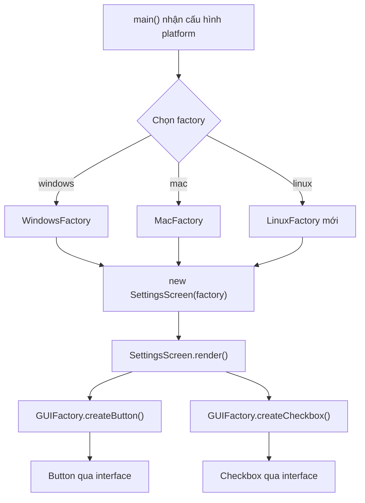

# Xác minh client tiếp tục hoạt động qua các interface hiện có

Trong module `SOFTWARE_DESIGN_DESIGN_PATTERN_CREATIONAL_ABSTRACT_FACTORY` — **Học về abstract factory trong design pattern** — một lợi ích quan trọng của **Abstract Factory** là cho phép thêm **họ sản phẩm** mới mà không buộc phần lớn mã client phải thay đổi. Tuy nhiên, chỉ tạo thêm các lớp sản phẩm và factory là chưa đủ: ta cần **xác minh client cũ vẫn biên dịch, thực thi đúng và chỉ phụ thuộc vào các interface hiện có**.

Bài học thuộc chương **Thêm họ sản phẩm**. Ta giả sử một ứng dụng có hai họ giao diện Windows, macOS và vừa bổ sung họ Linux. Trọng tâm là **kiểm chứng tính tương thích của client sau khi mở rộng**, từ hợp đồng kiểu dữ liệu đến hành vi, khả năng chọn họ mới và các kiểm thử hồi quy.

## 1. “Client tiếp tục hoạt động” nghĩa là gì?

Giả sử màn hình cài đặt (`SettingsScreen`) luôn cần một `Button` để lưu cấu hình và một `Checkbox` để bật thông báo. Nó nhận một `GUIFactory` và chỉ biết các hợp đồng:

```java
interface Button {
    String render(String label);
}

interface Checkbox {
    String render(String label, boolean checked);
}

interface GUIFactory {
    Button createButton();
    Checkbox createCheckbox();
}
```

Hai loại sản phẩm và ba họ được bố trí như sau:

| Loại sản phẩm | Windows (cũ) | macOS (cũ) | Linux (mới) |
| --- | --- | --- | --- |
| `Button` | `WindowsButton` | `MacButton` | **`LinuxButton`** |
| `Checkbox` | `WindowsCheckbox` | `MacCheckbox` | **`LinuxCheckbox`** |
| Factory | `WindowsFactory` | `MacFactory` | **`LinuxFactory`** |

Trong tình huống này, **thêm họ Linux** phải thỏa mãn các tiêu chí:

1. **Giữ hợp đồng hiện có:** không thay đổi phương thức của `Button`, `Checkbox` và `GUIFactory` chỉ vì thêm Linux.
2. **Giữ nguyên mã client:** `SettingsScreen` không cần thêm `if (linux)`, `switch (platform)`, ép kiểu hay câu lệnh `new LinuxButton()`.
3. **Đúng hành vi:** với mỗi concrete factory, `SettingsScreen` tạo và sử dụng các sản phẩm thông qua interface mà không lỗi.
4. **Cùng họ:** `LinuxFactory` tạo cả `LinuxButton` lẫn `LinuxCheckbox`; các factory cũ vẫn trả về sản phẩm thuộc họ của chúng.
5. **Được tích hợp:** điểm cấu hình ứng dụng cho phép chọn `LinuxFactory` khi người dùng yêu cầu Linux; giá trị không hỗ trợ phải được xử lý rõ ràng.
6. **Không hồi quy:** các luồng Windows và macOS tiếp tục hoạt động đúng như trước.

**Chú ý:** “Không sửa client” **không đồng nghĩa** “không sửa dòng mã nào trong ứng dụng”. Điểm khởi tạo hoặc đăng ký factory có thể phải thay đổi để có cách chọn Linux. Đảm bảo ở đây là **mã nghiệp vụ dùng sản phẩm không cần biết hoặc sửa theo biến thể cụ thể**.

## 2. Ranh giới nào được phép biết họ sản phẩm mới?



Trong sơ đồ, `main()` là **composition root**, nơi biết các concrete factory và chịu trách nhiệm chọn một họ. `SettingsScreen` chỉ giữ tham chiếu kiểu `GUIFactory`. Khi factory được truyền vào, client không cần nhận thêm tham số `platform` để quyết định tạo sản phẩm.

Ta có thể đọc cấu trúc phụ thuộc theo hai chiều:

- **Luồng khởi tạo:** cấu hình → concrete factory → constructor của client → phương thức tạo sản phẩm.
- **Phụ thuộc mã nguồn của client:** `SettingsScreen` → `GUIFactory`, `Button`, `Checkbox`. Không có phụ thuộc trực tiếp từ `SettingsScreen` tới `LinuxFactory` hoặc `LinuxButton`.

Điều kiện quan trọng là **mọi concrete factory đều thực hiện đúng hợp đồng**. Interface chung làm cho client có thể làm việc với các factory, nhưng **tính đúng đắn của từng họ** vẫn cần được kiểm chứng.

## 3. Ví dụ Java hoàn chỉnh: chạy lại cùng client với ba họ

Đoạn mã sau mô phỏng các thành phần UI bằng chuỗi đầu ra. Mục tiêu là quan sát **đường tạo sản phẩm và khả năng sử dụng interface**, không phải dựng widget native thực. Trong một ứng dụng GUI thật, các concrete product sẽ dùng toolkit thích hợp và có thêm kiểm thử trực quan.

Lưu toàn bộ vào `VerifyClientAfterNewFamily.java`:

```java
import java.util.Locale;
import java.util.Objects;

public class VerifyClientAfterNewFamily {

    // Hợp đồng tồn tại từ trước khi có Linux.
    interface Button {
        String render(String label);
    }

    interface Checkbox {
        String render(String label, boolean checked);
    }

    interface GUIFactory {
        Button createButton();
        Checkbox createCheckbox();
    }

    // Họ Windows: các lớp cũ.
    static final class WindowsButton implements Button {
        @Override
        public String render(String label) {
            return "[Windows] Button: " + label;
        }
    }

    static final class WindowsCheckbox implements Checkbox {
        @Override
        public String render(String label, boolean checked) {
            return "[Windows] Checkbox: " + label
                    + (checked ? " [checked]" : " [unchecked]");
        }
    }

    static final class WindowsFactory implements GUIFactory {
        @Override
        public Button createButton() {
            return new WindowsButton();
        }

        @Override
        public Checkbox createCheckbox() {
            return new WindowsCheckbox();
        }
    }

    // Họ macOS: các lớp cũ.
    static final class MacButton implements Button {
        @Override
        public String render(String label) {
            return "[macOS] Button: " + label;
        }
    }

    static final class MacCheckbox implements Checkbox {
        @Override
        public String render(String label, boolean checked) {
            return "[macOS] Checkbox: " + label
                    + (checked ? " [checked]" : " [unchecked]");
        }
    }

    static final class MacFactory implements GUIFactory {
        @Override
        public Button createButton() {
            return new MacButton();
        }

        @Override
        public Checkbox createCheckbox() {
            return new MacCheckbox();
        }
    }

    // Họ Linux: các concrete product mới.
    static final class LinuxButton implements Button {
        @Override
        public String render(String label) {
            return "[Linux] Button: " + label;
        }
    }

    static final class LinuxCheckbox implements Checkbox {
        @Override
        public String render(String label, boolean checked) {
            return "[Linux] Checkbox: " + label
                    + (checked ? " [checked]" : " [unchecked]");
        }
    }

    // Concrete factory mới: hiện thực đủ hợp đồng cũ.
    static final class LinuxFactory implements GUIFactory {
        @Override
        public Button createButton() {
            return new LinuxButton();
        }

        @Override
        public Checkbox createCheckbox() {
            return new LinuxCheckbox();
        }
    }

    // CLIENT DÙNG CHUNG: không biết Windows, macOS hay Linux.
    static final class SettingsScreen {
        private final GUIFactory factory;

        SettingsScreen(GUIFactory factory) {
            this.factory = Objects.requireNonNull(factory, "factory");
        }

        String render() {
            Button save = factory.createButton();
            Checkbox notifications = factory.createCheckbox();

            return save.render("Lưu cài đặt")
                    + "\n"
                    + notifications.render("Nhận thông báo", true);
        }
    }

    // Điểm chọn factory; đây là nơi bổ sung nhánh Linux.
    static GUIFactory selectFactory(String platform) {
        String key = Objects.requireNonNull(platform, "platform")
                .trim().toLowerCase(Locale.ROOT);

        switch (key) {
            case "windows":
                return new WindowsFactory();
            case "mac":
            case "macos":
                return new MacFactory();
            case "linux":
                return new LinuxFactory();
            default:
                throw new IllegalArgumentException(
                        "Nền tảng không hỗ trợ: " + platform);
        }
    }

    // Kiểm tra hành vi client trên một factory bất kỳ.
    static void verifyScreen(String name, GUIFactory factory,
                             String expected) {
        String actual = new SettingsScreen(factory).render();
        if (!expected.equals(actual)) {
            throw new AssertionError(
                    name + " không tương thích: " + actual);
        }
    }

    // Kiểm thử hồi quy và tương thích với họ mới.
    static void verifyAllFamilies() {
        verifyScreen(
                "Windows", new WindowsFactory(),
                "[Windows] Button: Lưu cài đặt\n"
                + "[Windows] Checkbox: Nhận thông báo [checked]");

        verifyScreen(
                "macOS", new MacFactory(),
                "[macOS] Button: Lưu cài đặt\n"
                + "[macOS] Checkbox: Nhận thông báo [checked]");

        verifyScreen(
                "Linux", new LinuxFactory(),
                "[Linux] Button: Lưu cài đặt\n"
                + "[Linux] Checkbox: Nhận thông báo [checked]");

        // Phát hiện việc factory Linux vô tình trộn họ.
        GUIFactory linux = new LinuxFactory();
        if (!(linux.createButton() instanceof LinuxButton)
                || !(linux.createCheckbox() instanceof LinuxCheckbox)) {
            throw new AssertionError(
                    "LinuxFactory trả về sản phẩm sai họ");
        }

        System.out.println("PASS: client tương thích với cả 3 họ");
    }

    public static void main(String[] args) {
        verifyAllFamilies();

        String platform = args.length == 0 ? "windows" : args[0];
        GUIFactory factory = selectFactory(platform);
        SettingsScreen screen = new SettingsScreen(factory);

        System.out.println(screen.render());
    }
}
```

Biên dịch và chạy trong thư mục chứa file:

```bash
javac -encoding UTF-8 VerifyClientAfterNewFamily.java
java VerifyClientAfterNewFamily windows
java VerifyClientAfterNewFamily mac
java VerifyClientAfterNewFamily linux
```

Với tham số `linux`, **đầu ra dự kiến**:

```text
PASS: client tương thích với cả 3 họ
[Linux] Button: Lưu cài đặt
[Linux] Checkbox: Nhận thông báo [checked]
```

Với `mac` hoặc `windows`, dòng `PASS` vẫn xuất hiện trước hai dòng sản phẩm tương ứng với họ được chọn. `verifyAllFamilies()` luôn kiểm tra cả ba họ trước khi hiển thị màn hình của nền tảng đầu vào.

Đây là ví dụ mô phỏng và mã tham khảo để người học tự biên dịch. Các chuỗi kỳ vọng trong `verifyScreen()` được viết tường minh, nên nếu một factory thay đổi hành vi hoặc trả sản phẩm không đúng, phép kiểm tra có thể phát hiện được sự khác biệt quan sát được.

## 4. Chứng minh rằng client không phải sửa

Mã client cốt lõi vẫn là:

```java
final class SettingsScreen {
    private final GUIFactory factory;

    SettingsScreen(GUIFactory factory) {
        this.factory = java.util.Objects.requireNonNull(factory);
    }

    String render() {
        Button button = factory.createButton();
        Checkbox checkbox = factory.createCheckbox();
        return button.render("Lưu cài đặt") + "\n"
                + checkbox.render("Nhận thông báo", true);
    }
}
```

Đoạn trên minh họa lại cấu trúc client trong chương trình hoàn chỉnh. Để hiểu một thay đổi thực tế, hãy đối chiếu mã nguồn **trước khi có Linux** và **sau khi thêm Linux**:

| Thành phần | Có cần thay khi thêm Linux? | Lý do |
| --- | --- | --- |
| Interface `Button` | Không, nếu hợp đồng cũ đáp ứng yêu cầu | Mọi button cùng cung cấp `render(label)` |
| Interface `Checkbox` | Không, nếu hợp đồng cũ đáp ứng yêu cầu | Mọi checkbox cùng cung cấp `render(label, checked)` |
| Interface `GUIFactory` | Không | Các loại sản phẩm cần tạo vẫn là Button và Checkbox |
| `SettingsScreen` | Không | Chỉ tham chiếu ba interface kể trên |
| `WindowsFactory` và `MacFactory` | Không | Không thay đổi hợp đồng hay họ cũ |
| `LinuxButton`, `LinuxCheckbox` | **Bổ sung** | Cần hiện thực cho họ mới |
| `LinuxFactory` | **Bổ sung** | Cần tạo đủ sản phẩm Linux |
| `selectFactory()` hoặc cấu hình DI | **Có thể cần cập nhật** | Đăng ký/cho phép chọn factory mới |

Đây là ý nghĩa thực tế của **mở rộng theo chiều họ sản phẩm**: thêm các lớp hiện thực mới và cập nhật điểm cấu hình, còn logic client và các abstraction tiếp tục được dùng lại. Cụm “có thể cần cập nhật” áp dụng khi hệ thống đã có cơ chế tự đăng ký plugin hoặc phát hiện factory; trong ví dụ `switch`, ta **phải thêm nhánh Linux**.

## 5. Các lớp kiểm chứng: biên dịch chưa phải là đủ

### 5.1. Hợp đồng kiểu dữ liệu

`LinuxButton implements Button`, `LinuxCheckbox implements Checkbox` và `LinuxFactory implements GUIFactory`. Trình biên dịch Java có thể phát hiện việc thiếu phương thức bắt buộc hoặc trả về kiểu không tương thích.

Tuy nhiên, `LinuxFactory.createButton()` trả `new WindowsButton()` **vẫn có thể biên dịch** vì `WindowsButton` cũng triển khai `Button`. Vì vậy, còn cần kiểm tra đúng họ và hành vi.

### 5.2. Khả năng hoán đổi và kết quả nghiệp vụ

Đoạn sau thể hiện phép kiểm tra cơ bản:

```java
GUIFactory[] factories = {
    new WindowsFactory(),
    new MacFactory(),
    new LinuxFactory()
};

for (GUIFactory factory : factories) {
    SettingsScreen screen = new SettingsScreen(factory);
    String output = screen.render();
    if (output == null || output.isEmpty()) {
        throw new AssertionError("Màn hình không hiển thị nội dung");
    }
}
```

Đoạn minh họa này có thể đặt **bên trong lớp** `VerifyClientAfterNewFamily`. Nó chứng minh client chạy trên mọi factory, nhưng điều kiện “không rỗng” vẫn **quá yếu** để kiểm chứng đúng họ hay đúng nội dung. Vì thế, `verifyAllFamilies()` ở mục 3 còn so sánh kết quả mong đợi và kiểm tra lớp sản phẩm do `LinuxFactory` tạo.

### 5.3. Kiểm tra nguồn gốc sản phẩm

Cần xác nhận:

- Factory Linux trả về cả hai sản phẩm Linux, không âm thầm trả sản phẩm Windows/macOS.
- Factory Windows/macOS vẫn trả về sản phẩm thuộc họ cũ.
- Client không ép kiểu sang `LinuxButton`, không sử dụng `instanceof` để quyết định xử lý và không gọi constructor của concrete product.

Phép kiểm tra `instanceof` **ở vùng kiểm thử factory** là phù hợp để kiểm tra quy tắc họ. Đưa nó **vào mã nghiệp vụ của client** sẽ tạo phụ thuộc vào lớp cụ thể và làm giảm khả năng thay thế họ.

### 5.4. Kiểm tra cách chọn và lỗi cấu hình

Lệnh `java VerifyClientAfterNewFamily linux` phải chọn được `LinuxFactory`. Với tham số không hỗ trợ, ví dụ `freebsd`, `selectFactory()` ném `IllegalArgumentException` thay vì ngầm chọn Windows. Trong ứng dụng thật, có thể thay ngoại lệ bằng thông báo lỗi cấu hình rõ ràng và chiến lược fallback đã được thống nhất.

### 5.5. Kiểm thử hồi quy

Thêm Linux không được làm hỏng Windows/macOS. Tối thiểu, kiểm tra các luồng đã hoạt động trước đó và chạy lại những kiểm thử hiện có. Trong chương trình này, `verifyAllFamilies()` kiểm tra lại hai họ cũ ngay cả khi tham số dòng lệnh là `linux`.

## 6. Dùng fake factory để kiểm tra ranh giới client

Một bài kiểm thử tốt có thể kiểm tra **client yêu cầu những sản phẩm nào** mà không phụ thuộc vào kiểu Windows/macOS/Linux cụ thể. Ta tạo một fake factory chỉ ghi nhận số lần yêu cầu sản phẩm:

```java
// Có thể đặt lớp và phương thức dưới đây bên trong
// VerifyClientAfterNewFamily.
static final class RecordingFactory implements GUIFactory {
    int buttonCalls;
    int checkboxCalls;

    @Override
    public Button createButton() {
        buttonCalls++;
        return label -> "[Fake] Button: " + label;
    }

    @Override
    public Checkbox createCheckbox() {
        checkboxCalls++;
        return (label, checked) ->
                "[Fake] Checkbox: " + label + " = " + checked;
    }
}

static void verifyClientUsesFactory() {
    RecordingFactory fake = new RecordingFactory();
    SettingsScreen screen = new SettingsScreen(fake);

    String output = screen.render();
    if (fake.buttonCalls != 1 || fake.checkboxCalls != 1) {
        throw new AssertionError("Client không yêu cầu đủ sản phẩm");
    }
    if (!output.contains("[Fake] Button:")
            || !output.contains("[Fake] Checkbox:")) {
        throw new AssertionError("Client không dùng sản phẩm của factory");
    }
}
```

Để sử dụng phép thử, gọi `verifyClientUsesFactory()` từ `main()`; không cần sửa `SettingsScreen`. **Fake factory** giúp xác nhận client phụ thuộc vào `GUIFactory` và sử dụng các sản phẩm được cấp, còn **kiểm thử concrete factory** xác nhận mỗi họ tạo đúng thành phần thật. Hai mức kiểm tra bổ sung nhau.

Trong dự án thực tế, nên đưa các phép thử vào JUnit hoặc bộ kiểm thử phù hợp, thay vì để chúng trong `main()`. Tất cả đoạn mã trong mục này chỉ nhằm minh họa hướng kiểm chứng với các interface đã định nghĩa.

## 7. Những tình huống làm mất tính tương thích

**Trường hợp 1 — Client tự tạo sản phẩm của một họ.**

```java
// Thiết kế làm client phụ thuộc cụ thể:
Button button = new WindowsButton();

// Thiết kế cho phép thay họ qua factory:
Button buttonFromFactory = factory.createButton();
```

Nếu client dùng `new WindowsButton()`, việc truyền `LinuxFactory` vào client **không đủ** để toàn bộ màn hình chuyển sang Linux. Cần rà soát các vị trí tạo product nằm ngoài factory.

**Trường hợp 2 — Client điều kiện hóa hành vi theo lớp concrete.**

```java
// Ví dụ nên tránh trong client:
if (button instanceof MacButton) {
    // Xử lý riêng cho macOS.
}
```

Đoạn kiểm tra này không nhất thiết gây lỗi ngay, nhưng cho thấy client đang biết các lớp cụ thể. Khi thêm Linux, nhánh xử lý có thể bị bỏ sót. Nếu hành vi thật sự phải khác theo họ, nên xem xét đưa nó vào hợp đồng sản phẩm, một abstraction phù hợp hoặc cơ chế chính sách được cấp từ bên ngoài.

**Trường hợp 3 — Interface vẫn giống nhau, hành vi lại không đúng.** Một `LinuxCheckbox` có thể trả về sai trạng thái checked/unchecked hoặc không đáp ứng yêu cầu truy cập bàn phím. Biên dịch thành công chỉ chứng minh khớp chữ ký phương thức, không chứng minh đúng hành vi. Cần kiểm thử ngữ nghĩa hợp đồng và các tình huống UI thực tế.

**Trường hợp 4 — Factory mới không trả đủ sản phẩm.** Trả về `null`, ném `UnsupportedOperationException` ở `createCheckbox()` hoặc trộn sản phẩm từ các họ khác khiến client thất bại khi thực thi dù interface được triển khai đầy đủ trên giấy tờ.

**Trường hợp 5 — Đã thêm họ nhưng chưa đăng ký.** `LinuxFactory` tồn tại trong codebase nhưng `selectFactory()` không có lựa chọn Linux. Khi đó mã client có thể hoàn toàn tương thích với factory mới, nhưng người dùng **không thể đi đến luồng chạy mới**.

**Trường hợp 6 — Thay đổi luôn abstract factory.** Nếu nhân dịp thêm Linux mà đổi tên `createButton()`, xóa `createCheckbox()` hoặc thay chữ ký phương thức, client cũ có thể ngừng biên dịch. Đây là thay đổi **hợp đồng**, khác với việc chỉ thêm họ. Mở rộng thêm **loại sản phẩm** (ví dụ `Slider`) là một thay đổi khác: khi đó thường phải thêm phương thức tạo mới vào interface factory và cập nhật mọi concrete factory.

## 8. Quy trình kiểm chứng trong một dự án thật

| Bước | Việc thực hiện | Bằng chứng nên thu được |
| --- | --- | --- |
| 1. So sánh hợp đồng | Kiểm tra các interface sản phẩm và factory trước/sau khi thêm họ | Chữ ký public được giữ nguyên trong phạm vi thay đổi này |
| 2. So sánh client | Xem diff các màn hình/service đang dùng factory | Không cần thêm tên lớp Linux hoặc nhánh chọn biến thể |
| 3. Biên dịch toàn hệ thống | Build mã nguồn client và các concrete factory | Các lớp triển khai khớp hợp đồng |
| 4. Kiểm tra factory mới | Xác nhận mỗi phương thức tạo đúng product trong họ | LinuxButton và LinuxCheckbox được tạo đầy đủ |
| 5. Kiểm tra hoán đổi | Chạy cùng một client với Windows, macOS, Linux factory | Hành vi client hợp lệ với mọi họ |
| 6. Kiểm tra đăng ký | Chọn Linux qua cấu hình thực tế | Luồng khởi tạo thực sự sử dụng LinuxFactory |
| 7. Kiểm thử hồi quy | Chạy lại các kiểm thử của Windows/macOS | Không phá vỡ chức năng cũ |
| 8. Kiểm tra UI thực tế | Thử trạng thái focus, disabled, tương phản, bàn phím… | Sản phẩm của họ mới hoạt động theo yêu cầu giao diện |

Khi chạy kiểm thử trong CI, nên phân biệt ba nguồn lỗi: **client vi phạm abstraction**, **factory tạo sản phẩm sai**, và **cấu hình không chọn được factory**. Cách tách này giúp định vị nguyên nhân thay vì sửa ngay trong mỗi màn hình.

## 9. Bài tập thực hành

**Bài tập 1 — Thêm họ nữa mà không sửa client.** Bổ sung `WebButton`, `WebCheckbox` và `WebFactory`, sau đó cập nhật `selectFactory()` để nhận `web`. Mở rộng `verifyAllFamilies()` với kỳ vọng Web. Kiểm tra `SettingsScreen` có cần sửa một dòng nào không.

**Bài tập 2 — Cố ý làm hỏng factory.** Trong `LinuxFactory.createCheckbox()`, thử trả về `new WindowsCheckbox()`. Chương trình có biên dịch không? Phép kiểm tra nào phát hiện sai họ? Sửa lại và chạy lại bộ kiểm thử.

**Bài tập 3 — Xác minh hành vi.** Thay giá trị `true` truyền cho checkbox thành `false` trong client. Đặt ra kỳ vọng cho cả ba họ và bổ sung kiểm tra kết quả `[unchecked]`. Thảo luận vì sao cần kiểm tra cả hai trạng thái chứ không chỉ kiểm tra lớp sản phẩm.

**Bài tập 4 — Phân tích thay đổi hợp đồng.** Nếu màn hình mới cần thêm `Slider`, hãy liệt kê những interface và factory phải thay đổi. Giải thích vì sao trường hợp này khác với việc chỉ thêm họ Linux và vì sao không thể cam kết mọi mã hiện có đều không cần biên dịch/kiểm thử lại.

**Tự đánh giá:** Nếu factory Linux đã được viết và chương trình biên dịch thành công, liệu đã đủ cơ sở nói `SettingsScreen` tiếp tục hoạt động đúng? Tại sao cần thử cùng client trên cả các họ cũ, họ mới và đường chọn cấu hình?

## Kết luận

Xác minh khả năng mở rộng theo **họ sản phẩm** của Abstract Factory đòi hỏi nhiều hơn việc thấy các lớp mới biên dịch được. Ta cần chứng minh **client vẫn dùng các interface cũ**, mọi concrete factory tạo đủ sản phẩm thuộc cùng họ, cấu hình chọn được họ mới và chức năng của các họ cũ không hồi quy. Trong ví dụ, cùng một `SettingsScreen` chạy với `WindowsFactory`, `MacFactory` và `LinuxFactory` mà không chứa điều kiện chọn nền tảng. Đó là bằng chứng thực tế cho việc **thêm họ mới nhưng vẫn tái sử dụng được client qua các abstraction hiện có**.
