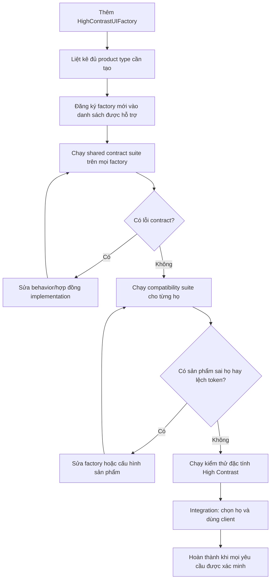

# Tái sử dụng contract test và mở rộng kiểm thử tương thích cho họ mới

> **Chương:** Thêm họ sản phẩm  
> **Module:** `SOFTWARE_DESIGN_DESIGN_PATTERN_CREATIONAL_ABSTRACT_FACTORY` — Học về abstract factory trong design pattern.

## 1. Mục tiêu học tập

**Abstract Factory** giúp client tạo và sử dụng nhiều loại sản phẩm liên quan thông qua các interface chung. Khi thêm một **họ sản phẩm mới**, chẳng hạn bổ sung giao diện **High Contrast** bên cạnh **Light** và **Dark**, ta muốn giữ nguyên client và hợp đồng factory, nhưng phải chứng minh factory mới tạo ra bộ sản phẩm **đủ chức năng, đúng hợp đồng và tương thích với nhau**.

Bài này tập trung vào hai tầng kiểm thử:

1. **Contract test dùng chung**: cùng một bộ tình huống được chạy với **mọi concrete factory**, nhằm kiểm tra những yêu cầu mà tất cả họ đều phải tuân theo.
2. **Compatibility test theo họ**: kiểm tra các sản phẩm được tạo từ một factory mới có tuân theo **quy tắc của cùng một họ** và có thể phối hợp hoạt động không.

Sau khi học, bạn có thể:

- Phân biệt hợp đồng **chung cho từng loại sản phẩm** với ràng buộc **tương thích giữa các sản phẩm cùng họ**.
- Thiết kế bộ contract test tái sử dụng khi thêm một concrete factory.
- Đưa factory mới vào danh sách kiểm thử mà không sao chép cùng một bài test thành nhiều bản.
- Phát hiện lỗi factory mới trả về sản phẩm thuộc họ cũ dù vẫn đúng kiểu interface.
- Bổ sung kiểm thử riêng cho đặc tính mới mà không biến contract test chung thành một bộ `if/else` theo từng họ.
- Xây dựng tiêu chí hoàn thành, kiểm thử CI và kế hoạch mở rộng bộ kiểm thử khi số họ tăng lên.

## 2. Bối cảnh: thêm họ High Contrast vào giao diện

Ứng dụng có hai họ sản phẩm hiện có là `Light` và `Dark`, mỗi họ gồm:

- `Button`: nhận thao tác nhấn.
- `Checkbox`: chuyển đổi trạng thái.
- `Dialog`: mở hộp thoại.

Yêu cầu mới: hỗ trợ `HighContrast`. Màn hình được cấu hình với họ này phải sử dụng **nút, ô chọn và hộp thoại cùng quy tắc giao diện High Contrast**.

Ma trận sau thay đổi:

| Loại sản phẩm | Light | Dark | High Contrast (mới) |
| --- | --- | --- | --- |
| `Button` | `LightButton` | `DarkButton` | `HighContrastButton` |
| `Checkbox` | `LightCheckbox` | `DarkCheckbox` | `HighContrastCheckbox` |
| `Dialog` | `LightDialog` | `DarkDialog` | `HighContrastDialog` |
| Concrete factory | `LightUIFactory` | `DarkUIFactory` | `HighContrastUIFactory` |

**Các tên class ở ma trận mô tả vai trò/biến thể**, không bắt buộc mỗi ô phải có một class riêng trong mọi dự án. Nếu một implementation có thể cấu hình lại an toàn bằng token giao diện và vẫn đáp ứng hợp đồng, nhiều ô có thể dùng chung mã. Điều không được thay đổi là **bộ sản phẩm do một factory tạo ra phải thuộc họ tương thích**.

### Bất biến thiết kế

Đối với một màn hình sử dụng một `UIFactory` được chọn:

> Mọi `Button`, `Checkbox` và `Dialog` do factory đó tạo phải thực hiện hợp đồng chung và thể hiện nhất quán họ giao diện đã chọn.

Có hai nhóm lỗi khác nhau:

- **Sai hợp đồng:** `Checkbox.toggle()` không đổi trạng thái như đã cam kết; `Dialog.open()` không đánh dấu đã mở; phương thức tạo trả về `null`.
- **Sai tương thích:** `HighContrastUIFactory.createDialog()` vô tình tạo một `DarkDialog` hoặc gán bộ màu không tương thích với các thành phần High Contrast còn lại.

Một bộ contract test chỉ kiểm tra thao tác `open()` có thể vẫn **PASS** khi factory trả về `DarkDialog`. Vì vậy phải có **bài kiểm tra tương thích** riêng.

## 3. Hai lớp kiểm thử phục vụ hai câu hỏi

| Nhóm | Câu hỏi cần trả lời | Ví dụ kết quả cần xác minh |
| --- | --- | --- |
| **Product contract** | Mỗi loại sản phẩm có tuân theo API và hành vi chung? | Nút nhấn được, checkbox đổi trạng thái, dialog mở |
| **Factory contract** | Mỗi factory có tạo đủ loại sản phẩm theo abstraction? | `createButton()`, `createCheckbox()`, `createDialog()` đều trả về đối tượng hợp lệ |
| **Family compatibility** | Các sản phẩm của một factory có cùng cấu hình/họ và phối hợp được? | Không có `DarkDialog` nằm trong bộ High Contrast |
| **Family-specific requirement** | Họ mới có đáp ứng những quy tắc riêng đã được công bố? | High Contrast áp dụng palette và tiêu chí tương phản phù hợp |
| **Integration/regression** | Điểm chọn factory và client sử dụng có hoạt động với họ mới? | Chọn High Contrast được; không cần sửa logic `SettingsScreen` |

**Contract test** kiểm tra hành vi được mô tả bởi abstraction. Nó phải chạy được với **cả họ mới và các họ cũ** mà không cần biết tên concrete product.

**Compatibility test** kiểm tra tính đúng đắn của tổ hợp sản phẩm trong một họ. Nó có thể đọc metadata của các sản phẩm đã render, kiểm tra token giao diện, dùng semantic assertions hoặc chạy qua giao diện thực tế. Đừng chỉ dựa vào `instanceof` nếu các implementation có thể dùng chung class hoặc class cụ thể sẽ thay đổi sau refactor.

**Family-specific test** xác minh yêu cầu bổ sung của High Contrast. Ví dụ, phần mềm giao diện thật cần đo tương phản bằng giá trị màu đầu ra thực tế hoặc công cụ kiểm tra truy cập phù hợp. Một cờ `highContrast=true` có thể dùng cho bài tập mô phỏng, nhưng **không chứng minh** giao diện thật đã đáp ứng chuẩn tương phản.

## 4. Tách contract chung khỏi dữ liệu về từng họ

Thay vì tạo ba bộ test gần như giống nhau:

```text
LightButtonTest
DarkButtonTest
HighContrastButtonTest
```

Ta xây dựng một **contract suite** dùng chung và danh sách các **factory case**:

```text
runCommonContract(LightUIFactory)
runCommonContract(DarkUIFactory)
runCommonContract(HighContrastUIFactory)

runFamilyCompatibility(LightUIFactory, LIGHT)
runFamilyCompatibility(DarkUIFactory, DARK)
runFamilyCompatibility(HighContrastUIFactory, HIGH_CONTRAST)
```

Các test được tái sử dụng phải mô tả hành vi client thực sự cần, ví dụ:

- Factory trả về đúng các interface và không trả về `null`.
- Nút ban đầu chưa được nhấn; sau `click()` trạng thái phản ánh thao tác nhấn.
- Checkbox ban đầu chưa chọn; `toggle()` thay đổi trạng thái và có thể thay đổi lại.
- Dialog ban đầu đóng; sau `open()` ở trạng thái mở.
- Hai đối tượng được tạo riêng có trạng thái độc lập, **nếu hợp đồng quy định mỗi lần tạo trả về một component có state riêng**.

Một số sản phẩm bất biến có thể được dùng chung instance. Vì vậy, **không nên áp dụng máy móc** điều kiện “mỗi lần gọi factory phải tạo object mới” cho mọi Abstract Factory. Chỉ test tính độc lập instance khi đó là một phần của hợp đồng sản phẩm.

### Cần kiểm tra tất cả factory thực sự được hỗ trợ

Khi thêm High Contrast, ta không nên chỉ sửa phần sản xuất mà quên đăng ký kiểm thử. Hãy có một danh sách nguồn chân lý rõ ràng về các họ được hỗ trợ, đồng thời xác minh dữ liệu case của test **bao phủ danh sách đó**.

Ví dụ, nếu hệ thống có registry theo `themeId`, việc thêm `high-contrast` vào registry nên đi kèm một kiểm tra rằng registry và danh sách factory case trong test biểu diễn **cùng tập theme**. Nếu test chỉ chạy trên những factory được liệt kê sẵn, một factory bị bỏ sót sẽ không thể làm test thất bại.

## 5. Mẫu mã Java 17: một bộ kiểm thử cho ba họ

Để ví dụ có thể chạy **không cần JUnit hoặc thư viện ngoài**, ta dùng các hàm assertion tự định nghĩa. Trong dự án thật, cấu trúc này có thể chuyển sang test parameterized của JUnit 5, với mỗi phần tử `FactoryCase` là một test case.

Ví dụ minh họa sử dụng `StyleToken` gồm mã họ và mã palette để quan sát tính tương thích. Đó là metadata đơn giản cho bài học; sản phẩm thật có thể kiểm tra output của renderer hoặc style system. Các class `BasicButton`, `BasicCheckbox` và `BasicDialog` dùng chung phần triển khai, nhưng **factory quyết định biến thể** qua `StyleToken`.

Lưu code thành `FamilyContractDemo.java`:

```java
import java.util.List;
import java.util.Objects;

public class FamilyContractDemo {
    enum Theme {
        LIGHT, DARK, HIGH_CONTRAST
    }

    record StyleToken(Theme theme, String paletteId, boolean highContrast) {
        StyleToken {
            Objects.requireNonNull(theme, "theme");
            if (paletteId == null || paletteId.isBlank()) {
                throw new IllegalArgumentException("paletteId rỗng");
            }
        }
    }

    interface StyledComponent {
        StyleToken style();
    }

    interface Button extends StyledComponent {
        void click();
        boolean clicked();
    }

    interface Checkbox extends StyledComponent {
        void toggle();
        boolean checked();
    }

    interface Dialog extends StyledComponent {
        void open();
        boolean opened();
    }

    interface UIFactory {
        Button createButton();
        Checkbox createCheckbox();
        Dialog createDialog();
    }

    static final class BasicButton implements Button {
        private final StyleToken style;
        private boolean clicked;

        BasicButton(StyleToken style) {
            this.style = Objects.requireNonNull(style);
        }

        @Override
        public StyleToken style() {
            return style;
        }

        @Override
        public void click() {
            clicked = true;
        }

        @Override
        public boolean clicked() {
            return clicked;
        }
    }

    static final class BasicCheckbox implements Checkbox {
        private final StyleToken style;
        private boolean checked;

        BasicCheckbox(StyleToken style) {
            this.style = Objects.requireNonNull(style);
        }

        @Override
        public StyleToken style() {
            return style;
        }

        @Override
        public void toggle() {
            checked = !checked;
        }

        @Override
        public boolean checked() {
            return checked;
        }
    }

    static final class BasicDialog implements Dialog {
        private final StyleToken style;
        private boolean opened;

        BasicDialog(StyleToken style) {
            this.style = Objects.requireNonNull(style);
        }

        @Override
        public StyleToken style() {
            return style;
        }

        @Override
        public void open() {
            opened = true;
        }

        @Override
        public boolean opened() {
            return opened;
        }
    }

    // Mỗi concrete factory chọn một bộ StyleToken nhất quán.
    static final class LightUIFactory implements UIFactory {
        private final StyleToken token =
                new StyleToken(Theme.LIGHT, "light-v1", false);

        @Override
        public Button createButton() {
            return new BasicButton(token);
        }

        @Override
        public Checkbox createCheckbox() {
            return new BasicCheckbox(token);
        }

        @Override
        public Dialog createDialog() {
            return new BasicDialog(token);
        }
    }

    static final class DarkUIFactory implements UIFactory {
        private final StyleToken token =
                new StyleToken(Theme.DARK, "dark-v1", false);

        @Override
        public Button createButton() {
            return new BasicButton(token);
        }

        @Override
        public Checkbox createCheckbox() {
            return new BasicCheckbox(token);
        }

        @Override
        public Dialog createDialog() {
            return new BasicDialog(token);
        }
    }

    // Họ mới: không cần thay đổi UIFactory hoặc client.
    static final class HighContrastUIFactory implements UIFactory {
        private final StyleToken token =
                new StyleToken(Theme.HIGH_CONTRAST, "high-contrast-v1", true);

        @Override
        public Button createButton() {
            return new BasicButton(token);
        }

        @Override
        public Checkbox createCheckbox() {
            return new BasicCheckbox(token);
        }

        @Override
        public Dialog createDialog() {
            return new BasicDialog(token);
        }
    }

    record FactoryCase(
            String name,
            Theme expectedTheme,
            String expectedPalette,
            UIFactory factory
    ) {}

    // Dùng trong mã minh họa; JUnit thường dùng assertTrue/assertEquals.
    static void check(boolean condition, String message) {
        if (!condition) {
            throw new AssertionError(message);
        }
    }

    // Contract chung: hoàn toàn không biết Light/Dark/HighContrast.
    static void runSharedContract(UIFactory factory) {
        Button button = factory.createButton();
        Checkbox checkbox = factory.createCheckbox();
        Dialog dialog = factory.createDialog();

        check(button != null, "Button không được null");
        check(checkbox != null, "Checkbox không được null");
        check(dialog != null, "Dialog không được null");

        check(!button.clicked(), "Button ban đầu chưa được nhấn");
        button.click();
        check(button.clicked(), "Button phải ghi nhận click");

        check(!checkbox.checked(), "Checkbox ban đầu chưa chọn");
        checkbox.toggle();
        check(checkbox.checked(), "Checkbox phải bật sau toggle");
        checkbox.toggle();
        check(!checkbox.checked(), "Checkbox phải tắt sau toggle tiếp");

        check(!dialog.opened(), "Dialog ban đầu phải đóng");
        dialog.open();
        check(dialog.opened(), "Dialog phải mở sau open");

        // Ví dụ này quy định mỗi component có state riêng.
        Button anotherButton = factory.createButton();
        check(!anotherButton.clicked(),
                "Nút mới không được dùng chung state với nút đã click");
    }

    // Kiểm tra tương thích các sản phẩm trong một họ.
    static void runFamilyCompatibility(FactoryCase testCase) {
        UIFactory factory = testCase.factory();
        StyleToken b = factory.createButton().style();
        StyleToken c = factory.createCheckbox().style();
        StyleToken d = factory.createDialog().style();

        check(b.theme() == testCase.expectedTheme(), "Sai theme của Button");
        check(c.theme() == testCase.expectedTheme(), "Sai theme của Checkbox");
        check(d.theme() == testCase.expectedTheme(), "Sai theme của Dialog");

        check(b.paletteId().equals(testCase.expectedPalette()),
                "Sai palette của Button");
        check(c.paletteId().equals(testCase.expectedPalette()),
                "Sai palette của Checkbox");
        check(d.paletteId().equals(testCase.expectedPalette()),
                "Sai palette của Dialog");

        boolean expectedHighContrast =
                testCase.expectedTheme() == Theme.HIGH_CONTRAST;
        check(b.highContrast() == expectedHighContrast,
                "Sai chế độ tương phản của Button");
        check(c.highContrast() == expectedHighContrast,
                "Sai chế độ tương phản của Checkbox");
        check(d.highContrast() == expectedHighContrast,
                "Sai chế độ tương phản của Dialog");
    }

    public static void main(String[] args) {
        List<FactoryCase> cases = List.of(
                new FactoryCase(
                        "Light", Theme.LIGHT, "light-v1", new LightUIFactory()),
                new FactoryCase(
                        "Dark", Theme.DARK, "dark-v1", new DarkUIFactory()),
                new FactoryCase(
                        "High Contrast", Theme.HIGH_CONTRAST,
                        "high-contrast-v1", new HighContrastUIFactory())
        );

        for (FactoryCase testCase : cases) {
            // Mỗi factory phải vượt qua CÙNG MỘT contract.
            runSharedContract(testCase.factory());
            // Sau đó kiểm tra tính nhất quán theo cấu hình họ.
            runFamilyCompatibility(testCase);
            System.out.println("PASS: " + testCase.name());
        }
    }
}
```

Biên dịch và chạy:

```bash
javac FamilyContractDemo.java
java FamilyContractDemo
```

Kết quả dự kiến:

```text
PASS: Light
PASS: Dark
PASS: High Contrast
```

**Điểm đáng quan sát:** Phương thức `runSharedContract` không đổi khi thêm họ High Contrast. Một `FactoryCase` mới được thêm vào danh sách; test chung được chạy trên factory mới cùng với hai factory cũ.

Nếu trong `HighContrastUIFactory.createDialog()` ta vô tình truyền token `Theme.DARK`, các phương thức `open()` và `opened()` vẫn có thể chạy đúng. Khi đó:

- `runSharedContract` có thể **PASS**.
- `runFamilyCompatibility` phải **FAIL** vì dialog không thuộc họ High Contrast.

Đó là lý do cần cả hai lớp kiểm thử.

## 6. Contract test nên xác nhận những gì?

Contract của sản phẩm nên được mô tả bằng **hành vi quan sát được** từ interface, không phải bằng cách implementation được viết.

| Hợp đồng | Kiểm tra tối thiểu | Không nên kiểm tra trong contract chung |
| --- | --- | --- |
| `UIFactory` | Tạo đủ `Button`, `Checkbox`, `Dialog` hợp lệ | Factory dùng constructor nào, gọi bao nhiêu private method |
| `Button` | Gọi `click()` đạt hiệu quả theo hợp đồng | Tên concrete class hay private field |
| `Checkbox` | `toggle()` đổi trạng thái đúng kỳ vọng | Code của `toggle()` dùng boolean hay state machine |
| `Dialog` | `open()` tạo trạng thái mở | Chi tiết triển khai UI của từng nền tảng |
| Vòng đời đối tượng | State độc lập, tái sử dụng hay bất biến **theo hợp đồng đã định** | Tự ý bắt mọi factory phải `new` mỗi lần gọi |

Cách xác định contract là hỏi: “Nếu thay `LightUIFactory` bằng `HighContrastUIFactory`, client có quyền kỳ vọng điều gì vẫn đúng?”.

Không biến mọi chi tiết của Light thành yêu cầu cho Dark/High Contrast. Ví dụ `background=#fff` là đặc trưng của một palette cụ thể, **không phải hợp đồng chung** của mọi `Button`.

Nếu sản phẩm của các họ có hành vi đặc biệt (ví dụ hộp thoại High Contrast bắt buộc có focus outline rõ), kiểm thử riêng của họ đó sẽ xác nhận đặc tính riêng. Còn hành vi mở hộp thoại và xử lý focus theo những cam kết chung phải nằm trong contract test nếu mọi họ đều được yêu cầu cung cấp.

### Mở rộng với trường hợp biên và lỗi

Đừng chỉ kiểm tra “gọi method không ném lỗi”. Nếu hợp đồng nghiệp vụ quy định rõ, cần bổ sung:

- Thao tác nhiều lần (ví dụ toggle hai lần trở lại trạng thái ban đầu).
- Dữ liệu không hợp lệ (ví dụ nhãn rỗng hoặc payload thiếu) được xử lý theo cùng quy tắc.
- Quy tắc idempotent hoặc khả năng gọi lặp nếu interface cam kết.
- Vòng đời, tính độc lập trạng thái và thread-safety **chỉ khi** chúng thuộc hợp đồng thực.
- Bảo toàn bất biến của client sau khi đổi factory.

Không bắt buộc mọi bài contract test đều kiểm tra đồng thời tất cả các đặc tính trên; phải dựa vào hợp đồng đã được thống nhất.

## 7. Compatibility test không chỉ kiểm tra “cùng tên theme”

Trong code minh họa, ta dùng `StyleToken` để kiểm tra một family marker chung. Cách này đủ cho việc giải thích cơ chế phát hiện **lẫn family token** nhưng chưa đủ cho UI thực tế.

Một kế hoạch kiểm thử tương thích nên có nhiều mức độ:

| Mức | Ví dụ điều kiện | Hướng kiểm tra |
| --- | --- | --- |
| **Family identity** | Cùng theme/palette được cấp cho bộ thành phần | Metadata hoặc configuration output |
| **Tính nhất quán của tài nguyên** | Nút, ô chọn và dialog dùng cùng hệ font, spacing, icon set, palette được quy định | Kiểm tra style token/cấu hình render của từng product |
| **Tương tác liên sản phẩm** | Mở dialog từ nút không gây sai trạng thái hoặc mất điều hướng focus | Integration test tại màn hình sử dụng nhiều sản phẩm |
| **Đặc tính riêng High Contrast** | Màu chữ/nền và focus indicator đủ rõ theo tiêu chí được chọn | Đo màu render thực tế, kiểm thử accessibility, screenshot khi có ích |
| **Chuyển đổi họ** | Sau khi đổi Light → High Contrast, các thành phần được tái tạo/cập nhật đúng phạm vi | End-to-end hoặc integration test theo cơ chế vòng đời của UI |

Một số quy tắc tương thích là **cùng giá trị** (ví dụ cùng mã palette). Một số quy tắc lại là **phối hợp đúng** giữa các giá trị khác nhau (ví dụ nền dialog khác nền button nhưng vẫn nằm trong bộ màu nhất quán). Vì vậy, trong ứng dụng thật, không nên viết một assertion cứng rằng mọi foreground/background của các component phải giống hệt nhau.

Nếu dùng CSS hoặc component library, test có thể kiểm tra theme provider và style được tính toán từ renderer. Nếu dùng GUI desktop, cần kiểm tra hành vi và thuộc tính hiển thị của các widget thật. Mục tiêu là kiểm tra **ràng buộc tương thích được công bố**, không kiểm tra tên class.

## 8. Luồng kiểm thử khi một họ mới xuất hiện



Từ sơ đồ có thể xây dựng một checklist triển khai:

1. **Giữ nguyên contract:** Họ mới triển khai `UIFactory` hiện có và tạo đủ các loại sản phẩm, không buộc sửa code client sử dụng `UIFactory`.
2. **Đăng ký đầy đủ:** Factory mới được nhận diện tại composition root/registry và xuất hiện trong tập test case.
3. **Tái sử dụng test:** Shared contract suite chạy trên **toàn bộ** factory, không chỉ factory mới.
4. **Bổ sung compatibility:** Kiểm tra ít nhất một tổ hợp gồm tất cả loại sản phẩm của họ mới trong cùng phạm vi sử dụng.
5. **Kiểm tra yêu cầu riêng:** Với High Contrast, xác nhận những đặc tính đã được đưa vào acceptance criteria; với ứng dụng thật nên có kiểm tra accessibility trên output thực.
6. **Kiểm thử đường chọn họ:** Người dùng chọn High Contrast và client tạo/sử dụng đúng sản phẩm mà không cần nhánh kiểm tra concrete type.
7. **Chạy hồi quy:** Các họ Light/Dark tiếp tục hoạt động theo hợp đồng cũ.

Việc thêm họ có thể chỉ yêu cầu **một cột mới** trong ma trận sản phẩm, nhưng số lượng kịch bản kết hợp thực tế tăng lên. Hãy ưu tiên các ranh giới có rủi ro cao và quy tắc tương thích cụ thể, thay vì cố gắng kiểm tra mọi tổ hợp không liên quan.

## 9. Tổ chức test để mỗi họ mới được kiểm tra tự động

Một cấu trúc dễ bảo trì khi dùng framework kiểm thử là:

```text
UiFactoryContractSuite
  - createsAllProductTypes
  - buttonBehavior
  - checkboxBehavior
  - dialogBehavior

UiFamilyCompatibilitySuite
  - productsUseExpectedFamily
  - productsUseCompatiblePalette
  - productsWorkTogether

HighContrastSpecificSuite
  - meetsDeclaredContrastRequirements
  - focusIndicatorVisible

AppIntegrationSuite
  - selectingThemeCreatesCorrectFamily
```

Trong JUnit 5, có thể cấp các factory bằng `@MethodSource`, `@ParameterizedTest` hoặc interface test contract. Ví dụ **phác thảo**:

```java
// Minh họa ý tưởng dùng JUnit 5; phụ thuộc junit-jupiter là cần thiết.
// Các interface/classes UIFactory, FactoryCase và hàm kiểm tra
// được định nghĩa trong mã sản xuất hoặc test fixture của dự án.

@ParameterizedTest(name = "{0}")
@MethodSource("factoryCases")
void allFamiliesSatisfyContract(FactoryCase testCase) {
    runSharedContract(testCase.factory());
}

@ParameterizedTest(name = "{0}")
@MethodSource("factoryCases")
void allFamiliesAreCompatible(FactoryCase testCase) {
    runFamilyCompatibility(testCase);
}
```

Test **không được phụ thuộc** vào thứ tự phần tử của danh sách factory để xác định họ; mỗi case cần có tên, expected family và factory cụ thể. Nếu dự án lấy factory từ dependency injection hoặc registry, test có thể sinh case trực tiếp từ registry để tránh bỏ sót. Nhưng phải cẩn thận: test chỉ duyệt registry hiện có sẽ **không phát hiện** một họ đáng lẽ được hỗ trợ nhưng chưa được đăng ký. Vì vậy cần một assertion độc lập so khớp với **danh sách họ yêu cầu**.

### Cần công bố rõ expected behavior

Khi một họ mới có khác biệt có chủ đích, ví dụ dialog High Contrast không dùng animation, hãy xác định đó là:

- Một **khác biệt triển khai được phép** vì không phá contract.
- Một **capability tùy chọn** phải được mô hình hóa trong abstraction nếu client cần quyết định dựa vào nó.
- Hay một **vi phạm contract** nếu mọi dialog đều bắt buộc thực hiện animation.

Nếu cả Light và Dark đều có một tính năng nhưng High Contrast không, không nên tự động làm yếu contract chung chỉ để test mới PASS. Hãy xem lại yêu cầu và khả năng thay thế của family mới.

## 10. Ví dụ lỗi để thấy vì sao cần hai bộ kiểm thử

Giả sử một developer sao chép `DarkUIFactory` để tạo `HighContrastUIFactory` và quên đổi một dòng:

```java
final class HighContrastUIFactory implements UIFactory {
    @Override
    public Button createButton() {
        return new HighContrastButton();
    }

    @Override
    public Checkbox createCheckbox() {
        return new HighContrastCheckbox();
    }

    @Override
    public Dialog createDialog() {
        return new DarkDialog(); // Sai họ; vẫn là Dialog hợp lệ.
    }
}
```

Ở ví dụ này, cả ba sản phẩm đều có thể đáp ứng **hành vi chung**: nút nhấn được, checkbox chuyển trạng thái, dialog mở được.

| Bài kiểm tra | Kết quả có thể xảy ra | Lý do |
| --- | --- | --- |
| Biên dịch `HighContrastUIFactory` | PASS | `DarkDialog` vẫn implements `Dialog` |
| Shared contract test | PASS | `DarkDialog.open()` có thể đúng hành vi chung |
| Compatibility test | **FAIL** | Dialog không thuộc họ High Contrast |
| Kiểm thử UI tích hợp | Có thể FAIL | Style/focus/độ tương phản của dialog khác bộ thành phần còn lại |

Cách sửa là tạo hoặc cấp `HighContrastDialog` (hoặc một dialog được cấu hình phù hợp High Contrast) từ `HighContrastUIFactory`. Sau đó chạy lại **cả contract và compatibility test**.

**Câu hỏi quan trọng:** “Factory mới trả về đúng interface” mới chỉ là yêu cầu **cần**. Để bảo đảm một họ sản phẩm, ta còn phải chứng minh **đúng biến thể và tương thích giữa các loại sản phẩm**.

## 11. Các lỗi thường gặp khi viết bộ test

### Lỗi 1 — Sao chép test thành một file cho mỗi họ

Khi có 5 họ và 12 tình huống hành vi chung, sao chép test sẽ gây nhiều điểm cần cập nhật. Một thay đổi contract dễ được bổ sung cho Light nhưng quên Dark/High Contrast.

**Cách xử lý:** Dùng shared suite, cấp factory dưới dạng test data. Chỉ đặt test riêng cho hành vi hoặc ràng buộc **thực sự khác nhau**.

### Lỗi 2 — Kiểm tra tên concrete class trong shared contract

```java
// Không phù hợp cho shared contract của mọi họ:
check(factory.createButton() instanceof LightButton, "must be LightButton");
```

Đoạn này làm test không thể tái sử dụng cho Dark/High Contrast. Hãy kiểm tra hành vi chung bằng interface; kiểm tra biến thể trong **compatibility suite** với thông tin dự kiến của từng họ.

### Lỗi 3 — Chỉ thêm case mới mà không kiểm tra đăng ký

Test chạy trên `Light`, `Dark` và `HighContrast` nhưng bộ chọn theme của ứng dụng chưa biết `high-contrast`. Unit test vẫn xanh, người dùng vẫn không chọn được họ mới.

**Cách xử lý:** Thêm integration test qua đường khởi tạo thực tế, đồng thời kiểm tra **toàn bộ họ phải hỗ trợ** được registry phục vụ.

### Lỗi 4 — Đánh đồng metadata với khả năng truy cập

`StyleToken.highContrast()==true` không chứng minh chữ/nền hay focus đủ tương phản. Một implementation có thể ghi cờ đúng nhưng render sai.

**Cách xử lý:** Dùng cờ/metadata để kiểm tra ranh giới cấu hình, rồi dùng **computed styles, kiểm tra tương phản thực tế, hành vi bàn phím và focus** để xác nhận đặc tính UI. Không lấy con số tương phản từ dữ liệu tự khai báo làm bằng chứng cuối cùng.

### Lỗi 5 — Chỉ kiểm tra từng product riêng lẻ

Button, Checkbox và Dialog đều chạy được; nhưng dialog lấy palette Dark trong màn hình High Contrast. Unit test hành vi không phát hiện.

**Cách xử lý:** Tạo bộ sản phẩm từ **cùng một factory**, kiểm tra ràng buộc chung và một số luồng phối hợp thực tế.

### Lỗi 6 — Thử mọi tổ hợp giữa các họ dù không được hỗ trợ

Nếu hợp đồng yêu cầu mọi sản phẩm của một màn hình phải cùng họ, việc test `LightButton` + `DarkDialog` như tổ hợp hợp lệ có thể làm sai yêu cầu. Chỉ kiểm tra **cross-family integration** khi có một use case thực sự cho phép phối hợp giữa các họ.

### Lỗi 7 — Tạo contract test quá đặc thù

Ví dụ yêu cầu mọi checkbox phải dùng cùng màu nền xanh như Light, khiến Dark và High Contrast “vi phạm” một chi tiết vốn chưa từng là contract. Shared contract cần mô tả **đầu ra và hành vi chung**, còn chi tiết phong cách nằm trong expected properties của từng họ.

## 12. Chiến lược bao phủ khi số họ tăng

Giả sử có `F` concrete factories và `P` loại sản phẩm. Nếu mỗi loại có `K` tình huống hành vi chung, việc chạy shared contract trên mọi họ có quy mô kiểm tra xấp xỉ **`F × P × K`**. Ta **tái sử dụng mã test**, nhưng số lượt thực thi vẫn tăng theo số họ; đây là điều mong muốn để tránh mất độ bao phủ.

Compatibility test cần đánh giá ít nhất **một bộ đủ `P` sản phẩm cho mỗi họ**, sau đó bổ sung các tương tác có ý nghĩa. Không cần tự động thử tất cả tổ hợp khác họ nếu những tổ hợp đó bị cấm theo thiết kế.

Khi thêm `HighContrast`, tối thiểu nên có:

| Phạm vi | Light | Dark | High Contrast |
| --- | --- | --- | --- |
| Shared factory contract | Chạy lại | Chạy lại | **Chạy mới** |
| Shared product behavior | Chạy lại | Chạy lại | **Chạy mới** |
| Compatibility toàn họ | Chạy lại | Chạy lại | **Chạy mới** |
| Tính năng riêng từng họ | Giữ yêu cầu Light | Giữ yêu cầu Dark | **Bổ sung yêu cầu High Contrast** |
| Chọn factory trong ứng dụng | Chạy hồi quy | Chạy hồi quy | **Xác minh đường mới** |

Nếu sản phẩm thật có nhiều cấp cấu hình (nền tảng, ngôn ngữ, theme, phiên bản), nên xây dựng test theo **những trục biến thiên có ràng buộc thực tế**. Không tự động nhân tất cả tổ hợp nếu nhiều trục độc lập và đã được test riêng.

## 13. Bài tập thực hành: thêm họ Solarized

Giữ nguyên `UIFactory` với ba phương thức `createButton()`, `createCheckbox()`, `createDialog()`. Sản phẩm có các hành vi như ví dụ Java, nhưng hãy thêm họ thứ tư **Solarized**.

Nhiệm vụ:

1. Thêm một cột Solarized vào ma trận `Button`/`Checkbox`/`Dialog`. Xác định ba biến thể tương ứng, dùng class riêng hoặc cấu hình có chủ đích.
2. Tạo `SolarizedUIFactory` implements `UIFactory`, không sửa `SettingsScreen`.
3. Thêm một `FactoryCase("Solarized", ...)` vào dữ liệu test. Không viết một bản `runSharedContractSolarized` sao chép riêng.
4. Kiểm tra ba product có cùng `Theme.SOLARIZED` và cùng palette được khai báo.
5. Giả lập lỗi `SolarizedUIFactory.createCheckbox()` trả về checkbox Dark. Cho biết suite nào phải báo lỗi và tại sao.
6. Thêm một đường kiểm tra rằng theme Solarized có thể được chọn qua composition root/registry, ngoài việc factory có thể được `new` trực tiếp trong test.
7. Chỉ ra một yêu cầu riêng của Solarized có thể kiểm tra bằng test khác nhưng **không nên bắt Light/Dark/High Contrast phải tuân theo**.

**Gợi ý đáp án:** Khi bổ sung giá trị `SOLARIZED` vào enum/theme registry, sửa expected case và triển khai factory mới, **shared contract test phải dùng nguyên**. Compatibility suite cần biết expected family/palette cho Solarized. Nếu checkbox từ họ Dark, test hành vi `toggle()` có thể vẫn PASS nhưng test tương thích phải FAIL.

### Thử thêm một loại sản phẩm thay vì họ

Sau bài tập trên, giả sử có yêu cầu thêm `Slider` cho **mọi** họ. Hãy giải thích vì sao lúc này ta không thể chỉ thêm một `FactoryCase`. Hợp đồng `UIFactory` phải có `createSlider()`, mọi concrete factory phải triển khai khả năng đó và shared contract suite cần bổ sung các ca kiểm tra `Slider`. Đây là khác biệt quan trọng giữa **thêm cột (họ)** và **thêm hàng (loại)** trong ma trận Abstract Factory.

## 14. Rubric tự đánh giá

| Tiêu chí | Điểm tối đa | Dấu hiệu đạt |
| --- | ---: | --- |
| Giữ nguyên hợp đồng chung khi thêm họ | 20 | `UIFactory` và client không phải thêm điều kiện chọn concrete product |
| Tái sử dụng contract test | 25 | Cùng test suite chạy với Light/Dark/High Contrast và họ mới |
| Kiểm tra tính tương thích | 25 | Bắt được trường hợp factory tạo sản phẩm đúng interface nhưng sai họ/palette |
| Kiểm tra yêu cầu riêng và tích hợp | 20 | Yêu cầu riêng của họ mới và đường lựa chọn factory đều được xác minh |
| Đảm bảo bao phủ và tính dễ bảo trì | 10 | Có danh sách họ được hỗ trợ, không bỏ sót factory và không sao chép test không cần thiết |
| **Tổng** | **100** | |

## 15. Checklist trước khi chấp nhận họ sản phẩm mới

- [ ] Concrete factory mới triển khai đủ các phương thức của abstract factory.
- [ ] Mỗi product đáp ứng **hợp đồng hành vi chung** của loại sản phẩm tương ứng.
- [ ] Factory mới tham gia **shared contract suite** giống tất cả factory cũ.
- [ ] Danh sách factory được kiểm thử bao phủ đủ các họ ứng dụng công bố hỗ trợ.
- [ ] Các product trong cùng một factory tương thích về họ và những tài nguyên phụ thuộc nhau.
- [ ] Compatibility suite phát hiện được lỗi trả về sản phẩm thuộc một họ khác.
- [ ] Những yêu cầu riêng của họ mới có test hoặc bằng chứng kiểm chứng phù hợp.
- [ ] Composition root/registry chọn được factory mới và client tiếp tục dùng abstraction.
- [ ] Kiểm thử hồi quy của các họ hiện có vẫn đạt.
- [ ] Các giới hạn của bài kiểm tra mô phỏng đã được phân biệt với xác minh hành vi/render thực tế.

**Ghi nhớ:** Thêm một họ sản phẩm không chỉ là thêm concrete factory và các biến thể tương ứng. Cần **chạy lại contract test chung trên mọi họ**, **mở rộng compatibility test cho họ mới** và **kiểm tra đường lựa chọn factory trong ứng dụng**. Contract đúng đảm bảo mỗi loại sản phẩm có thể thay thế qua abstraction; kiểm tra tương thích mới đảm bảo các sản phẩm được tạo ra thực sự thuộc về cùng một họ.
