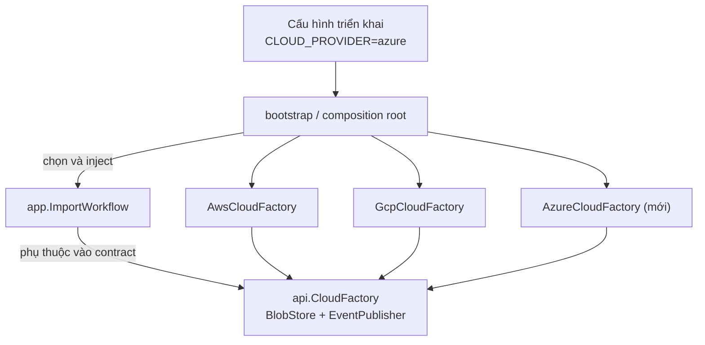
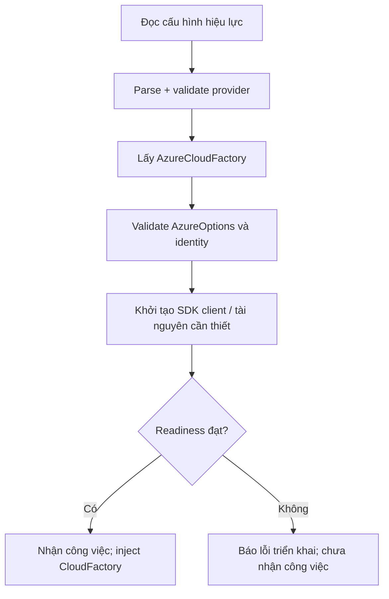

# Đánh giá những điểm vẫn phải thay đổi tại composition root và cấu hình triển khai

Một ưu điểm quan trọng của **Abstract Factory** là cho phép bổ sung **họ sản phẩm mới** mà phần mã sử dụng các *abstract product* và *abstract factory* thường không cần sửa. Tuy nhiên, điều đó **không có nghĩa chỉ cần viết một `ConcreteFactory` rồi hệ thống tự sử dụng được họ mới**. Ứng dụng vẫn phải biết **khi nào chọn factory mới, lấy cấu hình từ đâu, đóng gói implementation thế nào và triển khai các tài nguyên phụ thuộc ra sao**.

Bài này thuộc chương **Thêm họ sản phẩm** trong module **SOFTWARE_DESIGN_DESIGN_PATTERN_CREATIONAL_ABSTRACT_FACTORY** — học về Abstract Factory trong nhóm creational design pattern. Trọng tâm là đánh giá những điểm thay đổi **tại composition root và cấu hình triển khai** khi thêm họ mới, phân biệt phạm vi được đóng kín bởi interface với phạm vi lắp ghép vốn phải biết các implementation cụ thể.

## 1. Tình huống: thêm Azure bên cạnh AWS và GCP

Giả sử ứng dụng nhập dữ liệu cần hai loại sản phẩm hoạt động cùng nhau:

- `BlobStore`: lưu dữ liệu nhập lên một kho lưu trữ.
- `EventPublisher`: phát sự kiện báo đã hoàn tất quá trình nhập.

Ban đầu ứng dụng có hai họ sản phẩm:

| Họ | `BlobStore` | `EventPublisher` | Concrete Factory |
| --- | --- | --- | --- |
| `AWS` | `S3BlobStore` | `SnsEventPublisher` | `AwsCloudFactory` |
| `GCP` | `GcsBlobStore` | `PubSubEventPublisher` | `GcpCloudFactory` |

Yêu cầu mới là bổ sung `AZURE`, sử dụng `AzureBlobStore` và `ServiceBusEventPublisher`, được tạo bởi `AzureCloudFactory`. Đây là **thêm một họ sản phẩm**, vì số **loại** sản phẩm không đổi: mọi provider vẫn phải cung cấp đúng `BlobStore` và `EventPublisher`.

Với hợp đồng đã đủ ổn định, mã xử lý nhập dữ liệu không cần biết provider đang dùng là gì. Nhưng nếu cấu hình `CLOUD_PROVIDER=azure` chưa được công nhận, `AzureCloudFactory` chưa nằm trong gói chạy, hoặc deployment thiếu quyền truy cập dịch vụ Azure thì họ mới vẫn chưa thể hoạt động.

## 2. Phạm vi nào được Abstract Factory bảo vệ?

Hãy tách ba trách nhiệm có quan hệ nhưng không giống nhau:

1. **Hợp đồng sản phẩm và factory:** `BlobStore`, `EventPublisher` và `CloudFactory` mô tả *ứng dụng cần gì*.
2. **Từng họ triển khai:** `AwsCloudFactory`, `GcpCloudFactory`, `AzureCloudFactory` mô tả *tạo các sản phẩm tương thích của một provider như thế nào*.
3. **Composition root:** `Main`, cấu hình DI hoặc bootstrap module quyết định *factory nào được chọn và truyền cho client*.



Sơ đồ thể hiện **hai ý**: cấu hình đi vào composition root để quyết định cách lắp ghép; phụ thuộc mã nguồn của `ImportWorkflow` hướng về `CloudFactory`. Sơ đồ không ngụ ý `ImportWorkflow` import các concrete factory. Trên thực tế, **composition root là nơi được chủ động phép biết implementation cụ thể** để lắp ghép hệ thống.

### Điều gì thường được giữ nguyên và điều gì phải thay?

| Thành phần | Khi thêm họ `AZURE` | Vì sao? |
| --- | --- | --- |
| `BlobStore`, `EventPublisher` | **Thường giữ nguyên** | Hai loại sản phẩm và nhu cầu của client không đổi |
| `CloudFactory` | **Thường giữ nguyên** | Họ mới vẫn cung cấp đủ các phương thức cũ |
| `ImportWorkflow` và client khác | **Thường giữ nguyên** | Chỉ nhận `CloudFactory` đã được inject |
| `AwsCloudFactory`, `GcpCloudFactory` | **Thường giữ nguyên** | Không phải thêm một loại sản phẩm vào các họ cũ |
| `AzureBlobStore`, `ServiceBusEventPublisher` | **Thêm mới** | Hiện thực hai abstract product của họ mới |
| `AzureCloudFactory` | **Thêm mới** | Đóng gói việc tạo hai sản phẩm Azure tương thích |
| Enum / parser / cấu hình provider | **Có thể phải cập nhật** | Công nhận đầu vào `azure` và kiểm tra giá trị không hợp lệ |
| Selector / DI / registry tại composition root | **Phải có cơ chế nhận biết họ mới** | Nếu không, factory mới sẽ không bao giờ được chọn |
| Build/dependency và artifact triển khai | **Rà soát, thường phải cập nhật** | Bảo đảm implementation và SDK cần thiết có mặt lúc chạy |
| Cấu hình môi trường, identity, endpoint, quyền | **Rà soát theo provider** | Cần tài nguyên thật để sử dụng Azure |
| Test tích hợp, health check, quy trình phát hành | **Bổ sung trường hợp cho họ mới** | Chứng minh đường lắp ghép hoạt động từ đầu đến cuối |

Từ **“thường”** rất quan trọng: nếu client đang dùng class cụ thể hoặc API mới của provider đòi thay đổi hợp đồng, phạm vi sửa đổi sẽ rộng hơn. Lợi ích của Abstract Factory phụ thuộc vào việc **họ mới thật sự tuân theo contract cũ**.

## 3. Thay đổi bắt buộc về mặt quyết định tại composition root

Trong ứng dụng chọn một provider lúc khởi động, đường đi thường là:

```text
Biến môi trường / cấu hình triển khai
    -> đọc và chuẩn hóa CLOUD_PROVIDER
    -> kiểm tra provider được hỗ trợ
    -> chọn một ConcreteFactory
    -> inject CloudFactory vào ImportWorkflow
    -> factory tạo BlobStore và EventPublisher cùng họ
```

Khi thêm `AZURE`, ít nhất **bộ phận xác định factory hiệu lực** phải biết cách xử lý lựa chọn mới. Có hai cách tổ chức phổ biến.

### 3.1. Selector tường minh bằng `switch`

Trước khi thêm Azure:

```java
CloudFactory selectFactory(CloudProvider provider) {
    return switch (provider) {
        case AWS -> new AwsCloudFactory();
        case GCP -> new GcpCloudFactory();
    };
}
```

Sau khi thêm giá trị enum `AZURE`, cần bổ sung nhánh:

```java
CloudFactory selectFactory(CloudProvider provider) {
    return switch (provider) {
        case AWS -> new AwsCloudFactory();
        case GCP -> new GcpCloudFactory();
        case AZURE -> new AzureCloudFactory();
    };
}
```

Các đoạn trên minh họa **chỗ thay đổi**, giả định các type đã được định nghĩa. Với Java 17, `switch` expression trên enum không có `default` có lợi: khi thêm `AZURE` mà quên nhánh xử lý, mã nguồn selector sẽ không còn được xem là đầy đủ để biên dịch. Nếu trước đó dùng `default -> new AwsCloudFactory()`, lỗi bỏ sót rất dễ bị che đi và cấu hình `azure` có thể âm thầm chạy trên AWS.

Việc **sửa selector** là điều bình thường, không phải bằng chứng Abstract Factory thất bại: selector chính là điểm được phép biết các `ConcreteFactory`. Mục tiêu là giữ thay đổi **tập trung ở điểm lắp ráp**, thay vì để mọi client `switch` theo provider.

### 3.2. Registry hoặc dependency injection container

Một hệ thống plugin có thể đăng ký factory theo key ở bootstrap:

```java
Map<CloudProvider, Supplier<CloudFactory>> factories = Map.of(
        CloudProvider.AWS, AwsCloudFactory::new,
        CloudProvider.GCP, GcpCloudFactory::new,
        CloudProvider.AZURE, AzureCloudFactory::new);

Supplier<CloudFactory> supplier = factories.get(provider);
if (supplier == null) {
    throw new IllegalArgumentException("Provider chưa được đăng ký: " + provider);
}
CloudFactory selected = supplier.get();
```

Đây là một **đoạn minh họa** với `java.util.Map` và `java.util.function.Supplier` trong bootstrap. Thêm provider mới đồng nghĩa **thêm một registration**; registry không tự có thông tin về class mới nếu chưa có cơ chế discovery và metadata phù hợp.

Với Spring, Guice hoặc DI container khác, thay đổi tương đương có thể nằm ở `@Configuration`, điều kiện tạo bean, qualifier hoặc module registration. Dù tên class ít xuất hiện trong mã `Main`, hệ thống vẫn cần **một nơi nhận biết mapping `azure → AzureCloudFactory`**. Nếu tạo nhiều bean `CloudFactory` nhưng không xác định cách chọn, DI container có thể không biết phải inject bean nào.

## 4. Ví dụ Java 17 hoàn chỉnh: thêm họ mới mà không sửa client

Ví dụ dùng một file `ProductFamilyExtensionDemo.java` để có thể biên dịch và chạy mà không cần SDK đám mây. Chuỗi trả về chỉ **mô phỏng** hành vi của từng provider; trong hệ thống thật, concrete product sẽ gọi SDK tương ứng.

```java
import java.util.Locale;
import java.util.Objects;

public final class ProductFamilyExtensionDemo {
    enum CloudProvider {
        AWS, GCP, AZURE;

        static CloudProvider parse(String raw) {
            if (raw == null || raw.isBlank()) {
                throw new IllegalArgumentException("Thiếu CLOUD_PROVIDER");
            }
            return switch (raw.trim().toLowerCase(Locale.ROOT)) {
                case "aws" -> AWS;
                case "gcp" -> GCP;
                case "azure" -> AZURE;
                default -> throw new IllegalArgumentException(
                        "Provider không hỗ trợ: " + raw);
            };
        }
    }

    interface BlobStore {
        String save(String key);
    }

    interface EventPublisher {
        String publish(String eventName);
    }

    // Abstract Factory: hợp đồng không thay đổi khi thêm Azure.
    interface CloudFactory {
        BlobStore createBlobStore();
        EventPublisher createEventPublisher();
    }

    static final class AwsCloudFactory implements CloudFactory {
        @Override
        public BlobStore createBlobStore() {
            return key -> "AWS S3 saved " + key;
        }

        @Override
        public EventPublisher createEventPublisher() {
            return name -> "AWS SNS published " + name;
        }
    }

    static final class GcpCloudFactory implements CloudFactory {
        @Override
        public BlobStore createBlobStore() {
            return key -> "GCP GCS saved " + key;
        }

        @Override
        public EventPublisher createEventPublisher() {
            return name -> "GCP Pub/Sub published " + name;
        }
    }

    // Concrete Factory mới: cung cấp cả hai loại sản phẩm cho cùng họ.
    static final class AzureCloudFactory implements CloudFactory {
        @Override
        public BlobStore createBlobStore() {
            return key -> "AZURE Blob saved " + key;
        }

        @Override
        public EventPublisher createEventPublisher() {
            return name -> "AZURE Service Bus published " + name;
        }
    }

    // Client không biết AWS, GCP hay AZURE.
    static final class ImportWorkflow {
        private final CloudFactory factory;

        ImportWorkflow(CloudFactory factory) {
            this.factory = Objects.requireNonNull(factory);
        }

        String run() {
            BlobStore store = factory.createBlobStore();
            EventPublisher publisher = factory.createEventPublisher();
            return store.save("imports/data.csv") + "\n"
                    + publisher.publish("import.completed");
        }
    }

    // Composition root: nơi cần bổ sung ánh xạ khi có provider mới.
    static CloudFactory selectFactory(CloudProvider provider) {
        return switch (Objects.requireNonNull(provider)) {
            case AWS -> new AwsCloudFactory();
            case GCP -> new GcpCloudFactory();
            case AZURE -> new AzureCloudFactory();
        };
    }

    public static void main(String[] args) {
        if (args.length > 1) {
            throw new IllegalArgumentException("Chỉ nhận tối đa một provider");
        }

        // Tham số dòng lệnh ưu tiên hơn cấu hình từ môi trường.
        String rawProvider = args.length == 1
                ? args[0]
                : System.getenv("CLOUD_PROVIDER");

        CloudProvider provider = CloudProvider.parse(rawProvider);
        CloudFactory factory = selectFactory(provider);
        System.out.println("Active provider: " + provider);
        System.out.println(new ImportWorkflow(factory).run());
    }
}
```

Biên dịch và chạy với JDK 17 trở lên:

```bash
javac -encoding UTF-8 ProductFamilyExtensionDemo.java
java ProductFamilyExtensionDemo azure
```

Kết quả dự kiến:

```text
Active provider: AZURE
AZURE Blob saved imports/data.csv
AZURE Service Bus published import.completed
```

Với `java ProductFamilyExtensionDemo aws`, cả kết quả lưu trữ và phát sự kiện đều thuộc họ `AWS`; với `gcp` cũng tương tự. Khi truyền `unknown` hoặc không có tham số lẫn `CLOUD_PROVIDER`, chương trình báo lỗi sớm. Thứ tự ưu tiên tham số dòng lệnh so với biến môi trường được cố ý xác định rõ để người vận hành có thể truy ra lựa chọn hiệu lực.

Để chuyển ví dụ sang project nhiều file, có thể nhóm `BlobStore`, `EventPublisher`, `CloudFactory` trong `api`, `ImportWorkflow` trong `app`, các factory theo `infrastructure/aws`, `infrastructure/gcp`, `infrastructure/azure`, và parser/selector trong `bootstrap`. Các class ở package hạ tầng phụ thuộc vào `api`, còn `app` không import chúng.

## 5. Điều gì xảy ra nếu chỉ viết AzureCloudFactory rồi dừng lại?

Giả sử đã tạo đầy đủ `AzureBlobStore`, `ServiceBusEventPublisher`, `AzureCloudFactory`, tất cả class đều biên dịch. Ứng dụng **vẫn có thể không hề sử dụng Azure** vì:

1. `CloudProvider.parse("azure")` chưa nhận ra giá trị mới và báo cấu hình không hợp lệ.
2. `CloudFactorySelector` chưa có `case AZURE`, hoặc registry chưa đăng ký key `AZURE`.
3. DI container chưa scan package hoặc chưa có bean definition của `AzureCloudFactory`.
4. Module `azure-adapter` chưa được đóng gói vào artifact chạy; một số class/SDK chỉ có trong môi trường build nhưng vắng lúc runtime.
5. Deployment vẫn đặt `CLOUD_PROVIDER=aws`, vì cập nhật code **không có nghĩa cấu hình môi trường tự đổi**.
6. Đã chọn Azure nhưng thiếu tài nguyên, thông tin xác thực hoặc quyền truy cập dịch vụ, nên thao tác đầu tiên mới lỗi.

Do đó cần kiểm tra **khả năng chọn**, **khả năng tải/khởi tạo**, và **khả năng vận hành** như ba điều kiện riêng. Mỗi điều kiện có thể thành công hoặc thất bại độc lập.

## 6. Cấu hình triển khai nào cần đánh giá lại?

### 6.1. Cấu hình chọn provider

Hệ thống nên có một key lựa chọn rõ ràng, chẳng hạn:

```dotenv
# Ví dụ cấu hình minh họa, không phải file bí mật thật.
CLOUD_PROVIDER=azure
```

Đọc cấu hình một lần tại điểm lắp ráp nếu provider là thuộc tính cố định của tiến trình, kiểm tra giá trị và chọn factory tương ứng. Không để từng service tự đọc `CLOUD_PROVIDER` rồi tạo sản phẩm riêng, vì dễ có `BlobStore` của Azure nhưng `EventPublisher` của AWS.

**Không tự động bật Azure ở mọi môi trường** chỉ vì code hỗ trợ Azure. Môi trường development, staging và production có thể có các lựa chọn khác nhau theo kế hoạch phát hành.

### 6.2. Cấu hình chuyên biệt của provider

Ngoài key lựa chọn, Azure có thể cần cấu hình cho lưu trữ và bus sự kiện. Các tên biến dưới đây là **quy ước minh họa do ứng dụng định nghĩa**, không phải danh sách biến chuẩn bắt buộc của Azure SDK:

```dotenv
CLOUD_PROVIDER=azure
APP_AZURE_STORAGE_CONTAINER=import-data
APP_AZURE_SERVICEBUS_TOPIC=import-events
APP_AZURE_REGION=example-region
```

Ví dụ thực tế còn có endpoint, identity hoặc thông tin kết nối tùy SDK và hạ tầng. **Không hardcode secret trong source code, tài liệu hoặc log**. Khóa truy cập và token nên do cơ chế quản lý bí mật/identity của môi trường cung cấp; chỉ trao quyền tối thiểu cho tác vụ thực sự cần.

Nên chia rõ trách nhiệm:

| Lớp trách nhiệm | Dữ liệu nhận | Hành vi |
| --- | --- | --- |
| Bộ nạp cấu hình | `CLOUD_PROVIDER`, các key liên quan | Đọc, chuẩn hóa, kiểm tra thiếu/sai |
| Composition root | Provider hợp lệ và cấu hình đã được kiểm tra | Chọn factory, inject thông số vào concrete factory |
| `AzureCloudFactory` | Cấu hình chuyên biệt Azure và các SDK client cần thiết | Tạo cặp sản phẩm Azure tương thích |
| `ImportWorkflow` | Interface `CloudFactory` | Chạy nghiệp vụ, không hiểu chi tiết các biến môi trường |

Nếu có trường bắt buộc chỉ cho Azure, cần kiểm tra **khi Azure được chọn**; không yêu cầu mọi deployment dùng AWS/GCP đều khai báo các key Azure chưa dùng. Có thể chuẩn hóa bằng `AzureOptions` bất biến trước khi tạo `AzureCloudFactory`.

### 6.3. Phụ thuộc triển khai và tài nguyên hạ tầng

Thêm một họ thường kéo theo những việc nằm ngoài mã Java:

- Gói chạy cần chứa `azure-adapter` và các dependency runtime tương thích với phiên bản Java, SDK và cấu hình build.
- Identity triển khai cần quyền truy cập kho lưu trữ và kênh sự kiện thích hợp; chính sách network/firewall/DNS phải cho phép kết nối.
- Tài nguyên như container, topic, namespace hoặc endpoint phải tồn tại và có cấu hình chính xác trong từng môi trường.
- Cần kiểm tra cách factory quản lý thời gian chờ, retry, connection/client lifecycle, giới hạn request và lỗi SDK.
- Bộ giám sát cần phân biệt được **provider hiệu lực** khi truy lỗi, nhưng không ghi credential vào log hoặc metrics.

Abstract Factory giúp ổn định **mã client**; nó không thay thế hạ tầng thật mà concrete product phụ thuộc vào.

## 7. Thêm họ sản phẩm có bắt buộc sửa composition root không?

Câu trả lời chính xác là: **hệ thống luôn cần một cách đưa họ mới vào cơ chế chọn/lắp ghép; nhưng không nhất thiết phải sửa chính file `Main.java`**.

| Cơ chế lựa chọn | Phần thường phải thay đổi |
| --- | --- |
| `switch` hardcode trong `Main` | Thêm giá trị enum, nhánh chọn và import `AzureCloudFactory` |
| Selector riêng trong `bootstrap` | Thêm ánh xạ vào selector; `Main` có thể giữ nguyên |
| DI config tường minh | Đăng ký/điều kiện tạo bean Azure và tiêu chí chọn bean |
| Registry dựa trên cấu hình | Thêm entry Azure, bảo đảm factory được tạo qua supplier hợp lệ |
| Service loader / plugin discovery | Đóng gói provider implementation, metadata đăng ký, quyền/module tương ứng; selector chính có thể không đổi |

Trong mô hình plugin, nếu `ServiceLoader` tìm thấy một implementation mới, phần code lặp chọn class có thể không cần sửa. Tuy vậy vẫn phải **đóng gói service provider**, công bố metadata, gắn key provider đúng, kiểm tra không trùng registration và chọn đúng instance theo cấu hình. Không có cơ chế nào giúp một class mới tự được chọn một cách đáng tin cậy nếu hệ thống không biết class đó đại diện cho biến thể nào.

Vì thế, khi nói “thêm họ mới không cần sửa code cũ”, cần hiểu đúng phạm vi: **code xử lý nghiệp vụ và abstract contract thường giữ nguyên**; **điểm lắp ghép hoặc đăng ký triển khai vẫn phải tiến hóa**.

## 8. Thêm họ mới có thật sự không đổi contract?

Điều kiện là `AzureCloudFactory` hiện thực đầy đủ hợp đồng `CloudFactory` hiện có, không làm client cần một phương thức riêng như `createAzureBlobClient()`.

Nếu chỉ Azure có một tính năng đặc biệt nhưng client phổ thông không sử dụng, nên đặt tính năng đó trong một abstraction/capability phù hợp ở hạ tầng; không đưa API chuyên biệt của Azure vào `CloudFactory` chỉ để “hỗ trợ họ mới”.

Nếu yêu cầu chung thực sự thay đổi, ví dụ mọi provider nay phải cung cấp thêm `JobScheduler`, đây là **thêm loại sản phẩm**, không còn là bài toán thuần túy “thêm họ”. Khi ấy cần cập nhật contract và **từng** concrete factory. Phân biệt hai hướng thay đổi giúp ước lượng phạm vi chính xác.

Một cách review nhanh là kiểm tra diff: nếu thêm Azure mà phải sửa hàng loạt lớp client chỉ để phân nhánh `if(provider == AZURE)`, khả năng cao abstraction chưa che giấu được điểm biến thiên. Ngược lại, việc bổ sung mapping ở bootstrap cùng cấu hình triển khai **là thay đổi được mong đợi**.

## 9. Luồng khởi động nên phát hiện lỗi sớm

Khi ứng dụng nhận `CLOUD_PROVIDER=azure`, trình tự nên rõ ràng:



Không phải ứng dụng nào cũng cần tạo kết nối mạng ngay trong constructor của factory. Có thể khởi tạo lazy, nhưng phải có **cách kiểm tra sự sẵn sàng** phù hợp với yêu cầu vận hành. Việc `new AzureCloudFactory()` thành công chỉ chứng minh có object Java, **không chứng minh** quyền truy cập storage và event bus đã hoạt động.

Nên phân biệt rõ:

- **Configuration validation:** provider hợp lệ, đầy đủ key bắt buộc và giá trị có định dạng đúng.
- **Wiring validation:** mapping chọn đúng factory, dependency/bean/SDK có mặt.
- **Operational readiness:** kết nối/identity/tài nguyên cần thiết có thể sử dụng trong môi trường hiện tại.

Kiểm tra những điều này trước khi nhận tải giúp tránh trường hợp triển khai thành công về mặt build nhưng request đầu tiên mới phát hiện thiếu quyền hoặc endpoint sai.

## 10. Kiểm thử từ hợp đồng đến cấu hình triển khai

Mỗi tầng nên trả lời một câu hỏi khác nhau:

| Cấp kiểm thử | Mục tiêu | Trường hợp Azure |
| --- | --- | --- |
| Unit test parser | Nhận đúng config được hỗ trợ, từ chối config sai | `" AZURE " → AZURE`; `"unknown"` báo lỗi |
| Selector/composition test | Giá trị hợp lệ chọn đúng concrete factory | `AZURE → AzureCloudFactory` |
| Contract test của factory | Một factory tạo đầy đủ sản phẩm cùng họ | Cả store và publisher đều là triển khai Azure |
| Client test với fake factory | Mã nghiệp vụ chỉ dựa vào contract | `ImportWorkflow` không cần biết Azure |
| Integration test với SDK | Concrete products tương tác đúng với dịch vụ | Ghi đối tượng thử nghiệm và phát sự kiện thử nghiệm |
| Deployment smoke test | Artifact, config, identity, network, resource thực sự đúng | Deployment Azure có thể thực thi workflow mẫu |

Ví dụ JUnit 5 sau sử dụng lớp lồng của `ProductFamilyExtensionDemo`, giả sử test nằm cùng package mặc định với file minh họa:

```java
import org.junit.jupiter.api.Test;

import static org.junit.jupiter.api.Assertions.assertEquals;
import static org.junit.jupiter.api.Assertions.assertInstanceOf;
import static org.junit.jupiter.api.Assertions.assertThrows;

class ProductFamilyExtensionDemoTest {
    @Test
    void newConfigSelectsAzureFactory() {
        var selected = ProductFamilyExtensionDemo.selectFactory(
                ProductFamilyExtensionDemo.CloudProvider.parse(" AZURE "));
        assertInstanceOf(ProductFamilyExtensionDemo.AzureCloudFactory.class, selected);
    }

    @Test
    void azureFactoryProducesConsistentFamily() {
        var factory = new ProductFamilyExtensionDemo.AzureCloudFactory();
        assertEquals("AZURE Blob saved test.csv",
                factory.createBlobStore().save("test.csv"));
        assertEquals("AZURE Service Bus published import.completed",
                factory.createEventPublisher().publish("import.completed"));
    }

    @Test
    void unknownConfigIsRejected() {
        assertThrows(IllegalArgumentException.class,
                () -> ProductFamilyExtensionDemo.CloudProvider.parse("unknown"));
    }
}
```

Đây là **test minh họa** cần dependency JUnit Jupiter, không dùng tài khoản cloud thật. Với adapter production, test nên kiểm tra hành vi của SDK và các bất biến kỹ thuật quan trọng thay vì chỉ dựa vào tiền tố chuỗi `AZURE`. Khi triển khai thật, smoke test cần sử dụng tài nguyên test riêng, dữ liệu an toàn và cơ chế dọn dẹp phù hợp.

## 11. Chiến lược triển khai và bật họ mới

Hỗ trợ Azure trong bản build không đồng nghĩa phải chuyển ngay toàn bộ production sang Azure. Cách triển khai có kiểm soát thường gồm:

1. **Tạo và kiểm tra implementation:** phát triển `AzureCloudFactory` cùng các concrete product, rà soát contract và vòng đời client.
2. **Bổ sung mapping:** cập nhật parser/selector hoặc DI registration; xác minh `azure` chọn đúng factory.
3. **Đóng gói dependency:** bảo đảm module/SDK cần thiết nằm trong runtime artifact, không chỉ classpath của test.
4. **Chuẩn bị môi trường:** tạo storage container, event topic, identity, quyền truy cập, network và cấu hình tương ứng cho môi trường test/staging.
5. **Kiểm thử end-to-end ở staging:** chạy luồng nhập dữ liệu qua cả store và publisher Azure, xác nhận quan sát được kết quả đúng.
6. **Phát hành code hỗ trợ Azure:** giữ cấu hình production ở provider cũ nếu chưa có quyết định chuyển.
7. **Bật provider mới theo phạm vi đã chọn:** môi trường riêng, tenant thử nghiệm hoặc tỷ lệ tải phù hợp nếu hệ thống có cơ chế routing theo tenant/request.
8. **Giám sát và xử lý rollback:** theo dõi lỗi, độ trễ, chi phí dịch vụ, đối chiếu dữ liệu/sự kiện; có kế hoạch quay về provider cũ nếu cần.

Nếu ứng dụng **chỉ chọn provider ở startup**, thay `CLOUD_PROVIDER` đòi hỏi một chu kỳ khởi động lại hoặc tái triển khai theo cơ chế hiện tại. Không giả định đang chạy có thể tự đổi sang Azure sau khi sửa ConfigMap hoặc biến môi trường.

Nếu có lựa chọn **theo request/tenant**, phải giữ một factory nhất quán trong toàn bộ workflow và quản lý phạm vi cấu hình riêng từng tenant. Nếu runtime switching thật sự được hỗ trợ, việc thay factory còn cần xử lý tác vụ đang dùng factory cũ và vòng đời tài nguyên. **Những yêu cầu đó nằm ngoài khả năng tự động của Abstract Factory.**

### Lưu ý khi rollback

Chuyển lại `CLOUD_PROVIDER=aws` không tự di chuyển dữ liệu đã ghi trên Azure, cũng không hủy sự kiện đã phát qua Service Bus. Với các tác vụ có side effect, cần cân nhắc **idempotency, vị trí dữ liệu, khả năng xử lý lại và trách nhiệm của hệ thống downstream**. Rollback phần chọn factory chỉ thay hướng xử lý **các tác vụ mới** theo chính sách triển khai; không tự đảo ngược hoạt động trước đó.

## 12. Những sai lầm thường gặp

| Sai lầm | Hệ quả | Cách xử lý |
| --- | --- | --- |
| Chỉ thêm `AzureCloudFactory`, không sửa selector/registration | Provider mới không bao giờ được chọn | Kiểm tra ánh xạ cấu hình → concrete factory ở composition root |
| Dùng `default -> AwsCloudFactory()` cho giá trị không nhận ra | `azure` có thể âm thầm chạy trên AWS | Kiểm tra input hợp lệ, dùng `switch` đầy đủ hoặc báo lỗi rõ |
| Mỗi client tự `if(provider == AZURE)` để `new` sản phẩm | Logic chọn họ rải rác, tăng nguy cơ trộn sản phẩm | Inject một `CloudFactory` đã chọn |
| Update code nhưng không update runtime artifact/dependency | Lỗi class/SDK chỉ xuất hiện khi chạy | Kiểm tra build artifact và classpath runtime |
| Sao chép secret trực tiếp vào file cấu hình source | Rủi ro lộ thông tin xác thực và khó thay khóa | Dùng managed identity/secret store phù hợp |
| Bật `CLOUD_PROVIDER=azure` trên production trước khi chuẩn bị hạ tầng | Lỗi kết nối hoặc thiếu quyền ở request đầu tiên | Kiểm tra cấu hình và readiness trước khi nhận tải |
| Chỉ test `new AzureCloudFactory()` | Không phát hiện mapping sai, thiếu tài nguyên hoặc trộn họ | Test parser, composition, contract và tích hợp |
| Thêm API chuyên biệt Azure vào `CloudFactory` | Client bị phụ thuộc vendor, các họ cũ buộc triển khai vô nghĩa | Giữ contract chung; tách capability đặc biệt nếu cần |
| Chuyển provider rồi mặc định dữ liệu cũ đã chuyển theo | Truy vấn/công việc có thể đọc sai nơi hoặc thiếu dữ liệu | Lập kế hoạch dữ liệu, side effect và rollback riêng |
| Coi registry/DI tự phát hiện mọi implementation | Thiếu registration/qualifier, nạp nhầm hoặc nhiều bean trùng | Kiểm tra registration thực tế và lựa chọn theo config |

## 13. Bài tập tình huống: thêm họ báo cáo DOCX

Một ứng dụng có `ReportFactory` tạo `DocumentWriter` và `ChartRenderer`. Hiện có hai họ `HTML` và `PDF`. Nhóm sản phẩm muốn bổ sung `DOCX` mà **không sửa `ReportGenerator`**. Hãy xác định các điểm thay đổi.

Đáp án tham khảo:

1. **Giữ nguyên** `DocumentWriter`, `ChartRenderer`, `ReportFactory` và `ReportGenerator` nếu chúng đủ đáp ứng yêu cầu DOCX.
2. **Thêm** `DocxWriter`, `DocxChartRenderer`, `DocxReportFactory` tạo bộ sản phẩm cùng định dạng.
3. **Cập nhật composition root** để chấp nhận `REPORT_FORMAT=docx` và chọn `DocxReportFactory` hoặc đăng ký factory qua cơ chế plugin.
4. **Cập nhật triển khai**: thêm dependency của thư viện DOCX vào artifact, cấu hình storage/output path và các quyền cần thiết nếu có.
5. **Kiểm thử**: chọn `DOCX` trả về đúng factory; xuất một báo cáo có cả văn bản và biểu đồ; verify kết quả có thể mở được trong trình đọc DOCX.

Bài tập này cho thấy nội dung cụ thể của sản phẩm có thể khác Azure, nhưng nguyên tắc giống nhau: **contract và client ổn định, còn composition root, packaging và cấu hình môi trường phải nhận biết họ mới**.

## 14. Checklist review khi bổ sung một họ sản phẩm

- [ ] Họ mới triển khai đủ **mọi loại sản phẩm hiện có** trong Abstract Factory.
- [ ] Không sửa product interface hoặc client nếu chỉ bổ sung một họ đúng contract.
- [ ] Không trộn sản phẩm của các họ khác nhau trong cùng một concrete factory.
- [ ] Cấu hình nhận ra tên họ mới, chuẩn hóa và báo lỗi rõ khi giá trị không hợp lệ.
- [ ] Selector, registry hoặc DI container có cơ chế chọn được concrete factory mới.
- [ ] Component chọn factory nằm ở composition root; client vẫn chỉ biết abstract factory.
- [ ] Module/SDK mới được đóng gói đầy đủ trong runtime artifact.
- [ ] Cấu hình provider-specific, identity, secret, endpoint và quyền được chuẩn bị cho môi trường cần dùng.
- [ ] Có kiểm tra readiness/smoke test trước khi bật biến thể mới cho tải thực tế.
- [ ] Test parser, mapping, contract của cả họ và luồng tích hợp đã được bổ sung.
- [ ] Đã xác định cách bật biến thể theo startup, deployment, tenant hoặc request.
- [ ] Có kế hoạch theo dõi, rollback, xử lý dữ liệu/sự kiện đã phát sinh sau khi đổi provider.

**Ghi nhớ:** Abstract Factory giúp **mở rộng thêm họ sản phẩm mà mã client và hợp đồng chung có thể giữ nguyên**. Phần mã vẫn phải tiến hóa thường nằm ở **concrete products/factory mới, điểm chọn và lắp ghép implementation, dependency được đóng gói, cấu hình và hạ tầng triển khai**. Đánh giá đầy đủ những điểm này mới biến một class factory mới thành **một biến thể thực sự có thể chọn, kiểm thử và vận hành an toàn**.
