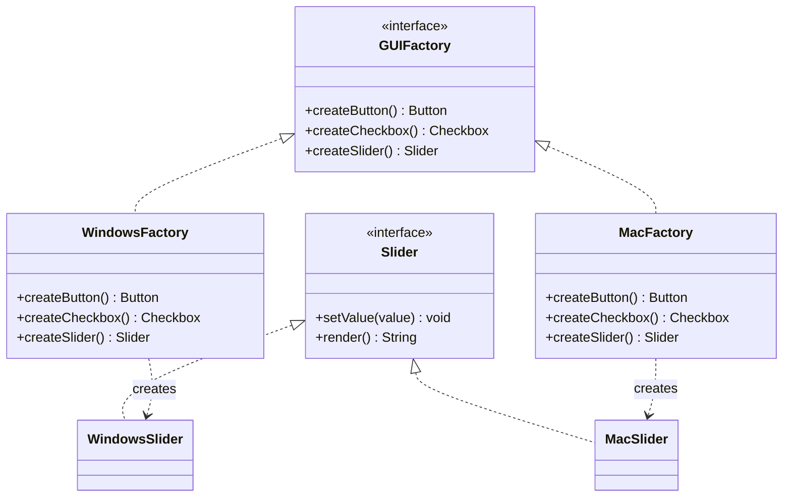

# Thêm Slider vào ví dụ để quan sát sự thay đổi theo chiều loại sản phẩm

Trong module `SOFTWARE_DESIGN_DESIGN_PATTERN_CREATIONAL_ABSTRACT_FACTORY` — **Học về abstract factory trong design pattern** — ta đã xem cách **Abstract Factory** tạo ra các đối tượng thuộc cùng một họ giao diện. Bài này mở rộng ví dụ giao diện người dùng (GUI): ngoài `Button` và `Checkbox`, ứng dụng cần thêm **`Slider`** (thanh trượt). Qua thay đổi này, ta thấy rõ chi phí mở rộng theo **chiều loại sản phẩm** và phân biệt nó với việc thêm **một họ sản phẩm mới**.

## 1. Tình huống: ứng dụng cần thêm thanh điều chỉnh

Giả sử một ứng dụng chạy trên **Windows** và **macOS**, với các thành phần giao diện mang phong cách riêng của từng hệ điều hành. Trước đây, mỗi màn hình cần một nút bấm và một ô chọn. Nay màn hình cài đặt còn cần thanh trượt điều chỉnh mức âm lượng từ 0 đến 100.

Ta có hai chiều biến thiên:

- **Họ sản phẩm (product family / variant):** Windows và macOS. Mỗi họ quy định phong cách hiển thị nhất quán.
- **Loại sản phẩm (product type):** `Button`, `Checkbox`, và giờ là `Slider`. Mỗi loại thể hiện một chức năng giao diện khác nhau.

| Họ giao diện | Trước khi mở rộng | Sau khi thêm Slider |
| --- | --- | --- |
| Windows | `WindowsButton`, `WindowsCheckbox` | `WindowsButton`, `WindowsCheckbox`, **`WindowsSlider`** |
| macOS | `MacButton`, `MacCheckbox` | `MacButton`, `MacCheckbox`, **`MacSlider`** |

Mục tiêu của ứng dụng là tạo cả ba thành phần **thông qua một factory cùng họ**, để mã xử lý màn hình không cần biết đó là Windows hay macOS.

> Điểm cốt lõi: thêm một loại sản phẩm buộc **hợp đồng của abstract factory và từng concrete factory** cùng mở rộng. Đây là đặc tính quan trọng khi cân nhắc sử dụng mẫu thiết kế này.

## 2. Nhìn cấu trúc trước và sau

Trước khi có thanh trượt, giao diện `GUIFactory` chỉ công bố hai phương thức:

```java
interface GUIFactory {
    Button createButton();
    Checkbox createCheckbox();
}
```

Khi bổ sung `Slider`, ta thêm một **abstract product** mới và một phương thức tạo tương ứng:

```java
interface Slider {
    void setValue(int value);
    String render();
}

interface GUIFactory {
    Button createButton();
    Checkbox createCheckbox();
    Slider createSlider(); // Phương thức mới
}
```

Giờ `WindowsFactory` chịu trách nhiệm tạo `WindowsSlider`, còn `MacFactory` tạo `MacSlider`. Không nên để client tự quyết định bằng `new WindowsSlider()` hay `new MacSlider()`, vì như vậy client lại phụ thuộc trực tiếp vào họ giao diện.



Sơ đồ chỉ tập trung vào **phần mới**. `Button` và `Checkbox` vẫn tồn tại, do cùng factory tạo ra; chúng được lược bớt khỏi sơ đồ để dễ thấy đường mở rộng `Slider`.

## 3. Cài đặt minh họa hoàn chỉnh bằng Java

Ví dụ sau chạy trên console để quan sát **họ giao diện được chọn**. Các chuỗi trả về bởi `render()` chỉ **mô phỏng** cách vẽ; trong ứng dụng GUI thực tế, mỗi thành phần sẽ gọi API của thư viện giao diện tương ứng.

Lưu toàn bộ đoạn mã vào `AbstractFactorySliderDemo.java`:

```java
public class AbstractFactorySliderDemo {

    // Các abstract product: hợp đồng mà ứng dụng sử dụng.
    interface Button {
        String render();
    }

    interface Checkbox {
        String render();
    }

    // LOẠI SẢN PHẨM MỚI
    interface Slider {
        void setValue(int value);
        String render();
    }

    // Abstract factory: tạo trọn bộ sản phẩm cùng một họ.
    interface GUIFactory {
        Button createButton();
        Checkbox createCheckbox();
        Slider createSlider(); // Phương thức mới
    }

    // Họ Windows: các concrete product.
    static class WindowsButton implements Button {
        public String render() {
            return "[Windows] Button";
        }
    }

    static class WindowsCheckbox implements Checkbox {
        public String render() {
            return "[Windows] Checkbox";
        }
    }

    // Logic giá trị dùng chung; không quyết định phong cách hiển thị.
    static abstract class BaseSlider implements Slider {
        private int value = 0;

        public final void setValue(int value) {
            if (value < 0 || value > 100) {
                throw new IllegalArgumentException(
                    "Slider value must be between 0 and 100"
                );
            }
            this.value = value;
        }

        protected final int getValue() {
            return value;
        }
    }

    // CONCRETE PRODUCT MỚI: WindowsSlider.
    static class WindowsSlider extends BaseSlider {
        public String render() {
            return "[Windows] Slider = " + getValue() + "%";
        }
    }

    // Họ macOS: các concrete product.
    static class MacButton implements Button {
        public String render() {
            return "[macOS] Button";
        }
    }

    static class MacCheckbox implements Checkbox {
        public String render() {
            return "[macOS] Checkbox";
        }
    }

    // CONCRETE PRODUCT MỚI: MacSlider.
    static class MacSlider extends BaseSlider {
        public String render() {
            return "[macOS] Slider = " + getValue() + "%";
        }
    }

    // Các concrete factory tạo đủ ba loại sản phẩm.
    static class WindowsFactory implements GUIFactory {
        public Button createButton() {
            return new WindowsButton();
        }

        public Checkbox createCheckbox() {
            return new WindowsCheckbox();
        }

        public Slider createSlider() {
            return new WindowsSlider();
        }
    }

    static class MacFactory implements GUIFactory {
        public Button createButton() {
            return new MacButton();
        }

        public Checkbox createCheckbox() {
            return new MacCheckbox();
        }

        public Slider createSlider() {
            return new MacSlider();
        }
    }

    // Client chỉ phụ thuộc vào các interface.
    static class SettingsScreen {
        private final GUIFactory factory;

        SettingsScreen(GUIFactory factory) {
            this.factory = factory;
        }

        void show() {
            Button button = factory.createButton();
            Checkbox checkbox = factory.createCheckbox();
            Slider volume = factory.createSlider();
            volume.setValue(70);

            System.out.println(button.render());
            System.out.println(checkbox.render());
            System.out.println(volume.render());
        }
    }

    // Chọn họ giao diện duy nhất tại điểm khởi tạo.
    public static void main(String[] args) {
        boolean useMac = args.length > 0
            && args[0].equalsIgnoreCase("mac");
        GUIFactory factory = useMac
            ? new MacFactory()
            : new WindowsFactory();

        new SettingsScreen(factory).show();
    }
}
```

Chạy trong thư mục chứa file:

```bash
javac AbstractFactorySliderDemo.java
java AbstractFactorySliderDemo
java AbstractFactorySliderDemo mac
```

Lệnh thứ hai (mặc định chọn Windows) in ra:

```text
[Windows] Button
[Windows] Checkbox
[Windows] Slider = 70%
```

Lệnh thứ ba (chọn macOS) in ra:

```text
[macOS] Button
[macOS] Checkbox
[macOS] Slider = 70%
```

Khi thay đổi đối số từ mặc định sang `mac`, **toàn bộ họ sản phẩm** thay đổi theo một quyết định tại `main`. `SettingsScreen` vẫn gọi `createButton()`, `createCheckbox()`, `createSlider()` và `render()` như cũ. Trong ví dụ này, `BaseSlider` chỉ tái sử dụng quy tắc giới hạn 0–100; nó là lựa chọn cài đặt, **không phải thành phần bắt buộc** của Abstract Factory.

## 4. Những chỗ phải thay đổi khi thêm một loại sản phẩm

Quan sát bốn trách nhiệm khác nhau:

| Vị trí | Thay đổi | Vì sao cần |
| --- | --- | --- |
| Abstract product | Khai báo `Slider` với `setValue()`, `render()` | Client có hợp đồng chung, độc lập hệ điều hành |
| Concrete product | Tạo `WindowsSlider`, `MacSlider` | Mỗi họ cung cấp cách hiển thị tương thích |
| Abstract factory | Thêm `Slider createSlider()` vào `GUIFactory` | Mọi factory phải có khả năng tạo loại mới |
| Concrete factory | Cài đặt `createSlider()` ở `WindowsFactory` và `MacFactory` | Factory trả về đúng phiên bản trong họ mình |
| Client sử dụng loại mới | Gọi `factory.createSlider()`, thao tác qua `Slider` | Bổ sung chức năng mới mà không kiểm tra hệ điều hành |

Vì Java kiểm tra hợp đồng interface ở thời điểm biên dịch, sau khi thêm `createSlider()` vào `GUIFactory`, một concrete factory thiếu phương thức này sẽ **không còn biên dịch được** (trừ khi nó là lớp `abstract`). Điều đó giúp phát hiện sớm họ sản phẩm chưa được bổ sung đầy đủ.

Thứ tự triển khai hợp lý là: xác định hành vi chung của `Slider` → cài đặt mọi biến thể `Slider` cần hỗ trợ → mở rộng hợp đồng factory → cập nhật tất cả concrete factory → tích hợp vào client. Khi chỉnh sửa một codebase có sẵn, việc cập nhật interface và các lớp triển khai thường diễn ra cùng một thay đổi để hệ thống luôn nhất quán.

## 5. Phân biệt hai chiều mở rộng

Abstract Factory tổ chức sản phẩm thành một **ma trận**: hàng là họ giao diện; cột là loại sản phẩm.

| | Button | Checkbox | Slider |
| --- | --- | --- | --- |
| Windows | `WindowsButton` | `WindowsCheckbox` | `WindowsSlider` |
| macOS | `MacButton` | `MacCheckbox` | `MacSlider` |
| *Linux (giả sử thêm sau)* | `LinuxButton` | `LinuxCheckbox` | `LinuxSlider` |

**Thêm một họ sản phẩm** (ví dụ Linux) chủ yếu tạo thêm các lớp concrete product của họ đó và một `LinuxFactory` cài đặt **hợp đồng factory đang có**. Client chỉ cần được cung cấp factory mới ở điểm cấu hình; các interface `Button`, `Checkbox`, `Slider` không cần đổi.

**Thêm một loại sản phẩm** (ví dụ `Slider`) thay đổi **hợp đồng `GUIFactory`**, kéo theo việc sửa **tất cả concrete factory** hiện có để tạo loại đó. Nếu có \(N\) họ giao diện, về nguyên tắc cần ít nhất \(N\) concrete product tương ứng và \(N\) phương thức factory được cài đặt cho loại mới.

Do đó:

- Abstract Factory **thuận lợi khi số loại sản phẩm tương đối ổn định**, còn số họ/biến thể có thể tăng.
- Abstract Factory **tốn công hơn khi liên tục bổ sung loại sản phẩm**, vì thay đổi lan tới toàn bộ hệ thống factory.
- Mọi họ cần cung cấp **một bộ sản phẩm tương ứng**. Nếu một họ thực sự không hỗ trợ `Slider`, cần thiết kế lại khả năng hỗ trợ hoặc hợp đồng; không nên lặng lẽ trả `null` rồi đẩy lỗi cho client.

Đây là một đánh đổi có chủ đích. Không nên diễn giải nguyên tắc *Open/Closed* thành tuyên bố rằng Abstract Factory cho phép thêm **mọi loại tính năng** mà không sửa mã cũ. Trong bài này, thêm `Slider` rõ ràng **phải sửa** hợp đồng factory; ưu thế của mẫu nằm ở việc tạo các **họ đối tượng nhất quán** và giảm sự phụ thuộc vào lớp cụ thể.

## 6. Vì sao không tạo Slider trực tiếp trong client?

Giả sử `SettingsScreen` tự kiểm tra hệ điều hành:

```java
// Ví dụ phản diện: logic chọn họ bị đẩy vào client.
Slider volume = isMac ? new MacSlider() : new WindowsSlider();
```

Khi đó, client phải biết `MacSlider`, `WindowsSlider` và điều kiện chọn hệ điều hành. Mỗi nơi tạo Slider có nguy cơ lặp lại logic này. Tệ hơn, client có thể lấy `Button` của Windows từ factory nhưng tự tạo `MacSlider`, dẫn đến một giao diện trộn lẫn các họ.

Khi dùng `Slider volume = factory.createSlider();`, client chỉ biết hợp đồng `Slider`. Quy tắc tạo sản phẩm đồng bộ nằm tại `WindowsFactory` hoặc `MacFactory`. Client vẫn quyết định **cần Slider làm gì** (ở đây đặt giá trị 70), nhưng không quyết định **Slider thuộc họ nào**.

## 7. Các lỗi thường gặp và cách tự kiểm tra

1. **Quên cập nhật một concrete factory:** sau khi khai báo `createSlider()`, hãy rà soát mọi lớp triển khai `GUIFactory`. Trình biên dịch Java thường báo lỗi ngay nếu lớp thiếu phương thức.
2. **Trả sai họ sản phẩm:** `MacFactory.createSlider()` mà trả về `WindowsSlider` vẫn có thể biên dịch vì cùng implement `Slider`, nhưng vi phạm ý nghĩa nhất quán của Abstract Factory. Cần đối chiếu bảng ma trận họ–loại.
3. **Ép kiểu ở client:** nếu phải ép từ `Slider` thành `WindowsSlider` để gọi một chức năng thiết yếu, hợp đồng chung có thể đang thiếu hành vi thật sự dùng chung. Hãy xem lại interface trước khi thêm phụ thuộc cụ thể.
4. **Đưa logic giao diện vào `GUIFactory`:** factory có nhiệm vụ *tạo* đối tượng; việc đặt âm lượng, phản ứng với sự kiện hay vẽ màn hình thuộc về sản phẩm và client phù hợp.
5. **Bỏ qua trạng thái hợp lệ:** giá trị thanh trượt phải được kiểm tra. Trong mã ví dụ, `setValue(-1)` hoặc `setValue(101)` ném `IllegalArgumentException` như đã định nghĩa.

Có thể tự kiểm tra ba hành vi cốt lõi: chọn `WindowsFactory` tạo đủ ba sản phẩm Windows; chọn `MacFactory` tạo đủ ba sản phẩm macOS; thay `factory` đầu vào không yêu cầu sửa `SettingsScreen`. Sau đó thử thay 70 bằng 0, 100 và 101 để quan sát ranh giới hợp lệ.

## 8. Bài tập mở rộng

**Bài tập 1 — Thêm họ Linux.** Giữ nguyên ba interface sản phẩm và `GUIFactory`. Viết `LinuxButton`, `LinuxCheckbox`, `LinuxSlider`, rồi tạo `LinuxFactory`. Thử thêm lựa chọn `linux` tại điểm khởi tạo. Theo dõi những tệp/lớp cần bổ sung và những nơi không phải sửa.

**Bài tập 2 — Thêm loại ProgressBar.** Đặt ra giao diện `ProgressBar` với `setProgress(int)` và `render()`. Bổ sung sản phẩm tương ứng cho từng họ, mở rộng `GUIFactory` bằng `createProgressBar()`, sau đó dùng trong `SettingsScreen`. So sánh số vị trí phải chỉnh sửa với bài tập 1.

**Câu hỏi suy ngẫm:** Nếu roadmap dự kiến cứ mỗi tuần thêm một loại control mới nhưng hiếm khi thêm hệ điều hành mới, Abstract Factory có còn là lựa chọn thuận tiện nhất không? Hãy đánh giá theo tần suất thay đổi của **hai chiều** và yêu cầu giữ giao diện nhất quán, thay vì chọn mẫu thiết kế chỉ vì ứng dụng có nhiều lớp.

**Ghi nhớ:** `Slider` minh họa chiều mở rộng **loại sản phẩm**. Nó cần một hợp đồng sản phẩm mới, các hiện thực cho từng họ và một phương thức tạo mới ở **tất cả** factory. Đổi lại, mã client tiếp tục làm việc với các abstraction và nhận được trọn bộ giao diện nhất quán từ factory đã chọn.
