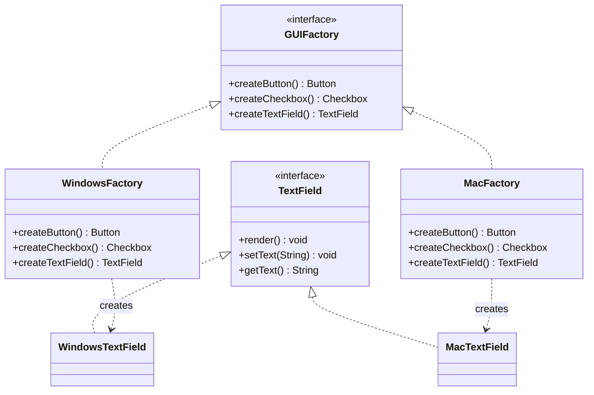

# Bổ sung product interface và phương thức tạo trong AbstractFactory

> **Chương:** Thêm loại sản phẩm  
> **Module:** `SOFTWARE_DESIGN_DESIGN_PATTERN_CREATIONAL_ABSTRACT_FACTORY` — Học về Abstract Factory trong Design Pattern.  
> **Mục tiêu:** Biết cách thêm **một loại sản phẩm mới** vào họ đối tượng, hiểu vì sao phải mở rộng *product interface* và hợp đồng của `AbstractFactory`, đồng thời đánh giá tác động đến các *concrete factory* và mã sử dụng.

## 1. Bối cảnh: từ hai loại sản phẩm sang ba loại

Một ứng dụng giao diện đa nền tảng cung cấp hai họ widget:

- **Windows:** `WindowsButton` và `WindowsCheckbox`.
- **macOS:** `MacButton` và `MacCheckbox`.

Mỗi màn hình dùng một đối tượng `GUIFactory` để yêu cầu các sản phẩm cùng họ. Ban đầu hợp đồng của factory chỉ có hai phương thức:

```java
interface Button {
    void render();
}

interface Checkbox {
    void render();
}

interface GUIFactory {
    Button createButton();
    Checkbox createCheckbox();
}
```

Nhờ vậy, màn hình đăng nhập có thể tạo nút và ô chọn mà không phải biết lớp cụ thể theo hệ điều hành:

```java
Button loginButton = factory.createButton();
Checkbox rememberMe = factory.createCheckbox();
```

Yêu cầu mới xuất hiện: màn hình cần thêm **ô nhập tên người dùng** (`TextField`), vẫn phải mang phong cách của hệ điều hành đang dùng. Nếu Button và Checkbox của màn hình thuộc họ Windows, TextField cũng phải là `WindowsTextField`; tương tự với họ macOS.

| Họ giao diện | Button | Checkbox | TextField mới |
| --- | --- | --- | --- |
| Windows | `WindowsButton` | `WindowsCheckbox` | `WindowsTextField` |
| macOS | `MacButton` | `MacCheckbox` | `MacTextField` |

Đây là thao tác **thêm loại sản phẩm** (*adding a product type*) vào mỗi họ. Nó khác với việc **thêm họ sản phẩm** (chẳng hạn Linux):

| Hướng mở rộng | Thay đổi trong ma trận | Ảnh hưởng chính |
| --- | --- | --- |
| Thêm họ Linux | Thêm một **hàng** với `LinuxButton`, `LinuxCheckbox`… | Tạo factory Linux và các sản phẩm Linux |
| Thêm loại TextField | Thêm một **cột** với `WindowsTextField`, `MacTextField`… | Mở rộng hợp đồng factory và cập nhật **mọi factory hiện có** |

Sự khác biệt này giải thích một đánh đổi quan trọng của Abstract Factory: mẫu thiết kế rất thuận tiện khi cần chọn nguyên **một họ sản phẩm**, nhưng việc thêm **một loại sản phẩm** có thể gây thay đổi trên nhiều lớp.

## 2. Bước 1 — Định nghĩa product interface mới

Đầu tiên, xác định **những thao tác chung mà mã sử dụng cần từ TextField**, không đưa chi tiết Windows hoặc macOS vào hợp đồng.

```java
interface TextField {
    void render();
    void setText(String text);
    String getText();
}
```

Ý nghĩa của từng phương thức:

- `render()`: minh họa khả năng hiển thị của ô nhập.
- `setText(String)`: cập nhật chuỗi người dùng nhập.
- `getText()`: đọc lại giá trị hiện tại.

Trong ứng dụng thực, widget có thể cần sự kiện thay đổi văn bản, xử lý focus, kiểm tra dữ liệu hoặc các thuộc tính accessibility. Ví dụ này chỉ giữ ba thao tác chung để làm rõ cấu trúc tạo đối tượng.

**Không** cần sửa `Button` hoặc `Checkbox` chỉ vì thêm `TextField`. Mỗi *product interface* đại diện cho một **loại sản phẩm**, còn việc phối hợp nhiều loại cùng họ là trách nhiệm của factory.

### Xác định phần nào được phép khác nhau

Hai implementation `WindowsTextField` và `MacTextField` có thể khác về cách render, skin, focus hoặc tích hợp hệ điều hành. Tuy nhiên, cả hai đều phải tuân theo `TextField` để mã màn hình có thể sử dụng một kiểu chung.

Đây là ranh giới trừu tượng quan trọng:

```text
Mã màn hình -> TextField (hợp đồng chung)
                      ^
           +----------+----------+
           |                     |
    WindowsTextField         MacTextField
```

## 3. Bước 2 — Tạo concrete product mới cho từng họ

Sau khi có `TextField`, bổ sung một implementation cho **mỗi họ đã được hỗ trợ**:

```java
final class WindowsTextField implements TextField {
    private String text = "";

    @Override
    public void render() {
        System.out.println("Windows TextField: " + text);
    }

    @Override
    public void setText(String text) {
        this.text = java.util.Objects.requireNonNull(text);
    }

    @Override
    public String getText() {
        return text;
    }
}

final class MacTextField implements TextField {
    private String text = "";

    @Override
    public void render() {
        System.out.println("macOS TextField: " + text);
    }

    @Override
    public void setText(String text) {
        this.text = java.util.Objects.requireNonNull(text);
    }

    @Override
    public String getText() {
        return text;
    }
}
```

Hai lớp cùng triển khai `TextField`, nên client dùng được `setText()` và `getText()` thông qua interface. Chúng khác nhau ở phần render để mô phỏng phong cách nền tảng. Các lệnh `System.out.println` **chỉ là mô phỏng**, không phải thư viện vẽ GUI thật.

Nếu một họ đang hỗ trợ Button và Checkbox nhưng chưa có TextField, họ đó **chưa hoàn chỉnh** theo hợp đồng mở rộng mới.

## 4. Bước 3 — Bổ sung phương thức tạo vào AbstractFactory

Thêm `createTextField()` vào cùng interface đang khai báo `createButton()` và `createCheckbox()`:

```java
interface GUIFactory {
    Button createButton();
    Checkbox createCheckbox();

    // Phương thức mới: sản phẩm thứ ba của cùng họ giao diện
    TextField createTextField();
}
```

Hợp đồng này quy định rằng **mọi concrete factory tuân theo `GUIFactory` phải biết tạo cả ba loại sản phẩm**. Phương thức trả về interface `TextField` thay vì một kiểu cụ thể như `WindowsTextField`, nhờ đó client không phải nhận biết hệ điều hành.

Tiếp theo, mở rộng từng concrete factory:

```java
final class WindowsFactory implements GUIFactory {
    @Override
    public Button createButton() {
        return new WindowsButton();
    }

    @Override
    public Checkbox createCheckbox() {
        return new WindowsCheckbox();
    }

    @Override
    public TextField createTextField() {
        return new WindowsTextField();
    }
}

final class MacFactory implements GUIFactory {
    @Override
    public Button createButton() {
        return new MacButton();
    }

    @Override
    public Checkbox createCheckbox() {
        return new MacCheckbox();
    }

    @Override
    public TextField createTextField() {
        return new MacTextField();
    }
}
```

Điểm phải kiểm tra khi review:

1. `WindowsFactory.createTextField()` trả về `WindowsTextField`.
2. `MacFactory.createTextField()` trả về `MacTextField`.
3. Factory **không chọn nền tảng lại cho từng phương thức**: đối tượng factory được chọn trước, và mọi phương thức tạo trong nó thuộc cùng họ.
4. Toàn bộ implementation của `GUIFactory` trong codebase đều được cập nhật.

Nếu vô tình trả `new MacTextField()` từ `WindowsFactory`, mã vẫn có thể biên dịch vì cả hai đều là `TextField`, nhưng **bất biến cùng họ bị vi phạm**. Do đó, ngoài kiểm tra kiểu trả về, cần có kiểm thử tính nhất quán họ sản phẩm.

## 5. Bước 4 — Sử dụng sản phẩm mới trong client

Màn hình đăng nhập giữ tham chiếu `GUIFactory` mà ứng dụng đã chọn một lần:

```java
final class LoginForm {
    private final Button loginButton;
    private final Checkbox rememberMe;
    private final TextField username;

    LoginForm(GUIFactory factory) {
        loginButton = factory.createButton();
        rememberMe = factory.createCheckbox();
        username = factory.createTextField();
    }

    void show() {
        username.setText("alice");
        username.render();
        rememberMe.render();
        loginButton.render();
    }
}
```

Client chỉ phụ thuộc vào ba **product interface** và một **factory interface**. Khi tạo `new LoginForm(new WindowsFactory())`, cả ba sản phẩm đều thuộc họ Windows; khi truyền `new MacFactory()`, chúng thuộc họ macOS.

Một màn hình chưa cần TextField vẫn có thể chỉ gọi hai phương thức cũ. **Không bắt buộc mọi client đều dùng sản phẩm mới**, nhưng mọi implementation của hợp đồng factory mở rộng phải cung cấp cách tạo sản phẩm đó.

## 6. Ví dụ Java hoàn chỉnh có thể biên dịch

Ví dụ dưới đây tập hợp các thành phần vào **một tệp** để có thể kiểm tra luồng từ factory đến client. Những lớp lồng được dùng chỉ để ví dụ tự chứa; trong dự án thật, các interface và concrete class thường nằm trong các tệp riêng.

Lưu tệp là `AddingProductTypeDemo.java`:

```java
public class AddingProductTypeDemo {
    interface Button {
        void render();
    }

    interface Checkbox {
        void render();
    }

    // Product interface mới
    interface TextField {
        void render();
        void setText(String text);
        String getText();
    }

    // Abstract factory: thêm phương thức cho loại sản phẩm mới
    interface GUIFactory {
        Button createButton();
        Checkbox createCheckbox();
        TextField createTextField();
    }

    static final class WindowsButton implements Button {
        public void render() {
            System.out.println("Windows Button");
        }
    }

    static final class WindowsCheckbox implements Checkbox {
        public void render() {
            System.out.println("Windows Checkbox");
        }
    }

    static final class WindowsTextField implements TextField {
        private String text = "";

        public void render() {
            System.out.println("Windows TextField: " + text);
        }

        public void setText(String text) {
            this.text = java.util.Objects.requireNonNull(text);
        }

        public String getText() {
            return text;
        }
    }

    static final class MacButton implements Button {
        public void render() {
            System.out.println("macOS Button");
        }
    }

    static final class MacCheckbox implements Checkbox {
        public void render() {
            System.out.println("macOS Checkbox");
        }
    }

    static final class MacTextField implements TextField {
        private String text = "";

        public void render() {
            System.out.println("macOS TextField: " + text);
        }

        public void setText(String text) {
            this.text = java.util.Objects.requireNonNull(text);
        }

        public String getText() {
            return text;
        }
    }

    static final class WindowsFactory implements GUIFactory {
        public Button createButton() {
            return new WindowsButton();
        }

        public Checkbox createCheckbox() {
            return new WindowsCheckbox();
        }

        public TextField createTextField() {
            return new WindowsTextField();
        }
    }

    static final class MacFactory implements GUIFactory {
        public Button createButton() {
            return new MacButton();
        }

        public Checkbox createCheckbox() {
            return new MacCheckbox();
        }

        public TextField createTextField() {
            return new MacTextField();
        }
    }

    static final class LoginForm {
        private final Button loginButton;
        private final Checkbox rememberMe;
        private final TextField username;

        LoginForm(GUIFactory factory) {
            this.loginButton = factory.createButton();
            this.rememberMe = factory.createCheckbox();
            this.username = factory.createTextField();
        }

        void show() {
            username.setText("alice");
            username.render();
            rememberMe.render();
            loginButton.render();
        }
    }

    public static void main(String[] args) {
        System.out.println("=== Windows ===");
        new LoginForm(new WindowsFactory()).show();

        System.out.println("=== macOS ===");
        new LoginForm(new MacFactory()).show();
    }
}
```

Biên dịch và chạy bằng JDK:

```bash
javac AddingProductTypeDemo.java
java AddingProductTypeDemo
```

Kết quả dự kiến:

```text
=== Windows ===
Windows TextField: alice
Windows Checkbox
Windows Button
=== macOS ===
macOS TextField: alice
macOS Checkbox
macOS Button
```

Hãy quan sát: trong `LoginForm` không xuất hiện nhánh `if` chọn Windows/macOS và không trực tiếp khởi tạo lớp `WindowsTextField` hay `MacTextField`. Factory cụ thể quyết định phiên bản nào được tạo.

## 7. Sơ đồ thay đổi hợp đồng tạo sản phẩm



Sơ đồ nhấn mạnh mối quan hệ mới: `createTextField()` được khai báo **một lần** trong `GUIFactory`, nhưng **mỗi factory cụ thể** phải triển khai cách tạo TextField của họ mình. Hai product interface cũ (`Button`, `Checkbox`) và các phương thức tạo tương ứng vẫn tồn tại.

## 8. Tác động khi thay đổi hợp đồng AbstractFactory

Thêm một phương thức trừu tượng vào `GUIFactory` là thay đổi về **hợp đồng API**, vì vậy cần xem xét tác động đến các lớp triển khai.

| Thành phần | Thay đổi bắt buộc? | Giải thích |
| --- | --- | --- |
| `TextField` | Có, tạo mới | Định nghĩa những thao tác chung |
| `WindowsTextField` và `MacTextField` | Có, tạo mới | Hiện thực sản phẩm cho từng họ |
| `GUIFactory` | Có | Thêm `createTextField()` |
| `WindowsFactory`, `MacFactory` | Có | Hiện thực phương thức mới, trả đúng họ |
| `Button` và `Checkbox` | Không | Hai kiểu sản phẩm cũ không bị thay đổi yêu cầu |
| Client muốn dùng TextField | Có | Gọi factory để lấy sản phẩm mới |
| Client chỉ dùng Button/Checkbox | Không nhất thiết | Các lời gọi hiện có tiếp tục sử dụng hợp đồng cũ |

### Tác động tại thời điểm biên dịch

Trong Java, nếu khai báo `createTextField()` là **phương thức trừu tượng** của interface, mọi lớp cụ thể `implements GUIFactory` sẽ phải cung cấp implementation. Khi biên dịch lại một factory cũ chưa cập nhật, trình biên dịch có thể báo lỗi tương tự:

```text
WindowsFactory is not abstract and does not override
abstract method createTextField() in GUIFactory
```

Đây là một tín hiệu hữu ích để tìm những factory chưa hoàn tất nâng cấp. Nhưng nó cũng là rủi ro cho hệ thống có plugin, thư viện hoặc các factory do nhóm khác duy trì: họ cần cập nhật implementation để biên dịch với interface mới. Với mã nhị phân cũ, trường hợp gọi phương thức mới trên một implementation chưa có phương thức tương ứng có thể dẫn đến `AbstractMethodError` khi chạy. Vì vậy, không được coi việc thêm phương thức trừu tượng là thay đổi tương thích hoàn toàn với mọi implementation bên ngoài.

### Có nên dùng phương thức `default` để tránh sửa các factory cũ?

Một cách dễ nghĩ đến là:

```java
interface GUIFactory {
    Button createButton();
    Checkbox createCheckbox();

    default TextField createTextField() {
        throw new UnsupportedOperationException(
                "TextField is not supported");
    }
}
```

Cách này có thể giúp factory cũ biên dịch mà không cần ngay lập tức triển khai phương thức mới, nhưng **đã làm yếu lời hứa của hợp đồng**: client gọi `createTextField()` có thể nhận exception thay vì một sản phẩm hợp lệ. Nếu mọi họ giao diện bắt buộc phải có TextField, cách rõ ràng hơn là yêu cầu các factory cung cấp đầy đủ và kiểm thử chúng.

Trong hệ thống lớn cần triển khai dần hoặc giữ tương thích với bên thứ ba, có thể cân nhắc một interface mở rộng như `GUIFactoryWithTextField extends GUIFactory`, adapter hoặc cơ chế kiểm tra khả năng hỗ trợ. Đổi lại, mã sử dụng phải xử lý sự khác biệt giữa factory có và không có loại sản phẩm mới. Đây là **quyết định thiết kế ở ranh giới API**, không phải yêu cầu mặc định của Abstract Factory.

## 9. Kiểm thử sau khi bổ sung product type

Chỉ xác nhận mã biên dịch là chưa đủ: nếu `WindowsFactory` tạo nhầm `MacTextField`, Java vẫn chấp nhận kiểu trả về `TextField`. Kiểm thử nên bao phủ cả **cấu trúc họ sản phẩm** lẫn **hành vi của sản phẩm mới**.

### Kiểm thử tính đúng họ

Giả sử những lớp concrete trong ví dụ Java được đặt trong cùng một tệp như ở mục 6. Có thể thêm đoạn kiểm tra sau vào `main` hoặc một hàm kiểm thử riêng:

```java
GUIFactory windows = new WindowsFactory();
GUIFactory mac = new MacFactory();

if (!(windows.createButton() instanceof WindowsButton)
        || !(windows.createCheckbox() instanceof WindowsCheckbox)
        || !(windows.createTextField() instanceof WindowsTextField)) {
    throw new AssertionError("WindowsFactory creates mixed families");
}

if (!(mac.createButton() instanceof MacButton)
        || !(mac.createCheckbox() instanceof MacCheckbox)
        || !(mac.createTextField() instanceof MacTextField)) {
    throw new AssertionError("MacFactory creates mixed families");
}
```

Đây là kiểm tra dành cho nội bộ triển khai factory, nơi có thể biết các concrete class. **Mã client sản phẩm không nên phải dùng `instanceof`** để chọn logic theo nền tảng; làm như vậy sẽ phá vỡ mục đích tách biệt khỏi lớp cụ thể.

### Kiểm thử hợp đồng chung

Các TextField của mọi họ phải duy trì giá trị văn bản qua cùng những thao tác:

```java
TextField[] fields = {
    new WindowsFactory().createTextField(),
    new MacFactory().createTextField()
};

for (TextField field : fields) {
    field.setText("user@example.com");
    if (!"user@example.com".equals(field.getText())) {
        throw new AssertionError("TextField contract violated");
    }
}
```

Trong ứng dụng GUI thật, tiếp tục kiểm tra khả năng nhập, focus, nhãn trường, keyboard navigation, disabled state và các quy ước riêng của từng nền tảng. Những kiểm thử đó khác với kiểm thử cấu trúc factory, nhưng đều cần thiết khi đưa tính năng vào sản phẩm.

### Checklist review khi thêm loại sản phẩm

1. Có *product interface* mới mô tả đúng hành vi chung, tránh phụ thuộc nền tảng chưa?
2. Mỗi họ đang được hỗ trợ đã có một concrete product tương ứng chưa?
3. Phương thức tạo trong `AbstractFactory` có trả về **interface chung** không?
4. Mọi concrete factory đã triển khai phương thức mới và tạo **đúng họ** chưa?
5. Client đã lấy sản phẩm qua factory được cấp, thay vì `new` trực tiếp từng loại theo nền tảng chưa?
6. Các hệ thống sử dụng interface factory từ thư viện/plugin có cần phối hợp nâng cấp không?
7. Kiểm thử tính cùng họ và hợp đồng sản phẩm mới đã bao phủ mọi concrete factory chưa?

## 10. Những sai lầm thường gặp

### Sai lầm 1 — Chỉ tạo lớp mới nhưng quên khai báo trong factory

Có `WindowsTextField` và `MacTextField` chưa đủ nếu màn hình vẫn phải tự viết:

```java
TextField field = isWindows
        ? new WindowsTextField()
        : new MacTextField();
```

Cách này đưa quyết định chọn phiên bản trở lại client. Muốn giữ cấu trúc Abstract Factory, thêm `createTextField()` vào hợp đồng factory và để concrete factory quyết định.

### Sai lầm 2 — Trả về lớp cụ thể từ factory interface

```java
// Sai về mức trừu tượng cho factory dùng chung nhiều họ:
WindowsTextField createTextField();
```

Nếu phương thức trên nằm trong `GUIFactory`, nó vô tình ràng buộc toàn bộ factory vào họ Windows. Hợp đồng đúng phải là:

```java
TextField createTextField();
```

Một concrete factory có thể dùng kiểu trả về cụ thể hơn khi override hợp lệ trong Java, nhưng **interface dùng chung** vẫn nên khai báo kiểu sản phẩm trừu tượng.

### Sai lầm 3 — Cập nhật một factory và bỏ quên factory khác

`WindowsFactory` có `createTextField()` không có nghĩa `MacFactory` đã hoàn tất. Với phương thức trừu tượng, lỗi có thể được phát hiện khi biên dịch lại, nhưng với cơ chế `default` hoặc adapter, nguy cơ xuất hiện khi chạy cần được kiểm thử.

### Sai lầm 4 — Tạo nhầm sản phẩm thuộc họ khác

```java
// Sai về tính nhất quán, dù đúng kiểu TextField:
public TextField createTextField() {
    return new MacTextField(); // nằm trong WindowsFactory
}
```

Factory phải tạo toàn bộ sản phẩm thuộc **cùng một họ**, vì đó là lý do sử dụng Abstract Factory ngay từ đầu.

### Sai lầm 5 — Mở rộng factory quá lớn

Nếu mọi tính năng mới đều buộc phải thêm phương thức vào một interface trung tâm, số lượng loại sản phẩm có thể khiến factory trở nên cồng kềnh. Hãy nhóm những sản phẩm **thực sự có quan hệ họ và cần được lựa chọn cùng nhau**. Những sản phẩm độc lập có thể phù hợp với các factory riêng hoặc một chiến lược tạo đối tượng khác.

## 11. Luyện tập: thêm một loại sản phẩm nữa

Giả sử thiết kế mới yêu cầu thêm `Slider` để chỉnh âm lượng. Hãy triển khai lần lượt:

1. Tạo interface `Slider` với `render()`, `setValue(int)` và `getValue()`; đặt quy tắc giá trị từ 0 đến 100.
2. Tạo `WindowsSlider` và `MacSlider` thực thi cùng interface, tự bảo đảm ràng buộc giá trị.
3. Thêm `Slider createSlider()` vào `GUIFactory`.
4. Cập nhật `WindowsFactory`, `MacFactory` để trả về đúng implementation cùng họ.
5. Trong màn hình Cài đặt, lấy Slider từ factory đã có thay vì tự kiểm tra hệ điều hành.
6. Viết kiểm thử các trường hợp đặt 0, 100 và giá trị ngoài khoảng cho cả hai họ; xác nhận Slider cùng họ với Button và Checkbox.

**Câu hỏi suy nghĩ:**

- Vì sao chỉ thêm `WindowsSlider` và `MacSlider` là chưa đủ để client dùng chúng qua Abstract Factory?
- Khi thêm `createSlider()`, những concrete factory nào bị ảnh hưởng?
- Vì sao thêm một loại sản phẩm mới thường tốn nhiều thay đổi hơn thêm một họ mới trong kiến trúc Abstract Factory?
- Khi nào nên tách một factory lớn thành các factory nhỏ hơn?

## 12. Điểm cốt lõi cần ghi nhớ

Khi bổ sung **một loại sản phẩm** vào Abstract Factory, hãy lần theo đủ bốn mắt xích:

```text
Product interface mới (TextField)
              |
              v
Concrete product của từng họ
    WindowsTextField / MacTextField
              |
              v
AbstractFactory thêm createTextField()
              |
              v
Mọi ConcreteFactory triển khai createTextField()
              |
              v
Client nhận TextField từ factory đã chọn
```

Quan hệ giữa các bước quan trọng hơn tên lớp cụ thể: **interface sản phẩm** định nghĩa client có thể làm gì với một loại widget; **phương thức tạo trên AbstractFactory** cam kết mọi họ có thể cung cấp widget đó; **concrete factory** hiện thực cam kết bằng phiên bản cùng họ. Nếu thiếu bất kỳ mắt xích nào, hệ thống có nguy cơ không biên dịch, không hỗ trợ đầy đủ loại sản phẩm mới hoặc làm mất tính nhất quán giữa các đối tượng.
