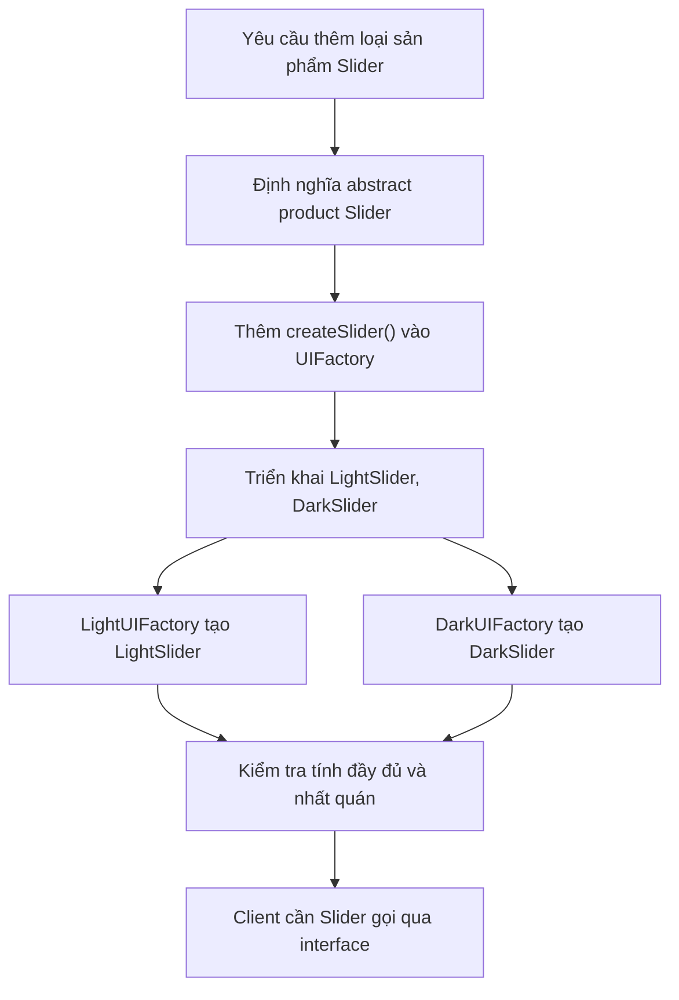

# Cập nhật mọi ConcreteFactory và từng họ sản phẩm đang hỗ trợ

> **Chương:** Thêm loại sản phẩm  
> **Module:** `SOFTWARE_DESIGN_DESIGN_PATTERN_CREATIONAL_ABSTRACT_FACTORY` — Học về abstract factory trong design pattern.

## 1. Mục tiêu học tập

**Abstract Factory** cung cấp một giao diện tạo ra **các họ đối tượng liên quan** mà client có thể sử dụng thông qua abstraction. Thiết kế này thường thuận lợi khi bổ sung một **họ sản phẩm mới**, nhưng sẽ đòi hỏi nhiều thay đổi đồng bộ khi bổ sung một **loại sản phẩm mới**.

Sau bài này, bạn có thể:

- Phân biệt việc thêm **loại sản phẩm** với việc thêm **họ sản phẩm**.
- Chỉ ra toàn bộ vị trí phải cập nhật khi một abstract factory có thêm phương thức tạo sản phẩm.
- Bảo đảm mỗi `ConcreteFactory` tạo đúng concrete product **thuộc họ của mình**.
- Lập ma trận đầy đủ để phát hiện factory bỏ sót sản phẩm mới hoặc tạo nhầm họ.
- Kiểm tra tác động đến mã client, kiểm thử và các implementation nằm ngoài phạm vi nhóm phát triển.
- Lựa chọn cách xử lý phù hợp nếu **không phải họ nào cũng hỗ trợ** loại sản phẩm mới.

## 2. Tình huống: thêm Slider cho hai giao diện

Giả sử một ứng dụng hỗ trợ giao diện **Light** và **Dark**. Trước đây, mỗi họ cung cấp hai loại thành phần:

| Loại sản phẩm (product type) | Họ Light | Họ Dark |
| --- | --- | --- |
| `Button` | `LightButton` | `DarkButton` |
| `Checkbox` | `LightCheckbox` | `DarkCheckbox` |

Abstract factory ban đầu có dạng:

```java
interface UIFactory {
    Button createButton();
    Checkbox createCheckbox();
}
```

Hai concrete factory là `LightUIFactory` và `DarkUIFactory`, mỗi factory tạo đúng hai sản phẩm của họ tương ứng.

Yêu cầu mới: màn hình cài đặt cần thêm một **thanh trượt âm lượng (`Slider`)**. Thanh trượt phải tuân theo giao diện Light hoặc Dark đang được chọn và có chung các hành vi mà client cần: đặt giá trị từ 0 đến 100 và hiển thị.

Ma trận **sau thay đổi** phải trở thành:

| Loại sản phẩm | Họ Light | Họ Dark |
| --- | --- | --- |
| `Button` | `LightButton` | `DarkButton` |
| `Checkbox` | `LightCheckbox` | `DarkCheckbox` |
| **`Slider` (mới)** | **`LightSlider`** | **`DarkSlider`** |

Điểm cần nhớ: **thêm một hàng vào ma trận** có nghĩa là mỗi **cột hiện có** phải có một ô hợp lệ trong hàng mới. Ở ví dụ này, thêm `Slider` không chỉ là viết một class `LightSlider` rồi kết thúc công việc.

## 3. Vì sao mọi ConcreteFactory đều bị ảnh hưởng?

Abstract Factory cam kết một tập khả năng tạo sản phẩm chung. Khi thêm phương thức `createSlider()` vào `UIFactory`, mọi concrete factory hiện thực interface đó phải đáp ứng hợp đồng mới.



Có hai lý do buộc phải cập nhật đồng bộ:

1. **Đáp ứng hợp đồng:** Mỗi class hiện thực `UIFactory` phải cung cấp `createSlider()` (trừ trường hợp interface có triển khai mặc định, vốn có thể che giấu việc thiếu hỗ trợ).
2. **Giữ tính nhất quán của họ:** `LightUIFactory` phải trả về `LightSlider` và `DarkUIFactory` phải trả về `DarkSlider`. Chỉ cần trả về đối tượng đúng kiểu `Slider` là **chưa đủ**.

Nếu `DarkUIFactory.createSlider()` lại trả về `LightSlider`, chương trình vẫn có thể biên dịch vì `LightSlider` là một `Slider`. Tuy nhiên, màn hình Dark sẽ trộn sản phẩm Light và Dark, vi phạm mục tiêu của pattern.

## 4. Quy trình cập nhật từ hợp đồng đến implementation

### Bước 1 — Xác nhận Slider là một loại sản phẩm chung

Trước khi sửa interface, xác định:

- **Hành vi chung:** `setValue(int)` và `render()` đều có ý nghĩa với mọi họ.
- **Phạm vi giá trị:** trong bài này là từ 0 đến 100, tính cả hai đầu.
- **Ràng buộc cùng họ:** cùng một màn hình phải dùng `Button`, `Checkbox` và `Slider` theo cùng cấu hình.
- **Phạm vi hỗ trợ:** Light và Dark đều có khả năng triển khai thanh trượt.

Nếu một sản phẩm chỉ dùng riêng trong họ Dark, nó **chưa chắc** cần xuất hiện trong abstract factory dùng chung. Việc bổ sung vào hợp đồng phải xuất phát từ nhu cầu chung, không chỉ vì một concrete class mới xuất hiện.

### Bước 2 — Tạo abstract product mới

```java
interface Slider {
    void setValue(int value);
    String render();
}
```

Client sẽ gọi các phương thức này thông qua `Slider`. Không nên đưa vào interface những phương thức chỉ có nghĩa với `LightSlider` hoặc chỉ với `DarkSlider`.

### Bước 3 — Mở rộng abstract factory

```java
interface UIFactory {
    Button createButton();
    Checkbox createCheckbox();
    Slider createSlider(); // Phương thức mới
}
```

Hợp đồng được mở rộng từ **hai** lên **ba** loại sản phẩm. Trong Java, concrete class hiện thực `UIFactory` nhưng chưa triển khai `createSlider()` sẽ không biên dịch (nếu class đó không phải `abstract`).

Đây là tín hiệu hữu ích khi toàn bộ implementation được biên dịch lại cùng nhau. Tuy nhiên, **không nên dựa hoàn toàn vào lỗi biên dịch**: các module chưa được build, plugin phân phối riêng, hoặc factory trả về nhầm họ có thể vẫn bỏ sót khi kiểm tra.

### Bước 4 — Tạo một concrete product cho từng họ

```java
final class LightSlider implements Slider {
    private int value;

    @Override
    public void setValue(int value) {
        if (value < 0 || value > 100) {
            throw new IllegalArgumentException("Giá trị phải từ 0 đến 100");
        }
        this.value = value;
    }

    @Override
    public String render() {
        return "Light slider: " + value + "%";
    }
}

final class DarkSlider implements Slider {
    private int value;

    @Override
    public void setValue(int value) {
        if (value < 0 || value > 100) {
            throw new IllegalArgumentException("Giá trị phải từ 0 đến 100");
        }
        this.value = value;
    }

    @Override
    public String render() {
        return "Dark slider: " + value + "%";
    }
}
```

Hai class cùng tuân theo `Slider` nhưng quyết định cách hiển thị theo từng họ. Việc kiểm tra giới hạn trong ví dụ có thể được gom lại thành thành phần dùng chung khi dự án thực tế cần tránh lặp code.

### Bước 5 — Cập nhật **tất cả** concrete factory

```java
final class LightUIFactory implements UIFactory {
    @Override
    public Button createButton() {
        return new LightButton();
    }

    @Override
    public Checkbox createCheckbox() {
        return new LightCheckbox();
    }

    @Override
    public Slider createSlider() {
        return new LightSlider();
    }
}

final class DarkUIFactory implements UIFactory {
    @Override
    public Button createButton() {
        return new DarkButton();
    }

    @Override
    public Checkbox createCheckbox() {
        return new DarkCheckbox();
    }

    @Override
    public Slider createSlider() {
        return new DarkSlider();
    }
}
```

Khi thêm loại sản phẩm mới, **mỗi concrete factory của tập họ được hỗ trợ** phải được rà soát. Một factory không thể coi là hoàn thành chỉ vì đã có method với chữ ký phù hợp; method còn phải trả về biến thể **đúng họ**.

### Bước 6 — Cập nhật client có nhu cầu dùng Slider

```java
class SettingsScreen {
    private final Button button;
    private final Checkbox checkbox;
    private final Slider volumeSlider;

    SettingsScreen(UIFactory factory) {
        this.button = factory.createButton();
        this.checkbox = factory.createCheckbox();
        this.volumeSlider = factory.createSlider();
    }

    void display() {
        button.click();
        checkbox.toggle();
        volumeSlider.setValue(70);
        System.out.println(volumeSlider.render());
    }
}
```

`SettingsScreen` không cần biết `LightSlider` hoặc `DarkSlider`. Mã client **cũ không sử dụng thanh trượt** cũng không nhất thiết phải sửa. Việc mở rộng chủ yếu tác động đến factory contract, các factory implementation và client mới có yêu cầu dùng sản phẩm mới.

### Bước 7 — Rà soát và kiểm thử theo từng họ

Thay đổi chỉ hoàn thành khi cả hai câu hỏi đều có câu trả lời “Có”:

- **Đủ sản phẩm?** Mỗi factory cung cấp đủ `Button`, `Checkbox`, `Slider` chưa?
- **Đúng họ?** Mọi sản phẩm tạo ra bởi cùng factory đều thuộc một họ tương thích chưa?

## 5. Ví dụ Java hoàn chỉnh có thể chạy

Ví dụ sau gom toàn bộ thành phần vào một file để dễ kiểm tra, sử dụng class lồng nhau để không xung đột với những đoạn code minh họa ở trên. Lưu thành `AddingProductTypeDemo.java`:

```java
public class AddingProductTypeDemo {
    interface Button {
        void click();
    }

    interface Checkbox {
        void toggle();
    }

    // Abstract product mới.
    interface Slider {
        void setValue(int value);
        String render();
    }

    // Cập nhật abstract factory.
    interface UIFactory {
        Button createButton();
        Checkbox createCheckbox();
        Slider createSlider();
    }

    static final class LightButton implements Button {
        @Override
        public void click() {
            System.out.println("Light button clicked");
        }
    }

    static final class LightCheckbox implements Checkbox {
        @Override
        public void toggle() {
            System.out.println("Light checkbox toggled");
        }
    }

    static final class LightSlider implements Slider {
        private int value;

        @Override
        public void setValue(int value) {
            validate(value);
            this.value = value;
        }

        @Override
        public String render() {
            return "Light slider: " + value + "%";
        }
    }

    static final class DarkButton implements Button {
        @Override
        public void click() {
            System.out.println("Dark button clicked");
        }
    }

    static final class DarkCheckbox implements Checkbox {
        @Override
        public void toggle() {
            System.out.println("Dark checkbox toggled");
        }
    }

    static final class DarkSlider implements Slider {
        private int value;

        @Override
        public void setValue(int value) {
            validate(value);
            this.value = value;
        }

        @Override
        public String render() {
            return "Dark slider: " + value + "%";
        }
    }

    static void validate(int value) {
        if (value < 0 || value > 100) {
            throw new IllegalArgumentException("Giá trị phải từ 0 đến 100");
        }
    }

    // Mọi concrete factory đều triển khai phương thức mới.
    static final class LightUIFactory implements UIFactory {
        @Override
        public Button createButton() {
            return new LightButton();
        }

        @Override
        public Checkbox createCheckbox() {
            return new LightCheckbox();
        }

        @Override
        public Slider createSlider() {
            return new LightSlider();
        }
    }

    static final class DarkUIFactory implements UIFactory {
        @Override
        public Button createButton() {
            return new DarkButton();
        }

        @Override
        public Checkbox createCheckbox() {
            return new DarkCheckbox();
        }

        @Override
        public Slider createSlider() {
            return new DarkSlider();
        }
    }

    static final class SettingsScreen {
        private final Button button;
        private final Checkbox checkbox;
        private final Slider volumeSlider;

        SettingsScreen(UIFactory factory) {
            button = factory.createButton();
            checkbox = factory.createCheckbox();
            volumeSlider = factory.createSlider();
        }

        void show() {
            button.click();
            checkbox.toggle();
            volumeSlider.setValue(70);
            System.out.println(volumeSlider.render());
        }
    }

    // Chọn một concrete factory tại điểm khởi tạo ứng dụng.
    static UIFactory chooseFactory(String theme) {
        if ("light".equalsIgnoreCase(theme)) {
            return new LightUIFactory();
        }
        if ("dark".equalsIgnoreCase(theme)) {
            return new DarkUIFactory();
        }
        throw new IllegalArgumentException("Theme không hỗ trợ: " + theme);
    }

    public static void main(String[] args) {
        String theme = args.length == 0 ? "light" : args[0];
        UIFactory factory = chooseFactory(theme);
        SettingsScreen screen = new SettingsScreen(factory);
        screen.show();
    }
}
```

Biên dịch và chạy:

```bash
javac AddingProductTypeDemo.java
java AddingProductTypeDemo light
java AddingProductTypeDemo dark
```

Kết quả dự kiến:

```text
# java AddingProductTypeDemo light
Light button clicked
Light checkbox toggled
Light slider: 70%

# java AddingProductTypeDemo dark
Dark button clicked
Dark checkbox toggled
Dark slider: 70%
```

Có thể đối chiếu trực tiếp: với `light` cả ba sản phẩm thuộc họ Light; với `dark` cả ba thuộc họ Dark. `SettingsScreen` và phương thức `show()` hoàn toàn giống nhau trong hai lần chạy.

## 6. Xác minh bằng ma trận thay đổi

Một cách tránh bỏ sót là bắt đầu từ bảng có các concrete factory làm cột và các loại sản phẩm làm hàng, rồi đánh dấu cả **lớp được tạo** và **tình trạng triển khai**.

| Hợp đồng tạo | `LightUIFactory` | `DarkUIFactory` | Kết quả cần thấy |
| --- | --- | --- | --- |
| `createButton()` | `LightButton` | `DarkButton` | Đã có, không trộn họ |
| `createCheckbox()` | `LightCheckbox` | `DarkCheckbox` | Đã có, không trộn họ |
| **`createSlider()`** | **`LightSlider`** | **`DarkSlider`** | **Mới, bắt buộc có ở cả hai** |

Bên cạnh ma trận, hãy kiểm tra đủ bốn lớp thay đổi:

| Nhóm thay đổi | Việc cần làm | Hậu quả nếu quên |
| --- | --- | --- |
| **Abstract product** | Định nghĩa `Slider` và hợp đồng hành vi chung | Client phải phụ thuộc vào class cụ thể hoặc thiếu hợp đồng thống nhất |
| **Abstract factory** | Bổ sung `Slider createSlider()` | Client không có cách yêu cầu sản phẩm mới qua factory chung |
| **Concrete products** | Tạo `LightSlider`, `DarkSlider` | Một họ không có hiện thực tương ứng |
| **Concrete factories** | Thêm `createSlider()` trong mọi factory, trả đúng biến thể | Thiếu method hoặc tạo nhầm họ |
| **Client cần chức năng mới** | Nhận `UIFactory` rồi gọi `createSlider()` | Không sử dụng được chức năng mới |
| **Kiểm thử/tài liệu thiết kế** | Mở rộng case kiểm thử và ma trận | Lỗi thiếu họ có thể lọt qua review |

Trên hệ thống có thêm `HighContrastUIFactory` hoặc `MobileUIFactory`, hai factory đó **cũng** nằm trong danh sách cần cập nhật nếu đang tuân theo cùng hợp đồng `UIFactory`. Không nên chỉ rà soát các factory mà người viết tính năng mới thường xuyên dùng.

## 7. Khi thêm loại sản phẩm, chi phí mở rộng tăng như thế nào?

Gọi:

- `F` là số họ sản phẩm đang hỗ trợ, tương ứng số concrete factory.
- `P` là số loại sản phẩm được tạo bởi abstract factory.

Trong mô hình ma trận đầy đủ, có khoảng **`F × P` concrete product** nếu mỗi cặp họ–loại có một class triển khai riêng. Đây là cách đếm khái niệm; hệ thống thực tế có thể dùng chung implementation cho nhiều ô khi vẫn bảo đảm yêu cầu tương thích.

Khi bổ sung **một loại sản phẩm**, thường phải thêm:

1. Một abstract product interface mới.
2. Một phương thức tạo tương ứng vào abstract factory.
3. Tối đa `F` concrete product mới (mỗi họ một biến thể).
4. Phương thức triển khai mới trong **tất cả `F` concrete factory**.
5. Các thay đổi ở client thực sự cần dùng sản phẩm đó và ở kiểm thử.

Ngược lại, khi bổ sung **một họ sản phẩm**, thường cần một concrete factory mới và các implementation cho **`P` loại sản phẩm hiện có**, cộng thay đổi ở nơi chọn họ; abstract factory và client thông thường không phải sửa.

| Thay đổi | Điều thường phải sửa | Mức tác động khái niệm |
| --- | --- | --- |
| Thêm một **họ** | Một factory mới và tất cả loại sản phẩm đang có | Tỷ lệ với **số loại sản phẩm `P`** |
| Thêm một **loại** | Abstract factory và tất cả factory/họ hiện có | Tỷ lệ với **số họ `F`** |

Vì vậy, Abstract Factory phù hợp nhất khi các **họ có thể tiếp tục tăng**, còn tập **loại sản phẩm tương đối ổn định**. Nếu loại sản phẩm mới xuất hiện thường xuyên, cần cân nhắc kỹ chi phí thay đổi đồng bộ.

## 8. Những lỗi thường gặp và cách xử lý

### Lỗi 1 — Chỉ bổ sung implementation cho một họ

```java
// Chưa đủ: UIFactory đã có createSlider(),
// nhưng chỉ LightUIFactory được cập nhật.
class LightUIFactory implements UIFactory {
    // ... các phương thức khác
    @Override
    public Slider createSlider() {
        return new LightSlider();
    }
}
```

`DarkUIFactory` sẽ chưa hoàn thiện hợp đồng (nếu tiếp tục hiện thực `UIFactory`). Cách khắc phục: dùng ma trận để kiểm tra **mọi factory**, bao gồm cả factory thuộc module hoặc plugin khác.

### Lỗi 2 — Factory tạo đúng interface nhưng sai họ

```java
// Sai về nhất quán sản phẩm, dù hợp lệ về kiểu.
@Override
public Slider createSlider() {
    return new LightSlider(); // Đang đặt trong DarkUIFactory
}
```

Đây là lỗi dễ lọt qua trình biên dịch. Cần kiểm thử đầu ra của từng factory và tiêu chí thiết kế “mọi sản phẩm trong một họ tương thích với nhau”.

### Lỗi 3 — Né cập nhật bằng null hoặc lỗi runtime

```java
// Đây không phải cách hỗ trợ đầy đủ Slider.
@Override
public Slider createSlider() {
    return null; // Hoặc throw new UnsupportedOperationException()
}
```

Nếu hợp đồng chung yêu cầu mọi factory hỗ trợ `Slider`, trả về `null` hoặc ném lỗi khi client sử dụng nghĩa là hợp đồng không được đáp ứng ở runtime. Có thể tồn tại hệ thống mà việc không hỗ trợ được biểu diễn tường minh bằng một hợp đồng khác, nhưng phải được thiết kế và báo rõ cho client, không nên giấu dưới một phương thức tạo vốn được hiểu là luôn thành công.

### Lỗi 4 — Đưa logic chọn biến thể ngược về client

```java
// Sai vị trí: client lại phải biết cả hai biến thể.
Slider slider = darkMode ? new DarkSlider() : new LightSlider();
```

Mã client bị buộc vào các concrete product và rủi ro không đồng bộ tăng lên. Client nên dùng `factory.createSlider()` sau khi một factory đã được chọn cho phạm vi màn hình.

### Lỗi 5 — Xem “biên dịch thành công” là hoàn thành

Việc project biên dịch được chỉ chứng minh các chữ ký và kiểu có thể tương thích. Nó **không chứng minh** `DarkUIFactory` tạo `DarkSlider`, không chứng minh thao tác giới hạn giá trị đúng và không phát hiện được implementation nằm ngoài phạm vi build.

Cần thêm kiểm tra ma trận và những ca kiểm thử hành vi thích hợp.

## 9. Nếu một số họ không hỗ trợ sản phẩm mới?

Giả sử giao diện `LegacyTerminal` không có khả năng hiển thị thanh trượt, trong khi Light và Dark đều có. Lúc này cần xác định lại **hợp đồng thiết kế**, vì ý nghĩa của `UIFactory.createSlider()` là mọi implementation của `UIFactory` đều có thể tạo `Slider`.

Có một số hướng xử lý, tùy nghiệp vụ:

| Hướng | Phù hợp khi | Điểm cần lưu ý |
| --- | --- | --- |
| **Bổ sung một biến thể thay thế hợp lệ** | Họ Legacy có thể cung cấp bộ điều chỉnh âm lượng kiểu khác mà vẫn tuân theo `Slider` | Giữ hành vi chung có ý nghĩa; không chỉ tạo một đối tượng rỗng để đủ chữ ký |
| **Tách hợp đồng theo khả năng** | Chỉ một số factory cần tạo Slider và khả năng đó thực sự tùy chọn | Ví dụ `BasicUIFactory` và `SliderCapableUIFactory`; client cần kiểm tra khả năng bằng hợp đồng rõ ràng |
| **Tách nhóm sản phẩm thành factory riêng** | Slider thuộc một phạm vi thay đổi khác và không nhất thiết phải đi cùng họ giao diện | Cần chứng minh việc tách không làm mất ràng buộc tương thích quan trọng |
| **Giới hạn phạm vi hỗ trợ** | Yêu cầu tính năng mới không áp dụng cho Legacy | Công bố rõ giao diện/họ nào hỗ trợ và kiểm soát đường gọi tại nơi lắp ghép |

**Không nên mặc định** thêm `createSlider()` vào tất cả factory rồi để các họ không hỗ trợ ném `UnsupportedOperationException`. Cách đó làm client tin một khả năng mà factory thực tế không cung cấp. Đồng thời, cũng không cần chia interface chỉ vì một khả năng *có thể* khác nhau trong tương lai: chỉ thay đổi mô hình khi có yêu cầu rõ ràng.

## 10. Lưu ý tương thích và triển khai theo giai đoạn

Việc thêm phương thức vào interface là **thay đổi hợp đồng**. Nếu các factory do nhóm khác phát triển, hoặc được đóng gói trong plugin/module phát hành riêng, bản ứng dụng mới có thể gặp factory cũ chưa triển khai phương thức mới.

Để giảm rủi ro:

1. **Liệt kê mọi implementation thực tế** của interface, không chỉ các factory trong module hiện tại.
2. **Thông báo hợp đồng mới và thời điểm áp dụng** tới nhóm sở hữu implementation bên ngoài.
3. **Đảm bảo các implementation tương thích được cập nhật** trước khi bật đường gọi `createSlider()`; nếu triển khai lệch phiên bản, cần cơ chế thương lượng khả năng hoặc phiên bản hợp đồng.
4. **Build và kiểm thử với mọi họ được hỗ trợ**, rồi kiểm tra hành vi khi ứng dụng chạy với từng cấu hình.
5. **Cập nhật tài liệu ma trận/hợp đồng** để người thêm họ mới sau này biết bắt buộc triển khai `Slider`.

Trong Java, thêm abstract method vào interface không bảo đảm mọi implementation đã biên dịch từ trước tự động hỗ trợ method đó khi ghép với phiên bản mới. Vì thế, xử lý phụ thuộc phiên bản ở ranh giới module/plugin là công việc thực tế bên cạnh sửa code.

## 11. Kiểm thử tối thiểu sau thay đổi

Nên tách kiểm thử **hợp đồng tạo sản phẩm** và kiểm thử **hành vi client**.

| Ca kiểm tra | Cách kiểm tra | Kết quả mong đợi |
| --- | --- | --- |
| Light tạo Slider | `new LightUIFactory().createSlider()` | Đối tượng là `Slider` và có kiểu/biểu hiện thuộc họ Light |
| Dark tạo Slider | `new DarkUIFactory().createSlider()` | Đối tượng là `Slider` và có kiểu/biểu hiện thuộc họ Dark |
| Đầy đủ ma trận | Với mỗi factory, gọi tạo `Button`, `Checkbox`, `Slider` | Đủ ba sản phẩm và cùng họ |
| Giá trị hợp lệ | `slider.setValue(0)`, `slider.setValue(100)` | Chấp nhận hai biên |
| Giá trị không hợp lệ | `slider.setValue(-1)`, `slider.setValue(101)` | Từ chối với lỗi rõ ràng |
| Client thay thế được họ | Tạo `SettingsScreen` với Light rồi Dark | Client không cần đổi code, các sản phẩm hiển thị đúng theo factory |
| Factory giả cho client | Truyền fake `UIFactory` tạo ba fake products | Có thể kiểm thử client độc lập với concrete UI |

Ví dụ giả mã cho việc kiểm tra theo ma trận:

```text
for each factory in [LightUIFactory, DarkUIFactory]:
    products = [
        factory.createButton(),
        factory.createCheckbox(),
        factory.createSlider()
    ]
    assert all products are available
    assert all products belong to factory's intended family
```

Cần xác định tiêu chí “thuộc đúng họ” theo hệ thống: với ví dụ Java có thể kiểm tra class cụ thể; với ứng dụng thật có thể xác minh giao diện, cấu hình hoặc sự tương thích hành vi của sản phẩm, miễn là kiểm tra không tạo phụ thuộc ngược trong mã client sản xuất.

## 12. Bài tập áp dụng

Hãy mở rộng thiết kế Light/Dark vừa học để thêm loại sản phẩm **`Tooltip`** có hợp đồng:

```java
interface Tooltip {
    void show(String message);
}
```

Thực hiện lần lượt:

1. Bổ sung **một hàng `Tooltip`** vào ma trận hai họ Light và Dark; điền tên các concrete product.
2. Viết chữ ký cần thêm vào `UIFactory`.
3. Phác thảo `LightTooltip`, `DarkTooltip` và phương thức tương ứng trong cả hai concrete factory.
4. Cho một client `HelpScreen` nhận `UIFactory`, tạo và gọi `Tooltip` mà không tham chiếu class Light/Dark.
5. Giả sử sau đó xuất hiện `HighContrastUIFactory`, giải thích vì sao factory mới phải cung cấp cả bốn loại sản phẩm (`Button`, `Checkbox`, `Slider`, `Tooltip`).
6. Giả sử có một họ không thể hiển thị tooltip; đề xuất cách thể hiện khả năng thiếu hụt mà không giả vờ rằng `createTooltip()` luôn được hỗ trợ.

**Gợi ý tự đối chiếu:** Ma trận mới có **4 hàng × 2 cột**; `UIFactory` bổ sung `Tooltip createTooltip()`; `LightUIFactory` trả về `LightTooltip` và `DarkUIFactory` trả về `DarkTooltip`. `HelpScreen` chỉ phụ thuộc vào `UIFactory` và `Tooltip`.

## 13. Danh sách kiểm tra trước khi hoàn tất

- [ ] Đã phân biệt rõ **loại sản phẩm mới** với **họ sản phẩm mới**.
- [ ] Abstract product mới định nghĩa hành vi chung có ý nghĩa ở tất cả họ hỗ trợ.
- [ ] Abstract factory có phương thức tạo sản phẩm mới, trả về **abstract product**.
- [ ] Mọi concrete factory thực sự triển khai hợp đồng mới.
- [ ] Từng concrete factory tạo đúng sản phẩm của **chính họ đó**.
- [ ] Ma trận không còn ô thiếu hoặc tổ hợp biến thể không tương thích.
- [ ] Client sử dụng sản phẩm mới qua interface; nơi chọn họ vẫn được tách riêng.
- [ ] Đã cân nhắc các factory ở module/plugin khác và vấn đề tương thích phiên bản.
- [ ] Có kiểm thử theo từng họ, biên giá trị và khả năng thay thế factory trong client.
- [ ] Nếu có họ không hỗ trợ sản phẩm mới, hợp đồng/giới hạn hỗ trợ đã được xác định tường minh.

**Ghi nhớ:** Trong Abstract Factory, **thêm một loại sản phẩm là mở rộng hợp đồng cho toàn bộ họ hiện có**. Cần cập nhật abstract product, abstract factory, tất cả concrete factory và từng concrete product tương ứng; kiểm tra **đủ loại** lẫn **đúng họ** trước khi xem thay đổi là hoàn thành.
