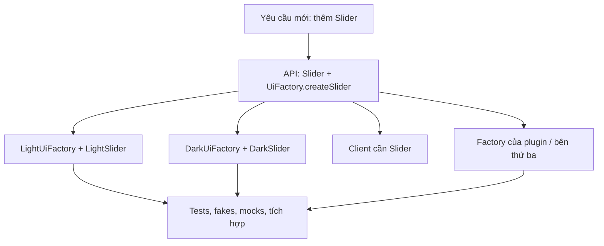

# Phân tích ảnh hưởng tới mã nguồn, hợp đồng API và các bên triển khai factory

**Abstract Factory** thuộc nhóm **Creational Design Pattern**: client yêu cầu một factory tạo ra nhiều loại sản phẩm thuộc cùng một họ, chẳng hạn `Button` và `Checkbox` của giao diện sáng hoặc tối. Pattern này giúp **thêm họ sản phẩm mới** tương đối thuận lợi, nhưng có một đánh đổi quan trọng: khi **thêm một loại sản phẩm mới** vào hợp đồng factory, thay đổi thường lan đến **tất cả các Concrete Factory**, kể cả những implementation do nhóm khác hoặc đối tác viết.

Bài học thuộc chương **Thêm loại sản phẩm** của module **SOFTWARE_DESIGN_DESIGN_PATTERN_CREATIONAL_ABSTRACT_FACTORY** (học về Abstract Factory trong design pattern). Trọng tâm là nhận diện chính xác những file và thành phần bị ảnh hưởng, phân biệt **tương thích mã nguồn** với **tương thích nhị phân** trong Java, và lên kế hoạch tiến hóa API sao cho mỗi họ vẫn tạo được bộ sản phẩm nhất quán.

## 1. Phân biệt hai hướng thay đổi trong Abstract Factory

Giả sử ứng dụng có hai họ giao diện `light` và `dark`, mỗi họ tạo hai loại sản phẩm `Button` và `Checkbox`:

| Họ sản phẩm | `Button` | `Checkbox` |
| --- | --- | --- |
| `light` | `LightButton` | `LightCheckbox` |
| `dark` | `DarkButton` | `DarkCheckbox` |

Có hai kiểu thay đổi khác nhau:

1. **Thêm một họ sản phẩm**: thêm giao diện `highContrast` với `HighContrastButton` và `HighContrastCheckbox`. Thường tạo một `HighContrastUiFactory` mới, giữ nguyên hợp đồng factory và phần lớn client.
2. **Thêm một loại sản phẩm**: mọi giao diện nay cần thêm `Slider`. Hợp đồng `UiFactory` phải diễn tả khả năng tạo `Slider`; **cả `LightUiFactory` lẫn `DarkUiFactory` đều phải được xem xét và cập nhật**.

Ma trận sau minh họa thay đổi thứ hai:

| Họ sản phẩm | `Button` (cũ) | `Checkbox` (cũ) | `Slider` (mới) |
| --- | --- | --- | --- |
| `light` | `LightButton` | `LightCheckbox` | **`LightSlider`** |
| `dark` | `DarkButton` | `DarkCheckbox` | **`DarkSlider`** |

Trong thiết kế Abstract Factory thông thường, `UiFactory` có một phương thức tạo cho mỗi **loại sản phẩm**. Vì vậy thêm `Slider` không chỉ là tạo hai class mới: thay đổi này còn liên quan tới chữ ký API, các implementer và kiểm thử.



Sơ đồ diễn tả **phạm vi ảnh hưởng khi sửa API**, không có nghĩa client import trực tiếp các Concrete Factory. Client vẫn nên thao tác qua interface.

## 2. Hợp đồng ban đầu: vì sao client không cần biết class cụ thể?

Trước khi thêm `Slider`, hợp đồng Java 17 có thể là:

`Button.java`:

```java
package com.example.ui.api;

public interface Button {
    String render();
}
```

`Checkbox.java`:

```java
package com.example.ui.api;

public interface Checkbox {
    String render();
}
```

`UiFactory.java` (phiên bản ban đầu):

```java
package com.example.ui.api;

public interface UiFactory {
    Button createButton();
    Checkbox createCheckbox();
}
```

Ví dụ một client chỉ cần sử dụng hai sản phẩm:

```java
// Phần thân minh họa bên trong một lớp đã nhận UiFactory từ constructor.
Button button = factory.createButton();
Checkbox checkbox = factory.createCheckbox();
System.out.println(button.render() + " | " + checkbox.render());
```

`factory` có thể là `LightUiFactory` hoặc `DarkUiFactory`; client không phải sửa khi đổi theme. Nhưng **hợp đồng này chưa có cách tạo `Slider`**, nên client muốn dùng loại sản phẩm mới cần một API bổ sung.

## 3. Thêm loại sản phẩm mới làm thay đổi những gì?

### 3.1. Bổ sung abstract product

Tạo `Slider.java`:

```java
package com.example.ui.api;

public interface Slider {
    String render();
}
```

Trong một thư viện UI thật, interface có thể cung cấp `setValue`, `getValue`, sự kiện thay đổi giá trị hoặc thuộc tính truy cập. Bản minh họa chỉ giữ `render()` để làm nổi bật vấn đề tiến hóa factory.

### 3.2. Mở rộng chữ ký Abstract Factory

`UiFactory.java` (phiên bản mới):

```java
package com.example.ui.api;

public interface UiFactory {
    Button createButton();
    Checkbox createCheckbox();

    // Mọi họ phải xác định cách tạo Slider tương thích.
    Slider createSlider(int initialValue);
}
```

Phương thức `createSlider` là **abstract** (vì không có phần thân `default`). Khi biên dịch lại từ mã nguồn, mọi lớp Java `concrete` khai báo `implements UiFactory` phải cung cấp phương thức này hoặc kế thừa một implementation hợp lệ từ lớp cha. Nếu không, trình biên dịch báo lỗi.

Ví dụ lớp cũ:

```java
// Trước đây class này hợp lệ; sau khi thêm createSlider() thì không còn
// biên dịch được từ nguồn nếu chưa triển khai phương thức mới.
public final class LegacyUiFactory implements UiFactory {
    @Override
    public Button createButton() { /* ... */ return null; }

    @Override
    public Checkbox createCheckbox() { /* ... */ return null; }
}
```

`return null` ở đoạn trên chỉ là **mã rút gọn nhằm chỉ ra chỗ thiếu phương thức**, không phải hướng dẫn trả `null` từ factory. Một factory đúng phải trả về sản phẩm hợp lệ theo contract. Đây là lỗi *triển khai chưa đầy đủ API*, khác với việc có tên lớp `Slider` nhưng client chưa sử dụng.

### 3.3. Cập nhật từng Concrete Factory và concrete product

`LightUiFactory` cần tạo `LightSlider`; `DarkUiFactory` cần tạo `DarkSlider`. Các class mới có thể phải được bổ sung theme token, validate giá trị, adapter cho thư viện UI và test riêng. Chỉ thêm phương thức mới vào interface mà chưa tạo được sản phẩm cho tất cả họ là **chưa hoàn tất thay đổi**.

### 3.4. Rà soát các thành phần phụ trợ

Tác động không dừng ở các file triển khai sản xuất:

| Thành phần | Cần thay đổi khi nào? | Ví dụ |
| --- | --- | --- |
| Abstract product API | Khi cần công bố loại sản phẩm mới | Thêm `Slider` |
| Abstract factory API | Khi mọi họ phải có khả năng tạo loại mới | Thêm `createSlider(int)` |
| Mỗi Concrete Factory | Khi hợp đồng mới có phương thức abstract | Thêm implementation phương thức |
| Concrete product theo họ | Khi từng họ cần hành vi/cách hiển thị khác nhau | `LightSlider`, `DarkSlider` |
| Client **đã tồn tại** | **Không nhất thiết**; nếu chỉ dùng sản phẩm cũ thì có thể giữ nguyên | `LoginScreen` chỉ dùng `Button` |
| Client **cần tính năng mới** | Khi cần tạo và sử dụng sản phẩm mới | `SettingsScreen` gọi `createSlider` |
| Test doubles/fakes | Khi fake class trực tiếp implements interface mới | `FakeUiFactory.createSlider` |
| Test hoặc mock framework | Khi test phụ thuộc hành vi của phương thức mới | Stub `factory.createSlider(50)` |
| API docs, ví dụ tích hợp, SDK | Khi factory là contract được công bố cho người dùng | Hướng dẫn custom factory cho plugin |
| Composition root, DI | Khi cấu hình phải chọn implementation đáp ứng contract mới | Kiểm tra factory đăng ký cho từng theme |

Một `mock` do framework tạo bằng runtime proxy có thể không gây cùng lỗi biên dịch như fake viết thủ công, nhưng **phương thức mới chưa được stub có thể trả giá trị mặc định** hoặc khiến test không mô tả đúng hành vi. Vì thế vẫn cần rà soát test liên quan.

## 4. Ví dụ Java 17 hoàn chỉnh: trước và sau khi thêm Slider

Ví dụ này đưa toàn bộ kiểu vào một file `ProductTypeEvolutionDemo.java` để có thể chạy ngay. Trong ứng dụng thật, `UiFactory`, các product interface và từng concrete factory sẽ ở package/file phù hợp; khác biệt chính vẫn là **mọi factory phải triển khai thêm phương thức**.

```java
import java.util.Locale;

public final class ProductTypeEvolutionDemo {
    interface Button {
        String render();
    }

    interface Checkbox {
        String render();
    }

    // Loại sản phẩm mới trong phiên bản mở rộng.
    interface Slider {
        String render();
    }

    interface UiFactory {
        Button createButton();
        Checkbox createCheckbox();
        Slider createSlider(int initialValue); // API mới
    }

    record LightButton() implements Button {
        @Override
        public String render() { return "LIGHT button"; }
    }

    record LightCheckbox() implements Checkbox {
        @Override
        public String render() { return "LIGHT checkbox"; }
    }

    record LightSlider(int value) implements Slider {
        LightSlider {
            checkValue(value);
        }

        @Override
        public String render() { return "LIGHT slider=" + value; }
    }

    record DarkButton() implements Button {
        @Override
        public String render() { return "DARK button"; }
    }

    record DarkCheckbox() implements Checkbox {
        @Override
        public String render() { return "DARK checkbox"; }
    }

    record DarkSlider(int value) implements Slider {
        DarkSlider {
            checkValue(value);
        }

        @Override
        public String render() { return "DARK slider=" + value; }
    }

    static void checkValue(int value) {
        if (value < 0 || value > 100) {
            throw new IllegalArgumentException("Slider must be from 0 to 100");
        }
    }

    static final class LightUiFactory implements UiFactory {
        @Override
        public Button createButton() { return new LightButton(); }

        @Override
        public Checkbox createCheckbox() { return new LightCheckbox(); }

        @Override
        public Slider createSlider(int initialValue) {
            return new LightSlider(initialValue);
        }
    }

    static final class DarkUiFactory implements UiFactory {
        @Override
        public Button createButton() { return new DarkButton(); }

        @Override
        public Checkbox createCheckbox() { return new DarkCheckbox(); }

        @Override
        public Slider createSlider(int initialValue) {
            return new DarkSlider(initialValue);
        }
    }

    static final class SettingsScreen {
        private final UiFactory factory;

        SettingsScreen(UiFactory factory) {
            this.factory = java.util.Objects.requireNonNull(factory);
        }

        String render() {
            Button save = factory.createButton();
            Checkbox remember = factory.createCheckbox();
            Slider volume = factory.createSlider(35);

            return save.render() + " | " + remember.render()
                    + " | " + volume.render();
        }
    }

    public static void main(String[] args) {
        if (args.length > 1) {
            throw new IllegalArgumentException("Expected zero or one theme argument");
        }

        String theme = args.length == 0
                ? "light"
                : args[0].trim().toLowerCase(Locale.ROOT);

        // Chọn factory tại composition root, không chọn riêng từng product.
        UiFactory factory = switch (theme) {
            case "light" -> new LightUiFactory();
            case "dark" -> new DarkUiFactory();
            default -> throw new IllegalArgumentException("Unsupported theme: " + theme);
        };

        System.out.println(new SettingsScreen(factory).render());
    }
}
```

Biên dịch/chạy bằng JDK 17 trở lên:

```bash
javac -encoding UTF-8 ProductTypeEvolutionDemo.java
java ProductTypeEvolutionDemo light
java ProductTypeEvolutionDemo dark
```

Kết quả tương ứng:

```text
LIGHT button | LIGHT checkbox | LIGHT slider=35
DARK button | DARK checkbox | DARK slider=35
```

Trong thiết kế đã mở rộng, `SettingsScreen` chỉ dùng `Button`, `Checkbox`, `Slider` và `UiFactory`. Sự nhất quán của bộ sản phẩm do từng concrete factory chịu trách nhiệm. Phần quan trọng là **không thêm điều kiện `if (theme)` riêng cho `Slider` trong client**: làm vậy có thể tạo slider khác họ với nút và checkbox.

## 5. Tương thích mã nguồn và nhị phân của hợp đồng Java

Khi thay một interface Java được nhiều module sử dụng, cần tách bạch hai câu hỏi:

- **Source compatibility:** mã nguồn của bên triển khai cũ có còn biên dịch khi dùng API mới hay không?
- **Binary compatibility:** các file `.class`/JAR đã biên dịch trước đó có tiếp tục liên kết và chạy với thư viện API mới hay không?

Với thao tác **thêm một phương thức abstract mới** vào một interface như `UiFactory`, hậu quả điển hình là:

| Thành phần | Biên dịch từ mã nguồn với API mới | Chạy binary cũ cùng API mới |
| --- | --- | --- |
| Client chỉ gọi `createButton()` và `createCheckbox()` | Thường không phải sửa | Các lời gọi cũ thường tiếp tục hoạt động |
| Concrete factory cũ chưa có `createSlider()` | **Lỗi biên dịch** nếu class concrete không thừa hưởng implementation hợp lệ | Việc nạp class/các lời gọi cũ có thể vẫn hoạt động, nhưng **gọi phương thức mới** trên implementation cũ có thể ném `AbstractMethodError` |
| Concrete factory đã bổ sung `createSlider()` | Hợp lệ nếu chữ ký và kiểu trả về đúng | Cần đóng gói và triển khai phiên bản mới phù hợp |
| Client mới gọi `createSlider()` | Biên dịch khi nhìn thấy API mới | Cần đảm bảo factory được cấp lúc chạy thực sự có implementation mới |

Trong Java, **thêm phương thức vào interface không đồng nghĩa mọi binary cũ lập tức không load được**. Tuy nhiên, không thể coi đây là thay đổi an toàn về mặt hành vi: một lời gọi tới phương thức abstract mới trên instance được tạo từ implementation cũ có thể lỗi tại runtime. Các tình huống đặc biệt như xung đột phương thức kế thừa hoặc `default` cũng cần được kiểm tra theo cách dùng thực tế.

### 5.1. Vì sao lỗi biên dịch đôi khi là tín hiệu tốt?

Khi toàn bộ mã nguồn nằm trong một monorepo và cùng build với nhau, lỗi ở `LightUiFactory`, `DarkUiFactory` hoặc `FakeUiFactory` giúp phát hiện **những bên chưa cập nhật hợp đồng** ngay tại thời điểm tích hợp. Nếu chỉ dựa vào fallback mặc định, chương trình có thể build thành công nhưng lỗi chỉ xuất hiện lúc người dùng mở màn hình có `Slider`.

### 5.2. Không nên "vá" bằng một `default` giả vờ hỗ trợ

Một cách né lỗi biên dịch thường thấy là:

```java
public interface UiFactory {
    Button createButton();
    Checkbox createCheckbox();

    default Slider createSlider(int value) {
        throw new UnsupportedOperationException("Slider is not supported");
    }
}
```

Đây **có thể** là quyết định có chủ đích nếu API định nghĩa rõ `Slider` là capability **tùy chọn**. Nhưng nó **không đáp ứng** lời hứa "mọi factory tạo được `Slider`". Bên triển khai quên cập nhật sẽ không bị trình biên dịch nhắc; client gọi phương thức mới mới phát hiện lỗi. Tương tự, `return null` hoặc trả một `GenericSlider` không cùng theme có thể che giấu sai lệch contract.

Phương thức `default` có giá trị khi có **hành vi dùng chung thực sự đúng** cho mọi implementation hoặc cần một bước chuyển tiếp đã được tài liệu hóa. Nếu yêu cầu mới là bắt buộc với tất cả họ, triển khai tường minh trong mỗi factory thường dễ kiểm soát hơn.

## 6. Các bên triển khai factory bị ảnh hưởng như thế nào?

Trong dự án nhỏ, người sở hữu hợp đồng và tất cả implementation có thể là cùng một nhóm. Trong hệ thống plugin, thư viện hoặc nhiều dịch vụ độc lập, **người định nghĩa `UiFactory` có thể không quản lý được mã nguồn của từng implementer**.

| Bên liên quan | Điều có thể bị ảnh hưởng | Việc cần phối hợp |
| --- | --- | --- |
| Nhóm sở hữu thư viện API | Phiên bản public interface, tài liệu, changelog | Công bố thay đổi và chính sách version |
| Nhóm phát triển từng theme/provider | Concrete product và phương thức tạo sản phẩm mới | Thêm `createSlider`, kiểm thử sản phẩm cùng họ |
| Nhóm ứng dụng sử dụng factory | Client mới cần `Slider`; client cũ ít bị ảnh hưởng | Chỉ bật tính năng mới khi factory tương ứng hỗ trợ |
| Nhóm tích hợp plugin/bên thứ ba | Các lớp implements factory và JAR phát hành riêng | Cập nhật SDK, build lại, kiểm thử tương thích |
| Nhóm kiểm thử | Fake factory, fixture, mock, contract test | Mở rộng test suite để bao phủ loại sản phẩm mới |
| Nhóm vận hành/phát hành | Bộ phiên bản API, plugin và ứng dụng được triển khai | Tránh chạy client mới với implementation quá cũ |

Nếu `UiFactory` là **public extension point**, việc thêm phương thức abstract là thay đổi **phá vỡ khả năng biên dịch lại từ nguồn** của implementer chưa cập nhật. Với thư viện áp dụng Semantic Versioning, thay đổi kiểu này thường cần được xem xét như một **breaking API change** và lên kế hoạch tăng phiên bản phù hợp với chính sách của dự án. Không nên tuyên bố an toàn chỉ vì một số binary cũ tiếp tục load được.

## 7. Ba chiến lược tiến hóa API

Không có một lựa chọn phù hợp mọi hệ thống. Quyết định phụ thuộc việc `Slider` **bắt buộc** với tất cả họ hay chỉ được hỗ trợ bởi một số biến thể.

### Chiến lược A: sửa trực tiếp `UiFactory` và cập nhật đồng bộ

Phù hợp khi **tất cả factory đều nằm trong phạm vi kiểm soát** và có thể nâng cấp cùng một đợt phát hành.

1. Thêm `Slider` và phương thức abstract `createSlider()`.
2. Cập nhật toàn bộ concrete factory cùng các fake dùng trong test.
3. Chạy build/test chung, kiểm tra mỗi họ trả đúng loại sản phẩm.
4. Phát hành đồng bộ API, implementation và các client sử dụng tính năng mới.

Ưu điểm: contract rõ ràng, compiler bắt các implementation còn thiếu. Nhược điểm: thay đổi lan đến tất cả implementer, không phù hợp nếu hệ thống có plugin chưa thể cập nhật đồng loạt.

### Chiến lược B: công bố interface mở rộng có phiên bản

Nếu phải duy trì `UiFactory` cũ cho plugin đã phát hành, có thể tạo một hợp đồng kế tiếp:

```java
public interface UiFactory {
    Button createButton();
    Checkbox createCheckbox();
}

public interface UiFactoryV2 extends UiFactory {
    Slider createSlider(int initialValue);
}
```

Đây là **đoạn mô tả quan hệ hai interface**; trong Java production, mỗi `public interface` top-level thường nằm trong file tương ứng. Implementer cũ vẫn có thể cung cấp `UiFactory`; implementer mới hỗ trợ tính năng sẽ triển khai `UiFactoryV2`. Client **bắt buộc** cần `Slider` phải nhận `UiFactoryV2` (hoặc một contract capability tương đương). Composition root phải kiểm tra/chọn đúng implementation; **không ép kiểu tùy tiện** một `UiFactory` cũ sang `UiFactoryV2`.

Ưu điểm: tránh bắt mọi plugin cũ triển khai ngay phương thức mới. Nhược điểm: có hai mức capability, thêm công việc lắp ghép và cần quy định rõ khi nào có thể ngừng hỗ trợ API cũ.

### Chiến lược C: tách nhóm factory theo capability có ý nghĩa riêng

Nếu `Slider` là một tính năng độc lập mà chỉ một số sản phẩm cần, có thể tách `SliderFactory` hoặc một nhóm `AdvancedUiFactory`. Cách này hợp lý **khi không có yêu cầu bắt buộc tất cả sản phẩm cùng một họ** hoặc có cơ chế giữ ngữ cảnh thống nhất.

Nguy cơ là client lấy `Button` từ `LightUiFactory` nhưng lấy `Slider` từ một factory khác cho theme `dark`. Vì vậy, nếu tách interface, composition root vẫn phải bảo đảm các factory được lắp ghép theo **cùng theme/tenant/provider**, hoặc thiết kế một đối tượng ngữ cảnh bao bọc các capability liên quan.

| Tiêu chí | Sửa trực tiếp API | API phiên bản/capability | Tách factory độc lập |
| --- | --- | --- | --- |
| `Slider` bắt buộc với mọi họ | Phù hợp nhất khi triển khai đồng bộ | Có thể dùng để chuyển tiếp | Thường tăng nguy cơ trộn họ nếu thiếu ràng buộc |
| Bên thứ ba chưa cập nhật được | Dễ tạo đứt gãy source | Cho phép duy trì implementer cũ | Có thể giảm phạm vi nâng cấp |
| Độ đơn giản của client mới | Một interface thống nhất | Client cần contract `V2` rõ ràng | Có thể phải nhận nhiều dependency |
| Chi phí dài hạn | Mỗi loại sản phẩm mới tác động mọi factory | Phải quản lý phiên bản và vòng đời API | Phải quản lý tương thích giữa các factory |

## 8. Quy trình thay đổi an toàn từ yêu cầu đến phát hành

Giả sử ứng dụng có hai theme nội bộ và một plugin `PartnerUiFactory` do đối tác phát triển. Có thể triển khai theo các bước:

1. **Làm rõ contract nghiệp vụ:** `Slider` có bắt buộc ở mọi theme không? Giá trị hợp lệ là gì? Từng họ phải tạo được slider như thế nào? Nếu là tùy chọn, client cần kiểm tra capability ra sao?
2. **Liệt kê implementer:** tìm các lớp `implements UiFactory`, các lớp kế thừa factory, fake test, runtime proxy/DI registration và plugin công bố ngoài repository. Chỉ tìm trong một module là chưa đủ khi contract được chia sẻ.
3. **Chọn cách tiến hóa API:** sửa trực tiếp nếu các implementer có thể cập nhật đồng bộ; dùng `UiFactoryV2` hoặc capability nếu cần hỗ trợ plugin cũ trong giai đoạn chuyển tiếp.
4. **Bổ sung concrete product đúng họ:** `LightSlider`, `DarkSlider` và adapter/renderer theo biến thể; kiểm tra các ràng buộc như khoảng giá trị, theme, accessibility.
5. **Cập nhật factory và test doubles:** triển khai `createSlider` tại mọi factory có nghĩa vụ hỗ trợ; tránh `null` và fallback không được định nghĩa.
6. **Kiểm tra mapping tại composition root:** cấu hình `light` phải chọn factory tạo cả `LightButton`, `LightCheckbox`, `LightSlider`; tương tự với `dark`. Khi có plugin cũ, phải từ chối hoặc không bật tính năng mới đối với implementation thiếu capability.
7. **Build và kiểm thử tích hợp:** biên dịch toàn bộ module có thể kiểm soát, chạy contract test với từng concrete factory và kiểm tra tổ hợp sản phẩm trong luồng thực tế. Với plugin bên thứ ba, chuẩn bị bộ test tương thích có thể chạy khi nâng SDK.
8. **Phát hành theo thứ tự phù hợp:** đảm bảo phiên bản API, factory và client triển khai tương thích; tài liệu hóa breaking change và kế hoạch deprecate nếu có.

Không cần biến mọi thay đổi thành một migration lớn; quy trình có thể rút gọn trong dự án nhỏ. Điều quan trọng là **hợp đồng mới và tất cả factory bắt buộc hỗ trợ nó phải tiến hóa cùng nhau**.

## 9. Viết contract test kiểm tra đồng thời nhiều factory

Đối với yêu cầu “mọi họ có `Slider`”, chỉ kiểm tra `LightSlider` riêng lẻ là chưa đủ. Nên có kiểm thử áp dụng cho mọi factory hiện hành.

Ví dụ sau dùng **JUnit 5** và lớp `ProductTypeEvolutionDemo` từ phần 4. Tạo `ProductTypeEvolutionDemoTest.java` cùng package mặc định của ví dụ (dự án thật nên đặt test trong package thích hợp):

```java
import java.util.List;
import org.junit.jupiter.api.Test;

import static org.junit.jupiter.api.Assertions.assertEquals;
import static org.junit.jupiter.api.Assertions.assertThrows;
import static org.junit.jupiter.api.Assertions.assertTrue;

class ProductTypeEvolutionDemoTest {
    @Test
    void everyFactoryProvidesMatchingSlider() {
        var variants = List.of(
                new Variant(new ProductTypeEvolutionDemo.LightUiFactory(), "LIGHT"),
                new Variant(new ProductTypeEvolutionDemo.DarkUiFactory(), "DARK"));

        for (Variant variant : variants) {
            var factory = variant.factory();
            String prefix = variant.prefix();

            assertTrue(factory.createButton().render().startsWith(prefix));
            assertTrue(factory.createCheckbox().render().startsWith(prefix));
            assertEquals(prefix + " slider=35", factory.createSlider(35).render());
            assertThrows(IllegalArgumentException.class,
                    () -> factory.createSlider(101));
        }
    }

    record Variant(ProductTypeEvolutionDemo.UiFactory factory, String prefix) {}
}
```

Bài test minh họa này cần JUnit Jupiter được cấu hình trong dự án. Nó kiểm tra **cả hợp đồng và quan hệ cùng họ** trong mô hình sử dụng chuỗi. Ở UI framework thực, nên kiểm tra token theme, accessibility, trạng thái tương tác và tích hợp widget thực tế thay vì phụ thuộc vào prefix chuỗi.

Với library công khai, có thể cung cấp một **bộ contract test dành cho implementer**: các test tự chạy trên từng factory mà plugin đăng ký. Đồng thời cần một bài kiểm tra deployment để xác nhận không còn plugin cũ thiếu capability được đưa vào những client đòi hỏi `Slider`.

## 10. Đo phạm vi thay đổi và xác định rủi ro bảo trì

Đặt `F` là số họ sản phẩm và `P` là số loại sản phẩm **trước** khi mở rộng. Nếu mỗi họ có một concrete product riêng cho mỗi loại và mọi sản phẩm đều bắt buộc:

| Yêu cầu | Công việc phát sinh thường gặp | Quy mô gần đúng |
| --- | --- | --- |
| Thêm **một họ mới** | Thêm `P` concrete product và một concrete factory mới; sửa cấu hình chọn họ | Phụ thuộc vào `P` |
| Thêm **một loại sản phẩm mới** | Thêm một product interface, một phương thức vào abstract factory, cập nhật `F` concrete factory và tạo sản phẩm cho từng họ | Phụ thuộc vào `F` |
| Thêm `K` loại sản phẩm mới | Mỗi factory thường phải có `K` phương thức mới và `K` concrete product nếu không dùng chung | Có thể cần tới `F × K` concrete product |

Đây là **ước lượng công sức thay đổi mã nguồn**, không phải công thức độ phức tạp runtime. Trong thực tế có thể tái sử dụng class, wrapper hoặc cấu hình khiến số file khác đi; chi phí đáng quan tâm hơn là số implementer phải phối hợp, số môi trường phải test và khả năng cập nhật đồng bộ.

Ví dụ có **5 họ** và thêm **2 loại sản phẩm**, thiết kế tách class riêng có thể phải bổ sung **10 concrete product**, sửa **5 concrete factory** để thêm **2 phương thức** và cập nhật hợp đồng. Nếu 3 trong 5 factory do bên thứ ba phát triển, chi phí đàm phán API, version và xác nhận tương thích có thể lớn hơn công việc viết 10 class.

Một dấu hiệu cần xem xét lại thiết kế là interface cứ tăng thêm phương thức mà nhiều factory liên tục phải ném `UnsupportedOperationException`. Điều đó cho thấy tập loại sản phẩm có thể **không thực sự chung một họ bắt buộc**, hoặc ranh giới factory đang gom quá nhiều trách nhiệm.

## 11. Những lỗi thường gặp khi thêm loại sản phẩm

| Sai sót | Hệ quả | Cách phòng tránh |
| --- | --- | --- |
| Thêm `Slider` nhưng chỉ cập nhật `LightUiFactory` | `DarkUiFactory` lỗi biên dịch khi rebuild; triển khai cũ có thể lỗi runtime khi gọi phương thức mới | Liệt kê tất cả implementer và chạy build/contract test chung |
| Dùng `default createSlider() -> null` | Client nhận `null`, lỗi muộn tại nơi sử dụng | Xác định capability rõ ràng, không trả `null` như một cách né nghĩa vụ |
| `DarkUiFactory` trả `LightSlider` | Factory vi phạm bất biến cùng họ dù interface đúng | Test sản phẩm tạo ra trong cùng một factory và review package |
| Sửa interface public nhưng không thông báo plugin owner | Đối tác không thể rebuild hoặc chưa cung cấp implementation mới | Changelog, chính sách version và bộ kiểm tra tương thích |
| Client tự `new Slider` theo theme | Quy tắc chọn họ bị lặp; có thể trộn với sản phẩm do factory khác tạo | Để factory cùng họ tạo `Slider` |
| Chỉ cập nhật production factory, quên fake test | Test fail khi compile hoặc mock trả giá trị không có nghĩa | Rà soát fixture/fake/stub của contract |
| Tự ép kiểu `UiFactory` sang `UiFactoryV2` | `ClassCastException` khi gặp plugin cũ | Chọn/inject đúng contract và kiểm tra capability tại điểm lắp ráp |
| Nâng client trước khi có implementation mới ở môi trường chạy | Có thể phát sinh `AbstractMethodError` hoặc lỗi unsupported capability | Phối hợp phiên bản và kiểm tra đủ các factory triển khai |
| Gom loại sản phẩm chỉ một provider mới có vào interface chung | Các provider khác phải có placeholder vô nghĩa | Cân nhắc API phiên bản hoặc tách capability theo yêu cầu |

## 12. Bài tập tự kiểm tra và checklist trước khi merge

**Tình huống:** Một thư viện báo cáo có `ReportFactory` tạo `DocumentWriter` và `ChartRenderer` cho ba định dạng `HTML`, `PDF`, `DOCX`. Nhóm sản phẩm muốn bổ sung `TableRenderer` để mọi báo cáo hiển thị bảng theo đúng định dạng đang chọn. Một trong ba concrete factory là plugin do đối tác triển khai.

Hãy xác định trước khi sửa mã:

1. **Hợp đồng nào thay đổi?** Cần bổ sung `TableRenderer` và `ReportFactory.createTableRenderer(...)` nếu sản phẩm mới là bắt buộc với mọi định dạng.
2. **Những ai phải triển khai?** Cả ba concrete factory, bao gồm plugin của đối tác, cùng các fake/test liên quan.
3. **Client cũ có phải đổi không?** Không nhất thiết nếu chỉ dùng `DocumentWriter` và `ChartRenderer`; client muốn tạo bảng phải gọi phương thức mới.
4. **Nếu plugin đối tác chưa kịp nâng cấp?** Không bật chức năng bắt buộc `TableRenderer` với plugin cũ; cân nhắc contract `ReportFactoryV2` hoặc kế hoạch phát hành phối hợp.
5. **Bất biến cần kiểm tra là gì?** `HTML` tạo writer, chart và table theo HTML; tương tự với PDF và DOCX; không có trường hợp tạo table của định dạng khác.

Trước khi hoàn thành thay đổi, rà soát:

- [ ] Đã phân biệt rõ **thêm loại sản phẩm** với **thêm họ sản phẩm**.
- [ ] Đã xác định `Slider`/loại mới là bắt buộc hay tùy chọn đối với từng họ.
- [ ] Product interface và chữ ký factory mô tả đúng hành vi, tham số và lỗi đầu vào.
- [ ] Đã cập nhật tất cả concrete factory thuộc phạm vi phải hỗ trợ API mới.
- [ ] Mỗi concrete factory tạo sản phẩm mới tương thích với các sản phẩm cùng họ.
- [ ] Đã kiểm tra các fake/mock/test fixture, tài liệu và ví dụ SDK.
- [ ] Đã đánh giá source compatibility, binary compatibility và nguy cơ runtime với JAR cũ.
- [ ] Nếu có implementer bên ngoài, đã có kế hoạch version, thông báo và kiểm tra tích hợp.
- [ ] Client cần loại sản phẩm mới được cấp factory có capability phù hợp.
- [ ] Composition root không trộn các factory thuộc các họ khác nhau để tạo bộ sản phẩm.
- [ ] Có contract test chạy cho mọi họ và có kiểm tra phương thức mới trên toàn bộ môi trường cần triển khai.

**Ghi nhớ:** Abstract Factory ưu tiên **thêm họ sản phẩm** mà không thay đổi contract của client. Khi **thêm một loại sản phẩm**, hợp đồng factory thường phải mở rộng và kéo theo công việc cho mọi bên triển khai. Sự thay đổi có thể làm hỏng **build từ nguồn**, gây lỗi **lúc chạy** với implementation cũ hoặc làm lẫn sản phẩm khác họ nếu cập nhật không đồng bộ. Phân tích tác động trên toàn bộ implementer, chọn chiến lược tiến hóa API phù hợp và kiểm thử tính tương thích của cả họ là cách quản lý đánh đổi này một cách có kiểm soát.
