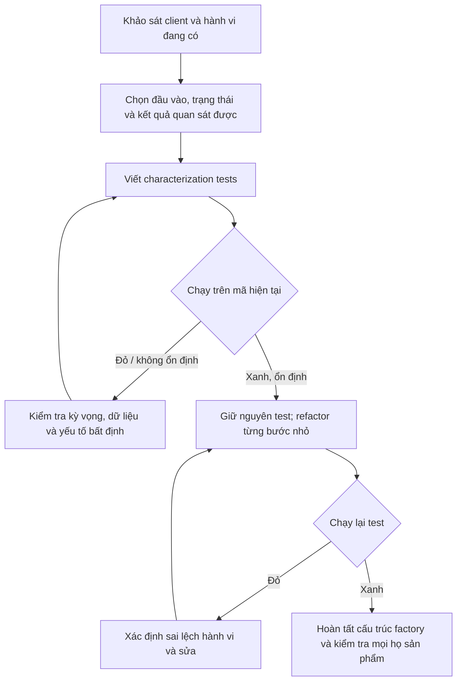

# Viết kiểm thử mô tả hành vi trước khi thay đổi cấu trúc tạo đối tượng

Trong quá trình **tái cấu trúc** sang **Abstract Factory**, thay đổi lớn thường nằm ở cách khởi tạo và liên kết các đối tượng: các lệnh `new` được chuyển từ client vào factory; client bắt đầu phụ thuộc vào interface; các sản phẩm cụ thể được nhóm theo từng họ. Nhưng những thay đổi cấu trúc đó **không được vô tình làm đổi hành vi mà người dùng đang dựa vào**.

Bài học này thuộc module **Học về abstract factory trong design pattern**, tập trung vào kỹ thuật **viết kiểm thử mô tả hành vi hiện có trước khi thay đổi cấu trúc tạo đối tượng**. Đây thường được gọi là *characterization testing*: quan sát hệ thống đang làm gì, ghi lại các kết quả quan trọng bằng kiểm thử, rồi sử dụng chúng như một mạng lưới an toàn khi refactor.

## 1. Vì sao cần kiểm thử trước khi đưa Abstract Factory vào?

Giả sử màn hình cài đặt tự tạo `WinButton` và `WinCheckbox`:

```java
final class SettingsScreen {
    private final WinButton saveButton = new WinButton();
    private final WinCheckbox notifications = new WinCheckbox();
}
```

Ta muốn hỗ trợ thêm macOS bằng `UiFactory`, `WindowsUiFactory` và `MacUiFactory`. Vấn đề là quá trình đổi cấu trúc có thể gây ra các lỗi mà trình biên dịch không phát hiện:

- Gán callback cho nút khác với nút thực tế được hiển thị hoặc kích hoạt.
- Tạo lại checkbox sau mỗi thao tác khiến trạng thái người dùng vừa chọn bị mất.
- Chuyển sự kiện nhấn thành hai lần gọi hành động Lưu.
- Vô ý thay đổi trạng thái khởi tạo của checkbox từ `false` thành `true`.
- Trộn sản phẩm của hai họ nếu cấu hình hoặc phương thức factory sai.

Compiler có thể chấp nhận tất cả các tình huống trên nếu kiểu dữ liệu vẫn đúng. **Kiểm thử hành vi** giúp phát hiện lỗi ở tầng kết quả, độc lập với việc object được tạo bằng `new`, Factory Method hay Abstract Factory.

Mục tiêu của refactoring là:

\[
\text{Hành vi quan sát được trước khi refactor}
=
\text{Hành vi quan sát được sau khi refactor}
\]

Đẳng thức này áp dụng trong **cùng điều kiện đầu vào và cùng cấu hình sản phẩm**. Việc bổ sung họ macOS là khả năng mới; hành vi hiện có của Windows cần được giữ ổn định.

## 2. Phân biệt đặc tả hành vi với kiểm thử cấu trúc

Một bài test tốt nên mô tả *khi người dùng thao tác thì điều gì xảy ra* thay vì *đoạn mã đang tạo đối tượng bằng cách nào*.

| Kiểm tra điều gì? | Nên giữ khi refactor? | Giải thích |
| --- | --- | --- |
| Khi nhấn Lưu một lần, hành động Lưu được thực hiện một lần | Có | Đây là hành vi quan sát được. |
| Checkbox ban đầu bỏ chọn; đổi hai lần thì trở về ban đầu | Có | Đây là quy tắc trạng thái mà màn hình cam kết. |
| Chuyển trạng thái checkbox không tự động lưu | Có, nếu đó là hành vi hiện tại được yêu cầu | Phát hiện thay đổi sai trong luồng tương tác. |
| Màn hình phải gọi `new WinButton()` | Không | Đây là chi tiết cấu trúc mà ta đang chủ định thay đổi. |
| Factory phải được gọi theo đúng thứ tự `createButton()`, rồi `createCheckbox()` | Thường không | Chỉ nên kiểm tra thứ tự nếu thứ tự có ý nghĩa nghiệp vụ thật sự. |
| Tên lớp cụ thể là `WinButton` | Không | Đổi tên hoặc thay triển khai không nhất thiết đổi hành vi. |

**Phân biệt quan trọng:** characterization test có thể ghi nhận cả **hành vi hiện hữu chưa chắc đúng**. Nếu phát hiện bug, cần xác minh kỳ vọng trước khi biến nó thành hợp đồng lâu dài. Với bug đã biết, có thể bổ sung test mô tả hành vi mong muốn và sửa riêng, tránh lẫn thay đổi nghiệp vụ vào cùng một bước refactor.

## 3. Quy trình kiểm thử trước, refactor sau



Trình tự thực hành:

1. **Chọn luồng có giá trị:** ví dụ bật thông báo, nhấn Lưu, xem kết quả; ghi rõ trạng thái ban đầu và điều kiện sau thao tác.
2. **Tìm điểm quan sát ổn định:** phương thức công khai, sự kiện nghiệp vụ, bản ghi đã lưu hoặc trạng thái trả về. Tránh phụ thuộc vào `new`, kiểu cụ thể hoặc chuỗi log debug.
3. **Tạo dữ liệu đầu vào lặp lại được:** tách clock, randomness, kết nối ngoài nếu chúng khiến kết quả thay đổi giữa các lần chạy.
4. **Viết test và chạy trên cấu trúc cũ:** xác nhận test thật sự xanh với hành vi hiện tại; một test chưa chạy được không phải mạng lưới an toàn.
5. **Thay cấu trúc từng bước:** rút interface sản phẩm, khai báo factory interface, tạo concrete factory, chuyển client sang nhận factory qua constructor.
6. **Chạy lại cùng bộ test sau mỗi bước:** nếu test đỏ, đối chiếu hành vi thay đổi thay vì sửa kỳ vọng cho phù hợp với code mới.
7. **Sau khi bảo toàn hành vi cũ, bổ sung test cho cấu hình mới:** ví dụ kiểm tra cùng contract với Windows và macOS, kiểm tra mỗi concrete factory tạo các sản phẩm cùng họ.

## 4. Ví dụ: Client tạo widget trực tiếp trước khi refactor

Xét một màn hình cài đặt mô phỏng bằng Java thuần. Người dùng có thể bật/tắt thông báo và nhấn Lưu; màn hình đếm số lần Lưu được kích hoạt. Số lần Lưu được dùng ở đây làm **kết quả quan sát được** trong ví dụ đơn giản; hệ thống thực tế có thể quan sát lời gọi lưu dữ liệu hoặc sự kiện đã phát ra.

Tệp `SettingsScreen.java` **trước khi refactor**:

```java
import java.util.Objects;

final class WinButton {
    private Runnable onClick = () -> {};

    void setOnClick(Runnable action) {
        onClick = Objects.requireNonNull(action);
    }

    void click() {
        onClick.run();
    }
}

final class WinCheckbox {
    private boolean checked;

    void toggle() {
        checked = !checked;
    }

    boolean isChecked() {
        return checked;
    }
}

public final class SettingsScreen {
    private final WinButton saveButton = new WinButton();
    private final WinCheckbox notifications = new WinCheckbox();
    private int saveCount;

    public SettingsScreen() {
        saveButton.setOnClick(() -> saveCount++);
    }

    public void toggleNotifications() {
        notifications.toggle();
    }

    public boolean notificationsEnabled() {
        return notifications.isChecked();
    }

    public void clickSave() {
        saveButton.click();
    }

    public int saveCount() {
        return saveCount;
    }
}
```

Ở đây `SettingsScreen` phụ thuộc `WinButton` và `WinCheckbox`; chưa có Abstract Factory. Tuy vậy, ta **chưa sửa** đoạn mã này ngay: trước tiên phải đặc tả những gì nó đang làm.

### 4.1. Viết các tình huống Given–When–Then

| Given — điều kiện trước | When — thao tác | Then — kết quả |
| --- | --- | --- |
| Vừa mở màn hình | Chưa thao tác | Thông báo tắt; số lần Lưu bằng 0 |
| Màn hình mới | Bật thông báo | Trạng thái bật; chưa lưu |
| Thông báo đã bật | Đổi trạng thái lần nữa | Trở về tắt |
| Màn hình mới | Nhấn Lưu 1 lần | Số lần Lưu bằng 1 |
| Màn hình mới | Nhấn Lưu thêm lần nữa | Số lần Lưu bằng 2, không bị gọi trùng |
| Có hai màn hình riêng | Chỉ thao tác màn hình thứ nhất | Màn hình thứ hai không đổi |

Những tiêu chí này chưa nhắc đến factory; đó chính là chủ ý.

### 4.2. Viết JUnit 5 tests trước khi thay đổi code

Tệp `SettingsScreenTest.java`:

```java
import org.junit.jupiter.api.Test;

import static org.junit.jupiter.api.Assertions.assertEquals;
import static org.junit.jupiter.api.Assertions.assertFalse;
import static org.junit.jupiter.api.Assertions.assertTrue;

class SettingsScreenTest {
    @Test
    void newScreenStartsWithNotificationsOffAndNoSaves() {
        SettingsScreen screen = new SettingsScreen();

        assertFalse(screen.notificationsEnabled());
        assertEquals(0, screen.saveCount());
    }

    @Test
    void togglingNotificationsDoesNotSaveAutomatically() {
        SettingsScreen screen = new SettingsScreen();

        screen.toggleNotifications();

        assertTrue(screen.notificationsEnabled());
        assertEquals(0, screen.saveCount());
    }

    @Test
    void togglingTwiceRestoresTheOriginalState() {
        SettingsScreen screen = new SettingsScreen();

        screen.toggleNotifications();
        screen.toggleNotifications();

        assertFalse(screen.notificationsEnabled());
    }

    @Test
    void eachSaveClickTriggersExactlyOneSave() {
        SettingsScreen screen = new SettingsScreen();

        screen.clickSave();
        assertEquals(1, screen.saveCount());

        screen.clickSave();
        assertEquals(2, screen.saveCount());
    }

    @Test
    void separateScreensDoNotShareMutableState() {
        SettingsScreen first = new SettingsScreen();
        SettingsScreen second = new SettingsScreen();

        first.toggleNotifications();
        first.clickSave();

        assertTrue(first.notificationsEnabled());
        assertEquals(1, first.saveCount());
        assertFalse(second.notificationsEnabled());
        assertEquals(0, second.saveCount());
    }
}
```

Chạy các test này bằng test runner JUnit Jupiter của dự án (IDE, Maven hoặc Gradle đã cấu hình JUnit 5). Ở bước này, cả năm test phải **PASS với phiên bản cũ**. Chỉ sau đó mới bắt đầu thay đổi cấu trúc.

Kiểm thử có khả năng phát hiện hồi quy vì:

- Nếu constructor mới làm checkbox bật mặc định, test khởi tạo sẽ đỏ.
- Nếu callback Lưu bị đăng ký hai lần, test số lần nhấn sẽ đỏ.
- Nếu màn hình tạo checkbox mới mỗi lần truy cập, test chuyển trạng thái sẽ đỏ.
- Nếu factory trả về singleton có trạng thái dùng chung cho nhiều màn hình, test về tính độc lập sẽ đỏ.

## 5. Refactor sang Abstract Factory khi test đã xanh

Mục đích của thay đổi là chuyển **chi tiết tạo widget** vào concrete factory, đồng thời giữ nguyên API và hành vi màn hình mà các test đang gọi.

Sau khi thay nội dung `SettingsScreen.java`, phiên bản mới có thể là:

```java
import java.util.Objects;

// Product interfaces: hợp đồng hành vi
interface Button {
    void setOnClick(Runnable action);
    void click();
}

interface Checkbox {
    void toggle();
    boolean isChecked();
}

// Abstract Factory: tạo cả họ sản phẩm
interface UiFactory {
    Button createButton();
    Checkbox createCheckbox();
}

// Concrete products thuộc họ Windows
final class WinButton implements Button {
    private Runnable onClick = () -> {};

    @Override
    public void setOnClick(Runnable action) {
        onClick = Objects.requireNonNull(action);
    }

    @Override
    public void click() {
        onClick.run();
    }
}

final class WinCheckbox implements Checkbox {
    private boolean checked;

    @Override
    public void toggle() {
        checked = !checked;
    }

    @Override
    public boolean isChecked() {
        return checked;
    }
}

// Concrete Factory tạo nhất quán các sản phẩm Windows
final class WindowsUiFactory implements UiFactory {
    @Override
    public Button createButton() {
        return new WinButton();
    }

    @Override
    public Checkbox createCheckbox() {
        return new WinCheckbox();
    }
}

public final class SettingsScreen {
    private final Button saveButton;
    private final Checkbox notifications;
    private int saveCount;

    // Giữ constructor cũ để các caller và test hiện tại tiếp tục hoạt động
    public SettingsScreen() {
        this(new WindowsUiFactory());
    }

    // Điểm inject factory cho các cấu hình và kiểm thử khác
    public SettingsScreen(UiFactory factory) {
        Objects.requireNonNull(factory);
        saveButton = Objects.requireNonNull(factory.createButton());
        notifications = Objects.requireNonNull(factory.createCheckbox());
        saveButton.setOnClick(() -> saveCount++);
    }

    public void toggleNotifications() {
        notifications.toggle();
    }

    public boolean notificationsEnabled() {
        return notifications.isChecked();
    }

    public void clickSave() {
        saveButton.click();
    }

    public int saveCount() {
        return saveCount;
    }
}
```

**Điểm then chốt:** Năm test trong mục 4.2 **không phải thay đổi**. `new SettingsScreen()` vẫn tạo bộ widget Windows; trạng thái khởi tạo, cách toggle, callback Lưu và tính độc lập của mỗi màn hình vẫn có cùng kết quả.

Lệnh `new WinButton()` và `new WinCheckbox()` vẫn tồn tại trong chương trình, nhưng đã được chuyển vào `WindowsUiFactory`, nơi việc biết concrete class là hợp lý. Bản thân `SettingsScreen` chỉ lưu `Button` và `Checkbox`.

### 5.1. Không sửa test để che một hồi quy

Giả sử trong lúc refactor, ta vô ý viết:

```java
public SettingsScreen(UiFactory factory) {
    saveButton = factory.createButton();
    notifications = factory.createCheckbox();
    saveButton.setOnClick(() -> saveCount++);
    saveButton.setOnClick(() -> {
        saveCount++;
        saveCount++;
    });
}
```

Khi nhấn Lưu một lần, `saveCount` tăng hai lần. Test `eachSaveClickTriggersExactlyOneSave` sẽ đỏ. Cách sửa là khôi phục hành vi callback, **không** đổi kỳ vọng `assertEquals(1, ...)` thành `assertEquals(2, ...)` chỉ để test xanh. Ví dụ này còn nhắc rằng thiết lập callback bằng `setOnClick` có ngữ nghĩa thay thế callback cũ: hợp đồng phải rõ ràng giữa các biến thể.

## 6. Bổ sung kiểm thử khi xuất hiện họ sản phẩm mới

Các characterization tests ban đầu chủ yếu bảo vệ Windows, bởi đó là cấu hình đã tồn tại trước refactor. Sau khi refactor ổn định, ta mới thêm sản phẩm và factory cho macOS.

Ví dụ, đặt các lớp sau trong tệp `MacUiFactory.java`:

```java
import java.util.Objects;

final class MacButton implements Button {
    private Runnable onClick = () -> {};

    @Override
    public void setOnClick(Runnable action) {
        onClick = Objects.requireNonNull(action);
    }

    @Override
    public void click() {
        onClick.run();
    }
}

final class MacCheckbox implements Checkbox {
    private boolean checked;

    @Override
    public void toggle() {
        checked = !checked;
    }

    @Override
    public boolean isChecked() {
        return checked;
    }
}

public final class MacUiFactory implements UiFactory {
    @Override
    public Button createButton() {
        return new MacButton();
    }

    @Override
    public Checkbox createCheckbox() {
        return new MacCheckbox();
    }
}
```

Tại đây, việc kiểm tra **cùng hợp đồng trên mọi họ** trở nên hữu ích. Sử dụng JUnit 5 Parameterized Tests (cần có `junit-jupiter-params` trong cấu hình test):

```java
import org.junit.jupiter.params.ParameterizedTest;
import org.junit.jupiter.params.provider.Arguments;
import org.junit.jupiter.params.provider.MethodSource;

import java.util.stream.Stream;

import static org.junit.jupiter.api.Assertions.*;

class FactoryBehaviorTest {
    static Stream<Arguments> families() {
        return Stream.of(
            Arguments.of("Windows", new WindowsUiFactory()),
            Arguments.of("macOS", new MacUiFactory())
        );
    }

    @ParameterizedTest(name = "{0}: save action runs once")
    @MethodSource("families")
    void sameSaveBehavior(String family, UiFactory factory) {
        SettingsScreen screen = new SettingsScreen(factory);

        screen.toggleNotifications();
        screen.clickSave();

        assertTrue(screen.notificationsEnabled());
        assertEquals(1, screen.saveCount());
    }

    @ParameterizedTest(name = "{0}: two screens are independent")
    @MethodSource("families")
    void screensDoNotShareState(String family, UiFactory factory) {
        SettingsScreen first = new SettingsScreen(factory);
        SettingsScreen second = new SettingsScreen(factory);

        first.toggleNotifications();
        first.clickSave();

        assertFalse(second.notificationsEnabled());
        assertEquals(0, second.saveCount());
    }
}
```

Tên `family` trong parameterized test chỉ dùng để báo cáo ca kiểm thử; không tham gia logic sản phẩm. Trong một UI thật, hai họ có thể khác màu sắc và animation, nhưng hợp đồng **toggle**, **click** và trạng thái độc lập phải nhất quán.

Việc factory tạo đúng họ (ví dụ `MacUiFactory` không tạo nhầm `WinButton`) có thể được kiểm tra thêm ở tầng wiring hoặc integration test nếu đó là rủi ro thực tế. Không cần buộc mọi characterization test so sánh tên lớp hoặc dùng `instanceof`.

## 7. Chọn ranh giới kiểm thử để tránh phụ thuộc triển khai

| Mức kiểm thử | Nên quan sát | Không nên khóa vào |
| --- | --- | --- |
| Characterization test cho client | Kết quả các thao tác mà client cung cấp; state transition; sự kiện thực sự có ý nghĩa | `new` nằm trong lớp nào; thứ tự gọi factory nếu không có cam kết |
| Contract test cho product interface | Hành vi mà mọi concrete product phải giữ, như toggle hai lần trở về trạng thái đầu | Tên lớp, cấu trúc field, thư viện UI cụ thể |
| Test tích hợp một họ sản phẩm | Cấu hình chọn đúng họ, tạo widget phù hợp, kết nối callback đúng | Toàn bộ từng phương thức private của concrete product |
| Smoke test hoặc end-to-end | Một luồng người dùng quan trọng chạy từ đầu đến cuối | Chi tiết DOM/CSS không được cam kết, log tạm thời |

**Không phải mọi thay đổi trong output đều là hồi quy:** chẳng hạn hiệu ứng hiển thị khác giữa Windows/macOS là một phần mục đích có nhiều họ. Test nghiệp vụ nên bảo vệ ý nghĩa người dùng cần; test giao diện riêng có thể kiểm tra hình thức phù hợp theo từng hệ điều hành.

### 7.1. Khi hệ thống có I/O, thời gian hoặc ngẫu nhiên

Trong dự án thực, nút Lưu thường ghi cơ sở dữ liệu, phát sự kiện hoặc gọi API. Thay vì dùng dữ liệu thật khiến test chậm và thiếu ổn định:

- Dùng database test có thể khôi phục trạng thái, fake repository hoặc sự kiện được thu thập trong test, tùy tầng kiểm thử.
- Tiêm `Clock` khi hành vi phụ thuộc thời gian; cố định thời điểm trong test.
- Cố định seed hoặc inject bộ sinh ID khi mã sử dụng số ngẫu nhiên.
- Kiểm tra **kết quả có ý nghĩa** (một bản ghi được lưu, một sự kiện được phát), thay vì bắt buộc cách gọi nội bộ trước và sau refactor giống từng bước.

Nếu mã hiện tại không cho inject những phụ thuộc này, có thể cần tạo một **seam nhỏ, an toàn** để test ổn định trước khi bắt đầu cuộc refactor lớn. Mỗi seam cũng phải có phạm vi hẹp và được kiểm tra để không làm thay đổi hành vi.

### 7.2. Khi dùng snapshot hoặc golden master

Với hệ thống cũ có nhiều trường hợp đầu vào, lưu một tập output đại diện (*golden master*) đôi khi hữu ích để phát hiện sự khác biệt sau refactor. Tuy nhiên, không nên snapshot toàn bộ dữ liệu chứa timestamp, ID ngẫu nhiên, thứ tự không ổn định hoặc các chi tiết UI không được cam kết. Cần chuẩn hóa những phần bất định và review các thay đổi kỳ vọng như với bất kỳ yêu cầu nghiệp vụ nào.

Snapshot giúp phát hiện **khác biệt**; nó không tự chứng minh kết quả cũ là **đúng**.

## 8. Những lỗi thường gặp khi viết test bảo vệ refactoring

### 8.1. Chỉ viết test sau khi đã đổi hết factory

Nếu chưa chạy test trên phiên bản cũ, ta không có mốc so sánh đáng tin cậy. Một test xanh với phiên bản mới có thể đang khẳng định chính hành vi sai vừa xuất hiện.

**Cách xử lý:** viết và chạy trước một nhóm test nhỏ bao phủ các luồng có giá trị; lưu kết quả baseline. Sau đó mới bắt đầu chuyển các lệnh tạo đối tượng.

### 8.2. Mock mọi lời gọi `new` và kiểm tra chi tiết nội bộ

Kiểm thử như “`SettingsScreen` phải tạo đúng một `WinButton`” sẽ hỏng đúng lúc ta chuyển việc tạo sang factory, dù người dùng không thấy khác biệt.

**Cách xử lý:** ưu tiên assert trạng thái hoặc kết quả. Chỉ xác nhận số lần tạo khi đó là yêu cầu thật về vòng đời đối tượng (ví dụ mỗi phiên giao dịch bắt buộc có state độc lập).

### 8.3. Chỉ có một happy path

Một test nhấn Lưu thành công không bảo vệ trường hợp double-click, toggle hai lần, màn hình mới hoặc xử lý lỗi khi I/O thất bại.

**Cách xử lý:** chọn cả trạng thái biên, chuỗi thao tác và lỗi có ý nghĩa. Mức bao phủ dựa trên **rủi ro hành vi** chứ không chỉ số dòng mã.

### 8.4. Đổi hành vi và refactor trong cùng một bước lớn

Khi vừa thay factory vừa đổi quy tắc Lưu hoặc default checkbox, rất khó xác định test đỏ do đâu.

**Cách xử lý:** giữ một mục tiêu cho mỗi bước: bảo toàn hành vi khi đổi cấu trúc; thay đổi yêu cầu nghiệp vụ nên được làm với test kỳ vọng mới ở bước riêng.

### 8.5. Sửa assertion theo kết quả mới mà không đánh giá

Đây là cách vô hiệu hóa mạng lưới an toàn. Chỉ thay expected result khi có một quyết định nghiệp vụ rõ ràng rằng hành vi cần thay đổi, đồng thời cập nhật tài liệu và các test liên quan.

### 8.6. Test phụ thuộc thứ tự chạy hoặc dùng tài nguyên chia sẻ

Nếu hai test dùng chung một singleton checkbox hoặc cơ sở dữ liệu còn trạng thái từ test trước, kết quả có thể thay đổi theo thứ tự thực thi.

**Cách xử lý:** mỗi test tự dựng trạng thái đầu vào, cô lập dữ liệu và dọn tài nguyên theo vòng đời test. Test `separateScreensDoNotShareMutableState` ở trên là một ví dụ bảo vệ tính cô lập mà client mong đợi.

## 9. Đánh giá việc refactor đã hoàn thành

Sau khi chuyển sang Abstract Factory, kiểm tra các điều kiện:

1. **Test baseline vẫn xanh:** những hành vi cũ quan trọng được giữ nguyên trên cấu hình Windows.
2. **Client sử dụng abstraction:** `SettingsScreen` nhận `UiFactory`, lưu `Button` và `Checkbox`, không cần ép kiểu về concrete product.
3. **Concrete factory chịu trách nhiệm khởi tạo:** `WindowsUiFactory` tạo cả hai widget Windows; `MacUiFactory` tạo cả hai widget macOS.
4. **Các họ tuân thủ contract:** luồng nhấn Lưu, đổi trạng thái và tính cô lập đều đúng với mỗi factory.
5. **Cấu hình chọn họ ở ranh giới thích hợp:** ví dụ bootstrap của ứng dụng quyết định factory theo môi trường; logic màn hình không rải `if (os == ...)`.
6. **Hồi quy được phát hiện ở mức người dùng:** thay đổi sai callback hoặc trạng thái sẽ làm test đỏ mà không cần biết cấu trúc tạo mới.

Khi phải chuyển cả một hệ thống cũ, nên áp dụng từng màn hình hoặc từng nhóm đối tượng. Có thể giữ constructor mặc định tương thích như ví dụ để giảm rủi ro cho những caller chưa được chuyển, sau đó cân nhắc bỏ nó khi tất cả nơi gọi đã dùng dependency injection.

## 10. Bài tập thực hành

**Đề bài:** Một màn hình `ExportScreen` hiện đang gọi trực tiếp `new CsvFormatter()` và `new LocalFileWriter()`. Công việc cần làm là hỗ trợ thêm họ `JsonFormatter` và `CloudFileWriter` bằng Abstract Factory.

**Trước khi refactor**, hãy viết các test bảo vệ những hành vi đã được xác nhận:

- Khi chọn Export, nội dung được xuất một lần.
- Kết quả xuất chứa đúng thông tin nghiệp vụ của bản ghi mẫu.
- Nếu thao tác ghi thất bại, màn hình trả về hoặc hiển thị lỗi theo hợp đồng hiện có, không báo thành công giả.
- Hai lần xuất độc lập không vô tình dùng lại dữ liệu trạng thái của lần trước.

**Sau đó**, rút interface `Formatter`, `Writer`, xây dựng `ExportFactory` với `createFormatter()` và `createWriter()`, đưa concrete factory cho từng họ vào nơi cấu hình. Chạy lại test baseline cho CSV/local; viết thêm contract test hoặc integration test cho JSON/cloud nếu yêu cầu của họ này có điểm khác biệt. Tách rõ quy tắc nghiệp vụ nào phải giữ chung và định dạng nào được phép khác.

Tự giải thích: Vì sao một test kiểm tra “`ExportScreen` gọi `new CsvFormatter()`” cần được thay, trong khi test “người dùng nhấn Export thì chỉ tạo một kết quả xuất” phải được giữ?

**Ghi nhớ:** Khi tái cấu trúc sang Abstract Factory, hãy **mô tả và xác minh hành vi hiện tại trước**, rồi thay đổi cách khởi tạo và phụ thuộc của đối tượng. Kiểm thử bảo vệ những điều người dùng và client thực sự quan sát được; Abstract Factory tổ chức cách chọn họ sản phẩm phía sau các hợp đồng. Cùng một bộ characterization tests xanh trước và sau là bằng chứng thiết thực rằng refactor đã giữ ổn định hành vi được kiểm tra, dù cấu trúc triển khai đã thay đổi.
