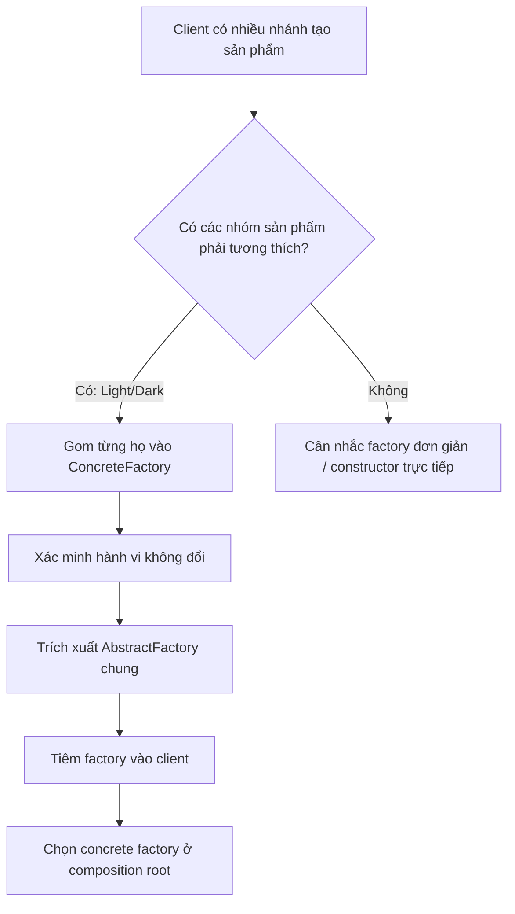

# Gom các thao tác tạo cùng họ vào ConcreteFactory rồi trích xuất AbstractFactory

## Mục tiêu

Trong mẫu thiết kế **Abstract Factory** thuộc nhóm *Creational Design Patterns*, một factory cung cấp **một họ sản phẩm có liên quan** qua các hợp đồng chung. Khi tái cấu trúc mã nguồn sẵn có, ta không nhất thiết bắt đầu bằng việc viết ngay một `AbstractFactory`. Cách làm dễ kiểm soát hơn là **gom các thao tác tạo của từng họ vào một `ConcreteFactory`**, xác nhận hành vi vẫn đúng, rồi **trích xuất interface chung** cho các concrete factory.

Bài học thuộc chương **Tái cấu trúc** và tập trung vào quy trình chuyển đổi từ mã client tự khởi tạo nhiều sản phẩm sang cấu trúc Abstract Factory. Sau bài này, bạn có thể:

- Nhận diện các nhóm lệnh `new` đang tạo **cùng một họ** sản phẩm.
- Chuyển quyền khởi tạo về `ConcreteFactory` theo từng bước nhỏ.
- Trích xuất `AbstractFactory` với phương thức trả về **product interface**.
- Đưa việc chọn concrete factory về **điểm khởi tạo ứng dụng** (*composition root*).
- Dùng kiểm thử hành vi để phân biệt **refactoring** với thay đổi chức năng.

## 1. Dấu hiệu cần tái cấu trúc

Giả sử ứng dụng có hai kiểu giao diện **Light** và **Dark**. Mỗi kiểu gồm hai loại sản phẩm:

| Loại sản phẩm | Họ Light | Họ Dark |
|---|---|---|
| Button | `LightButton` | `DarkButton` |
| Checkbox | `LightCheckbox` | `DarkCheckbox` |

Một màn hình cài đặt cần cả nút và ô chọn. Ban đầu, mã client quyết định dùng lớp cụ thể nào dựa trên cấu hình:

```java
final class SettingsScreen {
    String render(String theme) {
        Button save;
        Checkbox notifications;

        if ("light".equals(theme)) {
            save = new LightButton("Lưu");
            notifications = new LightCheckbox(true);
        } else if ("dark".equals(theme)) {
            save = new DarkButton("Lưu");
            notifications = new DarkCheckbox(true);
        } else {
            throw new IllegalArgumentException("Unknown theme: " + theme);
        }

        return save.render() + "\n" + notifications.render();
    }
}
```

Trong đoạn này, `Button` và `Checkbox` đã là **product interface**; còn `LightButton`, `DarkButton`, `LightCheckbox` và `DarkCheckbox` là **concrete product**. Các interface và lớp này được giả định có sẵn ở thời điểm trước refactor; một chương trình hoàn chỉnh sẽ được trình bày ở phần 5.

Khi nhiều màn hình hoặc dịch vụ khác cũng viết các nhánh giống vậy, việc thêm họ sản phẩm mới sẽ buộc sửa nhiều client. Tình trạng thường gặp:

- Các cụm lệnh `new LightButton(...)` và `new LightCheckbox(...)` luôn đi cùng nhau; tương tự cho họ Dark.
- Client phải biết tên các lớp concrete của từng họ.
- Những vị trí chọn sản phẩm có thể bị lệch: màn hình vô tình dùng `LightButton` với `DarkCheckbox`.
- Điều kiện chọn theme bị lặp lại, làm tăng số điểm cần sửa mỗi khi thêm họ.
- Việc tạo sản phẩm có thêm cấu hình hoặc tài nguyên (ví dụ theme token, thư viện UI) sẽ khiến client ôm cả logic cấu hình.

**Dấu hiệu quan trọng** là yêu cầu **chọn một bộ sản phẩm tương thích**, không đơn giản là có nhiều câu lệnh `new`. Nếu chỉ tạo một loại sản phẩm không có họ liên quan, một factory nhỏ hoặc Factory Method có thể đã đủ.

### Xác định ranh giới của một họ

Một họ là tập các biến thể được thiết kế để **phối hợp nhất quán**. Ví dụ `LightButton` và `LightCheckbox` cùng dùng token giao diện Light. Vì vậy, factory Light có trách nhiệm tạo **cả hai**. Không nên gom các thao tác tạo chỉ vì chúng xuất hiện gần nhau trong file hoặc cùng dùng ngôn ngữ Java.



## 2. Chuẩn bị trước khi chuyển code

Refactoring là thay đổi **cấu trúc bên trong mà vẫn giữ hành vi quan sát được**. Trước khi chỉnh sửa, hãy liệt kê hợp đồng hiện có.

Trong ví dụ, ta muốn giữ:

1. Cấu hình `light` tạo nút và ô chọn Light; `dark` tạo cả hai sản phẩm Dark.
2. Nhãn nút vẫn là `"Lưu"`; trạng thái ô chọn ban đầu vẫn là `true`.
3. Chuỗi kết quả của `render()` không đổi với cùng đầu vào.
4. Theme không hợp lệ vẫn bị từ chối bằng `IllegalArgumentException`.
5. Quy tắc tạo sản phẩm (mới mỗi lần, dùng lại hay cache) không bị thay đổi ngoài ý muốn.

Đây là bảng hành vi gốc dùng đối chiếu:

| Đầu vào | Kết quả kỳ vọng | Ghi chú |
|---|---|---|
| `light` | `Light button: Lưu` và `Light checkbox: checked` | Hai sản phẩm cùng họ Light |
| `dark` | `Dark button: Lưu` và `Dark checkbox: checked` | Hai sản phẩm cùng họ Dark |
| `other` | `IllegalArgumentException` | Không tự chuyển ngầm sang Light |

Có thể viết characterization tests cho các kết quả trên trước khi di chuyển constructor. Nếu code cũ chứa bug, hãy ghi rõ hành vi đang quan sát và quyết định sửa bug ở thay đổi riêng; như vậy khi refactor bị lỗi, bạn sẽ biết nguyên nhân đến từ đâu.

**Phạm vi thay đổi:** trước tiên chỉ di chuyển nơi **tạo đối tượng**; không đồng thời đổi thư viện UI, cấu trúc dữ liệu, kiểu trạng thái hoặc quy tắc render.

## 3. Bước một: gom thao tác tạo vào từng ConcreteFactory

Giữ nguyên hai product interface đang được client sử dụng:

```java
interface Button {
    String render();
}

interface Checkbox {
    String render();
}
```

Bây giờ tạo hai lớp, **mỗi lớp chịu trách nhiệm cho một họ**. Ở giai đoạn này ta **chưa cần** trích xuất `AbstractFactory`:

```java
final class LightUiFactory {
    Button createButton(String label) {
        return new LightButton(label);
    }

    Checkbox createCheckbox(boolean checked) {
        return new LightCheckbox(checked);
    }
}

final class DarkUiFactory {
    Button createButton(String label) {
        return new DarkButton(label);
    }

    Checkbox createCheckbox(boolean checked) {
        return new DarkCheckbox(checked);
    }
}
```

Hai lớp này là **ConcreteFactory về mặt trách nhiệm**: mỗi lớp tập trung việc tạo toàn bộ sản phẩm thuộc một họ. Chưa có interface chung nên Java chưa thể dùng cả hai qua cùng kiểu factory.

Trong giai đoạn trung gian, client có thể thay constructor trực tiếp bằng lời gọi factory:

```java
// Đoạn trung gian; mục tiêu là chuyển constructor khỏi client.
if ("light".equals(theme)) {
    LightUiFactory factory = new LightUiFactory();
    save = factory.createButton("Lưu");
    notifications = factory.createCheckbox(true);
} else if ("dark".equals(theme)) {
    DarkUiFactory factory = new DarkUiFactory();
    save = factory.createButton("Lưu");
    notifications = factory.createCheckbox(true);
} else {
    throw new IllegalArgumentException("Unknown theme: " + theme);
}
```

Đoạn trên **vẫn còn nhánh lựa chọn ở client**, nhưng đã đạt một bước quan trọng: mỗi factory phụ trách **các constructor của cùng họ**. Ta có thể kiểm tra ánh xạ giữa factory và product trước khi trích xuất abstraction mới.

### Vì sao gom theo họ thay vì theo loại?

Nếu tách thành `ButtonFactory` và `CheckboxFactory` độc lập, client vẫn phải phối hợp chọn Light/Dark cho hai factory. Điều này không bảo đảm chúng cùng họ:

```java
// Sai mục tiêu nhất quán họ: client có thể phối hợp nhầm.
Button button = lightButtonFactory.createButton("Lưu");
Checkbox box = darkCheckboxFactory.createCheckbox(true);
```

Một `LightUiFactory` tạo cả `Button` và `Checkbox` có thể quản lý chung theme token, quy ước giao diện và phụ thuộc riêng của họ Light. Đây là lý do **Abstract Factory tổ chức theo họ sản phẩm**.

### Kiểm tra sau bước một

- `LightUiFactory` trả đúng cả `LightButton` và `LightCheckbox`.
- `DarkUiFactory` trả đúng cả `DarkButton` và `DarkCheckbox`.
- Không có thay đổi về nhãn, trạng thái hay kết quả `render()`.
- Client không còn gọi các constructor concrete product ở những vị trí đã chuyển.
- Chưa đổi tên phương thức hoặc chữ ký nếu việc đổi chưa thực sự cần thiết.

Nếu nhiều điểm trong hệ thống đang tạo cùng họ, hãy di chuyển từng điểm theo các bước nhỏ có thể kiểm tra. Khi mọi lời gọi đã được chuyển, những helper khởi tạo cũ không còn được tham chiếu mới nên xóa.

## 4. Bước hai: trích xuất AbstractFactory từ API chung

So sánh public API của hai concrete factory:

| LightUiFactory | DarkUiFactory | Ý nghĩa chung |
|---|---|---|
| `createButton(String) : Button` | `createButton(String) : Button` | Tạo một nút theo họ factory |
| `createCheckbox(boolean) : Checkbox` | `createCheckbox(boolean) : Checkbox` | Tạo một ô chọn theo họ factory |

Vì các phương thức có **cùng ý nghĩa, tham số và kiểu trả về**, ta trích xuất một interface chung:

```java
interface UiFactory {
    Button createButton(String label);
    Checkbox createCheckbox(boolean checked);
}
```

Đây là **AbstractFactory**. Các kiểu trả về `Button` và `Checkbox` là **AbstractProduct** (product interface). AbstractFactory **không biết** `LightButton` hay `DarkCheckbox` được tạo cụ thể ra sao.

Cho hai concrete factory implements interface mới:

```java
final class LightUiFactory implements UiFactory {
    @Override
    public Button createButton(String label) {
        return new LightButton(label);
    }

    @Override
    public Checkbox createCheckbox(boolean checked) {
        return new LightCheckbox(checked);
    }
}

final class DarkUiFactory implements UiFactory {
    @Override
    public Button createButton(String label) {
        return new DarkButton(label);
    }

    @Override
    public Checkbox createCheckbox(boolean checked) {
        return new DarkCheckbox(checked);
    }
}
```

**Lợi ích của việc trích xuất sau khi gom:** interface được rút ra từ hành vi **thực sự dùng chung** của những concrete factory đang hoạt động. Ta tránh đoán trước một interface quá rộng chỉ vì nghĩ sau này sẽ cần nhiều loại sản phẩm.

### Điều kiện để trích xuất an toàn

- Mỗi factory hỗ trợ **mọi phương thức bắt buộc** của interface.
- Từng phương thức có **cùng ngữ nghĩa** ở mọi họ: `checked=true` không được bị hiểu ngược trong họ Dark.
- Những kiểu tham số và kết quả có thể diễn đạt bằng product interface tương ứng.
- Không biến một phương thức thành `Object create(String type)` khiến client phải ép kiểu.
- Không thêm phương thức tạo sản phẩm mà một họ **không hỗ trợ**, rồi cài `throw new UnsupportedOperationException()` để hợp thức hóa interface.

Trong Java, một concrete factory có thể ghi đè với **kiểu trả về hiệp biến** như `LightButton createButton(String)` nếu `LightButton implements Button`. Tuy nhiên, client sử dụng `UiFactory` vẫn nhìn thấy kiểu trả về `Button`. Việc khai báo trực tiếp `Button` trong các factory giúp ví dụ dễ so sánh API hơn.

## 5. Bước ba: đưa việc chọn factory ra khỏi client

Khi đã có `UiFactory`, client chỉ cần nhận đối tượng thực thi interface đó qua constructor:

```java
final class SettingsScreen {
    private final UiFactory factory;

    SettingsScreen(UiFactory factory) {
        this.factory = factory;
    }

    String render() {
        Button save = factory.createButton("Lưu");
        Checkbox notifications = factory.createCheckbox(true);
        return save.render() + "\n" + notifications.render();
    }
}
```

Ở đây `SettingsScreen` không còn biết `light`, `dark` hay bất kỳ concrete factory nào. Việc lựa chọn diễn ra ở **composition root**, thường là phần khởi tạo ứng dụng:

```java
static UiFactory selectFactory(String theme) {
    if (theme == null) {
        throw new IllegalArgumentException("Unknown theme: null");
    }
    return switch (theme) {
        case "light" -> new LightUiFactory();
        case "dark" -> new DarkUiFactory();
        default -> throw new IllegalArgumentException(
                "Unknown theme: " + theme);
    };
}

// Sử dụng:
UiFactory factory = selectFactory("dark");
SettingsScreen screen = new SettingsScreen(factory);
System.out.println(screen.render());
```

Một khi đã chọn factory, các sản phẩm do client yêu cầu đều được cung cấp qua **cùng một concrete factory instance**. Điều này giúp tập trung các quy tắc đồng bộ của họ: cấu hình, theme token, tài nguyên dùng chung và chính sách vòng đời.

Việc chọn factory ở composition root **không bắt buộc phải dùng `switch`**. Trong hệ thống lớn có thể dùng dependency injection, cấu hình, registry hoặc tham số đầu vào. Điều quan trọng là **client nghiệp vụ không lặp lại điều kiện chọn họ**.

## 6. Code hoàn chỉnh sau refactor (Java 17+)

Đặt toàn bộ mã dưới đây trong một file **`Demo.java`**. Đoạn này chạy độc lập, bao gồm product interface, concrete product, AbstractFactory, các ConcreteFactory, client và composition root.

```java
import java.util.Objects;

// AbstractProducts: hợp đồng cho từng loại sản phẩm.
interface Button {
    String render();
}

interface Checkbox {
    String render();
}

// ConcreteProducts: họ Light.
record LightButton(String label) implements Button {
    @Override
    public String render() {
        return "Light button: " + label;
    }
}

record LightCheckbox(boolean checked) implements Checkbox {
    @Override
    public String render() {
        return "Light checkbox: "
                + (checked ? "checked" : "unchecked");
    }
}

// ConcreteProducts: họ Dark.
record DarkButton(String label) implements Button {
    @Override
    public String render() {
        return "Dark button: " + label;
    }
}

record DarkCheckbox(boolean checked) implements Checkbox {
    @Override
    public String render() {
        return "Dark checkbox: "
                + (checked ? "checked" : "unchecked");
    }
}

// AbstractFactory: cung cấp các loại sản phẩm theo một họ.
interface UiFactory {
    Button createButton(String label);
    Checkbox createCheckbox(boolean checked);
}

// ConcreteFactory: gom constructor của toàn bộ họ Light.
final class LightUiFactory implements UiFactory {
    @Override
    public Button createButton(String label) {
        return new LightButton(label);
    }

    @Override
    public Checkbox createCheckbox(boolean checked) {
        return new LightCheckbox(checked);
    }
}

// ConcreteFactory: gom constructor của toàn bộ họ Dark.
final class DarkUiFactory implements UiFactory {
    @Override
    public Button createButton(String label) {
        return new DarkButton(label);
    }

    @Override
    public Checkbox createCheckbox(boolean checked) {
        return new DarkCheckbox(checked);
    }
}

// Client chỉ phụ thuộc UiFactory, Button và Checkbox.
final class SettingsScreen {
    private final UiFactory factory;

    SettingsScreen(UiFactory factory) {
        this.factory = Objects.requireNonNull(factory, "factory");
    }

    String render() {
        Button save = factory.createButton("Lưu");
        Checkbox notifications = factory.createCheckbox(true);
        return save.render() + "\n" + notifications.render();
    }
}

// Composition root quyết định cụ thể họ nào được sử dụng.
public class Demo {
    static UiFactory selectFactory(String theme) {
        if (theme == null) {
            throw new IllegalArgumentException("Unknown theme: null");
        }
        return switch (theme) {
            case "light" -> new LightUiFactory();
            case "dark" -> new DarkUiFactory();
            default -> throw new IllegalArgumentException(
                    "Unknown theme: " + theme);
        };
    }

    public static void main(String[] args) {
        String theme = args.length == 0 ? "light" : args[0];
        UiFactory factory = selectFactory(theme);
        System.out.println(new SettingsScreen(factory).render());
    }
}
```

Chạy chương trình:

```powershell
javac -encoding UTF-8 Demo.java
java Demo light
java Demo dark
```

Kết quả mong đợi:

```text
Light button: Lưu
Light checkbox: checked
```

```text
Dark button: Lưu
Dark checkbox: checked
```

**Tại sao đây là Abstract Factory?** `UiFactory` khai báo cách cung cấp **nhiều loại sản phẩm** (`Button`, `Checkbox`); mỗi concrete factory tạo **một họ sản phẩm cùng biến thể** (Light hoặc Dark). `SettingsScreen` làm việc với cả factory lẫn sản phẩm thông qua các interface, nên thay factory không cần sửa logic của màn hình.

## 7. Theo dõi thay đổi và xác định điểm kết thúc refactor

Một phương pháp tốt là ghi nhật ký những vị trí đã được chuyển quyền khởi tạo:

| Giai đoạn | Việc thay đổi | Điều kiện hoàn thành |
|---|---|---|
| Ban đầu | Client gọi `new LightButton`, `new DarkCheckbox`... | Có kết quả gốc hoặc characterization tests |
| Gom theo họ | Thêm `LightUiFactory`, `DarkUiFactory` và di chuyển constructor | Constructor concrete product nằm trong factory |
| Trích interface | Thêm `UiFactory`; hai concrete factory implements | Cả hai đáp ứng API chung và trả product interface |
| Tiêm factory | Client nhận `UiFactory` thay vì theme | Client không cần biết concrete factory/product |
| Chọn factory tập trung | Composition root chọn Light hoặc Dark | Một nơi quyết định họ và quản lý việc cấp factory |
| Dọn mã cũ | Xóa nhánh/constructor/helper không còn dùng | Không còn đường tạo sản phẩm cũ bị bỏ quên |

### Đừng nhầm đếm lớp với đếm vị trí sửa

Trong mô hình chuẩn có \(F\) họ và \(P\) loại sản phẩm:

- Abstract product interfaces: \(P\).
- Abstract factory interface: \(1\).
- Concrete factories: \(F\).
- Concrete products: \(F\times P\), nếu mỗi ô ma trận có một lớp riêng.

Ví dụ \(F=2\), \(P=2\) tương ứng **2 product interface + 1 AbstractFactory + 2 ConcreteFactory + 4 ConcreteProduct = 9 kiểu** tham gia pattern. Lớp `SettingsScreen` và `Demo` là client/điểm tích hợp nên không tính vào chín kiểu này.

Tuy nhiên, **số vị trí mã phải sửa khi refactor** phụ thuộc số client đã có, số nơi chứa constructor, mã cấu hình, cách phân chia file và kiểm thử. Chẳng hạn ứng dụng có mười màn hình cùng tự tạo nút và ô chọn thì dù chỉ thêm hai concrete factory, bạn vẫn cần chuyển **mười điểm sử dụng** (hoặc gom qua adapter trung gian).

Không nên tuyên bố “refactor chỉ cần sửa ba file” nếu chưa kiểm tra nơi gọi và quản lý phụ thuộc thực tế.

## 8. Kiểm chứng rằng hành vi không đổi

Một refactor an toàn cần được kiểm tra ở **biên hành vi**, không chỉ kiểm tra mã biên dịch. Với ví dụ `Demo`, có thể viết kiểm tra đơn giản như sau (đặt trong một lớp kiểm thử riêng, hoặc chạy như một phương thức kiểm tra bổ sung):

```java
static void assertEquals(String expected, String actual) {
    if (!expected.equals(actual)) {
        throw new AssertionError(
                "Expected: " + expected + ", actual: " + actual);
    }
}

static void verifyRefactor() {
    UiFactory light = new LightUiFactory();
    UiFactory dark = new DarkUiFactory();

    assertEquals(
            "Light button: Lưu\nLight checkbox: checked",
            new SettingsScreen(light).render());

    assertEquals(
            "Dark button: Lưu\nDark checkbox: checked",
            new SettingsScreen(dark).render());

    assertEquals("Light checkbox: unchecked",
            light.createCheckbox(false).render());
    assertEquals("Dark checkbox: unchecked",
            dark.createCheckbox(false).render());

    try {
        Demo.selectFactory("unknown");
        throw new AssertionError("Invalid theme was accepted");
    } catch (IllegalArgumentException expected) {
        // Đúng hợp đồng: theme không hợp lệ bị từ chối.
    }

    try {
        Demo.selectFactory(null);
        throw new AssertionError("Null theme was accepted");
    } catch (IllegalArgumentException expected) {
        // Giữ nguyên hành vi của nhánh if/else ở mã gốc.
    }
}
```

Những ca này kiểm tra:

1. **Kết quả hiển thị** vẫn khớp phiên bản trước.
2. **Hai sản phẩm cùng họ** được tạo từ mỗi concrete factory.
3. **Trạng thái khác** của Checkbox vẫn đúng (`false` không bị nhầm thành `true`).
4. **Đầu vào không hợp lệ** không bị thay thành fallback âm thầm.

Nếu hệ thống cũ dùng sản phẩm có trạng thái mutable, tài nguyên đóng được hoặc cache, còn cần kiểm tra **identity, tính độc lập trạng thái, thứ tự khởi tạo và trách nhiệm `close()`**. Di chuyển constructor từ client sang factory có thể vô tình thay đổi thời điểm tạo hoặc phạm vi dùng chung nếu bạn thêm cache/singleton trong cùng đợt refactor.

## 9. Các rủi ro khi gom và trích xuất

### Rủi ro 1 — Gom sai theo loại sản phẩm

Nếu chỉ tạo `ButtonFactory` và `CheckboxFactory` riêng biệt, client vẫn phải phối hợp chúng sao cho cùng Light/Dark. Cách đó không đạt mục tiêu cấp **một họ nhất quán**; chỉ phù hợp nếu các sản phẩm thực tế độc lập và không có yêu cầu phối hợp.

### Rủi ro 2 — Trích xuất interface quá sớm hoặc quá rộng

Một interface `UiFactory` với nhiều phương thức không được mọi họ hỗ trợ sẽ dẫn đến cài đặt giả, trả `null` hoặc ném `UnsupportedOperationException`. Hãy đối chiếu các thao tác tạo đang **thật sự có ý nghĩa chung** trước khi khai báo contract.

### Rủi ro 3 — AbstractFactory trả về concrete product

```java
// Không phù hợp nếu client cần đổi họ qua cùng interface.
interface BadUiFactory {
    LightButton createButton(String label);
    LightCheckbox createCheckbox(boolean checked);
}
```

Client sẽ bị khóa vào họ Light ở phần sử dụng sản phẩm. Cần trả về `Button` và `Checkbox`, tức các AbstractProduct.

### Rủi ro 4 — Đổi cả hành vi lẫn cấu trúc

Nếu trước refactor mỗi lần gọi `createButton` tương ứng một `new Button` độc lập mà sau refactor factory cache cùng một instance có trạng thái, client có thể bị chia sẻ dữ liệu ngoài ý muốn. Tốt nhất giữ chính sách vòng đời trong giai đoạn refactor, rồi tối ưu hóa riêng khi có kiểm thử bảo vệ.

### Rủi ro 5 — Đưa mọi phụ thuộc vào AbstractFactory

AbstractFactory mô tả **cách yêu cầu sản phẩm**, không nhất thiết phải chứa toàn bộ cấu hình riêng của từng họ. Chẳng hạn `DarkUiFactory` có thể nhận `DarkThemeTokens` ở constructor, trong khi `UiFactory` chỉ khai báo `createButton` và `createCheckbox`. Đưa mọi chi tiết cấu hình cụ thể lên `UiFactory` khiến interface chung mất tính ổn định.

### Rủi ro 6 — Vẫn chọn theme trong từng client

Nếu `SettingsScreen` có `switch(theme)` chỉ để chọn factory, rồi những màn hình khác lặp lại điều đó, tác động của việc thêm họ vẫn phân tán. Nên cung cấp factory từ composition root hoặc cấu hình DI, sau đó truyền qua constructor.

### Rủi ro 7 — Một factory tạo sản phẩm lẫn họ

`LightUiFactory` trả `LightButton` và `DarkCheckbox` vẫn có thể hợp lệ về **kiểu** vì cả hai implements đúng product interface. Compiler không biết quy tắc tương thích Light/Dark; cần kiểm tra **đúng họ**, không chỉ `instanceof Button` hoặc `instanceof Checkbox`.

## 10. Khi nào nên dừng ở ConcreteFactory?

Không phải mọi đợt gom constructor đều cần tiến tới Abstract Factory.

**Dừng ở một concrete factory đơn giản** có thể hợp lý nếu hệ thống chỉ có một họ ổn định, các sản phẩm không cần thay đồng bộ, hoặc client không có nhu cầu chọn giữa các concrete factory.

**Trích xuất AbstractFactory** phù hợp hơn khi:

- Có ít nhất hai họ phải cung cấp **cùng tập loại sản phẩm**.
- Client cần thay toàn bộ họ mà không sửa phần sử dụng sản phẩm.
- Các concrete factory có cùng API có ý nghĩa và sản phẩm có product interface phù hợp.
- Hệ thống có khả năng bổ sung họ mới, hoặc muốn kiểm thử client bằng một factory giả.

Phần công trích xuất interface, nhiều lớp và bước cấu hình là chi phí có thật. Lợi ích chính là **cô lập nơi lựa chọn họ và bảo đảm client chỉ phụ thuộc abstraction**.

## 11. Bài tập áp dụng

Một chương trình đang hỗ trợ hai hệ quản trị dữ liệu, **PostgreSQL** và **MySQL**, mỗi hệ có hai loại sản phẩm phối hợp: `QueryBuilder` và `TypeMapper`. Các service hiện gọi constructor của từng loại trực tiếp theo cấu hình database.

Hãy phác thảo refactor mà chưa cần viết mã:

1. Xác định hai họ và hai loại sản phẩm; vẽ ma trận \(2\times2\).
2. Gom các thao tác tạo `PostgresQueryBuilder`/`PostgresTypeMapper` vào `PostgresDialectFactory`, tương tự cho MySQL.
3. Trích interface `DialectFactory` với hai phương thức trả `QueryBuilder` và `TypeMapper`.
4. Đưa việc chọn factory theo loại database vào điểm khởi tạo; service chỉ giữ `DialectFactory`.
5. Nêu các ca kiểm tra đảm bảo query builder và type mapper luôn dùng **cùng một dialect** và kết quả cũ không đổi.

<details>
<summary>Gợi ý cấu trúc đáp án</summary>

```java
interface QueryBuilder {
    String selectAll(String table);
}

interface TypeMapper {
    String sqlTypeForString();
}

interface DialectFactory {
    QueryBuilder createQueryBuilder();
    TypeMapper createTypeMapper();
}

final class PostgresDialectFactory implements DialectFactory {
    @Override
    public QueryBuilder createQueryBuilder() {
        return new PostgresQueryBuilder();
    }

    @Override
    public TypeMapper createTypeMapper() {
        return new PostgresTypeMapper();
    }
}
```

`MySqlDialectFactory` làm tương tự với hai concrete product MySQL. Service nhận `DialectFactory` qua constructor. Đây là **phác thảo interface/factory**: các concrete product và kết quả SQL cụ thể cần được triển khai khi thực hành, và việc dùng MySQL/PostgreSQL thật cần kiểm thử integration để chắc rằng mã SQL hợp lệ.

</details>

### Checklist hoàn thành refactor

- [ ] Đã xác định rõ loại sản phẩm và họ sản phẩm tương thích.
- [ ] Mỗi concrete factory sở hữu các thao tác tạo của **một họ**.
- [ ] AbstractFactory chỉ chứa những phương thức có ý nghĩa chung.
- [ ] Mọi phương thức của AbstractFactory trả về **product interface** phù hợp.
- [ ] Client nhận AbstractFactory từ bên ngoài và không tạo concrete product trực tiếp.
- [ ] Quyết định chọn họ nằm ở composition root hoặc cơ chế cấu hình tập trung.
- [ ] Không để lại nhánh khởi tạo cũ hoặc đường đi song song không còn dùng.
- [ ] Kiểm thử kết quả, lỗi, trạng thái và quy tắc cùng họ trước/sau refactor.
- [ ] Quyền sở hữu tài nguyên và chính sách tạo mới/dùng lại/cache không đổi ngoài ý muốn.

**Ghi nhớ:** thứ tự **gom constructor của cùng họ vào ConcreteFactory → trích xuất AbstractFactory chung → chuyển client sang phụ thuộc abstraction** giúp mỗi bước có mục tiêu rõ ràng và kiểm tra được. Đích đến không chỉ là giảm số lệnh `new` trong client, mà là bảo đảm client sử dụng **cả một họ sản phẩm tương thích** qua các hợp đồng ổn định, trong khi quyết định lớp cụ thể được tập trung tại concrete factory.

