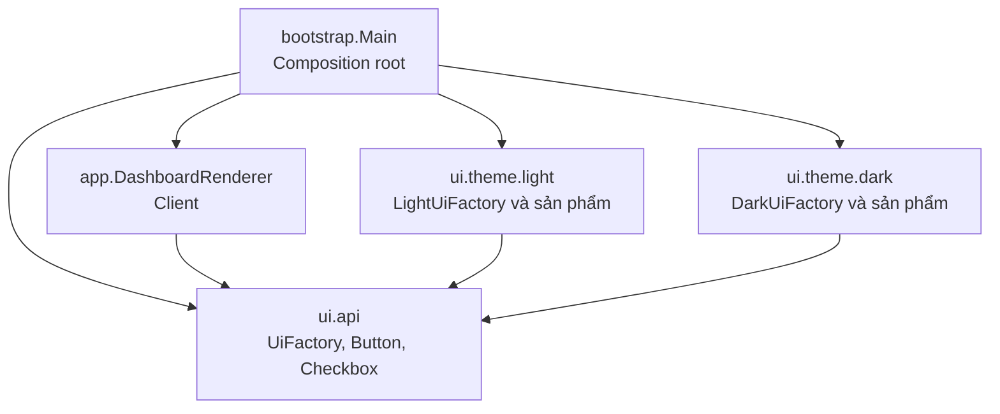

# Đặt interface và lớp triển khai trong cấu trúc package có hướng phụ thuộc rõ ràng

Trong **Abstract Factory**, việc khai báo một interface `Factory` và nhiều lớp triển khai mới chỉ giải quyết một phần bài toán. Khi tích hợp pattern vào ứng dụng, ta còn phải quyết định **interface nằm ở package nào, từng họ sản phẩm nằm ở đâu và lớp nào được phép phụ thuộc vào lớp nào**. Đặt sai ranh giới package có thể khiến lớp nghiệp vụ phải import một factory cụ thể, làm mất lợi ích thay thế cả họ sản phẩm của Abstract Factory.

Bài học này thuộc chủ đề **Tích hợp kiến trúc** trong module học về **Abstract Factory thuộc nhóm Creational Design Pattern**. Mục tiêu là thiết kế cấu trúc package đủ rõ để thêm hoặc đổi một họ sản phẩm mà phần mã sử dụng chúng ít bị ảnh hưởng.

## 1. Bài toán tích hợp: thay cả họ đối tượng, giữ nguyên mã sử dụng

Giả sử một ứng dụng bảng điều khiển hỗ trợ hai giao diện sáng (`light`) và tối (`dark`). Mỗi giao diện cần một **bộ sản phẩm tương thích**: `Button` và `Checkbox`.

- Phần `DashboardRenderer` chỉ cần biết cách tạo và hiển thị `Button`, `Checkbox`; nó không cần biết class `LightButton` hay `DarkCheckbox`.
- `LightUiFactory` phải tạo **cả** `LightButton` và `LightCheckbox`; `DarkUiFactory` phải tạo **cả** `DarkButton` và `DarkCheckbox`.
- Mã khởi động ứng dụng chọn một factory dựa trên cấu hình, sau đó truyền factory đó vào `DashboardRenderer`.

Nếu `DashboardRenderer` tự gọi `new LightButton(...)`, import `LightUiFactory` hoặc dùng `if/else` để chọn theme, nó sẽ bị gắn chặt với cơ chế triển khai. Khi chuyển theme, những lớp đang sử dụng sản phẩm cũng có nguy cơ phải sửa.

Trong Abstract Factory, có hai loại hợp đồng chính:

| Thành phần | Vai trò | Ví dụ |
| --- | --- | --- |
| **Abstract products** | Khai báo hành vi mà client có thể sử dụng | `Button`, `Checkbox` |
| **Abstract factory** | Khai báo cách tạo một bộ sản phẩm | `UiFactory` |
| **Concrete products** | Hiện thực hành vi theo từng họ | `LightButton`, `DarkCheckbox` |
| **Concrete factories** | Tạo đúng các sản phẩm thuộc cùng một họ | `LightUiFactory`, `DarkUiFactory` |
| **Client** | Sử dụng các hợp đồng, không biết class cụ thể | `DashboardRenderer` |
| **Composition root** | Chọn và lắp các đối tượng lúc khởi động | `Main` |

## 2. Nguyên tắc quan trọng nhất: hướng phụ thuộc đi về hợp đồng

Quy ước `A → B` trong sơ đồ dưới đây có nghĩa là **mã nguồn của A biết tới B qua import, kiểu dữ liệu hoặc lời gọi trực tiếp** (phụ thuộc khi biên dịch). Đây không phải sơ đồ thứ tự gọi hàm khi chạy.



Sơ đồ thể hiện bốn quy tắc:

1. **Hợp đồng độc lập với triển khai:** `ui.api` không import class từ `ui.theme.light` hoặc `ui.theme.dark`.
2. **Client phụ thuộc vào hợp đồng:** `app.DashboardRenderer` chỉ sử dụng kiểu `UiFactory`, `Button`, `Checkbox`.
3. **Các họ triển khai phụ thuộc vào hợp đồng:** mỗi concrete factory implements `UiFactory`, còn các concrete product implements product interface tương ứng. Các họ triển khai không phụ thuộc lẫn nhau.
4. **Chỉ vùng lắp ghép biết các triển khai cụ thể:** `bootstrap.Main` có thể import `LightUiFactory` và `DarkUiFactory` để lựa chọn và truyền một thể hiện vào client.

Nguyên tắc này phù hợp với **Dependency Inversion Principle (DIP)**: chính sách hoặc tác vụ ở mức cao phụ thuộc vào abstraction ổn định; chi tiết triển khai cũng phụ thuộc vào abstraction đó. Việc client gọi một đối tượng `LightButton` **lúc chạy** không tạo ra phụ thuộc vào class `LightButton` **trong mã nguồn client**, miễn client chỉ giữ tham chiếu kiểu `Button`.

> Package chỉ giúp diễn đạt ranh giới về mặt tổ chức. Java không tự cấm một lớp trong `app` import `LightButton` nếu class đó `public` và nằm trên classpath. Muốn biến quy ước thành ràng buộc có thể kiểm tra, cần giới hạn visibility, tách build module hoặc thêm bài kiểm tra kiến trúc.

## 3. Cấu trúc package đề xuất

Ví dụ sử dụng Java 17, với package gốc `com.example.dashboard`:

```text
src/main/java/com/example/dashboard/
├── app/
│   └── DashboardRenderer.java
├── ui/
│   ├── api/
│   │   ├── Button.java
│   │   ├── Checkbox.java
│   │   └── UiFactory.java
│   └── theme/
│       ├── light/
│       │   └── LightUiFactory.java
│       └── dark/
│           └── DarkUiFactory.java
└── bootstrap/
    └── Main.java
```

Trong ví dụ ngắn này, mỗi file factory chứa thêm hai concrete product có visibility **package-private**. Trong dự án thực, có thể tách `LightButton.java`, `LightCheckbox.java`, ... thành các file riêng **trong cùng package** mà không đổi quy tắc phụ thuộc.

Vai trò của từng vùng:

| Package | Chứa gì? | Được phép biết gì? |
| --- | --- | --- |
| `ui.api` | Interface của factory và các sản phẩm | Các kiểu nền tảng cần thiết; không biết theme cụ thể |
| `app` | Luồng xử lý sử dụng sản phẩm | `ui.api`, không import `ui.theme.*` |
| `ui.theme.light` | Factory và sản phẩm của theme sáng | `ui.api`, các thư viện nội bộ của theme sáng |
| `ui.theme.dark` | Factory và sản phẩm của theme tối | `ui.api`, các thư viện nội bộ của theme tối |
| `bootstrap` | Khởi tạo cấu hình, chọn triển khai, nối dependency | `app`, `ui.api`, các concrete factory cần lắp ghép |

Đặt `UiFactory` gần **phía sử dụng hợp đồng** là điều quan trọng. Nếu kiến trúc dự án tổ chức theo feature hoặc hexagonal architecture, có thể đặt nó ở `app.port.UiFactory` hoặc một module contract độc lập thay cho tên `ui.api`. Tên package có thể thay đổi; **chiều phụ thuộc phải giữ nguyên**.

## 4. Ví dụ Java đầy đủ: đặt đúng interface, implementation và nơi lắp ghép

### 4.1. Khai báo hợp đồng sản phẩm và factory

`ui/api/Button.java`:

```java
package com.example.dashboard.ui.api;

public interface Button {
    String render();
}
```

`ui/api/Checkbox.java`:

```java
package com.example.dashboard.ui.api;

public interface Checkbox {
    String render();
}
```

`ui/api/UiFactory.java`:

```java
package com.example.dashboard.ui.api;

public interface UiFactory {
    Button createButton(String label);

    Checkbox createCheckbox(String label, boolean checked);
}
```

`UiFactory` trả về **kiểu trừu tượng**, không trả về `LightButton` hoặc `DarkCheckbox`. Nhờ đó, chữ ký phương thức có thể được sử dụng bởi client mà không biết họ sản phẩm đang được chọn.

### 4.2. Triển khai họ sản phẩm sáng

`ui/theme/light/LightUiFactory.java`:

```java
package com.example.dashboard.ui.theme.light;

import com.example.dashboard.ui.api.Button;
import com.example.dashboard.ui.api.Checkbox;
import com.example.dashboard.ui.api.UiFactory;

public final class LightUiFactory implements UiFactory {
    @Override
    public Button createButton(String label) {
        return new LightButton(label);
    }

    @Override
    public Checkbox createCheckbox(String label, boolean checked) {
        return new LightCheckbox(label, checked);
    }
}

final class LightButton implements Button {
    private final String label;

    LightButton(String label) {
        this.label = label;
    }

    @Override
    public String render() {
        return "LIGHT | Button: " + label;
    }
}

final class LightCheckbox implements Checkbox {
    private final String label;
    private final boolean checked;

    LightCheckbox(String label, boolean checked) {
        this.label = label;
        this.checked = checked;
    }

    @Override
    public String render() {
        return "LIGHT | Checkbox: " + label + " (" + checked + ")";
    }
}
```

`LightButton` và `LightCheckbox` không có modifier `public`, nên mã từ package khác không thể trực tiếp khởi tạo hai lớp này. `LightUiFactory` là điểm truy cập công khai duy nhất của họ `light` trong ví dụ.

### 4.3. Triển khai họ sản phẩm tối

`ui/theme/dark/DarkUiFactory.java`:

```java
package com.example.dashboard.ui.theme.dark;

import com.example.dashboard.ui.api.Button;
import com.example.dashboard.ui.api.Checkbox;
import com.example.dashboard.ui.api.UiFactory;

public final class DarkUiFactory implements UiFactory {
    @Override
    public Button createButton(String label) {
        return new DarkButton(label);
    }

    @Override
    public Checkbox createCheckbox(String label, boolean checked) {
        return new DarkCheckbox(label, checked);
    }
}

final class DarkButton implements Button {
    private final String label;

    DarkButton(String label) {
        this.label = label;
    }

    @Override
    public String render() {
        return "DARK | Button: " + label;
    }
}

final class DarkCheckbox implements Checkbox {
    private final String label;
    private final boolean checked;

    DarkCheckbox(String label, boolean checked) {
        this.label = label;
        this.checked = checked;
    }

    @Override
    public String render() {
        return "DARK | Checkbox: " + label + " (" + checked + ")";
    }
}
```

Mỗi concrete factory tạo sản phẩm **cùng một theme**. Đây là điểm khác biệt cốt lõi giữa Abstract Factory với việc chỉ gom các constructor hoặc static factory method rời rạc.

### 4.4. Client chỉ phụ thuộc vào interface

`app/DashboardRenderer.java`:

```java
package com.example.dashboard.app;

import com.example.dashboard.ui.api.Button;
import com.example.dashboard.ui.api.Checkbox;
import com.example.dashboard.ui.api.UiFactory;

public final class DashboardRenderer {
    private final UiFactory uiFactory;

    public DashboardRenderer(UiFactory uiFactory) {
        this.uiFactory = uiFactory;
    }

    public String render() {
        Button saveButton = uiFactory.createButton("Lưu");
        Checkbox notifications = uiFactory.createCheckbox("Thông báo", true);
        return saveButton.render() + "\n" + notifications.render();
    }
}
```

`DashboardRenderer` nhận factory qua **constructor injection**. Nó không phải chọn `light`/`dark` và không tạo concrete product bằng `new`. Vì thế, cùng một class có thể hoạt động với cả hai họ sản phẩm.

### 4.5. Composition root là nơi duy nhất chọn họ triển khai

`bootstrap/Main.java`:

```java
package com.example.dashboard.bootstrap;

import com.example.dashboard.app.DashboardRenderer;
import com.example.dashboard.ui.api.UiFactory;
import com.example.dashboard.ui.theme.dark.DarkUiFactory;
import com.example.dashboard.ui.theme.light.LightUiFactory;
import java.util.Locale;

public final class Main {
    public static void main(String[] args) {
        String theme = args.length > 0
                ? args[0].toLowerCase(Locale.ROOT)
                : "light";

        UiFactory factory = switch (theme) {
            case "light" -> new LightUiFactory();
            case "dark" -> new DarkUiFactory();
            default -> throw new IllegalArgumentException("Theme không hỗ trợ: " + theme);
        };

        DashboardRenderer renderer = new DashboardRenderer(factory);
        System.out.println(renderer.render());
    }
}
```

Với tham số `light`, kết quả là:

```text
LIGHT | Button: Lưu
LIGHT | Checkbox: Thông báo (true)
```

Với tham số `dark`, kết quả là:

```text
DARK | Button: Lưu
DARK | Checkbox: Thông báo (true)
```

Ở đây `render()` chỉ trả chuỗi để làm rõ hành vi và hướng phụ thuộc; trong ứng dụng thực, concrete product có thể tạo component của UI framework, truy cập widget toolkit hoặc trả kết quả dưới dạng đối tượng. Nguyên tắc package không thay đổi.

**Kiểm tra import để thấy khác biệt:** `DashboardRenderer` chỉ import `ui.api`, trong khi `Main` là nơi import các concrete factory. Đó là chủ ý kiến trúc, không phải sự ngẫu nhiên của cách sắp xếp file.

## 5. Mở rộng họ sản phẩm và giữ tương thích

Giả sử ứng dụng thêm theme `high-contrast`:

1. Tạo package `ui.theme.highcontrast`, hiện thực `HighContrastUiFactory`, `HighContrastButton` và `HighContrastCheckbox` theo đúng hợp đồng `ui.api`.
2. Thêm lựa chọn `high-contrast` vào cấu hình/lắp ghép trong `bootstrap` (hoặc cấu hình dependency injection tương đương).
3. Giữ nguyên `DashboardRenderer` và các lớp client chỉ phụ thuộc vào `UiFactory`, `Button`, `Checkbox`.

Đây là hướng mở rộng mà Abstract Factory hỗ trợ tốt: **thêm một họ sản phẩm mới khi tập loại sản phẩm tương đối ổn định**. Ngược lại, nếu thêm một loại sản phẩm mới như `Slider` vào `UiFactory`, ta thường phải cập nhật giao diện factory và **tất cả** concrete factory, đồng thời triển khai `LightSlider`, `DarkSlider`, ... Đó là đánh đổi cần cân nhắc trước khi thiết kế factory quá lớn.

Đừng để một factory tự tạo lẫn sản phẩm của hai theme (ví dụ `LightButton` nhưng `DarkCheckbox`) nếu yêu cầu là thay nguyên bộ nhất quán. Việc duy trì quan hệ *cùng họ* là trách nhiệm của concrete factory.

## 6. Từ package đến ranh giới module có thể kiểm soát

Khi dự án phát triển, package rõ ràng là bước đầu; build module có thể làm quy tắc mạnh hơn:

| Module ví dụ | Chứa | Phụ thuộc khi biên dịch |
| --- | --- | --- |
| `ui-contract` | `ui.api` | Không phụ thuộc `theme-*` hoặc `app-core` |
| `app-core` | `app` | `ui-contract` |
| `theme-light` | `ui.theme.light` | `ui-contract` |
| `theme-dark` | `ui.theme.dark` | `ui-contract` |
| `launcher` | `bootstrap` | `app-core`, `ui-contract`, `theme-light`, `theme-dark` |

Các mũi tên trên là quan hệ module phụ thuộc khi **biên dịch**; công cụ build như Maven hoặc Gradle cho phép khai báo chúng một cách tường minh. Nếu `app-core` không có dependency tới `theme-light`, một import nhầm `LightUiFactory` ở client sẽ gây lỗi biên dịch, thay vì chỉ vi phạm quy ước tài liệu.

Trong một ứng dụng dùng Spring hoặc dependency injection container, `bootstrap` có thể là lớp `@Configuration` khai báo bean `UiFactory` cho theme đã chọn. Cơ chế nối đối tượng thay đổi nhưng **client vẫn nhận `UiFactory`**, không import concrete factory. Nếu dùng cơ chế auto-discovery, cũng cần bảo đảm chỉ chọn một factory phù hợp theo cấu hình, tránh nhiều bean cùng kiểu gây nhập nhằng.

Có thể bổ sung bài kiểm tra kiến trúc bằng ArchUnit (minh họa với JUnit 5 và ArchUnit đã được cấu hình làm dependency test):

```java
package com.example.dashboard;

import com.tngtech.archunit.junit.AnalyzeClasses;
import com.tngtech.archunit.junit.ArchTest;
import com.tngtech.archunit.lang.ArchRule;

import static com.tngtech.archunit.lang.syntax.ArchRuleDefinition.noClasses;

@AnalyzeClasses(packages = "com.example.dashboard")
class PackageDependencyTest {
    @ArchTest
    static final ArchRule app_does_not_import_concrete_themes =
            noClasses().that().resideInAPackage("..app..")
                    .should().dependOnClassesThat()
                    .resideInAnyPackage("..ui.theme..");
}
```

Quy tắc này nhằm phát hiện khi mã `app` bắt đầu phụ thuộc vào một theme cụ thể. Khi có nhiều tầng, có thể bổ sung các quy tắc ngăn `ui.api` phụ thuộc ngược về `app`, ngăn `theme.light` import `theme.dark` và phát hiện chu trình phụ thuộc.

## 7. Dấu hiệu đặt package sai và cách khắc phục

| Dấu hiệu | Hậu quả | Cách điều chỉnh |
| --- | --- | --- |
| `UiFactory` được khai báo ngay trong `ui.theme.light` | Client muốn dùng contract phải phụ thuộc package triển khai | Chuyển contract vào package/module trung lập như `ui.api` hoặc port của client |
| `DashboardRenderer` import `LightUiFactory`, `DarkButton` | Thay họ sản phẩm đòi sửa client | Inject `UiFactory`; client chỉ thao tác qua product interface |
| `switch (theme)` xuất hiện ở nhiều service | Logic lựa chọn bị lặp, dễ tạo bộ sản phẩm không nhất quán | Chỉ chọn concrete factory ở composition root |
| `LightUiFactory` gọi `new DarkCheckbox(...)` | Một factory trả về các sản phẩm không cùng họ | Giữ toàn bộ sản phẩm theme sáng trong `ui.theme.light` |
| `ui.api` import class từ `ui.theme.*` | Hợp đồng phụ thuộc ngược vào chi tiết, dễ hình thành chu trình | Làm contract độc lập; chuyển logic triển khai xuống concrete package |
| Tất cả interface, client và concrete class nằm trong một package `factory` | Khó nhìn ra ranh giới và kiểm soát dependency | Phân chia theo `api`, client, từng họ triển khai và `bootstrap` |
| Mọi factory được gom vào một interface rất lớn | Thêm sản phẩm mới buộc sửa hàng loạt họ | Chỉ gom **những sản phẩm thực sự cần thay cùng nhau**; tách họ/factory theo nhóm trách nhiệm nếu cần |

Không có một tên package duy nhất đúng cho mọi dự án. Với clean/hexagonal architecture, contract có thể thuộc tầng application; với ứng dụng thư viện UI, contract có thể ở module `ui-api`. Tiêu chí quyết định là **code cấp cao chỉ biết hợp đồng mà nó cần**, và chỉ vùng lắp ghép mới phải biết cách tạo implementation cụ thể.

## 8. Checklist khi review cấu trúc Abstract Factory

- [ ] `Button`, `Checkbox`, `UiFactory` được đặt trong package hợp đồng không phụ thuộc các theme cụ thể.
- [ ] Client sử dụng `UiFactory` và product interface; không `new` concrete product, không chứa điều kiện chọn theme.
- [ ] Mỗi concrete factory tạo một bộ sản phẩm tương thích thuộc đúng họ.
- [ ] Các implementation được nhóm theo họ (`light`, `dark`, ...), không import chéo nhau.
- [ ] Composition root được xác định rõ: chịu trách nhiệm chọn factory và inject cho client.
- [ ] Visibility/package hoặc module dependency ngăn mã bên ngoài phụ thuộc nhầm vào chi tiết không cần thiết.
- [ ] Có cách kiểm tra hướng phụ thuộc khi dự án lớn lên: module build, kiểm tra import hoặc ArchUnit.

**Kết luận:** Trong Abstract Factory, `api` là đường biên giữa mã sử dụng và các họ triển khai. Client và concrete factory đều phụ thuộc vào đường biên này; composition root là nơi chọn cách lắp ghép. Khi duy trì đúng hướng phụ thuộc, ứng dụng có thể thay cả một họ đối tượng mà không làm lan rộng thay đổi sang các lớp đang sử dụng chúng.
