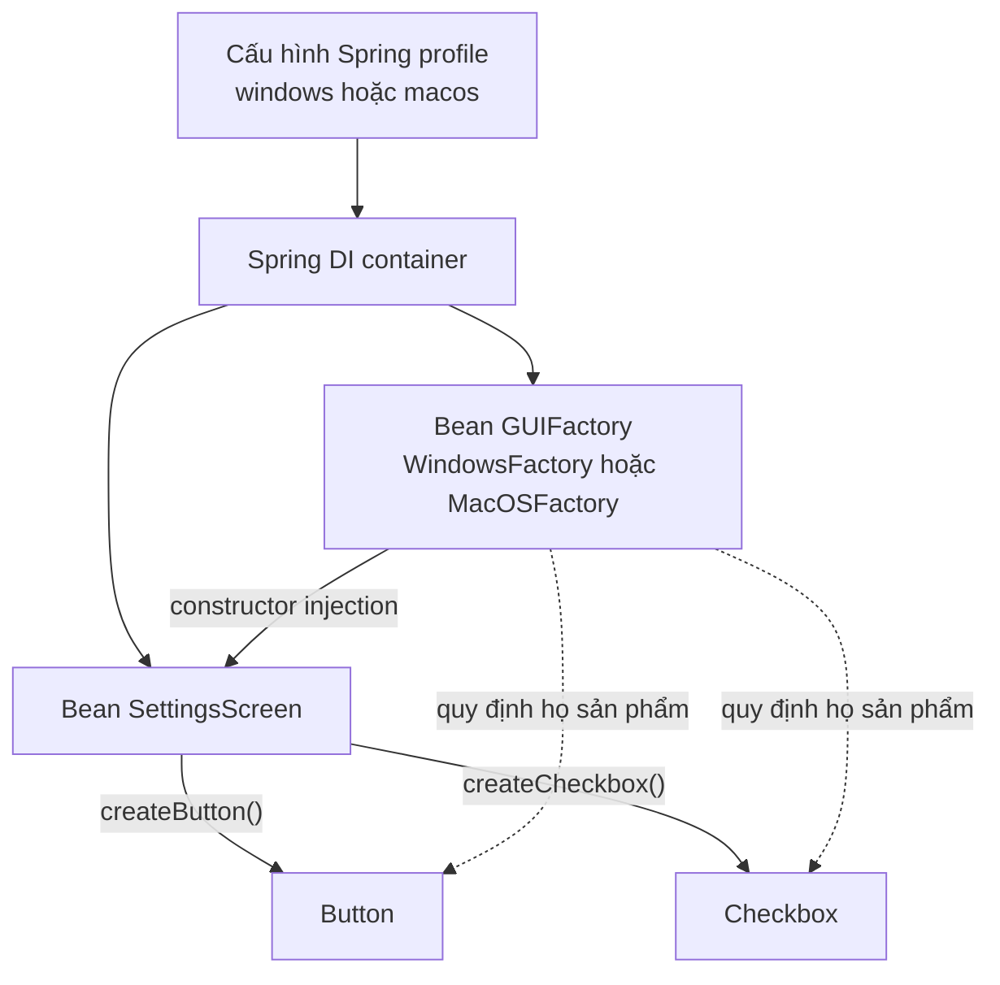
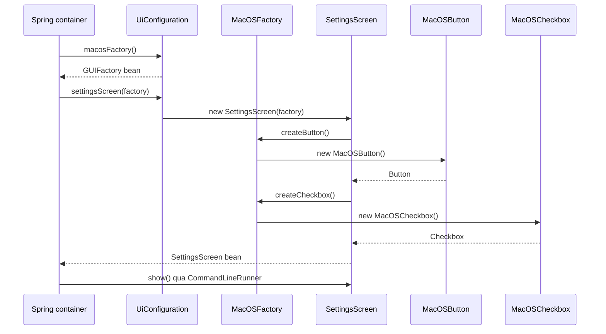

# Kết hợp Abstract Factory với dependency injection container khi ứng dụng đã sử dụng container

## 1. Đặt đúng trách nhiệm trong kiến trúc

Trong ứng dụng Java đã sử dụng **dependency injection (DI) container** như Spring, các service thường được container tạo và tiêm qua constructor. Tuy nhiên, có những thành phần phải tạo **nhiều sản phẩm liên quan thuộc cùng một họ**. Ví dụ ứng dụng có hai phong cách giao diện Windows và macOS, mỗi phong cách gồm:

- **Button**: nút lưu cài đặt.
- **Checkbox**: ô chọn bật hoặc tắt tự động lưu.

Ứng dụng cần một cặp thành phần nhất quán: khi chọn Windows, cả nút lẫn ô chọn đều mang phong cách Windows. Nếu client tự gọi `new WindowsButton()` và `new MacOSCheckbox()`, giao diện có thể bị trộn họ. Mẫu thiết kế **Abstract Factory** đưa quy tắc tạo một họ sản phẩm về một giao diện factory chung.

Khi đã có container, vấn đề không phải chọn giữa DI và Abstract Factory. Hai cơ chế đảm nhiệm **hai trách nhiệm bổ sung nhau**:

| Thành phần | Câu hỏi nó giải quyết | Ví dụ |
| --- | --- | --- |
| DI container | Khi lắp ghép ứng dụng, đối tượng nào được tiêm vào client? | Spring đăng ký một bean `GUIFactory` phù hợp với cấu hình. |
| Abstract Factory | Khi cần sản phẩm, những biến thể nào được cấp để tạo một họ nhất quán? | `createButton()` và `createCheckbox()` cùng lấy sản phẩm của Windows hoặc macOS. |
| Concrete Factory | Tạo hoặc cung cấp sản phẩm thuộc họ cụ thể bằng cách nào? | `WindowsFactory` cấp `WindowsButton` và `WindowsCheckbox`. |
| Product | Client sử dụng sản phẩm qua hợp đồng nào? | `Button`, `Checkbox` là interface; các biến thể là lớp hiện thực. |
| Client | Sử dụng sản phẩm để phục vụ chức năng nào? | `SettingsScreen` dùng nút và ô chọn để hiện màn hình cài đặt. |

Thiết kế thường dùng là **container chọn factory, factory cấp product, client sử dụng product**. Nhờ vậy việc chọn hệ sinh thái sản phẩm nằm tại cấu hình lắp ghép, còn mã nghiệp vụ không cần biết các lớp sản phẩm cụ thể.

## 2. Sơ đồ ranh giới phụ thuộc



Có hai giai đoạn:

1. **Khởi động:** Container đọc cấu hình, khởi tạo một concrete factory và lắp ghép client với factory theo kiểu `GUIFactory`.
2. **Tạo sản phẩm:** Client gọi các phương thức trên factory được tiêm; factory cung cấp các biến thể `Button` và `Checkbox` cùng họ. Client chỉ gọi phương thức khai báo trong interface sản phẩm.

**Lưu ý:** Factory là một bean Spring không đồng nghĩa mọi product do factory trả về đều là bean Spring. Nếu factory dùng `new WindowsButton()`, Spring không tự quản lý lifecycle, dependency injection hay proxy của đối tượng sản phẩm đó. Phần sau sẽ chỉ ra khi nào có thể giữ cách tạo đơn giản này, và khi nào nên để container cấp product.

## 3. Ví dụ Spring Boot: tiêm một `GUIFactory` theo profile

Ví dụ mô phỏng hai họ GUI bằng chuỗi văn bản, nên có thể quan sát kết quả ngay cả trên máy không có hệ thống đồ họa. Nó minh họa cấu trúc Abstract Factory chứ không tạo cửa sổ GUI thật.

Đặt toàn bộ đoạn mã vào **`src/main/java/demo/abstractfactory/DemoApplication.java`** của một dự án Spring Boot có `spring-boot-starter`. Các kiểu không khai báo `public` để có thể cùng tồn tại trong một tệp; dự án thực tế nên tách ra nhiều tệp/package.

```java
package demo.abstractfactory;

import org.springframework.boot.CommandLineRunner;
import org.springframework.boot.SpringApplication;
import org.springframework.boot.autoconfigure.SpringBootApplication;
import org.springframework.context.annotation.Bean;
import org.springframework.context.annotation.Configuration;
import org.springframework.context.annotation.Profile;

// Abstract Products: các hợp đồng client cần.
interface Button {
    String render(String text);
}

interface Checkbox {
    String render(String text, boolean checked);
}

// Abstract Factory: khai báo cả hai loại sản phẩm trong một họ.
interface GUIFactory {
    Button createButton();
    Checkbox createCheckbox();
}

// Concrete Products thuộc họ Windows.
final class WindowsButton implements Button {
    @Override
    public String render(String text) {
        return "Windows button: [" + text + "]";
    }
}

final class WindowsCheckbox implements Checkbox {
    @Override
    public String render(String text, boolean checked) {
        return "Windows checkbox: [" + (checked ? "x" : " ") + "] " + text;
    }
}

// Concrete Products thuộc họ macOS.
final class MacOSButton implements Button {
    @Override
    public String render(String text) {
        return "macOS button: (" + text + ")";
    }
}

final class MacOSCheckbox implements Checkbox {
    @Override
    public String render(String text, boolean checked) {
        return "macOS checkbox: (" + (checked ? "x" : " ") + ") " + text;
    }
}

// Concrete Factories: mỗi factory cấp đúng cặp sản phẩm cùng họ.
final class WindowsFactory implements GUIFactory {
    @Override
    public Button createButton() {
        return new WindowsButton();
    }

    @Override
    public Checkbox createCheckbox() {
        return new WindowsCheckbox();
    }
}

final class MacOSFactory implements GUIFactory {
    @Override
    public Button createButton() {
        return new MacOSButton();
    }

    @Override
    public Checkbox createCheckbox() {
        return new MacOSCheckbox();
    }
}

// Client: sử dụng các interface, không tự chọn nền tảng.
final class SettingsScreen {
    private final Button saveButton;
    private final Checkbox autoSaveCheckbox;

    SettingsScreen(GUIFactory factory) {
        this.saveButton = factory.createButton();
        this.autoSaveCheckbox = factory.createCheckbox();
    }

    void show() {
        System.out.println(saveButton.render("Save"));
        System.out.println(autoSaveCheckbox.render("Auto-save", true));
    }
}

// Configuration: container chọn và tiêm factory.
@Configuration(proxyBeanMethods = false)
class UiConfiguration {
    @Bean
    @Profile("windows")
    GUIFactory windowsFactory() {
        return new WindowsFactory();
    }

    @Bean
    @Profile("macos")
    GUIFactory macosFactory() {
        return new MacOSFactory();
    }

    @Bean
    SettingsScreen settingsScreen(GUIFactory factory) {
        return new SettingsScreen(factory);
    }
}

@SpringBootApplication
public class DemoApplication {
    public static void main(String[] args) {
        SpringApplication.run(DemoApplication.class, args);
    }

    @Bean
    CommandLineRunner showSettings(SettingsScreen screen) {
        return args -> screen.show();
    }
}
```

### 3.1. Lý do tiêm factory qua container

- `UiConfiguration` là lớp cấu hình có quyền biết đến `WindowsFactory` và `MacOSFactory`. Bean `GUIFactory` được chọn lúc tạo application context dựa trên profile đang hoạt động.
- `settingsScreen(GUIFactory factory)` nhận tham số theo **interface**, do Spring cung cấp. Nó không cần biết lớp factory được chọn cụ thể.
- `SettingsScreen` nhận factory qua constructor, yêu cầu hai product rồi giữ chúng trong các trường kiểu interface. Nó hoàn toàn không cần annotation hoặc API Spring.
- `CommandLineRunner` chỉ kích hoạt công việc hiển thị sau khi Spring đã lắp ghép các bean.

Điều này giúp bảo toàn ranh giới: **Spring ở lớp lắp ghép**, **Abstract Factory ở lớp tạo họ sản phẩm**, **logic của client ở lớp sử dụng sản phẩm**. Client vẫn có thể được tạo thủ công trong unit test.

### 3.2. Chạy với hai họ giao diện

Để mặc định chọn Windows khi không truyền profile khác, đặt vào **`src/main/resources/application.properties`**:

```properties
spring.profiles.default=windows
```

Với dự án Maven có Spring Boot Maven Plugin và Maven Wrapper:

```bash
# Dùng profile mặc định.
./mvnw spring-boot:run

# Chọn macOS lúc khởi chạy.
./mvnw spring-boot:run -Dspring-boot.run.arguments=--spring.profiles.active=macos
```

Trên Windows có thể dùng `mvnw.cmd` thay cho `./mvnw`. Với bản ứng dụng đã đóng gói thành `app.jar`, có thể truyền profile tương tự:

```bash
java -jar app.jar --spring.profiles.active=macos
```

Ngoài log của Spring, với cấu hình macOS hai dòng ứng dụng mong đợi là:

```text
macOS button: (Save)
macOS checkbox: (x) Auto-save
```

Với cấu hình Windows:

```text
Windows button: [Save]
Windows checkbox: [x] Auto-save
```

Trong cả hai lần chạy, **mã `SettingsScreen` không hề thay đổi**. Đây là lợi ích cốt lõi của việc tiêm factory: thay đổi họ sản phẩm ở cấu hình, không phân nhánh theo nền tảng trong client.

### 3.3. Điều kiện để container tiêm đúng factory

Hai profile `windows` và `macos` **không tự loại trừ nhau**. Nếu kích hoạt cả hai, ứng dụng có thể đăng ký hai bean kiểu `GUIFactory`, và Spring không biết nên tiêm bean nào vào `SettingsScreen` (lỗi nhiều ứng viên). Nếu không có profile nào và cũng không có profile mặc định thích hợp, Spring sẽ thiếu bean `GUIFactory`.

Vì vậy, thiết kế cần một **quy tắc cấu hình chọn đúng một họ** cho mỗi application context. Ngoài `@Profile`, dự án có thể dùng bean theo điều kiện cấu hình hoặc qualifier tường minh; chọn cách khớp với hệ thống cấu hình hiện có. Đừng dùng `@Primary` chỉ để che một cấu hình mâu thuẫn mà chưa quyết định rõ họ giao diện mong muốn.

## 4. Theo dõi luồng khởi tạo và sử dụng

Khi chạy bằng profile `macos`, có thể lần theo như sau:



Điểm kiểm tra sự hiểu biết:

1. Spring tạo bean `MacOSFactory` và tiêm nó dưới kiểu `GUIFactory`.
2. `SettingsScreen` gọi `createButton()`, `createCheckbox()` trên **cùng factory**.
3. `MacOSFactory` thực hiện các lệnh `new MacOSButton()`, `new MacOSCheckbox()`.
4. `SettingsScreen.show()` chỉ dùng các phương thức của `Button` và `Checkbox`; nó không cần biết profile hoạt động.

Vì vậy, container không “thay thế” Abstract Factory: container **chọn factory**, còn factory **bảo đảm cách cung cấp cả họ product**.

## 5. Phân biệt vòng đời bean với vòng đời product

Điểm dễ nhầm nhất khi tích hợp là cho rằng factory đã là Spring bean thì product nó tạo cũng được Spring quản lý.

| Cách cấp product | Bên thực hiện | Hệ quả đối với vòng đời |
| --- | --- | --- |
| `return new WindowsButton();` trong factory | Mã factory | Product là đối tượng Java thông thường, không tự có DI, bean callback hoặc proxy Spring. |
| `@Bean GUIFactory windowsFactory()` | Spring | Factory là bean; mặc định singleton, có thể được chia sẻ giữa các client. |
| `ObjectProvider<WindowsButton>.getObject()` trong factory | Spring cung cấp product theo scope bean | Product có thể nhận DI và các cơ chế bean; mỗi lần gọi nhận mới hay cũ tùy scope. |

Ở ví dụ mục 3, factory là bean singleton theo mặc định. Hai product được tạo bằng `new` một lần khi constructor của `SettingsScreen` chạy; `SettingsScreen` cũng là bean singleton mặc định nên giữ lại hai product đó. Nếu muốn màn hình có sản phẩm khác sau khi đổi theme, không thể chỉ sửa một biến cấu hình và mong các đối tượng đã tạo tự biến đổi.

### 5.1. Khi product cũng cần DI: dùng `ObjectProvider`

Nếu `WindowsButton` và `WindowsCheckbox` cần các phụ thuộc do Spring quản lý (ví dụ dịch vụ localization, theme settings, logging/metrics) hoặc cần scope riêng, factory có thể **ủy quyền khâu tạo product cho container**. Ví dụ dưới đây là **cách cấu hình thay thế** cho bean Windows ở mục 3; không nên đăng ký đồng thời hai phương thức tạo bean `windowsFactory` trong cùng một context.

Đoạn mã giả định đã có các interface và product của ví dụ chính:

```java
import org.springframework.beans.factory.ObjectProvider;
import org.springframework.beans.factory.config.ConfigurableBeanFactory;
import org.springframework.context.annotation.Bean;
import org.springframework.context.annotation.Configuration;
import org.springframework.context.annotation.Profile;
import org.springframework.context.annotation.Scope;

@Configuration(proxyBeanMethods = false)
@Profile("windows")
class WindowsUiBeans {
    @Bean
    @Scope(ConfigurableBeanFactory.SCOPE_PROTOTYPE)
    WindowsButton windowsButton() {
        return new WindowsButton();
    }

    @Bean
    @Scope(ConfigurableBeanFactory.SCOPE_PROTOTYPE)
    WindowsCheckbox windowsCheckbox() {
        return new WindowsCheckbox();
    }

    @Bean
    GUIFactory windowsFactory(
            ObjectProvider<WindowsButton> buttons,
            ObjectProvider<WindowsCheckbox> checkboxes) {
        return new GUIFactory() {
            @Override
            public Button createButton() {
                return buttons.getObject();
            }

            @Override
            public Checkbox createCheckbox() {
                return checkboxes.getObject();
            }
        };
    }
}
```

- `@Scope("prototype")` quy định container tạo một instance product mới mỗi lần provider yêu cầu bean.
- `ObjectProvider` tránh việc tiêm sẵn một prototype vào singleton factory ở thời điểm khởi tạo rồi giữ mãi cùng một instance.
- Product do container tạo có thể sử dụng cơ chế tiêm bean và khởi tạo của Spring. Với prototype, Spring **không tự quản lý đầy đủ bước hủy** khi product không còn được dùng, nên tài nguyên cần đóng phải có chiến lược dọn dẹp phù hợp.

**Abstract Factory là hợp đồng cấp một họ sản phẩm; nó không bắt buộc mỗi phương thức phải tự gọi `new`.** Factory có thể dùng constructor, provider, pool hoặc cache miễn vẫn tôn trọng kiểu trả về, ngữ nghĩa vòng đời và tính nhất quán của họ.

### 5.2. Khi không cần biến product thành bean

Nếu product là đối tượng nhỏ không có phụ thuộc, không có callback vòng đời hoặc proxy cần Spring áp dụng, để factory tạo bằng `new` thường rõ ràng và tiết kiệm cấu hình hơn. Chỉ đăng ký product thành bean khi có nhu cầu thực tế về DI, scope hoặc quản lý vòng đời.

Với client singleton, cũng cần tự hỏi **sản phẩm được tạo lúc nào**: trong constructor như `SettingsScreen` hay mỗi lần người dùng mở màn hình? Chọn thời điểm phù hợp với vòng đời của UI và dữ liệu trạng thái, không mặc định coi tất cả product đều singleton.

## 6. Lỗi tích hợp thường gặp

### 6.1. Client vừa nhận factory vừa tạo concrete product

```java
// Ví dụ sai về nhất quán họ (giả sử các kiểu đã khai báo).
final class BadScreen {
    private final Button button;
    private final Checkbox checkbox;

    BadScreen(GUIFactory factory) {
        button = factory.createButton();
        checkbox = new WindowsCheckbox(); // Sai khi factory là MacOSFactory.
    }
}
```

Lớp này vẫn có thể biên dịch, nhưng client phụ thuộc trực tiếp vào một product Windows và có thể trộn hai họ. Sửa bằng cách gọi `factory.createCheckbox()` để lấy cả hai product từ cùng factory.

### 6.2. Container có nhiều factory mà không chọn một

```java
// Phác họa cấu hình có thể gây nhập nhằng nếu cùng hoạt động.
@Bean
GUIFactory windowsFactory() { return new WindowsFactory(); }

@Bean
GUIFactory macosFactory() { return new MacOSFactory(); }
```

Nếu một constructor yêu cầu đúng một `GUIFactory`, cần cấu hình sao cho chỉ có một ứng viên thích hợp hoặc chỉ rõ bean muốn dùng. Có thể dùng profile, điều kiện cấu hình, qualifier hoặc một lớp chọn factory tập trung; **quy tắc chọn phải tương ứng với yêu cầu nghiệp vụ**, không dựa vào thứ tự khai báo ngẫu nhiên.

### 6.3. Giả định đổi profile là đổi theme tức thì

Profile thường được chọn khi tạo Spring application context. Nếu `SettingsScreen` đã lấy product và lưu trong trường `final`, việc thay đổi giá trị cấu hình về sau không tự làm product chuyển từ Windows sang macOS. Tính năng đổi theme trong lúc chạy cần cơ chế chủ động tạo lại product/client hoặc thiết kế các component hỗ trợ cập nhật theme.

### 6.4. Dùng container làm service locator ở khắp client

Nếu mọi màn hình gọi `applicationContext.getBean(...)` hoặc đọc tên bean để tự quyết định họ sản phẩm, phụ thuộc vào container và cấu hình bị rải khắp ứng dụng. Với bài toán có nhiều loại sản phẩm theo cùng họ, tiêm `GUIFactory` vào client giữ hợp đồng tạo sản phẩm rõ ràng hơn và giúp unit test độc lập với Spring.

## 7. Cân nhắc khi chọn Abstract Factory trong ứng dụng có DI

Không phải trường hợp nào có nhiều implementation cũng cần Abstract Factory.

| Yêu cầu | Hướng tiếp cận hợp lý | Vì sao |
| --- | --- | --- |
| Chỉ chọn **một** implementation dịch vụ gửi email theo môi trường. | Tiêm interface dịch vụ trực tiếp bằng container. | Không có họ gồm nhiều loại product liên quan. |
| Cần đồng bộ `Button`, `Checkbox` và `Menu` theo Windows/macOS. | Tiêm một `GUIFactory` bằng container. | Factory diễn đạt và tập trung quy tắc cùng họ. |
| Client cần tạo nhiều product mới khi có sự kiện. | Giữ factory trong client và gọi khi phát sinh nhu cầu. | Cho phép tạo ở đúng thời điểm và theo cùng họ. |
| Product có dependency hoặc scope do Spring quản lý. | Dùng provider hoặc cơ chế container trong concrete factory. | Kết hợp đúng vòng đời bean với hợp đồng Abstract Factory. |
| Product đều đã cố định trong cấu hình và không có ràng buộc cùng họ. | Xem xét tiêm product trực tiếp. | Tránh thêm lớp factory khi không có giá trị thiết kế rõ ràng. |

Abstract Factory thường **thuận lợi khi thêm họ mới**: thêm concrete products và concrete factory mới, rồi cập nhật cấu hình DI để chọn factory đó. Nhưng khi thêm **một loại product mới**, chẳng hạn `Slider`, cần bổ sung `createSlider()` vào `GUIFactory`, đồng thời cập nhật **mọi** concrete factory và lớp sản phẩm liên quan. Đó là đánh đổi phải nhận thức trước khi chọn mẫu.

## 8. Kiểm thử hai tầng: client và cấu hình tích hợp

Vì `SettingsScreen` không phụ thuộc API Spring, có thể tạo fake factory để kiểm tra logic sử dụng product mà không khởi động application context:

```java
GUIFactory fakeFactory = new GUIFactory() {
    @Override
    public Button createButton() {
        return text -> "Fake button: " + text;
    }

    @Override
    public Checkbox createCheckbox() {
        return (text, checked) ->
                "Fake checkbox: " + text + "=" + checked;
    }
};

new SettingsScreen(fakeFactory).show();
```

Kết quả minh họa:

```text
Fake button: Save
Fake checkbox: Auto-save=true
```

Nên phân biệt:

1. **Unit test:** Kiểm tra client dùng đúng hợp đồng sản phẩm với fake factory; không cần container chạy.
2. **Integration test:** Với mỗi profile, xác nhận context có đúng factory được chọn, tiêm được vào client và tạo product thuộc đúng họ.
3. **Contract test cho concrete factory:** Kiểm tra `WindowsFactory` trả cả `WindowsButton` lẫn `WindowsCheckbox`, tương tự macOS. Chỉ kiểm tra mã biên dịch là chưa đủ, vì `WindowsFactory.createCheckbox()` trả về `MacOSCheckbox` vẫn hợp lệ về kiểu `Checkbox` nhưng sai quy ước nhất quán họ.

Các kiểm tra này đánh giá ba trách nhiệm độc lập: **client sử dụng đúng abstraction**, **container chọn đúng factory**, và **factory cấp đúng họ product**.

## 9. Checklist ra quyết định kiến trúc

Trước khi tích hợp Abstract Factory vào ứng dụng đã có DI container, hãy tự trả lời:

1. Có thực sự tồn tại **một họ gồm nhiều loại product liên quan** cần tạo đồng bộ?
2. Client có nhận `GUIFactory` qua constructor và chỉ dùng `Button`/`Checkbox` qua interface không?
3. Logic chọn Windows/macOS có tập trung ở configuration, tránh xuất hiện lại trong từng client không?
4. Cấu hình có bảo đảm đúng một factory phù hợp cho mỗi context không?
5. Factory có luôn cung cấp **đúng cùng một họ sản phẩm**, kể cả khi trả về product do Spring tạo không?
6. Product cần được tạo mới theo lần gọi, theo lần mở màn hình hay sống cùng singleton client? Ai quản lý resource của nó?
7. Có thể kiểm tra client bằng fake factory và kiểm tra cách chọn factory bằng integration test tách biệt không?
8. Khi thêm một họ mới hoặc thêm một loại product mới, các lớp và cấu hình nào buộc phải thay đổi?

Một thiết kế được phân chia trách nhiệm rõ ràng sẽ có luồng: **DI container lắp ghép factory → client yêu cầu product qua factory → factory cấp các product cùng họ → client sử dụng product qua interface**. Cách kết hợp này có ích khi ứng dụng Java vốn đã có container nhưng vẫn cần quy tắc tạo các họ sản phẩm nhất quán mà dependency injection trực tiếp từng product khó thể hiện rõ ràng.
