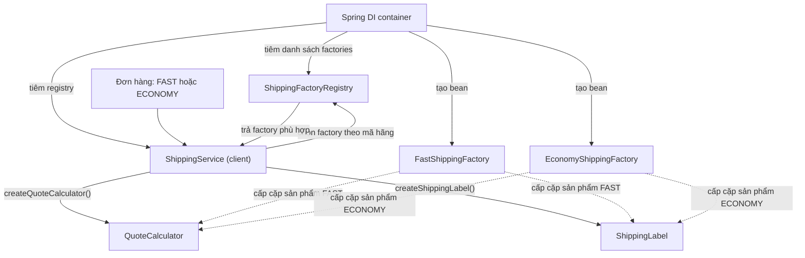
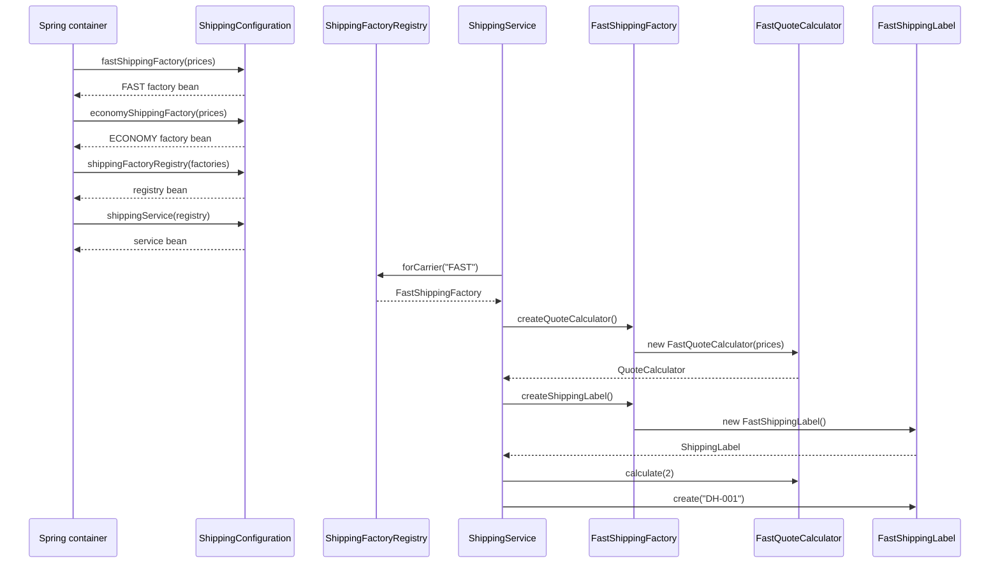

# Phân biệt factory nghiệp vụ với chức năng khởi tạo và quản lý bean của container

## 1. Vì sao dễ nhầm hai loại “factory”?

Khi học **Abstract Factory** trong nhóm *Creational Design Patterns*, chúng ta thường gặp các interface như `GUIFactory`, `PaymentFactory` hoặc `ShippingFactory`. Trong ứng dụng Java dùng Spring, ta lại gặp `BeanFactory`, `FactoryBean`, phương thức `@Bean` và các cơ chế tự động khởi tạo đối tượng. Vì cùng có chức năng tạo hoặc cung cấp đối tượng, những thành phần này dễ bị hiểu là cùng một mẫu thiết kế.

Thực tế, chúng giải quyết các bài toán ở **hai cấp độ khác nhau**:

- **Factory nghiệp vụ (business/application factory)** trả lời câu hỏi: *Đối với một yêu cầu nghiệp vụ cụ thể, phải tạo những đối tượng nào để chúng tương thích và tuân thủ quy tắc nghiệp vụ?* Trong Abstract Factory, factory thường cung cấp **nhiều loại sản phẩm thuộc cùng một họ**.
- **DI container** trả lời câu hỏi: *Khi lắp ghép ứng dụng, những đối tượng nào được đăng ký, khởi tạo, tiêm phụ thuộc và quản lý vòng đời như bean?*

Một factory nghiệp vụ **có thể đồng thời là một bean do container quản lý**. Điều đó không biến factory thành chính container; trách nhiệm của nó vẫn là cung cấp các sản phẩm nghiệp vụ đúng hợp đồng.

**Mục tiêu bài học:** đọc một thiết kế Java/Spring và chỉ ra được đâu là quy tắc tạo sản phẩm nghiệp vụ, đâu là hạ tầng tạo/tiêm bean, khi nào chúng phối hợp, và khi nào không nên đưa việc chọn sản phẩm vào container.

## 2. So sánh trách nhiệm và vòng đời

| Tiêu chí | Factory nghiệp vụ theo Abstract Factory | DI container |
| --- | --- | --- |
| Mục đích | Cung cấp **họ sản phẩm liên quan** phù hợp với yêu cầu nghiệp vụ. | Lắp ghép các đối tượng thành ứng dụng và quản lý các bean. |
| Hợp đồng | Các phương thức như `createQuoteCalculator()`, `createShippingLabel()`. | Đăng ký bean, giải quyết phụ thuộc, chọn implementation, quản lý scope/lifecycle. |
| Thời điểm tạo | Có thể ở lúc xử lý từng đơn hàng, phiên làm việc hoặc tác vụ. | Thường thiết lập phần lớn singleton khi khởi động; các scope khác có thể tạo theo nhu cầu. |
| Tiêu chí chọn | Họ sản phẩm theo thông tin nghiệp vụ: đơn hàng dùng hãng vận chuyển nào? | Cấu hình container: kiểu bean, qualifier, profile, scope và điều kiện khai báo. |
| Tính nhất quán | Ràng buộc các loại sản phẩm trong một họ: tính cước và tạo nhãn phải theo cùng hãng. | Không tự hiểu quy tắc nghiệp vụ “cùng một hãng” chỉ từ các kiểu bean. |
| Vòng đời sản phẩm | Tùy cách factory hiện thực: `new`, cache, pool hoặc yêu cầu container cung cấp. | Quản lý vòng đời **bean mà container tạo** theo scope và cơ chế tương ứng. |
| Phụ thuộc vào framework | Có thể viết bằng Java thuần, không cần Spring. | Gắn với API/cấu hình của framework DI cụ thể. |
| Kiểm thử | Có thể dựng factory thật hoặc fake bằng Java thuần. | Có thể dùng integration test để kiểm tra context và cấu hình bean. |

Một interface có tên `Factory` chưa chắc là **Abstract Factory** theo GoF. Để phân tích đúng, hãy xem nó có cung cấp **nhiều loại sản phẩm liên quan** và các concrete factory có thể thay thế nhau để tạo **những họ sản phẩm tương thích** hay không.

### 2.1. Thuật ngữ Spring không đồng nghĩa với Abstract Factory

- **`BeanFactory`** là một giao diện nền tảng của Spring container dùng để truy cập và quản lý bean. Tên có chữ *Factory* nhưng mục đích là quản lý đối tượng của container, không mặc nhiên thể hiện một họ sản phẩm nghiệp vụ.
- **`FactoryBean<T>`** là cơ chế mở rộng của Spring cho phép một bean chuyên tạo hoặc cung cấp một loại đối tượng `T` theo cách riêng; nó không mặc nhiên là Abstract Factory tạo nhiều loại sản phẩm liên quan.
- **`@Bean`** đánh dấu phương thức cấu hình trả về một đối tượng được đăng ký với container. Một phương thức `@Bean` trả về `ShippingFactory` có thể tạo **bean factory nghiệp vụ**, nhưng việc đăng ký bean và việc factory cấp product là hai giai đoạn riêng.
- **`ObjectProvider<T>`** cho phép lấy bean từ container theo nhu cầu. Nó hữu ích khi product cũng cần được Spring quản lý, nhưng bản thân provider không diễn đạt quy tắc một họ nghiệp vụ.

Trong ví dụ dưới đây, **Spring là nơi lắp ghép**, **`ShippingFamilyFactory` là factory nghiệp vụ**, và **`ShippingService` là client**.

## 3. Bài toán thực tế: tạo bộ xử lý vận chuyển theo hãng

Một hệ thống bán hàng hỗ trợ hai hãng giao hàng:

| Hãng | Bộ tính cước | Bộ tạo nhãn |
| --- | --- | --- |
| `FAST` | `FastQuoteCalculator` | `FastShippingLabel` |
| `ECONOMY` | `EconomyQuoteCalculator` | `EconomyShippingLabel` |

Mỗi đơn hàng có mã hãng vận chuyển do nghiệp vụ lựa chọn. Để chuẩn bị giao hàng, hệ thống cần **hai loại sản phẩm liên quan**:

1. `QuoteCalculator` tính phí giao hàng.
2. `ShippingLabel` tạo mã nhãn giao hàng.

Nếu dùng bộ tính cước của `FAST` nhưng nhãn của `ECONOMY`, hệ thống tạo bộ chứng từ không nhất quán. Vì vậy, `ShippingFamilyFactory` phải cung cấp **cả hai sản phẩm thuộc cùng một hãng**.

Khác với việc chọn profile khi khởi động, hai đơn hàng liên tiếp trong **cùng một lần chạy ứng dụng** có thể chọn hai hãng khác nhau. Container có thể đăng ký **cả hai factory bean** ngay từ đầu, còn yêu cầu nghiệp vụ sẽ quyết định dùng factory nào ở thời điểm xử lý từng đơn hàng.



**Chú ý:** Registry ở đây là lớp lựa chọn factory theo **mã hãng của đơn hàng**, không phải lớp truy cập `ApplicationContext`. Nó có thể nhận các factory bằng constructor và hoạt động mà không có Spring. Vai trò này nằm ở lớp ứng dụng, còn container chỉ cung cấp các phụ thuộc đã cấu hình.

## 4. Ví dụ Java/Spring Boot đầy đủ

Ví dụ sau dùng Java 17+ với Spring Boot 3 và `spring-boot-starter`. Nó tính cước theo công thức minh họa và trả về nhãn chuỗi, **không tích hợp API của hãng vận chuyển thật**. Mọi lớp được đặt trong một tệp để có thể quan sát toàn bộ thiết kế. Trong dự án thực tế, nên tách các loại theo package phù hợp.

Lưu vào `src/main/java/demo/shipping/DemoApplication.java`:

```java
package demo.shipping;

import java.util.HashMap;
import java.util.List;
import java.util.Locale;
import java.util.Map;
import org.springframework.boot.CommandLineRunner;
import org.springframework.boot.SpringApplication;
import org.springframework.boot.autoconfigure.SpringBootApplication;
import org.springframework.context.annotation.Bean;
import org.springframework.context.annotation.Configuration;

// Abstract Products: mỗi loại sản phẩm có hợp đồng riêng.
interface QuoteCalculator {
    long calculate(int weightKg);
}

interface ShippingLabel {
    String create(String orderId);
}

// Abstract Factory: cấp cả hai loại sản phẩm cùng một họ.
interface ShippingFamilyFactory {
    String carrierCode();
    QuoteCalculator createQuoteCalculator();
    ShippingLabel createShippingLabel();
}

// Cấu hình dùng chung do container tạo và tiêm vào factories.
record ShippingPrices(long fastBase, long economyBase) {}

// Concrete Products của hãng FAST.
final class FastQuoteCalculator implements QuoteCalculator {
    private final ShippingPrices prices;

    FastQuoteCalculator(ShippingPrices prices) {
        this.prices = prices;
    }

    @Override
    public long calculate(int weightKg) {
        return prices.fastBase() + 5_000L * weightKg;
    }
}

final class FastShippingLabel implements ShippingLabel {
    @Override
    public String create(String orderId) {
        return "FAST/" + orderId;
    }
}

// Concrete Products của hãng ECONOMY.
final class EconomyQuoteCalculator implements QuoteCalculator {
    private final ShippingPrices prices;

    EconomyQuoteCalculator(ShippingPrices prices) {
        this.prices = prices;
    }

    @Override
    public long calculate(int weightKg) {
        return prices.economyBase() + 2_000L * weightKg;
    }
}

final class EconomyShippingLabel implements ShippingLabel {
    @Override
    public String create(String orderId) {
        return "ECONOMY/" + orderId;
    }
}

// Concrete Factories: tạo trọn bộ product của một hãng.
final class FastShippingFactory implements ShippingFamilyFactory {
    private final ShippingPrices prices;

    FastShippingFactory(ShippingPrices prices) {
        this.prices = prices;
    }

    @Override
    public String carrierCode() {
        return "FAST";
    }

    @Override
    public QuoteCalculator createQuoteCalculator() {
        return new FastQuoteCalculator(prices);
    }

    @Override
    public ShippingLabel createShippingLabel() {
        return new FastShippingLabel();
    }
}

final class EconomyShippingFactory implements ShippingFamilyFactory {
    private final ShippingPrices prices;

    EconomyShippingFactory(ShippingPrices prices) {
        this.prices = prices;
    }

    @Override
    public String carrierCode() {
        return "ECONOMY";
    }

    @Override
    public QuoteCalculator createQuoteCalculator() {
        return new EconomyQuoteCalculator(prices);
    }

    @Override
    public ShippingLabel createShippingLabel() {
        return new EconomyShippingLabel();
    }
}

// Registry: chọn factory theo mã hãng từ đơn hàng.
final class ShippingFactoryRegistry {
    private final Map<String, ShippingFamilyFactory> factories;

    ShippingFactoryRegistry(List<ShippingFamilyFactory> candidates) {
        Map<String, ShippingFamilyFactory> found = new HashMap<>();
        for (ShippingFamilyFactory factory : candidates) {
            String code = factory.carrierCode().toUpperCase(Locale.ROOT);
            if (found.putIfAbsent(code, factory) != null) {
                throw new IllegalArgumentException(
                        "Duplicate carrier code: " + code);
            }
        }
        this.factories = Map.copyOf(found);
    }

    ShippingFamilyFactory forCarrier(String carrierCode) {
        if (carrierCode == null || carrierCode.isBlank()) {
            throw new IllegalArgumentException("Carrier code is required");
        }

        String code = carrierCode.trim().toUpperCase(Locale.ROOT);
        ShippingFamilyFactory factory = factories.get(code);
        if (factory == null) {
            throw new IllegalArgumentException(
                    "Unsupported carrier: " + carrierCode);
        }
        return factory;
    }
}

// Client ứng dụng: không phụ thuộc vào tên concrete product.
final class ShippingService {
    private final ShippingFactoryRegistry registry;

    ShippingService(ShippingFactoryRegistry registry) {
        this.registry = registry;
    }

    String prepareShipment(String carrierCode, String orderId, int weightKg) {
        if (orderId == null || orderId.isBlank() || weightKg <= 0) {
            throw new IllegalArgumentException("Invalid shipment");
        }

        ShippingFamilyFactory factory = registry.forCarrier(carrierCode);
        QuoteCalculator calculator = factory.createQuoteCalculator();
        ShippingLabel label = factory.createShippingLabel();

        long price = calculator.calculate(weightKg);
        return orderId + " | " + factory.carrierCode()
                + " | " + price + " VND | " + label.create(orderId);
    }
}

// Hạ tầng Spring: đăng ký và nối các bean.
@Configuration(proxyBeanMethods = false)
class ShippingConfiguration {
    @Bean
    ShippingPrices shippingPrices() {
        return new ShippingPrices(20_000L, 10_000L);
    }

    @Bean
    ShippingFamilyFactory fastShippingFactory(ShippingPrices prices) {
        return new FastShippingFactory(prices);
    }

    @Bean
    ShippingFamilyFactory economyShippingFactory(ShippingPrices prices) {
        return new EconomyShippingFactory(prices);
    }

    @Bean
    ShippingFactoryRegistry shippingFactoryRegistry(
            List<ShippingFamilyFactory> factories) {
        return new ShippingFactoryRegistry(factories);
    }

    @Bean
    ShippingService shippingService(ShippingFactoryRegistry registry) {
        return new ShippingService(registry);
    }
}

@SpringBootApplication
public class DemoApplication {
    public static void main(String[] args) {
        SpringApplication.run(DemoApplication.class, args);
    }

    @Bean
    CommandLineRunner example(ShippingService shipping) {
        return args -> {
            System.out.println(
                    shipping.prepareShipment("FAST", "DH-001", 2));
            System.out.println(
                    shipping.prepareShipment("ECONOMY", "DH-002", 2));
        };
    }
}
```

### 4.1. Khởi động và kết quả

Đặt ví dụ vào dự án Spring Boot 3 đã có JDK 17+ và Spring Boot Maven plugin. Nếu dự án có Maven Wrapper, có thể chạy:

```bash
./mvnw spring-boot:run
```

Trên Windows, dùng `mvnw.cmd`. Ngoài các dòng log của Spring, chương trình in:

```text
DH-001 | FAST | 30000 VND | FAST/DH-001
DH-002 | ECONOMY | 14000 VND | ECONOMY/DH-002
```

Công thức giả định:

- `FAST`: phí gốc 20.000 VND + 5.000 VND/kg → 2 kg thành 30.000 VND.
- `ECONOMY`: phí gốc 10.000 VND + 2.000 VND/kg → 2 kg thành 14.000 VND.

Đây chỉ là dữ liệu mô phỏng để minh họa **cùng một client xử lý nhiều họ sản phẩm trong một lần chạy**.

## 5. Phân tích chính xác đối tượng nào được tạo ở đâu

### 5.1. Container tạo và quản lý những bean nào?

Trong `ShippingConfiguration`, các phương thức `@Bean` đăng ký:

1. Một bean `ShippingPrices` chứa cấu hình tính cước dùng chung.
2. Hai bean `ShippingFamilyFactory`: `FastShippingFactory` và `EconomyShippingFactory`.
3. Một bean `ShippingFactoryRegistry`, nhận danh sách **cả hai** factory do Spring tiêm.
4. Một bean `ShippingService`, nhận registry do container cung cấp.

Tất cả là singleton theo mặc định của Spring trong ví dụ này. Khi tạo bean factory, container cũng cung cấp bean `ShippingPrices` cho constructor của từng factory. Container làm được việc này vì nó biết khai báo `@Bean` và kiểu tham số, **không phải vì hiểu quy tắc nghiệp vụ của hãng FAST/ECONOMY**.

### 5.2. Factory nghiệp vụ tạo những product nào?

Khi xử lý `prepareShipment("FAST", "DH-001", 2)`:

1. `ShippingService` gọi `registry.forCarrier("FAST")`; registry trả về bean `FastShippingFactory` đã được tiêm từ trước.
2. `ShippingService` gọi `createQuoteCalculator()` và `createShippingLabel()` trên **cùng một factory**.
3. `FastShippingFactory` dùng `new` để tạo `FastQuoteCalculator` và `FastShippingLabel`.
4. `ShippingService` chỉ sử dụng các interface `QuoteCalculator` và `ShippingLabel` để tính phí và tạo nhãn.

**Hai product ở bước 3 không phải Spring bean.** Chúng là các đối tượng Java được factory tạo trực tiếp, mặc dù factory và cấu hình `ShippingPrices` đã được Spring quản lý. Thực tế này là ranh giới quan trọng nhất giữa **tạo product nghiệp vụ** và **quản lý bean**.



Trong sequence diagram, khâu lắp ghép của Spring xảy ra **trước** lần xử lý đơn hàng; sản phẩm do business factory tạo chỉ xuất hiện khi client gọi phương thức tạo. Việc một factory bean có scope singleton **không bắt buộc** mọi product của nó cũng là singleton.

## 6. Khác biệt giữa chọn bean theo cấu hình và chọn factory theo nghiệp vụ

Có hai kiểu lựa chọn dễ bị trộn lẫn:

| Kiểu lựa chọn | Ví dụ | Thời điểm | Thành phần phù hợp |
| --- | --- | --- | --- |
| **Theo cấu hình môi trường** | Một bản triển khai chỉ dùng một gateway thử nghiệm hoặc một cơ chế gửi mail. | Thường khi tạo application context. | `@Profile`, `@Conditional...`, qualifier hoặc cấu hình DI. |
| **Theo dữ liệu nghiệp vụ từng lần gọi** | Đơn DH-001 dùng `FAST`, đơn DH-002 dùng `ECONOMY`. | Khi xử lý từng request/đơn hàng. | Registry/strategy/factory lựa chọn theo dữ liệu nghiệp vụ. |

Ở ví dụ vận chuyển, đăng ký **cả hai** factory bằng Spring là có chủ ý. Nếu cố chọn duy nhất một factory bằng `@Profile("fast")`, ứng dụng sẽ khó xử lý hai hãng trong cùng một application context. Ngược lại, nếu mỗi đơn hàng tự truy cập `ApplicationContext.getBean("...")`, mã nghiệp vụ bị gắn chặt vào Spring và tên bean.

Cách trình bày rành mạch hơn là **Spring tiêm danh sách factory vào registry lúc lắp ghép**, còn **registry dùng mã hãng từ đơn hàng để chọn factory khi chạy**. `ShippingService` không cần biết tên bean, profile hay phương thức khởi tạo của container.

Trong ứng dụng có nhiều hãng, registry có thể bổ sung chính sách kiểm tra mã hãng, phát hiện trùng mã và báo lỗi hãng chưa hỗ trợ. Nó không nên trở thành nơi nhân bản toàn bộ logic tính cước hoặc tạo nhãn đã được giao cho các product.

## 7. Vòng đời product: factory có thể dùng container mà vẫn giữ vai trò nghiệp vụ

Trong ví dụ đầy đủ, các factory tự `new` product. Cách này phù hợp nếu product là đối tượng nhỏ, ít phụ thuộc và không cần Spring quản lý.

Khi product cần injection của service hạ tầng, proxy hoặc scope do Spring quản lý, có thể **ủy quyền việc tạo product cho container** mà vẫn giữ giao diện `ShippingFamilyFactory` ở lớp nghiệp vụ.

Ví dụ phương án **thay thế** cho cách tạo product FAST; đoạn trích không phải chương trình độc lập, mà minh họa cấu hình bổ sung cho các interface/kiểu đã có ở mục 4:

```java
import org.springframework.beans.factory.ObjectProvider;
import org.springframework.beans.factory.config.ConfigurableBeanFactory;
import org.springframework.context.annotation.Bean;
import org.springframework.context.annotation.Configuration;
import org.springframework.context.annotation.Scope;

@Configuration(proxyBeanMethods = false)
class FastProductBeans {
    @Bean
    @Scope(ConfigurableBeanFactory.SCOPE_PROTOTYPE)
    FastQuoteCalculator fastQuoteCalculator(ShippingPrices prices) {
        return new FastQuoteCalculator(prices);
    }

    @Bean
    @Scope(ConfigurableBeanFactory.SCOPE_PROTOTYPE)
    FastShippingLabel fastShippingLabel() {
        return new FastShippingLabel();
    }

    @Bean
    ShippingFamilyFactory fastShippingFactory(
            ObjectProvider<FastQuoteCalculator> calculators,
            ObjectProvider<FastShippingLabel> labels) {
        return new ShippingFamilyFactory() {
            @Override
            public String carrierCode() {
                return "FAST";
            }

            @Override
            public QuoteCalculator createQuoteCalculator() {
                return calculators.getObject();
            }

            @Override
            public ShippingLabel createShippingLabel() {
                return labels.getObject();
            }
        };
    }
}
```

**Cách dùng đoạn trích:** thay phương thức bean `fastShippingFactory(ShippingPrices prices)` ở cấu hình cũ bằng cấu hình provider này; **không** đồng thời đăng ký hai bean có cùng vai trò và mã hãng `FAST`, vì registry sẽ phát hiện mã trùng.

Với phương án này:

- Factory nghiệp vụ vẫn cấp một bộ product `FAST` qua interface `ShippingFamilyFactory`.
- Container cung cấp product theo scope `prototype` khi factory gọi `getObject()`; việc khởi tạo product và xử lý phụ thuộc xảy ra qua Spring.
- Product prototype được tạo mới khi yêu cầu, nhưng Spring **không tự thực hiện toàn bộ bước hủy vòng đời của prototype sau khi trả về cho client**. Nếu product sở hữu kết nối, tệp hay tài nguyên cần đóng, client hoặc cơ chế khác phải đảm nhận việc dọn dẹp.
- `ObjectProvider<T>` là cầu nối kỹ thuật từ factory tới container. Nó không thay thế quy tắc chọn đúng họ sản phẩm.

Hãy tránh hiểu nhầm: một singleton factory nhận trực tiếp một bean prototype qua constructor **chỉ nhận instance được tạo lúc injection**. Muốn mỗi lần gọi factory có product mới, cần cơ chế truy xuất theo nhu cầu như `ObjectProvider`, không chỉ gắn `@Scope("prototype")` vào lớp sản phẩm.

## 8. Ba thiết kế có vấn đề và cách sửa

### 8.1. Đặt lựa chọn nghiệp vụ vào tên bean

```java
// Trích đoạn minh họa thiết kế gây phụ thuộc vào Spring.
class BadShippingService {
    private final org.springframework.context.ApplicationContext context;

    BadShippingService(
            org.springframework.context.ApplicationContext context) {
        this.context = context;
    }

    ShippingFamilyFactory choose(String carrierCode) {
        return (ShippingFamilyFactory)
                context.getBean(carrierCode.toLowerCase() + "ShippingFactory");
    }
}
```

Client này biết container và quy tắc đặt tên bean. Đổi tên bean hoặc thay framework có thể buộc sửa logic nghiệp vụ. Thay bằng constructor injection của `ShippingFactoryRegistry` hoặc danh sách factory thông qua một lớp adapter lắp ghép độc lập với Spring.

### 8.2. Factory tạo hai product thuộc hai họ

```java
// Lỗi logic hợp đồng, dù kiểu Java vẫn hợp lệ.
final class BrokenFastFactory implements ShippingFamilyFactory {
    public String carrierCode() { return "FAST"; }
    public QuoteCalculator createQuoteCalculator() {
        return new FastQuoteCalculator(new ShippingPrices(20_000L, 10_000L));
    }
    public ShippingLabel createShippingLabel() {
        return new EconomyShippingLabel(); // Sai họ.
    }
}
```

Spring không thể tự phát hiện “nhãn ECONOMY không đi với cước FAST” chỉ từ kiểu `ShippingLabel`. Đây là **bất biến nghiệp vụ** của Abstract Factory, phải được duy trì qua thiết kế và kiểm tra hợp đồng factory.

### 8.3. Coi mọi product đều là bean singleton

Nếu một product lưu dữ liệu biến đổi theo từng đơn hàng nhưng được đăng ký singleton và dùng lại trên nhiều request, dữ liệu có thể bị chia sẻ nhầm. Ngược lại, không phải product nào cũng cần prototype: đối tượng bất biến và không giữ trạng thái theo request có thể được tái sử dụng an toàn.

**Cách sửa:** thiết kế product để nhận dữ liệu của từng đơn hàng qua phương thức, như `calculate(weightKg)` và `create(orderId)`; chọn scope theo nhu cầu trạng thái thực tế. Nếu cần instance riêng, factory có thể tự `new` hoặc yêu cầu provider cấp product mới.

## 9. Kiểm thử đúng trách nhiệm

Khi cần chứng minh thiết kế hoạt động, nên đặt các câu hỏi độc lập cho từng lớp trách nhiệm:

| Phạm vi kiểm tra | Kiểm tra gì? | Có cần Spring context? |
| --- | --- | --- |
| Product | `FastQuoteCalculator` tính đúng theo cấu hình, `FastShippingLabel` tạo đúng mã nhãn. | Không. |
| Concrete Factory | Factory `FAST` luôn cấp calculator và label cùng họ `FAST`. | Không nếu factory dùng constructor thông thường. |
| Registry | Mã `FAST`/`ECONOMY` được phân giải đúng; trùng mã và mã không hỗ trợ báo lỗi rõ ràng. | Không. |
| Client | `ShippingService` dùng các interface đúng thứ tự, chấp nhận factory giả lập. | Không. |
| Cấu hình DI | Spring tạo đủ bean factory, tiêm danh sách vào registry và lắp ghép service đúng. | Có; đây là integration test. |

Ví dụ test ý tưởng với Java thuần (không cần khởi động container):

```java
ShippingPrices prices = new ShippingPrices(20_000L, 10_000L);
ShippingFactoryRegistry registry = new ShippingFactoryRegistry(List.of(
        new FastShippingFactory(prices),
        new EconomyShippingFactory(prices)
));
ShippingService service = new ShippingService(registry);

String result = service.prepareShipment("FAST", "DH-001", 2);
if (!result.equals("DH-001 | FAST | 30000 VND | FAST/DH-001")) {
    throw new AssertionError(result);
}
```

Đoạn này sử dụng các lớp đã khai báo trong mục 4, cho thấy **business factory, registry và client không bắt buộc phụ thuộc vào container**. Spring chỉ là một cách thiết lập các đối tượng đó. Khi chuyển framework hoặc chuyển sang Java thuần, có thể giữ phần lớn logic nghiệp vụ và thay lớp cấu hình lắp ghép.

## 10. Khi nào chọn cách nào?

**Chỉ dùng DI container** thường đủ nếu hệ thống chỉ có một service cần được chọn theo cấu hình, chẳng hạn một implementation của `EmailSender` cho môi trường test và một implementation khác cho production. Không có yêu cầu tạo một họ gồm nhiều loại product liên quan thì Abstract Factory có thể chỉ làm tăng độ phức tạp.

**Dùng Abstract Factory độc lập** phù hợp nếu ứng dụng không dùng container, hoặc nếu quy tắc tạo họ product đủ nhỏ để khởi tạo bằng constructor trực tiếp.

**Kết hợp cả hai** phù hợp khi ứng dụng đã dùng container để quản lý phụ thuộc, trong khi nghiệp vụ cần tạo một bộ các product liên quan. Hãy để container tiêm factory và các phụ thuộc dùng chung; factory chịu trách nhiệm cấp đúng product theo họ, trực tiếp hoặc qua provider; client tập trung vào xử lý tác vụ.

### Checklist đánh giá thiết kế

1. Có ít nhất hai loại sản phẩm cần liên kết **theo cùng một họ** hay không?
2. Ai chọn họ ở mỗi yêu cầu nghiệp vụ: cấu hình khởi động, registry, hay domain service?
3. Container đăng ký những bean nào và thực tế **đối tượng nào do factory tự tạo**?
4. Client có biết tên bean, `ApplicationContext` hoặc concrete product không? Nếu có, phụ thuộc đó có thực sự cần thiết?
5. Hợp đồng của mỗi concrete factory có ngăn việc trộn các họ về mặt thiết kế và được kiểm tra không?
6. Product có cần DI, scope, proxy hoặc callback vòng đời của container không?
7. Có nguy cơ giữ product có trạng thái theo request trong singleton hay không?
8. Có thể kiểm thử factory, registry và client bằng Java thuần, đồng thời kiểm thử cấu hình Spring riêng không?

Điều cần nhớ là **“có tạo đối tượng” không đồng nghĩa “cùng một trách nhiệm thiết kế”**. DI container quản lý việc lắp ghép bean và vòng đời; factory nghiệp vụ biểu diễn quy tắc cung cấp **các loại sản phẩm phối hợp thành một họ**. Khi phân biệt rõ hai cấp độ, ta tránh biến container thành service locator trong mã nghiệp vụ và vẫn tận dụng được Spring cho những đối tượng thật sự cần được container quản lý.
