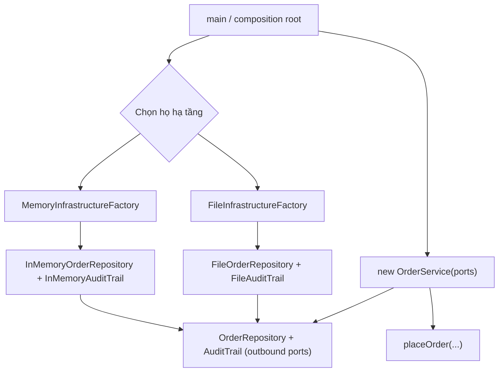

# Dùng factory tại ranh giới hạ tầng trong kiến trúc phân lớp hoặc ports and adapters

**Chương:** Tích hợp kiến trúc  
**Chuyên đề:** `SOFTWARE_DESIGN_DESIGN_PATTERN_CREATIONAL_ABSTRACT_FACTORY` — Học về abstract factory trong design pattern.

## Mục tiêu học tập

Sau bài này, bạn có thể:

- Xác định **ranh giới hạ tầng** và chiều phụ thuộc trong kiến trúc phân lớp (layered architecture) hoặc **ports and adapters** (hexagonal architecture).
- Phân biệt **port** (hợp đồng mà application cần), **adapter** (hiện thực kết nối hạ tầng), **Abstract Factory** (tạo một họ adapter liên quan) và **composition root** (lắp ráp toàn bộ ứng dụng).
- Tổ chức việc chọn một họ adapter, chẳng hạn lưu trữ trong bộ nhớ hoặc lưu ra tệp, **ở bên ngoài lớp nghiệp vụ**.
- Viết mã Java cho một application service chỉ phụ thuộc interface, có thể hoạt động với nhiều họ hạ tầng.
- Nhận ra khi nào cần factory theo họ, khi nào tiêm trực tiếp từng adapter là đủ và những rủi ro về giao dịch, vòng đời, cấu hình khi tích hợp hạ tầng thực tế.

## 1. Bối cảnh: thay hạ tầng mà không sửa nghiệp vụ

Giả sử ứng dụng xử lý đơn hàng có thao tác **tạo đơn**:

1. Kiểm tra dữ liệu đầu vào của đơn hàng.
2. Lưu đơn qua một `OrderRepository`.
3. Ghi sự kiện audit qua một `AuditTrail`.

Trong môi trường học tập, ta muốn lưu đơn và audit **trong bộ nhớ** để chạy nhanh và dễ thử nghiệm. Trong một môi trường khác, ta muốn cả hai thành phần **ghi ra tệp** để có thể quan sát dữ liệu sau khi chương trình kết thúc.

Nếu `OrderService` tự viết `new InMemoryOrderRepository()` hoặc `new FileAuditTrail(...)`, service sẽ phụ thuộc vào những chi tiết không liên quan quy tắc nghiệp vụ. Mỗi lần đổi nơi lưu trữ, phải sửa mã service. Nếu repository dùng bộ nhớ còn audit ghi ra tệp ngoài ý muốn, cấu hình hạ tầng của cùng một luồng xử lý có thể mất nhất quán.

**Abstract Factory** có thể giúp tạo một **bộ adapter** thuộc cùng lựa chọn hạ tầng, ví dụ:

| Họ hạ tầng | Sản phẩm `OrderRepository` | Sản phẩm `AuditTrail` | Concrete factory |
| --- | --- | --- | --- |
| Memory | `InMemoryOrderRepository` | `InMemoryAuditTrail` | `MemoryInfrastructureFactory` |
| File | `FileOrderRepository` | `FileAuditTrail` | `FileInfrastructureFactory` |

Trong bảng này, **cột** là những loại dependency mà ứng dụng cần, còn **hàng** là một cấu hình hạ tầng có chủ đích. Cả hai adapter trong một hàng phải tuân thủ **hợp đồng mà ứng dụng dùng**. Factory của hàng File đồng thời biết thư mục gốc dành cho các tệp của môi trường đó.

Việc gom repository và audit thành cùng một họ là **quyết định thiết kế của ví dụ**, không phải quy tắc bắt buộc mọi hệ thống. Trong ứng dụng thực tế, repository có thể nằm ở cơ sở dữ liệu, còn audit đi qua message broker nếu chúng không có lý do cần chọn và thay thế thành một bộ. Chỉ nên tạo Abstract Factory cho nhiều sản phẩm **có ràng buộc lựa chọn hoặc cấu hình chung thực sự**.

## 2. Ranh giới hạ tầng nằm ở đâu?

### 2.1. Trong kiến trúc phân lớp

Một cách phân chia thường gặp:

| Lớp | Vai trò | Ví dụ |
| --- | --- | --- |
| **Domain** | Định nghĩa thực thể và bất biến nghiệp vụ | `Order`, quy tắc đơn hàng hợp lệ |
| **Application** | Điều phối use case, khai báo dependency cần dùng | `OrderService`, `OrderRepository`, `AuditTrail` |
| **Infrastructure** | Hiện thực giao tiếp với các cơ chế bên ngoài | `FileOrderRepository`, `InMemoryAuditTrail` |
| **Bootstrap / Composition root** | Đọc cấu hình, chọn implementation và nối object graph | `ApplicationBootstrap`, `InfrastructureFactory` |

Nhiều cách tổ chức layered architecture cho phép tên lớp và hướng phụ thuộc khác nhau. Trong bài này, ta sử dụng nguyên tắc quan trọng của **Dependency Inversion**: **application định nghĩa interface cần thiết; infrastructure triển khai interface đó; application không import lớp adapter cụ thể**.

Nếu đặt `OrderRepository` ngay bên trong package `infrastructure`, service sẽ phải phụ thuộc vào package hạ tầng dù nó chỉ dùng hợp đồng. Với hệ thống mong muốn tách core ra khỏi hạ tầng, hợp đồng thường thuộc **application hoặc một module abstraction mà core được phép phụ thuộc**, còn lớp triển khai nằm ngoài.

### 2.2. Trong ports and adapters

Trong cách gọi ports and adapters:

- **Port đầu ra (outbound port)**: `OrderRepository` và `AuditTrail` là các interface mô tả những khả năng application yêu cầu.
- **Adapter đầu ra (outbound adapter)**: `InMemoryOrderRepository`, `FileOrderRepository`, `InMemoryAuditTrail`, `FileAuditTrail` cung cấp khả năng cụ thể.
- **Application service**: `OrderService` chỉ gọi hai port; nó không biết adapter nào đang chạy.
- **Composition root**: nơi chọn họ adapter, tạo instance, tiêm các port vào `OrderService` và khởi động use case.

Sơ đồ phụ thuộc và lắp ráp:



Trong sơ đồ, các mũi tên từ factory sang adapter diễn tả **quá trình tạo**; còn `OrderService → ports` diễn tả **phụ thuộc ở mã nguồn**. Không nên hiểu mọi mũi tên là cùng một loại quan hệ. Các adapter cụ thể triển khai port, trong khi service chỉ được biết port.

### 2.3. Đặt interface factory ở lớp nào?

Có hai lựa chọn hợp lý, tùy ai cần gọi factory:

1. **Chỉ bootstrap cần factory:** khai báo `InfrastructureFactory` trong vùng cấu hình/lắp ráp bên ngoài application. Bootstrap dùng factory để lấy các port rồi truyền thẳng cho service. Đây là lựa chọn của ví dụ bên dưới; domain và application **không cần biết factory tồn tại**.
2. **Application cần yêu cầu tạo một bộ dependency trong khi xử lý use case:** có thể khai báo một **factory port** ở phía application, để adapter ngoài hiện thực port đó. Chỉ dùng cách này khi việc tạo theo yêu cầu là một phần thực sự của hợp đồng use case (ví dụ tạo phiên làm việc độc lập), và phải xác định rõ vòng đời/tài nguyên.

Việc dùng Abstract Factory **không buộc** application phải phụ thuộc trực tiếp vào interface factory. Nó hoàn toàn có thể chỉ phụ thuộc vào các product ports.

## 3. Phân biệt bốn trách nhiệm dễ nhầm lẫn

| Thành phần | Trả lời câu hỏi | Có nên biết lớp hạ tầng cụ thể? |
| --- | --- | --- |
| `OrderRepository` / `AuditTrail` | “Application cần làm được gì?” | **Không**; đây là port |
| `FileOrderRepository` / `FileAuditTrail` | “Làm việc đó bằng tệp như thế nào?” | **Có**; là adapter cụ thể |
| `FileInfrastructureFactory` | “Lắp bộ adapter File từ cấu hình nào?” | **Có**; tạo đúng thành viên của họ |
| `ApplicationBootstrap` | “Ứng dụng lần này dùng họ nào, inject vào đâu?” | **Có**; là composition root |

**Factory khác composition root:** factory biết cách tạo một nhóm sản phẩm liên quan, còn composition root biết **đối tượng nào được dùng bởi use case nào**. Phương thức `new FileOrderRepository(...)` trong `FileInfrastructureFactory` là hợp lý. Lời gọi `new FileOrderRepository(...)` bên trong `OrderService` là dấu hiệu service vượt qua ranh giới.

**Factory khác service locator:** với service locator, service có thể gọi một đối tượng toàn cục để tự lấy dependency ẩn. Trong ví dụ này, `OrderService` khai báo rõ các dependency trong constructor; bootstrap là nơi cấp chúng.

## 4. Ví dụ Java hoàn chỉnh: hai họ adapter tại ranh giới hạ tầng

Ví dụ Java 8 sau có đủ ba phần: **core** (entity + port + service), **infrastructure** (adapter + concrete factory), và **bootstrap** (đọc lựa chọn rồi lắp ráp). Mọi lớp đặt chung một tệp để có thể chạy ngay; trong dự án thật nên tách thành package/module theo ranh giới.

Với profile `memory`, dữ liệu chỉ được giữ trong quá trình chạy. Với profile `file`, đơn hàng và audit được ghi vào hai tệp UTF-8 trong cùng thư mục cấu hình. Ví dụ tập trung vào **cách nối hạ tầng**, không cung cấp cơ chế giao dịch, đồng bộ ghi nhiều luồng hay lưu trữ production.

Lưu toàn bộ mã dưới đây vào **`InfrastructureBoundaryDemo.java`**:

```java
import java.io.IOException;
import java.io.UncheckedIOException;
import java.nio.charset.StandardCharsets;
import java.nio.file.Files;
import java.nio.file.Path;
import java.nio.file.Paths;
import java.nio.file.StandardOpenOption;
import java.util.ArrayList;
import java.util.List;
import java.util.Locale;
import java.util.Objects;

// ===== DOMAIN: dữ liệu và bất biến của đơn hàng =====
final class Order {
    final String id;
    final String item;

    Order(String id, String item) {
        this.id = validField(id, "id");
        this.item = validField(item, "item");
    }

    private static String validField(String value, String field) {
        Objects.requireNonNull(value, field);
        // Dùng định dạng dòng phân tách bằng | trong adapter File của ví dụ.
        if (value.trim().isEmpty() || value.contains("|")
                || value.contains("\n") || value.contains("\r")) {
            throw new IllegalArgumentException("Dữ liệu " + field + " không hợp lệ");
        }
        return value;
    }
}

// ===== APPLICATION: outbound ports =====
interface OrderRepository {
    void save(Order order);
}

interface AuditTrail {
    void record(String event);
}

// ===== APPLICATION: use case chỉ biết ports =====
final class OrderService {
    private final OrderRepository orders;
    private final AuditTrail audit;

    OrderService(OrderRepository orders, AuditTrail audit) {
        this.orders = Objects.requireNonNull(orders, "orders");
        this.audit = Objects.requireNonNull(audit, "audit");
    }

    void placeOrder(String id, String item) {
        Order order = new Order(id, item);
        orders.save(order);
        audit.record("ORDER_CREATED|" + order.id);
        System.out.println("Đã ghi nhận đơn " + order.id);
    }
}

// ===== INFRASTRUCTURE: họ Memory =====
final class InMemoryOrderRepository implements OrderRepository {
    private final List<Order> saved = new ArrayList<>();

    @Override
    public void save(Order order) {
        saved.add(Objects.requireNonNull(order, "order"));
    }
}

final class InMemoryAuditTrail implements AuditTrail {
    private final List<String> events = new ArrayList<>();

    @Override
    public void record(String event) {
        events.add(Objects.requireNonNull(event, "event"));
    }
}

// ===== INFRASTRUCTURE: công cụ ghi tệp chung =====
final class FileAppend {
    private FileAppend() { }

    static void line(Path file, String content) {
        try {
            Files.write(file,
                    (content + System.lineSeparator()).getBytes(StandardCharsets.UTF_8),
                    StandardOpenOption.CREATE,
                    StandardOpenOption.APPEND);
        } catch (IOException error) {
            throw new UncheckedIOException("Không ghi được tệp: " + file, error);
        }
    }
}

// ===== INFRASTRUCTURE: họ File =====
final class FileOrderRepository implements OrderRepository {
    private final Path file;

    FileOrderRepository(Path file) {
        this.file = Objects.requireNonNull(file, "file");
    }

    @Override
    public void save(Order order) {
        Objects.requireNonNull(order, "order");
        FileAppend.line(file, order.id + "|" + order.item);
    }
}

final class FileAuditTrail implements AuditTrail {
    private final Path file;

    FileAuditTrail(Path file) {
        this.file = Objects.requireNonNull(file, "file");
    }

    @Override
    public void record(String event) {
        FileAppend.line(file, Objects.requireNonNull(event, "event"));
    }
}

// ===== OUTER BOUNDARY: abstract factory cho hai loại port =====
// Trong ví dụ, chỉ bootstrap phụ thuộc vào interface này.
interface InfrastructureFactory {
    OrderRepository createOrderRepository();
    AuditTrail createAuditTrail();
}

final class MemoryInfrastructureFactory implements InfrastructureFactory {
    @Override
    public OrderRepository createOrderRepository() {
        return new InMemoryOrderRepository();
    }

    @Override
    public AuditTrail createAuditTrail() {
        return new InMemoryAuditTrail();
    }
}

final class FileInfrastructureFactory implements InfrastructureFactory {
    private final Path directory;

    FileInfrastructureFactory(Path directory) {
        this.directory = Objects.requireNonNull(directory, "directory");
        try {
            Files.createDirectories(directory);
        } catch (IOException error) {
            throw new UncheckedIOException("Không tạo được thư mục: " + directory, error);
        }
    }

    @Override
    public OrderRepository createOrderRepository() {
        return new FileOrderRepository(directory.resolve("orders.txt"));
    }

    @Override
    public AuditTrail createAuditTrail() {
        return new FileAuditTrail(directory.resolve("audit.log"));
    }
}

// ===== BOOTSTRAP / COMPOSITION ROOT =====
final class ApplicationBootstrap {
    private ApplicationBootstrap() { }

    static OrderService assemble(String profile, Path dataDirectory) {
        String choice = Objects.requireNonNull(profile, "profile")
                .trim().toLowerCase(Locale.ROOT);
        InfrastructureFactory factory;

        switch (choice) {
            case "memory":
                factory = new MemoryInfrastructureFactory();
                break;
            case "file":
                factory = new FileInfrastructureFactory(dataDirectory);
                break;
            default:
                throw new IllegalArgumentException(
                        "Profile không được hỗ trợ: " + profile);
        }

        // Chỉ một factory được chọn cho cả bộ dependency.
        OrderRepository repository = factory.createOrderRepository();
        AuditTrail audit = factory.createAuditTrail();
        return new OrderService(repository, audit);
    }
}

// Điểm vào: chọn profile rồi gọi use case.
public final class InfrastructureBoundaryDemo {
    public static void main(String[] args) {
        String profile = args.length > 0 ? args[0] : "memory";
        Path directory = Paths.get(
                args.length > 1 ? args[1] : "demo-infrastructure-data");

        OrderService service = ApplicationBootstrap.assemble(profile, directory);
        service.placeOrder("ORD-001", "Ban phim");
        System.out.println("Profile đã chọn: " + profile);
    }
}
```

### Chạy chương trình

Trong thư mục chứa tệp Java:

```bash
javac -encoding UTF-8 InfrastructureBoundaryDemo.java
java InfrastructureBoundaryDemo memory
java InfrastructureBoundaryDemo file demo-infrastructure-data
```

Mỗi lần chạy hợp lệ dự kiến in:

```text
Đã ghi nhận đơn ORD-001
Profile đã chọn: memory
```

Lần chạy với `file` sẽ in `Profile đã chọn: file` và tạo hoặc ghi thêm vào:

```text
demo-infrastructure-data/
  orders.txt     -> ORD-001|Ban phim
  audit.log      -> ORDER_CREATED|ORD-001
```

Các tệp được ghi **theo chế độ append**: chạy lại có thể tạo thêm một dòng tương ứng, không có cơ chế chống trùng ID trong ví dụ. Profile `memory` không tạo tệp vì thư mục chỉ được khởi tạo bởi `FileInfrastructureFactory`. Truyền profile khác, ví dụ `cloud`, khiến bootstrap báo `IllegalArgumentException` thay vì âm thầm dùng một adapter không xác định.

### Điểm nào trong ví dụ là Abstract Factory?

`InfrastructureFactory` khai báo hai phương thức tạo hai loại sản phẩm:

```java
interface InfrastructureFactory {
    OrderRepository createOrderRepository();
    AuditTrail createAuditTrail();
}
```

Hai concrete factory tạo hai **họ adapter**; phương thức trả về chỉ dùng **kiểu port**, không trả về `FileOrderRepository` hoặc `InMemoryAuditTrail` trong chữ ký API. `OrderService` không biết `InfrastructureFactory` có tồn tại, vì bootstrap đã chuyển sản phẩm từ factory thành những dependency cụ thể của service.

### Điểm nào là ranh giới hạ tầng?

`OrderService` chỉ phụ thuộc vào `OrderRepository` và `AuditTrail`. Hai interface mô tả **năng lực mà use case cần** (lưu đơn và ghi audit), trong khi chi tiết `List` hay `Files.write` nằm ở adapter. Cùng một `OrderService` hoạt động với cả hai cấu hình mà không có nhánh `if (profile.equals("file"))`.

## 5. Tổ chức package trong dự án thực tế

Khi tách khỏi ví dụ một file, có thể bố trí như sau:

```text
com.example.orders
├── domain
│   └── Order.java
├── application
│   ├── OrderService.java
│   └── port
│       ├── OrderRepository.java
│       └── AuditTrail.java
├── infrastructure
│   ├── memory
│   │   ├── InMemoryOrderRepository.java
│   │   └── InMemoryAuditTrail.java
│   ├── file
│   │   ├── FileOrderRepository.java
│   │   └── FileAuditTrail.java
│   └── factory
│       ├── MemoryInfrastructureFactory.java
│       └── FileInfrastructureFactory.java
└── bootstrap
    ├── InfrastructureFactory.java
    ├── ApplicationBootstrap.java
    └── Main.java
```

Đây chỉ là **một cách tổ chức**; các lớp factory có thể nằm trong module cấu hình hạ tầng hoặc thư mục của từng adapter để khớp convention dự án. Điều cốt yếu là **module application không import package infrastructure hoặc bootstrap**.

Với dự án nhiều module, quy tắc phụ thuộc có thể biểu diễn:

```text
domain           <- application
application      <- infrastructure
application      <- bootstrap
infrastructure   <- bootstrap
```

Mũi tên ở đây có nghĩa **module bên phải được phép tham chiếu module bên trái**. Bootstrap đứng ngoài cùng, phụ thuộc cả application lẫn infrastructure để tạo object graph. Không có chiều `application → infrastructure`.

Trong một ứng dụng Spring, Micronaut hoặc Jakarta CDI, các bean/configuration provider có thể đóng vai trò composition root và concrete factory. Bản chất phân tách không thay đổi: interface port là thứ service dùng; mã cấu hình bên ngoài quyết định implementation. Không cần tạo thêm một lớp `InfrastructureFactory` hình thức nếu dependency injection container đã lắp ráp cùng một cấu hình một cách rõ ràng và nhất quán.

## 6. Đánh giá khi nào nên dùng một Abstract Factory hạ tầng

**Nên cân nhắc Abstract Factory** khi:

- Hệ thống thường xuyên đổi **cả một bộ adapter** theo môi trường, nhà cung cấp hoặc giao thức, thay vì đổi độc lập từng adapter.
- Các adapter trong họ cần **cấu hình hoặc tài nguyên chung**: đường dẫn dữ liệu, tenant, endpoint, credential hoặc một đơn vị giao dịch đã được thiết kế.
- Việc lắp ráp thủ công lặp đi lặp lại và có nguy cơ trộn các thành viên không tương thích.
- Các adapter phải đáp ứng cùng tập port đủ ổn định để kiểm tra hợp đồng.

**Có thể đơn giản hơn bằng constructor injection từng port** khi:

- Use case chỉ có một dependency, không tồn tại khái niệm “họ sản phẩm” đáng kể.
- Repository và audit được chọn **độc lập** bởi yêu cầu kiến trúc; một factory gộp sẽ tạo ràng buộc giả.
- Container DI đã cấu hình rõ ràng từng port và các thay đổi ít khi diễn ra theo nhóm.

Điều kiện quan trọng không phải số lượng class. Nếu hai port được nhóm thành một factory mà không có quy tắc tương thích hoặc quan hệ cấu hình chung, thiết kế có thể phức tạp hơn mà không thu được lợi ích.

## 7. Bốn rủi ro tích hợp cần xử lý ngoài factory

### 7.1. Hai adapter cùng họ không có nghĩa là cùng giao dịch

Trong ví dụ, `orders.save(order)` ghi trước, sau đó `audit.record(...)` ghi. Nếu lưu đơn thành công nhưng ghi audit thất bại, hệ thống có thể ở trạng thái **đã có đơn nhưng chưa có audit**.

Abstract Factory **không tự tạo atomic transaction** cho hai hành động này. Khi yêu cầu tất cả cùng thành công hoặc cùng thất bại, hệ thống phải thiết kế thêm cơ chế phù hợp như transaction chung nếu hai thao tác nằm trong cùng transactional resource, hoặc **transactional outbox** / cơ chế bù trừ và xử lý lỗi khi qua nhiều resource. Không nên khẳng định hai adapter thuộc cùng factory sẽ luôn bảo đảm tính nhất quán giao dịch.

### 7.2. Vòng đời của đối tượng phải rõ ràng

`MemoryInfrastructureFactory` hiện tạo một repository mới cho mỗi lần gọi `createOrderRepository()`. Nếu bootstrap lắp ráp lại nhiều `OrderService` độc lập, dữ liệu của các repository này **không tự chia sẻ**.

Tùy use case, factory có thể tạo instance mới, dùng instance đã cấu hình, hoặc dùng một resource dùng chung. Cần mô tả phạm vi rõ ràng: theo ứng dụng, request, tenant hay tác vụ. Những adapter có kết nối/tệp/socket cần chính sách đóng và giải phóng tài nguyên, không chỉ phương thức `create...()`.

### 7.3. Sai môi trường hoặc trộn họ

Trường hợp sau biên dịch bình thường nhưng vi phạm quy ước chọn một bộ:

```java
OrderRepository orders =
        new FileInfrastructureFactory(Paths.get("data-a")).createOrderRepository();
AuditTrail audit =
        new MemoryInfrastructureFactory().createAuditTrail();
```

Nếu yêu cầu đã thống nhất rằng repository và audit phải cùng profile, cách lắp ráp trên là sai. Composition root nên chọn profile **một lần**, sau đó lấy toàn bộ adapter từ factory tương ứng. Đồng thời, các concrete factory phải thực sự trả về sản phẩm đúng họ; chữ ký interface tự nó không ngăn một concrete factory trả nhầm adapter từ họ khác.

### 7.4. Hợp đồng ngoài đời thường rộng hơn interface Java

Interface `OrderRepository.save(Order)` không mô tả đủ các yếu tố như idempotency, consistency, retry, timeout, mã lỗi, concurrency và chính sách xóa dữ liệu. Hai adapter `Memory` và `File` của ví dụ có thể khác nhau về độ bền và khả năng xử lý nhiều luồng. Nếu application ngầm yêu cầu điều kiện mà một adapter không đáp ứng, việc hoán đổi hai adapter có thể dẫn đến lỗi nghiệp vụ dù compiler chấp nhận.

Vì vậy cần **contract tests dùng chung** cho các adapter, ngoài các test riêng cho tích hợp thật. Bản demo không triển khai giao dịch, đọc lại bản ghi, chống ghi trùng, escape định dạng dữ liệu hoặc đồng bộ đồng thời; không nên sử dụng bộ adapter `File` như một cơ chế lưu đơn production.

## 8. Kiểm thử ranh giới và cấu hình

Một chiến lược kiểm tra có thể chia thành các lớp sau:

| Cấp kiểm tra | Điều cần xác nhận | Gợi ý |
| --- | --- | --- |
| Application unit test | `OrderService` gọi đúng `OrderRepository` và `AuditTrail` sau khi kiểm tra đơn | Truyền fake/stub của hai port; không cần file thật |
| Port contract test | Mỗi implementation thực hiện đúng ý nghĩa `save`, `record` và các invariant đã công bố | Dùng chung bộ test cho Memory và File |
| Factory contract test | Mỗi concrete factory tạo đầy đủ hai port, trả về adapter của đúng profile | Kiểm tra các phương thức `create...()`, non-null, cấu hình chung |
| Bootstrap integration test | `memory` chọn Memory; `file` chọn File; profile sai bị từ chối | Lắp ráp qua `ApplicationBootstrap.assemble(...)` |
| Infrastructure integration test | Ghi file thực tế, xử lý lỗi IO và quyền ghi | Chạy trong thư mục tạm; dọn tài nguyên sau test |

Một ví dụ test rất ngắn ở cấp application, không cần khởi tạo factory thực:

```java
// Có thể đặt trong một unit test của OrderService.
List<Order> savedOrders = new ArrayList<>();
List<String> auditEvents = new ArrayList<>();

OrderRepository repository = savedOrders::add;
AuditTrail audit = auditEvents::add;
OrderService service = new OrderService(repository, audit);

service.placeOrder("ORD-T1", "Chuot");

if (savedOrders.size() != 1
        || !savedOrders.get(0).id.equals("ORD-T1")
        || !auditEvents.contains("ORDER_CREATED|ORD-T1")) {
    throw new AssertionError("Use case không gọi đúng outbound ports");
}
```

Hai interface trong ví dụ chỉ có một abstract method nên có thể dùng lambda trên Java 8. Test này đánh giá **luồng ứng dụng**. Nó không chứng minh factory tạo đúng adapter hay thao tác file hoạt động; hai loại hành vi đó được kiểm tra ở các lớp test tương ứng.

## 9. Lỗi thường gặp khi áp dụng Abstract Factory ở ranh giới hạ tầng

| Lỗi | Hệ quả | Cách điều chỉnh |
| --- | --- | --- |
| `OrderService` gọi `new FileOrderRepository(...)` | Application phụ thuộc implementation hạ tầng | Chỉ phụ thuộc port, inject từ composition root |
| Đưa `InfrastructureFactory` vào mọi service dù service chỉ cần một port | API nghiệp vụ bị gắn với cơ chế khởi tạo | Inject trực tiếp `OrderRepository` hoặc `AuditTrail` cần dùng |
| Đặt port chỉ trong module hạ tầng | Core bị buộc import module ngoài để dùng hợp đồng | Định nghĩa port ở application/core hoặc module abstraction phù hợp |
| Chọn Memory cho repository, File cho audit mà không có yêu cầu chủ đích | Mất quy ước chọn một họ adapter | Chọn factory một lần ở bootstrap cho phạm vi cần đồng bộ |
| Nghĩ dùng cùng factory sẽ tự đảm bảo transaction | Có thể lưu thành công một nơi và thất bại nơi khác | Thiết kế transaction/outbox hoặc xử lý lỗi thích hợp |
| Mỗi lần gọi factory tạo resource mới nhưng ứng dụng tưởng dùng chung | Không chia sẻ state và có thể lãng phí kết nối | Quy định rõ lifecycle, scope và quyền sở hữu resource |
| Thêm họ hạ tầng mới mà không chạy lại contract tests | Adapter mới có thể sai semantics hoặc thiếu khả năng | Chạy cùng bộ kiểm tra với mọi họ và kiểm tra tích hợp |

## 10. Bài luyện tập

**Câu 1.** Trong ví dụ trên, `OrderService` có nên import `FileInfrastructureFactory` để tự quyết định nơi lưu đơn không? Vì sao?

**Đáp án gợi ý:** Không. Service chỉ biết `OrderRepository` và `AuditTrail`. Quyết định profile và việc tạo adapter cụ thể thuộc bootstrap/composition root.

**Câu 2.** Nếu thêm họ `DatabaseInfrastructureFactory`, những phần nào cần thay đổi?

**Đáp án gợi ý:** Triển khai `DatabaseOrderRepository` và `DatabaseAuditTrail` (hoặc các adapter phù hợp với quy ước họ mới), tạo factory triển khai `InfrastructureFactory` và đăng ký lựa chọn ở bootstrap. `OrderService` và các port không cần thay đổi nếu hợp đồng vẫn đủ khả năng biểu đạt.

**Câu 3.** Dùng một `FileInfrastructureFactory` có bảo đảm `orders.save()` và `audit.record()` hoặc cùng thành công hoặc cùng thất bại không?

**Đáp án gợi ý:** Không. Factory chỉ hỗ trợ tạo bộ adapter. Hai lệnh ghi tệp độc lập trong ví dụ; cần cơ chế nhất quán giao dịch được thiết kế riêng khi nghiệp vụ yêu cầu.

**Câu 4.** Khi nào không nên gộp hai outbound port vào một Abstract Factory?

**Đáp án gợi ý:** Khi hai port được chọn độc lập, không có ràng buộc tương thích hoặc cấu hình chung, hay khi DI trực tiếp từng dependency đơn giản hơn. Không nên tự tạo một “họ” chỉ vì service có hai interface.

**Bài thực hành.** Thêm một port `NotificationSender` và triển khai cho hai profile. Trước khi bổ sung `createNotificationSender()` vào `InfrastructureFactory`, hãy trả lời: notification có cần luôn thuộc cùng profile với repository và audit không? Nếu **có**, bổ sung sản phẩm cho mọi factory và mở rộng kiểm thử. Nếu **không**, có thể chọn notification adapter riêng tại bootstrap rồi inject vào service sử dụng nó.

## Kết luận

Trong kiến trúc **phân lớp** hoặc **ports and adapters**, Abstract Factory phát huy tác dụng khi cần **chọn và tạo một bộ implementation hạ tầng có liên quan** tại ranh giới bên ngoài application. Các use case phụ thuộc vào port như `OrderRepository`, `AuditTrail`; concrete adapter giải quyết chi tiết tệp, bộ nhớ, cơ sở dữ liệu hay dịch vụ bên ngoài; composition root chọn một concrete factory, lấy các adapter và tiêm vào application. Thiết kế này giữ chiều phụ thuộc hướng về các hợp đồng của core, giúp thay họ hạ tầng mà không sửa nghiệp vụ. Tuy nhiên, factory chỉ giải quyết **khởi tạo và tính nhất quán lựa chọn họ**; giao dịch, vòng đời resource, semantics của port và kiểm thử tích hợp vẫn cần được thiết kế, xác minh riêng.
