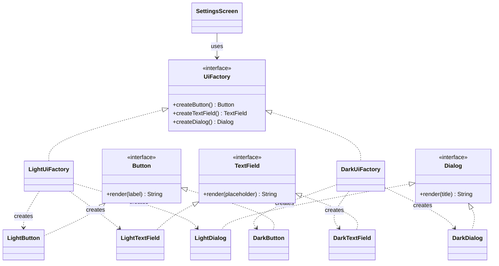

# Bộ thành phần giao diện cùng theme hoặc cùng nền tảng

Trong module `SOFTWARE_DESIGN_DESIGN_PATTERN_CREATIONAL_ABSTRACT_FACTORY` (*Học về abstract factory trong design pattern*), một tình huống ứng dụng rất điển hình của **Abstract Factory** là xây dựng **bộ thành phần giao diện (UI component kit)** nhất quán theo **theme** (ví dụ Light/Dark) hoặc **nền tảng** (ví dụ Windows/macOS, Android/iOS). Bài học này tập trung vào cách thiết kế, tích hợp và đánh giá mẫu khi một màn hình cần đồng thời nhiều thành phần giao diện cùng phong cách.

## 1. Bài toán thực tế: nhất quán cả một bộ giao diện

Hãy tưởng tượng ứng dụng quản lý tài khoản có màn hình Cài đặt gồm:

- `Button`: nút “Lưu thay đổi”;
- `TextField`: ô nhập tên hiển thị;
- `Dialog`: hộp thoại xác nhận trước khi lưu.

Ứng dụng hỗ trợ theme **Light** và **Dark**. Với mỗi theme, ba thành phần cần thống nhất màu nền, độ tương phản, kiểu viền và quy tắc hiển thị trạng thái tương tác. Nếu nút có phong cách Dark nhưng ô nhập và hộp thoại lại theo Light, màn hình sẽ thiếu nhất quán, khó bảo trì và có thể gây vấn đề về khả năng đọc.

| Loại thành phần (product type) | Họ Light (product family) | Họ Dark (product family) |
| --- | --- | --- |
| Nút bấm | `LightButton` | `DarkButton` |
| Ô nhập | `LightTextField` | `DarkTextField` |
| Hộp thoại | `LightDialog` | `DarkDialog` |

Theo ma trận này, **mỗi cột là một bộ sản phẩm tương thích**. Màn hình phải nhận *một nguồn tạo thành phần* rồi lấy cả ba loại sản phẩm từ đó; không nên tự lựa chọn lớp concrete ở nhiều nơi.

**Abstract Factory** giải quyết phần **khởi tạo các họ đối tượng liên quan**. Nó cung cấp một interface tạo thành phần; các concrete factory quyết định sản phẩm của họ nào sẽ được tạo.

## 2. Ánh xạ bài toán vào các vai trò của Abstract Factory

| Vai trò trong mẫu | Trong ví dụ theme | Trách nhiệm |
| --- | --- | --- |
| Abstract product | `Button`, `TextField`, `Dialog` | Định nghĩa hành vi chung cho từng loại thành phần |
| Concrete product | `LightButton`, `DarkButton`, … | Cài đặt thành phần ứng với một theme cụ thể |
| Abstract factory | `UiFactory` | Công bố `createButton()`, `createTextField()`, `createDialog()` |
| Concrete factory | `LightUiFactory`, `DarkUiFactory` | Tạo bộ sản phẩm đúng theme |
| Client | `SettingsScreen` | Kết hợp các thành phần để dựng màn hình, chỉ dùng các interface |
| Composition root | `main()` hoặc cấu hình khởi động | Chọn factory thích hợp rồi truyền vào client |

Sơ đồ cho thấy client **phụ thuộc vào interface** và chỉ lựa chọn theme ở ranh giới khởi tạo ứng dụng:



Điểm đáng chú ý: `SettingsScreen` không chứa câu lệnh kiểm tra `isDark` để chọn từng button, text field, dialog. Khi factory thay đổi, **toàn bộ bộ sản phẩm** tạo ra từ factory cũng thay đổi theo.

## 3. Ví dụ Java: tạo ba thành phần cùng theme

Ví dụ dưới đây dùng `render()` trả về chuỗi mô phỏng để người học nhìn thấy theme của từng sản phẩm. Đây là minh họa **cấu trúc Abstract Factory**, không phải mã vẽ giao diện thật. Khi áp dụng với Swing, JavaFX, Android hoặc framework khác, phần concrete product có thể bọc widget và style tương ứng của nền tảng/framework đó.

Lưu thành `UiThemeFactoryDemo.java`:

```java
public class UiThemeFactoryDemo {
    // 1. Abstract products: client sử dụng các hợp đồng này.
    interface Button {
        String render(String label);
    }

    interface TextField {
        String render(String placeholder);
    }

    interface Dialog {
        String render(String title);
    }

    // 2. Abstract factory: một nơi tạo cả bộ thành phần.
    interface UiFactory {
        Button createButton();
        TextField createTextField();
        Dialog createDialog();
    }

    // 3. Các concrete product của họ Light.
    static class LightButton implements Button {
        public String render(String label) {
            return "Button[light]: " + label;
        }
    }

    static class LightTextField implements TextField {
        public String render(String placeholder) {
            return "TextField[light]: " + placeholder;
        }
    }

    static class LightDialog implements Dialog {
        public String render(String title) {
            return "Dialog[light]: " + title;
        }
    }

    // 4. Các concrete product của họ Dark.
    static class DarkButton implements Button {
        public String render(String label) {
            return "Button[dark]: " + label;
        }
    }

    static class DarkTextField implements TextField {
        public String render(String placeholder) {
            return "TextField[dark]: " + placeholder;
        }
    }

    static class DarkDialog implements Dialog {
        public String render(String title) {
            return "Dialog[dark]: " + title;
        }
    }

    // 5. Concrete factories chịu trách nhiệm chọn đúng họ.
    static class LightUiFactory implements UiFactory {
        public Button createButton() {
            return new LightButton();
        }

        public TextField createTextField() {
            return new LightTextField();
        }

        public Dialog createDialog() {
            return new LightDialog();
        }
    }

    static class DarkUiFactory implements UiFactory {
        public Button createButton() {
            return new DarkButton();
        }

        public TextField createTextField() {
            return new DarkTextField();
        }

        public Dialog createDialog() {
            return new DarkDialog();
        }
    }

    // 6. Client không cần biết tên lớp Light*/Dark*.
    static class SettingsScreen {
        private final UiFactory factory;

        SettingsScreen(UiFactory factory) {
            this.factory = factory;
        }

        void show() {
            Button saveButton = factory.createButton();
            TextField nameField = factory.createTextField();
            Dialog confirmDialog = factory.createDialog();

            System.out.println(saveButton.render("Lưu thay đổi"));
            System.out.println(nameField.render("Nhập tên hiển thị"));
            System.out.println(confirmDialog.render("Xác nhận lưu?"));
        }
    }

    // 7. Điểm cấu hình duy nhất chọn theme cho màn hình.
    public static void main(String[] args) {
        boolean darkMode = args.length > 0
                && args[0].equalsIgnoreCase("dark");
        UiFactory factory = darkMode
                ? new DarkUiFactory()
                : new LightUiFactory();

        new SettingsScreen(factory).show();
    }
}
```

Biên dịch và chạy trong thư mục chứa file:

```bash
javac UiThemeFactoryDemo.java
java UiThemeFactoryDemo
java UiThemeFactoryDemo dark
```

Kết quả khi chạy không có đối số:

```text
Button[light]: Lưu thay đổi
TextField[light]: Nhập tên hiển thị
Dialog[light]: Xác nhận lưu?
```

Khi chạy với đối số `dark`:

```text
Button[dark]: Lưu thay đổi
TextField[dark]: Nhập tên hiển thị
Dialog[dark]: Xác nhận lưu?
```

Hai lần chạy đều gọi chính xác ba phương thức `createButton()`, `createTextField()` và `createDialog()` từ client. Điểm khác biệt duy nhất là **factory được truyền vào**. Điều này cho thấy lợi ích của *dependency inversion*: màn hình phụ thuộc vào các hợp đồng, còn việc quyết định biến thể cụ thể nằm ở tầng cấu hình.

## 4. Tình huống tương tự: một bộ thành phần theo nền tảng

Giả sử phần mềm desktop có cùng luồng “Lưu hồ sơ” trên Windows và macOS. Mỗi nền tảng có quy ước riêng về nút, hộp thoại và ô nhập. Ta có thể thay hai họ Light/Dark bằng **Windows/macOS**:

| Abstract product | Windows | macOS |
| --- | --- | --- |
| `Button` | `WindowsButton` | `MacButton` |
| `TextField` | `WindowsTextField` | `MacTextField` |
| `Dialog` | `WindowsDialog` | `MacDialog` |
| Abstract factory | `WindowsUiFactory` | `MacUiFactory` |

Ví dụ cách chọn ở điểm khởi tạo:

```java
// Phác thảo khi đã có các concrete factory tương ứng.
UiFactory factory = isMacOs
        ? new MacUiFactory()
        : new WindowsUiFactory();
SettingsScreen screen = new SettingsScreen(factory);
screen.show();
```

Đoạn trên là **phác thảo**, không thuộc file Java hoàn chỉnh ở mục 3: `MacUiFactory` và `WindowsUiFactory` sẽ cần được cài đặt nếu xây dựng ví dụ nền tảng. Một ứng dụng Android/iOS cũng có thể tổ chức factory tương tự khi cần chọn **cả bộ widget native** theo hệ điều hành.

Điều quan trọng là mỗi concrete factory trả về các sản phẩm **phù hợp với cùng một nền tảng**. Mẫu Abstract Factory không tự động tạo widget native, áp dụng accessibility hay bảo đảm giao diện đúng quy chuẩn: các concrete product và thư viện GUI vẫn phải làm những việc đó.

### Nếu cần hỗ trợ đồng thời theme *và* nền tảng?

Hai thuộc tính này là **hai chiều độc lập**. Ví dụ mỗi nền tảng đều có Light và Dark:

| | Light | Dark |
| --- | --- | --- |
| Windows | Windows Light | Windows Dark |
| macOS | macOS Light | macOS Dark |

Có thể định nghĩa các họ kết hợp như `WindowsLightUiFactory`, `WindowsDarkUiFactory`, `MacLightUiFactory`, `MacDarkUiFactory` khi **cả hành vi và kiểu hiện thực thành phần thực sự khác nhau**. Tuy nhiên, nếu chỉ đổi màu sắc, việc tạo một bộ lớp mới cho mỗi tổ hợp có thể gây **bùng nổ số lượng lớp**. Khi các chiều thay đổi độc lập, hãy cân nhắc tách:

- **Factory hoặc adapter theo nền tảng** để chọn widget/điều khiển phù hợp;
- **Theme tokens, cấu hình style, hoặc strategy** để quyết định màu, khoảng cách, typography.

Việc chọn một hay nhiều factory phải phản ánh **ranh giới biến thể thật sự** của ứng dụng. Không có yêu cầu rằng mọi tổ hợp theme và nền tảng đều phải trở thành một concrete factory riêng.

## 5. Lợi ích đối với sản phẩm và đội phát triển

**Nhất quán tại điểm tạo.** Một `DarkUiFactory` được viết đúng sẽ cung cấp đủ các thành phần thuộc Dark; các màn hình không phải tự chọn từng lớp theo theme. Đây là cách tập trung quy tắc *thành phần nào đi với thành phần nào*.

**Giảm phụ thuộc ở phía màn hình.** Client làm việc với `Button`, `TextField`, `Dialog`. Khi thay đổi họ hiện thực, mã dựng màn hình không bắt buộc phải đổi. Từ đó việc tạo các màn hình và kiểm thử chúng bằng factory giả trở nên đơn giản hơn.

**Dễ bổ sung họ mới khi bộ loại sản phẩm ổn định.** Nếu sau này cần thêm `HighContrastUiFactory` cho một bộ giao diện có độ tương phản cao, ta tạo concrete product cần thiết và factory mới mà không sửa `UiFactory`. Tuy nhiên, yêu cầu accessibility vẫn cần được kiểm tra thực tế: tên gọi “HighContrast” tự nó không bảo đảm giao diện đáp ứng tiêu chuẩn nào.

**Điểm đánh đổi là thêm *loại* thành phần mới.** Nếu `UiFactory` có thêm `createSlider()`, mọi concrete factory triển khai interface này sẽ phải cung cấp phương thức mới. Abstract Factory vì vậy phù hợp hơn khi **bộ loại thành phần tương đối ổn định**, còn các **họ** có thể mở rộng.

## 6. Khi nào nên dùng và khi nào nên chọn cách đơn giản hơn?

| Bối cảnh | Hướng xử lý | Lý do |
| --- | --- | --- |
| Ứng dụng có nhiều loại widget, cùng chuyển theo Light/Dark hoặc Windows/macOS | Cân nhắc Abstract Factory | Cần tạo một *họ đối tượng có liên hệ* và giữ client độc lập với biến thể |
| Thường xuyên thêm một bộ style/brand mới, loại widget đã ổn định | Abstract Factory có thể phù hợp | Thêm concrete factory và các concrete product cho họ mới |
| Chỉ đổi bảng màu và kích thước, không đổi cách tạo widget | Ưu tiên theme provider/design tokens sẵn có | Có thể dùng một bộ widget chung; factory riêng cho từng style gây dư thừa |
| Chỉ có một nút cần thay đổi hành vi | Cân nhắc Strategy hoặc cấu hình trực tiếp | Chưa có một *họ nhiều sản phẩm* cần được tạo cùng nhau |
| Hệ thống liên tục thêm loại widget mới và rất ít khi thêm theme | Đánh giá lại chi phí Abstract Factory | Mỗi loại mới kéo theo thay đổi ở tất cả factory |
| UI framework đã hỗ trợ theme động và widget đa nền tảng đầy đủ | Tận dụng cơ chế framework trước | Tự tạo tầng factory có thể lặp lại chức năng sẵn có |

Abstract Factory **không đồng nghĩa** với yêu cầu bắt buộc phải có một lớp Java cho mỗi nút bấm nhìn thấy trên màn hình. Trong ứng dụng thực tế, một concrete factory có thể khởi tạo widget của thư viện GUI và áp dụng cấu hình chung, hoặc trả về các adapter; yếu tố xác định mẫu là **giao diện tạo nhiều sản phẩm liên quan** và **khả năng hoán đổi toàn bộ họ**.

## 7. Những rủi ro thực tế khi tích hợp

### 7.1. Trộn sản phẩm từ nhiều họ

Đoạn mã sau đi ngược mục tiêu nhất quán:

```java
UiFactory factory = new DarkUiFactory();
Button button = factory.createButton();
TextField field = new LightTextField(); // Lẫn Light vào màn hình Dark
```

Nó vẫn có thể **biên dịch** vì cả hai đều thỏa mãn interface, nhưng làm sai quy ước thiết kế. Nên tập trung việc tạo các thành phần cùng họ qua một factory, và kiểm thử quy tắc này.

### 7.2. Chuyển theme khi ứng dụng đang chạy

Đổi biến `factory` từ Light sang Dark **không làm các đối tượng Light đã được tạo tự biến đổi**. Với cách tổ chức ở mục 3, ứng dụng cần **tạo lại những thành phần cần thay đổi**, đồng thời khôi phục trạng thái người dùng (văn bản đang nhập, ô đang focus, vị trí cuộn, ...), hoặc xây dựng cơ chế theme động trong widget.

Nếu người dùng chuyển theme liên tục, cơ chế design tokens hoặc theme provider có thể phù hợp hơn việc dựng lại toàn bộ cây giao diện. Khi theme chỉ được chọn khi khởi động, factory thường đơn giản hơn.

### 7.3. Dồn toàn bộ nghiệp vụ vào factory

Factory nên trả lời **tạo loại thành phần nào của họ nào**. Nó không nên tự chịu trách nhiệm xác thực email, gọi API lưu dữ liệu hay quyết định quyền truy cập. Các phần đó thuộc logic ứng dụng. Concrete product phụ trách hành vi widget; client hoặc controller phối hợp luồng màn hình.

### 7.4. Coi tên theme là bằng chứng về chất lượng

Hai sản phẩm đều mang hậu tố `Dark` vẫn có thể có màu sắc và tương phản không tương thích. Nên định nghĩa một **design contract** rõ ràng: màu nền/chữ, kích thước tối thiểu, trạng thái hover/focus/disabled, cách hiển thị lỗi, hỗ trợ bàn phím và khả năng truy cập. Factory giúp **tập hợp** các sản phẩm đã được thiết kế, nhưng việc chúng phù hợp với nhau cần được bảo đảm bằng hiện thực và kiểm thử.

## 8. Quy trình áp dụng vào một dự án

1. **Liệt kê những loại thành phần phải luôn đi cùng nhau**, chẳng hạn `Button`, `TextField`, `Dialog`; xác định hành vi chung thật sự cần từ client.
2. **Xác định trục biến thể chính:** Light/Dark, Windows/macOS hoặc một bộ brand cụ thể. Tách các thuộc tính độc lập như màu sắc nếu có thể.
3. **Thiết kế các abstract product và abstract factory**. Tránh đưa phương thức chỉ dành riêng cho một theme vào hợp đồng chung.
4. **Hiện thực mỗi họ đầy đủ** và kiểm tra factory trả đúng thành phần thuộc họ đó.
5. **Tiêm factory vào client** tại điểm khởi tạo ứng dụng hoặc qua cơ chế dependency injection; giới hạn việc tạo concrete product trực tiếp ở nơi phù hợp.
6. **Kiểm thử các tổ hợp quan trọng**: mọi component trong mỗi họ, hành vi thống nhất, trạng thái focus/disabled/error và chuyển theme nếu được hỗ trợ.

Một phép thử đơn giản cho ví dụ Java là truyền lần lượt `LightUiFactory` và `DarkUiFactory` vào `SettingsScreen`, rồi kiểm tra **cả ba** dòng kết quả có cùng nhãn theme. Thử phát triển thêm theme thứ ba để quan sát liệu `SettingsScreen` và `UiFactory` có cần sửa hay không.

## 9. Bài tập củng cố

**Bài tập A — Thêm High Contrast.** Viết `HighContrastButton`, `HighContrastTextField`, `HighContrastDialog` và `HighContrastUiFactory`. Thêm lựa chọn dòng lệnh `contrast`. Ghi lại những chỗ thay đổi và giải thích vì sao `SettingsScreen` có thể giữ nguyên.

**Bài tập B — Xử lý trạng thái.** Thêm thuộc tính tên đang nhập vào `SettingsScreen`. Mô phỏng thao tác người dùng chuyển Light sang Dark sau khi nhập tên. Đề xuất cách đổi theme mà không mất dữ liệu đang nhập; chỉ ra phần Abstract Factory **không** tự giải quyết.

**Bài tập C — Quyết định kiến trúc.** Một ứng dụng gồm Windows/macOS, mỗi nền tảng có Light/Dark và 20 loại widget. Nếu yêu cầu chỉ khác màu sắc, hãy so sánh hai phương án: (1) bốn concrete factory cho các tổ hợp; (2) factory theo nền tảng kết hợp theme tokens. Nêu chi phí mở rộng và kiểm thử của từng phương án.

**Tự đánh giá:** Trong một ứng dụng nhiều màn hình, làm thế nào để bảo đảm toàn bộ button, text field và dialog được tạo theo cùng một theme? Vì sao thêm một theme mới thường ít tác động tới interface factory hơn việc thêm một **loại** widget mới?

## Kết luận

Abstract Factory phù hợp với bài toán **bộ thành phần giao diện cùng theme hoặc cùng nền tảng** khi một màn hình phải tạo **nhiều loại sản phẩm tương thích** và cần hoán đổi giữa các **họ** mà không sửa logic client. Mấu chốt là chọn đúng trục biến thể, tập trung quy tắc tạo sản phẩm trong concrete factory và cân nhắc các cơ chế theme/native UI sẵn có để tránh tăng số lượng lớp không cần thiết.
