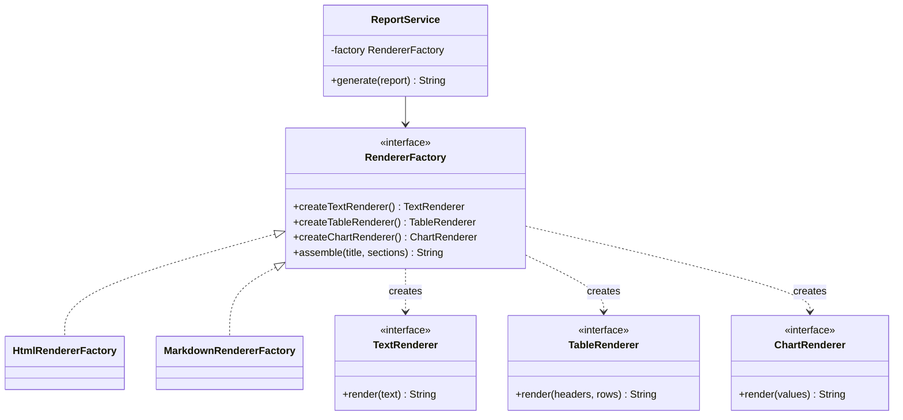
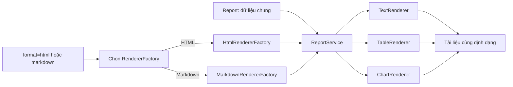

# Bộ render văn bản, bảng và biểu đồ cho các định dạng tài liệu khác nhau

## 1. Bối cảnh: xuất cùng một báo cáo ra nhiều định dạng

Một hệ thống báo cáo có thể phải xuất **cùng một dữ liệu** thành nhiều loại tài liệu: HTML để xem trên trình duyệt, Markdown để lưu trong kho tài liệu, hoặc PDF để in và gửi khách hàng. Mỗi báo cáo đều có ba loại nội dung:

- **Văn bản:** tiêu đề, lời giới thiệu, nhận xét, ghi chú.
- **Bảng:** cột tiêu đề và các hàng dữ liệu, ví dụ số đơn hàng từng tháng.
- **Biểu đồ:** các nhãn và giá trị thể hiện xu hướng hoặc phân bố.

Yêu cầu quan trọng là **các thành phần trong cùng một tài liệu phải tuân theo cùng một định dạng đầu ra**. Một báo cáo HTML cần đoạn văn HTML, bảng HTML và biểu đồ có thể hiển thị trong HTML; một báo cáo Markdown cần văn bản, bảng và cách biểu diễn biểu đồ phù hợp với khả năng của Markdown.

Nếu mỗi nơi tạo báo cáo đều viết:

```java
if ("html".equals(format)) {
    // Dựng đoạn văn HTML
    // Dựng bảng HTML
    // Dựng biểu đồ HTML
} else if ("markdown".equals(format)) {
    // Dựng đoạn văn Markdown
    // Dựng bảng Markdown
    // Dựng biểu đồ có thể đọc trong Markdown
}
```

thì lựa chọn định dạng bị trộn với logic tổng hợp báo cáo. Việc bổ sung PDF hoặc chỉnh sửa cách xuất biểu đồ sẽ kéo theo thay đổi ở nhiều phần của ứng dụng.

Đây là tình huống ứng dụng phù hợp với **Abstract Factory**: một factory đại diện cho **cả họ renderer tương thích** của một định dạng. Mã xây dựng báo cáo chỉ cần yêu cầu factory tạo renderer cho văn bản, bảng và biểu đồ.

## 2. Xác định các họ sản phẩm

Ta chọn hai định dạng để minh họa bằng mã Java chạy độc lập, không dùng thư viện ngoài:

1. **HTML:** văn bản được đặt trong phần tử `<p>`, bảng dùng `<table>` và biểu đồ dùng các thanh được bố trí bằng HTML/CSS.
2. **Markdown:** văn bản dùng cú pháp Markdown, bảng dùng dấu `|` và biểu đồ được biểu diễn bằng các thanh ký tự trong khối mã. Cách này đọc được ở mọi trình xem Markdown hỗ trợ fenced code block.

Vì Markdown cơ bản **không có cú pháp biểu đồ chuẩn**, bộ renderer Markdown chủ động chọn biểu đồ ký tự. Trong sản phẩm thật, có thể thay bằng ảnh, SVG được tham chiếu, hoặc một cú pháp mở rộng như Mermaid nếu nền tảng hiển thị hỗ trợ.

| Loại sản phẩm | Họ HTML | Họ Markdown |
| --- | --- | --- |
| Văn bản | `HtmlTextRenderer` → `<p>...` | `MarkdownTextRenderer` → đoạn Markdown |
| Bảng | `HtmlTableRenderer` → `<table>...` | `MarkdownTableRenderer` → bảng dấu `|` |
| Biểu đồ | `HtmlChartRenderer` → các thanh HTML/CSS | `MarkdownChartRenderer` → biểu đồ ký tự |
| Factory | `HtmlRendererFactory` | `MarkdownRendererFactory` |

Ba **abstract products** tương ứng là:

- `TextRenderer` nhận văn bản và trả về nội dung đã render.
- `TableRenderer` nhận tiêu đề cột và các hàng dữ liệu.
- `ChartRenderer` nhận cặp nhãn–giá trị của chuỗi số liệu.

**Abstract factory** `RendererFactory` khai báo ba phương thức tạo renderer. Nó còn có phương thức ghép các phần đã render thành một tài liệu hoàn chỉnh theo định dạng; bước ghép này cũng phải thuộc về cơ chế của định dạng để tránh trộn, chẳng hạn đưa Markdown trực tiếp vào thẻ `<body>`.



**Ranh giới trách nhiệm:**

- `ReportService` quyết định **báo cáo cần có những phần nào** và thứ tự của chúng.
- `RendererFactory` quyết định **tạo bộ renderer của định dạng nào** và **ghép chúng thành tài liệu ra sao**.
- Mỗi renderer quyết định **cách biểu diễn một loại nội dung**.
- Điểm khởi tạo ứng dụng (*composition root*) quyết định sử dụng `HtmlRendererFactory` hay `MarkdownRendererFactory`.

Dữ liệu báo cáo (tiêu đề, bảng, số liệu) vẫn là dữ liệu thuần, không cần mang theo thẻ HTML hoặc cú pháp Markdown.

## 3. Ví dụ Java 17 chạy độc lập

Tạo tệp `ReportRendererDemo.java` theo mã sau. Ví dụ dùng các functional interface cho ba loại abstract product; hai concrete factory cung cấp **ba cách triển khai riêng** cho HTML và Markdown. Các renderer trả về chuỗi để dễ quan sát; trong hệ thống thực, chúng có thể ghi ra stream, tạo DOM hoặc sinh đối tượng của thư viện PDF.

```java
import java.util.LinkedHashMap;
import java.util.List;
import java.util.Locale;
import java.util.Map;

public final class ReportRendererDemo {

    // Abstract products: đầu vào là dữ liệu, đầu ra là một phần tài liệu.
    @FunctionalInterface
    interface TextRenderer {
        String render(String text);
    }

    @FunctionalInterface
    interface TableRenderer {
        String render(List<String> headers, List<List<String>> rows);
    }

    @FunctionalInterface
    interface ChartRenderer {
        String render(Map<String, Integer> values);
    }

    // Abstract factory: tạo trọn bộ renderer và ghép tài liệu.
    interface RendererFactory {
        TextRenderer createTextRenderer();
        TableRenderer createTableRenderer();
        ChartRenderer createChartRenderer();
        String assemble(String title, List<String> sections);
    }

    // Dữ liệu độc lập với định dạng đầu ra.
    record Report(
        String title,
        String introduction,
        List<String> headers,
        List<List<String>> rows,
        Map<String, Integer> chartValues
    ) {}

    // Client không cần biết tên renderer cụ thể.
    static final class ReportService {
        private final RendererFactory factory;

        ReportService(RendererFactory factory) {
            this.factory = factory;
        }

        String generate(Report report) {
            TextRenderer text = factory.createTextRenderer();
            TableRenderer table = factory.createTableRenderer();
            ChartRenderer chart = factory.createChartRenderer();

            List<String> sections = List.of(
                text.render(report.introduction()),
                table.render(report.headers(), report.rows()),
                chart.render(report.chartValues())
            );

            return factory.assemble(report.title(), sections);
        }
    }

    // Những thao tác dùng chung để tránh lỗi dữ liệu trong ví dụ.
    static void checkTable(List<String> headers, List<List<String>> rows) {
        if (headers.isEmpty()) {
            throw new IllegalArgumentException("Bảng phải có ít nhất một cột");
        }
        for (List<String> row : rows) {
            if (row.size() != headers.size()) {
                throw new IllegalArgumentException("Số ô phải bằng số cột");
            }
        }
    }

    static int chartMaximum(Map<String, Integer> values) {
        int max = 0;
        for (Integer value : values.values()) {
            if (value == null || value < 0) {
                throw new IllegalArgumentException(
                    "Giá trị biểu đồ phải là số nguyên không âm");
            }
            max = Math.max(max, value);
        }
        return Math.max(1, max); // Tránh chia cho 0 nếu biểu đồ rỗng/toàn 0.
    }

    // Escape dữ liệu khi đưa vào nội dung HTML.
    static String html(String value) {
        return value.replace("&", "&amp;")
            .replace("<", "&lt;")
            .replace(">", "&gt;")
            .replace("\"", "&quot;");
    }

    // Escape các ký tự Markdown thường gặp ở đoạn văn.
    static String markdown(String value) {
        return value.replace("\\", "\\\\")
            .replace("*", "\\*")
            .replace("_", "\\_")
            .replace("`", "\\`")
            .replace("#", "\\#")
            .replace("[", "\\[")
            .replace("]", "\\]")
            .replace("<", "&lt;")
            .replace(">", "&gt;");
    }

    // Ô bảng còn phải escape dấu phân cách cột và bỏ xuống dòng.
    static String markdownCell(String value) {
        return markdown(value)
            .replace("|", "\\|")
            .replace("\r", " ")
            .replace("\n", " ");
    }

    // Họ sản phẩm HTML.
    static final class HtmlRendererFactory implements RendererFactory {

        @Override
        public TextRenderer createTextRenderer() {
            return value -> "<p>" + html(value) + "</p>";
        }

        @Override
        public TableRenderer createTableRenderer() {
            return (headers, rows) -> {
                checkTable(headers, rows);
                StringBuilder out = new StringBuilder("<table border=\"1\">\n");
                out.append("<thead><tr>");
                for (String header : headers) {
                    out.append("<th>").append(html(header)).append("</th>");
                }
                out.append("</tr></thead>\n<tbody>\n");
                for (List<String> row : rows) {
                    out.append("<tr>");
                    for (String cell : row) {
                        out.append("<td>").append(html(cell)).append("</td>");
                    }
                    out.append("</tr>\n");
                }
                return out.append("</tbody></table>").toString();
            };
        }

        @Override
        public ChartRenderer createChartRenderer() {
            return values -> {
                int max = chartMaximum(values);
                StringBuilder out =
                    new StringBuilder("<section><h2>Biểu đồ số đơn hàng</h2>\n");
                for (Map.Entry<String, Integer> entry : values.entrySet()) {
                    int width = (int) Math.round(
                        entry.getValue() * 100.0 / max
                    );
                    out.append("<div><span>")
                        .append(html(entry.getKey()))
                        .append(": ")
                        .append(entry.getValue())
                        .append("</span><div style=\"background:steelblue;")
                        .append("height:12px;width:")
                        .append(width)
                        .append("%\"></div></div>\n");
                }
                return out.append("</section>").toString();
            };
        }

        @Override
        public String assemble(String title, List<String> sections) {
            return "<!doctype html>\n<html lang=\"vi\">\n<head>"
                + "<meta charset=\"UTF-8\"><title>"
                + html(title)
                + "</title></head>\n<body>\n<h1>"
                + html(title)
                + "</h1>\n"
                + String.join("\n", sections)
                + "\n</body></html>\n";
        }
    }

    // Họ sản phẩm Markdown.
    static final class MarkdownRendererFactory implements RendererFactory {

        @Override
        public TextRenderer createTextRenderer() {
            return ReportRendererDemo::markdown;
        }

        @Override
        public TableRenderer createTableRenderer() {
            return (headers, rows) -> {
                checkTable(headers, rows);
                StringBuilder out = new StringBuilder();
                out.append("| ")
                    .append(String.join(" | ",
                        headers.stream().map(ReportRendererDemo::markdownCell)
                            .toList()))
                    .append(" |\n");
                out.append("|")
                    .append(" --- |".repeat(headers.size()))
                    .append("\n");
                for (List<String> row : rows) {
                    out.append("| ")
                        .append(String.join(" | ",
                            row.stream().map(ReportRendererDemo::markdownCell)
                                .toList()))
                        .append(" |\n");
                }
                return out.toString();
            };
        }

        @Override
        public ChartRenderer createChartRenderer() {
            return values -> {
                int max = chartMaximum(values);
                StringBuilder out = new StringBuilder(
                    "## Biểu đồ số đơn hàng\n\n```text\n"
                );
                for (Map.Entry<String, Integer> entry : values.entrySet()) {
                    int count = entry.getValue() == 0
                        ? 0
                        : Math.max(1, (int) Math.round(
                            entry.getValue() * 20.0 / max));
                    String label = entry.getKey()
                        .replace("\r", " ")
                        .replace("\n", " ")
                        .replace("`", "'");
                    out.append(label)
                        .append(" | ")
                        .append("#".repeat(count))
                        .append(" (")
                        .append(entry.getValue())
                        .append(")\n");
                }
                return out.append("```\n").toString();
            };
        }

        @Override
        public String assemble(String title, List<String> sections) {
            return "# " + markdown(title) + "\n\n"
                + String.join("\n\n", sections) + "\n";
        }
    }

    // Composition root: đây là nơi duy nhất chọn họ renderer.
    public static void main(String[] args) {
        if (args.length > 1) {
            throw new IllegalArgumentException(
                "Cú pháp: java ReportRendererDemo [html|markdown]");
        }
        String format = args.length == 0
            ? "html" : args[0].toLowerCase(Locale.ROOT);

        RendererFactory factory = switch (format) {
            case "html" -> new HtmlRendererFactory();
            case "markdown" -> new MarkdownRendererFactory();
            default -> throw new IllegalArgumentException(
                "Định dạng không hỗ trợ: " + format);
        };

        Map<String, Integer> chart = new LinkedHashMap<>();
        chart.put("Tháng 1", 12);
        chart.put("Tháng 2", 20);
        chart.put("Tháng 3", 16);

        Report report = new Report(
            "Báo cáo bán hàng",
            "Số đơn hàng trong ba tháng đầu năm.",
            List.of("Tháng", "Đơn hàng"),
            List.of(
                List.of("Tháng 1", "12"),
                List.of("Tháng 2", "20"),
                List.of("Tháng 3", "16")
            ),
            chart
        );

        System.out.print(new ReportService(factory).generate(report));
    }
}
```

**Lưu ý về ví dụ:** các interface sản phẩm được hiện thực bằng lambda do concrete factory tạo ra. Đây vẫn là một họ các renderer cụ thể: mỗi factory cung cấp đủ ba hành vi tương ứng với định dạng của nó. Khi logic renderer lớn, nên chuyển các lambda thành `HtmlTextRenderer`, `HtmlTableRenderer`, `HtmlChartRenderer` (và bộ Markdown tương ứng) để mỗi lớp có trách nhiệm rõ hơn.

### Chạy và quan sát kết quả

Biên dịch:

```bash
javac -encoding UTF-8 ReportRendererDemo.java
```

Xuất HTML:

```bash
java ReportRendererDemo html > report.html
```

Mở `report.html` bằng trình duyệt. Tài liệu sẽ có tiêu đề, một đoạn giới thiệu, bảng ba tháng và các thanh biểu đồ HTML/CSS. Phần quan trọng của kết quả là:

```html
<p>Số đơn hàng trong ba tháng đầu năm.</p>
<table border="1">
  <thead><tr><th>Tháng</th><th>Đơn hàng</th></tr></thead>
  <!-- Các hàng dữ liệu -->
</table>
<section>
  <h2>Biểu đồ số đơn hàng</h2>
  <!-- Các thanh biểu đồ -->
</section>
```

Đoạn trên là phần **minh họa rút gọn**; chương trình phát ra đầy đủ các hàng, thẻ và thuộc tính kiểu dáng.

Xuất Markdown:

```bash
java ReportRendererDemo markdown > report.md
```

Nội dung Markdown sẽ tương tự:

````markdown
# Báo cáo bán hàng

Số đơn hàng trong ba tháng đầu năm.

| Tháng | Đơn hàng |
| --- | --- |
| Tháng 1 | 12 |
| Tháng 2 | 20 |
| Tháng 3 | 16 |

## Biểu đồ số đơn hàng

```text
Tháng 1 | ############ (12)
Tháng 2 | #################### (20)
Tháng 3 | ################ (16)
```
````

Biểu đồ Markdown sử dụng tối đa 20 dấu `#` cho giá trị lớn nhất. Giá trị thực luôn được in bên cạnh, nên việc làm tròn chiều dài thanh không làm mất dữ liệu số. Định dạng HTML sử dụng thanh có độ rộng tính bằng phần trăm của giá trị lớn nhất.

## 4. Tại sao đây là Abstract Factory chứ không chỉ là một if/switch?

Bản thân `switch (format)` trong `main` không phải vấn đề: ứng dụng **phải có một nơi** chuyển yêu cầu cấu hình thành đối tượng cụ thể. Giá trị của Abstract Factory nằm ở việc `ReportService`:

1. Không gọi `new Html...` hoặc `new Markdown...` cho từng thành phần.
2. Không kiểm tra `format` khi render từng đoạn văn, bảng hoặc biểu đồ.
3. Nhận đúng một `RendererFactory` và tạo toàn bộ bộ sản phẩm qua hợp đồng chung.
4. Có thể được kiểm thử bằng một factory giả lập mà không cần tạo file HTML hoặc Markdown thực.

Nhờ đó, khi thêm định dạng mới, thay đổi chủ yếu nằm ở **họ renderer mới và điểm chọn factory**, trong khi thứ tự và logic nội dung báo cáo vẫn giữ nguyên.



Một điểm tinh tế: **Abstract Factory bảo đảm cấu trúc chọn đúng bộ renderer, nhưng không tự động bảo đảm mọi kết quả đều hợp lệ**. Chất lượng HTML/Markdown vẫn phụ thuộc vào từng concrete renderer, cách escape dữ liệu, bộ quy tắc định dạng và các bài kiểm thử.

## 5. Mở rộng sang PDF, DOCX hoặc định dạng khác

Giả sử ứng dụng cần thêm `PdfRendererFactory`. Về mặt thiết kế, factory mới phải cung cấp:

- `PdfTextRenderer`: dùng API thư viện PDF để viết đoạn văn với font, căn lề, ngắt trang.
- `PdfTableRenderer`: xây bảng, độ rộng cột, header, ngắt trang.
- `PdfChartRenderer`: vẽ biểu đồ bằng vector hoặc thêm ảnh biểu đồ vào tài liệu.
- Cơ chế ghép nội dung vào một tài liệu PDF có vòng đời rõ ràng.

**Khác biệt quan trọng:** PDF là định dạng nhị phân, không thể biểu diễn chính xác chỉ bằng một chuỗi Markdown hoặc HTML. Để hỗ trợ PDF trong sản phẩm thực, hợp đồng `String render(...)` của ví dụ nên được thiết kế lại thành hợp đồng độc lập với cách lưu trữ, chẳng hạn:

```java
interface DocumentContext {
    // Chứa tài nguyên và trạng thái của tài liệu đang tạo.
}

interface TextRenderer {
    void render(String text, DocumentContext context);
}

interface TableRenderer {
    void render(
        List<String> headers,
        List<List<String>> rows,
        DocumentContext context
    );
}

interface ChartRenderer {
    void render(Map<String, Integer> values, DocumentContext context);
}

interface RendererFactory {
    DocumentContext openDocument(String title);
    TextRenderer createTextRenderer();
    TableRenderer createTableRenderer();
    ChartRenderer createChartRenderer();
    byte[] finishDocument(DocumentContext context);
}
```

Đây là **phác thảo kiến trúc**, không phải API PDF hoàn chỉnh hay một đoạn chương trình độc lập có thể chạy ngay. Trong triển khai thực tế, phải bổ sung quản lý tài nguyên (đóng stream/tài liệu), phông chữ Unicode, kích thước trang, phân trang, hình ảnh và lỗi I/O. Tùy thư viện, có thể cần factory tạo renderer gắn với cùng một document context để tránh trộn các tài liệu.

Bài học thiết kế: **không ép mọi định dạng khác nhau vào một kiểu trả về thiếu phù hợp**. Mẫu Abstract Factory giữ ý tưởng “tạo các thành phần thuộc một họ”; hợp đồng render cụ thể phải phản ánh đúng cách xuất dữ liệu của hệ thống.

## 6. Tính nhất quán và những rủi ro thực tế

### 6.1. Không trộn các renderer khác họ

Ví dụ dưới đây biểu thị cấu hình không nhất quán:

```java
// Phản ví dụ: nội dung đầu ra trộn hai định dạng.
TextRenderer text = new HtmlRendererFactory().createTextRenderer();
TableRenderer table =
    new MarkdownRendererFactory().createTableRenderer();
```

Nếu ghép hai kết quả vào tài liệu HTML, bảng Markdown có thể chỉ hiện như văn bản thô; nếu ghép vào Markdown, các thẻ HTML có thể hiển thị khác nhau giữa các trình xem. Hãy truyền **một** concrete factory cho cả phiên xuất báo cáo để giữ đúng họ sản phẩm.

### 6.2. Escape dữ liệu theo định dạng và theo ngữ cảnh

Dữ liệu người dùng có thể chứa `&`, `<`, dấu `|` hoặc ký tự có ý nghĩa trong markup. Ví dụ dùng `html()` và `markdownCell()` để tránh phá cấu trúc cơ bản của HTML và bảng Markdown.

Trong hệ thống thật, cần escape theo **ngữ cảnh cụ thể**: phần tử HTML, thuộc tính HTML, URL, CSS, chuỗi JavaScript, khối Markdown hoặc dữ liệu biểu đồ có quy tắc khác nhau. Ví dụ chỉ đưa giá trị động vào **nội dung văn bản** và dùng số đã kiểm tra cho độ rộng thanh; không nên đưa chuỗi tùy ý của người dùng trực tiếp vào `style` hoặc một chuỗi HTML.

### 6.3. Bảo đảm dữ liệu và thứ tự hiển thị

Bảng cần có cùng số ô trên mọi hàng. Biểu đồ số lượng đơn hàng cần chặn giá trị âm nếu nghiệp vụ không cho phép. Trật tự của chuỗi dữ liệu cũng quan trọng: ví dụ dùng `LinkedHashMap` để giữ thứ tự các tháng; nếu cần sắp xếp theo thời gian, nên thực hiện ở lớp chuẩn bị dữ liệu, không để mỗi renderer tự chọn thứ tự khác nhau.

### 6.4. Quản lý tài nguyên và tài liệu lớn

Cách cộng chuỗi phù hợp với ví dụ nhỏ. Khi sinh hàng nghìn dòng hoặc hình ảnh độ phân giải cao, nên cân nhắc ghi luồng, xử lý phân trang, giới hạn bộ nhớ, font và cơ chế đóng tài nguyên. Tránh để từng renderer độc lập ghi vào các file khác nhau rồi ghép thủ công nếu định dạng yêu cầu một trạng thái tài liệu chung.

## 7. Kiểm thử theo họ renderer

Một kế hoạch kiểm thử có thể bao gồm:

| Tình huống | Kỳ vọng |
| --- | --- |
| Xuất HTML | Có `<p>`, `<table>`, các thanh biểu đồ HTML và thẻ đóng tài liệu |
| Xuất Markdown | Có đoạn văn, bảng đúng cú pháp và biểu đồ ký tự trong fenced code |
| Cùng bộ dữ liệu sang hai định dạng | Các số lượng, nhãn và thứ tự dữ liệu không thay đổi |
| Ô bảng chứa dấu `|` | Bảng Markdown vẫn đúng cấu trúc |
| Văn bản chứa `<` hoặc `&` | Kết quả HTML không làm hỏng cấu trúc thẻ |
| Một hàng có số ô không đúng | Báo lỗi sớm trước khi xuất tài liệu sai |
| Biểu đồ có giá trị âm | Báo lỗi vì trái quy ước ví dụ |
| Biểu đồ toàn số 0 | Không chia cho 0; độ dài thanh bằng 0 |
| Yêu cầu định dạng chưa hỗ trợ | Báo lỗi rõ ràng ở điểm chọn factory |
| Thêm concrete factory mới | `ReportService` không cần sửa nếu hợp đồng chung giữ nguyên |

**Kiểm thử khả năng thay thế factory:** có thể tạo `FakeRendererFactory` để trả về chuỗi xác định như `TEXT`, `TABLE`, `CHART`. Sau đó xác nhận `ReportService` gọi đúng ba loại renderer theo thứ tự mà không cần quan tâm HTML hoặc Markdown được tạo như thế nào.

Đây là một lợi ích trực tiếp của dependency injection: kiểm thử hành vi tổng hợp báo cáo độc lập với chi tiết xuất tệp.

## 8. Khi nào mẫu này phù hợp hoặc quá mức cần thiết?

Abstract Factory đặc biệt hữu ích khi:

- Có **nhiều định dạng** cùng yêu cầu **nhiều loại thành phần** liên quan (văn bản, bảng, biểu đồ, chú thích...).
- Cần giữ **tính tương thích** giữa renderer và bộ đóng gói tài liệu.
- Mã nghiệp vụ tạo báo cáo nên độc lập với thư viện xuất HTML/PDF/DOCX hoặc với biến thể đầu ra.
- Một định dạng mới phải được bổ sung mà không thay đổi các client tạo báo cáo.

Có thể chưa cần Abstract Factory nếu ứng dụng chỉ xuất một chuỗi văn bản theo một định dạng hoặc chỉ có **một** renderer. Một interface `ReportExporter` với các triển khai `HtmlExporter` và `MarkdownExporter` có thể đơn giản và dễ duy trì hơn khi không cần tách ba loại sản phẩm. Nếu thay đổi thường xuyên nhất là **thêm loại thành phần** (ví dụ bảng chéo, bản đồ, video), Abstract Factory sẽ đòi hỏi thêm phương thức và cập nhật tất cả concrete factory. Hãy cân nhắc phạm vi và tốc độ thay đổi của hệ thống.

## 9. Bài tập áp dụng

Một nền tảng phân tích cần xuất báo cáo quản trị ở hai định dạng: **Web Dashboard** và **PDF**. Mỗi báo cáo gồm phần mô tả, bảng KPI và biểu đồ xu hướng.

1. Hãy liệt kê ba abstract product và hai họ concrete product.
2. Xác định lớp nào nên nhận `RendererFactory` để dựng báo cáo và lớp nào chọn biến thể theo cấu hình.
3. Nếu thêm `CsvRendererFactory`, biểu đồ cần được biểu diễn thế nào khi CSV không hỗ trợ đồ họa trực tiếp? Đây có còn là cùng một hợp đồng renderer hợp lý không?
4. Nếu mỗi renderer PDF yêu cầu cùng một `PdfDocumentContext`, hãy chỉ ra nơi quản lý vòng đời và đóng tài liệu.
5. Thiết kế một phép thử xác nhận bộ render không làm thay đổi số liệu giữa HTML và PDF.

**Gợi ý:** CSV là trường hợp cần cân nhắc lại yêu cầu sản phẩm: có thể xuất bảng dữ liệu làm nguồn cho biểu đồ thay vì tạo đồ họa. Khi một định dạng không thể biểu diễn một loại sản phẩm theo yêu cầu, cần xác định rõ chính sách thay thế, báo không hỗ trợ hoặc tách hợp đồng, thay vì giả vờ tất cả định dạng có cùng khả năng.

---

**Ghi nhớ:** trong tình huống này, **định dạng tài liệu là trục biến thể**, còn **văn bản, bảng và biểu đồ là các loại sản phẩm trong một họ**. Abstract Factory giúp nơi tạo báo cáo sử dụng một bộ renderer tương thích, tập trung việc lựa chọn định dạng và giữ dữ liệu nghiệp vụ tách khỏi chi tiết trình bày.
