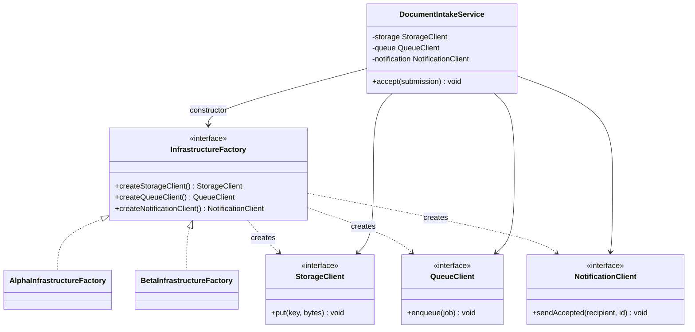
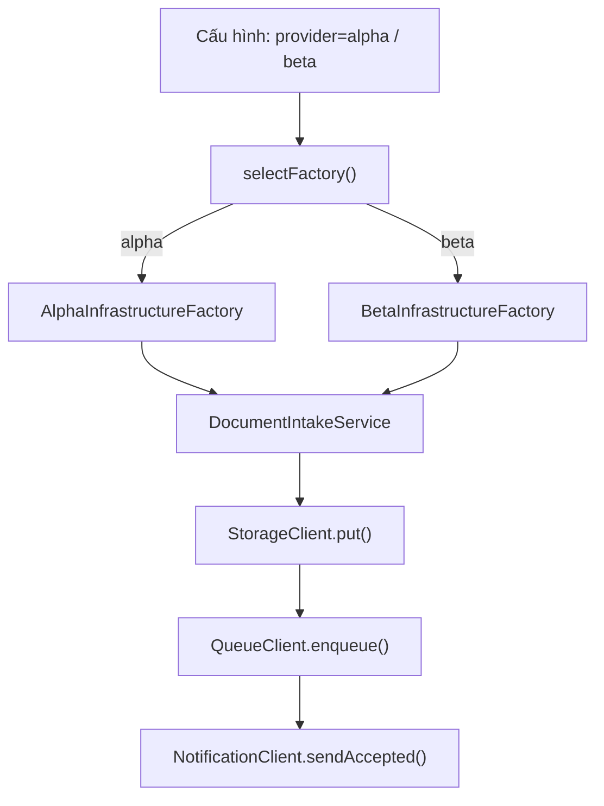

# Bộ client lưu trữ, hàng đợi và thông báo theo từng nhà cung cấp hạ tầng

## 1. Bài toán thực tế: một quy trình, nhiều nhà cung cấp

Giả sử một nền tảng tiếp nhận tài liệu cho phép khách hàng tải tệp lên để xử lý bất đồng bộ. Mỗi yêu cầu cần thực hiện ba bước:

1. **Lưu trữ (storage):** ghi nội dung tài liệu vào kho đối tượng.
2. **Hàng đợi (queue):** gửi công việc xử lý tài liệu cho worker.
3. **Thông báo (notification):** báo cho người yêu cầu rằng hệ thống đã tiếp nhận yêu cầu.

Ban đầu ứng dụng chỉ dùng một nhà cung cấp hạ tầng. Sau đó, hệ thống cần vận hành tại hai môi trường triển khai: **Cloud Alpha** và **Cloud Beta**. Đây là hai nhà cung cấp *giả định* được dùng trong bài học; tên lớp và lời gọi bên dưới không đại diện cho API SDK thật.

Mỗi nhà cung cấp có ba loại dịch vụ tương ứng, nhưng cách xác thực, cấu hình endpoint, cú pháp SDK và cơ chế vận hành có thể khác nhau. Yêu cầu thiết kế là: **một phiên xử lý phải dùng bộ storage, queue và notification được cấu hình cho cùng một nhà cung cấp và môi trường triển khai**.

Bài toán phù hợp với **Abstract Factory** vì ta cần tạo **một họ gồm nhiều đối tượng liên quan**, chứ không chỉ chọn một loại đối tượng. Phần nghiệp vụ tiếp nhận tài liệu nên hoạt động qua các interface chung, không phải tự biết SDK và tên lớp cụ thể của từng cloud.

> Trong kiến trúc này, Abstract Factory chọn và tạo một bộ *adapter/client* cùng họ. Mẫu thiết kế không làm cho các dịch vụ mạng trở thành một giao dịch nguyên tử và cũng không tự giải quyết độ trễ, lỗi kết nối hay khác biệt về bảo đảm giao nhận.

## 2. Dấu hiệu cần tách việc chọn nhà cung cấp khỏi nghiệp vụ

Một thiết kế ban đầu có thể rải điều kiện chọn nhà cung cấp ngay trong dịch vụ nghiệp vụ:

```java
// Mã minh họa vấn đề, không phải chương trình độc lập.
void accept(Submission submission, String provider) {
    if ("alpha".equals(provider)) {
        new AlphaStorageClient().put(...);
    } else {
        new BetaStorageClient().put(...);
    }

    if ("alpha".equals(provider)) {
        new AlphaQueueClient().enqueue(...);
    } else {
        new BetaQueueClient().enqueue(...);
    }

    if ("alpha".equals(provider)) {
        new AlphaNotificationClient().send(...);
    } else {
        new BetaNotificationClient().send(...);
    }
}
```

Thiết kế này có nhiều rủi ro:

- **Phụ thuộc SDK/lớp cụ thể:** lớp nghiệp vụ biết tên lớp và cách khởi tạo của mọi nhà cung cấp.
- **Nhánh điều kiện lặp:** ba quyết định cùng dựa vào `provider`. Khi thêm nhà cung cấp thứ ba, mã nghiệp vụ phải sửa ở nhiều nơi.
- **Nguy cơ trộn hạ tầng:** một nhánh bị bỏ sót có thể dùng storage Alpha nhưng queue Beta, khiến worker không tìm thấy đối tượng ở nơi nó được cấu hình để đọc.
- **Khó kiểm thử:** bài kiểm thử nghiệp vụ có thể bị kéo theo SDK, thông số kết nối hoặc giả lập API của nhà cung cấp.
- **Sai lệch chính sách:** các client tự cấu hình riêng có thể dùng khác namespace, khu vực, tài khoản hoặc môi trường.

Cần phân biệt hai việc: **chọn nhà cung cấp** là quyết định tại điểm khởi tạo ứng dụng; **thực hiện quy trình tiếp nhận tài liệu** là trách nhiệm của dịch vụ nghiệp vụ. Abstract Factory giúp tách hai trách nhiệm này.

## 3. Nhận diện abstract products và các họ concrete products

| Vai trò | Hợp đồng chung | Họ Alpha | Họ Beta |
| --- | --- | --- | --- |
| Lưu trữ | `StorageClient` | `AlphaStorageClient` | `BetaStorageClient` |
| Hàng đợi | `QueueClient` | `AlphaQueueClient` | `BetaQueueClient` |
| Thông báo | `NotificationClient` | `AlphaNotificationClient` | `BetaNotificationClient` |
| Tạo cả bộ | `InfrastructureFactory` | `AlphaInfrastructureFactory` | `BetaInfrastructureFactory` |

Hợp đồng của ba sản phẩm chỉ mô tả những thao tác mà nghiệp vụ thật sự cần:

- `StorageClient.put(key, content)`: lưu nội dung dưới một khóa logic.
- `QueueClient.enqueue(job)`: đưa một yêu cầu xử lý vào hàng đợi.
- `NotificationClient.sendAccepted(recipient, documentId)`: gửi thông báo **đã tiếp nhận**, chưa khẳng định đã xử lý xong.

`InfrastructureFactory` cung cấp `createStorageClient()`, `createQueueClient()` và `createNotificationClient()`. Mỗi concrete factory tạo ra cả ba client thuộc cùng họ. Lớp `DocumentIntakeService` nhận factory qua constructor và không cần tham số `provider` trong từng lời gọi.



Sơ đồ nhấn mạnh rằng **client nghiệp vụ dùng các interface sản phẩm**, còn việc cụ thể hóa họ được tập trung tại concrete factory.

## 4. Ví dụ Java 17 tự chứa

Ví dụ sau có thể biên dịch và chạy bằng JDK 17 mà không cần đăng ký tài khoản cloud. Các adapter Alpha/Beta **chỉ in mô phỏng lời gọi**, không lưu dữ liệu, đẩy thông điệp hoặc gửi email thật. Mục đích là quan sát ranh giới trách nhiệm của Abstract Factory.

Tạo tệp `InfrastructureFactoryDemo.java`:

```java
import java.nio.charset.StandardCharsets;
import java.util.Locale;

public final class InfrastructureFactoryDemo {

    // Dữ liệu nghiệp vụ độc lập với SDK của nhà cung cấp.
    record Submission(String documentId, String recipient, String text) {}

    record ProcessingJob(String documentId, String objectKey) {}

    // Ba abstract products.
    interface StorageClient {
        void put(String key, byte[] content);
    }

    interface QueueClient {
        void enqueue(ProcessingJob job);
    }

    interface NotificationClient {
        void sendAccepted(String recipient, String documentId);
    }

    // Abstract factory: luôn cung cấp trọn bộ 3 loại client.
    interface InfrastructureFactory {
        StorageClient createStorageClient();
        QueueClient createQueueClient();
        NotificationClient createNotificationClient();
    }

    // ===== Họ sản phẩm Alpha =====

    static final class AlphaStorageClient implements StorageClient {
        private final String namespace;

        AlphaStorageClient(String namespace) {
            this.namespace = namespace;
        }

        @Override
        public void put(String key, byte[] content) {
            System.out.printf(
                "[ALPHA storage][%s] PUT %s (%d bytes)%n",
                namespace, key, content.length
            );
        }
    }

    static final class AlphaQueueClient implements QueueClient {
        private final String namespace;

        AlphaQueueClient(String namespace) {
            this.namespace = namespace;
        }

        @Override
        public void enqueue(ProcessingJob job) {
            System.out.printf(
                "[ALPHA queue][%s] ENQUEUE %s -> %s%n",
                namespace, job.documentId(), job.objectKey()
            );
        }
    }

    static final class AlphaNotificationClient
            implements NotificationClient {
        private final String namespace;

        AlphaNotificationClient(String namespace) {
            this.namespace = namespace;
        }

        @Override
        public void sendAccepted(String recipient, String documentId) {
            // Giả lập thao tác gửi. Không in địa chỉ nhận ra log.
            System.out.printf(
                "[ALPHA notification][%s] ACCEPTED %s%n",
                namespace, documentId
            );
        }
    }

    static final class AlphaInfrastructureFactory
            implements InfrastructureFactory {
        private final String namespace;

        AlphaInfrastructureFactory(String namespace) {
            this.namespace = namespace;
        }

        @Override
        public StorageClient createStorageClient() {
            return new AlphaStorageClient(namespace);
        }

        @Override
        public QueueClient createQueueClient() {
            return new AlphaQueueClient(namespace);
        }

        @Override
        public NotificationClient createNotificationClient() {
            return new AlphaNotificationClient(namespace);
        }
    }

    // ===== Họ sản phẩm Beta =====

    static final class BetaStorageClient implements StorageClient {
        private final String namespace;

        BetaStorageClient(String namespace) {
            this.namespace = namespace;
        }

        @Override
        public void put(String key, byte[] content) {
            System.out.printf(
                "[BETA storage][%s] PUT %s (%d bytes)%n",
                namespace, key, content.length
            );
        }
    }

    static final class BetaQueueClient implements QueueClient {
        private final String namespace;

        BetaQueueClient(String namespace) {
            this.namespace = namespace;
        }

        @Override
        public void enqueue(ProcessingJob job) {
            System.out.printf(
                "[BETA queue][%s] ENQUEUE %s -> %s%n",
                namespace, job.documentId(), job.objectKey()
            );
        }
    }

    static final class BetaNotificationClient
            implements NotificationClient {
        private final String namespace;

        BetaNotificationClient(String namespace) {
            this.namespace = namespace;
        }

        @Override
        public void sendAccepted(String recipient, String documentId) {
            System.out.printf(
                "[BETA notification][%s] ACCEPTED %s%n",
                namespace, documentId
            );
        }
    }

    static final class BetaInfrastructureFactory
            implements InfrastructureFactory {
        private final String namespace;

        BetaInfrastructureFactory(String namespace) {
            this.namespace = namespace;
        }

        @Override
        public StorageClient createStorageClient() {
            return new BetaStorageClient(namespace);
        }

        @Override
        public QueueClient createQueueClient() {
            return new BetaQueueClient(namespace);
        }

        @Override
        public NotificationClient createNotificationClient() {
            return new BetaNotificationClient(namespace);
        }
    }

    // ===== Client nghiệp vụ, không biết Alpha hay Beta =====

    static final class DocumentIntakeService {
        private final StorageClient storage;
        private final QueueClient queue;
        private final NotificationClient notification;

        DocumentIntakeService(InfrastructureFactory factory) {
            this.storage = factory.createStorageClient();
            this.queue = factory.createQueueClient();
            this.notification = factory.createNotificationClient();
        }

        void accept(Submission submission) {
            String objectKey =
                "incoming/" + submission.documentId() + ".txt";

            storage.put(
                objectKey,
                submission.text().getBytes(StandardCharsets.UTF_8)
            );

            queue.enqueue(new ProcessingJob(
                submission.documentId(), objectKey
            ));

            // Chỉ xác nhận đã nhận yêu cầu, không báo đã xử lý xong.
            notification.sendAccepted(
                submission.recipient(), submission.documentId()
            );
        }
    }

    // ===== Composition root: chọn factory một lần =====

    static InfrastructureFactory selectFactory(
            String rawProvider, String namespace) {
        return switch (rawProvider.strip().toLowerCase(Locale.ROOT)) {
            case "alpha" -> new AlphaInfrastructureFactory(namespace);
            case "beta" -> new BetaInfrastructureFactory(namespace);
            default -> throw new IllegalArgumentException(
                "Provider không hỗ trợ: " + rawProvider
            );
        };
    }

    public static void main(String[] args) {
        if (args.length > 1) {
            throw new IllegalArgumentException(
                "Cú pháp: java InfrastructureFactoryDemo [alpha|beta]"
            );
        }

        String provider = args.length == 0 ? "alpha" : args[0];
        InfrastructureFactory factory =
            selectFactory(provider, "training");

        DocumentIntakeService service = new DocumentIntakeService(factory);
        service.accept(new Submission(
            "DOC-001", "sample@example.com", "Sample contract"
        ));
    }
}
```

### Biên dịch và chạy

```bash
javac -encoding UTF-8 InfrastructureFactoryDemo.java
java InfrastructureFactoryDemo alpha
```

Đầu ra dự kiến:

```text
[ALPHA storage][training] PUT incoming/DOC-001.txt (15 bytes)
[ALPHA queue][training] ENQUEUE DOC-001 -> incoming/DOC-001.txt
[ALPHA notification][training] ACCEPTED DOC-001
```

Đổi sang nhà cung cấp Beta:

```bash
java InfrastructureFactoryDemo beta
```

Đầu ra chỉ thay đổi họ client:

```text
[BETA storage][training] PUT incoming/DOC-001.txt (15 bytes)
[BETA queue][training] ENQUEUE DOC-001 -> incoming/DOC-001.txt
[BETA notification][training] ACCEPTED DOC-001
```

`DocumentIntakeService` giữ nguyên trong cả hai lần chạy. Giá trị `training` trong ví dụ chỉ là một namespace minh họa; khi triển khai thực, factory cần nhận cấu hình có ý nghĩa với nhà cung cấp như tenant, account, endpoint, region và thông tin xác thực qua một cơ chế an toàn.

## 5. Vì sao cách này bảo đảm chọn đúng *họ* client?

Trước khi có factory, dịch vụ nghiệp vụ có thể lấy client từ ba nguồn khác nhau: một helper tạo storage Alpha, một container khác tạo queue Beta và một singleton tạo notification Alpha. Không có một nơi nào chịu trách nhiệm kiểm tra chúng có cùng môi trường hay không.

Trong ví dụ, `DocumentIntakeService` nhận **một** `InfrastructureFactory` rồi lấy ba sản phẩm từ factory đó. Khi cần thay nhà cung cấp, composition root đổi concrete factory:



Factory có thể quản lý hoặc truyền vào các dependency chung của họ client: namespace, account, region, credential provider, kết nối hoặc cấu hình retry. Nhờ vậy, các client được tạo **cùng cấu hình triển khai theo thiết kế**.

Tuy nhiên, interface Java **không tự kiểm chứng** tài khoản, tên bucket, queue hay quyền truy cập thực tế có khớp nhau. Concrete factory và cơ chế cấu hình vẫn cần kiểm tra các bất biến đó. Nếu queue nằm ở khu vực khác storage, worker vẫn có thể đọc dữ liệu khi được cấu hình đúng; yêu cầu kỹ thuật là **đường đi và quyền truy cập phải nhất quán**, không nhất thiết mọi dịch vụ phải ở cùng một region trong mọi kiến trúc.

## 6. Ánh xạ sang SDK và dịch vụ thật

Ví dụ dùng Alpha/Beta giả định để tránh gắn bài học với tên hoặc phiên bản SDK cụ thể. Khi triển khai với cloud thật, concrete client thường là **adapter** bọc SDK của nhà cung cấp và chuyển đổi từ hợp đồng của ứng dụng:

| Nhu cầu nghiệp vụ | API chung do ứng dụng sở hữu | Công việc của adapter |
| --- | --- | --- |
| Lưu nội dung | `put(key, bytes)` | Xác định bucket/container, xác thực và gửi dữ liệu bằng SDK |
| Đưa công việc vào hàng đợi | `enqueue(ProcessingJob)` | Tuần tự hóa thông điệp, chọn queue/topic và công bố |
| Thông báo tiếp nhận | `sendAccepted(recipient, id)` | Chọn kênh gửi, tạo nội dung và gọi dịch vụ thông báo |
| Chọn bộ client | `InfrastructureFactory` | Lắp đúng các adapter, tài nguyên và cấu hình của môi trường |

Một bản triển khai thực có thể dùng tên lớp như `AlphaStorageAdapter` thay cho `AlphaStorageClient` để nhấn mạnh rằng lớp này bọc một SDK. Phần nghiệp vụ không được phụ thuộc vào các kiểu request/response đặc thù của SDK; nếu cần trả kết quả, hãy tạo kiểu dữ liệu ứng dụng như `StoredObjectRef` hoặc `EnqueueReceipt` có **ngữ nghĩa chung, được mô tả rõ ràng**.

Ví dụ, `StorageClient.put` trong hệ thống thật có thể trả về tham chiếu:

```java
record StoredObjectRef(String logicalKey, String version) {}

interface StorageClient {
    StoredObjectRef put(String key, byte[] content);
}
```

Cần quyết định liệu `version` có bắt buộc không, cách xử lý provider không hỗ trợ versioning và ý nghĩa của việc ghi đè đối tượng. **Không nên giả định** mọi cloud có cùng giới hạn kích thước, thứ tự giao nhận, độ bền, API hay bảo đảm đồng nhất.

### Cấu hình và vòng đời

Trong triển khai thực, các client thường có vòng đời dài hơn một yêu cầu. Factory có thể tạo một client được chia sẻ an toàn giữa các yêu cầu hoặc quản lý cache/pool, tùy tính thread-safe và khuyến nghị của SDK. Mã ví dụ khởi tạo mới mỗi lần gọi `create...` để đơn giản hóa việc học; ứng dụng thực cần quản lý việc đóng client, stream, kết nối và tài nguyên sau khi sử dụng.

Nên chọn factory tại **composition root**, ví dụ dựa vào cấu hình môi trường:

```properties
provider=alpha
namespace=production
```

Sau khi đọc và xác thực cấu hình, tạo một `AlphaInfrastructureFactory` và inject vào dịch vụ. Tránh cho các client nghiệp vụ tự đọc biến môi trường hoặc tự khởi tạo SDK trong từng phương thức.

## 7. Điểm quan trọng: Abstract Factory không tạo giao dịch phân tán

Trong ví dụ, `accept()` gọi ba dịch vụ theo thứ tự:

```text
1. Storage.put()            -> có thể thành công
2. Queue.enqueue()          -> có thể thất bại
3. Notification.sendAccepted() -> có thể thất bại
```

Nếu bước 1 thành công nhưng bước 2 thất bại, tài liệu đã được lưu nhưng chưa có công việc xử lý. Nếu bước 2 thành công nhưng bước 3 thất bại, tài liệu có thể đang được xử lý nhưng người yêu cầu chưa nhận xác nhận.

Abstract Factory chỉ giải quyết **lắp ráp họ đối tượng**; nó không bảo đảm *all-or-nothing* cho ba dịch vụ độc lập.

Một số biện pháp thiết kế có thể cần khi đưa hệ thống vào vận hành:

- **Idempotency:** dùng `documentId` hoặc khóa yêu cầu để phát hiện yêu cầu gửi lại. Worker cần chịu được việc nhận trùng thông điệp.
- **Retry có giới hạn:** phân loại lỗi tạm thời và lỗi vĩnh viễn, dùng backoff và tránh gửi thông báo trùng khi retry.
- **Transactional outbox:** khi hệ thống có cơ sở dữ liệu lưu trạng thái yêu cầu, có thể ghi trạng thái và sự kiện cần phát trong cùng một transaction của cơ sở dữ liệu, rồi có một tiến trình riêng xuất sự kiện sang queue. Cơ chế này không tự biến lần tải lên object storage thành transaction cùng cơ sở dữ liệu.
- **Reconciliation:** tìm những tài liệu đã lưu nhưng thiếu job, và có kế hoạch tạo lại job hoặc dọn dẹp đối tượng mồ côi.
- **Dead-letter queue và quan sát:** theo dõi job lỗi, độ trễ xử lý, request ID và các chỉ số tương ứng của từng nhà cung cấp.
- **Phân biệt trạng thái:** `sendAccepted` chỉ xác nhận yêu cầu đã được tiếp nhận, không được diễn đạt thành “tài liệu đã xử lý thành công”. Thông báo hoàn thành nên phát từ worker sau khi xử lý thành công.

Đặc biệt, việc lắp ba client cùng một provider không bảo đảm **exactly-once delivery**. Mức độ bảo đảm phải được xác định theo dịch vụ hàng đợi thực tế và cách thiết kế consumer.

## 8. Kiểm thử mà không cần kết nối cloud

Do `DocumentIntakeService` chỉ phụ thuộc vào ba interface, có thể xây dựng một factory giả (*test double*) tạo các client ghi nhận lời gọi.

Ví dụ một factory lưu lại thứ tự thao tác, dùng chung các lớp interface ở mục 4:

```java
import java.util.ArrayList;
import java.util.List;

// Đoạn mã bổ sung minh họa, đặt cùng ngữ cảnh với các interface ở trên.
final class RecordingFactory implements InfrastructureFactory {
    final List<String> calls = new ArrayList<>();

    @Override
    public StorageClient createStorageClient() {
        return (key, content) -> calls.add("save:" + key);
    }

    @Override
    public QueueClient createQueueClient() {
        return job -> calls.add("enqueue:" + job.objectKey());
    }

    @Override
    public NotificationClient createNotificationClient() {
        return (recipient, documentId) ->
            calls.add("notify:" + documentId);
    }
}
```

Đoạn trên minh họa cấu trúc fake **khi được đặt trong đúng phạm vi truy cập của các interface** (chẳng hạn làm lớp lồng trong `InfrastructureFactoryDemo`). Đây không phải tệp Java độc lập để biên dịch riêng. Với một test harness, sau khi gọi `service.accept(...)`, xác nhận thứ tự:

```text
save:incoming/DOC-001.txt
enqueue:incoming/DOC-001.txt
notify:DOC-001
```

Các trường hợp kiểm thử hữu ích:

| Nhóm kiểm thử | Kỳ vọng |
| --- | --- |
| Chọn provider `alpha` | Factory Alpha tạo đủ ba client thuộc họ Alpha |
| Chọn provider `beta` | Factory Beta tạo đủ ba client thuộc họ Beta |
| Giá trị provider không hỗ trợ | Báo lỗi rõ trước khi tạo dịch vụ |
| Quy trình thành công | Gọi storage → queue → thông báo tiếp nhận |
| Storage thất bại | Không đẩy queue và không thông báo đã tiếp nhận |
| Queue thất bại | Không thông báo đã tiếp nhận; có cơ chế xử lý tài liệu đã lưu |
| Notification thất bại | Không kết luận xử lý đã thất bại hoàn toàn; có phương án retry riêng |
| Gửi lại cùng một yêu cầu | Không tạo tác dụng phụ sai hoặc gửi thông báo trùng ngoài ý muốn |
| Chuyển từ Alpha sang Beta | `DocumentIntakeService` không phải sửa |
| Thêm provider thứ ba | Chỉ bổ sung họ adapter/factory và cập nhật chỗ lựa chọn |

Các test fake giúp kiểm tra **thứ tự và quyết định nghiệp vụ**. Vẫn cần integration test với từng provider để kiểm chứng xác thực, tên tài nguyên, hợp đồng dữ liệu, lỗi mạng và cách SDK thật hoạt động.

## 9. Khi nào dùng Abstract Factory, khi nào chọn cấu trúc đơn giản hơn?

Abstract Factory phát huy hiệu quả khi:

- Có **nhiều nhà cung cấp hoặc môi trường hạ tầng**.
- Mỗi nhà cung cấp cần tạo **nhiều client thuộc cùng một bộ** (storage, queue, notification).
- Nhiều dịch vụ nghiệp vụ dùng lại các interface chung.
- Phải bảo đảm một triển khai dùng đúng bộ dependency và cấu hình đã chọn.
- Việc thêm provider mới diễn ra thường xuyên hơn việc thay đổi các loại client mà interface chung hỗ trợ.

Có thể chưa cần Abstract Factory nếu ứng dụng dùng duy nhất một provider và chỉ có một `StorageClient`. Constructor injection trực tiếp hoặc một factory đơn giản có thể dễ đọc hơn.

Cũng cần phân biệt hai kiểu thay đổi:

| Thay đổi | Tác động dự kiến |
| --- | --- |
| **Thêm nhà cung cấp Gamma** | Thêm `GammaStorageClient`, `GammaQueueClient`, `GammaNotificationClient` và `GammaInfrastructureFactory`; cập nhật nơi chọn factory |
| **Thêm loại client mới, ví dụ SearchClient** | Thêm phương thức vào `InfrastructureFactory` và triển khai ở **tất cả** concrete factory; có thể sửa các client nghiệp vụ sử dụng tìm kiếm |

Abstract Factory thuận tiện cho **thêm họ sản phẩm**, còn việc thêm **loại sản phẩm** có thể đòi hỏi nhiều thay đổi. Nếu các loại dịch vụ của mỗi provider rất khác nhau, không nên ép chúng vào một interface chỉ để “dùng được Abstract Factory”.

### Có nên dùng một factory cho từng tenant?

Có thể, nhưng cần định nghĩa rõ phạm vi sống của factory và các client. Với ứng dụng nhiều tenant, một factory chung gắn cố định với một tenant có thể gây truy cập sai dữ liệu nếu được dùng bởi tenant khác. Có thể cần một registry cung cấp factory theo **tenant + môi trường**, đồng thời xác thực thông tin truy cập trước khi chọn. Nếu cần chuyển provider khi chương trình đang chạy, phải tính đến các job còn nằm trong queue cũ và các đối tượng còn nằm ở storage cũ; **đổi factory không tự chuyển dữ liệu**.

## 10. Bài tập áp dụng

Một nền tảng thương mại điện tử có hai môi trường:

- **Provider Green:** lưu ảnh sản phẩm, hàng đợi tạo thumbnail, thông báo khi ảnh đã xử lý.
- **Provider Blue:** cung cấp bộ dịch vụ tương ứng nhưng SDK và cách đặt tên tài nguyên khác nhau.

Ứng dụng hiện tại có `ProductImageService` chứa nhiều `if (provider)` để khởi tạo từng client.

Hãy thực hiện lần lượt:

1. Xác định **ba abstract product** và **hai họ concrete product**.
2. Phác thảo `MediaInfrastructureFactory` với ba phương thức khởi tạo.
3. Viết `ProductImageService` chỉ nhận factory qua constructor, không biết concrete class của Green/Blue.
4. Mô tả trường hợp upload thành công nhưng enqueue thất bại. Cần lưu trạng thái nào để có thể phục hồi mà không đẩy trùng job?
5. Đề xuất cách kiểm thử việc **một factory chỉ tạo sản phẩm thuộc đúng họ**, cũng như thứ tự gọi các client.
6. Nếu một provider chỉ có dịch vụ storage và queue mà không có dịch vụ thông báo, hãy cân nhắc xem nên tạo adapter thông báo qua kênh khác, tách contract, báo không hỗ trợ hay thay đổi thiết kế. Giải thích ảnh hưởng đối với tính nhất quán của factory.

**Gợi ý:** trước tiên hãy xác định **hợp đồng nghiệp vụ** của ba client, sau đó mới chọn lớp adapter của provider. Khi cần thay một provider bằng provider khác, mã xử lý ảnh vẫn chỉ làm việc qua các interface chung.

---

**Ghi nhớ:** trong kịch bản này, **nhà cung cấp hạ tầng là trục biến thể**, còn **storage, queue và notification là ba loại sản phẩm của cùng một họ**. Abstract Factory tập trung việc khởi tạo bộ client tương thích và giúp nghiệp vụ độc lập với cách dựng SDK. Những yêu cầu về xác thực, xử lý lỗi, độ bền và tính nhất quán dữ liệu vẫn cần được thiết kế và kiểm thử riêng.
