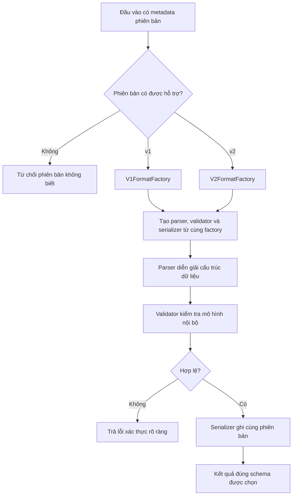

# Bộ parser, validator và serializer dùng chung phiên bản định dạng dữ liệu

> **Chương:** Tình huống ứng dụng  
> **Module:** `SOFTWARE_DESIGN_DESIGN_PATTERN_CREATIONAL_ABSTRACT_FACTORY` — Học về abstract factory trong design pattern.

## 1. Mục tiêu của tình huống

Trong một ứng dụng trao đổi dữ liệu, một định dạng thường thay đổi theo phiên bản: tên trường, cấu trúc, giá trị mặc định và những quy tắc hợp lệ có thể khác nhau. Nếu **parser**, **validator** và **serializer** được lựa chọn độc lập, chương trình dễ đọc theo phiên bản này nhưng kiểm tra hoặc ghi lại theo phiên bản khác.

Bài học áp dụng **Abstract Factory** để tạo **một bộ ba thành phần cùng phiên bản định dạng dữ liệu**:

- **Parser**: diễn giải dữ liệu đầu vào theo cấu trúc của phiên bản đã chọn và chuyển thành mô hình nội bộ.
- **Validator**: kiểm tra các điều kiện hợp lệ mà phiên bản đó yêu cầu đối với dữ liệu đã được diễn giải.
- **Serializer**: chuyển mô hình nội bộ thành cấu trúc dữ liệu đầu ra của cùng phiên bản.

Sau bài này, bạn có thể xác định trục **họ sản phẩm = phiên bản định dạng**, thiết kế các interface chung, chọn factory tại đúng ranh giới, kiểm tra tính nhất quán của bộ xử lý và phân biệt **round-trip trong cùng phiên bản** với **chuyển đổi có chủ đích giữa hai phiên bản**.

## 2. Bối cảnh nghiệp vụ: dữ liệu hồ sơ có hai phiên bản

Giả sử hệ thống nhận và phát hành bản ghi tài khoản người dùng. Hai phiên bản của định dạng trao đổi có cấu trúc minh họa như sau.

**Phiên bản V1:**

```json
{
  "version": "v1",
  "id": "u-17",
  "name": "Lan"
}
```

**Phiên bản V2:**

```json
{
  "version": "v2",
  "user_id": "u-17",
  "display_name": "Lan",
  "enabled": false
}
```

Đây là **quy ước giả định của bài học**, không phải một chuẩn định dạng có sẵn.

| Đặc điểm | V1 | V2 |
| --- | --- | --- |
| Trường nhận diện phiên bản | `version: "v1"` | `version: "v2"` |
| Định danh người dùng | `id` | `user_id` |
| Tên hiển thị | `name` | `display_name` |
| Trạng thái hoạt động | Không có trường riêng; mặc định `true` khi đọc | Trường `enabled` kiểu boolean |
| Điều kiện dữ liệu nội bộ để ghi ra phiên bản | Chỉ ghi được tài khoản có `enabled = true` mà không mất ý nghĩa | Ghi được cả `true` và `false` |

Ứng dụng sử dụng một mô hình nội bộ chung:

```java
record UserData(String id, String displayName, boolean enabled) {}
```

Dù V1 và V2 có **hình dạng dữ liệu bên ngoài khác nhau**, client nghiệp vụ có thể làm việc với `UserData`. Tuy nhiên, quá trình đi từ định dạng ngoài vào `UserData` rồi trở lại phải tuân theo quy tắc của **đúng phiên bản**.

### Lỗi khi trộn các phiên bản

Giả sử chương trình:

1. Đọc đầu vào V1 bằng `V1Parser`; bộ đọc hiểu `id` và `name`.
2. Chạy `V2Validator`; bộ kiểm tra cho rằng trạng thái `enabled = false` có thể biểu diễn được.
3. Ghi bằng `V1Serializer`; V1 không có chỗ biểu diễn `enabled = false`.

Nếu quá trình ghi bỏ qua trạng thái `false` và xuất ra V1, người đọc V1 sẽ suy ra `enabled = true`. Dữ liệu bị **thay đổi ý nghĩa âm thầm**. Một serializer đúng phải **từ chối** trạng thái không thể biểu diễn hoặc yêu cầu một quy tắc chuyển đổi được xác định rõ.

Abstract Factory giúp gắn việc tạo ba thành phần với một quyết định phiên bản; kiểm tra dữ liệu ở runtime vẫn cần được triển khai riêng.

## 3. Nhận diện họ sản phẩm từ yêu cầu

Trong bài này:

- **Trục họ sản phẩm**: phiên bản định dạng `v1` hoặc `v2`.
- **Loại sản phẩm thứ nhất**: `DataParser`, diễn giải cấu trúc phiên bản.
- **Loại sản phẩm thứ hai**: `DataValidator`, kiểm tra ràng buộc phiên bản.
- **Loại sản phẩm thứ ba**: `DataSerializer`, tạo cấu trúc dữ liệu phiên bản.
- **Bất biến cần giữ**: trong một luồng đọc, kiểm tra và ghi lại **cùng phiên bản**, cả ba thành phần phải thuộc **cùng một họ**.

Ma trận họ sản phẩm:

| Loại sản phẩm | Họ định dạng V1 | Họ định dạng V2 |
| --- | --- | --- |
| Parser | `V1Parser` | `V2Parser` |
| Validator | `V1Validator` | `V2Validator` |
| Serializer | `V1Serializer` | `V2Serializer` |
| Concrete factory | `V1FormatFactory` | `V2FormatFactory` |

Một `FormatFactory` trừu tượng khai báo ba phương thức tạo:

```java
interface FormatFactory {
    DataParser createParser();
    DataValidator createValidator();
    DataSerializer createSerializer();
}
```

`V1FormatFactory` tạo **trọn bộ V1**; `V2FormatFactory` tạo **trọn bộ V2**. Client nhận `FormatFactory`, yêu cầu ba thành phần rồi thực thi theo thứ tự.

**Lý do chọn Abstract Factory:** đây là **ba loại đối tượng khác nhau** cùng biến thiên theo phiên bản định dạng và cần tương thích. Nếu chỉ có một parser với hai biến thể mà không có validator/serializer phụ thuộc phiên bản, factory đơn giản có thể đủ.

## 4. Vị trí chọn factory và trình tự xử lý



Quy trình gồm ba ranh giới:

1. **Ranh giới lựa chọn phiên bản:** điểm nhận dữ liệu đọc phiên bản từ metadata/envelope, đối chiếu với danh sách hỗ trợ rồi tạo `FormatFactory` tương ứng.
2. **Ranh giới tạo sản phẩm:** một concrete factory tạo ba thành phần phù hợp với phiên bản đã chọn. Client không tự `new V1Parser()` rồi `new V2Serializer()`.
3. **Ranh giới sử dụng:** client gọi phương thức trên các abstraction như `DataParser`, `DataValidator`, `DataSerializer`.

### Phiên bản từ dữ liệu chưa xác thực có đáng tin không?

Trường `version` trong dữ liệu nhận từ bên ngoài là **đầu vào chưa đáng tin**. Nó có thể được dùng như **gợi ý định tuyến**, nhưng không được coi là bằng chứng rằng dữ liệu đã hợp lệ hoặc có quyền được xử lý.

Một bộ xử lý thực tế cần giới hạn **các phiên bản được hỗ trợ**, độ dài/số trường, kiểm tra cú pháp, kiểm tra schema và các ràng buộc bảo mật thích hợp. Với dữ liệu có chữ ký hoặc mã hóa, việc xác thực nguồn gốc và phạm vi chữ ký phải tuân theo giao thức; riêng việc nhìn thấy `"version": "v2"` không chứng minh payload là V2 hợp lệ.

Trong ví dụ dưới đây, factory sẽ được chọn **theo danh sách cho phép** và parser tiếp tục kiểm tra schema của chính phiên bản đó. Việc chọn factory không thay thế kiểm tra dữ liệu.

## 5. Mỗi thành phần chịu trách nhiệm gì?

Để tránh các nhiệm vụ chồng chéo, có thể phân biệt ba trách nhiệm:

| Thành phần | Đầu vào | Đầu ra | Trách nhiệm chính |
| --- | --- | --- | --- |
| `DataParser` | Dữ liệu đã được tách thành trường (decoded fields) | `UserData` | Hiểu tên trường, cấu trúc và cách ánh xạ phiên bản |
| `DataValidator` | `UserData` | Thành công hoặc lỗi | Kiểm tra ràng buộc của mô hình đối với phiên bản sẽ xử lý |
| `DataSerializer` | `UserData` | Các trường theo schema đầu ra | Ánh xạ về đúng tên trường và biểu diễn dữ liệu của phiên bản |

Trong hệ thống có JSON thực, thường còn một **tầng giải mã cú pháp** từ bytes/text JSON thành cấu trúc object. Để mã mẫu chạy bằng Java chuẩn mà không cần thư viện JSON, bài học bắt đầu sau bước này, bằng `Map<String, String>`. Vì vậy `DataParser` ở đây là **parser logic/schema theo phiên bản**; trong sản phẩm thật nó có thể nhận `JsonNode` hoặc một đối tượng tương tự.

Việc tách tầng cú pháp khỏi logic phiên bản giúp tập trung vào cách Abstract Factory phối hợp **parser, validator và serializer**. Mã mẫu chỉ minh họa trường chuỗi; JSON thật còn cần phân biệt kiểu boolean với chuỗi, số và `null`.

### Hai loại kiểm tra có thể cùng tồn tại

- **Kiểm tra cấu trúc (parser/schema):** trường bắt buộc có đủ không, tên trường đúng không, giá trị `enabled` có cú pháp hợp lệ không?
- **Kiểm tra ràng buộc (validator):** `id`/`displayName` có hợp lệ không, phiên bản đích có biểu diễn được trạng thái `enabled = false` không?

Mặc dù parser và validator đôi khi có thể gộp trong ứng dụng nhỏ, bài học cố ý tách chúng thành hai loại sản phẩm vì đây là các trách nhiệm cần thay đổi đồng bộ theo phiên bản.

## 6. Ví dụ Java hoàn chỉnh

Ví dụ hoạt động với **Java 17+**, dùng `Map<String, String>` làm dữ liệu đã được giải mã sơ bộ. Chúng ta xây dựng:

- Một interface cho từng loại sản phẩm.
- Hai concrete factory tạo đúng ba implementation của V1 hoặc V2.
- Một client `FormatService` dùng các abstraction.
- Một điểm chọn factory theo phiên bản và một luồng chuyển đổi V1 → V2 được chỉ định tường minh.

Lưu thành file `VersionedFormatDemo.java`:

```java
import java.util.Map;
import java.util.Objects;
import java.util.Set;

public class VersionedFormatDemo {
    // Mô hình nội bộ chung, không phụ thuộc tên trường V1/V2.
    record UserData(String id, String displayName, boolean enabled) {}

    // Các abstract products.
    interface DataParser {
        UserData parse(Map<String, String> fields);
    }

    interface DataValidator {
        void validate(UserData user);
    }

    interface DataSerializer {
        Map<String, String> serialize(UserData user);
    }

    // Abstract Factory: tạo cả bộ thuộc một phiên bản.
    interface FormatFactory {
        DataParser createParser();
        DataValidator createValidator();
        DataSerializer createSerializer();
    }

    static String required(Map<String, String> fields, String key) {
        Objects.requireNonNull(fields, "fields");
        String value = fields.get(key);
        if (value == null || value.isBlank()) {
            throw new IllegalArgumentException("Thiếu hoặc rỗng: " + key);
        }
        return value;
    }

    static void requireKeys(Map<String, String> fields, Set<String> keys) {
        Objects.requireNonNull(fields, "fields");
        if (!fields.keySet().equals(keys)) {
            throw new IllegalArgumentException(
                    "Schema không đúng. Mong đợi các trường: " + keys);
        }
    }

    static void validateCommon(UserData user) {
        Objects.requireNonNull(user, "user");
        if (user.id() == null || user.id().isBlank()
                || user.displayName() == null || user.displayName().isBlank()) {
            throw new IllegalArgumentException("id và displayName không được rỗng");
        }
    }

    // Họ sản phẩm V1.
    static final class V1Parser implements DataParser {
        @Override
        public UserData parse(Map<String, String> fields) {
            requireKeys(fields, Set.of("version", "id", "name"));
            if (!"v1".equals(required(fields, "version"))) {
                throw new IllegalArgumentException("Không phải dữ liệu V1");
            }
            // V1 không có trường enabled; mặc định là true.
            return new UserData(
                    required(fields, "id"),
                    required(fields, "name"),
                    true);
        }
    }

    static final class V1Validator implements DataValidator {
        @Override
        public void validate(UserData user) {
            validateCommon(user);
            if (!user.enabled()) {
                throw new IllegalArgumentException(
                        "V1 không biểu diễn được enabled=false");
            }
        }
    }

    static final class V1Serializer implements DataSerializer {
        @Override
        public Map<String, String> serialize(UserData user) {
            new V1Validator().validate(user);
            return Map.of(
                    "version", "v1",
                    "id", user.id(),
                    "name", user.displayName());
        }
    }

    static final class V1FormatFactory implements FormatFactory {
        @Override
        public DataParser createParser() {
            return new V1Parser();
        }

        @Override
        public DataValidator createValidator() {
            return new V1Validator();
        }

        @Override
        public DataSerializer createSerializer() {
            return new V1Serializer();
        }
    }

    // Họ sản phẩm V2.
    static final class V2Parser implements DataParser {
        @Override
        public UserData parse(Map<String, String> fields) {
            requireKeys(fields, Set.of(
                    "version", "user_id", "display_name", "enabled"));
            if (!"v2".equals(required(fields, "version"))) {
                throw new IllegalArgumentException("Không phải dữ liệu V2");
            }

            String enabledText = required(fields, "enabled");
            if (!"true".equals(enabledText) && !"false".equals(enabledText)) {
                throw new IllegalArgumentException(
                        "enabled phải là true hoặc false");
            }

            return new UserData(
                    required(fields, "user_id"),
                    required(fields, "display_name"),
                    Boolean.parseBoolean(enabledText));
        }
    }

    static final class V2Validator implements DataValidator {
        @Override
        public void validate(UserData user) {
            validateCommon(user);
            // V2 cho phép enabled=true hoặc enabled=false.
        }
    }

    static final class V2Serializer implements DataSerializer {
        @Override
        public Map<String, String> serialize(UserData user) {
            new V2Validator().validate(user);
            return Map.of(
                    "version", "v2",
                    "user_id", user.id(),
                    "display_name", user.displayName(),
                    "enabled", Boolean.toString(user.enabled()));
        }
    }

    static final class V2FormatFactory implements FormatFactory {
        @Override
        public DataParser createParser() {
            return new V2Parser();
        }

        @Override
        public DataValidator createValidator() {
            return new V2Validator();
        }

        @Override
        public DataSerializer createSerializer() {
            return new V2Serializer();
        }
    }

    // Client: chỉ biết abstract factory và abstract products.
    static final class FormatService {
        private final DataParser parser;
        private final DataValidator validator;
        private final DataSerializer serializer;

        FormatService(FormatFactory factory) {
            parser = factory.createParser();
            validator = factory.createValidator();
            serializer = factory.createSerializer();
        }

        Map<String, String> roundTrip(Map<String, String> input) {
            UserData user = parser.parse(input);
            validator.validate(user);
            return serializer.serialize(user);
        }
    }

    // Điểm chọn factory: chỉ đây cần biết V1/V2FormatFactory.
    static FormatFactory factoryFor(String version) {
        return switch (version) {
            case "v1" -> new V1FormatFactory();
            case "v2" -> new V2FormatFactory();
            default -> throw new IllegalArgumentException(
                    "Phiên bản không hỗ trợ: " + version);
        };
    }

    static Map<String, String> roundTrip(Map<String, String> input) {
        String version = required(input, "version");
        FormatFactory factory = factoryFor(version);
        return new FormatService(factory).roundTrip(input);
    }

    public static void main(String[] args) {
        Map<String, String> v1 = Map.of(
                "version", "v1", "id", "u-17", "name", "Lan");
        Map<String, String> v2 = Map.of(
                "version", "v2",
                "user_id", "u-17",
                "display_name", "Lan",
                "enabled", "false");

        Map<String, String> out1 = roundTrip(v1);
        Map<String, String> out2 = roundTrip(v2);
        System.out.println("Round-trip V1: " + out1.get("version"));
        System.out.println("Round-trip V2: " + out2.get("version"));
        System.out.println("V2 enabled: " + out2.get("enabled"));

        // Chuyển đổi có chủ đích: nguồn V1, đích V2.
        FormatFactory sourceFactory = factoryFor("v1");
        UserData user = sourceFactory.createParser().parse(v1);
        sourceFactory.createValidator().validate(user);

        FormatFactory targetFactory = factoryFor("v2");
        targetFactory.createValidator().validate(user);
        Map<String, String> migrated =
                targetFactory.createSerializer().serialize(user);
        System.out.println("Migrated: " + migrated.get("version")
                + ", enabled=" + migrated.get("enabled"));
    }
}
```

Biên dịch và chạy:

```bash
javac VersionedFormatDemo.java
java VersionedFormatDemo
```

Kết quả:

```text
Round-trip V1: v1
Round-trip V2: v2
V2 enabled: false
Migrated: v2, enabled=true
```

Luồng `roundTrip` chọn **một factory** và tạo cả ba thành phần cùng phiên bản. Mã client `FormatService` không cần biết các class `V1Parser`, `V2Validator` hoặc `V1Serializer`.

**Giới hạn của ví dụ:** `Map<String, String>` đã đơn giản hóa cú pháp và kiểu dữ liệu của JSON. Trong hệ thống thật, cần decoder JSON, kiểm soát kích thước, đối chiếu kiểu dữ liệu, schema và xử lý lỗi đầu vào. Yêu cầu `requireKeys` ở ví dụ cũng **từ chối mọi trường không biết**; chiến lược cho phép trường mở rộng hay không phải được xác định theo hợp đồng của sản phẩm thật.

## 7. Đọc, xác thực và ghi: vì sao từng bước phải cùng phiên bản?

Giả sử người dùng cung cấp dữ liệu V2 với `enabled=false`:

```json
{
  "version": "v2",
  "user_id": "u-17",
  "display_name": "Lan",
  "enabled": false
}
```

**Luồng đúng cho round-trip cùng phiên bản:**

1. `factoryFor("v2")` chọn `V2FormatFactory`.
2. `createParser()` tạo `V2Parser` để đọc tên trường `user_id`, `display_name`, `enabled`.
3. `createValidator()` tạo `V2Validator`, cho phép tài khoản bị vô hiệu hóa.
4. `createSerializer()` tạo `V2Serializer`, ghi lại trường `enabled=false`.

**Luồng sai nếu tạo thành phần độc lập:**

```java
DataParser parser = new V2Parser();
DataValidator validator = new V2Validator();
DataSerializer serializer = new V1Serializer(); // Trộn phiên bản
```

Trộn kiểu này có thể bị phát hiện khi `V1Serializer` từ chối `enabled=false`. Nhưng nếu serializer không tự kiểm tra khả năng biểu diễn và bỏ qua trường, lỗi có thể thành **mất thông tin âm thầm**. Đó là lý do nên bảo vệ ràng buộc cả ở **cấu trúc tạo bộ xử lý** lẫn **kiểm tra hành vi khi ghi**.

Không có gì trong Java type system tự động bảo đảm rằng một `DataParser` và một `DataSerializer` trả về từ bất kỳ implementation `FormatFactory` nào đều cùng họ. **Concrete factory có thể viết sai**. Vì vậy ngoài việc dùng pattern, cần kiểm tra ma trận và thử từng concrete factory.

## 8. Round-trip cùng phiên bản khác với migration có chủ đích

Hai nghiệp vụ có mục tiêu khác nhau:

| Luồng | Phiên bản đầu vào | Phiên bản đầu ra | Cách lựa chọn thành phần |
| --- | --- | --- | --- |
| Round-trip V1 | V1 | V1 | Chỉ dùng `V1FormatFactory` |
| Round-trip V2 | V2 | V2 | Chỉ dùng `V2FormatFactory` |
| Migration V1 → V2 | V1 | V2 | Đọc/kiểm tra bằng họ V1; **chuyển đổi có chủ đích** rồi kiểm tra/ghi bằng họ V2 |
| Migration V2 → V1 | V2 | V1 | Chỉ được thực hiện nếu dữ liệu có thể biểu diễn bằng V1 hoặc có quy tắc mất mát thông tin được chấp thuận rõ |

Ví dụ chuyển đổi V1 → V2 trong `main` dùng hai factory **có chủ đích** vì đó là **hai giai đoạn khác nhau**: đọc nguồn và xuất đích. Điều này không vi phạm yêu cầu dùng chung phiên bản trong **một bộ xử lý round-trip**.

Trường hợp V2 → V1 với `enabled=false` cần được từ chối bởi `V1Validator` và `V1Serializer`. Không nên âm thầm bỏ `enabled=false` để tạo bản ghi V1, vì người đọc V1 sẽ hiểu nó thành `true`.

Quy tắc tổng quát là:

- **Cùng phiên bản, cùng một round-trip:** parser, validator, serializer phải từ **cùng một factory**.
- **Chuyển đổi giữa hai phiên bản:** có **factory nguồn** và **factory đích** với điểm chuyển đổi rõ ràng; mỗi giai đoạn phải thực thi hợp đồng riêng.
- **Nhiều bước biến đổi nghiệp vụ:** không giả định serialize(parse(x)) giữ nguyên từng byte; hãy định nghĩa rõ tính tương đương của dữ liệu. Ví dụ thứ tự trường JSON có thể khác mà ý nghĩa vẫn giống nhau.

## 9. Kiểm tra ma trận khi có thêm phiên bản mới

Giả sử hệ thống phải hỗ trợ định dạng V3 có cấu trúc account mới và một trường `locale`.

Khi đó ma trận cần thêm **một cột**:

| Loại sản phẩm | V1 | V2 | V3 |
| --- | --- | --- | --- |
| Parser | `V1Parser` | `V2Parser` | `V3Parser` |
| Validator | `V1Validator` | `V2Validator` | `V3Validator` |
| Serializer | `V1Serializer` | `V2Serializer` | `V3Serializer` |
| Concrete factory | `V1FormatFactory` | `V2FormatFactory` | `V3FormatFactory` |

Thông thường, việc thêm V3 sẽ gồm:

1. Định nghĩa schema và quy tắc chuyển đổi giữa V3 với mô hình nội bộ.
2. Triển khai `V3Parser`, `V3Validator`, `V3Serializer`.
3. Triển khai `V3FormatFactory` tạo đủ ba thành phần.
4. Cập nhật **điểm chọn factory** để hỗ trợ `v3`.
5. Bổ sung kiểm thử round-trip, schema âm/dương, chuyển đổi giữa phiên bản cần hỗ trợ và bất biến về thông tin dữ liệu.

`FormatService` vẫn giữ nguyên nếu các abstract product interface không thay đổi. Đây là lợi thế của Abstract Factory khi **thêm họ (phiên bản)**.

Ngược lại, nếu yêu cầu thêm **loại sản phẩm** `DataNormalizer` vào cùng bộ xử lý, cần thêm `createNormalizer()` vào `FormatFactory` và cập nhật **mọi concrete factory**. Đây là chi phí mở rộng theo **loại sản phẩm** trong Abstract Factory.

## 10. Kiểm thử tính đúng đắn theo hai tầng

### 10.1. Kiểm thử cấu trúc và hợp đồng factory

Với từng họ được hỗ trợ, cần kiểm tra:

- Factory tạo đủ cả ba interface `DataParser`, `DataValidator`, `DataSerializer`.
- Từng sản phẩm xử lý đúng cấu trúc của **phiên bản factory đó**.
- Parser từ chối version sai; validator áp dụng đúng quy tắc của phiên bản; serializer xuất đúng schema.
- Thêm factory mới không đòi hỏi thêm nhánh điều kiện vào `FormatService`.

### 10.2. Kiểm thử dữ liệu và khả năng bảo toàn ý nghĩa

| Ca kiểm tra | Kỳ vọng |
| --- | --- |
| V1 hợp lệ: `{version=v1, id=u-17, name=Lan}` | Đọc được; round-trip trả schema V1; trạng thái nội bộ mặc định `true` |
| V2 hợp lệ: `enabled=false` | Đọc được; round-trip vẫn là V2 với `enabled=false` |
| Đầu vào khai báo `v2` nhưng thiếu `user_id` | Parser từ chối |
| Đầu vào khai báo `v2` nhưng `enabled=maybe` | Parser từ chối |
| Đầu vào dùng phiên bản `v99` | Điểm chọn factory từ chối |
| Dùng `V1Parser` với trường `version=v2` | Parser từ chối |
| Dùng `V1Serializer` với `UserData.enabled=false` | Serializer từ chối vì V1 không biểu diễn được |
| Migration V1 → V2 | Đầu ra có `version=v2` và `enabled=true` sau khi áp dụng giá trị mặc định V1 |
| Migration V2 → V1 khi `enabled=false` | Bị từ chối hoặc yêu cầu quy tắc chuyển đổi nghiệp vụ tường minh |

**Phép kiểm tra round-trip:** với mỗi phiên bản `v` và dữ liệu `x` hợp lệ, đánh giá:

```text
input --parse_v--> model --validate_v--> valid model
      --serialize_v--> output
```

Kỳ vọng `output` có schema đúng phiên bản `v` và bảo toàn **ý nghĩa đã được quy định**. Không nên khẳng định `output` có chuỗi byte giống hệt `input` nếu serializer được phép đổi thứ tự trường, khoảng trắng hoặc cách biểu diễn chuẩn hóa.

### 10.3. Kiểm thử client bằng factory giả

`FormatService` chỉ cần biết interface, nên có thể cấp một `FormatFactory` giả trả về ba thành phần giả. Kiểm tra parser được gọi trước validator, rồi serializer; khi validator lỗi, serializer không được chạy. Đây là bằng chứng về **ranh giới phụ thuộc** của client.

Tuy nhiên, factory giả không thay cho kiểm thử **từng concrete factory V1/V2**, vì một concrete factory có thể vô tình trả về sản phẩm của họ khác dù vẫn hợp lệ về kiểu.

## 11. Những lỗi thiết kế thường gặp

### Lỗi 1 — Ba bộ chọn phiên bản riêng biệt

```java
DataParser parser = parserRegistry.get(requestVersion);
DataValidator validator = validatorRegistry.get(configVersion);
DataSerializer serializer = serializerRegistry.get(defaultVersion);
```

Ba nguồn xác định phiên bản khác nhau có thể tạo tổ hợp không tương thích. Nếu nghiệp vụ yêu cầu round-trip cùng phiên bản, hãy dùng một `FormatFactory` đã chọn cho cả ba sản phẩm.

### Lỗi 2 — Chỉ đổi tên class, không kiểm tra đầu ra của factory

```java
// Sai về họ sản phẩm dù đúng kiểu trả về.
class V2FormatFactory implements FormatFactory {
    public DataParser createParser() { return new V2Parser(); }
    public DataValidator createValidator() { return new V1Validator(); }
    public DataSerializer createSerializer() { return new V2Serializer(); }
}
```

Đoạn code có thể biên dịch, nhưng V2 factory trả về validator của V1. **Interface không thể tự bảo đảm tính nhất quán của phiên bản**. Cần rà soát ma trận và kiểm thử từng họ.

### Lỗi 3 — Bỏ qua dữ liệu không biểu diễn được khi ghi phiên bản cũ

Nếu V1 không thể biểu diễn `enabled=false`, serializer phải thông báo rõ ràng. Chỉ loại bỏ trường khi **nghiệp vụ đã quy định việc mất dữ liệu là chấp nhận được**, và kết quả được theo dõi; không được âm thầm coi là một round-trip không mất thông tin.

### Lỗi 4 — Chọn factory bằng mặc định hiện tại cho dữ liệu lưu cũ

Một bản ghi đã lưu dưới V1 vẫn cần parser V1, dù phiên bản mặc định của ứng dụng là V2. Cần lưu metadata phiên bản cùng bản ghi hoặc có một cơ chế nhận diện phiên bản đáng tin cậy. Không dùng **cấu hình xuất mới** để diễn giải dữ liệu lịch sử.

### Lỗi 5 — Trộn kiểm tra cú pháp, phiên bản, nghiệp vụ và an toàn dữ liệu

`DataValidator` không nên trở thành nơi gánh mọi quy tắc bảo mật, phân quyền và nghiệp vụ của ứng dụng. Cần phân định **schema/version validation** với **business validation**; ví dụ kiểm tra quyền sửa tài khoản là trách nhiệm nghiệp vụ, không phải chỉ là ràng buộc định dạng V2.

Tương tự, Abstract Factory không tự xử lý các vấn đề như input quá lớn, JSON lồng sâu, chữ ký dữ liệu hoặc tấn công thông qua parser. Những cơ chế bảo vệ đó phải được thiết kế ở ranh giới nhận dữ liệu và trong implementation thực tế.

## 12. Khi nào nên và không nên dùng Abstract Factory?

| Đặc điểm bài toán | Mức độ phù hợp |
| --- | --- |
| Có nhiều phiên bản cùng tồn tại và mỗi phiên bản cần parser, validator, serializer riêng | **Phù hợp**: một factory cho mỗi phiên bản giúp bảo đảm bộ xử lý nhất quán |
| Các phiên bản có cấu trúc tương đồng nhưng quy tắc xác thực/ghi khác nhau | **Có thể phù hợp** nếu việc tổ chức theo họ giúp rõ ràng hơn |
| Chỉ có một parser, chưa có sản phẩm liên quan phải phối hợp | **Chưa đủ lý do** cho Abstract Factory; factory đơn giản có thể đủ |
| Chỉ một định dạng có rất ít thay đổi và ba thành phần gần như dùng chung | **Cân nhắc chi phí** của nhiều interface/concrete factory |
| Parser và serializer thực sự độc lập, thay thế không cần đồng bộ phiên bản | **Không nên ép** vào một họ chung nếu không có bất biến tương thích |
| Định dạng có quá nhiều phiên bản, nhưng khác biệt có thể diễn tả bằng một schema engine duy nhất | **Cân nhắc cấu hình/strategy/schema-driven** thay vì thêm nhiều lớp cho mỗi phiên bản |

Pattern là công cụ để **giữ các thành phần liên quan cùng một quyết định biến thể**. Không cần tạo ba lớp riêng cho mọi phiên bản nếu một số implementation có thể dùng chung một cách an toàn và rõ ràng; nhưng **factory vẫn phải cam kết** bộ sản phẩm trả về tương thích với phiên bản của nó.

## 13. Bài tập thực hành

Một hệ thống nhập xuất đơn hàng có hai phiên bản:

- **Order V1:** các trường `version`, `order_id`, `total_cents`; `currency` mặc định là `VND`.
- **Order V2:** các trường `version`, `id`, `amount_minor`, `currency`; giá trị tiền tệ bắt buộc phải được khai báo.

Yêu cầu: có parser, validator và serializer cho mỗi phiên bản; dữ liệu được chuyển sang mô hình `OrderData` chung.

Hãy làm lần lượt:

1. Lập ma trận hai cột V1/V2 và ba hàng Parser, Validator, Serializer. Đặt tên từng concrete product và concrete factory.
2. Viết ba abstract product interface và một abstract factory interface.
3. Xác định nơi chọn phiên bản đầu vào khi nhận đơn hàng và phạm vi sử dụng factory được chọn.
4. Giải thích vì sao dùng `V1Parser` và `V2Serializer` cùng lúc **không phải** là round-trip V1; đề xuất tên và ranh giới của một use case migration V1 → V2.
5. Khi thêm V3 có trường `tax_minor`, cần cập nhật những thành phần nào nếu abstract product contract không thay đổi?
6. Nếu V1 không biểu diễn một loại tiền tệ mà V2 cho phép, serializer V1 nên xử lý thế nào?
7. Viết ít nhất bốn ca kiểm thử, gồm một dữ liệu hợp lệ, một schema không hợp lệ, một phiên bản không hỗ trợ và một trường hợp không thể ghi về phiên bản cũ.

**Gợi ý tự đối chiếu:**

| Vai trò | Họ Order V1 | Họ Order V2 |
| --- | --- | --- |
| Parser | `V1OrderParser` | `V2OrderParser` |
| Validator | `V1OrderValidator` | `V2OrderValidator` |
| Serializer | `V1OrderSerializer` | `V2OrderSerializer` |
| Factory | `V1OrderFormatFactory` | `V2OrderFormatFactory` |

Cả hai họ có thể dùng `OrderData`, nhưng V1 cần áp dụng `currency=VND` khi đọc còn V2 lấy currency từ trường bắt buộc. Migration cần phân biệt **factory nguồn** và **factory đích** rõ ràng, đồng thời kiểm tra khả năng biểu diễn dữ liệu trước khi ghi.

## 14. Checklist đánh giá trước khi áp dụng

- [ ] Có ít nhất hai loại sản phẩm liên quan, với các biến thể theo cùng trục phiên bản.
- [ ] Đã mô tả ràng buộc parser/validator/serializer phải tương thích trong một luồng round-trip.
- [ ] Có ma trận phiên bản × loại sản phẩm đầy đủ, không bỏ sót ô.
- [ ] Abstract factory trả về các product interface, không phơi bày concrete class.
- [ ] Mỗi concrete factory chỉ trả về sản phẩm tương ứng phiên bản của mình.
- [ ] Nơi chọn phiên bản được tách khỏi logic client sử dụng ba thành phần.
- [ ] Phiên bản không hỗ trợ và dữ liệu sai schema bị từ chối rõ ràng.
- [ ] Dữ liệu không thể biểu diễn ở phiên bản đích không bị mất âm thầm.
- [ ] Round-trip cùng phiên bản và migration khác phiên bản được mô hình hóa thành hai luồng riêng.
- [ ] Đã kiểm tra từng factory, từng schema và hành vi với các ví dụ hợp lệ/không hợp lệ.

**Ghi nhớ:** Trong tình huống định dạng dữ liệu có phiên bản, Abstract Factory giúp một client nhận **trọn bộ parser, validator và serializer theo cùng phiên bản**. Muốn đọc ở V1 và ghi sang V2, hãy tạo **một luồng chuyển đổi có chủ đích** với hai factory, kiểm tra cả hợp đồng nguồn và khả năng biểu diễn ở đích. Tính nhất quán của factory và tính đúng đắn khi xử lý dữ liệu là hai yêu cầu cần được kiểm tra đồng thời.
