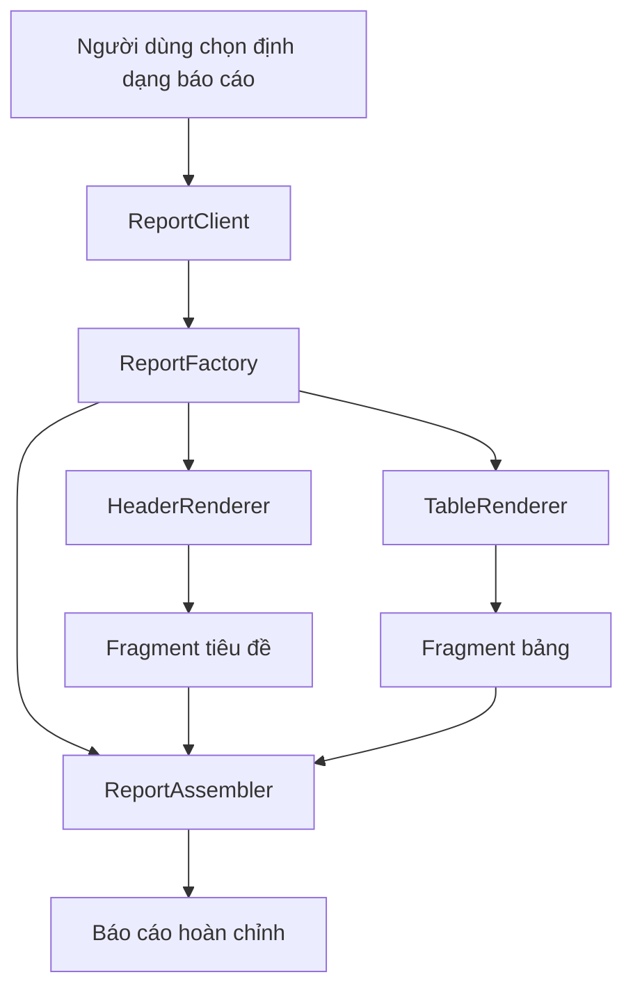
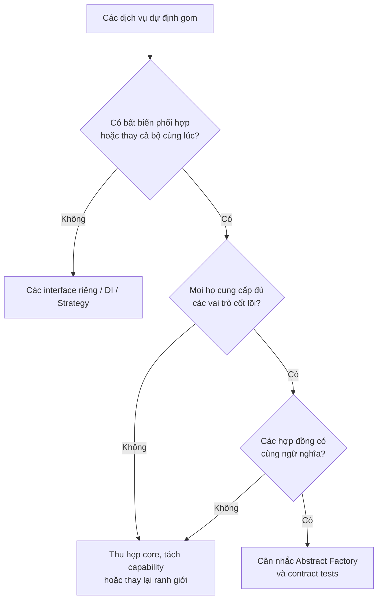

# Đánh giá độ gắn kết và khác biệt năng lực trước khi gom các dịch vụ vào một họ

Một sai lầm khi học **Abstract Factory** là thấy vài dịch vụ cùng thuộc một nền tảng rồi lập tức đặt chúng dưới một factory. Ví dụ: vì có `CloudEmailService`, `CloudCacheService` và `CloudPaymentService`, ta tạo `CloudServiceFactory` để sinh cả ba. Việc chúng cùng chạy trên cloud **chưa chứng minh chúng là một họ sản phẩm có ý nghĩa**.

Trong chương **Tình huống ứng dụng** của module **Học về abstract factory trong design pattern**, bài này tập trung vào một quyết định kiến trúc phải có **trước khi viết interface factory**: các dịch vụ có thật sự gắn kết với nhau về mục tiêu, khả năng phối hợp và vòng đời hay không; các biến thể có đủ năng lực để tuân thủ cùng hợp đồng hay không.

Abstract Factory có ích khi client cần **một bộ sản phẩm liên quan, tương thích, có thể thay bằng bộ khác mà không sửa logic dùng chung**. Nếu gom các dịch vụ có khả năng và nhịp thay đổi không liên quan, factory sẽ trở thành nơi chứa quá nhiều trách nhiệm, che lấp khác biệt thực tế và khiến mỗi thay đổi nhỏ tác động tới nhiều phần hệ thống.

## 1. Định nghĩa đúng “họ sản phẩm”

Trong Abstract Factory có hai chiều phân loại:

- **Loại sản phẩm (product type):** vai trò mà client cần, ví dụ `HeaderRenderer`, `TableRenderer`, `ReportAssembler`.
- **Họ sản phẩm (product family):** một bộ triển khai tương thích cho các loại đó, ví dụ bộ xuất báo cáo HTML hoặc bộ xuất báo cáo văn bản thuần.

| Thành phần | Họ HTML | Họ văn bản thuần |
| --- | --- | --- |
| `HeaderRenderer` | `HtmlHeaderRenderer` | `TextHeaderRenderer` |
| `TableRenderer` | `HtmlTableRenderer` | `TextTableRenderer` |
| `ReportAssembler` | `HtmlReportAssembler` | `TextReportAssembler` |
| Factory | `HtmlReportFactory` | `TextReportFactory` |

Ba loại sản phẩm cùng tham gia **một quy trình xuất báo cáo**. Các mảnh kết quả từ header và table phải có định dạng mà assembler hiểu. Nếu lấy HTML header rồi ghép với text assembler, đầu ra có thể không hợp lệ. Đó là **nhu cầu phối hợp thực sự**, một dấu hiệu đáng cân nhắc Abstract Factory.

Ngược lại, `EmailSender`, `CacheClient` và `PaymentGateway` có thể được triển khai bởi những nhà cung cấp khác nhau mà vẫn hoạt động đúng. Nếu không tồn tại ràng buộc cần chuyển đổi **cả bộ cùng lúc**, đưa tất cả vào một factory chỉ vì “cùng nhà cung cấp” sẽ tạo ra một họ thiếu gắn kết.

**Quy tắc đầu tiên:** Một họ phải được xác định bởi **quan hệ tương thích và mục tiêu sử dụng**, không chỉ bởi tên nhà cung cấp, thư mục mã nguồn hoặc công nghệ mà các lớp cùng dùng.

## 2. Độ gắn kết cần được đánh giá theo những chiều nào?

Đừng chỉ hỏi “Các dịch vụ có cùng chủ đề không?”. Hãy khảo sát một luồng nghiệp vụ cụ thể và tìm bằng chứng cho các mối quan hệ:

| Chiều đánh giá | Câu hỏi quan sát | Dấu hiệu gắn kết mạnh |
| --- | --- | --- |
| **Mục đích nghiệp vụ** | Các sản phẩm có cùng phục vụ một tác vụ của client? | Header, table và assembler cùng tạo một báo cáo |
| **Tương thích giữa sản phẩm** | Có quy tắc bắt buộc chúng dùng cùng định dạng/giao thức/context? | Assembler HTML nhận các fragment HTML |
| **Thay thế đồng bộ** | Khi chuyển biến thể, client cần đổi cả nhóm? | Đổi từ báo cáo HTML sang text phải đổi cả renderer và assembler |
| **Vòng đời và cấu hình** | Có chia sẻ một phiên xử lý, locale, schema hoặc session? | Các renderer dùng cùng cấu hình xuất báo cáo |
| **Hợp đồng hành vi** | Mọi họ có thể đáp ứng cùng các thao tác cơ bản với ngữ nghĩa giống nhau? | Đều tạo tiêu đề, bảng dữ liệu và kết quả báo cáo |
| **Nhịp thay đổi** | Các loại sản phẩm có thường thay đổi cùng nhau vì một yêu cầu? | Thay cấu trúc report có thể tác động header, table và assembler |

Không nhất thiết mọi chiều đều mạnh. **Tương thích bắt buộc** và **khả năng thay thế đồng bộ** thường là hai tín hiệu cốt lõi: nếu từng dịch vụ có thể chọn độc lập và không cần phối hợp qua một hợp đồng chung, lợi ích của Abstract Factory giảm đáng kể.

### 2.1. Xem xét dependency bằng một luồng sử dụng

Ví dụ ứng dụng lập báo cáo:



Header và table không chỉ “cùng là renderer”. Kết quả của chúng phải khớp với **quy tắc định dạng** mà assembler mong đợi. Việc chuyển từ HTML sang text vì thế là quyết định ở cấp toàn bộ pipeline.

### 2.2. Kiểm tra một câu hỏi loại trừ

Hãy hỏi: **Nếu thay riêng một dịch vụ sang nhà cung cấp khác trong khi giữ nguyên các dịch vụ còn lại, hệ thống có còn đúng mà không cần adapter hoặc điều kiện đặc biệt không?**

- Nếu **không**, vì có ràng buộc chặt về định dạng, transaction, resource context hoặc giao thức, gom chúng vào một họ có cơ sở.
- Nếu **có**, và thay từng dịch vụ độc lập còn là nhu cầu thường gặp, nên cân nhắc factory riêng, Strategy hoặc dependency injection theo từng dịch vụ.

Đây là phép thử kiến trúc để tìm quan hệ phối hợp, **không phải chứng minh toán học** rằng nhất thiết phải sử dụng Abstract Factory.

## 3. Ma trận năng lực: Cùng một interface có thực sự phù hợp?

Hai họ cùng cung cấp `TableRenderer` nhưng có thể **khác nhau về năng lực**. Với báo cáo HTML và text, ma trận ban đầu có thể là:

| Năng lực | HTML | Văn bản thuần | Xử lý thiết kế |
| --- | --- | --- | --- |
| Hiển thị tiêu đề | Có | Có | Đưa vào hợp đồng chung |
| Hiển thị danh sách dòng dữ liệu | Có | Có | Đưa vào hợp đồng chung |
| Ghép một báo cáo hoàn chỉnh | Có | Có | Đưa vào hợp đồng chung |
| Định dạng nhấn mạnh văn bản | Có, bằng thẻ/CSS | Giới hạn bởi môi trường text | Chỉ chuẩn hóa ý nghĩa cần thiết hoặc giữ riêng |
| Tương tác DOM/JavaScript | Có thể hỗ trợ | Không | Giữ ngoài hợp đồng chung hoặc tách capability |
| Liên kết có thể nhấp trong trình duyệt | Có thể hỗ trợ | Phụ thuộc nơi hiển thị text | Không cam kết chung khi chưa có cùng ngữ nghĩa |
| Kết quả là HTML markup | Có | Không | Chi tiết của họ, client chung không giả định |

Nếu đưa `renderInteractiveChart()` vào `TableRenderer` chung, lớp text có thể buộc phải ném `UnsupportedOperationException`. Đó là tín hiệu interface đã được thiết kế theo năng lực của **một biến thể**, không phải giao điểm hành vi của các họ.

Có ba kiểu khác biệt cần phân biệt:

1. **Khác cách thực hiện cùng một khả năng:** HTML dùng `<table>`, text dùng các dòng có dấu đầu dòng. Hai cách có thể thỏa hợp đồng “biểu diễn danh sách hàng”.
2. **Thiếu một khả năng tùy chọn:** HTML hỗ trợ chart tương tác, text không hỗ trợ. Nên cân nhắc capability interface riêng, feature negotiation hoặc dịch vụ chuyên biệt nếu client cần tính năng đó.
3. **Khác ngữ nghĩa cốt lõi:** một họ yêu cầu dữ liệu được lưu bền vững, họ kia chỉ ghi vào bộ nhớ nhưng cả hai cùng khẳng định `persist()` có tính bền vững như nhau. Khi ấy **không có hợp đồng chung trung thực**; cần đổi abstraction hoặc không gom chúng vào cùng một họ.

**Điểm quan trọng:** Khả năng cùng thực hiện một interface trong Java chỉ chứng minh **tương thích chữ ký phương thức**, chưa chứng minh tương thích **ngữ nghĩa và kỳ vọng của người dùng**.

## 4. Quy trình ra quyết định trước khi tạo factory

### Bước 1 — Chọn một hành trình người dùng cụ thể

Viết một câu như: “Người dùng chọn định dạng HTML hoặc text, sau đó ứng dụng dựng tiêu đề, bảng và ghép chúng thành một báo cáo”. Xác định đầu vào, đầu ra, điều gì được phép khác và điều gì phải giữ nguyên.

Không nên bắt đầu từ danh sách class hiện có rồi cố tìm tên factory đủ rộng để chứa chúng.

### Bước 2 — Vẽ ma trận **loại sản phẩm × họ sản phẩm**

Với mỗi họ dự định hỗ trợ, liệt kê đủ từng loại sản phẩm mà client dùng chung sẽ yêu cầu:

| Loại sản phẩm bắt buộc | HTML | Text | Kết luận |
| --- | --- | --- | --- |
| Header | Có | Có | Đủ |
| Table | Có | Có | Đủ |
| Assembler | Có | Có | Đủ |
| Interactive chart (nếu đưa vào core) | Có thể có | Không | Không thuộc core chung |

Nếu một factory không thể cung cấp loại sản phẩm cốt lõi mà không trả `null`, tạo đối tượng giả hoặc ném `UnsupportedOperationException`, cần **xem lại ranh giới của họ hoặc interface**.

### Bước 3 — Ghi rõ bất biến phối hợp

Ví dụ: “Mọi fragment trong một lần export phải được tạo theo cùng định dạng mà assembler có thể xử lý”. Với hệ thống khác, bất biến có thể là cùng database connection, cùng schema version, cùng tenant context hoặc cùng giao thức truyền.

Một bất biến cụ thể có thể được bảo vệ bằng việc client nhận một factory đã chọn, kết hợp kiểm tra ở ranh giới lắp ráp hoặc contract/integration tests.

### Bước 4 — Xác định giao điểm năng lực và phần tùy chọn

Tạo hai danh sách: khả năng **mọi họ đều cam kết** và khả năng **chỉ một số họ có**. Chỉ đưa danh sách thứ nhất vào product interfaces cơ bản. Với phần thứ hai, quyết định rõ liệu cần capability negotiation, specialized interface, một luồng nghiệp vụ khác hay không.

### Bước 5 — Kiểm tra nhịp thay đổi và quyền sở hữu

Nếu bổ sung một loại sản phẩm mới vào abstract factory, **mọi concrete factory** thường phải thay đổi để thực hiện phương thức mới. Vì vậy, mẫu này phù hợp nhất khi danh sách loại sản phẩm tương đối ổn định còn số họ dự kiến thay đổi.

Nếu các nhóm dịch vụ thay đổi theo roadmap độc lập, việc buộc một nhóm khác phải sửa cho mỗi sản phẩm mới là chi phí đáng kể. Trước khi gom, kiểm tra xem chúng có thật sự được xây dựng, triển khai và kiểm thử như một bộ hay không.

### Bước 6 — Chọn cấu trúc nhỏ nhất thỏa yêu cầu



Sơ đồ là hướng dẫn thảo luận. Có hệ thống chỉ cần một factory đơn giản hoặc một đối tượng cấu hình, dù các điều kiện có vẻ phù hợp; mẫu thiết kế chỉ nên xuất hiện khi giảm được phụ thuộc và chi phí thay đổi thực tế.

## 5. Ví dụ Java 17: Hai họ dịch vụ xuất báo cáo

Ví dụ sau cố ý dùng **HTML** và **text** thay vì giả lập một file PDF thật. Mọi thành phần hoạt động được bằng Java thuần: `HeaderRenderer` và `TableRenderer` trả về fragment; `ReportAssembler` kiểm tra định dạng và ghép báo cáo. Trong hệ thống sản xuất, bộ renderer có thể được thay bằng thư viện render tương ứng.

### 5.1. Hợp đồng và cấu trúc

```java
interface HeaderRenderer {
    Fragment render(String title);
}

interface TableRenderer {
    Fragment render(List<String> rows);
}

interface ReportAssembler {
    String assemble(Fragment header, Fragment table);
}

interface ReportFactory {
    HeaderRenderer createHeaderRenderer();
    TableRenderer createTableRenderer();
    ReportAssembler createAssembler();
}
```

Client nhận đúng một `ReportFactory` rồi dùng cả ba loại sản phẩm từ cùng factory. `Fragment` là kiểu dữ liệu trung lập biểu diễn kết quả trung gian, mang một `Format` để assembler có thể phát hiện lỗi trộn họ.

### 5.2. Mã có thể chạy

Lưu toàn bộ đoạn sau vào `Demo.java`:

```java
import java.util.List;
import java.util.Objects;

public final class Demo {
    private Demo() {}

    public enum Format { HTML, TEXT }

    public record ReportData(String title, List<String> rows) {
        public ReportData {
            if (title == null || title.isBlank()) {
                throw new IllegalArgumentException("title is blank");
            }
            rows = List.copyOf(Objects.requireNonNull(rows, "rows"));
        }
    }

    // Kiểu dữ liệu chung; Format ở đây dùng để phát hiện trộn định dạng.
    public record Fragment(Format format, String content) {
        public Fragment {
            Objects.requireNonNull(format, "format");
            Objects.requireNonNull(content, "content");
        }
    }

    // Các product interfaces chỉ diễn tả năng lực có ở cả hai họ.
    public interface HeaderRenderer {
        Fragment render(String title);
    }

    public interface TableRenderer {
        Fragment render(List<String> rows);
    }

    public interface ReportAssembler {
        String assemble(Fragment header, Fragment table);
    }

    public interface ReportFactory {
        HeaderRenderer createHeaderRenderer();
        TableRenderer createTableRenderer();
        ReportAssembler createAssembler();
    }

    // Nơi cấu hình chọn họ; các lớp triển khai nằm sau interface.
    public static ReportFactory forFormat(Format format) {
        return switch (Objects.requireNonNull(format, "format")) {
            case HTML -> new HtmlReportFactory();
            case TEXT -> new TextReportFactory();
        };
    }

    private static String escapeHtml(String value) {
        return value.replace("&", "&amp;")
            .replace("<", "&lt;")
            .replace(">", "&gt;")
            .replace("\"", "&quot;");
    }

    private static void requireFormat(
        Format expected, Fragment header, Fragment table
    ) {
        Objects.requireNonNull(header, "header");
        Objects.requireNonNull(table, "table");
        if (header.format() != expected || table.format() != expected) {
            throw new IllegalArgumentException(
                "Mixed report formats; expected " + expected
                    + ", header=" + header.format()
                    + ", table=" + table.format()
            );
        }
    }

    private static final class HtmlReportFactory implements ReportFactory {
        @Override
        public HeaderRenderer createHeaderRenderer() {
            return title -> new Fragment(
                Format.HTML, "<h1>" + escapeHtml(title) + "</h1>"
            );
        }

        @Override
        public TableRenderer createTableRenderer() {
            return rows -> {
                StringBuilder html = new StringBuilder("<table>");
                for (String row : rows) {
                    html.append("<tr><td>")
                        .append(escapeHtml(row))
                        .append("</td></tr>");
                }
                return new Fragment(
                    Format.HTML, html.append("</table>").toString()
                );
            };
        }

        @Override
        public ReportAssembler createAssembler() {
            return (header, table) -> {
                requireFormat(Format.HTML, header, table);
                return "<main>\n" + header.content() + "\n"
                    + table.content() + "\n</main>";
            };
        }
    }

    private static final class TextReportFactory implements ReportFactory {
        @Override
        public HeaderRenderer createHeaderRenderer() {
            return title -> new Fragment(Format.TEXT, "=== " + title + " ===");
        }

        @Override
        public TableRenderer createTableRenderer() {
            return rows -> {
                StringBuilder text = new StringBuilder();
                for (String row : rows) {
                    text.append("- ").append(row).append("\n");
                }
                return new Fragment(Format.TEXT, text.toString());
            };
        }

        @Override
        public ReportAssembler createAssembler() {
            return (header, table) -> {
                requireFormat(Format.TEXT, header, table);
                return header.content() + "\n" + table.content();
            };
        }
    }

    // Client không phụ thuộc HtmlReportFactory hoặc TextReportFactory.
    public static String buildReport(
        ReportFactory factory, ReportData report
    ) {
        Objects.requireNonNull(factory, "factory");
        Objects.requireNonNull(report, "report");

        HeaderRenderer header = factory.createHeaderRenderer();
        TableRenderer table = factory.createTableRenderer();
        ReportAssembler assembler = factory.createAssembler();

        Fragment titlePart = header.render(report.title());
        Fragment tablePart = table.render(report.rows());
        return assembler.assemble(titlePart, tablePart);
    }

    public static void main(String[] args) {
        Format format = args.length > 0
                && args[0].equalsIgnoreCase("html")
            ? Format.HTML : Format.TEXT;

        ReportData sample = new ReportData(
            "Báo cáo tháng 11",
            List.of("Khách <VIP>", "Đơn hàng: 42")
        );
        System.out.println(buildReport(forFormat(format), sample));
    }
}
```

Biên dịch và chạy:

```bash
javac -encoding UTF-8 Demo.java
java Demo html
java Demo text
```

Với `java Demo html`, đầu ra là markup (ký tự đặc biệt trong dữ liệu đã được escape):

```html
<main>
<h1>Báo cáo tháng 11</h1>
<table><tr><td>Khách &lt;VIP&gt;</td></tr><tr><td>Đơn hàng: 42</td></tr></table>
</main>
```

Với `java Demo text`:

```text
=== Báo cáo tháng 11 ===
- Khách <VIP>
- Đơn hàng: 42
```

Hai họ có **cùng năng lực cốt lõi**: xây tiêu đề, liệt kê các hàng và ghép kết quả. Chúng khác cách mã hóa đầu ra; Client `buildReport` không kiểm tra `instanceof Html...` hay tự chọn một renderer cho từng phần.

### 5.3. Có thể trộn họ dù chữ ký vẫn đúng

Xét một factory cài đặt sai: lấy header từ HTML, table từ text và assembler từ HTML. Java vẫn chấp nhận vì ba phương thức trả về đúng interface:

```java
Demo.ReportFactory mixed = new Demo.ReportFactory() {
    public Demo.HeaderRenderer createHeaderRenderer() {
        return Demo.forFormat(Demo.Format.HTML).createHeaderRenderer();
    }

    public Demo.TableRenderer createTableRenderer() {
        return Demo.forFormat(Demo.Format.TEXT).createTableRenderer();
    }

    public Demo.ReportAssembler createAssembler() {
        return Demo.forFormat(Demo.Format.HTML).createAssembler();
    }
};
```

Khi gọi `Demo.buildReport(mixed, sample)`, assembler HTML sẽ ném `IllegalArgumentException` vì phần bảng có `Format.TEXT`. Ví dụ cho thấy **nhãn format và guard chỉ là một kiểm tra runtime có chủ đích**, không phải bảo đảm có sẵn của Abstract Factory.

Một factory còn có thể cố tình gắn nhãn `HTML` cho nội dung text; guard không tự chứng minh nội dung thật sự tương thích. Với một hệ thống render thực, cần thêm kiểm thử định dạng, tính đúng đắn của output và khả năng phối hợp giữa các product.

## 6. Kiểm thử năng lực chung và ranh giới họ

Để kiểm tra thiết kế sau khi chọn Abstract Factory, nên bắt đầu từ **hành vi được cam kết**: cùng dữ liệu có thể tạo báo cáo đúng về nội dung trên cả hai họ, HTML escape các ký tự có ý nghĩa với HTML, và một bộ bị trộn không bị chấp nhận.

Ví dụ JUnit Jupiter 5 cho `Demo.java` ở trên:

```java
import java.util.List;
import org.junit.jupiter.api.Test;
import static org.junit.jupiter.api.Assertions.*;

class DemoTest {
    private static Demo.ReportData sample() {
        return new Demo.ReportData(
            "Báo cáo tháng 11", List.of("Khách <VIP>", "Đơn hàng: 42")
        );
    }

    @Test
    void htmlFamilyProducesEscapedMarkup() {
        String output = Demo.buildReport(
            Demo.forFormat(Demo.Format.HTML), sample()
        );

        assertTrue(output.contains("<h1>Báo cáo tháng 11</h1>"));
        assertTrue(output.contains("Khách &lt;VIP&gt;"));
        assertTrue(output.contains("<table>"));
    }

    @Test
    void textFamilyPreservesTheSameReportData() {
        String output = Demo.buildReport(
            Demo.forFormat(Demo.Format.TEXT), sample()
        );

        assertTrue(output.contains("Báo cáo tháng 11"));
        assertTrue(output.contains("- Khách <VIP>"));
        assertTrue(output.contains("- Đơn hàng: 42"));
    }

    @Test
    void intentionallyMixedFamilyIsRejected() {
        Demo.ReportFactory mixed = new Demo.ReportFactory() {
            public Demo.HeaderRenderer createHeaderRenderer() {
                return Demo.forFormat(Demo.Format.HTML)
                    .createHeaderRenderer();
            }

            public Demo.TableRenderer createTableRenderer() {
                return Demo.forFormat(Demo.Format.TEXT)
                    .createTableRenderer();
            }

            public Demo.ReportAssembler createAssembler() {
                return Demo.forFormat(Demo.Format.HTML)
                    .createAssembler();
            }
        };

        IllegalArgumentException error = assertThrows(
            IllegalArgumentException.class,
            () -> Demo.buildReport(mixed, sample())
        );
        assertTrue(error.getMessage().contains("Mixed report formats"));
    }
}
```

Kiểm thử này là ví dụ về **contract tests** và kiểm tra ranh giới. Để dùng trong dự án, cần cấu hình thư viện JUnit Jupiter phù hợp. Việc chỉ khớp nhãn định dạng trong một bài test chưa đủ để bảo đảm tính hợp lệ của một tài liệu HTML thực hay khả năng tương tác khi trình duyệt chạy JavaScript.

## 7. Khi chênh lệch năng lực khiến Abstract Factory không còn phù hợp

Giả sử roadmap chuyển từ “xuất bảng đơn giản” sang “xây dashboard có chart tương tác, filter và cập nhật liên tục”. HTML có thể đáp ứng các chức năng này, còn text không thể thể hiện cùng ngữ nghĩa.

Một thiết kế yếu sẽ mở rộng:

```java
interface ReportAssembler {
    String assemble(Fragment header, Fragment table);
    String renderInteractiveChart(ChartData data);
}
```

Rồi cho `TextReportAssembler.renderInteractiveChart()` ném `UnsupportedOperationException`. Client đã mất khả năng tin tưởng vào hợp đồng chung: gọi phương thức hợp lệ về kiểu nhưng thất bại chỉ vì họ được chọn.

Các lựa chọn tốt hơn tùy nhu cầu:

- **Giữ core chung nhỏ:** `ReportAssembler` chỉ lắp nội dung mà mọi họ có thể cung cấp; chart tương tác được triển khai ở một luồng chức năng khác.
- **Tách capability chuyên biệt:** `InteractiveDashboardRenderer` hoặc một dịch vụ dashboard chỉ được inject khi tính năng đó thực sự cần. Client chung không ép kiểu product để tìm khả năng.
- **Tách factory theo miền trách nhiệm:** `ReportFactory` cho xuất báo cáo cơ bản và `DashboardFactory` cho trải nghiệm tương tác nếu chúng có nhịp thay đổi độc lập.
- **Feature negotiation nếu yêu cầu phù hợp:** trong hệ thống plugin, có thể cung cấp metadata `Capabilities` rồi kiểm tra trước khi triển khai tính năng. Cần xác định rõ fallback và trường hợp không hỗ trợ, thay vì ném lỗi bất ngờ giữa luồng người dùng.

**Không nên** mở rộng product interfaces bằng mọi tính năng đặc biệt của từng họ hoặc đặt nhiều tham số `isHtml`, `isPdf`, `isText` trong một phương thức chung. Càng nhiều nhánh điều kiện theo họ ở Client, lý do dùng Abstract Factory càng yếu.

## 8. Ba tình huống đối chiếu ngoài bài toán báo cáo

### 8.1. Có cơ sở gom: dịch vụ kết nối cơ sở dữ liệu

Một thư viện cung cấp `Transaction` và `Statement` có thể cần bảo đảm chúng hoạt động cùng connection/context. Factory tạo cả hai trong cùng phiên giao dịch có lý do gắn kết rõ ràng. Tuy nhiên, SQL dialect, isolation level và kiểu rollback của các hệ quản trị có thể khác; cần kiểm tra **hành vi chung có thể cam kết** và tách phần khả năng đặc thù.

### 8.2. Cần thận trọng: bộ dịch vụ email và SMS

Hai kênh có thể cùng cần composer và sender. Nếu `EmailComposer` tạo nội dung HTML/attachment còn SMS chỉ chấp nhận văn bản với giới hạn độ dài, câu hỏi là liệu giao điểm khả năng có đủ phục vụ client dùng chung không. Có thể chỉ cần `MessageSender` ở tầng chung, còn composer đặc thù kênh nằm trong những luồng riêng. **Tên “notification” không đủ để kết luận mọi sản phẩm thuộc một họ thay thế tương đương.**

### 8.3. Không nên gom mặc định: mọi dịch vụ của một nhà cung cấp cloud

`CloudStorage`, `CloudEmail`, `CloudAnalytics` thường có API, vòng đời, SLA và yêu cầu thay thế khác nhau. Chúng không tự trở thành một họ chỉ vì cùng nhà cung cấp. Nếu hệ thống cần thay riêng storage mà giữ email, một `CloudEverythingFactory` sẽ biến thay đổi độc lập thành thay đổi xuyên miền.

Chỉ khi tồn tại **quy tắc phải chuyển cả bộ** (ví dụ chính sách tenant yêu cầu cùng provider/context, và mỗi biến thể cung cấp đủ các product contracts) thì một factory cấp cao mới đáng cân nhắc; cần ghi rõ bất biến đó thay vì suy từ nhãn “cloud”.

## 9. So sánh các lựa chọn thiết kế

| Cấu trúc | Phù hợp khi | Rủi ro nếu dùng sai |
| --- | --- | --- |
| **Abstract Factory** | Có nhiều loại sản phẩm liên quan; cần thay cả bộ theo họ | Thêm loại sản phẩm mới ảnh hưởng mọi concrete factory |
| **Strategy** | Thay một thuật toán/hành vi độc lập, như cách nén dữ liệu | Biến một việc đơn lẻ thành cả họ không cần thiết |
| **Dependency Injection theo interface** | Các dịch vụ thay độc lập, client chỉ cần hợp đồng riêng từng dịch vụ | Không tự bảo đảm các dịch vụ có cùng context nếu điều đó là bắt buộc |
| **Adapter** | Nhiều API không giống nhau nhưng có thể quy về một hợp đồng có ngữ nghĩa chung | Adapter không thể tạo ra năng lực mà dịch vụ gốc hoàn toàn thiếu |
| **Facade** | Muốn đơn giản hóa một luồng điều phối giữa nhiều dịch vụ | Không nhất thiết giải quyết việc lựa chọn nhiều họ triển khai |
| **Factory đơn giản** | Chỉ cần che logic tạo một sản phẩm hoặc một đối tượng cấu hình | Không biểu đạt đầy đủ quan hệ giữa nhiều loại sản phẩm |

Có thể kết hợp những cấu trúc này. Ví dụ Abstract Factory chọn bộ renderer HTML, nhưng từng renderer lại dùng Strategy để quyết định cách căn chỉnh hoặc định dạng dữ liệu. Không cần biến mọi quyết định nhỏ thành một phương thức tạo trên abstract factory.

## 10. Những dấu hiệu cảnh báo trước khi gom dịch vụ

| Dấu hiệu trong thiết kế dự kiến | Điều cần xem lại |
| --- | --- |
| Một factory có hàng chục phương thức `createX()` không liên quan | Ranh giới trách nhiệm quá rộng |
| Một concrete factory phải trả `null` cho vài phương thức | Họ không cung cấp đầy đủ product types |
| Một implementation ném `UnsupportedOperationException` với hành vi cốt lõi | Giao điểm năng lực được định nghĩa sai |
| Client thường xuyên kiểm tra loại factory rồi phân nhánh | Không thật sự có khả năng thay thế qua hợp đồng |
| Thay dịch vụ A khiến phải sửa factory của các dịch vụ B, C không liên quan | Gắn kết nhân tạo, nhịp thay đổi lệch |
| Factory chứa tham số `createThing(String provider)` cho từng sản phẩm | Client có thể trộn họ; quyết định chọn họ chưa tập trung |
| Không viết được một bất biến phối hợp cụ thể | Có thể chỉ đang gom vì tên gọi hoặc công nghệ |
| Các họ có quy tắc lỗi, độ bền dữ liệu hoặc bảo mật mâu thuẫn nhau | Không nên giả định cùng interface là đủ tương thích |

Khi gặp những dấu hiệu này, hãy sửa mô hình **trước khi thêm nhiều concrete factory**. Chi phí tái cấu trúc sau khi hàng chục client đã phụ thuộc một factory lớn sẽ cao hơn.

## 11. Bảng đánh giá nhanh cho một quyết định kiến trúc

Một nhóm phát triển có thể dùng biểu mẫu ngắn sau trong buổi review. Mỗi dòng cần **bằng chứng cụ thể**, không chỉ đánh dấu “có”:

| Tiêu chí | Bằng chứng từ bài toán báo cáo | Đánh giá |
| --- | --- | --- |
| Có luồng nghiệp vụ chung | Cùng dựng và xuất một báo cáo | Đạt |
| Có bất biến phối hợp | Fragment phải khớp định dạng assembler | Đạt |
| Có nhu cầu đổi cả bộ | Người dùng chọn HTML hoặc text cho toàn báo cáo | Đạt |
| Các product types đủ ở mọi họ | Header, table, assembler đều hiện diện | Đạt |
| Cùng hợp đồng cốt lõi | Đều biểu diễn tiêu đề và danh sách dòng | Đạt |
| Năng lực riêng được phân tách | Chart tương tác không nằm trong core | Cần quy định khi mở rộng |
| Vòng đời và context rõ ràng | Factory được chọn cho một lần xuất | Đạt |
| Có kiểm thử chứng minh khả năng thay thế | Test HTML/text và test bộ trộn | Có thể triển khai |

Nếu một hệ thống thất bại ở tiêu chí **đủ product types** hoặc **cùng ngữ nghĩa cốt lõi**, đừng cố “chữa” bằng các phương thức giả hay cast kiểu. Hãy điều chỉnh lại loại sản phẩm, chia factory thành nhiều nhóm, hoặc sử dụng kiểu thiết kế khác.

Đây là bảng ra quyết định dựa trên bối cảnh, **không phải thang điểm tuyệt đối**. Hai dịch vụ có rất ít điểm chung nhưng ràng buộc transaction rất mạnh vẫn có thể cần một ranh giới chung; ngược lại nhiều dịch vụ có tên giống nhau nhưng được thay độc lập thì không nên ép thành một họ.

## 12. Bài tập vận dụng

### Bài tập 1 — Có nên gom một bộ dịch vụ thanh toán?

Ứng dụng có `CardTokenizer`, `PaymentAuthorizer` và `RefundProcessor`. Nhà cung cấp A hỗ trợ token hóa, authorize và refund một phần; nhà cung cấp B hỗ trợ authorize và refund toàn phần nhưng không cho token hóa trực tiếp.

Hãy lập ma trận **loại dịch vụ × nhà cung cấp**, nêu bất biến về token/context và xét xem `PaymentFactory` có thể khai báo ba phương thức bắt buộc hay không. Đề xuất cách thiết kế không buộc nhà cung cấp B giả lập tokenization hoặc ném `UnsupportedOperationException`. Giải thích khi nào nên tách capability và khi nào cần giữ các thao tác thuộc cùng một provider.

### Bài tập 2 — Tìm “họ giả”

Một nhóm muốn tạo `EnterpriseFactory` với `createEmailSender()`, `createCache()`, `createPdfExporter()`, `createSearchClient()`. Hãy chỉ ra ít nhất ba câu hỏi về tương thích, vòng đời và khả năng thay đổi độc lập cần được trả lời trước khi chấp nhận cấu trúc này. Đề xuất phương án thay thế bằng interface và DI nếu không tìm được bất biến chung.

### Bài tập 3 — Mở rộng ví dụ Java

Từ `Demo.java`, thêm khả năng xử lý một danh sách hàng rỗng theo quy tắc đã thống nhất. Viết cùng một contract test cho HTML và text để xác minh **kết quả vẫn là một báo cáo hợp lệ**. Sau đó thử thêm yêu cầu chart tương tác chỉ có ở HTML. Thiết kế một capability interface riêng thay vì thêm phương thức bắt buộc vào `ReportAssembler` chung.

### Bài tập 4 — Phản biện thiết kế

Giả sử một nhà cung cấp báo cáo thứ ba chỉ có `HeaderRenderer` và `TableRenderer`, không có khả năng tự ghép nội dung thành báo cáo hoàn chỉnh. Bạn sẽ:

1. Viết một adapter assembler **nếu có thể bảo toàn ngữ nghĩa chung**?
2. Tách assembler ra khỏi họ nếu nó không thực sự cần thay theo định dạng?
3. Hay từ chối coi nhà cung cấp này là một họ thay thế hoàn chỉnh?

Trình bày điều kiện để mỗi lựa chọn hợp lý. Tránh chọn giải pháp chỉ nhằm làm cho code biên dịch.

**Ghi nhớ:** Trước khi gom dịch vụ vào một họ của Abstract Factory, phải đánh giá **mức độ cùng phục vụ một luồng**, **bất biến tương thích**, **nhu cầu thay thế đồng bộ** và **giao điểm năng lực giữa các biến thể**. Chỉ giữ trong product interfaces những hành vi có cùng ý nghĩa ở mọi họ; đưa khả năng riêng vào ranh giới thích hợp. Một factory tốt làm rõ sự phối hợp vốn đã tồn tại trong nghiệp vụ, thay vì tạo phụ thuộc giả giữa những dịch vụ độc lập.
