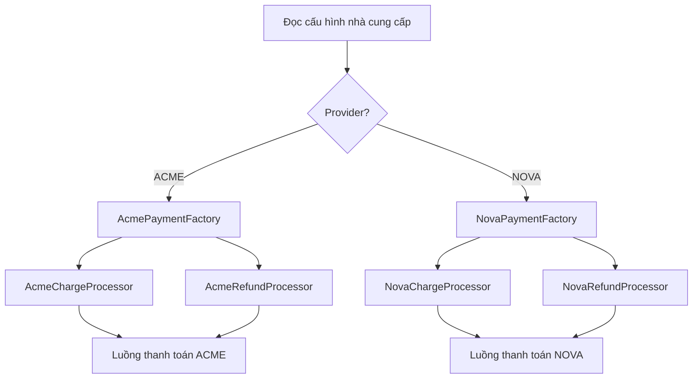
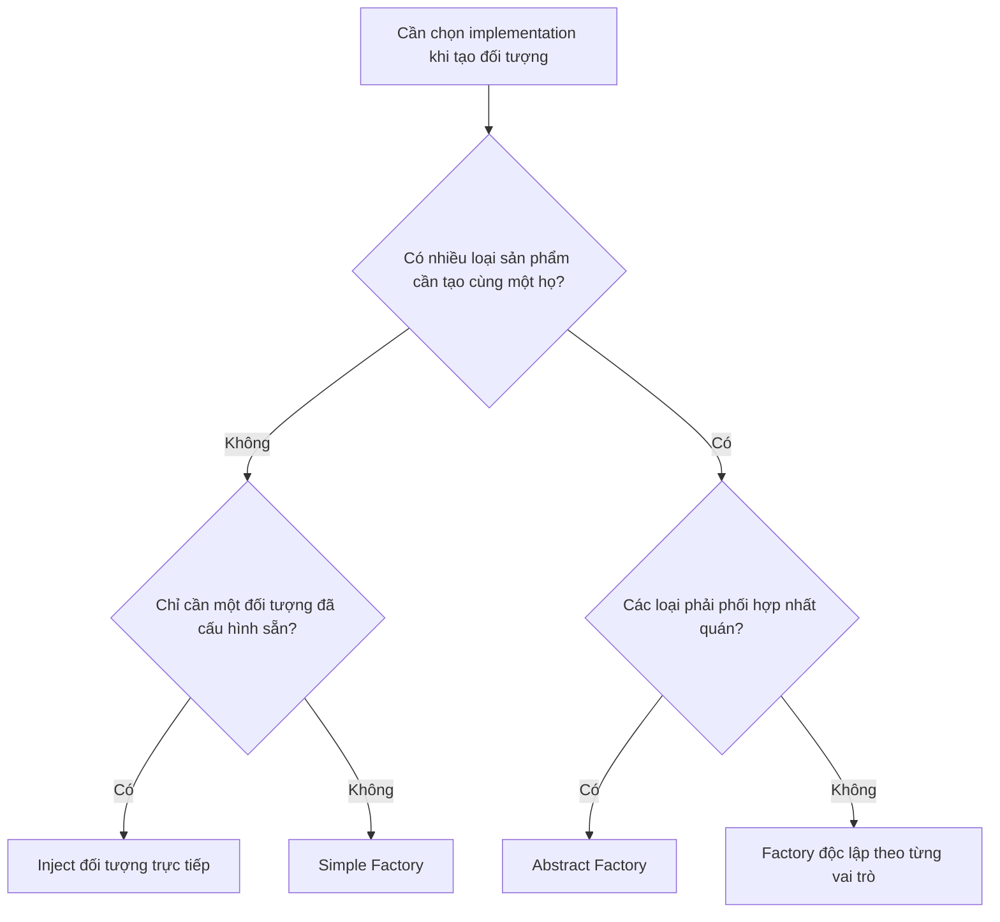

# Abstract Factory và Simple Factory khi cần chọn một lớp từ một nhóm

Khi một chương trình có nhiều lớp triển khai cùng một interface, chúng ta thường cần **chọn một lớp phù hợp ở thời điểm chạy**. Ví dụ, một hệ thống thanh toán có `AcmeChargeProcessor` và `NovaChargeProcessor`, nhưng phần xử lý đơn hàng chỉ muốn làm việc với `ChargeProcessor`. Tình huống này thường được giải quyết gọn bằng **Simple Factory**.

**Abstract Factory** cũng cho phép thay thế các lớp triển khai, nhưng nhắm đến bài toán khác: chọn **một họ gồm nhiều loại sản phẩm có liên quan** và tạo các đối tượng thuộc cùng họ đó. Nếu hệ thống còn cần `RefundProcessor` của đúng nhà cung cấp đã dùng để thu tiền, ta bắt đầu có lý do để dùng Abstract Factory.

Bài học thuộc phần **So sánh mẫu thiết kế** của module Abstract Factory: mục tiêu là nhận biết khi nào việc “chọn một lớp trong một nhóm” chỉ cần Simple Factory, và khi nào yêu cầu chọn **cả một bộ lớp tương thích** khiến Abstract Factory phù hợp hơn.

## 1. Khác biệt bắt đầu từ đơn vị được lựa chọn

| Tiêu chí | Simple Factory | Abstract Factory |
| --- | --- | --- |
| Câu hỏi chính | **Tạo đối tượng triển khai nào cho một vai trò?** | **Tạo cả bộ sản phẩm nào cho một họ?** |
| Đầu vào điển hình | Mã loại, cấu hình, tham số lựa chọn | Một concrete factory đã được chọn cho một họ |
| Đầu ra theo hợp đồng | Thường là **một loại sản phẩm** qua interface/abstract class chung | **Nhiều loại sản phẩm** qua các interface tương ứng |
| Cấu trúc thường thấy | Một lớp/hàm tạo dùng `if`, `switch` hoặc registry để chọn lớp | Interface factory và các concrete factory triển khai nhiều phương thức tạo |
| Mối quan hệ cần bảo đảm | Lớp được chọn đáp ứng hợp đồng của **một** interface | Các sản phẩm cùng factory phải **tương thích khi phối hợp** |
| Thêm biến thể mới | Thêm lớp triển khai và cập nhật điểm chọn hoặc registry | Thêm một concrete factory cung cấp đủ các loại sản phẩm |
| Thêm loại sản phẩm mới | Có thể dùng một factory riêng nếu vai trò độc lập | Thường phải thêm phương thức vào abstract factory và cập nhật **mọi** concrete factory |
| Độ phức tạp | Thường thấp, ít lớp | Cao hơn, hữu ích khi quản lý quan hệ giữa nhiều sản phẩm |

**Lưu ý thuật ngữ:** *Simple Factory* là tên gọi phổ biến cho một kỹ thuật tập trung logic khởi tạo, không phải một trong 23 mẫu thiết kế GoF chính thức. *Factory Method* là mẫu GoF khác, khai thác khả năng ghi đè phương thức tạo của lớp con. Không nên đồng nhất ba khái niệm này chỉ vì chúng cùng chứa từ “Factory”.

## 2. Trường hợp chỉ chọn một lớp: Simple Factory là đủ

Giả sử ứng dụng nhận cấu hình `ACME` hoặc `NOVA`, rồi cần một đối tượng thu tiền. Các bộ xử lý có cùng interface:

```java
interface ChargeProcessor {
    PaymentReference charge(int amount);
}
```

Ở thời điểm này, **client chỉ yêu cầu `ChargeProcessor`**. Một factory đơn giản nhận mã nhà cung cấp và trả về triển khai phù hợp:

```java
final class SimpleChargeFactory {
    static ChargeProcessor create(Provider provider) {
        if (provider == null) {
            throw new IllegalArgumentException("Thiếu nhà cung cấp");
        }
        switch (provider) {
            case ACME: return new AcmeChargeProcessor();
            case NOVA: return new NovaChargeProcessor();
            default: throw new IllegalArgumentException("Không hỗ trợ: " + provider);
        }
    }
}
```

Phần xử lý đơn hàng dùng `ChargeProcessor`, không cần biết `AcmeChargeProcessor` hay `NovaChargeProcessor` đã được tạo:

```java
ChargeProcessor processor = SimpleChargeFactory.create(Provider.ACME);
PaymentReference reference = processor.charge(100);
```

<small>Đây là các đoạn trích minh họa cấu trúc; phần 4 có chương trình Java hoàn chỉnh với các kiểu `Provider`, `PaymentReference` và lớp triển khai.</small>

Simple Factory đem lại ba lợi ích thiết thực:

1. **Tập trung quyết định lựa chọn** thay vì để nhiều client tự viết `if`/`switch` tạo lớp cụ thể.
2. **Ẩn tên lớp triển khai** đằng sau một interface ổn định; client dùng hợp đồng chung.
3. **Giữ chi phí thiết kế vừa đủ** khi yêu cầu chỉ là tạo một kiểu đối tượng có nhiều biến thể.

Ở đây, dù có **hai lớp cụ thể**, vẫn chỉ có **một loại sản phẩm trừu tượng** là `ChargeProcessor`. Việc tạo một interface `PaymentFactory` chứa duy nhất `createChargeProcessor()` rồi thêm nhiều concrete factory có thể tạo thêm tầng cấu trúc mà chưa mang lại lợi ích tương xứng.

## 3. Khi một lựa chọn chi phối nhiều sản phẩm: chuyển sang Abstract Factory

Giả sử hệ thống bổ sung nghiệp vụ hoàn tiền. Mỗi nhà cung cấp có cách xử lý thu tiền và hoàn tiền riêng. Việc hoàn tiền phải dùng đúng hệ thống đã tạo giao dịch thu tiền.

Ma trận các loại sản phẩm và họ như sau:

| Loại sản phẩm ↓ / Họ → | ACME | NOVA |
| --- | --- | --- |
| `ChargeProcessor` | `AcmeChargeProcessor` | `NovaChargeProcessor` |
| `RefundProcessor` | `AcmeRefundProcessor` | `NovaRefundProcessor` |

Khác biệt quan trọng nằm ở **cột**: client cần chọn **ACME như một bộ**, không phải đưa ra hai quyết định độc lập cho `ChargeProcessor` và `RefundProcessor`.

Nếu dùng hai lời gọi Simple Factory một cách rời rạc, lập trình viên có thể vô tình viết:

```java
ChargeProcessor charge = SimpleChargeFactory.create(Provider.ACME);
RefundProcessor refund = SimpleRefundFactory.create(Provider.NOVA);
// Thu tiền và hoàn tiền đã thuộc hai nhà cung cấp khác nhau.
```

Hai đối tượng có thể đều hợp lệ theo interface riêng của chúng, nhưng **không tương thích với nhau trong cùng một giao dịch**. Abstract Factory tạo ra một ranh giới rõ ràng:

```java
interface PaymentFactory {
    ChargeProcessor createChargeProcessor();
    RefundProcessor createRefundProcessor();
}
```

Mỗi concrete factory phụ trách cả một cột:

```java
final class AcmePaymentFactory implements PaymentFactory {
    public ChargeProcessor createChargeProcessor() {
        return new AcmeChargeProcessor();
    }

    public RefundProcessor createRefundProcessor() {
        return new AcmeRefundProcessor();
    }
}
```

Client chỉ nhận **một** `PaymentFactory` và tạo cả hai loại sản phẩm qua factory đó. Điều này đưa quyết định chọn nhà cung cấp về một điểm cấu hình, giúp giảm nguy cơ trộn các sản phẩm thuộc hai họ.



Abstract Factory không tự cấm mọi tình huống trộn họ ở mức compiler. Client vẫn có thể cố ý lấy sản phẩm từ hai factory khác nhau. Lợi ích của mẫu là cung cấp một **giao thức tạo bộ sản phẩm có chủ đích**; tính đúng đắn còn phụ thuộc vào concrete factory, phạm vi sử dụng và kiểm thử hợp đồng.

## 4. Ví dụ Java đầy đủ: cùng một bài toán, hai cách dùng factory

Ví dụ sau gộp hai tình huống trong một tệp `FactoryComparisonDemo.java`. Phần Simple Factory chỉ tạo bộ xử lý **thu tiền**; phần Abstract Factory cấp một **bộ thu tiền và hoàn tiền** theo cùng nhà cung cấp.

`PaymentReference` mang mã nhà cung cấp để minh họa điều kiện tương thích lúc hoàn tiền. Đây là ví dụ trên bộ nhớ, **không kết nối API thanh toán thực**; mã giao dịch được tạo đơn giản để dễ quan sát và không đại diện cho quy tắc định danh của hệ thống sản xuất.

```java
public class FactoryComparisonDemo {
    enum Provider { ACME, NOVA }

    static final class PaymentReference {
        final Provider provider;
        final String id;

        PaymentReference(Provider provider, String id) {
            this.provider = provider;
            this.id = id;
        }
    }

    // Abstract products: hai loại sản phẩm khác nhau.
    interface ChargeProcessor {
        PaymentReference charge(int amount);
    }

    interface RefundProcessor {
        void refund(PaymentReference reference);
    }

    static final class AcmeChargeProcessor implements ChargeProcessor {
        public PaymentReference charge(int amount) {
            System.out.println("ACME thu " + amount);
            return new PaymentReference(Provider.ACME, "ACME-DEMO-1");
        }
    }

    static final class NovaChargeProcessor implements ChargeProcessor {
        public PaymentReference charge(int amount) {
            System.out.println("NOVA thu " + amount);
            return new PaymentReference(Provider.NOVA, "NOVA-DEMO-1");
        }
    }

    static final class AcmeRefundProcessor implements RefundProcessor {
        public void refund(PaymentReference reference) {
            requireProvider(reference, Provider.ACME);
            System.out.println("ACME hoàn " + reference.id);
        }
    }

    static final class NovaRefundProcessor implements RefundProcessor {
        public void refund(PaymentReference reference) {
            requireProvider(reference, Provider.NOVA);
            System.out.println("NOVA hoàn " + reference.id);
        }
    }

    private static void requireProvider(
            PaymentReference reference, Provider expected) {
        if (reference == null || reference.provider != expected) {
            throw new IllegalArgumentException(
                "Giao dịch không thuộc nhà cung cấp " + expected);
        }
    }

    // Simple Factory: chọn MỘT implementation của ChargeProcessor.
    static final class SimpleChargeFactory {
        static ChargeProcessor create(Provider provider) {
            if (provider == null) {
                throw new IllegalArgumentException("Thiếu nhà cung cấp");
            }
            switch (provider) {
                case ACME: return new AcmeChargeProcessor();
                case NOVA: return new NovaChargeProcessor();
                default: throw new IllegalArgumentException("Không hỗ trợ: " + provider);
            }
        }
    }

    // Abstract Factory: tạo nhiều loại sản phẩm của CÙNG MỘT HỌ.
    interface PaymentFactory {
        ChargeProcessor createChargeProcessor();
        RefundProcessor createRefundProcessor();
    }

    static final class AcmePaymentFactory implements PaymentFactory {
        public ChargeProcessor createChargeProcessor() {
            return new AcmeChargeProcessor();
        }

        public RefundProcessor createRefundProcessor() {
            return new AcmeRefundProcessor();
        }
    }

    static final class NovaPaymentFactory implements PaymentFactory {
        public ChargeProcessor createChargeProcessor() {
            return new NovaChargeProcessor();
        }

        public RefundProcessor createRefundProcessor() {
            return new NovaRefundProcessor();
        }
    }

    // Một Simple Factory cũng có thể chọn CONCRETE ABSTRACT FACTORY.
    static final class PaymentFactorySelector {
        static PaymentFactory select(Provider provider) {
            if (provider == null) {
                throw new IllegalArgumentException("Thiếu nhà cung cấp");
            }
            switch (provider) {
                case ACME: return new AcmePaymentFactory();
                case NOVA: return new NovaPaymentFactory();
                default: throw new IllegalArgumentException("Không hỗ trợ: " + provider);
            }
        }
    }

    // Client sử dụng trọn bộ sản phẩm từ một PaymentFactory.
    static final class CheckoutService {
        private final PaymentFactory factory;

        CheckoutService(PaymentFactory factory) {
            this.factory = java.util.Objects.requireNonNull(factory);
        }

        void simulatePaymentAndRefund(int amount) {
            ChargeProcessor charge = factory.createChargeProcessor();
            RefundProcessor refund = factory.createRefundProcessor();

            PaymentReference reference = charge.charge(amount);
            refund.refund(reference);
        }
    }

    public static void main(String[] args) {
        Provider provider = args.length == 0
            ? Provider.ACME
            : Provider.valueOf(args[0].toUpperCase(java.util.Locale.ROOT));

        System.out.println("=== Chỉ thu tiền: Simple Factory ===");
        ChargeProcessor charge = SimpleChargeFactory.create(provider);
        PaymentReference reference = charge.charge(100);
        System.out.println("Mã tham chiếu: " + reference.id);

        System.out.println("=== Thu và hoàn tiền: Abstract Factory ===");
        PaymentFactory family = PaymentFactorySelector.select(provider);
        new CheckoutService(family).simulatePaymentAndRefund(200);
    }
}
```

Biên dịch và chạy bằng JDK:

```bash
javac -encoding UTF-8 FactoryComparisonDemo.java
java FactoryComparisonDemo ACME
```

Kết quả minh họa:

```text
=== Chỉ thu tiền: Simple Factory ===
ACME thu 100
Mã tham chiếu: ACME-DEMO-1
=== Thu và hoàn tiền: Abstract Factory ===
ACME thu 200
ACME hoàn ACME-DEMO-1
```

Với `java FactoryComparisonDemo NOVA`, các đối tượng được chọn sẽ thuộc NOVA.

**Điểm cần quan sát:** `PaymentFactorySelector.select(provider)` bản thân nó vẫn dùng logic kiểu Simple Factory để **chọn một concrete factory**. Hai kỹ thuật có thể kết hợp: Simple Factory chọn *factory của họ*; Abstract Factory sau đó tạo *các sản phẩm trong họ*. Việc sử dụng Abstract Factory không có nghĩa là tuyệt đối không được dùng `switch` ở điểm cấu hình.

## 5. Khi nào nên chọn cách nào?

Hãy quyết định dựa trên **số loại sản phẩm phải được lựa chọn nhất quán**, không dựa đơn thuần trên số lớp đang tồn tại:

| Nhu cầu | Hướng chọn | Lý do |
| --- | --- | --- |
| Chọn `JsonParser` hoặc `XmlParser` cho cùng interface `Parser` | Simple Factory | Chỉ có một vai trò đối tượng cần tạo |
| Chọn `EmailSender` hoặc `SmsSender` cho interface `Notifier` | Simple Factory | Các biến thể thay thế nhau, không tạo thành bộ đa sản phẩm |
| Chọn bộ `Button` + `Dialog` cùng chủ đề Light/Dark | Abstract Factory | Cần tạo đồng bộ hai loại sản phẩm thuộc cùng họ |
| Chọn `ChargeProcessor` + `RefundProcessor` theo nhà cung cấp | Abstract Factory | Hai loại sản phẩm phải phù hợp với cùng một hệ thanh toán |
| Chỉ cần inject sẵn một đối tượng đã được cấu hình | Có thể chưa cần factory | Client không có nhu cầu lựa chọn hay tạo thêm đối tượng |
| Nhiều lớp nhưng mỗi lớp chỉ hỗ trợ một nghiệp vụ không liên quan | Các factory nhỏ hoặc inject riêng | Không có một họ sản phẩm chung cần thay thế |

Một cách đặt câu hỏi ngắn gọn là: **“Khi thay biến thể A bằng B, client phải thay một đối tượng hay cả một tập đối tượng liên quan?”** Nếu chỉ một đối tượng qua một interface, Simple Factory thường đủ. Nếu phải thay một bộ các loại sản phẩm có quan hệ, Abstract Factory trở thành lựa chọn đáng cân nhắc.



Sơ đồ này là **gợi ý lựa chọn theo yêu cầu thường gặp**, không phải một quy tắc cứng. Còn cần cân nhắc vòng đời đối tượng, trạng thái cấu hình, cách quản lý dependency và khả năng mở rộng của hệ thống.

## 6. Chi phí thay đổi khi hệ thống phát triển

Hai kỹ thuật tối ưu hai hướng thay đổi khác nhau:

### Thêm biến thể mới

Giả sử thêm nhà cung cấp `ORBIT`:

- Với **Simple Factory**, tạo `OrbitChargeProcessor` rồi thêm logic ánh xạ `ORBIT` sang lớp này, hoặc đăng ký trong registry.
- Với **Abstract Factory**, cần tạo `OrbitPaymentFactory` và toàn bộ sản phẩm cần thiết: `OrbitChargeProcessor`, `OrbitRefundProcessor`. Sau đó thêm hoặc đăng ký lựa chọn factory mới tại điểm cấu hình.

Abstract Factory giúp client không đổi khi nhận một factory khác, nhưng **không tự miễn trừ** việc cập nhật điểm chọn factory hoặc cơ chế đăng ký các biến thể.

### Thêm loại sản phẩm mới

Giả sử hệ thống cần `WebhookVerifier` để xác thực sự kiện do nhà cung cấp gửi:

- Nếu chức năng này **độc lập** với luồng thanh toán đang xét, có thể xây một abstraction riêng.
- Nếu `WebhookVerifier` phải cùng bộ với `ChargeProcessor` và `RefundProcessor`, thêm `createWebhookVerifier()` vào `PaymentFactory`; khi đó **mọi** concrete factory phải triển khai loại sản phẩm mới.

Đây là đánh đổi nổi bật của Abstract Factory: **thêm một họ mới** khá tự nhiên khi các loại sản phẩm đã ổn định; **thêm loại sản phẩm mới vào hợp đồng chung** thường ảnh hưởng đồng loạt các concrete factory và client liên quan. Không nên mở rộng factory theo kiểu “mọi dịch vụ liên quan đến thanh toán đều cho vào đây”; cần giữ ranh giới dựa trên các sản phẩm phải thay thế như một bộ.

## 7. Các nhầm lẫn dễ gặp

### “Có nhiều lớp cụ thể thì phải dùng Abstract Factory”

Sai. Mười lớp cùng triển khai `Parser` vẫn có thể là mười lựa chọn cho **một loại sản phẩm**. Simple Factory (hoặc dependency injection) có thể giải quyết hoàn toàn bài toán.

### “Simple Factory luôn tệ vì dùng `switch`”

Không nhất thiết. Một `switch` tập trung tại điểm tạo đối tượng thường rõ ràng và dễ kiểm soát. Vấn đề xuất hiện khi logic lựa chọn bị sao chép khắp client, khi factory gánh quá nhiều trách nhiệm, hoặc khi yêu cầu đã chuyển sang quản lý cả một họ sản phẩm.

### “Abstract Factory luôn cần sinh toàn bộ đối tượng ngay lúc khởi tạo”

Không. Concrete factory có thể tạo từng sản phẩm **khi client gọi phương thức**. Yêu cầu cốt lõi là các phương thức trong cùng factory cung cấp những biến thể thuộc cùng họ; không có nghĩa các sản phẩm phải được tạo cùng lúc hoặc factory phải lưu sẵn tất cả instance.

### “Đưa hai phương thức tạo vào một interface là đã có bảo đảm tương thích”

Chưa đủ. Một factory lỗi vẫn có thể trả về `AcmeChargeProcessor` cùng `NovaRefundProcessor`. Interface chỉ quy định kiểu trả về, không tự kiểm tra quy ước nhà cung cấp. Cần định nghĩa hợp đồng về cấu hình, phiên xử lý hoặc mã tham chiếu và kiểm tra bằng các tình huống cộng tác thực tế.

### “Tách các bộ xử lý thành factory là luôn giải quyết được mọi ngữ cảnh”

Chưa chắc. Cùng nhà cung cấp nhưng khác merchant account hoặc môi trường sandbox/production vẫn có thể không tương thích. Trong hệ thống thật, factory cần giữ hoặc nhận **ngữ cảnh cấu hình phù hợp với phạm vi giao dịch**, tránh trộn sản phẩm từ các phiên khác nhau.

## 8. Kiểm chứng lựa chọn thiết kế

Đối với **Simple Factory**, các kiểm thử quan trọng gồm:

1. Mỗi đầu vào hợp lệ trả về đúng **loại triển khai** đáp ứng interface chung.
2. Đầu vào không được hỗ trợ tạo lỗi rõ ràng hoặc kết quả được định nghĩa trong hợp đồng.
3. Client có thể hoạt động qua interface, không cần ép kiểu sang lớp cụ thể.

Đối với **Abstract Factory**, ngoài việc kiểm tra đúng triển khai, cần xác nhận:

1. Mỗi concrete factory cung cấp **đủ các loại sản phẩm** theo hợp đồng.
2. Các sản phẩm tạo từ **cùng một factory** cộng tác thành công trong cùng ngữ cảnh.
3. Các ràng buộc như nhà cung cấp, merchant account, môi trường, giao thức và phiên bản được giữ nhất quán.
4. Khi thay một concrete factory bằng factory khác, logic client vẫn sử dụng được các interface chung và giữ đúng hành vi được cam kết.

Ví dụ, trong mã ở phần 4, thử tạo `PaymentReference` thuộc `ACME` rồi truyền vào `NovaRefundProcessor.refund(...)` sẽ phát sinh `IllegalArgumentException`. Đây chỉ là một phép kiểm tra đơn giản để minh họa việc phát hiện trộn họ; kiểm thử nghiệp vụ thực phải bao phủ cả giao thức và dữ liệu giao dịch.

## 9. Bài tập phân loại

Xét ba yêu cầu:

1. Ứng dụng đọc file `.csv`, `.json` và `.xml`, mỗi lần chọn **một** `DataReader` theo phần mở rộng.
2. Ứng dụng hỗ trợ giao diện Light/Dark; mỗi màn hình cần đồng bộ `Button`, `Dialog` và `Menu`.
3. Ứng dụng chỉ nhận một `Logger` đã được hệ thống dependency injection khởi tạo từ trước.

**Gợi ý đáp án:** (1) ưu tiên Simple Factory nếu cần tự tạo đối tượng theo phần mở rộng; (2) Abstract Factory vì lựa chọn chủ đề chi phối **nhiều loại sản phẩm cần cùng họ**; (3) có thể inject trực tiếp `Logger`, chưa cần thêm factory. Nếu yêu cầu thay đổi, cách thiết kế cũng có thể thay đổi theo.

## Tổng kết

Khi cần **chọn một lớp từ một nhóm lớp cùng vai trò**, hãy bắt đầu với **Simple Factory** nếu việc tạo một sản phẩm là đủ. Khi một lựa chọn đồng thời quyết định **nhiều loại sản phẩm phải phối hợp tương thích**, dùng **Abstract Factory** để mô hình hóa mỗi lựa chọn thành một họ và để client lấy cả bộ từ cùng concrete factory.

Hai kỹ thuật không loại trừ nhau: một Simple Factory có thể chọn concrete abstract factory, còn Abstract Factory xử lý việc tạo các sản phẩm của họ đã chọn. Chìa khóa của quyết định là **quan hệ giữa các sản phẩm và phạm vi cần giữ nhất quán**, không đơn thuần là đếm số lớp triển khai.
