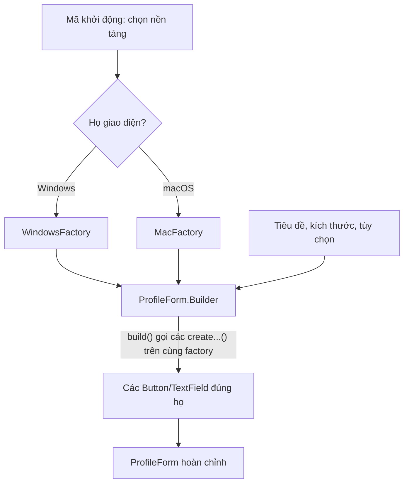
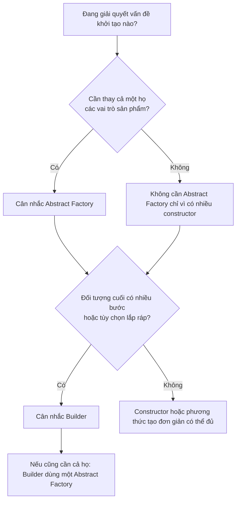

# Abstract Factory và Builder khi cần tạo họ sản phẩm hoặc lắp ráp một đối tượng phức tạp

## 1. Hai nhu cầu khởi tạo dễ bị nhầm lẫn

**Abstract Factory** và **Builder** đều thuộc nhóm *creational design patterns* (mẫu thiết kế khởi tạo), nhưng chúng giải quyết hai câu hỏi thiết kế khác nhau:

- **Abstract Factory:** “Làm thế nào để client nhận được **những loại sản phẩm liên quan thuộc cùng một họ** mà không phải biết các lớp cụ thể?”
- **Builder:** “Làm thế nào để xây dựng **một đối tượng phức tạp** qua các bước hoặc lựa chọn cấu hình rõ ràng, tránh phải truyền một danh sách dài tham số vào constructor?”

Giả sử ứng dụng có hai phong cách giao diện **Windows** và **macOS**. Một màn hình hồ sơ cần `Button` và `TextField` đúng phong cách. Đồng thời, đối tượng `ProfileForm` của màn hình phải được lắp ráp từ **tiêu đề, chiều rộng, ô nhập tên, nút lưu và nút hủy tùy chọn**.

Trong tình huống này có **hai chiều biến đổi**:

| Điều thay đổi | Ví dụ | Mẫu thiết kế phù hợp |
| --- | --- | --- |
| **Họ thành phần** | `WindowsButton` + `WindowsTextField` hoặc `MacButton` + `MacTextField` | **Abstract Factory** để cung cấp những thành phần cùng họ |
| **Cấu hình và cấu trúc một form** | Form rộng/hẹp, tiêu đề, nội dung, có/không có nút hủy | **Builder** để tổ chức việc lắp ráp một `ProfileForm` |

Nếu chỉ dùng một mẫu cho cả hai nhu cầu, mã có thể phải gánh thêm nhiều điều kiện, tham số hoặc đường tạo sản phẩm thiếu nhất quán. Để lựa chọn đúng, cần hiểu **đối tượng nào phải thay đổi**, **thay đổi theo chiều nào** và **ai chịu trách nhiệm khởi tạo**.

## 2. Abstract Factory: lựa chọn một họ sản phẩm

### 2.1. Cấu trúc và trách nhiệm

Trong Abstract Factory, client yêu cầu các **vai trò sản phẩm** thông qua một hợp đồng chung:

```java
interface WidgetFactory {
    Button createButton(String label);
    TextField createTextField(String placeholder);
}
```

Một `WindowsFactory` triển khai cả hai phương thức để trả về các lớp thuộc họ Windows; một `MacFactory` trả về các lớp thuộc họ macOS. Client nhận một `WidgetFactory`, gọi `createButton()` và `createTextField()` mà không phải kiểm tra nền tảng.

| Thành phần | Trách nhiệm |
| --- | --- |
| `WidgetFactory` (*AbstractFactory*) | Công bố các phương thức tạo theo **vai trò sản phẩm** |
| `WindowsFactory`, `MacFactory` (*ConcreteFactory*) | Quyết định lớp và cấu hình sản phẩm thuộc **một họ cụ thể** |
| `Button`, `TextField` (*AbstractProduct*) | Định nghĩa các hành vi client được sử dụng |
| `WindowsButton`, `MacTextField`... (*ConcreteProduct*) | Cung cấp hành vi cho từng họ |
| Client | Sử dụng sản phẩm qua interface; không phụ thuộc vào constructor cụ thể |

Điểm cốt lõi là **cả hai phương thức tạo cùng thuộc một lựa chọn họ**. Thay `WindowsFactory` bằng `MacFactory` có thể thay cả bộ sản phẩm mà vẫn giữ nguyên cách client sử dụng chúng.

### 2.2. Lợi ích và chi phí

Abstract Factory phù hợp khi:

1. Có **nhiều vai trò sản phẩm** cần phối hợp, ví dụ `Button` và `TextField`.
2. Có **nhiều họ/biến thể** cho các vai trò ấy, ví dụ Windows và macOS.
3. Client cần **thay đổi cả họ** thông qua một điểm lựa chọn, thay vì chứa nhiều nhánh khởi tạo.
4. Các vai trò sản phẩm tương đối ổn định qua thời gian.

Nếu bổ sung **một họ mới** (`LinuxFactory`), ta có thể tạo các concrete product tương ứng và một concrete factory mới. Nhưng nếu bổ sung **một vai trò mới** (`Checkbox`), thường phải thêm phương thức vào `WidgetFactory` và sửa **mọi** concrete factory.

**Giới hạn cần nhớ:** kiểu trả về `Button` không tự chứng minh nút được tạo tương thích với `TextField` bên cạnh. Concrete factory vẫn phải hiện thực đúng ánh xạ các sản phẩm cùng họ và được kiểm thử về tính nhất quán.

## 3. Builder: lắp ráp một đối tượng theo từng bước

### 3.1. Cấu trúc và trách nhiệm

Với Builder, trọng tâm chuyển sang **cách xây dựng một đối tượng hoàn chỉnh**. Một `ProfileForm.Builder` có thể cung cấp các thao tác:

```java
ProfileForm form = new ProfileForm.Builder(factory)
        .title("Hồ sơ")
        .width(520)
        .namePlaceholder("Tên người dùng")
        .saveLabel("Lưu")
        .addCancelButton()
        .build();
```

Các lệnh `title()`, `width()` và `addCancelButton()` mô tả **các lựa chọn lắp ráp** của đối tượng. Lệnh `build()` kiểm tra cấu hình và tạo `ProfileForm` hoàn chỉnh. Builder có thể giữ trạng thái tạm, đặt giá trị mặc định, xác minh các tổ hợp hợp lệ và tạo một kết quả bất biến.

Builder thường hữu ích khi:

- Một đối tượng có nhiều thành phần hoặc nhiều tham số, đặc biệt là tham số tùy chọn.
- Cần hỗ trợ một **quy trình tạo nhiều bước** hoặc cấu hình theo các tập lựa chọn khác nhau.
- Muốn tách logic lắp ráp/kiểm tra cấu hình khỏi đối tượng kết quả.
- Muốn ngăn tạo đối tượng ở trạng thái thiếu thông tin bắt buộc.

Đối tượng cuối không nhất thiết phải chứa nhiều lớp con hoặc nhiều họ sản phẩm. Một cấu hình truy vấn phức tạp, một thông điệp nhiều trường hay một cấu trúc tài liệu đều có thể được tạo bằng Builder dù chỉ có **một loại kết quả**.

### 3.2. Builder không đồng nghĩa với “chỉ có một kiểu kết quả”

Trong cách hiểu cổ điển của GoF, Builder cũng có thể **thay đổi cách biểu diễn** của đối tượng phức tạp, ví dụ cùng một chuỗi bước tạo ra các dạng biểu diễn khác nhau. Trong Java hiện đại, ta còn thường thấy *fluent builder* trả về một loại đối tượng với nhiều cấu hình.

Vì vậy, **không nên định nghĩa cứng rằng Builder chỉ tạo đúng một lớp, còn Abstract Factory luôn tạo nhiều lớp**. Khác biệt chính là **trách nhiệm được trừu tượng hóa**:

- Abstract Factory tổ chức **việc chọn và cung cấp các sản phẩm liên quan theo họ**.
- Builder tổ chức **quy trình xây dựng, các bước và cấu hình của một đối tượng phức tạp**.

## 4. Bảng so sánh theo quyết định thiết kế

| Tiêu chí | Abstract Factory | Builder |
| --- | --- | --- |
| **Câu hỏi trung tâm** | “Cần sản phẩm thuộc **họ nào**?” | “Làm sao **lắp ráp** đối tượng này?” |
| **Đối tượng được trừu tượng hóa** | Tập phương thức tạo các **vai trò sản phẩm liên quan** | Các **bước, tham số và quy tắc** xây dựng |
| **Thường nhận đầu vào gì?** | Họ/biến thể được chọn từ cấu hình hoặc mã khởi động | Các tùy chọn, thành phần, thứ tự hoặc thông tin cần để build |
| **Thường trả về gì?** | Những sản phẩm trừu tượng riêng biệt qua các phương thức như `createButton()` | Kết quả của `build()`, thường là đối tượng đã lắp ráp hoàn chỉnh |
| **Kiểm soát tính tương thích** | Nhóm các sản phẩm theo một concrete factory; cần hiện thực đúng | Có thể kiểm tra cấu hình lắp ráp; không tự đảm bảo các thành phần khác họ tương thích |
| **Điểm mở rộng thuận lợi** | Thêm **họ** sản phẩm khi tập vai trò ổn định | Thêm cách cấu hình/bước lắp ráp cho **đối tượng đích** |
| **Chi phí điển hình** | Thêm vai trò sản phẩm mới kéo theo cập nhật các concrete factory | Thêm trạng thái, kiểm tra hoặc bước tạo có thể làm Builder phình to |
| **Dấu hiệu lạm dụng** | Tạo cả hệ thống interface và factory chỉ để cấu hình một đối tượng | Đưa hàng loạt `if (windows)`/`if (mac)` vào các bước build để tự chọn từng concrete product |

Một đối tượng có nhiều tham số **không tự động đòi hỏi Builder**: constructor có tên rõ ràng hoặc factory method đơn giản có thể đủ. Tương tự, có hai lớp triển khai `Button` **không tự động đòi hỏi Abstract Factory**: mẫu này hữu ích khi cần quản lý các **họ sản phẩm có nhiều vai trò liên quan**.

## 5. Ba trường hợp lựa chọn điển hình

### Trường hợp A: nhiều họ sản phẩm, mỗi sản phẩm tạo khá đơn giản

Ứng dụng hỗ trợ hai hệ giao diện. Một vùng màn hình cần `Button` và `TextField` cùng phong cách. Constructor của từng thành phần có thể chỉ nhận một nhãn, nhưng việc **chọn đúng cả bộ** mới là thách thức.

**Chọn Abstract Factory:** `WindowsFactory` và `MacFactory` triển khai `WidgetFactory`. Không cần Builder nếu client chỉ lấy các thành phần và sử dụng trực tiếp, không có đối tượng tổng hợp phức tạp cần lắp ráp.

### Trường hợp B: một đối tượng có cấu hình phức tạp, không có nhiều họ

Ứng dụng tạo một `ReportRequest` với thời gian bắt đầu/kết thúc, bộ lọc, cột xuất, thứ tự sắp xếp và giới hạn kết quả. Mục tiêu là tạo **một yêu cầu hợp lệ từ nhiều lựa chọn**, chứ không phải thay một họ `Button`/`TextField`/… bằng một họ khác.

**Chọn Builder:** `ReportRequest.Builder` thu thập các lựa chọn, kiểm tra thời gian hợp lệ và trả về `ReportRequest`. Thêm Abstract Factory chỉ để xây dựng một yêu cầu báo cáo có thể làm tăng số lớp mà không giải quyết thêm vấn đề.

### Trường hợp C: vừa có nhiều họ, vừa có đối tượng cần lắp ráp

Ứng dụng dựng `ProfileForm` từ `TextField`, `Button` và các thuộc tính bố cục. Nó cần hỗ trợ cả Windows và macOS, đồng thời có nhiều lựa chọn khi lắp ráp.

**Kết hợp cả hai:**

1. Chọn **một** `WidgetFactory` cho form ở nơi khởi động.
2. Truyền factory đó vào `ProfileForm.Builder`.
3. Builder thu thập `title`, `width`, nhãn và tùy chọn nút hủy.
4. Khi gọi `build()`, Builder dùng **cùng factory** để tạo các thành phần rồi ghép thành `ProfileForm`.

**Abstract Factory quyết định nguồn và họ thành phần; Builder quyết định cách ghép chúng thành form.** Hai trách nhiệm bổ sung cho nhau, không cần phải chọn loại trừ.



## 6. Ví dụ Java hoàn chỉnh: Abstract Factory cung cấp thành phần, Builder lắp ráp form

Ví dụ sau dùng các lớp Java thuần, không phụ thuộc GUI framework. Phương thức `describe()` mô tả giao diện thành chuỗi để dễ chạy thử. Trong ứng dụng thật, có thể thay bằng các widget và bố cục cụ thể.

```java
// Lưu thành AbstractFactoryBuilderDemo.java
import java.util.Objects;

public class AbstractFactoryBuilderDemo {

    // Hai AbstractProduct: cách client tương tác với thành phần.
    interface Button {
        String describe();
    }

    interface TextField {
        String describe();
    }

    // AbstractFactory: những vai trò sản phẩm cần cung cấp.
    interface WidgetFactory {
        Button createButton(String label);
        TextField createTextField(String placeholder);
    }

    // ConcreteProduct thuộc họ Windows.
    static final class WindowsButton implements Button {
        private final String label;

        WindowsButton(String label) {
            this.label = label;
        }

        public String describe() {
            return "WindowsButton(" + label + ")";
        }
    }

    static final class WindowsTextField implements TextField {
        private final String placeholder;

        WindowsTextField(String placeholder) {
            this.placeholder = placeholder;
        }

        public String describe() {
            return "WindowsTextField(" + placeholder + ")";
        }
    }

    // ConcreteProduct thuộc họ macOS.
    static final class MacButton implements Button {
        private final String label;

        MacButton(String label) {
            this.label = label;
        }

        public String describe() {
            return "MacButton(" + label + ")";
        }
    }

    static final class MacTextField implements TextField {
        private final String placeholder;

        MacTextField(String placeholder) {
            this.placeholder = placeholder;
        }

        public String describe() {
            return "MacTextField(" + placeholder + ")";
        }
    }

    // ConcreteFactory: chọn sản phẩm thuộc cùng một họ.
    static final class WindowsFactory implements WidgetFactory {
        public Button createButton(String label) {
            return new WindowsButton(label);
        }

        public TextField createTextField(String placeholder) {
            return new WindowsTextField(placeholder);
        }
    }

    static final class MacFactory implements WidgetFactory {
        public Button createButton(String label) {
            return new MacButton(label);
        }

        public TextField createTextField(String placeholder) {
            return new MacTextField(placeholder);
        }
    }

    // Đối tượng phức tạp cần lắp ráp: ProfileForm.
    static final class ProfileForm {
        private final String title;
        private final int width;
        private final TextField nameField;
        private final Button saveButton;
        private final Button cancelButton; // có thể null nếu không yêu cầu

        private ProfileForm(String title, int width, TextField nameField,
                            Button saveButton, Button cancelButton) {
            this.title = title;
            this.width = width;
            this.nameField = nameField;
            this.saveButton = saveButton;
            this.cancelButton = cancelButton;
        }

        String describe() {
            String result = title + " [width=" + width + "]"
                    + "\n  " + nameField.describe()
                    + "\n  " + saveButton.describe();

            if (cancelButton != null) {
                result += "\n  " + cancelButton.describe();
            }
            return result;
        }

        // Builder: giữ lựa chọn lắp ráp và tạo form hoàn chỉnh.
        static final class Builder {
            private final WidgetFactory factory;
            private String title;
            private int width = 400;
            private String namePlaceholder = "Tên";
            private String saveLabel = "Lưu";
            private boolean includeCancelButton;

            Builder(WidgetFactory factory) {
                this.factory = Objects.requireNonNull(factory, "factory");
            }

            Builder title(String title) {
                this.title = title;
                return this;
            }

            Builder width(int width) {
                this.width = width;
                return this;
            }

            Builder namePlaceholder(String placeholder) {
                this.namePlaceholder = placeholder;
                return this;
            }

            Builder saveLabel(String label) {
                this.saveLabel = label;
                return this;
            }

            Builder addCancelButton() {
                this.includeCancelButton = true;
                return this;
            }

            ProfileForm build() {
                if (title == null || title.trim().isEmpty()) {
                    throw new IllegalStateException("Form title is required");
                }
                if (width < 240) {
                    throw new IllegalStateException("Form width must be >= 240");
                }

                // Mọi thành phần của một form lấy từ CÙNG factory.
                TextField field = factory.createTextField(namePlaceholder);
                Button save = factory.createButton(saveLabel);
                Button cancel = includeCancelButton
                        ? factory.createButton("Hủy")
                        : null;

                return new ProfileForm(title, width, field, save, cancel);
            }
        }
    }

    // Công thức lắp ráp không phụ thuộc Windows/macOS.
    static ProfileForm createForm(
            WidgetFactory factory, int width, boolean withCancel) {
        ProfileForm.Builder builder = new ProfileForm.Builder(factory)
                .title("Hồ sơ")
                .width(width)
                .namePlaceholder("Tên người dùng")
                .saveLabel("Lưu");

        if (withCancel) {
            builder.addCancelButton();
        }
        return builder.build();
    }

    public static void main(String[] args) {
        System.out.println(
                createForm(new WindowsFactory(), 520, true).describe());
        System.out.println(
                createForm(new MacFactory(), 360, false).describe());
    }
}
```

Biên dịch và chạy:

```bash
javac AbstractFactoryBuilderDemo.java
java AbstractFactoryBuilderDemo
```

Kết quả mong đợi:

```text
Hồ sơ [width=520]
  WindowsTextField(Tên người dùng)
  WindowsButton(Lưu)
  WindowsButton(Hủy)
Hồ sơ [width=360]
  MacTextField(Tên người dùng)
  MacButton(Lưu)
```

### Phân tích trách nhiệm từ ví dụ

- `WidgetFactory` xác định **vai trò sản phẩm**, không định nghĩa chiều rộng, tiêu đề hay có bao nhiêu nút trên form.
- `WindowsFactory` và `MacFactory` thực hiện **lựa chọn concrete product**. Cùng một lời gọi `createButton("Lưu")` tạo các biến thể khác nhau.
- `ProfileForm.Builder` giải quyết **giá trị mặc định, tùy chọn, kiểm tra đầu vào và bước lắp ráp**; nó không chứa `if (windows)` hoặc `new WindowsButton()`.
- `ProfileForm` lưu cấu trúc đã tạo. Các trường là `final`, nên các tham chiếu thành phần và cấu hình của form không bị gán lại sau khi build trong ví dụ này.
- `createForm(...)` là một công thức lắp ráp dùng được với cả hai họ. Chỉ thay đối tượng factory và các tham số cấu hình đã tạo ra hai form khác nhau.

**Điểm thiết kế quan trọng:** Builder dùng **một `WidgetFactory` đã chốt** để tạo toàn bộ thành phần trong một lần `build()`. Nếu Builder gọi `new WindowsButton()` ở một bước rồi lấy `MacTextField` từ nơi khác, việc kết hợp hai mẫu vẫn không đạt mục tiêu cùng họ.

Ví dụ không thiết lập bảo đảm bằng hệ thống kiểu rằng các sản phẩm luôn tương thích; việc triển khai đúng từng concrete factory và kiểm thử phối hợp vẫn cần thiết.

## 7. Khi yêu cầu thay đổi, lớp nào nên sửa?

| Thay đổi yêu cầu | Đường sửa chủ yếu | Lý do |
| --- | --- | --- |
| Thêm phong cách **Linux** với nút và ô nhập | Tạo `LinuxButton`, `LinuxTextField`, `LinuxFactory`; thêm lựa chọn tại mã khởi động | Thêm **họ** sản phẩm mới |
| Thêm vai trò `Checkbox` cho các form | Bổ sung `Checkbox` và `createCheckbox()` vào hợp đồng factory; cập nhật các concrete factory, sau đó Builder có thể sử dụng | Thay đổi **danh mục vai trò** mà mọi họ hỗ trợ |
| Thêm trường `helpText` cho form | Thêm tùy chọn và logic trình bày/lắp ráp trong Builder/`ProfileForm` | Thay đổi **cấu trúc đối tượng kết quả**, không nhất thiết thêm vai trò sản phẩm |
| Form có thêm **nút hủy tùy chọn** | Thêm phương thức cấu hình `addCancelButton()` và logic build | Cùng vai trò `Button`, chỉ thêm lựa chọn lắp ráp |
| Thay quy định chiều rộng tối thiểu | Sửa phần kiểm tra trong `build()` | Thay đổi **ràng buộc tạo một form hợp lệ** |
| Thay cách `MacButton` được dựng | Sửa `MacFactory` hoặc `MacButton` | Thay đổi **cách tạo một concrete product** |

Cần phân biệt **thêm một vai trò sản phẩm mới** với **tạo thêm đối tượng thuộc vai trò đã có**: form có hai nút thay vì một nút không nhất thiết phải thêm phương thức vào `WidgetFactory`; Builder chỉ cần gọi `createButton()` nhiều lần.

## 8. Sai lầm thường gặp khi chọn mẫu thiết kế

### 8.1. Dùng Abstract Factory chỉ để thay constructor nhiều tham số

Nếu yêu cầu chỉ là xây một `ReportRequest` có `startDate`, `endDate`, `filters` và `sortOrder`, việc tạo `ReportRequestFactoryA`/`ReportRequestFactoryB` mà không có những họ sản phẩm liên quan dễ làm thiết kế phức tạp không cần thiết. Builder (hoặc một constructor/factory method đơn giản, nếu ít tham số) thường trực tiếp hơn.

### 8.2. Dùng Builder làm bộ chọn họ ở từng bước

```java
// Phác thảo cách làm khó duy trì:
if (platform.equals("windows")) {
    builder.withButton(new WindowsButton("Lưu"));
} else {
    builder.withButton(new MacButton("Lưu"));
}
// Các nhánh tương tự lặp lại cho TextField, Checkbox, Menu...
```

Builder lúc này phải hiểu mọi concrete product; mỗi lần thêm họ mới phải sửa nhiều bước build. Nếu các sản phẩm cần đi cùng họ, nên chuyển quyết định đó sang **một concrete factory** và để Builder lấy các thành phần qua interface.

### 8.3. Nghĩ Builder tự đảm bảo sản phẩm cùng họ

Builder chỉ quản lý quy trình tạo theo cách người lập trình hiện thực. Nếu có `withButton(WindowsButton)` và `withTextField(MacTextField)` độc lập, Builder hoàn toàn có thể lắp ráp một form không nhất quán. Có thể giảm nguy cơ bằng cách truyền một factory vào Builder, giới hạn đường cấp sản phẩm trực tiếp hoặc kiểm tra tính tương thích ở ranh giới build.

### 8.4. Nghĩ Abstract Factory phải kiêm mọi quy tắc lắp ráp

Không cần đưa `title()`, `width()`, `withCancel()` vào `WidgetFactory` nếu những tham số ấy mô tả **cách lắp một form** chứ không mô tả việc tạo từng loại widget. Concrete factory nên tập trung vào việc cung cấp sản phẩm thuộc một họ; Builder tập trung vào đối tượng tổng hợp và các ràng buộc của nó.

### 8.5. Dùng Builder cho đối tượng quá đơn giản

Với đối tượng bất biến chỉ có một vài tham số bắt buộc và không có nhiều lựa chọn, constructor rõ nghĩa có thể dễ đọc và bảo trì hơn. Builder là công cụ cho **độ phức tạp thật**, không phải yêu cầu bắt buộc của mọi đối tượng khởi tạo.

## 9. Cách chọn nhanh từ đề bài



Đặt hai câu hỏi độc lập khi đánh giá:

1. **Chiều biến thể của sản phẩm:** Có cần chuyển đồng bộ giữa nhiều loại sản phẩm liên quan không? Nếu có, Abstract Factory là ứng viên mạnh.
2. **Chiều phức tạp của việc lắp ráp:** Có nhiều bước, tùy chọn, giá trị mặc định hoặc bất biến của một đối tượng cuối không? Nếu có, Builder là ứng viên mạnh.

Nếu cả hai câu trả lời đều “có”, kết hợp hai mẫu là hợp lý. Nếu cả hai đều “không”, có thể không cần mẫu nào trong hai mẫu.

## 10. Tự kiểm tra hiểu biết

**Tình huống 1.** Một trình xuất báo cáo hỗ trợ PDF và HTML. Với mỗi định dạng, hệ thống cần một `HeaderRenderer`, `BodyRenderer` và `FooterRenderer` tương thích. Mẫu nào giúp đổi cả bộ renderer? **Abstract Factory**, vì các renderer là nhiều vai trò trong một họ theo định dạng.

**Tình huống 2.** Một yêu cầu xuất báo cáo chỉ có một kiểu `ExportJob`, nhưng cần cấu hình nhiều bộ lọc, khoảng thời gian, định dạng ngày và chính sách lỗi. Mẫu nào giúp tạo `ExportJob` từng bước? **Builder**, vì trọng tâm là lắp ráp và xác minh một đối tượng nhiều tùy chọn.

**Tình huống 3.** Cần dựng `ExportJob` nhiều bước; đồng thời, mỗi định dạng xuất có bộ renderer riêng. Có thể làm thế nào? Dùng **Abstract Factory** để cung cấp renderer theo định dạng, còn **Builder** để lắp ráp `ExportJob` bằng các renderer được chọn. Kiểm tra tất cả renderer thực sự phù hợp với định dạng đang dùng.

## Ghi nhớ

**Abstract Factory quản lý sự thay thế của một họ sản phẩm; Builder quản lý quá trình lắp ráp một đối tượng phức tạp.** Tiêu chí phân biệt không chỉ là số lớp hoặc số tham số, mà là trách nhiệm cần trừu tượng hóa: **chọn sản phẩm nào thuộc cùng biến thể** hay **tạo kết quả cuối bằng những bước và lựa chọn nào**. Khi cả hai vấn đề cùng xuất hiện, Builder có thể sử dụng một Abstract Factory đã chọn để tạo các thành phần nhất quán rồi lắp ráp thành đối tượng hoàn chỉnh.
