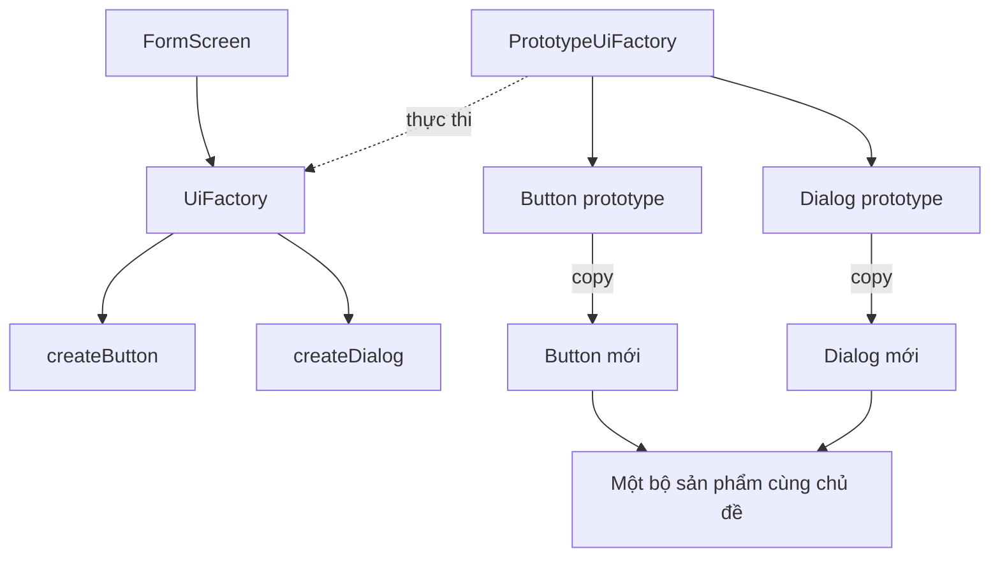

# Abstract Factory và Prototype khi sản phẩm được tạo bằng sao chép mẫu

Khi thiết kế phần mềm bằng **Abstract Factory**, ta thường nghĩ mỗi concrete factory sử dụng `new` để tạo một bộ sản phẩm thuộc cùng họ. Tuy nhiên, nếu các sản phẩm có cấu hình phức tạp hoặc cần dựa trên những đối tượng mẫu được chuẩn bị trước, factory cũng có thể **tạo sản phẩm bằng cách sao chép các prototype**.

Đây là điểm giao nhau giữa hai mẫu thiết kế khởi tạo:

- **Abstract Factory** xác định *những loại sản phẩm nào phải được tạo cùng một họ* và cung cấp interface để client yêu cầu chúng.
- **Prototype** xác định *một đối tượng mới được tạo từ đối tượng mẫu nào và sao chép như thế nào*, thay vì bắt buộc client biết constructor của lớp cụ thể.

Hai mẫu giải quyết **hai khía cạnh khác nhau của quá trình khởi tạo**. Chúng có thể được sử dụng độc lập hoặc kết hợp: một **concrete abstract factory lưu các prototype tương thích**, rồi mỗi phương thức tạo trả về một bản sao của prototype tương ứng.

## 1. Nhận diện nhu cầu trước khi chọn mẫu

Giả sử ứng dụng có hai chủ đề giao diện: **Light** và **Dark**. Mỗi chủ đề cần một `Button` và một `Dialog`. Các sản phẩm trong cùng một màn hình phải dùng cùng chủ đề để phối hợp nhất quán.

| Loại sản phẩm / Họ sản phẩm | Light | Dark |
| --- | --- | --- |
| `Button` | Nút Light với màu và style Light | Nút Dark với màu và style Dark |
| `Dialog` | Hộp thoại Light | Hộp thoại Dark |

Nếu chỉ quan tâm đến việc chọn **cặp nút và hộp thoại theo chủ đề**, Abstract Factory là ứng viên trực tiếp:

```java
interface UiFactory {
    Button createButton();
    Dialog createDialog();
}
```

Mỗi factory có trách nhiệm tạo các sản phẩm tương thích trong một cột của bảng. Cách tạo bên trong có thể là gọi constructor, gọi builder, lấy từ pool hoặc sao chép từ prototype, miễn là hợp đồng của sản phẩm và factory được giữ đúng.

Nếu vấn đề chỉ là **tạo thêm một nút đã cấu hình giống nút mẫu**, Prototype có thể đủ:

```java
Button newButton = buttonPrototype.copy();
```

Đoạn mã đó không tự định nghĩa một *họ* sản phẩm hoặc quy tắc phối hợp giữa nút và hộp thoại. Để giải quyết bài toán họ sản phẩm, ta cần thêm Abstract Factory hoặc một cơ chế khác quản lý lựa chọn các đối tượng tương thích.

## 2. So sánh trực diện Abstract Factory và Prototype

| Tiêu chí | Abstract Factory | Prototype |
| --- | --- | --- |
| Mục đích | Tạo các **họ sản phẩm có liên quan** thông qua những interface sản phẩm | Tạo đối tượng mới bằng cách **sao chép một đối tượng mẫu** |
| Đơn vị trừu tượng hóa | Họ sản phẩm, ví dụ `Button` + `Dialog` cùng chủ đề | Đối tượng mẫu và thao tác sao chép |
| Client biết gì? | Interface factory và interface các loại sản phẩm | Hợp đồng sao chép của prototype; có thể không biết lớp cụ thể |
| Quyết định biến thể | Chọn một concrete factory đại diện cho một họ | Chọn hoặc truyền một prototype để sao chép |
| Điểm mở rộng tự nhiên | Thêm một concrete factory cho họ mới khi các loại sản phẩm đã ổn định | Đưa vào hoặc thay đổi prototype, có thể ngay lúc chạy |
| Khó khăn đặc trưng | Thêm **loại sản phẩm mới** thường ảnh hưởng nhiều concrete factory | Sao chép đúng **trạng thái lồng nhau, định danh, tài nguyên và quan hệ tham chiếu** |
| Quan hệ tương thích | Mỗi concrete factory phải cung cấp các sản phẩm cùng họ | Bản sao phải thỏa hợp đồng của loại sản phẩm; Prototype tự nó không bảo đảm nhiều prototype khác loại tương thích |
| Có buộc dùng `new`? | Không | Không; triển khai copy có thể dùng copy constructor, factory, tuần tự hóa phù hợp hoặc cơ chế khác |

Sự khác biệt cốt lõi: **Abstract Factory trả lời “cần tạo cả bộ nào?”; Prototype trả lời “mỗi phần tử của bộ được tạo từ mẫu nào?”**.

### Prototype không đồng nghĩa với Java `Cloneable`

Trong Java, mẫu Prototype **không yêu cầu** triển khai `java.lang.Cloneable` hoặc gọi `Object.clone()`. Một phương thức tự định nghĩa như `copy()` và copy constructor thường dễ kiểm soát hơn, vì lập trình viên quyết định rõ trường nào phải sao chép, trường nào được chia sẻ và trường nào phải thiết lập lại.

`Object.clone()` thường cần được xử lý cẩn thận vì cơ chế sao chép mặc định tạo **bản sao nông** đối với các tham chiếu đối tượng. Việc triển khai `Cloneable` đơn thuần cũng không định nghĩa giúp hợp đồng sao chép sâu của toàn bộ cấu trúc.

## 3. Hai cách hiện thực một Abstract Factory

### Cách A: Concrete factory tạo sản phẩm bằng constructor

Một factory cho chủ đề Light có thể tạo trực tiếp:

```java
final class LightUiFactory implements UiFactory {
    public Button createButton() {
        return new LightButton();
    }

    public Dialog createDialog() {
        return new LightDialog();
    }
}
```

Các lớp `LightButton` và `LightDialog` ở đây là tên minh họa cho những triển khai tương ứng. Cách này rõ ràng khi cấu hình mặc định của mỗi biến thể đơn giản và ổn định.

### Cách B: Concrete factory sao chép từ hai đối tượng mẫu

Factory cũng có thể giữ sẵn:

- Một prototype cho `Button` đã được cấu hình màu sắc và các style.
- Một prototype cho `Dialog` đã được cấu hình tiêu đề và chủ đề.

Khi client gọi `createButton()` hoặc `createDialog()`, factory **copy đúng prototype tương ứng** rồi trả về sản phẩm mới. Để thêm một bộ giao diện mới, chương trình có thể chuẩn bị một cặp prototype khác và cung cấp chúng cho factory.



**Vai trò của Abstract Factory vẫn giữ nguyên.** Client yêu cầu các sản phẩm qua `UiFactory`, không cần biết factory tạo chúng bằng constructor hay bằng Prototype. **Vai trò của Prototype** nằm trong cách từng phương thức tạo sinh instance mới.

## 4. Ví dụ Java hoàn chỉnh: tạo bằng constructor và sao chép prototype

Ví dụ sau trình bày cả hai cách trong một tệp `FactoryPrototypeDemo.java`:

- `DirectUiFactory` tạo các sản phẩm qua constructor.
- `PrototypeUiFactory` lưu một prototype nút và một prototype hộp thoại, rồi trả về bản sao mỗi khi được yêu cầu.
- `FormScreen` chỉ dùng `UiFactory` và không cần phân biệt cơ chế khởi tạo.

Để minh họa lỗi **sao chép nông**, đối tượng nút chứa danh sách `styles` có thể thay đổi. Phương thức `copy()` phải tạo **một danh sách mới** để các nút không vô tình cùng chia sẻ trạng thái.

```java
import java.util.ArrayList;
import java.util.Arrays;
import java.util.Collections;
import java.util.List;
import java.util.Objects;

public class FactoryPrototypeDemo {
    // Prototype contract: tự định nghĩa copy(), không cần Cloneable.
    interface Prototype<T> {
        T copy();
    }

    // Abstract products: hợp đồng chung cho các biến thể.
    interface Button extends Prototype<Button> {
        String theme();
        String label();
        void setLabel(String label);
        void addStyle(String style);
        List<String> styles();
    }

    interface Dialog extends Prototype<Dialog> {
        String theme();
        void setTitle(String title);
        void show(Button action);
    }

    // Abstract Factory: tạo đủ hai loại sản phẩm của một họ.
    interface UiFactory {
        Button createButton();
        Dialog createDialog();
    }

    // Một triển khai Button có thể mang cấu hình Light hoặc Dark.
    static final class ThemedButton implements Button {
        private final String theme;
        private String label;
        private final List<String> styles;

        ThemedButton(String theme, String label, List<String> styles) {
            this.theme = Objects.requireNonNull(theme);
            this.label = Objects.requireNonNull(label);
            // Sao chép danh sách đầu vào để không phụ thuộc caller.
            this.styles = new ArrayList<>(Objects.requireNonNull(styles));
        }

        // Copy constructor qua constructor đầy đủ: styles độc lập.
        public Button copy() {
            return new ThemedButton(theme, label, styles);
        }

        public String theme() {
            return theme;
        }

        public String label() {
            return label;
        }

        public void setLabel(String label) {
            this.label = Objects.requireNonNull(label);
        }

        public void addStyle(String style) {
            styles.add(Objects.requireNonNull(style));
        }

        public List<String> styles() {
            return Collections.unmodifiableList(styles);
        }
    }

    static final class ThemedDialog implements Dialog {
        private final String theme;
        private String title;

        ThemedDialog(String theme, String title) {
            this.theme = Objects.requireNonNull(theme);
            this.title = Objects.requireNonNull(title);
        }

        public Dialog copy() {
            return new ThemedDialog(theme, title);
        }

        public String theme() {
            return theme;
        }

        public void setTitle(String title) {
            this.title = Objects.requireNonNull(title);
        }

        public void show(Button action) {
            if (action == null || !theme.equals(action.theme())) {
                throw new IllegalArgumentException(
                    "Button và Dialog không cùng chủ đề");
            }
            System.out.println("[" + theme + "] " + title
                    + " | hành động: " + action.label());
        }
    }

    // Concrete factory: tạo mới bằng constructor trực tiếp.
    static final class DirectUiFactory implements UiFactory {
        private final String theme;

        DirectUiFactory(String theme) {
            this.theme = Objects.requireNonNull(theme);
        }

        public Button createButton() {
            return new ThemedButton(
                theme, "Xác nhận", Arrays.asList("base", theme));
        }

        public Dialog createDialog() {
            return new ThemedDialog(theme, "Thông báo");
        }
    }

    // Concrete factory: tạo bằng sao chép hai prototype cùng một họ.
    static final class PrototypeUiFactory implements UiFactory {
        private final Button buttonPrototype;
        private final Dialog dialogPrototype;

        PrototypeUiFactory(Button button, Dialog dialog) {
            // Defensive copy: caller sửa mẫu gốc không ảnh hưởng factory.
            Button buttonCopy = Objects.requireNonNull(button).copy();
            Dialog dialogCopy = Objects.requireNonNull(dialog).copy();
            if (buttonCopy == null || dialogCopy == null
                    || !buttonCopy.theme().equals(dialogCopy.theme())) {
                throw new IllegalArgumentException(
                    "Hai prototype phải cùng họ và copy hợp lệ");
            }
            this.buttonPrototype = buttonCopy;
            this.dialogPrototype = dialogCopy;
        }

        public Button createButton() {
            return buttonPrototype.copy();
        }

        public Dialog createDialog() {
            return dialogPrototype.copy();
        }
    }

    // Client không phụ thuộc cách tạo của concrete factory.
    static final class FormScreen {
        private final UiFactory factory;

        FormScreen(UiFactory factory) {
            this.factory = Objects.requireNonNull(factory);
        }

        void render() {
            Button first = factory.createButton();
            Button second = factory.createButton();
            Dialog dialog = factory.createDialog();

            first.setLabel("Xóa");
            first.addStyle("danger");
            dialog.show(first);

            System.out.println("Nút thứ hai: " + second.label()
                    + ", styles=" + second.styles());
            System.out.println("Hai instance riêng: " + (first != second));
            System.out.println("Styles tách biệt: "
                    + !second.styles().contains("danger"));
        }
    }

    public static void main(String[] args) {
        System.out.println("=== Abstract Factory dùng constructor ===");
        new FormScreen(new DirectUiFactory("light")).render();

        System.out.println("=== Abstract Factory dùng Prototype ===");
        Button originalButton = new ThemedButton(
            "dark", "Xác nhận", Arrays.asList("base", "dark"));
        Dialog originalDialog = new ThemedDialog("dark", "Thông báo");

        UiFactory prototypeFactory =
            new PrototypeUiFactory(originalButton, originalDialog);

        // Factory đã giữ bản sao riêng của các mẫu được cung cấp.
        originalButton.setLabel("Mẫu gốc bị chỉnh sửa");

        new FormScreen(prototypeFactory).render();
    }
}
```

Biên dịch và chạy:

```bash
javac -encoding UTF-8 FactoryPrototypeDemo.java
java FactoryPrototypeDemo
```

Kết quả minh họa:

```text
=== Abstract Factory dùng constructor ===
[light] Thông báo | hành động: Xóa
Nút thứ hai: Xác nhận, styles=[base, light]
Hai instance riêng: true
Styles tách biệt: true
=== Abstract Factory dùng Prototype ===
[dark] Thông báo | hành động: Xóa
Nút thứ hai: Xác nhận, styles=[base, dark]
Hai instance riêng: true
Styles tách biệt: true
```

Các chi tiết đáng chú ý:

1. `FormScreen` chỉ biết `UiFactory`: việc đổi cơ chế từ `new` sang `copy()` không làm thay đổi cách client gọi factory.
2. `PrototypeUiFactory` dùng **hai prototype**, vì một họ gồm **hai loại sản phẩm**. Sao chép một prototype nút không tự tạo ra prototype hộp thoại tương thích.
3. Constructor của `PrototypeUiFactory` **copy các mẫu đầu vào**. Nhờ đó, việc caller sửa `originalButton` sau khi tạo factory không ảnh hưởng đến những nút mới từ factory.
4. Mỗi lời gọi `createButton()` tạo instance riêng và danh sách `styles` riêng. Nếu bản sao dùng chung một danh sách mutable, chỉnh sửa nút thứ nhất sẽ gây tác động ngoài ý muốn lên nút thứ hai.
5. `ThemedDialog.show(...)` kiểm tra chủ đề của Button lúc chạy: interface chung không tự chứng minh hai sản phẩm thuộc cùng một họ.

## 5. Những giới hạn quan trọng khi sao chép prototype

### Sao chép nông và sao chép sâu

**Sao chép nông (*shallow copy*)** tạo đối tượng ngoài mới nhưng giữ chung tham chiếu đến đối tượng con. **Sao chép sâu (*deep copy*)** tái tạo những thành phần con cần sở hữu riêng để hai bản sao độc lập về trạng thái.

Giả sử một Button giữ `List<String> styles`. Cách sao chép nông sau có thể gây lỗi:

```java
// Minh họa một thiết kế sai: copy() dùng chung danh sách mutable.
final class IncorrectButtonCopy {
    private final List<String> styles;

    IncorrectButtonCopy(List<String> styles) {
        this.styles = styles; // Giữ nguyên tham chiếu!
    }

    IncorrectButtonCopy copy() {
        return new IncorrectButtonCopy(styles); // Vẫn cùng List.
    }
}
```

Đoạn trên là mẫu **cần tránh** đối với danh sách có thể chỉnh sửa; hai đối tượng cùng trỏ tới một `List`. Trong chương trình hoàn chỉnh ở phần 4, constructor `ThemedButton` đã chủ động tạo `new ArrayList<>(styles)` để tránh lỗi này.

Không phải mọi trường đều phải sao chép sâu. Những dữ liệu **bất biến** như `String`, enum hoặc đối tượng cấu hình thật sự immutable có thể được chia sẻ an toàn. Ngược lại, collection mutable, buffer, cấu trúc cây có thể thay đổi hoặc bộ đếm trạng thái cần một **chính sách copy rõ ràng**.

| Loại dữ liệu bên trong prototype | Chiến lược thường phù hợp | Rủi ro nếu sao chép sai |
| --- | --- | --- |
| `String`, enum, giá trị immutable | Chia sẻ tham chiếu hoặc giá trị | Thấp nếu thật sự bất biến |
| `ArrayList`, map mutable | Tạo collection riêng, sao chép phần tử mutable khi cần | Hai bản sao vô tình sửa trạng thái của nhau |
| Cây đối tượng có tham chiếu chéo | Thiết kế copy có quản lý identity và chu trình | Lặp vô hạn hoặc mất quan hệ tham chiếu |
| ID định danh duy nhất | Quy định tạo ID mới hay giữ ID theo nghiệp vụ | Hai đối tượng mới mang cùng identity khi không được phép |
| File handle, socket, kết nối DB | Thường tạo lại/mượn qua cơ chế quản lý riêng; không sao chép mù quáng | Truy cập tài nguyên sai, đóng tài nguyên đang dùng |
| Cache bất biến hoặc cấu hình dùng chung | Có thể chia sẻ theo hợp đồng | Rủi ro nếu đối tượng được cho là bất biến nhưng thực chất mutable |

**Prototype không đồng nghĩa với deep copy toàn bộ.** Hợp đồng copy phải quyết định thành phần nào được chia sẻ, sao chép hoặc khởi tạo lại. Nếu đối tượng chứa tài nguyên sống, quyền sở hữu và vòng đời cần được thiết kế riêng.

### Không phải đối tượng nào cũng nên được sao chép

Một connection đang mở, transaction đang thực thi, thread hoặc lock không thể được coi là “một cấu hình có thể nhân đôi” chỉ bằng copy constructor. Đối với những trường hợp này, prototype có thể chỉ giữ **cấu hình tạo tài nguyên**, còn instance mới tự khởi tạo hoặc mượn tài nguyên đúng cách. Nếu không có cách sao chép an toàn, hãy dùng constructor/factory khác thay vì ép Prototype vào thiết kế.

### Prototype bị thay đổi sau khi đưa vào factory

Nếu concrete factory giữ trực tiếp tham chiếu đến prototype mutable do bên ngoài truyền vào, một thay đổi ngoài ý muốn có thể khiến tất cả sản phẩm tạo sau đó mang cấu hình mới. Có hai hướng phổ biến:

- **Đóng băng prototype:** dùng immutable object, không cung cấp thao tác chỉnh sửa sau khi cấu hình.
- **Phòng vệ tại ranh giới:** copy prototype khi nhận vào factory, sau đó chỉ trả về các bản sao riêng như ví dụ `PrototypeUiFactory`.

Việc sử dụng đồng thời từ nhiều thread cũng cần xem xét: nếu prototype được thay đổi trong lúc `copy()` chạy, bản sao có thể nhận trạng thái không nhất quán. Dùng prototype immutable hoặc bảo vệ việc đọc/ghi trạng thái theo hợp đồng thread safety.

## 6. Khi kết hợp, mỗi mẫu chịu trách nhiệm ở đâu?

Để không trộn lẫn trách nhiệm, có thể chia thiết kế thành ba lớp:

| Thành phần | Trách nhiệm | Điều không nên giả định |
| --- | --- | --- |
| Client dùng `UiFactory` | Yêu cầu `Button` và `Dialog`; sử dụng theo interface | Không cần biết sản phẩm được sao chép hay khởi tạo trực tiếp |
| `PrototypeUiFactory` | Cung cấp **bộ prototype thuộc cùng một họ** và trả về bản sao đúng loại | Không tự bảo đảm `copy()` của mọi sản phẩm đã sao chép đúng trạng thái |
| `Button.copy()` / `Dialog.copy()` | Tạo instance theo chính sách sao chép được định nghĩa | Không quyết định hai prototype khác loại có tương thích về ngữ nghĩa |

Giả sử ứng dụng muốn thêm chủ đề `HighContrast` nhưng không muốn tạo thêm một tập lớp con cho từng loại sản phẩm. Một hướng thiết kế là **khởi tạo một Button và một Dialog với cấu hình HighContrast**, rồi truyền vào `PrototypeUiFactory`. Client vẫn chọn họ một lần, còn factory tạo bản sao theo nhu cầu.

Điều đó **không loại bỏ nhu cầu kiểm tra tính tương thích**: một Button gắn theme `HighContrast` có thể cần font, contrast ratio, kích thước và cơ chế tương tác phù hợp với Dialog cùng chủ đề. Kiểm tra chuỗi theme bằng nhau trong ví dụ chỉ là điều kiện đơn giản; tính đúng đắn đầy đủ cần hợp đồng và kiểm thử hành vi.

## 7. Chọn Abstract Factory, Prototype hay kết hợp?

| Tình huống | Lựa chọn đáng cân nhắc | Lý do |
| --- | --- | --- |
| Có nhiều bộ `Button` + `Dialog` tương thích; lớp cụ thể dễ khởi tạo | Abstract Factory tạo trực tiếp | Nhấn mạnh quan hệ họ sản phẩm, ít logic sao chép |
| Chỉ cần nhân bản một đối tượng đã cấu hình phức tạp | Prototype | Không có yêu cầu quản lý nhiều loại sản phẩm cùng họ |
| Nhiều họ sản phẩm, từng sản phẩm cần nhận cấu hình mẫu và sao chép | Abstract Factory + Prototype | Abstract Factory giữ họ nhất quán; Prototype cung cấp instance đã cấu hình |
| Các sản phẩm đang sở hữu socket, connection hoặc transaction | Factory/builder quản lý vòng đời | Sao chép trạng thái sống thường không phù hợp |
| Họ sản phẩm thay đổi liên tục từ cấu hình hoặc plugin | Cân nhắc factory giữ prototype/registry có kiểm soát | Có thể thêm họ bằng dữ liệu cấu hình và mẫu, vẫn cần kiểm chứng hợp đồng |
| Chỉ có một vai trò sản phẩm với vài biến thể dễ tạo | Factory đơn giản, Factory Method hoặc inject trực tiếp | Không có lý do rõ ràng để quản lý cả một họ |

Các mẫu cũng không phải lựa chọn loại trừ nhau. Một concrete factory **có thể dùng Prototype cho một số loại sản phẩm**, đồng thời dùng constructor cho loại khác. Điều cần giữ ổn định là hợp đồng khởi tạo và tính tương thích của họ đối với client.

### Chi phí khi mở rộng

**Thêm một họ:** Với concrete factory tạo trực tiếp, ta thường bổ sung một factory và những lớp triển khai cần thiết. Với factory giữ prototype, có thể cấu hình một bộ mẫu mới nếu các lớp hiện có cho phép tái sử dụng theo biến thể. Khả năng thêm họ bằng dữ liệu **phụ thuộc thiết kế sản phẩm**, không phải tự động đến từ mẫu Prototype.

**Thêm một loại sản phẩm:** Nếu `UiFactory` bổ sung `createCheckbox()`, mọi concrete factory phải đáp ứng hợp đồng mới. Factory dùng Prototype cũng phải nhận hoặc sở hữu thêm **một prototype Checkbox**. Prototype không loại bỏ chi phí thay đổi interface Abstract Factory.

**Thay đổi cấu hình mặc định:** Factory dùng constructor có thể sửa logic khởi tạo; factory dùng Prototype có thể cập nhật mẫu được cấu hình. Với sản phẩm mutable, cần quy định thời điểm có hiệu lực của thay đổi để không làm ảnh hưởng ngoài ý muốn đến các instance đang hoạt động.

## 8. Những hiểu lầm phổ biến

**“Abstract Factory là bắt buộc phải có một class cho mỗi biến thể.”** Không nhất thiết. Một factory được cấu hình bằng một bộ prototype cũng có thể thực thi interface Abstract Factory. Phạm vi họ do hợp đồng tạo và phối hợp sản phẩm quyết định, không phải chỉ bởi số class.

**“Prototype là cách tạo đối tượng luôn nhanh hơn `new`.”** Không có bảo đảm này. Sao chép collection hoặc cây đối tượng có thể tốn nhiều thời gian, bộ nhớ hơn việc gọi constructor. Chọn theo nhu cầu cấu hình và tính đúng đắn; chỉ tối ưu hiệu năng sau khi đo đạc.

**“Có `copy()` là đã có một bản sao độc lập.”** Sai nếu hợp đồng và implementation chỉ sao chép nông các tham chiếu mutable. Cần xác định rõ semantics của `copy()` và kiểm tra các trạng thái có thể thay đổi sau khi sao chép.

**“Đã copy cùng theme thì chắc chắn các sản phẩm tương thích.”** Cùng giá trị theme chưa đủ chứng minh các ràng buộc về màu, style, trạng thái hoặc hành vi. Concrete factory phải cung cấp các prototype đã được thiết kế và kiểm tra để cộng tác.

**“Prototype tạo instance mới nên phải sao chép mọi trường y nguyên.”** Không nhất thiết. Định danh duy nhất, timestamp khởi tạo, session hoặc trạng thái tạm thời có thể cần được cấp lại. Chính sách đó là một phần của hợp đồng sao chép.

**“Kết hợp hai mẫu làm client phức tạp hơn.”** Client dùng Abstract Factory có thể giữ nguyên. Phức tạp chủ yếu nằm ở việc chuẩn bị prototype và triển khai sao chép đúng trong concrete factory.

## 9. Kiểm thử hợp đồng cho factory dùng prototype

Một kiểm thử hữu ích nên kiểm tra **cả họ sản phẩm** lẫn **chính sách tạo bản sao**. Chẳng hạn, với chương trình Java ở phần 4:

```java
// Có thể đặt method này trong FactoryPrototypeDemo.
static void verifyFactory(UiFactory factory) {
    Button first = factory.createButton();
    Button second = factory.createButton();
    Dialog dialog = factory.createDialog();

    if (first == second) {
        throw new AssertionError("Hai lần createButton trả cùng instance");
    }
    if (!first.theme().equals(second.theme())
            || !first.theme().equals(dialog.theme())) {
        throw new AssertionError("Sản phẩm khác họ");
    }

    String originalLabel = second.label();
    first.setLabel("Đã chỉnh sửa");
    first.addStyle("temporary");

    if (!originalLabel.equals(second.label())
            || second.styles().contains("temporary")) {
        throw new AssertionError("Bản sao chia sẻ mutable state");
    }

    dialog.show(first); // Kiểm tra hành vi cộng tác.
}
```

Ngoài kiểm thử ví dụ, khi sản phẩm có cấu trúc phức tạp nên xác minh:

1. **Đúng loại và đúng họ:** mọi sản phẩm do factory tạo thỏa interface và các quy ước tương thích.
2. **Độc lập về trạng thái:** sửa bản sao A không sửa bản sao B ở những trường phải tách biệt.
3. **Giữ cấu hình cần thiết:** bản sao duy trì đúng các thuộc tính cấu hình của prototype.
4. **Identity và tài nguyên:** ID duy nhất được cấp lại khi cần, handle sống không bị chia sẻ trái hợp đồng.
5. **Chống thay đổi từ ngoài:** thay đổi prototype đầu vào sau khi tạo factory không làm thay đổi factory nếu hợp đồng yêu cầu snapshot.
6. **Lỗi và cạnh biên:** copy thất bại được báo rõ, không làm hỏng prototype hoặc để lại tài nguyên rò rỉ.
7. **Đồng thời:** cách copy hoạt động an toàn nếu factory được dùng ở nhiều thread.

Không phải factory nào cũng cam kết **mỗi lần tạo trả một instance riêng**: một số interface factory có thể được thiết kế để tái sử dụng immutable object hoặc dùng pool. Trong ví dụ **Prototype tạo bản sao mới**, đây là một phần hợp đồng nên được kiểm tra rõ ràng.

## 10. Bài tập thiết kế

Một ứng dụng xuất báo cáo hỗ trợ hai bộ định dạng: **Corporate** và **Minimal**. Mỗi bộ gồm `HeaderRenderer` và `TableRenderer`, có cấu hình font, màu, lề và style. Người dùng có thể tự lưu bộ cấu hình mới, sau đó tạo nhiều bản báo cáo theo bộ đó.

Hãy xác định:

1. Hai **loại sản phẩm** và những **họ sản phẩm** trong yêu cầu.
2. Interface Abstract Factory cần các phương thức tạo nào?
3. Những đối tượng nào phù hợp làm prototype và bản sao phải xử lý font, style, danh sách cột như thế nào?
4. Nếu mỗi lần xuất phải tạo một file handle mới, có nên sao chép trực tiếp file handle từ prototype không?
5. Những kiểm thử nào xác nhận một báo cáo sửa style cục bộ sẽ không làm thay đổi báo cáo khác?

**Gợi ý:** thiết kế `ReportFactory` với `createHeaderRenderer()` và `createTableRenderer()`. Mỗi bộ cấu hình cung cấp cặp prototype được xây dựng theo cùng quy ước. Factory lưu snapshot của cặp này và trả bản sao cho mỗi báo cáo; các collection mutable cần được sao chép phù hợp. File handle nên được mở và quản lý bởi tiến trình xuất báo cáo hoặc lớp quản lý tài nguyên, không sao chép mù quáng từ prototype.

## Tổng kết

**Abstract Factory** giải quyết bài toán **tạo một họ sản phẩm tương thích** thông qua hợp đồng chung; **Prototype** giải quyết bài toán **tạo một đối tượng mới dựa trên mẫu đã cấu hình**. Khi kết hợp, concrete factory có thể giữ nhiều prototype thuộc cùng họ và sao chép từng prototype để cung cấp sản phẩm cho client.

Điều quan trọng nhất là giữ rõ **hai hợp đồng**: factory phải cung cấp đúng bộ sản phẩm có thể phối hợp, còn `copy()` phải tạo đối tượng với cấu hình, identity và mức độ độc lập trạng thái đúng yêu cầu. Cách kết hợp này đặc biệt hữu ích khi các họ sản phẩm có cấu hình linh hoạt hoặc được tạo từ mẫu, nhưng không thay thế việc kiểm thử tính tương thích, vòng đời tài nguyên và hành vi sao chép.
