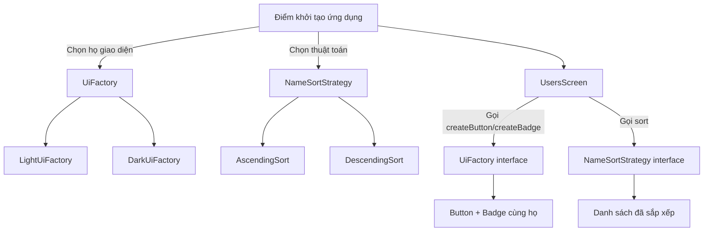
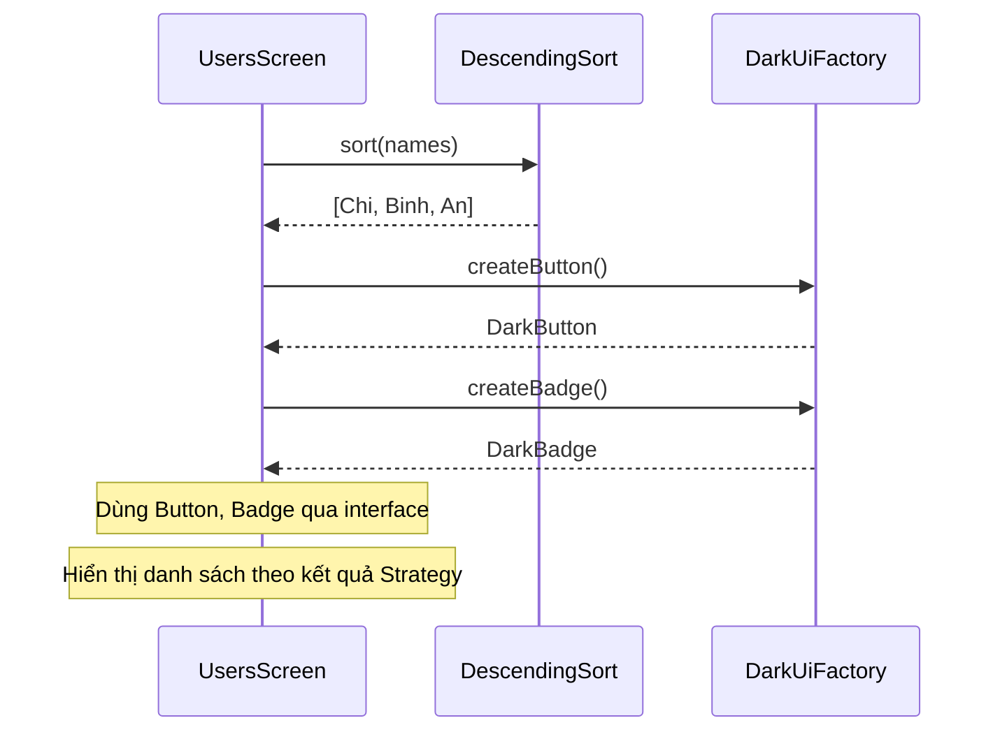

# Abstract Factory và Strategy khi thay cách tạo đối tượng hoặc thay thuật toán

Trong module `SOFTWARE_DESIGN_DESIGN_PATTERN_CREATIONAL_ABSTRACT_FACTORY` (*Học về abstract factory trong design pattern*), đôi khi ta gặp hai yêu cầu trông có vẻ giống nhau: ứng dụng cần **thay bộ đối tượng được tạo** hoặc cần **thay cách thực hiện một công việc**. Cả hai đều có thể giải quyết bằng cách định nghĩa interface và truyền một implementation vào client, nhưng chúng đại diện cho hai ý định thiết kế khác nhau.

Bài thuộc chương **So sánh mẫu thiết kế**. Trọng tâm là phân biệt **Abstract Factory** với **Strategy** trong tình huống *thay cách tạo đối tượng* và *thay thuật toán*, xác định lúc nào nên kết hợp cả hai, đồng thời tránh chọn mẫu chỉ vì chúng cùng sử dụng đa hình.

## 1. Câu hỏi quyết định: cần thay cái gì?

- **Abstract Factory** là mẫu thiết kế **khởi tạo (creational)**: cung cấp một giao diện để tạo ra **các họ đối tượng liên quan hoặc phụ thuộc lẫn nhau**, không để client phụ thuộc vào những lớp sản phẩm cụ thể. Ví dụ: cùng một màn hình cần `Button` và `Badge` thuộc theme Light hoặc Dark.
- **Strategy** là mẫu thiết kế **hành vi (behavioral)**: đóng gói **các thuật toán/cách xử lý có thể thay thế** sau một hợp đồng chung, cho phép client ủy quyền công việc cho thuật toán được chọn. Ví dụ: sắp xếp danh sách người dùng theo tên tăng dần hoặc giảm dần.

| Câu hỏi | Abstract Factory | Strategy |
| --- | --- | --- |
| Phần cần biến thiên là gì? | **Họ sản phẩm được tạo** | **Thuật toán/cách thực hiện công việc** |
| Client yêu cầu gì? | “Hãy tạo giúp tôi các đối tượng tương thích.” | “Hãy xử lý dữ liệu theo cách đã chọn.” |
| Interface thường có gì? | Nhiều phương thức tạo như `createButton()`, `createBadge()` | Phương thức hành vi như `sort(names)`, `calculate(price)` |
| Khi thêm biến thể | Tạo concrete product/factory cho **họ mới** | Tạo một concrete strategy cho **thuật toán mới** |
| Đầu ra điển hình | Các đối tượng thuộc những interface sản phẩm | Kết quả xử lý, trạng thái hoặc hiệu ứng của thuật toán |
| Vị trí client dùng interface | Gọi factory rồi sử dụng sản phẩm trả về | Gọi trực tiếp phương thức hành vi của strategy |

Phân biệt dựa trên **trách nhiệm** là quan trọng hơn tên phương thức. Một strategy hoàn toàn *có thể* chứa thuật toán tạo một đối tượng; một factory cũng có thể chứa logic nội bộ phức tạp. Tuy nhiên, khi mục tiêu chính là tạo **nhiều sản phẩm thành bộ tương thích**, Abstract Factory diễn đạt ý định rõ hơn; khi mục tiêu chính là **hoán đổi cách tính/xử lý**, Strategy phù hợp hơn.

## 2. Tình huống có cả hai trục biến thể

Giả sử đang xây dựng màn hình quản lý người dùng. Màn hình cần hai yêu cầu độc lập:

1. **Thay họ giao diện:** hiển thị `Button` “Thêm người dùng” và `Badge` “Tổng số” theo theme Light hoặc Dark.
2. **Thay thuật toán sắp xếp:** hiển thị danh sách tên theo **A → Z** hoặc **Z → A**.

Ta có hai lựa chọn cho mỗi trục:

| | Sắp xếp A → Z | Sắp xếp Z → A |
| --- | --- | --- |
| **Theme Light** | Button/Badge Light + A → Z | Button/Badge Light + Z → A |
| **Theme Dark** | Button/Badge Dark + A → Z | Button/Badge Dark + Z → A |

**Abstract Factory** chịu trách nhiệm tạo đúng *họ* `LightButton` + `LightBadge` hoặc `DarkButton` + `DarkBadge`. **Strategy** chịu trách nhiệm sắp xếp danh sách theo một thuật toán, không quyết định giao diện thuộc họ nào.

Điểm thiết kế mấu chốt: không cần tạo bốn class kiểu `LightAscendingScreen`, `LightDescendingScreen`, `DarkAscendingScreen`, `DarkDescendingScreen`. Ta có thể giữ một client và truyền vào **hai phụ thuộc độc lập**.

## 3. Cấu trúc phối hợp Abstract Factory và Strategy



Sơ đồ minh họa quan hệ trách nhiệm, không phải tất cả các implementation đều chạy cùng lúc. Điểm khởi tạo chọn **một** concrete factory và **một** concrete strategy rồi cấp chúng cho `UsersScreen`.

Một cách đọc các thành phần:

| Vai trò | Ví dụ | Client thấy được gì? |
| --- | --- | --- |
| Abstract factory | `UiFactory` | `createButton()`, `createBadge()` |
| Concrete factory | `LightUiFactory`, `DarkUiFactory` | Được chọn bên ngoài client |
| Abstract product | `Button`, `Badge` | `render(...)` |
| Concrete product | `LightButton`, `DarkBadge`, ... | Được che sau interface sản phẩm |
| Strategy interface | `NameSortStrategy` | `sort(List<String>)` |
| Concrete strategy | `AscendingSort`, `DescendingSort` | Được chọn bên ngoài client |
| Context/client | `UsersScreen` | Gọi cả factory lẫn strategy qua interface |

**Strategy không chịu trách nhiệm tạo bộ widget**, còn **Abstract Factory không quyết định thứ tự tên người dùng**. Việc tách hai trục này giúp từng phần thay đổi vì một lý do cụ thể.

## 4. Ví dụ Java hoàn chỉnh

Ví dụ dưới đây sử dụng chuỗi để mô phỏng giao diện, nhằm làm rõ cách tổ chức đối tượng. `render()` không vẽ widget thực tế; trong dự án GUI thật, concrete product sẽ gọi thư viện giao diện tương ứng.

Lưu toàn bộ mã thành `AbstractFactoryVsStrategyDemo.java`. Chương trình dùng các API Java tiêu chuẩn, tương thích Java 11 trở lên.

```java
import java.util.ArrayList;
import java.util.Comparator;
import java.util.List;
import java.util.Locale;
import java.util.Objects;

public class AbstractFactoryVsStrategyDemo {

    // ===== ABSTRACT FACTORY: những loại sản phẩm cần tạo =====
    interface Button {
        String render(String title);
    }

    interface Badge {
        String render(String label);
    }

    interface UiFactory {
        Button createButton();
        Badge createBadge();
    }

    // Các concrete product của họ Light.
    static final class LightButton implements Button {
        @Override
        public String render(String title) {
            return "[Light] Button: " + title;
        }
    }

    static final class LightBadge implements Badge {
        @Override
        public String render(String label) {
            return "[Light] Badge: " + label;
        }
    }

    // Các concrete product của họ Dark.
    static final class DarkButton implements Button {
        @Override
        public String render(String title) {
            return "[Dark] Button: " + title;
        }
    }

    static final class DarkBadge implements Badge {
        @Override
        public String render(String label) {
            return "[Dark] Badge: " + label;
        }
    }

    // Mỗi factory tạo đủ loại sản phẩm của cùng một họ.
    static final class LightUiFactory implements UiFactory {
        @Override
        public Button createButton() {
            return new LightButton();
        }

        @Override
        public Badge createBadge() {
            return new LightBadge();
        }
    }

    static final class DarkUiFactory implements UiFactory {
        @Override
        public Button createButton() {
            return new DarkButton();
        }

        @Override
        public Badge createBadge() {
            return new DarkBadge();
        }
    }

    // ===== STRATEGY: các cách xử lý dữ liệu có thể thay thế =====
    interface NameSortStrategy {
        List<String> sort(List<String> names);
    }

    static final class AscendingSort implements NameSortStrategy {
        @Override
        public List<String> sort(List<String> names) {
            List<String> result = new ArrayList<>(names);
            result.sort(Comparator.naturalOrder());
            return result;
        }
    }

    static final class DescendingSort implements NameSortStrategy {
        @Override
        public List<String> sort(List<String> names) {
            List<String> result = new ArrayList<>(names);
            result.sort(Comparator.reverseOrder());
            return result;
        }
    }

    // ===== CLIENT: dùng cả hai abstraction độc lập =====
    static final class UsersScreen {
        private final UiFactory uiFactory;
        private final NameSortStrategy sortStrategy;

        UsersScreen(UiFactory uiFactory, NameSortStrategy sortStrategy) {
            this.uiFactory = Objects.requireNonNull(uiFactory, "uiFactory");
            this.sortStrategy = Objects.requireNonNull(
                    sortStrategy, "sortStrategy");
        }

        void show(List<String> names) {
            List<String> ordered = sortStrategy.sort(names);
            Button addButton = uiFactory.createButton();
            Badge totalBadge = uiFactory.createBadge();

            System.out.println(addButton.render("Thêm người dùng"));
            System.out.println(totalBadge.render("Tổng số: " + ordered.size()));
            System.out.println("Danh sách: " + String.join(", ", ordered));
        }
    }

    // Điểm cấu hình quyết định họ sản phẩm.
    static UiFactory selectUiFactory(String theme) {
        switch (theme.trim().toLowerCase(Locale.ROOT)) {
            case "light":
                return new LightUiFactory();
            case "dark":
                return new DarkUiFactory();
            default:
                throw new IllegalArgumentException(
                        "Theme không hỗ trợ: " + theme);
        }
    }

    // Điểm cấu hình quyết định thuật toán.
    static NameSortStrategy selectSortStrategy(String order) {
        switch (order.trim().toLowerCase(Locale.ROOT)) {
            case "az":
                return new AscendingSort();
            case "za":
                return new DescendingSort();
            default:
                throw new IllegalArgumentException(
                        "Thứ tự không hỗ trợ: " + order);
        }
    }

    public static void main(String[] args) {
        String theme = args.length > 0 ? args[0] : "light";
        String order = args.length > 1 ? args[1] : "az";

        UiFactory factory = selectUiFactory(theme);
        NameSortStrategy strategy = selectSortStrategy(order);
        UsersScreen screen = new UsersScreen(factory, strategy);

        screen.show(List.of("Chi", "An", "Binh"));
    }
}
```

Biên dịch và chạy:

```bash
javac -encoding UTF-8 AbstractFactoryVsStrategyDemo.java
java AbstractFactoryVsStrategyDemo light az
java AbstractFactoryVsStrategyDemo dark za
```

Đầu ra dự kiến với `light az`:

```text
[Light] Button: Thêm người dùng
[Light] Badge: Tổng số: 3
Danh sách: An, Binh, Chi
```

Đầu ra dự kiến với `dark za`:

```text
[Dark] Button: Thêm người dùng
[Dark] Badge: Tổng số: 3
Danh sách: Chi, Binh, An
```

Hãy thử thêm hai tổ hợp `light za` và `dark az`. Màu/theme trong hai dòng đầu thay đổi theo **factory**, còn thứ tự tên ở dòng cuối thay đổi theo **strategy**. Cả hai quyết định đều nằm ở điểm khởi tạo; `UsersScreen` không có `switch` hay `instanceof` để phân biệt Light/Dark hoặc A→Z/Z→A.

Trong ví dụ, mỗi concrete strategy tạo **bản sao** của danh sách trước khi sắp xếp, vì vậy danh sách đầu vào không bị sửa. Đây là **quyết định về hợp đồng thuật toán** của ví dụ, không phải yêu cầu bắt buộc của mẫu Strategy.

## 5. Phân tích luồng gọi: tạo sản phẩm và thực thi thuật toán

Giả sử điểm khởi tạo đã truyền `DarkUiFactory` và `DescendingSort` cho một `UsersScreen`. Khi `show(names)` chạy:



Phân tích từng lời gọi:

1. `sortStrategy.sort(names)` **thực hiện một thuật toán** và trả về danh sách đã sắp xếp. Client không cần biết sắp xếp bằng comparator nào.
2. `uiFactory.createButton()` và `uiFactory.createBadge()` **khởi tạo hai sản phẩm** thuộc cùng họ Dark. Client không cần biết tên lớp concrete.
3. `button.render(...)` và `badge.render(...)` sử dụng **hành vi của các sản phẩm** vừa được tạo.

Điều này làm rõ ranh giới: factory **cấp các đối tượng**, còn strategy **cung cấp cách thực hiện một nhiệm vụ**. Cả hai đều có thể được tiêm qua constructor, nhưng việc tiêm phụ thuộc là kỹ thuật tổ chức code, không làm chúng trở thành cùng một mẫu.

## 6. So sánh chi phí mở rộng

Giả sử màn hình cần thêm lựa chọn **theme High Contrast**. Với Abstract Factory, ta bổ sung các concrete product thích hợp (`HighContrastButton`, `HighContrastBadge`), một `HighContrastUiFactory` cài đặt `UiFactory`, sau đó cập nhật cách chọn factory. Phần sắp xếp trong `UsersScreen` và hai strategy hiện tại không cần biết tới theme mới.

Nếu muốn thêm thuật toán **sắp xếp theo độ dài tên**, với Strategy ta tạo `LengthSort implements NameSortStrategy` rồi cập nhật nơi chọn strategy. Các class `LightUiFactory`, `DarkUiFactory` và concrete product không cần biết thuật toán mới.

| Thay đổi | Nơi cần mở rộng chính | Những phần thường giữ nguyên |
| --- | --- | --- |
| Thêm họ sản phẩm (High Contrast) | Concrete product tương ứng, concrete factory và đăng ký chọn họ | `UiFactory`, `UsersScreen`, strategy sắp xếp |
| Thêm thuật toán (theo độ dài tên) | Một concrete strategy và đăng ký chọn thuật toán | Các product/factory UI, `UsersScreen` |
| Thêm **loại sản phẩm** (`TextField`) | `TextField` interface, các concrete product và **tất cả** concrete factory | Chiến lược sắp xếp; phần client chưa dùng TextField |
| Đổi **hợp đồng thuật toán** (`sort` cần thêm tham số bắt buộc) | Interface strategy, các implementation và những client gọi phương thức | Factory UI |

Abstract Factory đặc biệt thuận lợi khi **các loại sản phẩm tương đối ổn định** nhưng thường xuyên có họ sản phẩm mới. Nó kém thuận tiện hơn khi liên tục thêm loại sản phẩm, vì interface factory và mọi concrete factory phải cập nhật. Strategy thường thuận tiện khi số lựa chọn thuật toán tăng nhưng **hợp đồng hành vi ổn định**. Cả hai đều có giới hạn: đổi hợp đồng chung có thể ảnh hưởng đến tất cả implementation.

## 7. Những trường hợp dễ chọn nhầm

### 7.1. Dùng Strategy để mô phỏng cả một họ sản phẩm

Giả sử có `ThemeStrategy` chứa `createButton()` và `createBadge()`, mỗi implementation lại tạo trọn một họ widget. Nếu mục tiêu thực sự là **cấp một bộ đối tượng tương thích**, cấu trúc này mang **vai trò Abstract Factory**, dù interface được đặt tên `Strategy`. Hãy đặt tên và mô tả trách nhiệm theo việc đối tượng **làm gì**, không chỉ theo hình dạng interface.

### 7.2. Dùng Abstract Factory để chọn một thuật toán

Nếu yêu cầu chỉ là thay cách sắp xếp danh sách, việc tạo các class `AscendingSortFactory` và `DescendingSortFactory` rồi tạo từng sorter có thể khiến thiết kế phức tạp không cần thiết. Thường chỉ cần tiêm một `NameSortStrategy`, hoặc thậm chí một `Comparator<String>` khi bài toán chỉ là so sánh thứ tự.

Ngược lại, có trường hợp **factory tạo các strategy** hoặc strategy được chọn từ **một factory**: cách tổ chức đó không sai, nhưng nên có lý do rõ ràng về vòng đời, cấu hình hoặc nhiều sản phẩm cần khởi tạo.

### 7.3. Coi mọi lựa chọn tại runtime là Strategy

Cả hai mẫu đều có thể chọn implementation tại runtime. `selectUiFactory(theme)` lựa chọn cách tạo một họ UI; `selectSortStrategy(order)` lựa chọn thuật toán sắp xếp. **Thời điểm lựa chọn** không phải dấu hiệu để phân biệt hai mẫu; hãy xem **trách nhiệm sau khi lựa chọn**.

### 7.4. Dùng Abstract Factory chỉ để đổi màu

Nếu các widget đều giống nhau về cách tạo và hành vi, chỉ khác một vài mã màu, hệ thống **design tokens**, theme provider hoặc style configuration sẵn có có thể đơn giản hơn. Abstract Factory đáng cân nhắc khi có những **biến thể sản phẩm thực sự khác nhau** cần tạo thành bộ đồng nhất.

### 7.5. Cố thay factory sau khi sản phẩm đã được tạo

Việc chuyển `uiFactory` từ Light sang Dark không tự biến `LightButton` đã được tạo thành `DarkButton`. Cần tạo lại thành phần, cập nhật trạng thái UI hoặc sử dụng cơ chế theme động phù hợp. Tương tự, việc thay strategy sắp xếp không tự sắp xếp lại danh sách đã hiển thị nếu client không gọi lại thuật toán và render lại kết quả.

## 8. Khi nào kết hợp cả hai?

Cách kết hợp ở mục 4 phù hợp khi **hai trục thay đổi độc lập**: theme quyết định bộ UI, còn tùy chọn sắp xếp quyết định thuật toán. Việc kết hợp thường có lợi khi ứng dụng có:

- Nhiều **họ đối tượng liên quan**, ví dụ component theo nền tảng, bộ driver cho các dịch vụ tương thích hoặc bộ parser/serializer theo định dạng.
- Nhiều **cách xử lý có thể thay thế**, ví dụ thuật toán sắp xếp, tính phí, chọn tuyến đường hoặc chính sách khuyến mãi.
- Các client cần **lắp ghép tùy chọn** từ hai nhóm mà không tạo một class riêng cho mọi tổ hợp.

Trong ứng dụng thực, cách chọn factory và strategy có thể nằm tại composition root, DI container hoặc cấu hình theo request. Nếu một request có thể dùng theme/thuật toán khác request còn lại, hãy cấp các phụ thuộc theo **phạm vi phù hợp**, tránh vô tình chia sẻ cấu hình thay đổi toàn cục giữa các request.

Một phương pháp ra quyết định:

| Câu hỏi kiểm tra | Lựa chọn cần cân nhắc |
| --- | --- |
| Có phải tạo **nhiều loại đối tượng** phải tương thích theo cùng một biến thể? | Abstract Factory |
| Có phải thực thi **cùng một công việc** với nhiều thuật toán? | Strategy |
| Cả bộ sản phẩm **và** thuật toán đều cần hoán đổi độc lập? | Kết hợp hai mẫu với hai interface |
| Chỉ tạo một loại đối tượng đơn giản? | Factory Method hoặc factory đơn giản, tùy bối cảnh |
| Thuật toán là một lời gọi rất ngắn, đã có interface chuẩn như `Comparator`? | Tận dụng interface/hàm của thư viện trước khi tạo thêm hệ thống class |

Đừng nhầm Abstract Factory là giải pháp cho mọi câu lệnh `new`, hay Strategy là giải pháp cho mọi câu lệnh `if`. Hai mẫu hữu ích khi có **những chiều thay đổi rõ ràng** và việc đóng gói những chiều đó thực sự giảm phụ thuộc giữa các phần.

## 9. Kiểm tra thiết kế và hành vi

Với chương trình minh họa, có thể xác minh sự độc lập của hai chiều mà không cần thư viện kiểm thử:

```java
// Đặt phương thức này bên trong AbstractFactoryVsStrategyDemo
// và gọi từ main() nếu muốn tự kiểm tra.
static void verifyIndependentChoices() {
    List<String> names = List.of("Chi", "An", "Binh");
    NameSortStrategy asc = new AscendingSort();
    NameSortStrategy desc = new DescendingSort();

    if (!asc.sort(names).equals(List.of("An", "Binh", "Chi"))) {
        throw new AssertionError("AscendingSort sai");
    }
    if (!desc.sort(names).equals(List.of("Chi", "Binh", "An"))) {
        throw new AssertionError("DescendingSort sai");
    }
    if (!names.equals(List.of("Chi", "An", "Binh"))) {
        throw new AssertionError("Strategy đã sửa dữ liệu đầu vào");
    }

    UiFactory light = new LightUiFactory();
    UiFactory dark = new DarkUiFactory();
    if (!(light.createButton() instanceof LightButton)
            || !(light.createBadge() instanceof LightBadge)) {
        throw new AssertionError("LightUiFactory trộn họ");
    }
    if (!(dark.createButton() instanceof DarkButton)
            || !(dark.createBadge() instanceof DarkBadge)) {
        throw new AssertionError("DarkUiFactory trộn họ");
    }
}
```

Phép kiểm tra Strategy quan sát **thứ tự sắp xếp** và việc giữ nguyên dữ liệu đầu vào; phép kiểm tra Abstract Factory quan sát **từng loại sản phẩm thuộc đúng họ**. Kiểm thử giao diện `UsersScreen` cho cả bốn tổ hợp sẽ xác nhận hai lựa chọn hoạt động cùng nhau. Việc dùng `instanceof` trong **kiểm thử factory** phù hợp để bắt lỗi trộn họ; client nghiệp vụ nên tiếp tục dùng các interface thay vì kiểm tra lớp cụ thể.

Nếu ứng dụng có yêu cầu về thứ tự tiếng Việt, so sánh chuỗi tự nhiên trong ví dụ (`Comparator.naturalOrder()`) **không thay thế** bộ so sánh theo quy tắc ngôn ngữ. Khi ấy, thuật toán Strategy có thể dùng `Collator` được cấu hình phù hợp; điều đó không làm thay đổi Abstract Factory.

## 10. Bài tập thực hành

**Bài tập 1 — Thêm họ sản phẩm.** Bổ sung `HighContrastButton`, `HighContrastBadge` và `HighContrastUiFactory`. Thêm lựa chọn `contrast` tại `selectUiFactory()`, sau đó chạy cả hai strategy với họ mới. Xác định lớp nào không cần sửa.

**Bài tập 2 — Thêm thuật toán.** Viết `LengthSort` để sắp xếp tên theo độ dài tăng dần; khi bằng độ dài, sắp theo thứ tự chữ cái. Thêm lựa chọn `length` ở `selectSortStrategy()`. Kiểm tra cả Light và Dark đều dùng được thuật toán mới mà không sửa factory.

**Bài tập 3 — Phát hiện sai trách nhiệm.** Giả sử `DarkUiFactory` có thêm `List<String> sortNames(...)`. Hãy giải thích vì sao hành vi này không thuộc trách nhiệm tạo họ sản phẩm UI, rồi chuyển sang một concrete strategy.

**Bài tập 4 — Đánh giá phương án đơn giản.** Một ứng dụng chỉ cần sắp xếp bảng A→Z/Z→A và sử dụng sẵn một UI framework có theme provider. Hãy cân nhắc liệu có cần tự tạo cả `UiFactory` và `NameSortStrategy` không, hay chỉ cần cấu hình theme của framework và một `Comparator`.

**Tự kiểm tra:** Nếu theme đổi nhưng thuật toán sắp xếp giữ nguyên, lớp nào phải thay? Nếu thuật toán đổi nhưng các widget vẫn thuộc Light, lớp nào phải thay? Nếu thêm loại sản phẩm `TextField`, vì sao mọi concrete factory cần được xem lại còn hai strategy sắp xếp thì không?

## Kết luận

**Abstract Factory** giải quyết câu hỏi **“tạo bộ đối tượng thuộc họ nào?”**; **Strategy** giải quyết câu hỏi **“thực hiện công việc bằng thuật toán nào?”**. Khi ứng dụng cần cả hai, hãy tách **biến thể sản phẩm** khỏi **biến thể hành vi**, truyền hai abstraction độc lập vào client và kiểm thử từng trách nhiệm riêng. Chọn mẫu dựa trên thứ cần thay đổi và hợp đồng muốn giữ ổn định; điều đó giúp mã dễ mở rộng mà không tạo thêm các lớp và nhánh điều kiện không cần thiết.
