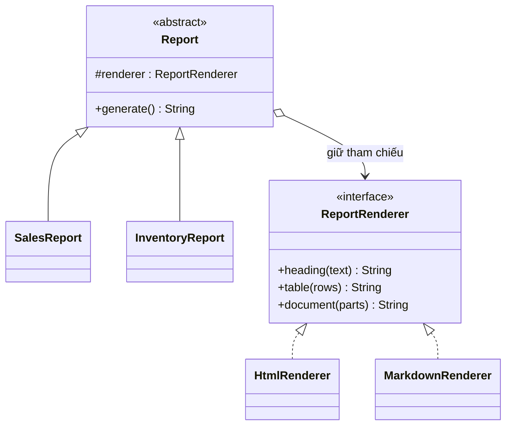
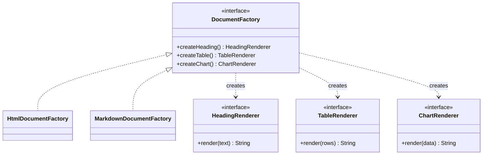
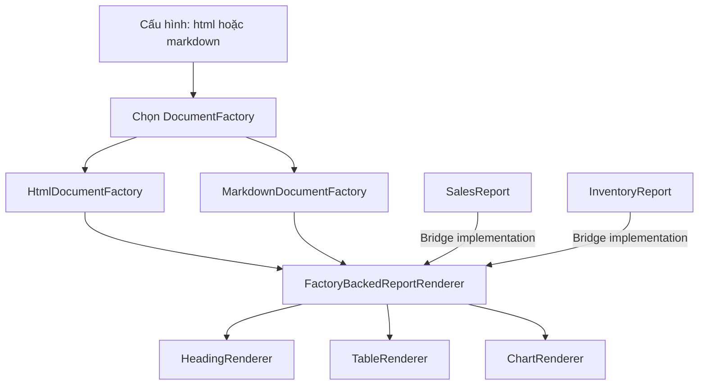

# Abstract Factory và Bridge khi tách các chiều biến thiên của abstraction và implementation

## 1. Vì sao hai mẫu này dễ bị nhầm?

**Abstract Factory** và **Bridge** đều giúp mã khách không phụ thuộc chặt vào các lớp triển khai cụ thể. Cả hai thường xuất hiện khi một hệ thống có nhiều biến thể, dùng interface và chuyển việc lựa chọn thành phần ra khỏi phần nghiệp vụ. Tuy nhiên, **đối tượng được thay đổi và mục tiêu tách biệt của chúng khác nhau**:

- **Abstract Factory** là mẫu **khởi tạo (creational)**. Nó cung cấp một interface để **tạo cả họ sản phẩm liên quan hoặc phụ thuộc nhau**, mà client không phải chỉ rõ lớp cụ thể. Câu hỏi trung tâm: *“Làm sao tạo đúng bộ đối tượng tương thích của biến thể đã chọn?”*
- **Bridge** là mẫu **cấu trúc (structural)**. Nó **tách abstraction khỏi implementation** để hai phía có thể thay đổi tương đối độc lập thông qua quan hệ kết hợp đối tượng (*composition*). Câu hỏi trung tâm: *“Làm sao để nhiều kiểu abstraction cùng sử dụng được nhiều implementation mà không phải tạo một lớp cho từng tổ hợp?”*

Ở đây, từ **abstraction** của Bridge có nghĩa là **vai trò cấp cao và hệ phân cấp chức năng của nó** (ví dụ `Report`, `SalesReport`, `InventoryReport`). **Implementation** là **interface cung cấp cách thực hiện các thao tác mà abstraction cần** (ví dụ `ReportRenderer`, `HtmlRenderer`, `MarkdownRenderer`). Implementation trong Bridge không nhất thiết là thư viện cấp thấp hoặc một class duy nhất; nó có thể là một hệ phân cấp riêng.

Điểm cần ghi nhớ ngay: **Abstract Factory tách việc tạo sản phẩm khỏi nơi sử dụng; Bridge tách hai chiều mở rộng trong cấu trúc đối tượng**. Chúng không loại trừ nhau và có thể cùng được dùng trong một hệ thống.

## 2. Bối cảnh chung: báo cáo có nhiều loại và nhiều định dạng

Xét một ứng dụng xuất báo cáo quản trị với hai chiều biến thiên:

1. **Loại báo cáo (abstraction):** báo cáo bán hàng `SalesReport`, báo cáo tồn kho `InventoryReport`.
2. **Cách trình bày (implementation):** xuất thành HTML hoặc Markdown.

Ngoài ra, mỗi định dạng tài liệu cần một **họ thành phần render** tương thích: tiêu đề, bảng và có thể có biểu đồ.

| Câu hỏi thiết kế | Ví dụ | Ý nghĩa |
| --- | --- | --- |
| Có những nghiệp vụ báo cáo nào? | Bán hàng, tồn kho | Các abstraction cấp cao khác nhau |
| Báo cáo có thể được trình bày bằng cách nào? | HTML, Markdown | Các implementation khác nhau của thao tác render |
| Một định dạng cần những sản phẩm nào? | `HeadingRenderer`, `TableRenderer`, `ChartRenderer` | Các loại sản phẩm thuộc cùng một họ |
| Làm sao một bộ sản phẩm luôn cùng định dạng? | HTML heading + HTML table + HTML chart | Bất biến mà một concrete factory cần đáp ứng |

Nếu không phân biệt các câu hỏi, thiết kế có thể bị ghép cứng:

```text
SalesHtmlReport
SalesMarkdownReport
InventoryHtmlReport
InventoryMarkdownReport
```

Khi bổ sung loại báo cáo `AuditReport` và định dạng PDF, số tổ hợp lớp có nguy cơ tăng theo tích của hai chiều. Với `N` loại báo cáo và `M` định dạng, một thiết kế tạo class riêng cho mọi cặp có thể cần tới **N × M** class dạng kết hợp. Đây là minh họa về độ phức tạp tiềm tàng, không phải công thức bắt buộc cho mọi ứng dụng.

Vấn đề có hai lớp:

- **Bridge** xử lý sự kết hợp giữa **loại báo cáo** và **cách render**.
- **Abstract Factory** xử lý việc khởi tạo **bộ renderer văn bản, bảng, biểu đồ** thuộc cùng một định dạng.

## 3. Bridge: hai hệ phân cấp thay đổi độc lập

Trong thiết kế Bridge:

- Phía **abstraction** là `Report` cùng các lớp mở rộng như `SalesReport` và `InventoryReport`.
- Phía **implementation** là `ReportRenderer` cùng các cách triển khai `HtmlRenderer` và `MarkdownRenderer`.
- `Report` **giữ tham chiếu** đến `ReportRenderer` và ủy quyền các thao tác trình bày cho nó.



Với cách này, ta có thể kết hợp `SalesReport` với `HtmlRenderer`, hoặc chính `SalesReport` đó với `MarkdownRenderer`. Khi thêm `AuditReport`, nó sử dụng interface `ReportRenderer` có sẵn. Khi thêm `PdfRenderer` đáp ứng đầy đủ hợp đồng, các loại báo cáo hiện có có thể dùng nó mà không cần tạo `SalesPdfReport`, `InventoryPdfReport`.

**Giới hạn của Bridge:** nếu ta thêm phương thức mới vào interface `ReportRenderer`, ví dụ `renderMap(...)`, mọi implementation liên quan có thể phải được cập nhật. Bridge giúp tách **hai hệ phân cấp**, không có nghĩa là mọi thay đổi đều không ảnh hưởng các lớp cũ.

### Dấu hiệu ưu tiên Bridge

Một dấu hiệu mạnh là mã có những tổ hợp biểu diễn cùng một chức năng ở nhiều cách triển khai: `LightDesktopDialog`, `DarkDesktopDialog`, `LightMobileDialog`, `DarkMobileDialog` hoặc `SalesHtmlReport`, `SalesPdfReport`, `InventoryHtmlReport`, `InventoryPdfReport`. Khi đó hãy hỏi: **có hai chiều biến thiên tương đối độc lập mà ta đang ghép thành lớp con theo từng cặp không?**

Nếu có, Bridge cho phép mỗi chiều mở rộng trong cấu trúc riêng, kết nối chúng bằng composition.

## 4. Ví dụ Bridge bằng Java 17: loại báo cáo × định dạng

Ví dụ dưới đây có thể chạy độc lập. Hai báo cáo dùng chung hai implementation renderer. Đầu vào gồm nhãn và số lượng; đầu ra là chuỗi HTML hoặc Markdown để dễ quan sát.

Lưu thành `ReportBridgeDemo.java`:

```java
import java.util.List;
import java.util.Locale;
import java.util.Objects;

public final class ReportBridgeDemo {

    private ReportBridgeDemo() {}

    // Dữ liệu không phụ thuộc HTML/Markdown.
    record Metric(String label, int value) {
        Metric {
            if (label == null || label.isBlank()) {
                throw new IllegalArgumentException(
                    "Metric label không được rỗng"
                );
            }
            if (value < 0) {
                throw new IllegalArgumentException(
                    "Metric value không được âm"
                );
            }
        }
    }

    // Implementation side của Bridge.
    interface ReportRenderer {
        String heading(String title);
        String table(List<Metric> metrics);
        String document(String... parts);
    }

    static final class HtmlRenderer implements ReportRenderer {

        private static String escape(String value) {
            return value.replace("&", "&amp;")
                .replace("<", "&lt;")
                .replace(">", "&gt;")
                .replace("\"", "&quot;");
        }

        @Override
        public String heading(String title) {
            return "<h1>" + escape(title) + "</h1>";
        }

        @Override
        public String table(List<Metric> metrics) {
            StringBuilder out = new StringBuilder(
                "<table><thead><tr><th>Nhãn</th>"
                    + "<th>Giá trị</th></tr></thead><tbody>"
            );
            for (Metric metric : metrics) {
                out.append("<tr><td>")
                    .append(escape(metric.label()))
                    .append("</td><td>")
                    .append(metric.value())
                    .append("</td></tr>");
            }
            return out.append("</tbody></table>").toString();
        }

        @Override
        public String document(String... parts) {
            return "<!doctype html>\n"
                + "<html lang=\"vi\"><head>"
                + "<meta charset=\"UTF-8\">"
                + "<title>Báo cáo</title></head><body>\n"
                + String.join("\n", parts)
                + "\n</body></html>";
        }
    }

    static final class MarkdownRenderer implements ReportRenderer {

        // Ví dụ tối giản: escape Markdown thường gặp.
        private static String escape(String value) {
            return value.replace("\\", "\\\\")
                .replace("*", "\\*")
                .replace("_", "\\_")
                .replace("`", "\\`")
                .replace("[", "\\[")
                .replace("]", "\\]")
                .replace("<", "&lt;")
                .replace(">", "&gt;");
        }

        private static String cell(String value) {
            return escape(value)
                .replace("|", "\\|")
                .replace("\r", " ")
                .replace("\n", " ");
        }

        @Override
        public String heading(String title) {
            return "# " + escape(title);
        }

        @Override
        public String table(List<Metric> metrics) {
            StringBuilder out = new StringBuilder(
                "| Nhãn | Giá trị |\n"
                    + "| --- | ---: |\n"
            );
            for (Metric metric : metrics) {
                out.append("| ")
                    .append(cell(metric.label()))
                    .append(" | ")
                    .append(metric.value())
                    .append(" |\n");
            }
            return out.toString();
        }

        @Override
        public String document(String... parts) {
            return String.join("\n\n", parts) + "\n";
        }
    }

    // Abstraction side của Bridge.
    static abstract class Report {
        protected final ReportRenderer renderer;

        Report(ReportRenderer renderer) {
            this.renderer = Objects.requireNonNull(
                renderer, "renderer"
            );
        }

        abstract String generate();
    }

    static final class SalesReport extends Report {

        SalesReport(ReportRenderer renderer) {
            super(renderer);
        }

        @Override
        String generate() {
            List<Metric> sales = List.of(
                new Metric("Tháng 1", 42),
                new Metric("Tháng 2", 55)
            );
            return renderer.document(
                renderer.heading("Báo cáo bán hàng"),
                renderer.table(sales)
            );
        }
    }

    static final class InventoryReport extends Report {

        InventoryReport(ReportRenderer renderer) {
            super(renderer);
        }

        @Override
        String generate() {
            List<Metric> inventory = List.of(
                new Metric("Sản phẩm A", 12),
                new Metric("Sản phẩm B", 7)
            );
            return renderer.document(
                renderer.heading("Báo cáo tồn kho"),
                renderer.table(inventory)
            );
        }
    }

    // Composition root quyết định implementation renderer.
    static ReportRenderer selectRenderer(String rawFormat) {
        if (rawFormat == null || rawFormat.isBlank()) {
            throw new IllegalArgumentException(
                "format phải là html hoặc markdown"
            );
        }
        return switch (rawFormat.strip().toLowerCase(Locale.ROOT)) {
            case "html" -> new HtmlRenderer();
            case "markdown" -> new MarkdownRenderer();
            default -> throw new IllegalArgumentException(
                "Định dạng không hỗ trợ: " + rawFormat
            );
        };
    }

    public static void main(String[] args) {
        if (args.length > 1) {
            throw new IllegalArgumentException(
                "Cú pháp: java ReportBridgeDemo [html|markdown]"
            );
        }
        ReportRenderer renderer = selectRenderer(
            args.length == 0 ? "html" : args[0]
        );

        for (Report report : List.of(
                new SalesReport(renderer),
                new InventoryReport(renderer))) {
            System.out.println(report.generate());
        }
    }
}
```

Biên dịch và chạy:

```bash
javac -encoding UTF-8 ReportBridgeDemo.java
java ReportBridgeDemo markdown
```

Đầu ra dự kiến, rút gọn:

```markdown
# Báo cáo bán hàng

| Nhãn | Giá trị |
| --- | ---: |
| Tháng 1 | 42 |
| Tháng 2 | 55 |

# Báo cáo tồn kho

| Nhãn | Giá trị |
| --- | ---: |
| Sản phẩm A | 12 |
| Sản phẩm B | 7 |
```

Chạy `java ReportBridgeDemo html` sẽ tạo hai tài liệu HTML dưới dạng chuỗi. Trong ví dụ, chúng được in liên tiếp ra terminal để tiện quan sát; sản phẩm thực có thể ghi mỗi báo cáo vào một tệp hoặc trả về hai chuỗi độc lập qua API.

### Điều gì thật sự thay đổi khi thêm một chiều?

| Yêu cầu mới | Nơi sửa/thêm | Những phần thường giữ nguyên |
| --- | --- | --- |
| Thêm `AuditReport` | Tạo lớp mới kế thừa `Report` | `HtmlRenderer`, `MarkdownRenderer` |
| Thêm định dạng PDF | Tạo implementation `PdfRenderer` đáp ứng `ReportRenderer`; cập nhật nơi chọn | `SalesReport`, `InventoryReport` |
| Đổi quy tắc số liệu bán hàng | `SalesReport` và nguồn dữ liệu liên quan | Các renderer |
| Đổi cú pháp bảng Markdown | `MarkdownRenderer` | Các loại báo cáo |

Bảng trên giả định interface `ReportRenderer` vẫn đủ khả năng diễn tả mọi báo cáo. Nếu một định dạng không hỗ trợ chức năng bắt buộc, cần thiết kế lại hợp đồng hoặc quy tắc chuyển đổi rõ ràng, không nên tự trả kết quả sai định dạng.

### Tại sao đây là Bridge?

Vì `SalesReport` và `InventoryReport` là **các abstraction nghiệp vụ**, còn `HtmlRenderer` và `MarkdownRenderer` là **các implementation thực thi thao tác trình bày**. Mỗi đối tượng `Report` giữ tham chiếu đến `ReportRenderer` được truyền vào constructor. Cả hai hệ phân cấp mở rộng độc lập mà không sinh lớp con cho từng cặp.

Đoạn `selectRenderer` chỉ là **cách chọn implementation tại composition root**, không biến mã này thành Abstract Factory. Nó trả về một loại đối tượng là `ReportRenderer`; chưa hề có một họ sản phẩm gồm nhiều loại renderer được tạo ra đồng thời.

## 5. Abstract Factory: tạo một họ sản phẩm cho cùng định dạng

Giờ xem lại một **bài toán khác nằm trong cùng hệ thống**: bộ xuất HTML cần ba thành phần tương thích:

- `HeadingRenderer` để xuất tiêu đề HTML.
- `TableRenderer` để xuất bảng HTML.
- `ChartRenderer` để xuất biểu đồ HTML.

Định dạng Markdown cũng cần ba loại renderer tương ứng. Những thành phần này là **các loại sản phẩm khác nhau** và phải thống nhất định dạng.



Một hợp đồng tối thiểu có dạng:

```java
// Phác thảo Abstract Factory; đặt trong ứng dụng có kiểu Metric.
interface HeadingRenderer {
    String render(String title);
}

interface TableRenderer {
    String render(List<Metric> metrics);
}

interface ChartRenderer {
    String render(List<Metric> metrics);
}

interface DocumentFactory {
    HeadingRenderer createHeading();
    TableRenderer createTable();
    ChartRenderer createChart();
}
```

Một concrete factory có thể triển khai:

```java
// Đoạn minh họa cấu trúc, không phải chương trình độc lập.
final class HtmlDocumentFactory implements DocumentFactory {
    @Override
    public HeadingRenderer createHeading() {
        return new HtmlHeadingRenderer();
    }

    @Override
    public TableRenderer createTable() {
        return new HtmlTableRenderer();
    }

    @Override
    public ChartRenderer createChart() {
        return new HtmlChartRenderer();
    }
}
```

Ở đây, `HtmlHeadingRenderer`, `HtmlTableRenderer` và `HtmlChartRenderer` là **ba concrete product cùng họ**. `MarkdownDocumentFactory` sẽ tạo ba concrete product Markdown tương ứng. Client dùng `DocumentFactory` để lấy trọn bộ.

**Mục tiêu chính của Abstract Factory:** giữ mã sử dụng không cần gọi trực tiếp `new HtmlHeadingRenderer()` và không phải tự quyết định định dạng cho từng sản phẩm. Một factory được chọn đúng sẽ gom quyết định tạo **cả bộ tương thích** về một nơi.

Cần lưu ý rằng **Abstract Factory không tự tạo ra hai hệ phân cấp độc lập kiểu Bridge**. Nó chủ yếu tổ chức cách tạo các sản phẩm. Việc tạo factory cụ thể từ cấu hình bằng một `switch` là một bước khác; interface factory không tự xác định cách triển khai sẽ được chọn.

### Câu hỏi giúp nhận diện Abstract Factory

- Có **nhiều loại sản phẩm khác nhau** cần được tạo cùng nhau không?
- Các sản phẩm có cần tuân theo cùng một biến thể, nền tảng, nhà cung cấp hoặc chủ đề không?
- Client có lặp các câu `new Html...`, `new Markdown...` và dễ trộn hai họ không?
- Khi thêm một **họ mới**, có thể thêm một concrete factory thay vì sửa mọi client không?

Nếu câu trả lời phần lớn là có, Abstract Factory là ứng viên đáng cân nhắc.

## 6. So sánh trực tiếp theo mục tiêu và trục biến thiên

| Tiêu chí | Abstract Factory | Bridge |
| --- | --- | --- |
| Nhóm mẫu | **Creational** — khởi tạo | **Structural** — cấu trúc |
| Vấn đề chính | Chọn và tạo **các sản phẩm liên quan** thuộc một họ | Tránh ghép cứng **abstraction** với một **implementation** |
| Đơn vị thay đổi trọng tâm | **Họ sản phẩm**: HTML/Markdown với heading, table, chart | **Hai hệ phân cấp**: loại báo cáo và cách render |
| Interface trung tâm | `DocumentFactory` với nhiều phương thức `createX()` | `ReportRenderer` được `Report` giữ tham chiếu |
| Client làm gì? | Yêu cầu factory tạo sản phẩm và dùng chúng qua interface | Giữ hoặc nhận implementation rồi ủy quyền thao tác |
| Mở rộng thuận lợi | Thêm **họ sản phẩm** mới khi các loại sản phẩm ổn định | Thêm abstraction mới hoặc implementation mới khi hợp đồng ổn định |
| Thay đổi tốn công | Thêm loại sản phẩm mới có thể phải sửa **mọi concrete factory** | Thêm phương thức vào implementation interface có thể phải sửa **mọi implementation** |
| Có bắt buộc nhiều lớp con abstraction không? | Không | Không bắt buộc nhiều lớp con, nhưng tách hai chiều là mục đích thiết kế |
| Có bắt buộc tạo nhiều sản phẩm khác loại không? | Đó là ý nghĩa đặc trưng của mẫu | Không; implementation có thể là một đối tượng duy nhất |
| Thay đổi runtime | Có thể đổi factory hoặc tạo họ mới tại điểm cấu hình; cần chú ý vòng đời sản phẩm đã tạo | Có thể truyền hoặc thay implementation tùy thiết kế vòng đời của abstraction |
| Rủi ro thường gặp | Factory tạo nhầm sản phẩm khác họ, interface quá rộng | Phân vai abstraction/implementation không rõ, interface implementation phình to |

**Hai mẫu không được phân biệt chỉ bằng việc có interface hay dependency injection.** Cả hai đều có thể dùng interface và constructor injection. Hãy nhìn vào **lý do tồn tại của interface**: nó dùng để *tạo một họ sản phẩm* hay dùng để *ủy quyền một nhánh triển khai từ abstraction*?

## 7. Khi hai mẫu phối hợp trong cùng một hệ thống

Một hệ thống báo cáo có thể dùng cả hai vì hai mẫu giải quyết **hai cấp độ lựa chọn khác nhau**:

1. **Bridge**: `SalesReport` và `InventoryReport` sử dụng một `ReportRenderer` được cấp từ bên ngoài.
2. **Abstract Factory**: implementation `ReportRenderer` sử dụng `DocumentFactory` để tạo `HeadingRenderer`, `TableRenderer` và `ChartRenderer` cùng định dạng.



Một adapter nối hai mẫu có thể có giao diện khái niệm như sau:

```java
// Phác thảo phối hợp, dựa trên các interface đã giới thiệu.
// Chỉ có thể biên dịch sau khi đặt các kiểu vào đúng package/phạm vi.
final class FactoryBackedReportRenderer implements ReportRenderer {
    private final DocumentFactory family;

    FactoryBackedReportRenderer(DocumentFactory family) {
        this.family = java.util.Objects.requireNonNull(family);
    }

    @Override
    public String heading(String title) {
        return family.createHeading().render(title);
    }

    @Override
    public String table(List<Metric> rows) {
        return family.createTable().render(rows);
    }

    @Override
    public String document(String... parts) {
        // Cần chính sách ghép tài liệu theo định dạng thực tế.
        return String.join("\n", parts);
    }
}
```

Đây là **phác thảo thiết kế**, không phải một triển khai xuất tài liệu hoàn chỉnh. Với HTML, cần cấu trúc tài liệu có thể chứa `<html>`/`<body>` và escape đúng ngữ cảnh; với PDF, định dạng nhị phân cần context và cơ chế ghi khác chuỗi. Thực tế có thể bổ sung **DocumentAssembler** làm một abstract product của họ, hoặc tổ chức cả quá trình xuất tài liệu trong implementation renderer. Không nên ghép chuỗi giống nhau cho mọi định dạng khi hợp đồng định dạng khác nhau.

Việc `FactoryBackedReportRenderer` là **adapter hỗ trợ Bridge** không khiến nó trở thành một Abstract Factory: adapter này ủy quyền thao tác cho các renderer. Abstract Factory vẫn là `DocumentFactory`, vì nhiệm vụ của nó là **tạo các thành phần thuộc cùng một họ**.

Nếu implementation quá đơn giản và chỉ cần một renderer có các phương thức `heading`, `table`, `document` như mục 4, thì không nhất thiết phải thêm `DocumentFactory`. Hai mẫu chỉ nên phối hợp khi tính phức tạp của các **loại sản phẩm liên quan** thực sự biện minh cho số lớp bổ sung.

## 8. Phân biệt với thiết kế chỉ có một chiều thay đổi

Không phải ứng dụng nào có hai giá trị cấu hình cũng cần Bridge hoặc Abstract Factory:

| Tình huống | Lựa chọn hợp lý để cân nhắc |
| --- | --- |
| Chỉ đổi màu, font, khoảng cách của một màn hình | Đối tượng `ThemeConfig` hoặc cấu hình dữ liệu có thể đủ |
| Chỉ có một loại đối tượng cần tạo theo tham số | Một factory đơn giản hoặc Factory Method có thể đủ |
| Một thuật toán có thể thay thế, không có hai hệ phân cấp abstraction/implementation | Strategy có thể diễn đạt mục tiêu rõ hơn |
| Nhiều loại abstraction cần dùng nhiều implementation độc lập | Bridge là ứng viên mạnh |
| Mỗi biến thể cần một bộ nhiều sản phẩm có liên quan | Abstract Factory là ứng viên mạnh |
| Có cả hai nhu cầu ở hai cấp cấu trúc khác nhau | Kết hợp Bridge và Abstract Factory khi đáng giá |

Bridge và Strategy có thể cùng **truyền một interface triển khai vào một đối tượng**. Khác biệt nằm ở mục đích thiết kế: Bridge nhấn mạnh **tách hai hệ phân cấp abstraction/implementation để mở rộng độc lập**; Strategy nhấn mạnh **thay đổi thuật toán/hành vi có thể hoán đổi**. Trong một mã nguồn nhỏ, cấu trúc có thể giống nhau đến mức việc gọi tên mẫu tùy vào vấn đề cần giải quyết. Không cần áp đặt một nhãn nếu một interface đơn giản đã đủ rõ.

### Cẩn trọng với “thay đổi độc lập”

Trong Bridge, “độc lập” có nghĩa **thêm biến thể trên một phía thường không buộc sửa phía còn lại khi hợp đồng còn phù hợp**. Nó không bảo đảm mọi cặp tổ hợp đều có ý nghĩa hoặc mọi implementation đều cung cấp năng lực giống nhau. Ví dụ, `AuditReport` cần chữ ký số nhưng `MarkdownRenderer` không hỗ trợ; khi đó cần:

- Xác định chữ ký có phải yêu cầu bắt buộc đối với mọi báo cáo không.
- Mở rộng hợp đồng implementation một cách có chủ đích hoặc tách interface theo khả năng.
- Kiểm tra khả năng trước khi tạo báo cáo và xử lý tổ hợp không hợp lệ rõ ràng.
- Tránh trả `null` hoặc âm thầm bỏ qua nội dung bắt buộc.

Abstract Factory cũng có ràng buộc tương tự: một concrete factory không nên tự trả sản phẩm khác họ để “chữa cháy” khi thiếu một loại sản phẩm.

## 9. Kiểm thử giúp chứng minh hai trách nhiệm khác nhau

Một bộ kiểm thử nên bảo vệ đúng đặc tính mà từng mẫu mang lại:

### Với Bridge

Chạy cùng logic của từng `Report` với nhiều `ReportRenderer`:

- `SalesReport` xuất được cả HTML và Markdown.
- `InventoryReport` xuất được cả HTML và Markdown.
- Giá trị dữ liệu không thay đổi khi đổi renderer.
- Đổi `HtmlRenderer` sang `MarkdownRenderer` không cần sửa mã nghiệp vụ của hai lớp báo cáo.

Một ví dụ JUnit Jupiter 5 cho chương trình `ReportBridgeDemo`:

```java
import static org.junit.jupiter.api.Assertions.*;

import java.util.stream.Stream;
import org.junit.jupiter.params.ParameterizedTest;
import org.junit.jupiter.params.provider.MethodSource;

class ReportBridgeDemoTest {
    static Stream<ReportBridgeDemo.ReportRenderer> renderers() {
        return Stream.of(
            new ReportBridgeDemo.HtmlRenderer(),
            new ReportBridgeDemo.MarkdownRenderer()
        );
    }

    @ParameterizedTest
    @MethodSource("renderers")
    void reportsKeepBusinessNumbers(
            ReportBridgeDemo.ReportRenderer renderer) {
        String sales = new ReportBridgeDemo.SalesReport(renderer).generate();
        String inventory =
            new ReportBridgeDemo.InventoryReport(renderer).generate();

        assertTrue(sales.contains("42"));
        assertTrue(sales.contains("55"));
        assertTrue(inventory.contains("12"));
        assertTrue(inventory.contains("7"));
    }
}
```

Đây là test minh họa: trong ứng dụng thực cần kiểm tra thêm cú pháp và dữ liệu định dạng bằng parser hoặc phép so sánh có cấu trúc, thay vì chỉ tìm chuỗi số. Với nhiều dữ liệu phức tạp, nên kiểm tra cả nhãn, số lượng hàng và hành vi lỗi.

### Với Abstract Factory

Tạo hợp đồng kiểm thử chạy trên mọi concrete factory:

- `createHeading()`, `createTable()`, `createChart()` trả sản phẩm khác `null` và có khả năng render theo hợp đồng.
- Các sản phẩm do cùng một factory tạo ra có **cùng định dạng**, không trộn HTML với Markdown.
- Thêm một factory PDF khiến toàn bộ contract test chạy lại trên họ PDF.
- Nếu một định dạng không hỗ trợ sản phẩm bắt buộc, lỗi được công bố và kiểm thử rõ ràng; không tạo sản phẩm giả hoặc trả `null` ngoài hợp đồng.

Khi một `DocumentFactory` có sản phẩm mang trạng thái, test nên tạo mới factory và các sản phẩm ở mỗi lượt để không chia sẻ trạng thái ngoài ý muốn.

## 10. Quy trình chọn mẫu khi thiết kế một tính năng mới

Có thể dùng quy trình sau khi phân tích yêu cầu:

1. **Liệt kê những gì có thể thay đổi.** Trong hệ thống báo cáo: loại báo cáo, định dạng tài liệu, các loại thành phần render.
2. **Nhóm các thay đổi liên quan.** Loại báo cáo là một chiều nghiệp vụ; định dạng là một chiều trình bày. Heading/table/chart là các loại sản phẩm cần nhất quán trong một định dạng.
3. **Kiểm tra số lượng hệ phân cấp.** Nếu mỗi loại báo cáo phải có một class riêng cho mỗi định dạng, cân nhắc Bridge để kết hợp hai hệ phân cấp thay vì tạo class tổ hợp.
4. **Kiểm tra nhu cầu tạo họ sản phẩm.** Nếu HTML và Markdown đều yêu cầu nhiều renderer riêng và client phải tạo đúng bộ, cân nhắc Abstract Factory.
5. **Xác định hợp đồng ổn định.** Bridge cần interface implementation đủ cho các abstraction; Abstract Factory cần interface tạo đủ các loại sản phẩm yêu cầu.
6. **Đặt quyết định cấu hình ở ranh giới khởi tạo.** Chọn renderer hoặc concrete factory một lần cho một phiên sử dụng phù hợp; inject dependency vào client.
7. **Thử hai thay đổi giả định.** Thêm loại báo cáo mới, rồi thêm định dạng mới. Ghi lại lớp nào phải sửa. Nếu thay đổi lan qua nhiều client, xem lại ranh giới abstraction.
8. **Thử một trường hợp không tương thích.** Ví dụ Markdown không hỗ trợ biểu đồ bắt buộc. Thiết kế phải nêu cách báo lỗi hoặc cách biểu diễn thay thế được chấp nhận.
9. **Viết kiểm thử hành vi và cấu trúc quan sát được.** Chạy các báo cáo với nhiều renderer; kiểm tra các factory tạo bộ sản phẩm nhất quán.

## 11. Bài tập phân tích thiết kế

Một ứng dụng quản trị cần hiển thị:

- Hai loại màn hình: `Dashboard` và `Settings`.
- Hai nền tảng: `Desktop` và `Mobile`.
- Trên mỗi nền tảng có một bộ widget liên quan: `Button`, `Checkbox` và `Dialog`.

Hiện tại dự án có các lớp `DesktopDashboard`, `MobileDashboard`, `DesktopSettings`, `MobileSettings`; trong mỗi lớp lại dùng các câu `new DesktopButton()` hoặc `new MobileCheckbox()`.

Hãy trả lời:

1. Có mấy **chiều biến thiên**? Chiều nào tương ứng với **abstraction/implementation** theo Bridge?
2. Vẽ sơ đồ Bridge gồm `Screen`, `Dashboard`, `Settings`, `PlatformRenderer`, `DesktopRenderer` và `MobileRenderer`.
3. Đề xuất một Abstract Factory tạo trọn bộ `Button`, `Checkbox`, `Dialog` cho mỗi nền tảng.
4. Tại điểm khởi tạo ứng dụng, nên quyết định nền tảng ở đâu để tránh mỗi màn hình tự đọc cấu hình?
5. Nếu thêm `TabletRenderer` nhưng không thay đổi các loại màn hình, thành phần nào phải thêm/sửa? Nếu thêm `SearchScreen` nhưng giữ nguyên nền tảng, điều gì thay đổi?
6. Nếu `MobileWidgetFactory` thiếu `Dialog` bắt buộc, nên giải quyết hợp đồng như thế nào để không trộn một `DesktopDialog` vào họ Mobile?
7. Giải thích khi nào **chỉ cần Bridge**, khi nào **chỉ cần Abstract Factory**, và khi nào kết hợp cả hai để giải quyết đúng yêu cầu.

**Gợi ý:** hãy tách *màn hình muốn làm gì* khỏi *nền tảng sẽ thực hiện thao tác đó như thế nào* để nhận diện Bridge; sau đó tách *các widget thuộc cùng nền tảng được tạo ra như thế nào* để nhận diện Abstract Factory. Hai câu hỏi này giải quyết các trách nhiệm khác nhau.

---

**Ghi nhớ:** **Bridge** tách các chiều **abstraction và implementation** để mỗi phía phát triển độc lập qua composition. **Abstract Factory** tập trung việc **tạo các họ sản phẩm tương thích** mà client không biết lớp cụ thể. Chọn mẫu theo trục thay đổi thực tế; khi một hệ thống có cả hai nhu cầu, hai mẫu có thể phối hợp mà vẫn giữ trách nhiệm riêng.
