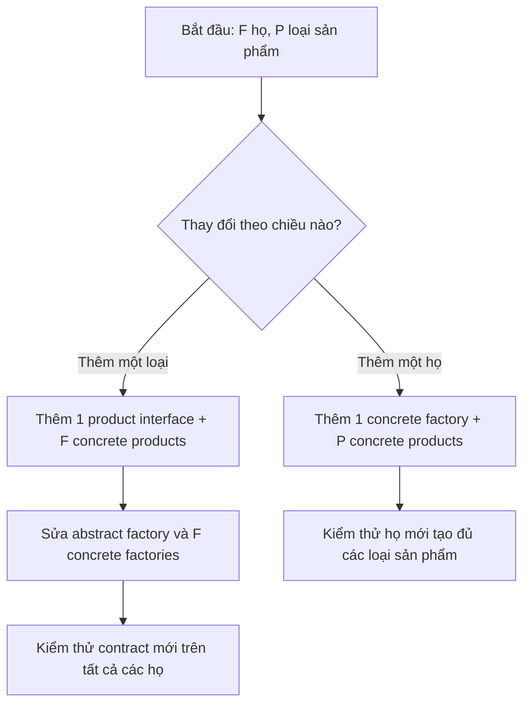

# Ước lượng số interface, lớp và factory tăng theo ma trận sản phẩm

## Mục tiêu

Trong **Abstract Factory** (mẫu thiết kế khởi tạo), mỗi *concrete factory* thường cung cấp một **họ sản phẩm tương thích**; các phương thức của factory trả về *abstract product* thay vì phụ thuộc vào lớp cụ thể. Cách tổ chức này giúp thay cả họ sản phẩm bằng cách đổi factory, nhưng cũng tạo ra chi phí về số kiểu dữ liệu, số lớp triển khai và công bảo trì.

Bài học thuộc chương **Chi phí và đánh đổi**, tập trung vào việc **ước lượng độ lớn cấu trúc Abstract Factory từ ma trận sản phẩm**. Sau bài này, bạn có thể:

- Phân biệt **loại sản phẩm** (*product type*) và **họ sản phẩm** (*product family*).
- Lập ma trận loại sản phẩm × họ sản phẩm để đếm số product interface, concrete product và concrete factory.
- Tính phần tăng thêm khi thêm một loại sản phẩm hoặc một họ mới, từ đó dự đoán chi phí thay đổi.
- Biết giới hạn của công thức và nhận diện khi có thể tái sử dụng implementation để giảm số lớp.

## 1. Ma trận sản phẩm: hai chiều phải đếm riêng

Giả sử thư viện giao diện hỗ trợ **ba họ**: Light, Dark, High Contrast. Mỗi họ phải có **bốn loại sản phẩm**: Button, Checkbox, TextField và Dialog.

| Loại sản phẩm ↓ / Họ → | Light | Dark | High Contrast |
|---|---|---|---|
| Button | `LightButton` | `DarkButton` | `HighContrastButton` |
| Checkbox | `LightCheckbox` | `DarkCheckbox` | `HighContrastCheckbox` |
| TextField | `LightTextField` | `DarkTextField` | `HighContrastTextField` |
| Dialog | `LightDialog` | `DarkDialog` | `HighContrastDialog` |

Trong ma trận:

- Một **cột** đại diện cho một **họ sản phẩm**. Ví dụ `DarkUiFactory` tạo bốn sản phẩm Dark.
- Một **hàng** đại diện cho một **loại sản phẩm** mà client cần sử dụng qua interface. Ví dụ `Button` có ba implementation tương ứng ba họ.
- Một **ô** thường đại diện cho một **concrete product**; ví dụ ô (Dialog, Dark) là `DarkDialog`.

Gọi:

- \(F\) = số **họ sản phẩm** (*families*), tương đương số concrete factory trong cách triển khai chuẩn.
- \(P\) = số **loại sản phẩm** (*product types*) mà abstract factory hỗ trợ.
- \(N\) = số **ô có implementation riêng** trong ma trận.

Với ma trận **đầy đủ**, mọi họ đều hỗ trợ mọi loại sản phẩm, nên:

\[
N = F \times P
\]

Ví dụ trên có \(F=3\), \(P=4\) và \(N=3\times4=12\) concrete product.

### Giả định đằng sau phép đếm

Công thức chuẩn dưới đây giả định:

1. Có **một abstract factory interface** cho toàn bộ họ sản phẩm.
2. Mỗi loại sản phẩm có **một product interface** riêng.
3. Mỗi họ được triển khai bằng **một concrete factory class**.
4. Mỗi ô ma trận có **một concrete product class** riêng.
5. Chỉ đếm các kiểu tham gia trực tiếp vào pattern; **chưa** đếm client, dependency injection configuration, helper, adapter, lớp cơ sở, enum, test, tài nguyên tĩnh hoặc mã generated.

Đây là **mô hình ước lượng cấu trúc chuẩn**, không phải quy tắc bắt buộc của Java hay giới hạn trên tuyệt đối: một concrete factory có thể dùng lại một product class ở nhiều họ, hoặc một sản phẩm có thể cần nhiều lớp nội bộ.

## 2. Công thức đếm interface, lớp và factory

Với ma trận đầy đủ và các giả định trên:

| Hạng mục | Công thức | Vì sao? |
|---|---:|---|
| Abstract factory interface | \(1\) | Một contract chung, ví dụ `UiFactory` |
| Product interfaces | \(P\) | Một contract cho mỗi loại sản phẩm |
| **Tổng interface** | **\(I=P+1\)** | \(P\) product interface + một factory interface |
| Concrete factories | \(F\) | Một factory triển khai mỗi họ |
| Concrete products | \(F\times P\) | Một lớp triển khai cho mỗi ô của ma trận |
| **Tổng concrete classes** | **\(C=F+FP=F(P+1)\)** | Factory classes + product classes |
| **Tổng kiểu tham gia pattern** | **\(T=I+C=(F+1)(P+1)\)** | Tổng interface và concrete class |

Lưu ý: “**số factory**” dễ gây nhầm. Bảng này có **1 abstract factory interface** và **\(F\) concrete factory classes**. Nếu đếm mọi *kiểu* factory, sẽ là \(F+1\); **đừng cộng thêm 1 lần nữa** khi tính tổng \(T\).

### Tính cụ thể với 3 họ × 4 loại

\[
\begin{aligned}
I &= P+1 = 4+1 = 5\\
C_{\text{factory}} &= F = 3\\
C_{\text{product}} &= F\times P = 3\times 4 = 12\\
T &= 5+3+12 = 20
\end{aligned}
\]

Vậy cách triển khai tiêu chuẩn cần **5 interface**, **3 concrete factory** và **12 concrete product class**, tức **20 kiểu** liên quan trực tiếp tới pattern.

Bốn product interface là `Button`, `Checkbox`, `TextField`, `Dialog`. Interface thứ năm là `UiFactory`. Ba concrete factory lần lượt là `LightUiFactory`, `DarkUiFactory` và `HighContrastUiFactory`.

### Bảng so sánh quy mô

| Số họ \(F\) | Số loại \(P\) | Product interface | Abstract factory interface | Concrete factory | Concrete product | Tổng kiểu \(T\) |
|---:|---:|---:|---:|---:|---:|---:|
| 2 | 2 | 2 | 1 | 2 | 4 | **9** |
| 3 | 4 | 4 | 1 | 3 | 12 | **20** |
| 4 | 6 | 6 | 1 | 4 | 24 | **35** |
| 5 | 8 | 8 | 1 | 5 | 40 | **54** |
| 10 | 10 | 10 | 1 | 10 | 100 | **121** |

Ở quy mô lớn, thành phần tăng mạnh nhất là số concrete product \(FP\). Do vậy độ tăng cấu trúc thường được mô tả là **\(O(FP)\)** đối với hai chiều thay đổi đồng thời. Đây là **tích hai chiều**, không phải tăng theo cấp số nhân \(2^F\) hay \(2^P\).

Nếu giữ cố định \(P\) và chỉ tăng số họ, số kiểu tăng **tuyến tính theo \(F\)**. Tương tự, khi giữ cố định \(F\), số kiểu tăng tuyến tính theo \(P\).

## 3. Minh họa bằng một Abstract Factory nhỏ trong Java

Xét ma trận **2 họ × 2 loại**:

| Loại sản phẩm | Light | Dark |
|---|---|---|
| Button | `LightButton` | `DarkButton` |
| Checkbox | `LightCheckbox` | `DarkCheckbox` |

Theo công thức, ta cần **3 interface** (`Button`, `Checkbox`, `UiFactory`), **2 concrete factory** và **4 concrete product**, tổng cộng **9 kiểu của pattern**.

Đoạn Java 17+ sau minh họa đúng cấu trúc đó (có thêm lớp `Demo` là mã client và **không** tính vào 9 kiểu):

```java
// Abstract products: 2 interfaces
interface Button {
    String render();
}

interface Checkbox {
    String render();
}

// Abstract factory: 1 interface
interface UiFactory {
    Button createButton(String label);
    Checkbox createCheckbox(boolean checked);
}

// 4 concrete products = 2 họ × 2 loại
record LightButton(String label) implements Button {
    @Override
    public String render() {
        return "Light button: " + label;
    }
}

record DarkButton(String label) implements Button {
    @Override
    public String render() {
        return "Dark button: " + label;
    }
}

record LightCheckbox(boolean checked) implements Checkbox {
    @Override
    public String render() {
        return "Light checkbox: " + checked;
    }
}

record DarkCheckbox(boolean checked) implements Checkbox {
    @Override
    public String render() {
        return "Dark checkbox: " + checked;
    }
}

// 2 concrete factories = 2 họ
final class LightUiFactory implements UiFactory {
    @Override
    public Button createButton(String label) {
        return new LightButton(label);
    }

    @Override
    public Checkbox createCheckbox(boolean checked) {
        return new LightCheckbox(checked);
    }
}

final class DarkUiFactory implements UiFactory {
    @Override
    public Button createButton(String label) {
        return new DarkButton(label);
    }

    @Override
    public Checkbox createCheckbox(boolean checked) {
        return new DarkCheckbox(checked);
    }
}

// Client, không tính trong số kiểu của pattern.
public class Demo {
    static void draw(UiFactory factory) {
        System.out.println(factory.createButton("Save").render());
        System.out.println(factory.createCheckbox(true).render());
    }

    public static void main(String[] args) {
        draw(new LightUiFactory());
        draw(new DarkUiFactory());
    }
}
```

Kết quả:

```text
Light button: Save
Light checkbox: true
Dark button: Save
Dark checkbox: true
```

Các phương thức của `UiFactory` trả về product interface (`Button`, `Checkbox`), vì vậy client sử dụng chung phương thức `draw` cho hai họ. Mỗi concrete factory chịu trách nhiệm tạo **đủ hai loại sản phẩm của đúng họ**.

**Điểm đánh đổi:** để client không phụ thuộc vào Light/Dark, ta định nghĩa nhiều kiểu hơn so với việc viết thẳng `new LightButton(...)`. Chi phí này có ý nghĩa khi hệ thống thực sự cần thay đổi **cả họ sản phẩm** và duy trì sự tương thích giữa chúng.

## 4. Khi thêm họ sản phẩm và khi thêm loại sản phẩm

Hai hướng mở rộng tạo ra **chi phí khác nhau**. Dùng công thức:

\[
T(F,P)=(F+1)(P+1)
\]

### Trường hợp A — Thêm một họ mới

Giữ nguyên \(P\), tăng từ \(F\) lên \(F+1\):

\[
\begin{aligned}
\Delta T_{\text{thêm họ}}
&=T(F+1,P)-T(F,P)\\
&=(F+2)(P+1)-(F+1)(P+1)\\
&=\boxed{P+1}
\end{aligned}
\]

Phần việc trực tiếp trong mô hình chuẩn:

- **Thêm 1 concrete factory** để tạo họ mới.
- **Thêm \(P\) concrete product class**: một implementation cho mỗi loại sản phẩm hiện có.
- **Không cần sửa abstract factory interface** hay các product interface nếu mọi contract vẫn phù hợp.

Ví dụ từ **3 họ × 4 loại**, thêm họ Solarized cần **1 SolarizedUiFactory + 4 concrete products**, tăng từ 20 lên **25 kiểu**. Client phụ thuộc `UiFactory` thường không cần đổi logic sử dụng; phần composition root cần biết cách chọn họ mới.

### Trường hợp B — Thêm một loại sản phẩm mới

Giữ nguyên \(F\), tăng từ \(P\) lên \(P+1\):

\[
\begin{aligned}
\Delta T_{\text{thêm loại}}
&=T(F,P+1)-T(F,P)\\
&=(F+1)(P+2)-(F+1)(P+1)\\
&=\boxed{F+1}
\end{aligned}
\]

Phần việc trực tiếp:

- **Thêm 1 product interface** cho loại mới.
- **Thêm \(F\) concrete product class**, một lớp cho mỗi họ.
- **Thêm một phương thức tạo sản phẩm vào abstract factory interface**, rồi cập nhật **tất cả \(F\) concrete factory** để triển khai phương thức đó.

Ví dụ từ **3 họ × 4 loại**, thêm `Slider` đòi hỏi `Slider` interface, `LightSlider`, `DarkSlider`, `HighContrastSlider`, cùng `createSlider()` ở `UiFactory` và cả ba concrete factory. Số **kiểu** tăng từ 20 lên **24**, nhưng số **file/lớp phải sửa** có thể lớn hơn con số \(F+1=4\), vì các factory hiện hữu đều cần được cập nhật.

> **Phân biệt số kiểu được thêm với số nơi cần chỉnh sửa:** \(\Delta T\) chỉ đếm kiểu **mới**. Nó không đo mọi sửa đổi method, test, cấu hình dependency injection, tài liệu API, ví dụ code hay release tương thích.

### Thêm đồng thời nhiều họ và nhiều loại

Nếu thêm \(a\) họ và \(b\) loại sản phẩm:

\[
\begin{aligned}
\Delta T
&=T(F+a,P+b)-T(F,P)\\
&=\boxed{a(P+1)+b(F+1)+ab}
\end{aligned}
\]

Hạng tử \(ab\) là các **ô giao nhau mới** giữa họ mới và loại sản phẩm mới; không được bỏ sót khi lập kế hoạch.

Ví dụ \(F=3\), \(P=4\), thêm 2 họ và 1 loại:

\[
\Delta T=2(4+1)+1(3+1)+2(1)=16
\]

Tổng mới là \(20+16=36\), đúng với \(T(5,5)=6\times6=36\).

## 5. Chi phí thiết kế thực tế lớn hơn số lượng lớp

Số lớp là **tín hiệu** về độ phức tạp, nhưng không phải thước đo trực tiếp số giờ phát triển. Hai lớp có thể khác nhau rất nhiều về độ khó, mã nguồn và tích hợp.

| Loại chi phí | Liên hệ với ma trận | Điều cần ước lượng thêm |
|---|---|---|
| Khởi tạo cấu trúc | Thường có \(P+1\) interface, \(F\) factory, \(FP\) concrete product | Công thiết kế contract, đặt tên, tổ chức package |
| Triển khai sản phẩm | Có tối đa một implementation riêng cho mỗi ô theo mô hình chuẩn | Độ phức tạp hành vi, xử lý trạng thái, phụ thuộc SDK |
| Mở rộng thêm họ | Thường tăng \(P+1\) kiểu | Tạo đủ sản phẩm, kiểm tra họ sản phẩm nhất quán |
| Mở rộng thêm loại | Thường tăng \(F+1\) kiểu mới | Sửa interface factory và **mọi concrete factory**, tương thích API |
| Kiểm thử contract | Cần kiểm tra các loại sản phẩm ở từng họ | Số ca cơ bản tối thiểu tăng theo \(FP\); kiểm thử tương tác có thể nhiều hơn |
| Bảo trì dài hạn | Càng nhiều ô, càng nhiều nơi có thể phát sinh lỗi | Sửa lỗi đa biến thể, review, tài liệu, quy ước sử dụng |

Để ước lượng công việc sát thực tế, có thể chia thành:

\[
E_{\text{ước lượng}}
\approx E_{\text{thiết kế interface}}
+ E_{\text{triển khai các ô}}
+ E_{\text{triển khai factory}}
+ E_{\text{kiểm thử}}
+ E_{\text{tích hợp}}
\]

Đây là **khung phân rã công việc**, không phải công thức thời gian cố định. Trong dự án thực, công triển khai từng ô có thể rất khác nhau; một button màu khác chỉ cần vài cấu hình, trong khi một dialog phụ thuộc bộ thư viện UI khác có thể tốn nhiều công tích hợp.

### Kiểm thử tăng như thế nào?

Với ma trận đầy đủ, ít nhất nên có những ca kiểm tra rằng **mỗi concrete factory cung cấp đúng product interface và đúng họ sản phẩm** cho từng loại. Số lượt xác minh tối thiểu theo ô là \(F\times P\). Nếu còn cần kiểm thử tương tác giữa các sản phẩm trong một họ (ví dụ Dialog chứa Button và Checkbox), số tình huống có thể tăng nhanh hơn và phụ thuộc vào quan hệ thực tế giữa chúng.

Kiểm thử client với `UiFactory` giả (*fake*) có thể giảm công lặp lại cho logic client; nó **không thay thế** kiểm thử tính tương thích của từng họ trong concrete factory.

## 6. Trường hợp ma trận không đầy đủ hoặc tái sử dụng implementation

Công thức \(FP\) giả định **mỗi ô được triển khai bởi một lớp riêng**. Có ít nhất ba tình huống làm kết quả khác đi.

### A. Hai họ dùng chung cùng một implementation

Nếu `LightCheckbox` và `HighContrastCheckbox` thật sự có cùng hành vi và không mang trạng thái/theme riêng, hai concrete factory có thể trả về **cùng một lớp** `BasicCheckbox` triển khai `Checkbox`.

Khi đó, dù ma trận logic vẫn có đủ \(FP\) **ô chức năng**, số **concrete product class khác nhau** có thể **nhỏ hơn \(FP\)**. Nếu \(U\) là số lớp product implementation phân biệt, phép đếm chính xác hơn là:

\[
T_{\text{thực tế}}=(P+1)+F+U
\]

với giả định vẫn có một abstract factory interface và \(F\) concrete factory class.

**Cẩn thận:** chia sẻ implementation chỉ hợp lý khi nó thực sự đáp ứng contract của từng họ. Không nên dùng lại một lớp có nhãn Light cố định cho họ Dark chỉ để giảm đếm lớp.

### B. Ma trận khuyết sản phẩm

Ví dụ một họ Console không có `Dialog`. Khi ấy ma trận không còn \(F\times P\) ô được hỗ trợ. Nếu \(K\) là số ô được hiện thực và mỗi ô tương ứng một lớp, số product class là \(K\), nên:

\[
T=(P+1)+F+K
\]

Nhưng cần giải quyết **vấn đề contract**: nếu `UiFactory` vẫn bắt mọi concrete factory cung cấp `createDialog()`, nhà phát triển không nên lặng lẽ trả `null` hay ném `UnsupportedOperationException` để che một ô không tồn tại mà client tưởng được hỗ trợ.

Những lựa chọn thiết kế cần cân nhắc:

- Chia factory interface thành các **nhóm khả năng** có ý nghĩa, để client chỉ yêu cầu những sản phẩm mà họ đó cam kết cung cấp.
- Tách họ Console ra một abstraction khác nếu sản phẩm của nó không thuộc cùng bộ hợp đồng.
- Chỉ dùng kết quả thể hiện tính tùy chọn khi **tính tùy chọn được thiết kế rõ** và mọi client biết xử lý.

Ma trận thiếu ô có thể là dấu hiệu các họ được gom chung chưa thật sự đồng nhất.

### C. Dùng chung phần dựng sản phẩm

Thay vì tạo một lớp độc lập dài hàng trăm dòng cho từng ô, có thể tái sử dụng **design token, thành phần cấu hình, delegate, strategy hoặc composition**. Ví dụ `ThemedButton` nhận một `ThemeTokens` bất biến, còn concrete factory truyền cấu hình Light/Dark.

Điều này giảm lặp mã nguồn, thậm chí giảm số lớp concrete product, nhưng mở ra đánh đổi mới: tăng phụ thuộc vào cấu hình và nguy cơ kết hợp nhầm token giữa các họ. Cần quyết định dựa trên **mức độ thay đổi hành vi thực tế**, không chỉ nhằm làm số lớp nhỏ hơn.

## 7. Đọc ma trận để ra quyết định kiến trúc

Một số dấu hiệu cho thấy Abstract Factory đem lại lợi ích đáng kể:

- Có **nhiều họ** sản phẩm và client cần thay **trọn bộ** mà không sửa logic sử dụng.
- Các sản phẩm trong một họ có **ràng buộc tương thích** rõ (giao diện cùng theme, connector cùng nhà cung cấp, driver cùng nền tảng).
- Các loại sản phẩm tương đối **ổn định**, trong khi **họ mới** thường được thêm vào: thêm họ thường không buộc sửa factory interface.

Ngược lại, hãy cân nhắc giải pháp đơn giản hơn nếu:

- Chỉ có một họ, ít loại sản phẩm và không có nhu cầu thay họ.
- Sản phẩm hầu như chỉ khác dữ liệu cấu hình, không khác hành vi; một implementation tham số hóa có thể dễ bảo trì hơn.
- Hệ thống liên tục thêm **loại sản phẩm mới** trong khi có rất nhiều concrete factory: mỗi lần bổ sung đều chạm đến mọi factory.
- Có quá nhiều ô không hợp lệ hoặc không được hỗ trợ: có thể đang ép các nhóm sản phẩm khác bản chất vào cùng một contract.

**Không có ngưỡng cố định** như “trên 20 lớp thì không nên dùng Abstract Factory”. Cần so sánh chi phí tạo cấu trúc với lợi ích thay thế họ sản phẩm, mức cô lập phụ thuộc và chi phí kiểm thử.

### Minh họa hướng thay đổi



Về mặt tổng số **kiểu mới**, thêm họ tốn \(P+1\), thêm loại tốn \(F+1\). Nhưng về **mức ảnh hưởng API**, thêm loại thường khó hơn vì phải sửa contract chung mà mọi concrete factory triển khai; thêm họ chủ yếu là bổ sung implementation nếu interface đang ổn định.

## 8. Ví dụ ước lượng cho một dự án thực tế

Giả sử ứng dụng báo cáo hỗ trợ ba nhà cung cấp xuất dữ liệu: PDF, HTML và Excel. Mỗi nhà cung cấp/họ phải cung cấp ba loại thành phần tương thích: `ReportWriter`, `ChartRenderer` và `TableRenderer`.

Dùng ma trận đầy đủ:

- \(F=3\) họ.
- \(P=3\) loại.
- \(I=4\) interface: một `ExportFactory` và ba product interface.
- \(C_{\text{factory}}=3\) concrete factory.
- \(C_{\text{product}}=9\) concrete product.
- Tổng \(T=4+3+9=\mathbf{16}\) kiểu.

Nếu thêm một loại `FooterRenderer`: tổng mới \(T(3,4)=4\times5=20\), tăng **4 kiểu mới**, đồng thời phải sửa `ExportFactory` và cả ba concrete factory.

Nếu thêm một họ Markdown thay vào đó: tổng mới \(T(4,3)=5\times4=20\), cũng tăng **4 kiểu**, nhưng thường không cần sửa contract của các factory hiện có.

**Điểm cần xác minh trước khi áp dụng:** trong ví dụ này “PDF/HTML/Excel” có thực sự là **họ sản phẩm tương thích** không? Nếu mỗi định dạng chỉ cần **một writer duy nhất** và không có nhiều loại sản phẩm phối hợp, một factory đơn giản hoặc một strategy theo định dạng có thể phù hợp hơn. Abstract Factory chỉ đáng dùng khi tổ chức **một họ gồm nhiều sản phẩm liên quan** tạo ra giá trị thiết kế thật.

## 9. Bài tập tự tính và checklist

### Bài tập 1 — Đếm số kiểu

Một hệ thống có **4 họ sản phẩm** và **6 loại sản phẩm**. Giả sử đầy đủ và mỗi ô có một class riêng. Hỏi có bao nhiêu interface, concrete factory, concrete product và tổng kiểu?

<details>
<summary>Đáp án và cách tính</summary>

- \(I=P+1=6+1=7\) interface.
- \(C_{\text{factory}}=F=4\).
- \(C_{\text{product}}=F P=4\times6=24\).
- \(T=7+4+24=\mathbf{35}\) kiểu.

</details>

### Bài tập 2 — Dự báo thay đổi

Từ hệ thống 4 họ × 6 loại ở trên, cần thêm **2 họ** và **1 loại**. Hỏi có bao nhiêu kiểu mới?

<details>
<summary>Đáp án và cách tính</summary>

Áp dụng \(a=2\), \(b=1\):

\[
\Delta T=2(6+1)+1(4+1)+2\times1=14+5+2=\mathbf{21}
\]

Tổng mới: \(35+21=\mathbf{56}\) kiểu, tương đương \(T(6,7)=7\times8=56\).

</details>

### Checklist khi ước lượng

1. **Xác định \(F\):** có bao nhiêu họ sản phẩm thực sự cần thay đồng bộ?
2. **Xác định \(P\):** có bao nhiêu loại sản phẩm được client yêu cầu qua product interface?
3. **Vẽ ma trận:** ô nào cần implementation riêng, ô nào dùng chung, ô nào không hợp lệ?
4. **Chọn mô hình đếm:** dùng \(FP\) cho ma trận đầy đủ có lớp riêng từng ô; dùng số lớp product phân biệt \(U\) nếu tái sử dụng.
5. **Tách thêm mới và chỉnh sửa:** khi thêm loại, tính cả công thay đổi factory interface và mọi concrete factory hiện hữu.
6. **Ước lượng công kiểm thử/tích hợp:** đặc biệt kiểm tra tính tương thích giữa các sản phẩm của cùng một họ.
7. **Đánh giá lợi ích:** cấu trúc này có giúp client đổi cả họ sản phẩm một cách rõ ràng, ổn định hay không?

**Ghi nhớ:** với \(F\) họ, \(P\) loại sản phẩm, một abstract factory interface và một concrete class cho mỗi ô, mô hình chuẩn có **\(P+1\) interface**, **\(F\) concrete factory**, **\(FP\) concrete product**; tổng **\((F+1)(P+1)\) kiểu**. Phần tăng **\(P+1\)** khi thêm họ và **\(F+1\)** khi thêm loại là cơ sở để dự báo chi phí, còn quyết định thiết kế cuối cùng phải xét cả sự ổn định của interface, mức trùng lặp triển khai và nhu cầu nhất quán của các họ sản phẩm.

