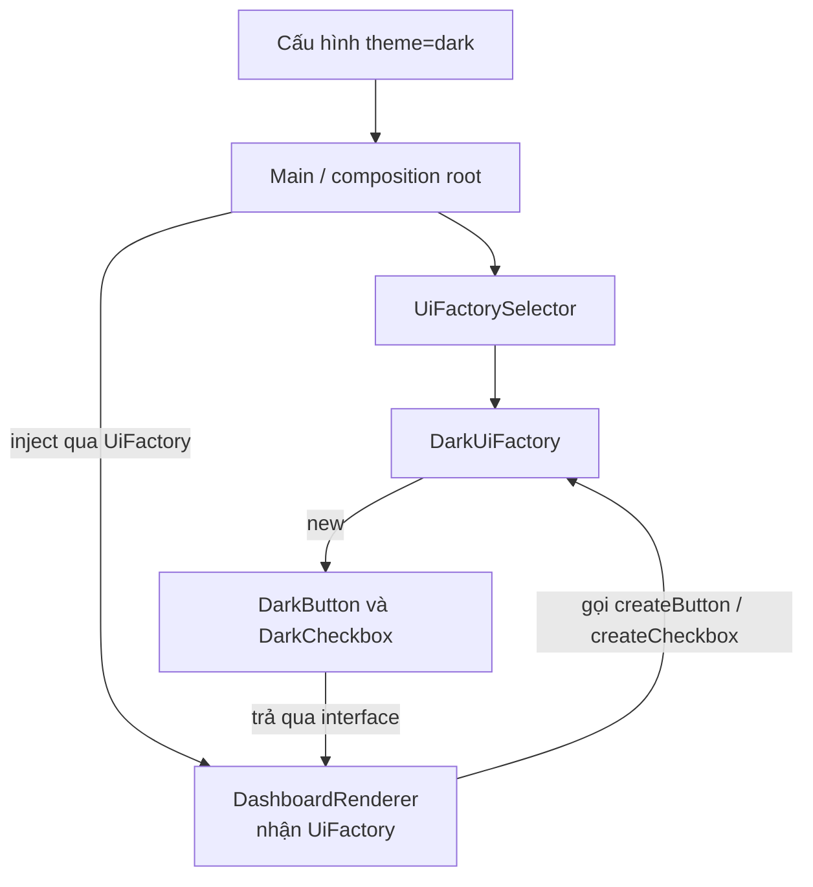

# Phân tích độ phức tạp do thêm lớp gián tiếp và chi phí đọc hiểu luồng khởi tạo

**Abstract Factory** là một mẫu thiết kế khởi tạo (creational design pattern) giúp ứng dụng tạo các **họ sản phẩm liên quan** mà client không cần phụ thuộc vào lớp triển khai cụ thể. Đổi lại, một thao tác tưởng như đơn giản là `new Button()` có thể phải đi qua interface, factory, cấu hình chọn biến thể và điểm lắp ráp. Đó là **chi phí có thật**, đặc biệt khi đọc mã, truy vết lỗi và hướng dẫn thành viên mới tham gia dự án.

Trong chương **Chi phí và đánh đổi** của module học về Abstract Factory, ta sẽ phân tích cụ thể **lớp gián tiếp bổ sung những gì**, **luồng khởi tạo trở nên khó theo dõi ra sao**, khi nào chi phí đó hợp lý và cách kiểm soát mà vẫn giữ được lợi ích của pattern. Không nên đánh giá một thiết kế chỉ bằng số dòng mã hoặc số interface; cần so sánh chi phí đó với mức độ biến động thực tế của các họ sản phẩm.

## 1. Một lệnh `new` đã biến thành những thành phần nào?

Giả sử ứng dụng có hai giao diện `light` và `dark`; mỗi giao diện cung cấp `Button` và `Checkbox` tương thích. Không dùng Abstract Factory, client có thể viết trực tiếp:

```java
// Ví dụ ngắn về mã phụ thuộc vào triển khai cụ thể.
Button button = new DarkButton("Lưu");
Checkbox checkbox = new DarkCheckbox("Ghi nhớ");
```

Khi có thêm một họ giao diện hoặc cần chọn giao diện từ cấu hình, client có thể bắt đầu chứa điều kiện `if`/`switch` ở nhiều chỗ. Abstract Factory chuyển trách nhiệm lựa chọn và tạo sản phẩm sang factory:

```java
// Client chỉ biết UiFactory, Button và Checkbox.
Button button = uiFactory.createButton("Lưu");
Checkbox checkbox = uiFactory.createCheckbox("Ghi nhớ");
```

Hai đoạn mã chỉ minh họa sự khác biệt của cách sử dụng; các khai báo interface và lớp triển khai đầy đủ được trình bày ở phần sau. Đoạn thứ hai ngắn hơn trong client, nhưng **tổng mã nguồn của hệ thống có thể dài hơn** vì phải có `UiFactory`, các concrete factory và cách chọn factory.

| Khía cạnh | Khởi tạo trực tiếp | Dùng Abstract Factory |
| --- | --- | --- |
| Đọc một phương thức client | Dễ thấy ngay lớp nào được tạo | Chỉ thấy interface và lời gọi factory |
| Đổi cả họ sản phẩm | Có thể phải sửa nhiều nơi có `new` hoặc `switch` | Thường đổi factory được inject tại điểm lắp ráp |
| Số hợp đồng trừu tượng | Có thể ít hơn | Cần product interfaces và abstract factory |
| Số lớp điều phối | Ít khi cấu hình đơn giản | Có concrete factory và thường có điểm chọn biến thể |
| Khả năng trộn họ | Client có thể tạo các biến thể không đồng nhất | Factory tập trung trách nhiệm tạo đúng một họ |
| Độ khó tìm class thực tế khi debug | Nhìn trực tiếp tại `new` | Phải lần theo lựa chọn factory và phương thức tạo |
| Kiểm thử client độc lập với chi tiết | Khó hơn nếu client tự `new` | Dễ truyền fake factory hoặc stub product |

Không phải cứ nhiều lớp hơn là thiết kế xấu. **Lớp gián tiếp có giá trị khi nó che giấu một quyết định có khả năng thay đổi**: chọn theme, nhà cung cấp dịch vụ, phiên bản giao thức hoặc họ sản phẩm. Nếu quyết định đó hầu như không tồn tại, lớp gián tiếp dễ trở thành gánh nặng.

## 2. Phân biệt ba loại chi phí của lớp gián tiếp

### 2.1. Chi phí cấu trúc

Đây là số hợp đồng và lớp phải tạo, đặt tên, tổ chức package, review và bảo trì. Với `P` **loại sản phẩm** và `F` **họ sản phẩm**, mô hình Abstract Factory thông thường có:

| Thành phần | Số lượng ước tính | Với `P = 2`, `F = 2` |
| --- | --- | --- |
| Product interface | `P` | 2: `Button`, `Checkbox` |
| Abstract factory interface | `1` | 1: `UiFactory` |
| Concrete factory | `F` | 2: `LightUiFactory`, `DarkUiFactory` |
| Concrete product | Tối đa hoặc thường là `F × P` nếu mỗi cặp cần lớp riêng | 4 concrete product |
| Điểm chọn/lắp ghép | Một hoặc vài thành phần tùy ứng dụng | `UiFactorySelector`, `Main` hoặc cấu hình DI |

Như vậy ví dụ 2 họ × 2 loại sản phẩm thường đã có **9 kiểu** thuộc riêng cơ chế product/factory (`2 + 1 + 2 + 4`), chưa tính client và điểm lắp ráp. Con số này **không phải quy định của pattern**: một số sản phẩm có thể dùng chung lớp, concrete product có thể được tạo bằng lambda hoặc adapter, và selector có thể nằm ngay trong composition root. Điều cần đếm là các khái niệm thật sự phải hiểu, chứ không chỉ số file.

### 2.2. Chi phí nhận thức

Người đọc một hàm `render()` chỉ thấy `uiFactory.createButton()`. Để biết tại sao màn hình tạo `DarkButton`, họ cần trả lời lần lượt: `uiFactory` đến từ đâu, factory nào đã được chọn, cấu hình nào quyết định lựa chọn đó và factory trả về lớp nào? Một hệ thống dependency injection (DI) có thể đặt logic lắp ghép ở một file cấu hình khác, khiến việc tìm hiểu đi qua nhiều package.

Chi phí này biểu hiện qua **thời gian cần để trả lời một câu hỏi đơn giản**: "Đối tượng cụ thể này được tạo ở đâu?" hoặc "Tại sao môi trường staging lại dùng provider A?". Đây thường là chi phí dễ cảm nhận hơn số lời gọi phương thức lúc chạy.

### 2.3. Chi phí thực thi và vận hành

Một lời gọi qua interface có thêm bước dispatch và factory có thể phải tạo đối tượng mới. Tuy nhiên **không thể kết luận Abstract Factory chậm đáng kể chỉ từ số lớp**. JIT của JVM có thể tối ưu nhiều lời gọi; trong hệ thống có I/O hoặc truy cập mạng, chi phí khởi tạo kết nối, xác thực và request thường quan trọng hơn chi phí gọi qua interface. Cần đo **đường chạy thực tế** trước khi tối ưu.

Rủi ro vận hành đáng chú ý hơn thường nằm ở **vòng đời**: factory tạo lại client mạng mỗi lần gọi, đối tượng bị cache sai scope, hoặc cấu hình thay đổi mà factory cũ vẫn được sử dụng. Đó là các quyết định triển khai cần kiểm tra riêng, không phải hệ quả tất yếu của Abstract Factory.

## 3. Chi phí đọc hiểu nằm trên cả một đường đi

Để truy ra một `DarkButton` từ client, thường cần xem cả **luồng chọn biến thể** lẫn **luồng tạo sản phẩm**:



Sơ đồ này mô tả **luồng dữ liệu và tạo đối tượng lúc chạy**, không đồng nghĩa `DashboardRenderer` import `DarkUiFactory`. Mục tiêu của Abstract Factory là giữ **phụ thuộc khi biên dịch của client hướng về interface**, trong khi quyết định dùng class nào được tập trung ở điểm lắp ráp.

Một người mới thường phải mở ít nhất bốn vị trí để hiểu luồng: **client**, **interface factory**, **điểm lắp ráp/selector**, **concrete factory**; nếu muốn xem hành vi, cần đọc thêm **concrete product**. Khi tên lớp mơ hồ, có nhiều factory lồng nhau hoặc selection bị ẩn sau registry động, đường đi này dài hơn nữa.

## 4. Ví dụ Java 17 có thể chạy: theo dõi chính xác từng bước

Ví dụ sau dùng một file `FactoryTraceDemo.java` để dễ chạy, nhưng vẫn giữ đủ các vai trò Abstract Factory. Ở dự án thực, mỗi vai trò thường được đặt trong package/file riêng. Việc in log chỉ nhằm minh họa luồng khởi tạo; nó không phải cơ chế logging production.

```java
import java.util.Locale;
import java.util.Objects;

public class FactoryTraceDemo {
    enum Theme {
        LIGHT, DARK;

        static Theme parse(String raw) {
            if (raw == null || raw.isBlank()) {
                throw new IllegalArgumentException("Theme không được rỗng");
            }
            return switch (raw.trim().toLowerCase(Locale.ROOT)) {
                case "light" -> LIGHT;
                case "dark" -> DARK;
                default -> throw new IllegalArgumentException("Theme không hỗ trợ: " + raw);
            };
        }
    }

    interface Button {
        String render();
    }

    interface Checkbox {
        String render();
    }

    interface UiFactory {
        Button createButton();
        Checkbox createCheckbox();
    }

    static final class LightButton implements Button {
        @Override
        public String render() { return "[light] Button: Save"; }
    }

    static final class LightCheckbox implements Checkbox {
        @Override
        public String render() { return "[light] Checkbox: Remember"; }
    }

    static final class DarkButton implements Button {
        @Override
        public String render() { return "[dark] Button: Save"; }
    }

    static final class DarkCheckbox implements Checkbox {
        @Override
        public String render() { return "[dark] Checkbox: Remember"; }
    }

    static final class LightUiFactory implements UiFactory {
        @Override
        public Button createButton() {
            System.out.println("factory: create LightButton");
            return new LightButton();
        }

        @Override
        public Checkbox createCheckbox() {
            System.out.println("factory: create LightCheckbox");
            return new LightCheckbox();
        }
    }

    static final class DarkUiFactory implements UiFactory {
        @Override
        public Button createButton() {
            System.out.println("factory: create DarkButton");
            return new DarkButton();
        }

        @Override
        public Checkbox createCheckbox() {
            System.out.println("factory: create DarkCheckbox");
            return new DarkCheckbox();
        }
    }

    static UiFactory selectFactory(Theme theme) {
        return switch (Objects.requireNonNull(theme)) {
            case LIGHT -> new LightUiFactory();
            case DARK -> new DarkUiFactory();
        };
    }

    static final class DashboardRenderer {
        private final UiFactory factory;

        DashboardRenderer(UiFactory factory) {
            this.factory = Objects.requireNonNull(factory);
        }

        void render() {
            Button button = factory.createButton();
            Checkbox checkbox = factory.createCheckbox();
            System.out.println("client: " + button.render());
            System.out.println("client: " + checkbox.render());
        }
    }

    public static void main(String[] args) {
        if (args.length > 1) {
            throw new IllegalArgumentException("Chỉ nhận tối đa một theme");
        }

        // Mặc định dark để ví dụ dễ chạy; production cần chính sách riêng.
        Theme theme = Theme.parse(args.length == 0 ? "dark" : args[0]);
        System.out.println("bootstrap: theme=" + theme);

        UiFactory factory = selectFactory(theme);
        System.out.println("bootstrap: factory=" + factory.getClass().getSimpleName());

        new DashboardRenderer(factory).render();
    }
}
```

Chạy với JDK 17 hoặc mới hơn:

```bash
javac -encoding UTF-8 FactoryTraceDemo.java
java FactoryTraceDemo dark
```

Kết quả mong đợi:

```text
bootstrap: theme=DARK
bootstrap: factory=DarkUiFactory
factory: create DarkButton
factory: create DarkCheckbox
client: [dark] Button: Save
client: [dark] Checkbox: Remember
```

Điểm cần quan sát: `DashboardRenderer` hoàn toàn không tham chiếu tới `DarkUiFactory`, `DarkButton` hoặc tên cấu hình `dark`. Để hiểu đầu ra, người đọc đi theo **cấu hình → `selectFactory()` → `DarkUiFactory` → `createButton()`/`createCheckbox()` → client**. Đây vừa là chi phí truy vết, vừa là cách pattern tập trung quyết định tạo trọn họ sản phẩm ở một chỗ.

Nếu chạy `java FactoryTraceDemo light`, phần bootstrap chọn `LightUiFactory`; client không thay đổi. Nếu nhập `blue`, `Theme.parse()` báo lỗi sớm thay vì âm thầm chọn một factory mặc định.

## 5. Thêm một họ mới dễ hơn, thêm một loại sản phẩm mới tốn hơn

Đây là đánh đổi thiết kế rất đặc trưng của Abstract Factory. Giả sử có `F` họ và `P` loại sản phẩm:

| Thay đổi yêu cầu | Công việc thường cần làm | Chi phí chính |
| --- | --- | --- |
| Thêm họ `highContrast` | Thêm một concrete factory, triển khai các loại sản phẩm thuộc họ mới, cập nhật cấu hình/selector và test | Xấp xỉ `P` concrete product mới và một factory mới, nếu mỗi loại cần class riêng |
| Thêm loại sản phẩm `Slider` | Bổ sung `Slider` interface; thêm `createSlider()` vào abstract factory và **từng** concrete factory; triển khai slider cho mỗi họ | Xấp xỉ `F` sản phẩm mới, đồng thời phải sửa `F` concrete factory |
| Đổi nội bộ `DarkButton` | Thường sửa concrete product của theme dark | Client ít bị ảnh hưởng nếu hợp đồng ổn định |
| Đổi chữ ký `createButton()` | Phải sửa hợp đồng và các factory/điểm gọi liên quan | Thay đổi lan theo số implementation và client |

Những con số trên là **mô hình ước lượng thay đổi về cấu trúc**, không phải độ phức tạp thời gian chạy `O(F × P)`. Chi phí thực tế còn phụ thuộc việc tái sử dụng implementation, kiểm thử tích hợp, quy trình release và yêu cầu tương thích ngược.

Lý do pattern thuận lợi khi thêm họ mới: client chỉ cần một interface factory, còn mỗi họ tự đảm trách việc tạo toàn bộ sản phẩm. Lý do pattern tốn công khi thêm loại sản phẩm mới: **hợp đồng factory mở rộng**, khiến tất cả concrete factory phải theo kịp. Với thư viện được dùng bởi bên thứ ba, thay đổi một phương thức trừu tượng có thể làm hỏng quá trình biên dịch của các implementation ngoài dự án.

Vì vậy, trước khi chọn Abstract Factory, hãy hỏi: **hệ thống thường thêm họ mới hay thường thêm loại sản phẩm mới?** Nếu các loại sản phẩm thay đổi liên tục và các họ không ổn định, cần cân nhắc chia nhỏ factory theo nhóm trách nhiệm hoặc chọn một thiết kế ít ràng buộc hơn.

## 6. Chi phí gỡ lỗi khi đối tượng cụ thể được chọn gián tiếp

Một lỗi sản phẩm hiển thị sai theme có thể đến từ ít nhất bốn điểm khác nhau:

1. **Đọc cấu hình sai:** môi trường chạy thực tế là `dark` nhưng bộ đọc nhận `light`, hoặc thứ tự ưu tiên CLI/biến môi trường khác mong đợi.
2. **Ánh xạ sai:** selector nhận `DARK` nhưng khởi tạo `LightUiFactory` do nhầm nhánh.
3. **Concrete factory sai:** `DarkUiFactory.createCheckbox()` trả `LightCheckbox` dù kiểu trả về `Checkbox` hợp lệ.
4. **Vòng đời sai:** factory đã được chọn đúng nhưng một component cũ hoặc cache vẫn dùng sản phẩm từ factory trước đó.

Khi debug, thay vì tìm kiếm tất cả `new DarkButton` rồi đoán, hãy truy theo các điểm sau:

| Điểm dừng / thông tin cần xem | Câu hỏi được giải đáp |
| --- | --- |
| Bộ đọc cấu hình | Giá trị cấu hình hiệu lực đến từ nguồn nào, có được chuẩn hóa không? |
| Composition root / `selectFactory()` | Factory cụ thể nào được chọn, với điều kiện nào? |
| Constructor của client | Client thực nhận instance factory nào, vòng đời ra sao? |
| `createButton()` / `createCheckbox()` | Factory trả về sản phẩm cụ thể nào? Có trộn họ không? |
| Nơi sử dụng sản phẩm | Lỗi xảy ra ngay khi tạo hay sau khi gọi hành vi sản phẩm? |

Trong ứng dụng sản xuất, log có cấu trúc ở composition root có thể ghi **mã biến thể hiệu lực** (ví dụ `theme=dark`), **tên triển khai** và **định danh tác vụ/request** nếu phù hợp. Không cần log mọi lời gọi factory khi lượng truy cập lớn; tránh ghi khóa API, token hoặc dữ liệu nhạy cảm chỉ để truy vết một quyết định khởi tạo.

Với Spring/DI container, lựa chọn có thể nằm trong cấu hình `@Bean`, annotation điều kiện, qualifier hoặc một module đăng ký khác. Khi đó cần kiểm tra **cấu hình nào đã được kích hoạt**, **bean nào đã được inject** và liệu container có nhiều bean cùng kiểu hay không. DI tự động hóa lắp ghép nhưng không xóa chi phí hiểu đồ thị phụ thuộc.

## 7. Những loại gián tiếp làm thiết kế khó hiểu hơn mức cần thiết

| Mẫu tổ chức có vấn đề | Chi phí phát sinh | Cách chỉnh |
| --- | --- | --- |
| `UiFactoryProvider → UiFactoryRegistry → UiFactoryResolver → UiFactory` cho hai theme cố định | Phải đi qua nhiều lớp để xác định một nhánh đơn giản | Dùng `switch` nhỏ trong composition root khi đủ rõ |
| Mỗi service có riêng một selector/`switch(theme)` | Lặp logic cấu hình và dễ tạo hai họ khác nhau | Chọn một factory tại điểm lắp ráp phù hợp với scope |
| Factory trả về `Object`, client phải ép kiểu | Mất hợp đồng kiểu rõ ràng, tăng khả năng lỗi runtime | Trả về `Button`, `Checkbox` hoặc interface tương ứng |
| Client gọi `GlobalServiceLocator.getFactory()` | Phụ thuộc bị ẩn, khó tìm nguồn factory và khó test | Dùng constructor injection hoặc tham số tường minh |
| Mọi loại đối tượng đều bị đưa vào một `MegaFactory` | Interface phình to, thay một sản phẩm làm nhiều họ phải đổi | Chỉ gom những sản phẩm cần thay cùng nhau |
| Concrete factory vừa chọn theme, vừa tạo sản phẩm, vừa xử lý nghiệp vụ | Quyết định bị dồn vào một lớp khó phân tích | Tách lắp ghép, tạo đối tượng và nghiệp vụ theo trách nhiệm |
| Factory tạo kết nối đắt tiền mới trên mỗi lời gọi `create*()` | Phát sinh chi phí tài nguyên khó nhìn thấy ở client | Xác định vòng đời, tái sử dụng client/kết nối theo nhu cầu thực tế |

Một `FactoryProvider` hoặc `Registry` **không mặc nhiên sai**: nó có ích nếu hệ thống có plugin, dynamic registration hoặc rất nhiều biến thể độc lập được phân phối qua module. Cần có **lý do cụ thể** cho từng tầng gián tiếp, thay vì tạo chúng chỉ để làm thiết kế trông tổng quát hơn.

## 8. Cách giữ lợi ích nhưng giảm chi phí đọc hiểu

### 8.1. Làm rõ composition root

Chỉ định một nơi đọc cấu hình, chọn concrete factory và truyền instance cho client. Với ứng dụng nhỏ, `Main` và một `switch` có thể đủ; với hệ thống lớn, đây có thể là module `bootstrap` hoặc cấu hình dependency injection. Điều quan trọng là người đọc biết **bắt đầu truy vết ở đâu**.

### 8.2. Đặt tên cho ranh giới thật sự

Tên như `UiFactory`, `LightUiFactory`, `DarkUiFactory`, `Button`, `Checkbox` cho biết cả **họ** và **loại sản phẩm**. Tránh những tên quá chung như `FactoryManagerImpl`, `UniversalCreator` nếu chúng không mang thêm ý nghĩa nghiệp vụ. Chia package thành `ui.api`, `ui.theme.light`, `ui.theme.dark` và `bootstrap` có thể giúp người đọc hình dung ngay chiều phụ thuộc.

### 8.3. Giữ interface nhỏ và ổn định

Một abstract factory chỉ nên khai báo những sản phẩm cần được tạo thành bộ tương thích. Nếu `AuditLogger` hoàn toàn độc lập với theme, đưa nó vào `UiFactory` chỉ làm tăng số phương thức phải triển khai và chi phí hiểu hệ thống.

### 8.4. Viết chú thích kiến trúc ngắn, hữu ích

Một ghi chú gần composition root có thể đủ:

```text
Cấu hình APP_THEME
    -> Theme.parse
    -> UiFactorySelector
    -> LightUiFactory / DarkUiFactory
    -> DashboardRenderer(UiFactory)
```

Ghi chú này hữu dụng hơn một sơ đồ lớp rất lớn nếu mục tiêu thường gặp là truy xem **biến thể nào được chọn tại thời điểm khởi động**. Khi cần, bổ sung ma trận `variant → factory → products` để kiểm tra bất biến cùng họ.

### 8.5. Kiểm thử ở ranh giới quyết định

Các bài kiểm tra có giá trị thường gồm: cấu hình hợp lệ ánh xạ đúng concrete factory; cấu hình sai bị từ chối; từng concrete factory tạo đủ bộ sản phẩm tương thích; client chạy được với fake factory. Kiểm tra như vậy nhắm vào **nguyên nhân dễ hỏng khi thêm lớp gián tiếp**, thay vì viết những test chỉ xác nhận `new` trả về đối tượng không null.

## 9. Khi nào chi phí của Abstract Factory đáng trả?

Không có ngưỡng cố định như "trên ba class phải dùng Abstract Factory". Quyết định phụ thuộc vào **bất biến cần bảo vệ** và tần suất biến thể thay đổi.

| Tình huống | Đánh giá chi phí/lợi ích |
| --- | --- |
| Một loại sản phẩm, một implementation duy nhất, không có yêu cầu thay cả họ | `new`, DI hoặc factory đơn giản thường dễ đọc hơn; Abstract Factory có thể dư thừa |
| Hai loại sản phẩm liên quan, hai theme, cùng thay theo cấu hình | Abstract Factory có thể hợp lý nếu cần bảo đảm cả bộ nhất quán và tránh `switch` ở nhiều client |
| Nhiều provider, mỗi provider có storage, queue và notifier khác nhau | Lợi ích tập trung lựa chọn và kiểm thử tương thích thường tăng lên |
| Sản phẩm thay đổi độc lập, mọi tổ hợp đều hợp lệ | Việc gom thành một họ tạo ràng buộc không cần thiết; nên xem lại ranh giới |
| Các loại sản phẩm được thêm liên tục cho tất cả provider | Mỗi lần thêm loại sản phẩm phải cập nhật nhiều concrete factory; cân nhắc nhóm nhỏ hơn |
| Một library công khai với nhiều implementation bên thứ ba | Cần đặc biệt cân nhắc khả năng tiến hóa của factory interface và tính tương thích phiên bản |

Đánh giá thực tế nên dựa trên một thay đổi dự kiến. Ví dụ: "Nếu ngày mai thêm theme thứ ba, phải sửa những file nào?" và "Nếu thêm `Tooltip`, bao nhiêu factory phải cập nhật?". Có thể làm một phép thử thay đổi nhỏ trên nhánh làm việc để quan sát, nhưng không nên mặc định thiết kế nhiều lớp là tối ưu chỉ vì nó dùng pattern.

### Một phép cân nhắc chi phí đơn giản

Giả sử có ba client cùng dùng `Button` và `Checkbox`. Với mã khởi tạo trực tiếp, việc thêm theme mới có thể buộc sửa logic chọn theme ở cả ba nơi. Với Abstract Factory, ta thường tạo thêm một concrete factory và sửa một nơi lắp ghép, còn ba client giữ nguyên. **Phần tiết kiệm tăng lên khi số client và số họ tăng**, đặc biệt khi các client cần tạo cùng bộ sản phẩm. Nhưng nếu thực tế chỉ có một client và không bao giờ thay theme, những lớp bổ sung khó tạo ra lợi ích tương xứng.

## 10. Tình huống thực hành: đọc một luồng khởi tạo đang gặp lỗi

Một ứng dụng báo cáo có `ReportFactory` tạo `DocumentWriter` và `ChartRenderer` cho hai định dạng `web`/`print`. Sau khi người dùng chọn `print`, bảng biểu vẫn có màu tương tác dành cho web. Đội phát triển thấy client chỉ dùng `ReportFactory` và cho rằng không thể trộn họ.

Đừng kết luận ngay rằng pattern không hoạt động. Hãy truy vết:

1. Giá trị `format` đã được chuẩn hóa thành `PRINT` ở biên hệ thống chưa?
2. Selector có thực sự cấp `PrintReportFactory` cho tác vụ hiện tại không?
3. `PrintReportFactory.createChartRenderer()` trả triển khai nào? Có copy nhầm từ `WebReportFactory` không?
4. Client có cache `ChartRenderer` từ lần render trước và tái sử dụng sau khi đổi format không?
5. Có kiểm thử **cả hai sản phẩm được tạo bởi cùng một factory** cho từng format không?

Bài toán cho thấy Abstract Factory **dồn quyết định vào ít điểm hơn**, nhưng người bảo trì vẫn cần biết các điểm đó. Một thiết kế tốt nên khiến các bước truy vết trên có câu trả lời rõ ràng và nhanh chóng.

## 11. Checklist đánh giá chi phí trước khi áp dụng

- [ ] Có ít nhất hai loại sản phẩm cần thay **cùng một họ** theo một quyết định chung.
- [ ] Đã xác định bất biến tương thích mà Abstract Factory giúp bảo vệ.
- [ ] Đã phân biệt chi phí thêm **họ mới** với chi phí thêm **loại sản phẩm mới**.
- [ ] Có composition root hoặc nơi chọn factory rõ ràng để bắt đầu đọc luồng khởi tạo.
- [ ] Client chỉ nhận factory qua hợp đồng cần thiết; không bị buộc biết concrete class.
- [ ] Tên interface, concrete factory và package giúp nhận ra ngay vai trò từng lớp.
- [ ] Không thêm `Manager`/`Resolver`/`Provider` trung gian nếu chưa có nhu cầu thật.
- [ ] Có kiểm tra mapping cấu hình → factory và kiểm tra mỗi factory tạo đúng họ sản phẩm.
- [ ] Vòng đời và chi phí khởi tạo tài nguyên (đặc biệt kết nối mạng, SDK, cache) được xác định rõ.
- [ ] Người mới có thể lần theo cấu hình → factory → sản phẩm → client bằng một sơ đồ hoặc ghi chú ngắn.

**Ghi nhớ:** Abstract Factory đổi **độ rõ ràng của lời gọi `new` tại chỗ** lấy **khả năng thay cả họ sản phẩm bằng một hợp đồng ổn định**. Giá của nó gồm thêm interface/concrete factory, thêm đường đi khi debug và thêm công việc khi hợp đồng có loại sản phẩm mới. Chi phí này đáng trả khi ứng dụng thật sự có nhiều họ sản phẩm cần giữ nhất quán và cần cô lập quyết định lựa chọn; nếu không, một giải pháp khởi tạo trực tiếp hoặc factory đơn giản thường dễ hiểu hơn.
