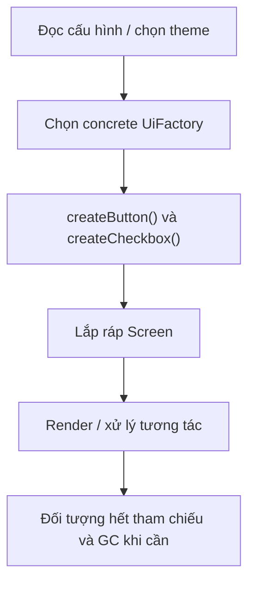

# Đo chi phí khởi tạo và cấp phát khi có vấn đề hiệu năng thực tế

**Chương:** Chi phí và đánh đổi  
**Chuyên đề:** `SOFTWARE_DESIGN_DESIGN_PATTERN_CREATIONAL_ABSTRACT_FACTORY` — Học về abstract factory trong design pattern.

## Mục tiêu học tập

Sau bài học, bạn có thể:

- Nhận diện những chi phí thực sự có thể xuất hiện khi sử dụng **Abstract Factory**: chọn factory, tạo sản phẩm, khởi tạo tài nguyên, cấp phát bộ nhớ và tác động đến garbage collection (GC).
- Phân biệt **chi phí một lần lúc khởi động** với **chi phí lặp lại trên đường xử lý nóng** (*hot path*), tránh tối ưu chỉ dựa trên số lượng interface hoặc lệnh `new`.
- Thiết kế một phép đo có **baseline**, các kịch bản so sánh công bằng và những chỉ số phù hợp với triệu chứng hiệu năng thực tế.
- Dùng ví dụ Java để quan sát thời gian và số byte cấp phát ở một luồng, đồng thời hiểu giới hạn của cách đo minh họa.
- Biết khi nào nên dùng **JMH**, **Java Flight Recorder (JFR)**, profiler cấp phát và phép đo tải thực tế; chọn giải pháp tối ưu mà không phá vỡ hợp đồng hoặc vòng đời sản phẩm.

## 1. Abstract Factory có gây chậm ứng dụng không?

**Abstract Factory** định nghĩa giao diện tạo ra một **họ sản phẩm có liên quan**. Ví dụ ứng dụng Java có hai loại thành phần giao diện: `Button` và `Checkbox`. Họ `Light` và `Dark` đều cung cấp đủ hai loại:

| Họ | `Button` | `Checkbox` | Factory |
| --- | --- | --- | --- |
| Light | `LightButton` | `LightCheckbox` | `LightUiFactory` |
| Dark | `DarkButton` | `DarkCheckbox` | `DarkUiFactory` |

Một màn hình nhận `UiFactory`, rồi yêu cầu `createButton()` và `createCheckbox()`. Mã có thêm lớp trừu tượng và lời gọi qua interface so với việc dùng `new LightButton()` trực tiếp. Tuy nhiên, không thể chỉ từ sơ đồ lớp mà kết luận **chi phí runtime cao**. JVM có thể inline lời gọi ảo, tối ưu những đối tượng không thoát phạm vi và cấp phát nhanh các đối tượng nhỏ; các tối ưu thực tế phụ thuộc JIT, trạng thái chương trình và cách đối tượng được sử dụng.

Vấn đề đáng quan tâm thường là **tần suất khởi tạo** hoặc **công việc bên trong quá trình tạo**:

- Factory được chọn một lần khi ứng dụng khởi động hay được tìm lại trong mỗi request?
- Mỗi lần gọi `createButton()` chỉ khởi tạo đối tượng nhẹ hay còn nạp font, đọc tệp, kết nối mạng, parse cấu hình?
- Mỗi lần render tạo hàng nghìn product mới hay tái sử dụng những đối tượng không mang trạng thái?
- Tỷ lệ cấp phát có làm GC xảy ra thường xuyên hoặc tăng độ trễ của thao tác người dùng không?

**Nguyên tắc:** đo khi có **triệu chứng và yêu cầu hiệu năng cụ thể**, rồi tối ưu nguyên nhân đã được xác định. Không nên bỏ Abstract Factory chỉ vì thêm một interface, cũng không nên cache mọi đối tượng theo cảm tính.

## 2. Phân rã chi phí trước khi đo

Trong luồng khởi tạo một màn hình, có thể phân biệt các công đoạn:



| Khoản chi phí | Ví dụ | Tần suất cần xác định | Đo bằng gì? |
| --- | --- | --- | --- |
| **Chọn factory** | Đọc `theme`, tra registry, tìm plugin | Khi khởi động, request hay mỗi lần render? | Tracing, profiler CPU, phép đo từng bước |
| **Tạo factory** | `new LightUiFactory()`, khởi tạo cache/tài nguyên | Một lần mỗi ứng dụng hay liên tục? | Thời gian khởi tạo, số lượng instance |
| **Tạo sản phẩm** | `new LightButton()`, `new LightCheckbox()` | Mỗi màn hình, mỗi request hay mỗi khung hình? | Allocation profiler, time/op |
| **Tài nguyên nặng** | Mở kết nối, tải file, build template, tạo thread | Một lần hay lặp lại? | Tracing, CPU sampling, I/O metrics |
| **Lắp ráp object graph** | `new PreferencesScreen(button, checkbox)` | Theo màn hình hoặc use case | CPU time, số đối tượng |
| **Thu gom rác** | Giải phóng các product ngắn hạn | Phụ thuộc áp lực cấp phát và heap | GC log/JFR, pause time, allocation rate |

Một biểu thức **mang tính phân tích**, không phải công thức đo chính xác trong mọi tình huống:

```text
Thời gian xử lý ≈ thời gian chọn factory
                + thời gian tạo sản phẩm
                + thời gian lắp ráp
                + thời gian sử dụng sản phẩm
                + ảnh hưởng gián tiếp từ GC/I-O/lịch CPU
```

Thời gian các công đoạn có thể chồng lấp, bị JIT tối ưu hoặc chịu nhiễu hệ điều hành. Vì thế hãy tách **phép đo độ trễ toàn thao tác** khỏi **phép đo từng thành phần**.

### Ba khái niệm bộ nhớ rất dễ nhầm

- **Allocation rate (byte/giây):** tổng số byte cấp phát trong một khoảng thời gian. Đối tượng có thể đã bị GC ngay sau đó.
- **Allocation per operation (byte/lượt):** số byte cấp phát chia cho số thao tác tương đương; hữu ích khi so sánh hai cách lắp ráp.
- **Live heap / retained size:** bộ nhớ vẫn còn được giữ bởi các tham chiếu; giảm số lần cấp phát bằng cache có thể **tăng** dung lượng được giữ lâu dài.

Ví dụ: tạo `Button` mới mỗi request có thể làm tăng byte/lượt nhưng không làm live heap tăng nhiều nếu đối tượng sống ngắn. Cache mọi `Button` có thể làm giảm byte/lượt nhưng giữ nhiều dữ liệu, hoặc vô tình chia sẻ trạng thái giữa người dùng.

## 3. Khi nào cần bắt đầu đo?

Đo khi có dấu hiệu có thể kiểm chứng, chẳng hạn:

1. **Độ trễ vượt mục tiêu:** thời gian mở màn hình hoặc p95/p99 của request tăng khi số widget/đơn tăng.
2. **GC gây ảnh hưởng:** thời gian pause, số lần thu gom hoặc lượng byte cấp phát/giây tăng cùng với tải.
3. **Khởi động hoặc chuyển cấu hình chậm:** chọn factory kéo theo việc nạp tài nguyên nặng nhiều lần.
4. **Profiler chỉ ra allocation hot spot:** các constructor sản phẩm hoặc phương thức `create...()` xuất hiện với tỷ lệ cấp phát đáng kể trên đường xử lý nóng.

Trước khi thay đổi thiết kế, ghi lại **baseline**: phiên bản JDK, cấu hình JVM, phần cứng, kiểu tải, số lượng thao tác, độ trễ, throughput, byte/lượt và GC nếu có. Ví dụ, một yêu cầu có thể là “p95 khi mở màn hình không quá 100 ms với 200 thành phần và tải đồng thời đã xác định”; ngưỡng phải đến từ nhu cầu thực tế của ứng dụng, không phải một con số mặc định cho mọi dự án.

Nếu ứng dụng chưa có triệu chứng và phép đo cấp phát cho thấy thời gian chủ yếu nằm ở I/O hoặc render, việc thay Abstract Factory bằng constructor trực tiếp thường không giải quyết nút thắt.

## 4. Thiết kế thí nghiệm để xác định chính xác chi phí

Thay vì so sánh ngẫu nhiên “mã có pattern” với “mã không có pattern”, hãy thay **một yếu tố ở mỗi kịch bản**:

| Kịch bản | Quyết định chọn factory | Sản phẩm | Giả thuyết cần kiểm tra |
| --- | --- | --- | --- |
| **A — Factory mới mỗi lượt** | Tạo `FreshUiFactory` ở mỗi lượt | Mỗi lượt tạo `Button` và `Checkbox` mới | Khởi tạo factory lặp lại có đáng kể không? |
| **B — Factory dùng chung** | Tạo `FreshUiFactory` một lần | Vẫn tạo sản phẩm mới mỗi lượt | Tách chi phí lựa chọn/vòng đời factory khỏi chi phí product |
| **C — Tái sử dụng sản phẩm không trạng thái** | Tạo `CachedUiFactory` một lần | Trả về cùng product đã tạo trước | Phần allocation product có đáng kể không? |

Ba kịch bản dùng cùng loại `Screen` và cùng thao tác sử dụng sản phẩm. Nếu một trong các sản phẩm chứa **trạng thái riêng theo người dùng** (ví dụ checkbox có biến `checked` có thể sửa), kịch bản C **không còn tương đương về chức năng**. Không thể dùng kết quả nhanh hơn của C để biện minh cho việc dùng chung đối tượng sai nghiệp vụ.

Ở ứng dụng thực, có thể cần thêm kịch bản **D — factory trả sản phẩm từ pool** hoặc **E — factory nạp tài nguyên lazy**, nhưng chỉ khi chức năng của hệ thống thực sự yêu cầu.

## 5. Ví dụ Java 8: quan sát thời gian và byte cấp phát

Ví dụ dưới đây dùng các sản phẩm nhẹ với mảng byte **đại diện cho dữ liệu style**. Các sản phẩm này không chứa trạng thái người dùng, không công khai mảng byte và chỉ trả về giá trị đọc, nên có thể tái sử dụng trong phạm vi minh họa.

Chương trình đo:

- **Thời gian đã trôi qua** bằng `System.nanoTime()`.
- **Số byte được cấp phát bởi luồng hiện tại** thông qua `com.sun.management.ThreadMXBean` nếu JVM hỗ trợ và cho phép bật đo.
- **Checksum** và một tham chiếu `volatile` để giữ kết quả có thể quan sát, giảm nguy cơ toàn bộ công việc bị JIT loại bỏ. Các thao tác chống tối ưu này cũng có chi phí và ảnh hưởng đến kết quả.

Lưu toàn bộ mã dưới đây vào **`FactoryAllocationMeasurementDemo.java`**. Mã phù hợp với JDK 8 có `com.sun.management.ThreadMXBean` (thường có trong các JDK HotSpot/OpenJDK); nếu JVM không hỗ trợ đo byte cấp phát theo luồng, chương trình vẫn in thời gian và `N/A` ở phần bộ nhớ.

```java
import java.lang.management.ManagementFactory;
import java.util.Locale;
import com.sun.management.ThreadMXBean;

// Hai abstract products.
interface Button {
    int renderUnits();
}

interface Checkbox {
    int renderUnits(boolean checked);
}

// Abstract Factory: mỗi concrete factory tạo cùng một họ sản phẩm.
interface UiFactory {
    Button createButton();
    Checkbox createCheckbox();
}

// Product "Light" chỉ đọc dữ liệu style được cấp phát khi khởi tạo.
final class LightButton implements Button {
    private final byte[] styleData = new byte[128];

    @Override
    public int renderUnits() {
        return styleData.length;
    }
}

final class LightCheckbox implements Checkbox {
    private final byte[] styleData = new byte[96];

    @Override
    public int renderUnits(boolean checked) {
        return styleData.length + (checked ? 1 : 0);
    }
}

// Factory luôn tạo product mới.
final class FreshUiFactory implements UiFactory {
    @Override
    public Button createButton() {
        return new LightButton();
    }

    @Override
    public Checkbox createCheckbox() {
        return new LightCheckbox();
    }
}

// Factory cache sản phẩm không mang trạng thái người dùng.
final class CachedUiFactory implements UiFactory {
    private final Button button = new LightButton();
    private final Checkbox checkbox = new LightCheckbox();

    @Override
    public Button createButton() {
        return button;
    }

    @Override
    public Checkbox createCheckbox() {
        return checkbox;
    }
}

// Client chỉ biết các abstract products.
final class Screen {
    private final Button button;
    private final Checkbox checkbox;

    Screen(Button button, Checkbox checkbox) {
        this.button = button;
        this.checkbox = checkbox;
    }

    int renderUnits() {
        return button.renderUnits() + checkbox.renderUnits(true);
    }
}

public final class FactoryAllocationMeasurementDemo {
    private static volatile Screen lastScreen;
    private static volatile long lastChecksum;

    enum Mode {
        FACTORY_EACH_SCREEN,
        SHARED_FACTORY_FRESH_PRODUCTS,
        SHARED_FACTORY_CACHED_PRODUCTS
    }

    private static ThreadMXBean allocationBean() {
        java.lang.management.ThreadMXBean raw =
                ManagementFactory.getThreadMXBean();
        if (!(raw instanceof ThreadMXBean)) {
            return null;
        }

        ThreadMXBean bean = (ThreadMXBean) raw;
        if (!bean.isThreadAllocatedMemorySupported()) {
            return null;
        }

        try {
            if (!bean.isThreadAllocatedMemoryEnabled()) {
                bean.setThreadAllocatedMemoryEnabled(true);
            }
            return bean.isThreadAllocatedMemoryEnabled() ? bean : null;
        } catch (SecurityException | UnsupportedOperationException error) {
            return null;
        }
    }

    private static long runScenario(Mode mode, int iterations) {
        UiFactory shared = null;
        if (mode == Mode.SHARED_FACTORY_FRESH_PRODUCTS) {
            shared = new FreshUiFactory();
        } else if (mode == Mode.SHARED_FACTORY_CACHED_PRODUCTS) {
            shared = new CachedUiFactory();
        }

        long checksum = 0;
        for (int i = 0; i < iterations; i++) {
            UiFactory factory = mode == Mode.FACTORY_EACH_SCREEN
                    ? new FreshUiFactory() : shared;

            Screen screen = new Screen(
                    factory.createButton(), factory.createCheckbox());
            checksum += screen.renderUnits();
            lastScreen = screen;
        }
        lastChecksum = checksum;
        return checksum;
    }

    private static long allocated(ThreadMXBean bean, long threadId) {
        return bean == null ? -1 : bean.getThreadAllocatedBytes(threadId);
    }

    private static void measure(
            Mode mode, int iterations, ThreadMXBean bean, long threadId) {
        long beforeBytes = allocated(bean, threadId);
        long begin = System.nanoTime();
        long sum = runScenario(mode, iterations);
        long elapsed = System.nanoTime() - begin;
        long afterBytes = allocated(bean, threadId);

        System.out.printf(Locale.ROOT,
                "%s: %.1f ns/lượt",
                mode, (double) elapsed / iterations);

        if (beforeBytes >= 0 && afterBytes >= beforeBytes) {
            System.out.printf(Locale.ROOT,
                    ", %.1f byte/lượt",
                    (double) (afterBytes - beforeBytes) / iterations);
        } else {
            System.out.print(", byte/lượt=N/A");
        }
        System.out.println(", checksum=" + sum);
    }

    public static void main(String[] args) {
        int iterations = args.length == 0
                ? 100_000 : Integer.parseInt(args[0]);
        if (iterations <= 0) {
            throw new IllegalArgumentException("Số lượt phải dương");
        }

        ThreadMXBean bean = allocationBean();
        long threadId = Thread.currentThread().getId();

        // Warm-up đơn giản: giúp tải mã và kích hoạt một phần tối ưu JIT.
        for (Mode mode : Mode.values()) {
            runScenario(mode, 20_000);
        }

        for (Mode mode : Mode.values()) {
            measure(mode, iterations, bean, threadId);
        }
        // Giữ kết quả quan sát được; không phụ thuộc kết quả cố định.
        if (lastScreen == null || lastChecksum <= 0) {
            throw new AssertionError("Kết quả không hợp lệ");
        }
    }
}
```

### Cách chạy

```bash
javac -encoding UTF-8 FactoryAllocationMeasurementDemo.java
java FactoryAllocationMeasurementDemo
java FactoryAllocationMeasurementDemo 200000
```

Đầu ra sẽ có **hình thức** như sau; ký hiệu `...` là giá trị chương trình đo trên máy của bạn, **không phải số liệu chuẩn**:

```text
FACTORY_EACH_SCREEN: ... ns/lượt, ... byte/lượt, checksum=...
SHARED_FACTORY_FRESH_PRODUCTS: ... ns/lượt, ... byte/lượt, checksum=...
SHARED_FACTORY_CACHED_PRODUCTS: ... ns/lượt, ... byte/lượt, checksum=...
```

Kết quả cụ thể phụ thuộc phiên bản JDK, JIT, hệ điều hành, CPU, heap, GC và tải nền. Một lượt chạy duy nhất hoặc một thứ tự thử cố định **không đủ** để khẳng định kịch bản nào nhanh hơn trong production.

### Đọc phép đo đúng cách

**A và B:** cả hai đều tạo mới `Button`, `Checkbox` và `Screen` mỗi lượt; chỉ khác cách tạo và giữ `UiFactory`. Trên JVM có khả năng tối ưu escape analysis, cấp phát factory cực nhỏ thậm chí có thể được tối ưu mất, nên số byte/lượt của hai kịch bản có thể rất gần nhau.

**B và C:** cả hai chọn factory một lần, nhưng C trả cùng hai product đã tạo trước. Với những product **được phép dùng chung**, C có thể giảm cấp phát theo lượt. Tuy nhiên, `Screen` vẫn được tạo mới, và hai product của C vẫn chiếm một lượng bộ nhớ giữ lâu hơn. Đừng áp dụng C cho widget hoặc đối tượng chứa trạng thái của từng người dùng.

**Phép đo này chỉ để minh họa kỹ thuật quan sát:** có warm-up ngắn, một mẫu mỗi kịch bản, một thứ tự đo cố định và thao tác `volatile`. Nó **không phải microbenchmark đủ tin cậy** để đưa ra kết luận hiệu năng nhỏ đến mức nano giây, cũng không đo được latency p95/p99 của hệ thống thực.

Ngoài ra, `ThreadMXBean.getThreadAllocatedBytes(...)` chỉ đếm allocation **trên luồng được chỉ định** (khi JVM hỗ trợ); nó không tự cộng allocation của worker thread khác, không thể hiện dung lượng heap còn sống sau GC, và không thay thế phép đo áp lực GC trên toàn tiến trình.

## 6. Muốn đo microbenchmark nghiêm túc: dùng JMH

Khi profiler cho thấy thật sự cần xác định chi phí riêng của lời gọi factory, khởi tạo product hay cache, nên dùng **Java Microbenchmark Harness (JMH)**. JMH hỗ trợ nhiều lần warm-up, nhiều lần đo, tách JVM fork và tiêu thụ kết quả nhằm giảm một số lỗi benchmark phổ biến.

Ví dụ ý tưởng (cần dependency JMH và cấu hình chạy benchmark; **đoạn dưới không thuộc file Java 8 tự chứa ở mục 5**):

```java
// Ví dụ JMH rút gọn; cần import/thiết lập JMH phù hợp.
@State(Scope.Thread)
public class ScreenFactoryBenchmark {
    private UiFactory factory;

    @Setup(Level.Trial)
    public void setup() {
        factory = new FreshUiFactory();
    }

    @Benchmark
    public void createScreen(Blackhole blackhole) {
        Screen screen = new Screen(
                factory.createButton(), factory.createCheckbox());
        blackhole.consume(screen);
    }
}
```

Khi chuyển ví dụ vào dự án benchmark, cần thêm các import `org.openjdk.jmh.annotations.*` và `org.openjdk.jmh.infra.Blackhole` cùng plugin/dependency JMH. Đây là **mẫu minh họa cấu trúc**, không phải công thức đo cố định cho mọi ứng dụng.

Các điểm cần giữ khi thiết kế benchmark:

1. **Cùng chức năng và đầu ra:** nếu so sánh factory mới/cũ, giữ các product và công việc sử dụng tương đương.
2. **Không đặt khởi tạo ngoài phạm vi muốn đo:** nếu cần đo `new UiFactory()`, đặt nó trong method benchmark; nếu cần đo riêng product allocation, chuẩn bị factory ở `@Setup`.
3. **Giữ kết quả có thể quan sát:** dùng `Blackhole` hoặc cơ chế do JMH hỗ trợ, tránh JIT loại bỏ cả phép tính không dùng.
4. **Đủ warm-up, measurement và fork:** quan sát dao động giữa các lần chạy; không kết luận từ một con số `ns/op`.
5. **Kiểm tra cả allocation:** xem số byte/op, lượng GC và các phần cấp phát gây chi phí, thay vì chỉ tập trung vào tốc độ lời gọi.
6. **Không dùng benchmark đơn luồng để suy ra mọi độ trễ production:** đường xử lý thực có cạnh tranh tài nguyên, lock, network, GC và tải đồng thời.

Nếu con số microbenchmark không thay đổi đáng kể p95/p99 hoặc throughput ở tải thật, đó có thể chỉ là tối ưu cục bộ không mang giá trị cho người dùng.

## 7. Đo trong ứng dụng thực: profiler và chỉ số vận hành

Với vấn đề cấp phát hoặc tạo đối tượng nhiều lần, nên quan sát từ **toàn thao tác** rồi đi sâu vào đoạn mã cụ thể.

| Triệu chứng | Nên đo | Công cụ/kỹ thuật tham khảo |
| --- | --- | --- |
| Mở màn hình chậm | Thời gian từ yêu cầu mở đến khi màn hình sẵn sàng, chia theo giai đoạn | Tracing, timestamp ứng dụng, CPU profiler |
| Tốc độ tạo product lớn | Allocation rate và byte/op theo call stack | JFR, allocation profiler, JMH cho phần nhỏ |
| GC dày hoặc pause dài | GC count, pause duration, live heap, promotion | GC logs, JFR/JMC, JVM metrics |
| Factory tạo tài nguyên nặng | Thời gian connect/load/parse và số lần thực hiện | Tracing, log có cấu trúc, I/O profiler |
| P99 bị tăng theo tải | Latency percentiles, throughput, concurrency, queueing | Load test với workload đại diện |
| Bộ nhớ tăng sau khi thêm cache | Heap dump, retained size, số lượng instance sống | Heap profiler, heap dump analyzer |

**JFR** (Java Flight Recorder) và **JMC** (Java Mission Control) hữu ích để phân tích sự kiện CPU, GC và cấp phát trên JVM hỗ trợ. Cách bật/tích hợp phụ thuộc phiên bản và bản phân phối JDK; với JDK hiện đại có thể dùng `jcmd`/cờ JVM hoặc công cụ theo môi trường. Không nên giả định mọi JDK 8 đều có JFR theo cùng cơ chế với JDK mới.

Khi đọc flame graph hoặc allocation profile, hãy phân biệt:

- **Factory xuất hiện trong call stack** không có nghĩa factory là nguyên nhân chính: phép cấp phát tốn nhiều bộ nhớ có thể nằm trong constructor product được nó gọi.
- **Số đối tượng** không tương đương **số byte**: một object chứa mảng lớn đáng chú ý hơn nhiều object siêu nhỏ.
- **GC pause dài** không phải lúc nào cũng do Abstract Factory; heap sizing, giữ tham chiếu lâu, tải và collector đều ảnh hưởng.

Tốt nhất đo cùng một workload trước và sau một thay đổi có kiểm soát, kiểm tra cả **cải thiện mục tiêu chính** lẫn **tác dụng phụ** như tăng live heap hoặc lỗi state.

## 8. Những hướng tối ưu và chi phí đánh đổi

### 8.1. Chọn factory một lần tại composition root

Nếu theme chỉ thay khi mở ứng dụng hoặc khi người dùng chọn lại, composition root có thể tạo factory và truyền vào màn hình:

```java
UiFactory factory = chooseFactory(configuredTheme);
PreferencesScreen screen = new PreferencesScreen(factory);
```

Nếu đang đọc JSON cấu hình, tìm plugin hoặc mở kết nối tại **mỗi lần render**, chuyển công việc đó ra khỏi đường xử lý nóng thường có ích hơn việc cố loại bỏ một interface. Tuy nhiên, khi lựa chọn phải thay đổi theo request/tenant, không được cache một factory toàn cục dẫn đến trộn cấu hình giữa người dùng.

### 8.2. Tái sử dụng **đối tượng thực sự không có trạng thái**

Các bộ màu, design tokens bất biến, codec không mang state hoặc cấu hình đã parse có thể được dùng chung khi phạm vi chia sẻ phù hợp. Điều này giúp tránh cấp phát và tính toán lặp lại.

Nhưng `Checkbox` trong UI thật thường có **trạng thái checked, focus và vòng đời riêng**. Nếu dùng chung một instance giữa hai màn hình, tương tác ở một nơi có thể làm thay đổi nơi còn lại. Caching chỉ hợp lệ khi object có hợp đồng bất biến/thread-safe hoặc được thiết kế cho phạm vi chia sẻ đó.

### 8.3. Lazy initialization cho tài nguyên nặng

Nếu factory phải tạo resource chỉ dùng ở một tính năng hiếm gặp, có thể trì hoãn khởi tạo đến lần đầu cần dùng. Ví dụ, một factory quản lý kết nối plugin render đặc biệt có thể nạp tài nguyên khi màn hình đó được mở.

Đổi lại cần xử lý thread safety, lỗi ở thời điểm sử dụng, cạnh tranh lần đầu khởi tạo và chính sách retry/cleanup. **Lazy** thường chuyển thời điểm chịu chi phí, không tự làm chi phí biến mất.

### 8.4. Pooling không phải lựa chọn mặc định

Với kết nối mạng hoặc tài nguyên khởi tạo đắt, pool phù hợp có thể giảm chi phí tái tạo. Với object Java nhỏ, sống ngắn, tự tạo pool thường thêm lock, quản lý vòng đời, giữ heap lâu và rủi ro rò rỉ trạng thái. Không nên lập pool cho `Button` chỉ vì thấy nhiều lệnh `new`.

### 8.5. Giữ thiết kế dễ thay thế trong quá trình tối ưu

Nếu thay `UiFactory` bằng các lệnh `new DarkButton()` rải rác chỉ vì microbenchmark có chênh lệch rất nhỏ, có thể đánh mất:

- Khả năng đổi toàn bộ họ sản phẩm nhất quán.
- Độ rõ ràng của quan hệ phụ thuộc và phạm vi tạo product.
- Khả năng thay thế product trong test và hỗ trợ theme mới.

Hãy xem mức cải thiện **ở workload thật** có đủ lớn để bù chi phí bảo trì, rủi ro tương thích và việc mất tính linh hoạt hay không. Trình biên dịch/JIT đôi khi đã tối ưu chi phí dispatch; profiler sẽ giúp xác định liệu có lý do để đánh đổi hay chưa.

## 9. Ma trận ra quyết định sau khi đo

| Quan sát đã kiểm chứng | Điều nên làm trước | Điều cần kiểm chứng sau thay đổi |
| --- | --- | --- |
| Factory được parse/resolve lại ở mỗi request không cần thiết | Hoist việc chọn factory lên phạm vi cấu hình phù hợp | P95, số lần resolve, đúng cấu hình theo tenant |
| Product rất nhẹ nhưng được tạo nhiều lần | Đo byte/op, allocation stack trước khi cache | Allocation rate, GC và giữ trạng thái |
| Cấp phát product không đáng kể, I/O chiếm phần lớn | Tối ưu I/O hoặc tài nguyên phía trong factory | Latency toàn thao tác và correctness |
| Cache giảm byte/op nhưng live heap tăng mạnh | Giới hạn vòng đời hoặc thu nhỏ cache | Retained heap, GC pause, memory footprint |
| Phép đo chỉ cải thiện vài ns/op, p95 không đổi | Giữ implementation dễ hiểu, tránh tối ưu sớm | Đánh giá lại khi workload thay đổi |
| Khởi tạo plugin tốn thời gian chỉ lúc startup | Đánh giá lazy/eager theo yêu cầu startup và lần dùng đầu | Startup time và first-use latency |

Không có một ngưỡng chung “`X ns/op` là quá chậm” hoặc “`Y byte/op` phải cache”. Giá trị phụ thuộc **tần suất thực tế**, SLO của hệ thống, ngân sách bộ nhớ và khả năng bảo trì.

## 10. Những lỗi phổ biến khi đo hiệu năng Abstract Factory

| Lỗi đo đạc | Vì sao gây hiểu lầm? | Cách sửa |
| --- | --- | --- |
| Chỉ đo một lần bằng `System.nanoTime()` | Bị ảnh hưởng bởi JIT, GC, scheduling, thứ tự đo | Dùng JMH cho microbenchmark; đo lặp có warm-up/fork |
| So sánh factory được cache với direct `new` có công việc khác | Hai kịch bản không tương đương | Cố định workload và điểm khởi tạo sản phẩm |
| Không sử dụng kết quả tạo ra | JIT có thể loại bỏ allocation/công việc | Dùng Blackhole/cơ chế quan sát phù hợp |
| Dùng `Runtime.totalMemory() - freeMemory()` làm byte cấp phát | Chỉ phản ánh heap tại thời điểm, chịu ảnh hưởng GC | Dùng allocation profiler hoặc bộ đếm cấp phát phù hợp |
| Đồng nhất byte cấp phát với live heap | Product đã chết vẫn được tính vào allocation; cache giữ live heap | Đo riêng allocation rate và retained heap |
| Chỉ đo một luồng khi request chạy trên nhiều luồng | Bỏ qua allocation của worker khác | Dùng profiler hoặc metrics toàn tiến trình |
| Bỏ qua GC và độ trễ của người dùng | Có thể nhanh ở microbenchmark nhưng tệ ở tải thật | Quan sát end-to-end p95/p99, throughput, GC |
| Cache product có trạng thái riêng theo màn hình | Sai chức năng, race condition hoặc rò rỉ state | Chỉ tái sử dụng khi hợp đồng chia sẻ cho phép |
| Đánh đồng chi phí implementation với pattern | Constructor tốn I/O làm factory trông chậm | Đo tách factory dispatch, product init và I/O |

## 11. Bài luyện tập và tự kiểm tra

**Câu 1.** Một ứng dụng mất 300 ms mở màn hình; profiler cho thấy 250 ms là tải font qua mạng trong `DarkButton`. Có nên xóa `UiFactory` để cải thiện không?

**Gợi ý đáp án:** Không có bằng chứng rằng lời gọi interface gây nút thắt. Cần xem lại cách tải/cache font và thời điểm thực hiện I/O; đo lại toàn thao tác trước khi quyết định thay pattern.

**Câu 2.** Hai phiên bản có cùng throughput, nhưng phiên bản B cấp phát ít hơn 40 byte/lượt. Có thể tuyên bố B tốt hơn không?

**Gợi ý đáp án:** Chưa đủ. Cần xét GC, p95/p99, live heap, độ phức tạp, thread safety và chức năng. Mức chênh lệch byte/lượt chỉ đáng kể khi nhân với tần suất thao tác đủ lớn và có ảnh hưởng được quan sát.

**Câu 3.** Vì sao `CachedUiFactory` trong ví dụ được phép chia sẻ `LightCheckbox` nhưng một checkbox thực tế có state `checked` không nên chia sẻ tùy tiện?

**Gợi ý đáp án:** Checkbox demo chỉ dùng dữ liệu style và tham số `checked` của lời gọi, không giữ trạng thái riêng. Checkbox stateful có thể rò rỉ lựa chọn của màn hình hoặc người dùng này sang nơi khác; việc cache làm thay đổi semantics.

**Câu 4.** Vì sao phép đo `System.nanoTime()` trong một vòng `for` không đủ kết luận “Abstract Factory chậm hơn direct constructor 5 ns”?

**Gợi ý đáp án:** JVM có JIT, inlining, escape analysis, warm-up, GC và các yếu tố nhiễu. Benchmark không kiểm soát chúng có thể đo sự khác biệt do môi trường thay vì chi phí bản thân pattern. JMH và phép đo tải thật phù hợp hơn.

**Bài thực hành A.** Chạy `FactoryAllocationMeasurementDemo` với nhiều số lượt (ví dụ 100.000 và 200.000) và lặp lại trong các JVM process mới. Ghi lại thời gian và byte/lượt. Giải thích vì sao kết quả không cố định và không dùng một lượt chạy để khẳng định tối ưu.

**Bài thực hành B.** Đổi `LightCheckbox` thành một lớp có trường `boolean checked` thay đổi được. Nêu tình huống hai màn hình cùng nhận một instance qua `CachedUiFactory`. Hãy xác định lỗi chia sẻ state và đề xuất chỉ cache phần style bất biến, còn mỗi màn hình vẫn tạo checkbox riêng.

**Bài thực hành C.** Giả sử profiler đo được 5 MB cấp phát/giây trong `createButton()`, nhưng GC không đáng kể và độ trễ nằm ở database. Bạn sẽ ưu tiên thay đổi nào và đo chỉ số gì để chứng minh quyết định?

**Gợi ý đáp án:** Ưu tiên nút thắt ảnh hưởng mục tiêu latency, có thể là truy vấn/cơ chế I/O của database. Đo end-to-end latency và throughput trước/sau; chỉ quay lại `createButton()` nếu có bằng chứng nó ảnh hưởng đáng kể tới SLO hoặc bộ nhớ.

## Kết luận

Chi phí của **Abstract Factory** chỉ có ý nghĩa khi đặt trong **tần suất tạo đối tượng, mức cấp phát, công việc khởi tạo tài nguyên và yêu cầu hiệu năng thực tế**. Trước tiên phải xác định vấn đề bằng baseline và profiler; sau đó mới dùng phép đo nhỏ hơn để tách chi phí chọn factory khỏi chi phí tạo product. Một factory dùng chung có thể giảm công việc cấu hình lặp lại; một sản phẩm bất biến được cache có thể giảm allocation nhưng lại tăng live heap và có rủi ro nếu bị dùng nhầm cho đối tượng stateful. Hãy dùng JMH khi cần kết luận về microbenchmark và dùng số liệu từ ứng dụng thật để quyết định có nên đánh đổi tính rõ ràng, khả năng thay thế họ sản phẩm và chi phí bảo trì của thiết kế hay không.
