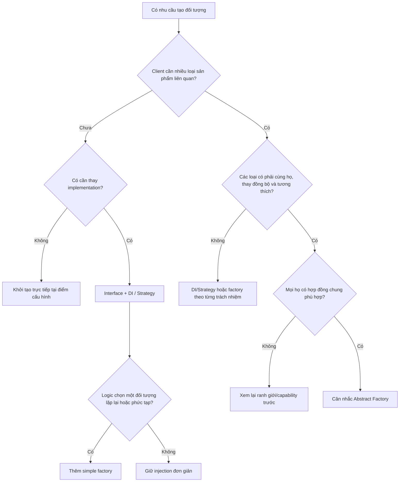

# Chọn giải pháp đơn giản hơn khi chưa có nhu cầu về họ sản phẩm

**Abstract Factory** giải quyết bài toán tạo ra nhiều **loại sản phẩm liên quan** theo từng **họ sản phẩm**, để client có thể đổi cả bộ mà không phải biết các lớp triển khai. Tuy nhiên, không phải ứng dụng nào có nhiều lớp, nhiều cấu hình hay nhiều nhà cung cấp cũng cần Abstract Factory. Nếu chỉ có một loại đối tượng cần thay thế, hoặc các đối tượng thay đổi độc lập, việc lập tức tạo một hệ thống factory nhiều tầng thường tăng độ phức tạp mà chưa mang lại giá trị.

Bài học thuộc chương **Chi phí và đánh đổi** của module **Học về abstract factory trong design pattern**. Trọng tâm là cách chọn **giải pháp đơn giản hơn khi chưa có nhu cầu về họ sản phẩm**, đồng thời nhận diện những tín hiệu cụ thể cho thấy đã đến lúc nâng cấp thiết kế. Chúng ta sẽ so sánh khởi tạo trực tiếp, dependency injection, Strategy, simple factory và Abstract Factory qua tình huống xuất hóa đơn bằng Java.

## 1. Bắt đầu từ nhu cầu hiện tại, không bắt đầu từ tên pattern

Giả sử một ứng dụng bán hàng cần xuất hóa đơn. Phiên bản đầu tiên chỉ cần trả về hóa đơn dạng văn bản. Sau đó có thể thêm HTML. Yêu cầu nghiệp vụ là:

- Nhận danh sách dòng hàng, số lượng và đơn giá.
- Tính tổng tiền theo cùng quy tắc.
- Chuyển hóa đơn thành **một kết quả xuất** ở định dạng đã chọn.

Trong trường hợp này, client chỉ cần một vai trò: **`ReceiptRenderer`**. Có hai cách triển khai `TextReceiptRenderer` và `HtmlReceiptRenderer` không có nghĩa ta đã có hai họ với nhiều loại sản phẩm cần phối hợp. Đó mới là **hai chiến lược để thực hiện cùng một nhiệm vụ**.

| Câu hỏi | Tình huống xuất hóa đơn ban đầu | Ý nghĩa thiết kế |
| --- | --- | --- |
| Client cần mấy loại sản phẩm? | Một `ReceiptRenderer` | Chưa cần factory tạo nhiều loại sản phẩm |
| Có mấy cách thực hiện? | Text trước, HTML sau | Một interface và hai implementation có thể đủ |
| Các sản phẩm có phải phối hợp theo họ? | Chưa có các sản phẩm rời cần kết hợp | Chưa có lý do chính để dùng Abstract Factory |
| Có cần thay implementation không? | Có, theo định dạng được chọn | Strategy hoặc DI có thể đáp ứng |
| Có nhiều nhánh khởi tạo phức tạp không? | Không | Có thể dùng `new` trực tiếp tại điểm cấu hình |

Điểm mấu chốt là phân biệt **biến thể của một sản phẩm** với **một họ gồm nhiều loại sản phẩm tương thích**. Abstract Factory chủ yếu hữu ích cho trường hợp thứ hai.

## 2. Abstract Factory bổ sung những chi phí gì?

Một thiết kế Abstract Factory thường có **abstract factory**, các **concrete factories**, **product interfaces** và các **concrete products**. Với hai họ và ba loại sản phẩm, ta có thể cần ba product interfaces, một factory interface, hai concrete factories và sáu concrete products. Đây chỉ là cách đếm minh họa theo cấu trúc thông dụng; thực tế có thể tái sử dụng các lớp, adapter hoặc thành phần chung.

Nếu không có ràng buộc phối hợp giữa các loại sản phẩm, chi phí này chưa chắc được bù đắp:

| Chi phí | Biểu hiện trong dự án | Hệ quả khi bài toán còn nhỏ |
| --- | --- | --- |
| **Nhiều kiểu và lớp** | Thêm interface factory, concrete factories, product interfaces | Người mới phải đi qua nhiều tệp mới tìm được đoạn tạo đối tượng |
| **Nhiều bước điều hướng** | Client gọi factory, factory chọn sản phẩm rồi trả interface | Khó lần theo logic hơn một lời gọi constructor trực tiếp |
| **Đổi loại sản phẩm tốn công** | Thêm `createNewProduct()` vào interface và mọi concrete factory | Một thay đổi nhỏ có thể chạm nhiều triển khai |
| **Kiểm thử thêm quan hệ** | Kiểm tra từng factory tạo các sản phẩm đúng họ | Tăng số ca kiểm thử và trách nhiệm bảo trì |
| **Thiết kế hợp đồng sớm** | Phải quyết định các loại sản phẩm và hành vi chung | Dễ đoán sai abstraction khi yêu cầu chưa ổn định |
| **Khó biểu đạt năng lực riêng** | Một họ không hỗ trợ phương thức mà họ khác có | Dễ sinh `null`, `instanceof` hoặc `UnsupportedOperationException` |

Chi phí đáng kể nhất thường không phải vài dòng `new`, mà là **đóng băng một ranh giới abstraction quá sớm**. Khi requirement đổi, cả hệ thống factory có thể phải thay theo một cấu trúc được thiết kế trên giả định chưa được kiểm chứng.

> **Nguyên tắc thực dụng:** Chỉ trả chi phí của Abstract Factory khi có lợi ích rõ ràng từ việc tạo và thay thế **nhiều loại sản phẩm theo một họ tương thích**.

## 3. Các lựa chọn đơn giản hơn và phạm vi của từng lựa chọn

| Giải pháp | Dùng khi nào? | Đánh đổi cần chấp nhận |
| --- | --- | --- |
| **Khởi tạo trực tiếp** `new Concrete()` | Một triển khai ổn định, ít nơi tạo và chưa có nhu cầu thay thế | Client hoặc điểm cấu hình biết concrete class |
| **Constructor injection theo interface** | Client cần dễ kiểm thử hoặc tráo một dependency | Phải có nơi khởi tạo và truyền dependency |
| **Strategy** | Cần thay **một thuật toán/hành vi** theo cấu hình hoặc lúc chạy | Mỗi chiến lược phải tuân thủ cùng hợp đồng |
| **Simple Factory** | Logic chọn **một đối tượng** trở nên lặp lại hoặc phức tạp | Hàm chọn có thể phải sửa khi thêm biến thể |
| **Abstract Factory** | Cần một **bộ nhiều loại sản phẩm** liên quan và thay đồng bộ theo họ | Tăng số lớp và khó thêm loại sản phẩm mới vào họ |

Các phương án không hoàn toàn loại trừ nhau. Có thể dùng một interface `ReceiptRenderer` theo cách Strategy, chọn implementation bằng một hàm simple factory tại composition root rồi inject vào service. Đó vẫn là thiết kế đơn giản nếu client chỉ cần một renderer.

### 3.1. Khởi tạo trực tiếp không phải lúc nào cũng là lỗi

Nếu ứng dụng chỉ có một định dạng văn bản:

```java
ReceiptService service = new ReceiptService(new TextReceiptRenderer());
```

Câu lệnh này ở **composition root** là lựa chọn bình thường. Composition root là chỗ quyết định các dependency cụ thể và lắp chúng lại; việc nó biết lớp `TextReceiptRenderer` không phá vỡ khả năng tái sử dụng của `ReceiptService`.

Không nhất thiết phải thêm `ReceiptAbstractFactory` chỉ để thay thế một lời gọi `new` duy nhất.

### 3.2. Khi cần nhiều biến thể của một hành vi, Strategy đã đủ

```java
interface ReceiptRenderer {
    String render(Receipt receipt);
}

final class ReceiptService {
    private final ReceiptRenderer renderer;

    ReceiptService(ReceiptRenderer renderer) {
        this.renderer = renderer;
    }

    String export(Receipt receipt) {
        return renderer.render(receipt);
    }
}
```

Service không cần hỏi renderer là text hay HTML. Nó chỉ biết `render()`. Khi có một loại sản phẩm duy nhất, việc này đạt gần như toàn bộ mục tiêu thay thế mà ứng dụng đang cần.

## 4. Ví dụ Java 17 hoàn chỉnh: Thiết kế đơn giản cho một vai trò

Ví dụ sau cho thấy một giải pháp đủ dùng khi chưa có họ sản phẩm. Mỗi renderer tạo **toàn bộ hóa đơn**; `ReceiptService` chỉ nhận một renderer qua constructor, và một hàm chọn implementation nằm ở điểm cấu hình. Cách tính tổng nằm trong dữ liệu nghiệp vụ để tránh chênh lệch giữa hai định dạng.

Lưu toàn bộ mã thành `Demo.java`:

```java
import java.util.List;
import java.util.Objects;

public final class Demo {
    private Demo() {}

    public record ReceiptLine(String name, long unitPrice, int quantity) {
        public ReceiptLine {
            if (name == null || name.isBlank()) {
                throw new IllegalArgumentException("name is blank");
            }
            if (unitPrice < 0 || quantity <= 0) {
                throw new IllegalArgumentException("invalid price or quantity");
            }
        }

        public long amount() {
            return Math.multiplyExact(unitPrice, quantity);
        }
    }

    public record Receipt(List<ReceiptLine> lines) {
        public Receipt {
            lines = List.copyOf(Objects.requireNonNull(lines, "lines"));
            if (lines.isEmpty()) {
                throw new IllegalArgumentException("receipt has no lines");
            }
        }

        public long total() {
            long sum = 0;
            for (ReceiptLine line : lines) {
                sum = Math.addExact(sum, line.amount());
            }
            return sum;
        }
    }

    // Một product interface: đủ cho nhu cầu hiện tại.
    public interface ReceiptRenderer {
        String render(Receipt receipt);
    }

    public static final class TextReceiptRenderer
            implements ReceiptRenderer {
        @Override
        public String render(Receipt receipt) {
            Objects.requireNonNull(receipt, "receipt");
            StringBuilder result = new StringBuilder("HOA DON\n");
            for (ReceiptLine line : receipt.lines()) {
                result.append("- ").append(line.name())
                    .append(": ").append(line.amount()).append("\n");
            }
            return result.append("Tong: ").append(receipt.total()).toString();
        }
    }

    public static final class HtmlReceiptRenderer
            implements ReceiptRenderer {
        private static String escapeHtml(String value) {
            return value.replace("&", "&amp;")
                .replace("<", "&lt;")
                .replace(">", "&gt;")
                .replace("\"", "&quot;")
                .replace("'", "&#39;");
        }

        @Override
        public String render(Receipt receipt) {
            Objects.requireNonNull(receipt, "receipt");
            StringBuilder result = new StringBuilder(
                "<article><h1>Hóa đơn</h1><ul>"
            );
            for (ReceiptLine line : receipt.lines()) {
                result.append("<li>").append(escapeHtml(line.name()))
                    .append(": ").append(line.amount()).append("</li>");
            }
            return result.append("</ul><strong>Tổng: ")
                .append(receipt.total())
                .append("</strong></article>").toString();
        }
    }

    // Client sử dụng hành vi qua abstraction.
    public static final class ReceiptService {
        private final ReceiptRenderer renderer;

        public ReceiptService(ReceiptRenderer renderer) {
            this.renderer = Objects.requireNonNull(renderer, "renderer");
        }

        public String export(Receipt receipt) {
            return renderer.render(Objects.requireNonNull(receipt, "receipt"));
        }
    }

    public enum OutputFormat { TEXT, HTML }

    // Simple factory cho một sản phẩm, chưa phải Abstract Factory.
    public static ReceiptRenderer rendererFor(OutputFormat format) {
        return switch (Objects.requireNonNull(format, "format")) {
            case TEXT -> new TextReceiptRenderer();
            case HTML -> new HtmlReceiptRenderer();
        };
    }

    // Composition root lắp service với một renderer được chọn.
    public static void main(String[] args) {
        OutputFormat format = args.length > 0
                && args[0].equalsIgnoreCase("html")
            ? OutputFormat.HTML
            : OutputFormat.TEXT;

        Receipt receipt = new Receipt(List.of(
            new ReceiptLine("Sach", 50, 2),
            new ReceiptLine("But", 20, 1)
        ));
        ReceiptService service = new ReceiptService(rendererFor(format));
        System.out.println(service.export(receipt));
    }
}
```

Chạy với JDK 17 trở lên:

```bash
javac -encoding UTF-8 Demo.java
java Demo text
java Demo html
```

Với `java Demo text`, kết quả là:

```text
HOA DON
- Sach: 100
- But: 20
Tong: 120
```

Với `java Demo html`, kết quả được kết xuất thành một chuỗi HTML:

```html
<article><h1>Hóa đơn</h1><ul><li>Sach: 100</li><li>But: 20</li></ul><strong>Tổng: 120</strong></article>
```

Thiết kế này chỉ có **một product interface** và hai implementation. `rendererFor(...)` chọn một renderer, vì thế nó là **simple factory**, không phải Abstract Factory. `ReceiptService` được giữ độc lập với biến thể triển khai nhờ constructor injection. Không có quan hệ nhiều product types cần bảo đảm cùng họ.

### 4.1. Vì sao vẫn dễ kiểm thử?

Ta có thể inject một fake renderer mà không cần tạo cả họ fake products:

```java
import java.util.List;
import java.util.concurrent.atomic.AtomicInteger;
import org.junit.jupiter.api.Test;
import static org.junit.jupiter.api.Assertions.*;

class ReceiptServiceTest {
    @Test
    void serviceDelegatesToInjectedRendererExactlyOnce() {
        AtomicInteger calls = new AtomicInteger();
        Demo.ReceiptRenderer fake = receipt -> {
            calls.incrementAndGet();
            return "total=" + receipt.total();
        };
        Demo.ReceiptService service = new Demo.ReceiptService(fake);
        Demo.Receipt receipt = new Demo.Receipt(List.of(
            new Demo.ReceiptLine("Sach", 50, 2)
        ));

        assertEquals("total=100", service.export(receipt));
        assertEquals(1, calls.get());
    }

    @Test
    void htmlEscapesUntrustedItemNames() {
        Demo.Receipt receipt = new Demo.Receipt(List.of(
            new Demo.ReceiptLine("<VIP>", 100, 1)
        ));
        Demo.ReceiptService service = new Demo.ReceiptService(
            Demo.rendererFor(Demo.OutputFormat.HTML)
        );

        String html = service.export(receipt);
        assertTrue(html.contains("&lt;VIP&gt;"));
        assertFalse(html.contains("<VIP>"));
        assertTrue(html.contains("Tổng: 100"));
    }

    @Test
    void bothFormatsPreserveBusinessTotal() {
        Demo.Receipt receipt = new Demo.Receipt(List.of(
            new Demo.ReceiptLine("A", 5, 3),
            new Demo.ReceiptLine("B", 7, 1)
        ));
        for (Demo.OutputFormat format : Demo.OutputFormat.values()) {
            String output = new Demo.ReceiptService(
                Demo.rendererFor(format)
            ).export(receipt);
            assertTrue(output.contains("22"));
        }
    }
}
```

Các test dùng **JUnit Jupiter 5** và cần cấu hình dependency tương ứng trong dự án. Trong ứng dụng thực, nên đặt kỳ vọng cụ thể hơn cho dữ liệu, cấu trúc output và định dạng tiền tệ. Ví dụ chỉ mô phỏng tiền bằng số nguyên để tập trung vào lựa chọn mẫu thiết kế.

Khi có bug trong việc tính tổng, ta sửa `Receipt.total()`; khi có bug HTML escape, ta sửa `HtmlReceiptRenderer`. Hai vấn đề đều không đòi hỏi hệ thống Abstract Factory.

## 5. Một cây quyết định trước khi thêm factory



Đây là **công cụ suy nghĩ**, không phải thuật toán thay thế đánh giá kiến trúc. Ví dụ, một hệ thống có ba loại sản phẩm nhưng tất cả nằm hoàn toàn bên trong `ReceiptRenderer`, client chỉ dùng `render()` thì interface duy nhất vẫn có thể đủ. Việc code nội bộ có nhiều component **không tự tạo ra nhu cầu** cho client nhận nhiều product interfaces.

### 5.1. Năm câu hỏi kiểm tra nhu cầu thật

1. Client có thực sự gọi **nhiều phương thức tạo khác nhau** như `createHeader()`, `createTable()` và `createFooter()` không?
2. Các sản phẩm được tạo có **bất biến phối hợp** nào không, ví dụ cùng định dạng, schema, theme hoặc transaction context?
3. Khi đổi biến thể, có cần **thay cả bộ** để duy trì tính đúng đắn không?
4. Mọi họ dự kiến hỗ trợ có **cùng các loại sản phẩm cốt lõi** và cùng ngữ nghĩa hành vi không?
5. Số họ sản phẩm có khả năng tăng trong khi **tập loại sản phẩm tương đối ổn định** không?

Nếu câu trả lời chủ yếu là “chưa”, lựa chọn đơn giản hơn thường giúp giảm chi phí hiện tại. Nếu nhiều câu trả lời là “có”, đặc biệt câu 2 và 3, hãy xem xét Abstract Factory.

## 6. Khi nào bài toán hóa đơn thực sự có thể cần Abstract Factory?

Giả sử yêu cầu mới xuất hiện: một bộ công cụ xuất tài liệu cho phép client **tạo và sắp xếp từng phần** của hóa đơn trong nhiều workflow. Client cần ba loại sản phẩm riêng:

- `HeaderRenderer`: tạo phần tiêu đề.
- `LineItemsRenderer`: tạo phần các mặt hàng.
- `TotalsRenderer`: tạo phần tổng cộng.

Đồng thời, một hóa đơn phải giữ **cùng định dạng** ở cả ba phần, vì assembler xử lý chúng theo các quy tắc tương thích. Người dùng có thể chuyển **cả bộ** giữa HTML và text, và các workflow có thể chỉ dùng một số thành phần.

Lúc đó mới có căn cứ để dùng:

```java
interface HeaderRenderer {
    Fragment renderHeader(String title);
}

interface LineItemsRenderer {
    Fragment renderLines(List<ReceiptLine> lines);
}

interface TotalsRenderer {
    Fragment renderTotal(long amount);
}

interface ReceiptFamilyFactory {
    HeaderRenderer createHeaderRenderer();
    LineItemsRenderer createLineItemsRenderer();
    TotalsRenderer createTotalsRenderer();
}
```

Các kiểu `Fragment` và `ReceiptLine` trong đoạn minh họa này là những kiểu trung lập về định dạng do ứng dụng định nghĩa; `Fragment` cần có quy tắc về định dạng và cách ghép phù hợp, không phải một chuỗi tùy ý mà assembler nào cũng hiểu.

Mỗi concrete factory tạo **ba loại sản phẩm của cùng một họ**:

```java
final class HtmlReceiptFamilyFactory implements ReceiptFamilyFactory {
    public HeaderRenderer createHeaderRenderer() {
        return new HtmlHeaderRenderer();
    }

    public LineItemsRenderer createLineItemsRenderer() {
        return new HtmlLineItemsRenderer();
    }

    public TotalsRenderer createTotalsRenderer() {
        return new HtmlTotalsRenderer();
    }
}
```

Các lớp concrete trên minh họa kiến trúc dự kiến, **không nằm trong ví dụ `Demo.java` chạy độc lập ở mục 4**. Khi hiện thực đầy đủ, cần khai báo tương ứng các interface, fragment và các concrete product của từng định dạng. Mã client dùng chung chỉ nhận `ReceiptFamilyFactory` và sử dụng ba interface sản phẩm.

Việc chuyển từ simple factory sang Abstract Factory chỉ đáng làm khi **client cần phối hợp nhiều loại sản phẩm như vậy**. Nếu yêu cầu vẫn chỉ là `render(receipt)` cho một kết quả xuất hoàn chỉnh, giữ `ReceiptRenderer` thường đơn giản và hiệu quả hơn, ngay cả khi renderer nội bộ tách thành nhiều helper.

## 7. So sánh chi phí thay đổi qua ba kịch bản

| Yêu cầu thay đổi | Một renderer + DI/Strategy | Abstract Factory gồm nhiều renderer |
| --- | --- | --- |
| Thêm định dạng CSV xuất trọn hóa đơn | Viết `CsvReceiptRenderer` và thêm lựa chọn vào composition root | Thêm `CsvHeaderRenderer`, `CsvLineItemsRenderer`, `CsvTotalsRenderer` và concrete factory nếu ba loại là bắt buộc |
| Đổi cách tính tổng tiền | Sửa domain logic trong `Receipt` | Vẫn nên sửa domain logic chung, không nhân bản trong từng product |
| Thêm loại sản phẩm `DiscountSummaryRenderer` cho tất cả định dạng | Có thể xử lý trong renderer hiện có nếu client không cần dùng riêng | Thêm product interface, phương thức factory và triển khai tại **mọi họ** |
| Cần dùng tiêu đề HTML và bảng text trong cùng một tài liệu | Client vẫn chỉ chọn một renderer; renderer tự xử lý theo hợp đồng | Cần xác định trộn đó có hợp lệ không; Abstract Factory thường nhằm giữ bộ tương thích |
| Cần client chọn riêng header/table/totals, nhưng luôn cùng định dạng | Một renderer tổng có thể trở nên khó tái sử dụng giữa workflow | Abstract Factory có thể giảm lỗi trộn họ và gom điểm chọn triển khai |

**Không nên suy từ số dòng mã rằng Abstract Factory luôn tốn thời gian hơn**. Nếu nhiều workflow phải tự điều phối những bộ sản phẩm tương thích, không có factory có thể khiến logic chọn định dạng bị lặp và lỗi trộn họ khó phát hiện. Lợi ích phụ thuộc vào số lượng nơi sử dụng và tần suất thay đổi **cả họ**, không phụ thuộc riêng số lượng class.

### 7.1. Chi phí của thay đổi theo hai chiều

Với Abstract Factory, ta thường có hai chiều mở rộng:

- **Thêm một họ mới:** tạo các concrete products tương ứng và một concrete factory; client dùng chung thường không đổi nếu interface ổn định.
- **Thêm một loại sản phẩm mới:** bổ sung product interface, phương thức tạo và triển khai trong các concrete factories; đây là trường hợp có chi phí lan rộng hơn.

Nếu roadmap liên tục thêm **loại sản phẩm** mà hiếm khi thêm **họ sản phẩm**, việc chuẩn hóa một abstract factory lớn ngay từ đầu có thể làm thay đổi đơn giản trở nên tốn kém.

## 8. Quy trình tiến hóa an toàn từ thiết kế đơn giản

Không cần dự đoán trước toàn bộ các họ sản phẩm có thể xuất hiện trong vài năm nữa. Một hướng triển khai theo bằng chứng:

1. **Viết phiên bản trực tiếp trước nếu yêu cầu đơn giản.** Đặt các lệnh `new` ở một số ít nơi dễ tìm, ưu tiên composition root.
2. **Trích một product interface khi có lợi ích rõ.** Chẳng hạn cần thay renderer hoặc kiểm thử service thì tạo `ReceiptRenderer`, inject qua constructor.
3. **Thêm một hàm chọn implementation nếu việc chọn lặp lại.** `rendererFor(OutputFormat)` tập trung lựa chọn mà chưa cần nhiều loại sản phẩm.
4. **Theo dõi các thay đổi có thật.** Nếu thường xuyên có yêu cầu “thay đồng bộ Header, Lines và Totals”, hãy ghi nhận đó là bằng chứng về họ sản phẩm.
5. **Viết characterization/contract tests bảo vệ hành vi cũ.** Ví dụ số tiền, nội dung xuất, xử lý ký tự đặc biệt và quy tắc lỗi phải giữ đúng khi cấu trúc thay đổi.
6. **Chỉ lúc đó trích các product interfaces và abstract factory.** Di chuyển logic khởi tạo theo từng bước, giữ client dùng chung không phụ thuộc concrete class, kiểm tra mỗi factory tạo đúng họ.
7. **Loại bỏ đường tạo cũ khi migration hoàn tất.** Không giữ đồng thời nhiều cơ chế chọn sản phẩm công khai nếu chúng cho phép caller trộn họ hoặc gây mơ hồ về nguồn cấu hình.

**Điểm lưu ý:** Refactor là thay đổi cấu trúc mà về nguyên tắc giữ nguyên hành vi đã được cam kết. Việc thêm một định dạng hoặc chức năng mới là thay đổi tính năng; nên tách hai loại thay đổi để kiểm thử và review dễ xác nhận nguyên nhân.

## 9. Dấu hiệu đã thiết kế quá mức

| Dấu hiệu trong code review | Vì sao đáng xem lại? | Phương án gọn hơn |
| --- | --- | --- |
| `FactoryOfFactories` chỉ để trả về một `ReceiptRenderer` | Có thêm tầng nhưng không tạo ra họ nhiều loại sản phẩm | Một hàm `rendererFor(...)` |
| Mọi factory chỉ có đúng một `createRenderer()` | Chưa có phối hợp giữa các product types | Strategy + DI |
| Mỗi lớp mới đều phải thêm interface mặc dù chỉ có một caller cố định | Ranh giới biến thể chưa có bằng chứng | Dùng class cụ thể, trích interface khi cần |
| Thêm `WindowsHeaderFactory`, `WindowsFooterFactory` cho một báo cáo đơn giản | Chia nhỏ điểm tạo nhưng client không cần các phần rời | Renderer tổng nếu đủ cho workflow |
| Phải tạo fake của năm product để test một phép tính tổng | Thiết kế đưa quá nhiều phụ thuộc vào logic nghiệp vụ | Đưa phép tính vào domain object thuần |
| Nhiều implementation trả `null` hoặc ném `UnsupportedOperationException` | Hợp đồng không phù hợp với mọi họ | Tách capability hoặc giảm tập product types |
| Mọi client đều có `if (factory instanceof ...)` | Abstraction không che được khác biệt quan trọng | Thiết kế lại contract hoặc giữ luồng riêng |
| Tạo nhiều họ dự phòng nhưng chưa có yêu cầu sử dụng | Đang gánh chi phí bảo trì của giả định tương lai | Xây dựng khi có use case cụ thể |

Tránh hiểu **YAGNI** (*You Aren't Gonna Need It*) là “không được trừu tượng hóa”. Một interface nhỏ giúp test hoặc thay dependency hiện có là quyết định có lợi ích rõ. YAGNI ở đây nhắc ta **không xây cả một cấu trúc họ sản phẩm dựa trên nhu cầu chưa xuất hiện**.

## 10. Ba tình huống đối chiếu

### 10.1. Chỉ thay thuật toán sắp xếp

Ứng dụng cần sắp xếp sản phẩm theo giá, điểm đánh giá hoặc ngày đăng. Client chỉ cần `SortStrategy.sort(...)`. Mỗi chiến lược tạo ra một thứ tự khác nhau, không phải một bộ nhiều loại sản phẩm cần đi cùng nhau. **Strategy** thường rõ ràng hơn Abstract Factory.

### 10.2. Chọn driver lưu trữ

Ứng dụng chỉ cần một `DocumentRepository` để lưu và đọc tài liệu; có thể triển khai bằng database hoặc object storage. Nếu client chỉ tiêu thụ một repository interface và không có các product types liên quan phải chuyển cùng nhau, **DI với một interface repository** có thể đã đủ. Khi repository, transaction và query builder phải chia sẻ một context tương thích, khi đó mới nên xem xét một factory cấp phiên hoặc đơn vị công việc.

### 10.3. Bộ widget giao diện đa nền tảng

Một màn hình cần `Button`, `Checkbox` và `Dialog` theo cùng theme và cùng nền tảng. Cần đổi toàn bộ bộ widget giữa Windows/macOS, đồng thời các thành phần có quy ước tương tác nhất quán. Đây là **ứng viên tốt cho Abstract Factory** vì có nhiều product types và một bất biến rõ ràng về họ. Tuy nhiên, nếu framework UI đã cung cấp cơ chế theme và widget nhất quán sẵn, không cần tạo thêm tầng factory chỉ để mô phỏng lại cơ chế đó.

## 11. Bảng quyết định cho một yêu cầu mới

Trước khi chọn pattern, có thể điền:

| Câu cần trả lời | Ví dụ hiện tại | Tác động đến quyết định |
| --- | --- | --- |
| Client cần kết quả gì? | Một chuỗi hóa đơn đã xuất | Ưu tiên một `ReceiptRenderer` |
| Có bao nhiêu product types client phải gọi? | Một | Chưa cần Abstract Factory |
| Có biến thể nào đang cần hỗ trợ? | Text và HTML | Chọn implementation qua Strategy/DI |
| Bất biến giữa các loại sản phẩm là gì? | Chưa có nhiều loại sản phẩm | Không cần cơ chế kiểm tra họ |
| Có cần thay cả bộ khi đổi cấu hình? | Chỉ thay một renderer | Simple factory nếu cần tập trung chọn |
| Hành vi chung có ổn định không? | `render(Receipt)` phù hợp cả hai định dạng | Giữ interface nhỏ |
| Tín hiệu tương lai nào khiến ta xem lại? | Client bắt đầu dùng các renderer phần riêng, phải tương thích cùng format | Đánh giá lại Abstract Factory |

Kết luận cho ví dụ hiện tại: chọn **`ReceiptRenderer` + constructor injection**, và thêm `rendererFor(...)` nếu muốn tập trung nơi chọn định dạng. Khi nhu cầu thay đổi theo hướng nhiều loại sản phẩm liên quan, dùng kết quả của bảng này làm điểm bắt đầu để thiết kế lại.

## 12. Bài tập vận dụng

### Bài tập 1 — Có nên tạo họ sản phẩm không?

Một ứng dụng chỉ cần gửi thông báo qua email hoặc SMS. Ban đầu có `NotificationSender.send(message)` với hai implementation. Hãy giải thích vì sao một Strategy có thể đáp ứng yêu cầu. Sau đó giả sử hệ thống cần cả `MessageComposer`, `DeliveryClient` và `DeliveryReceiptParser` của cùng một giao thức nhà cung cấp, không được kết hợp khác họ. Xác định tín hiệu nào khiến Abstract Factory trở nên đáng cân nhắc; chỉ ra các khác biệt về khả năng như attachment của email so với giới hạn SMS cần được xử lý thế nào.

### Bài tập 2 — Rút gọn thiết kế

Một đồng đội tạo `ReceiptAbstractFactory`, `ReceiptFactoryProvider`, `TextReceiptFactory`, `HtmlReceiptFactory` và `ReceiptRenderer`, trong khi mỗi factory chỉ trả về **một** `ReceiptRenderer`. Hãy đề xuất cách tổ chức gọn hơn cho cùng yêu cầu, nêu những class nào có thể gộp hoặc bỏ, và viết một test chứng minh `ReceiptService` vẫn thay renderer được.

### Bài tập 3 — Nhận diện thời điểm nâng cấp

Từ `Demo.java`, giả sử yêu cầu mới buộc client được tạo và dùng độc lập ba loại `HeaderRenderer`, `LineItemsRenderer` và `TotalsRenderer` trong nhiều quy trình xuất. Mỗi biến thể HTML/text phải dùng cùng `Format` khi ghép một hóa đơn.

1. Vẽ ma trận **loại sản phẩm × họ sản phẩm**.
2. Thiết kế `ReceiptFamilyFactory` trả về ba product interfaces.
3. Chỉ ra nơi chọn factory và nơi kiểm tra các fragment cùng định dạng.
4. Viết một negative test với factory cố tình trộn header HTML và totals text.
5. So sánh số nơi cần đổi khi thêm một họ Markdown với khi thêm loại sản phẩm `TaxSummaryRenderer`.

### Bài tập 4 — Phản biện quyết định kiến trúc

Nhóm phát triển dự định tạo `CloudPlatformFactory` gồm `createEmailSender()`, `createCache()` và `createPaymentGateway()` chỉ vì cả ba có thể dùng cùng nhà cung cấp. Hãy nêu **bất biến phối hợp** nào cần chứng minh trước khi chấp nhận đề xuất. Nếu ba dịch vụ có thể đổi nhà cung cấp độc lập, đề xuất cách inject từng interface thay vì buộc cả ứng dụng đổi thành một họ.

## 13. Các nguyên tắc cần ghi nhớ

- **Một biến thể không phải một họ:** hai cách thực hiện một hành vi thường chỉ cần Strategy hoặc một interface đơn giản.
- **Một họ cần lý do phối hợp:** có nhiều loại sản phẩm liên quan, phải tương thích và thường được thay đồng bộ.
- **Đơn giản không đồng nghĩa bỏ thiết kế:** đặt `new` ở ranh giới cấu hình, giữ domain logic độc lập và viết test hành vi vẫn là cấu trúc tốt.
- **Chỉ nâng cấp khi có bằng chứng:** quan sát nhu cầu tạo nhiều product types, yêu cầu cùng context/format và các lỗi trộn họ thực sự có thể xảy ra.
- **Hiểu chi phí của cả hai chiều thay đổi:** Abstract Factory thường thuận tiện khi thêm họ mới, nhưng việc thêm loại sản phẩm mới có thể tác động mọi factory.

**Ghi nhớ:** Với bài toán **Học về abstract factory trong design pattern**, điều quan trọng không phải áp dụng Abstract Factory ở mọi nơi mà là **nhận ra khi nào nhu cầu về họ sản phẩm đã hình thành**. Khi chưa có nhu cầu đó, một class đơn giản, một interface với dependency injection hoặc Strategy có thể rõ ràng, dễ kiểm thử và ít chi phí hơn. Khi nhiều loại sản phẩm bắt đầu có ràng buộc tương thích và phải thay theo bộ, lúc ấy Abstract Factory mới đem lại giá trị phù hợp với chi phí của nó.
