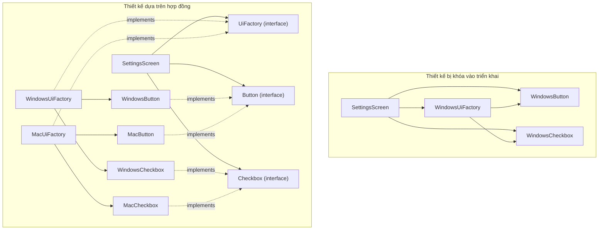

# Factory trả về lớp cụ thể khiến client tiếp tục phụ thuộc chi tiết triển khai

Trong **Abstract Factory**, mục tiêu chính là để client tạo và sử dụng **một họ sản phẩm liên quan** thông qua các hợp đồng trừu tượng. Tuy nhiên, một lỗi thường gặp là factory vẫn công khai các lớp sản phẩm cụ thể, chẳng hạn `WindowsButton` hoặc `MacCheckbox`, làm kiểu trả về. Khi đó, dù đã có “factory”, client vẫn biết và phụ thuộc vào chi tiết triển khai.

Bài này nằm trong chương **Lỗi thường gặp** của module **Học về abstract factory trong design pattern**. Ta sẽ phân tích dấu hiệu, nguyên nhân, hậu quả, cách sửa và những ngoại lệ cần hiểu đúng của lỗi **factory trả về lớp cụ thể khiến client tiếp tục phụ thuộc chi tiết triển khai**.

## 1. Vì sao đây là lỗi trong Abstract Factory?

Giả sử ứng dụng hiển thị một màn hình cài đặt có hai loại sản phẩm:

- **Button**: hiển thị nút Lưu và thực hiện thao tác khi người dùng nhấn.
- **Checkbox**: hiển thị và quản lý lựa chọn “Nhận thông báo”.

Ứng dụng phải hỗ trợ hai **họ sản phẩm**: Windows và macOS. Mỗi họ có `Button` và `Checkbox` riêng nhưng client cần cùng một hành vi ở cả hai hệ điều hành.

Một thiết kế Abstract Factory đúng thường có hai tầng hợp đồng:

1. **Product interfaces** (`Button`, `Checkbox`) mô tả client có thể làm gì với từng loại sản phẩm.
2. **Abstract factory interface** (`UiFactory`) mô tả cách lấy các loại sản phẩm đó. Các phương thức factory trả về **product interface**.

Các concrete factory (`WindowsUiFactory`, `MacUiFactory`) quyết định sản phẩm cụ thể cần tạo. Phần màn hình cài đặt chỉ giữ `UiFactory`, `Button` và `Checkbox`.

> **Nguyên tắc:** Factory cụ thể được quyền biết lớp cụ thể cần khởi tạo; client sử dụng sản phẩm không cần biết lớp đó là gì.

## 2. Phản ví dụ: Có factory nhưng vẫn khóa client vào Windows

Xét cách tổ chức sau (các lớp `WindowsButton` và `WindowsCheckbox` được giả định đã định nghĩa):

```java
final class WindowsUiFactory {
    WindowsButton createButton() {
        return new WindowsButton();
    }

    WindowsCheckbox createCheckbox() {
        return new WindowsCheckbox();
    }
}

final class SettingsScreen {
    private final WindowsButton saveButton;
    private final WindowsCheckbox notifications;

    SettingsScreen(WindowsUiFactory factory) {
        saveButton = factory.createButton();
        notifications = factory.createCheckbox();
    }
}
```

Đây là một lớp hỗ trợ khởi tạo đối tượng, nhưng chưa tạo ra ranh giới phụ thuộc mà Abstract Factory mong muốn:

- `SettingsScreen` phải import/biết ba lớp chỉ dành cho Windows.
- Muốn thay bằng macOS, ta phải sửa kiểu của tham số constructor, hai thuộc tính hoặc tạo nhánh xử lý theo nền tảng.
- Khi kiểm thử màn hình với sản phẩm giả (fake/stub), kiểu thuộc tính cụ thể làm việc thay thế khó hơn; trong Java, lớp `final` ở ví dụ này còn không thể được kế thừa để tạo stub.
- Sản phẩm Windows và macOS có thể cung cấp cùng hành vi, nhưng client không có một **hợp đồng sản phẩm chung** để sử dụng.

Một biến thể còn gây vấn đề rõ hơn là đặt kiểu cụ thể ngay trong “abstract” factory:

```java
interface UiFactory {
    WindowsButton createButton();       // Khóa hợp đồng vào Windows
    WindowsCheckbox createCheckbox();   // Khóa hợp đồng vào Windows
}
```

Khi ấy, `MacUiFactory` không thể trả về `MacButton` và `MacCheckbox` khác kiểu mà vẫn thực hiện đúng hai phương thức nói trên. Ta đã gắn lựa chọn nền tảng vào hợp đồng cần dùng chung cho mọi nền tảng.

## 3. Phân tích nguyên nhân gốc

### 3.1. Nhầm việc gom lệnh `new` với đảo chiều phụ thuộc

Chuyển `new WindowsButton()` từ màn hình vào `WindowsUiFactory` chỉ giải quyết nơi **khởi tạo**. Nếu phương thức factory và biến trong client vẫn mang kiểu `WindowsButton`, phụ thuộc vào nền tảng vẫn còn.

Abstract Factory cần cả hai điều kiện:

- Client nhận một factory thông qua **interface chung**.
- Client nhận và lưu từng sản phẩm thông qua **interface sản phẩm**.

Đổi chỗ câu lệnh `new` mà không đổi ranh giới kiểu dữ liệu không đạt được mục tiêu này.

### 3.2. Thiết kế hợp đồng từ tên lớp triển khai

Nếu bắt đầu bằng “Chúng ta có `WindowsButton` và `WindowsCheckbox`, vậy factory trả về hai lớp này”, API công khai phản chiếu cấu trúc nền tảng. Nên bắt đầu bằng câu hỏi: “Màn hình cần thực hiện những hành vi gì trên nút và checkbox?”.

Ví dụ:

| Client cần | Hợp đồng nên dùng | Chi tiết ẩn bên trong concrete product |
| --- | --- | --- |
| Hiển thị nút và xử lý nhấn | `Button.render()`, `Button.setOnClick(...)` | API vẽ nút, kiểu đường viền, hiệu ứng riêng của OS |
| Đọc và thay đổi lựa chọn | `Checkbox.isChecked()`, `Checkbox.setChecked(...)` | Control native, định dạng trạng thái, cách đồng bộ UI |
| Nhận một bộ widget đồng bộ | `UiFactory.createButton()`, `UiFactory.createCheckbox()` | Chọn `WindowsButton` hay `MacButton` |

### 3.3. Nhầm “họ sản phẩm” với “loại sản phẩm”

- **Loại sản phẩm** là `Button`, `Checkbox`, `TextField` — mỗi loại có hành vi riêng.
- **Họ sản phẩm** là Windows, macOS, Linux — mỗi họ có biến thể cho các loại sản phẩm.

Sai lầm phổ biến là đặt `WindowsButton` vào chữ ký chung của factory, khiến khía cạnh **họ** làm ô nhiễm khía cạnh **loại**. `UiFactory` nên nói “tạo một Button”, còn `WindowsUiFactory` chịu trách nhiệm quyết định nút Windows nào được khởi tạo.

## 4. Sơ đồ phụ thuộc trước và sau



Trong cách sửa, `SettingsScreen` chỉ tham chiếu interface. Mỗi concrete factory vẫn dùng `new` và biết rõ các concrete product của nó; phần đó là trách nhiệm hợp lý của tầng khởi tạo.

## 5. Cách sửa: Factory trả về interface sản phẩm

### 5.1. Định nghĩa hợp đồng hành vi trước

```java
interface Button {
    void render();
    void setOnClick(Runnable action);
    void click();
}

interface Checkbox {
    void render();
    void setChecked(boolean checked);
    boolean isChecked();
}

interface UiFactory {
    Button createButton();
    Checkbox createCheckbox();
}
```

Ở đây `UiFactory` không chứa `Windows` hay `Mac` trong phương thức hoặc kiểu trả về. Cũng không cần trả về `Object` rồi ép kiểu: Java đã có đủ type safety nhờ hai product interface rõ ràng.

### 5.2. Ví dụ Java chạy được cho hai họ sản phẩm

Đặt toàn bộ ví dụ dưới đây vào tệp `Demo.java`:

```java
import java.util.Objects;

// Product interfaces: hành vi client thật sự cần
interface Button {
    void render();
    void setOnClick(Runnable action);
    void click();
}

interface Checkbox {
    void render();
    void setChecked(boolean checked);
    boolean isChecked();
}

// Abstract factory: kiểu trả về trừu tượng
interface UiFactory {
    Button createButton();
    Checkbox createCheckbox();
}

// Họ Windows
final class WindowsButton implements Button {
    private Runnable action = () -> {};

    @Override
    public void render() {
        System.out.println("[Windows] Button Luu");
    }

    @Override
    public void setOnClick(Runnable action) {
        this.action = Objects.requireNonNull(action);
    }

    @Override
    public void click() {
        action.run();
    }
}

final class WindowsCheckbox implements Checkbox {
    private boolean checked;

    @Override
    public void render() {
        System.out.println("[Windows] Checkbox = " + checked);
    }

    @Override
    public void setChecked(boolean checked) {
        this.checked = checked;
    }

    @Override
    public boolean isChecked() {
        return checked;
    }
}

// Họ macOS
final class MacButton implements Button {
    private Runnable action = () -> {};

    @Override
    public void render() {
        System.out.println("[macOS] Button Luu");
    }

    @Override
    public void setOnClick(Runnable action) {
        this.action = Objects.requireNonNull(action);
    }

    @Override
    public void click() {
        action.run();
    }
}

final class MacCheckbox implements Checkbox {
    private boolean checked;

    @Override
    public void render() {
        System.out.println("[macOS] Checkbox = " + checked);
    }

    @Override
    public void setChecked(boolean checked) {
        this.checked = checked;
    }

    @Override
    public boolean isChecked() {
        return checked;
    }
}

// Concrete factories: biết các lớp cụ thể và tạo sản phẩm cùng họ
final class WindowsUiFactory implements UiFactory {
    @Override
    public Button createButton() {
        return new WindowsButton();
    }

    @Override
    public Checkbox createCheckbox() {
        return new WindowsCheckbox();
    }
}

final class MacUiFactory implements UiFactory {
    @Override
    public Button createButton() {
        return new MacButton();
    }

    @Override
    public Checkbox createCheckbox() {
        return new MacCheckbox();
    }
}

// Client: không tham chiếu lớp WindowsButton hay MacButton
final class SettingsScreen {
    private final Button saveButton;
    private final Checkbox notifications;

    SettingsScreen(UiFactory factory) {
        this.saveButton = factory.createButton();
        this.notifications = factory.createCheckbox();
        saveButton.setOnClick(() ->
            System.out.println("Da luu; nhan thong bao = " + notifications.isChecked()));
    }

    void simulate() {
        notifications.setChecked(true);
        notifications.render();
        saveButton.render();
        saveButton.click();
    }
}

// Composition root: chỉ tại đây mới chọn biến thể nền tảng
public class Demo {
    public static void main(String[] args) {
        UiFactory factory =
            args.length > 0 && args[0].equalsIgnoreCase("mac")
                ? new MacUiFactory()
                : new WindowsUiFactory();

        new SettingsScreen(factory).simulate();
    }
}
```

Biên dịch và chạy:

```bash
javac Demo.java
java Demo mac
java Demo windows
```

Kết quả minh họa cho `java Demo mac`:

```text
[macOS] Checkbox = true
[macOS] Button Luu
Da luu; nhan thong bao = true
```

Với Windows, các dòng hiển thị mang tiền tố `[Windows]`; logic lưu cài đặt vẫn giống nhau. Client không đổi khi chuyển nền tảng, vì nó chỉ dựa trên những hành vi chung `Button` và `Checkbox`.

**Lưu ý về phạm vi:** Đây là mô phỏng Java console. Trong UI thật, `render()` có thể dựng widget native và framework chuyển sự kiện nhấn đến callback; `click()` ở ví dụ chỉ giúp thể hiện hành vi mà không cần thư viện đồ họa.

## 6. Factory trả về interface nhưng client vẫn ép kiểu thì sao?

Đổi kiểu trả về của factory mới là một nửa công việc. Nếu client tiếp tục ép kiểu về lớp cụ thể, phụ thuộc vẫn tồn tại:

```java
UiFactory factory = new MacUiFactory();
Button button = factory.createButton();

// Sai: client cho rằng sản phẩm luôn là WindowsButton.
WindowsButton windowsButton = (WindowsButton) button;
// Runtime sẽ ném ClassCastException khi chạy dòng ép kiểu.
```

Tương tự, đoạn sau là tín hiệu client cần biết quá nhiều về nền tảng:

```java
if (button instanceof WindowsButton) {
    // Logic dành riêng Windows bên trong client dùng chung
} else if (button instanceof MacButton) {
    // Logic dành riêng macOS bên trong client dùng chung
}
```

Hướng xử lý đúng phụ thuộc vào **nhu cầu thực sự**:

1. Nếu đó là hành vi chung của mọi nút, bổ sung hành vi ở mức `Button` với ngữ nghĩa trung lập nền tảng, sau khi kiểm tra rằng mọi biến thể đều hỗ trợ hợp lý.
2. Nếu đó là tính năng đặc thù nền tảng, đặt logic ở concrete product, adapter hoặc một dịch vụ nền tảng chuyên biệt được inject. Không ép mọi loại sản phẩm thực hiện phương thức vô nghĩa.
3. Nếu màn hình thực sự chỉ dành cho Windows, hãy ghi rõ phạm vi đó; không cần giả vờ nó là client dùng chung cho mọi nền tảng.

Các kiểu trả về `Object`, chuỗi `"WindowsButton"` hay `Map<String, Object>` cũng không sửa được vấn đề. Chúng chỉ đẩy việc quyết định kiểu và kiểm tra lỗi về phía client, thường còn làm mất kiểm tra kiểu tại thời điểm biên dịch.

## 7. Trường hợp dễ nhầm: Kiểu trả về hiệp biến (covariant return)

Java cho phép một phương thức override trả về **kiểu con** của kiểu trả về trong interface:

```java
interface UiFactory {
    Button createButton();
}

final class WindowsUiFactory implements UiFactory {
    @Override
    public WindowsButton createButton() {
        return new WindowsButton();
    }
}
```

Giả sử `WindowsButton implements Button`, đoạn trên **hợp lệ trong Java**. Điểm cần phân biệt:

- Nếu client giữ biến `UiFactory factory`, biểu thức `factory.createButton()` có kiểu tĩnh `Button`. Client có thể giữ nguyên phụ thuộc trừu tượng.
- Nếu client giữ biến `WindowsUiFactory factory` và sử dụng các API riêng của `WindowsButton`, ranh giới trừu tượng lại bị phá vỡ.

Vì vậy, **không thể kết luận cứ có concrete return type trong một concrete factory là toàn bộ Abstract Factory sai**. Rủi ro xuất hiện khi hợp đồng chung hoặc client công khai/phụ thuộc trực tiếp kiểu cụ thể. Để API dễ đọc và tránh khuyến khích phụ thuộc ngược, ví dụ ở mục 5 chọn khai báo cả hai concrete factory trả về `Button` và `Checkbox`.

## 8. Hậu quả với khả năng mở rộng và kiểm thử

| Tình huống | Factory lộ concrete type | Factory trả về product interface |
| --- | --- | --- |
| Thêm họ Linux | Client có thể cần sửa constructor, biến và nhánh điều kiện. | Thêm `LinuxButton`, `LinuxCheckbox` và `LinuxUiFactory`; màn hình dùng chung giữ nguyên nếu hành vi không đổi. |
| Viết unit test cho màn hình | Phải dùng hoặc dựng đối tượng tương thích với các lớp cụ thể; có thể kéo theo API nền tảng. | Có thể đưa một `FakeUiFactory` trả về `FakeButton` và `FakeCheckbox` theo cùng hợp đồng. |
| Đổi công nghệ UI phía dưới | Kiểu cụ thể dễ lan đến nhiều nơi gọi. | Tầng triển khai và nơi chọn factory chịu phần lớn thay đổi. |
| Bảo đảm sản phẩm cùng họ | Client thường tự chọn hoặc trộn các biến thể. | Mỗi concrete factory tập trung tạo trọn bộ cùng họ. |
| Thêm một loại sản phẩm mới | Phạm vi thay đổi khó kiểm soát nếu API rời rạc. | Vẫn phải mở rộng interface factory và các concrete factory tương ứng; đây là đánh đổi của pattern. |

Ví dụ kiểm thử không cần một widget Windows thật:

```java
final class FakeButton implements Button {
    Runnable action = () -> {};
    boolean clicked;

    public void render() {}
    public void setOnClick(Runnable action) { this.action = action; }
    public void click() { clicked = true; action.run(); }
}

final class FakeCheckbox implements Checkbox {
    private boolean checked;

    public void render() {}
    public void setChecked(boolean value) { checked = value; }
    public boolean isChecked() { return checked; }
}

final class FakeUiFactory implements UiFactory {
    final FakeButton button = new FakeButton();
    final FakeCheckbox checkbox = new FakeCheckbox();

    public Button createButton() { return button; }
    public Checkbox createCheckbox() { return checkbox; }
}

// Trong một phép kiểm thử cùng với các interface/SettingsScreen ở trên:
// FakeUiFactory fake = new FakeUiFactory();
// new SettingsScreen(fake).simulate();
// assert fake.button.clicked;
// assert fake.checkbox.isChecked();
```

Khi phụ thuộc vào interface, test kiểm tra được **luồng sử dụng** mà không cần dựng UI native. Trong hệ thống sản xuất, có thể dùng JUnit và các assertion rõ ràng thay cho biểu thức `assert` minh họa (vốn cần bật `-ea` khi chạy Java).

## 9. Quy trình sửa lỗi trong dự án đang có

Giả sử codebase đang để `WindowsUiFactory.createButton()` trả về `WindowsButton` và rất nhiều client đang lưu kiểu `WindowsButton`. Có thể refactor theo từng bước:

1. **Liệt kê hành vi client đang dùng:** tìm mọi chỗ gọi `createButton()`, `createCheckbox()`, các ép kiểu và lời gọi phương thức đặc thù.
2. **Rút ra hợp đồng chung:** tạo `Button`, `Checkbox` với phương thức thực sự cần thiết cho client dùng chung. Kiểm tra ngữ nghĩa nhất quán giữa các họ.
3. **Cho sản phẩm cụ thể triển khai interface:** `WindowsButton implements Button`, `MacButton implements Button`, tương tự với checkbox.
4. **Sửa hợp đồng factory:** dùng `UiFactory.createButton(): Button` và `createCheckbox(): Checkbox`; mỗi concrete factory cài đặt phương thức tạo cùng một họ.
5. **Đổi kiểu phụ thuộc của client:** constructor nhận `UiFactory`; các thuộc tính lưu `Button` và `Checkbox`. Gỡ `new` và `instanceof`/ép kiểu không cần thiết khỏi logic dùng chung.
6. **Đưa việc chọn họ về composition root:** nơi khởi động ứng dụng hoặc cấu hình dependency injection quyết định factory cụ thể cần truyền vào.
7. **Kiểm tra với ít nhất hai họ và một fake factory:** xác nhận cả hành vi chung lẫn tính nhất quán của họ sản phẩm. Nếu phải sửa quá nhiều client, xem lại hợp đồng có đang lộ yêu cầu riêng của một nền tảng hay không.

Một chỉ dấu thực tế khi review code: **client dùng chung không cần import `WindowsButton`, `MacCheckbox`, `WindowsUiFactory` hay `MacUiFactory`**. Ngoại lệ có chủ đích là composition root, nơi bắt buộc phải chọn triển khai.

## 10. Khi nào trả về lớp cụ thể vẫn hợp lý?

Không phải mọi phương thức tạo đối tượng đều cần Abstract Factory. Trả về kiểu cụ thể có thể phù hợp khi:

- API cố ý cung cấp **một sản phẩm chuyên biệt** và client được phép sử dụng hành vi chuyên biệt đó.
- Ứng dụng chỉ có một triển khai, không cần tráo đổi họ sản phẩm và tính trừu tượng không mang lại lợi ích rõ ràng.
- Concrete factory override phương thức bằng **covariant return**, nhưng client dùng chung vẫn làm việc qua `UiFactory` và product interfaces.

Vấn đề của bài học này phát sinh khi **mục tiêu đã được xác định là hỗ trợ nhiều họ sản phẩm thay thế được cho nhau**, nhưng hợp đồng factory hoặc client lại làm lộ các lớp cụ thể. Trong trường hợp đó, thiết kế đã bỏ lỡ lý do sử dụng Abstract Factory.

## 11. Câu hỏi tự kiểm tra và bài tập

**Tình huống A:** `UiFactory.createButton()` trả về `WindowsButton`. Có thể cài đặt `MacUiFactory` trả về một `MacButton` không kế thừa `WindowsButton` không?

**Trả lời:** Không, vì `MacButton` không phải kiểu con hợp lệ của `WindowsButton`. Cần đổi hợp đồng thành `Button createButton()` với cả hai lớp triển khai `Button`.

**Tình huống B:** Interface `UiFactory` trả về `Button`, nhưng client viết `(WindowsButton) factory.createButton()`. Đã khắc phục lỗi chưa?

**Trả lời:** Chưa. Client vẫn phụ thuộc lớp cụ thể và có thể gặp `ClassCastException` khi dùng factory của macOS.

**Tình huống C:** `WindowsUiFactory` override `createButton()` trả về `WindowsButton` trong khi `UiFactory` trả về `Button`. Đây có chắc là lỗi không?

**Trả lời:** Không chắc. Java cho phép kiểu trả về hiệp biến. Cần xem **kiểu mà client phụ thuộc** và liệu client có sử dụng chi tiết riêng của Windows hay không.

**Bài tập:** Mở rộng `UiFactory` để tạo thêm `TextField` dùng cho nhập tên người dùng. Thiết kế `TextField` theo hành vi nhập và đọc nội dung, cài đặt `WindowsTextField` cùng `MacTextField`, sau đó thêm `createTextField()` vào hai factory. Kiểm tra rằng `SettingsScreen` có thể dùng `TextField` mà không phải import biến thể nền tảng nào. Giải thích vì sao việc **thêm một loại sản phẩm** làm cả hai concrete factory phải thay đổi, trong khi thêm **một họ sản phẩm** thường không buộc client dùng chung thay đổi.

**Ghi nhớ:** Abstract Factory chỉ giúp giảm phụ thuộc triển khai khi **cả factory lẫn sản phẩm đều được sử dụng qua hợp đồng phù hợp**. Concrete factory có trách nhiệm chọn và khởi tạo lớp cụ thể; client chỉ yêu cầu và vận hành sản phẩm thông qua interface. Đừng để chữ ký trả về hoặc thao tác ép kiểu vô tình mang chi tiết nền tảng trở lại client.
