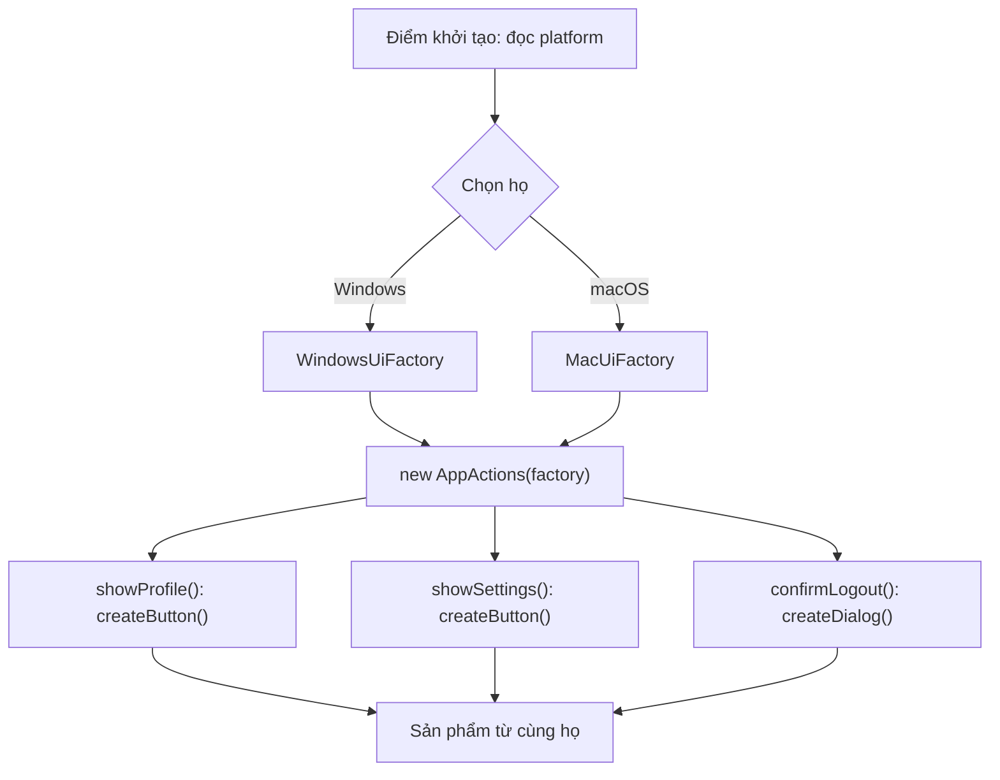

# Lặp lại if hoặc switch chọn biến thể trong từng phương thức nghiệp vụ

Trong module `SOFTWARE_DESIGN_DESIGN_PATTERN_CREATIONAL_ABSTRACT_FACTORY` (*Học về abstract factory trong design pattern*), một lỗi dễ gặp là để mỗi phương thức nghiệp vụ tự chọn phiên bản đối tượng cần tạo bằng những nhánh `if` hoặc `switch` giống nhau. Cách viết này thường xuất hiện trước khi áp dụng **Abstract Factory**, nhưng cũng có thể còn sót lại sau khi đã tạo các lớp factory.

Trong chương **Lỗi thường gặp**, bài học phân tích dấu hiệu nhận biết, tác hại và cách sửa lỗi **lặp lại điều kiện chọn biến thể**. Mục tiêu là đưa quyết định về **họ sản phẩm** đến một nơi cấu hình rõ ràng, sau đó để các phương thức nghiệp vụ sử dụng các **abstract product** từ cùng một **abstract factory**.

## 1. Tình huống: nhiều thao tác đều tự chọn Windows hay macOS

Một ứng dụng desktop có ba thao tác: hiển thị nút sửa hồ sơ, hiển thị nút lưu cài đặt và mở hộp thoại xác nhận đăng xuất. Ứng dụng hỗ trợ hai họ giao diện Windows và macOS.

| Loại sản phẩm | Họ Windows | Họ macOS |
| --- | --- | --- |
| `Button` | `WindowsButton` | `MacButton` |
| `Dialog` | `WindowsDialog` | `MacDialog` |

Giả sử các lớp concrete product đã tồn tại. Mã client dưới đây minh họa lỗi: **mỗi phương thức tự kiểm tra nền tảng để quyết định tạo đối tượng nào**.

```java
// Minh họa anti-pattern; giả định các lớp concrete product đã có.
class AppActionsBefore {
    private final String platform;

    AppActionsBefore(String platform) {
        this.platform = platform;
    }

    String showProfile() {
        Button button;
        if (platform.equalsIgnoreCase("mac")) {
            button = new MacButton();
        } else {
            button = new WindowsButton();
        }
        return button.render("Sửa hồ sơ");
    }

    String showSettings() {
        Button button;
        if (platform.equalsIgnoreCase("mac")) {
            button = new MacButton();
        } else {
            button = new WindowsButton();
        }
        return button.render("Lưu cài đặt");
    }

    String confirmLogout() {
        Dialog dialog;
        if (platform.equalsIgnoreCase("mac")) {
            dialog = new MacDialog();
        } else {
            dialog = new WindowsDialog();
        }
        return dialog.render("Bạn muốn đăng xuất?");
    }
}
```

Cả ba phương thức đều có cùng câu hỏi: **“Ứng dụng đang chạy với họ giao diện nào?”**. Đây không phải là quyết định nghiệp vụ riêng của `showProfile()`, `showSettings()` hay `confirmLogout()`; nó là quyết định **cấu hình biến thể**. Lặp lại nó trong từng thao tác làm tăng số nơi cần sửa và tăng nguy cơ tạo sản phẩm không đồng nhất.

> Quy tắc nhận biết: khi nhiều phương thức chỉ khác nhau ở tên lớp concrete được tạo ra theo cùng một biến thể, hãy xem liệu việc chọn **một họ sản phẩm** có thể được tập trung trong Abstract Factory hay không.

## 2. Vì sao mã vẫn chạy nhưng thiết kế có vấn đề?

### 2.1. Thêm một họ mới gây sửa đổi dây chuyền

Nếu cần hỗ trợ Linux, ta phải tìm và sửa mọi nhánh `if`/`switch` tương ứng, bổ sung `LinuxButton` và `LinuxDialog` tại từng vị trí. Chỉ cần bỏ sót `confirmLogout()`, ứng dụng Linux có thể hiện nút phong cách Linux nhưng hộp thoại Windows.

Sự cố này dễ lọt qua trình biên dịch: `WindowsDialog` và `LinuxDialog` có thể cùng triển khai `Dialog`, nên việc chọn nhầm họ là **lỗi hành vi/thiết kế**, không nhất thiết là lỗi kiểu dữ liệu.

### 2.2. Logic nghiệp vụ biết quá nhiều chi tiết khởi tạo

`showProfile()` cần một `Button` có thể render nhãn “Sửa hồ sơ”; nó không cần biết `MacButton` và `WindowsButton` được khởi tạo thế nào. Khi gọi `new MacButton()` hoặc `new WindowsButton()`, client phụ thuộc trực tiếp vào các lớp cụ thể.

Hệ quả là thay đổi cách dựng widget, tham số constructor hoặc cơ chế cấu hình nền tảng có thể kéo theo sửa mã ở nhiều màn hình.

### 2.3. Cùng một quy tắc bị sao chép và có thể lệch nhau

Một phương thức dùng `platform.equalsIgnoreCase("mac")`, phương thức khác dùng `platform.equals("macOS")`, phương thức thứ ba quên kiểm tra chuỗi rỗng. Khi đó các thao tác có thể tạo các đối tượng thuộc những họ khác nhau dù chỉ có **một** cấu hình nền tảng.

Đặc biệt nguy hiểm là nhánh `else` ngầm coi mọi giá trị không phải `mac` đều là Windows. Nhập sai `"linux"` hoặc `"mca"` sẽ âm thầm cho ra giao diện Windows thay vì báo cấu hình không hợp lệ.

### 2.4. Kiểm thử bị phân tán

Thay vì kiểm tra một điểm lựa chọn biến thể cùng từng factory, ta phải kiểm tra các nhánh tương tự trong nhiều phương thức. Càng nhiều nơi chứa điều kiện, nguy cơ **sửa một nơi, quên nơi khác** càng lớn.

## 3. Refactor: chọn một factory, sử dụng qua interface

Abstract Factory chia trách nhiệm thành ba phần:

1. **Abstract product** (`Button` và `Dialog`) công bố hành vi mà client cần.
2. **Concrete factory** (`WindowsUiFactory`, `MacUiFactory`) tạo đầy đủ các sản phẩm thuộc đúng họ.
3. **Composition root** (điểm khởi tạo ứng dụng) chọn factory dựa trên cấu hình và truyền nó cho client.

Client chỉ còn gọi `factory.createButton()` hoặc `factory.createDialog()` trong từng thao tác. Điều kiện chọn nền tảng xuất hiện tại điểm khởi tạo, **không lặp lại trong logic hiển thị màn hình**.



**Lưu ý:** `AppActions` không có biến `platform` hoặc nhánh chọn biến thể. Nó có một tham chiếu `UiFactory` được cấp qua constructor injection. Điều kiện ở composition root vẫn cần thiết để chọn biến thể; vấn đề cần xử lý là **sao chép cùng một quyết định ở nhiều phương thức nghiệp vụ**.

## 4. Ví dụ Java hoàn chỉnh sau khi sửa

Chương trình sau thay ba đoạn điều kiện trùng nhau bằng một `UiFactory`. Các phương thức `render()` trả về chuỗi để dễ quan sát, không tạo cửa sổ GUI thực. Lưu toàn bộ vào `VariantSelectionPitfallDemo.java`:

```java
import java.util.Locale;
import java.util.Objects;

public class VariantSelectionPitfallDemo {

    // Abstract products: hợp đồng do client sử dụng.
    interface Button {
        String render(String label);
    }

    interface Dialog {
        String render(String message);
    }

    // Abstract factory: cung cấp trọn bộ các loại sản phẩm.
    interface UiFactory {
        Button createButton();
        Dialog createDialog();
    }

    // Các concrete product của họ Windows.
    static final class WindowsButton implements Button {
        @Override
        public String render(String label) {
            return "[Windows] Button: " + label;
        }
    }

    static final class WindowsDialog implements Dialog {
        @Override
        public String render(String message) {
            return "[Windows] Dialog: " + message;
        }
    }

    // Các concrete product của họ macOS.
    static final class MacButton implements Button {
        @Override
        public String render(String label) {
            return "[macOS] Button: " + label;
        }
    }

    static final class MacDialog implements Dialog {
        @Override
        public String render(String message) {
            return "[macOS] Dialog: " + message;
        }
    }

    // Concrete factories: quyết định lớp nào được tạo.
    static final class WindowsUiFactory implements UiFactory {
        @Override
        public Button createButton() {
            return new WindowsButton();
        }

        @Override
        public Dialog createDialog() {
            return new WindowsDialog();
        }
    }

    static final class MacUiFactory implements UiFactory {
        @Override
        public Button createButton() {
            return new MacButton();
        }

        @Override
        public Dialog createDialog() {
            return new MacDialog();
        }
    }

    // Client: không có if/switch theo biến thể trong nghiệp vụ.
    static final class AppActions {
        private final UiFactory factory;

        AppActions(UiFactory factory) {
            this.factory = Objects.requireNonNull(factory, "factory");
        }

        String showProfile() {
            Button button = factory.createButton();
            return button.render("Sửa hồ sơ");
        }

        String showSettings() {
            Button button = factory.createButton();
            return button.render("Lưu cài đặt");
        }

        String confirmLogout() {
            Dialog dialog = factory.createDialog();
            return dialog.render("Bạn muốn đăng xuất?");
        }
    }

    // Composition root chọn factory đúng một lần khi khởi tạo.
    static UiFactory selectFactory(String platform) {
        String normalized = Objects.requireNonNull(
                platform, "platform").trim().toLowerCase(Locale.ROOT);

        switch (normalized) {
            case "windows":
                return new WindowsUiFactory();
            case "mac":
            case "macos":
                return new MacUiFactory();
            default:
                throw new IllegalArgumentException(
                        "Nền tảng không hỗ trợ: " + platform);
        }
    }

    public static void main(String[] args) {
        String platform = args.length == 0 ? "windows" : args[0];
        UiFactory factory = selectFactory(platform);
        AppActions app = new AppActions(factory);

        System.out.println(app.showProfile());
        System.out.println(app.showSettings());
        System.out.println(app.confirmLogout());
    }
}
```

Biên dịch và chạy:

```bash
javac -encoding UTF-8 VariantSelectionPitfallDemo.java
java VariantSelectionPitfallDemo windows
java VariantSelectionPitfallDemo mac
```

Với `windows`, chương trình in:

```text
[Windows] Button: Sửa hồ sơ
[Windows] Button: Lưu cài đặt
[Windows] Dialog: Bạn muốn đăng xuất?
```

Với `mac`, chương trình in:

```text
[macOS] Button: Sửa hồ sơ
[macOS] Button: Lưu cài đặt
[macOS] Dialog: Bạn muốn đăng xuất?
```

Nếu chạy với `linux`, chương trình ném `IllegalArgumentException` tại `selectFactory()`, vì chưa có factory được cấu hình cho Linux. Đây là lựa chọn chủ ý nhằm phát hiện cấu hình chưa hỗ trợ, thay vì âm thầm dùng sai họ sản phẩm.

Điểm quan trọng không phải là chương trình **không còn bất kỳ `switch` nào**. Nó vẫn có một `switch` ở ranh giới chọn factory. Điều thay đổi là **ba phương thức nghiệp vụ không còn lặp lại lựa chọn biến thể** và mỗi lời gọi đều lấy sản phẩm từ cùng một factory.

## 5. Phân tích thay đổi trước và sau

| Khía cạnh | Trước: nhiều điều kiện rải rác | Sau: Abstract Factory |
| --- | --- | --- |
| Nơi chọn Windows/macOS | Từng phương thức của client | Một điểm cấu hình (`selectFactory()`) |
| Phụ thuộc của client | `WindowsButton`, `MacButton`, `WindowsDialog`, `MacDialog` | `UiFactory`, `Button`, `Dialog` |
| Thêm họ Linux | Phải sửa từng đoạn chọn biến thể | Bổ sung `LinuxButton`, `LinuxDialog`, `LinuxUiFactory` và đăng ký lựa chọn |
| Đảm bảo cùng họ | Dựa vào việc mọi nhánh được viết giống nhau | Concrete factory tập trung quy tắc sản phẩm đi cùng nhau |
| Kiểm thử client | Phải kiểm tra nhiều nhánh chọn biến thể | Có thể thay factory bằng fake để kiểm tra lời gọi |
| Thêm loại sản phẩm | Có thể thêm nhánh tại nơi sử dụng | Phải bổ sung interface sản phẩm và phương thức vào tất cả factory |

Abstract Factory giúp cải thiện tính mở rộng **theo chiều họ sản phẩm** khi danh sách loại sản phẩm tương đối ổn định. Nếu thêm loại mới như `Slider`, mọi concrete factory vẫn phải được cập nhật để cung cấp `createSlider()`. Vì vậy, mẫu không xóa bỏ toàn bộ chi phí thay đổi; nó **tổ chức lại thay đổi theo đúng trách nhiệm**.

## 6. Cách phát hiện lỗi trong codebase

Tìm các phương thức có một hoặc nhiều dấu hiệu sau:

- Cùng một biến `theme`, `platform`, `provider` hoặc `variant` liên tục được so sánh với những giá trị giống nhau.
- Mỗi nhánh tạo một đối tượng concrete khác nhau nhưng kết quả đều được dùng qua cùng interface.
- Nhiều thao tác có các đoạn `if (isMac) new MacX() else new WindowsX()` gần giống nhau.
- Khi thêm biến thể mới, lập trình viên phải tìm và sửa rất nhiều nhánh rải trong màn hình, service hoặc controller.
- Các nhánh chọn biến thể xuất hiện cùng logic nghiệp vụ không liên quan, khiến việc kiểm thử và bảo trì chồng chéo.

Một quy trình refactor an toàn:

1. **Xác định trục biến thể.** Chẳng hạn `platform` có Windows/macOS. Kiểm tra những lựa chọn này có thực sự quyết định **một bộ sản phẩm cùng họ** hay không.
2. **Liệt kê các loại sản phẩm.** Ví dụ `Button` và `Dialog`. Định nghĩa hợp đồng `render()` cần thiết cho client.
3. **Định nghĩa abstract factory.** Tạo `UiFactory` với phương thức tạo sản phẩm tương ứng.
4. **Hiện thực concrete factory cho từng họ.** `WindowsUiFactory` chỉ tạo sản phẩm Windows; `MacUiFactory` chỉ tạo sản phẩm macOS.
5. **Truyền factory vào client.** Thay các đoạn chọn lớp cụ thể trong phương thức nghiệp vụ bằng lời gọi trên `UiFactory`.
6. **Chuyển lựa chọn biến thể đến composition root.** Đọc cấu hình một lần khi khởi tạo client và xử lý rõ giá trị không hỗ trợ.
7. **Kiểm chứng hành vi.** So sánh đầu ra trước/sau trên từng họ, kiểm tra tình huống nhập biến thể sai và bảo đảm sản phẩm không trộn họ.

Trong dự án thực tế, nên refactor theo từng client hoặc từng luồng nghiệp vụ để hạn chế phạm vi chỉnh sửa, sau đó gom tất cả về cơ chế tạo factory được dùng chung.

## 7. Kiểm thử: tập trung vào quy tắc thay vì chỉ đếm if

Đừng đánh giá việc sửa lỗi chỉ bằng số lượng `if` đã xóa. Hai tính chất quan trọng hơn là **client không cần biết concrete product** và **factory được chọn tạo bộ sản phẩm nhất quán**.

### 7.1. Kiểm tra factory đúng họ

Các đoạn sau có thể đặt bên trong lớp `VariantSelectionPitfallDemo` để kiểm tra quy tắc họ:

```java
static void verifyFactories() {
    UiFactory windows = new WindowsUiFactory();
    UiFactory mac = new MacUiFactory();

    if (!(windows.createButton() instanceof WindowsButton)
            || !(windows.createDialog() instanceof WindowsDialog)) {
        throw new AssertionError("Windows factory bị trộn sản phẩm");
    }

    if (!(mac.createButton() instanceof MacButton)
            || !(mac.createDialog() instanceof MacDialog)) {
        throw new AssertionError("macOS factory bị trộn sản phẩm");
    }
}
```

Nếu `MacUiFactory.createDialog()` vô tình trả về `WindowsDialog`, đoạn kiểm tra này phát hiện được lỗi dù mã vẫn biên dịch. Trong mã nghiệp vụ, client thường **không nên** dùng `instanceof` để chọn hành vi; đây chỉ là kiểm tra ở ranh giới factory.

### 7.2. Kiểm tra client bằng fake factory

Một fake factory trả các sản phẩm đơn giản giúp xác nhận mỗi thao tác yêu cầu đúng loại sản phẩm, không cần tạo widget thật:

```java
static final class RecordingUiFactory implements UiFactory {
    int buttonsCreated;
    int dialogsCreated;

    @Override
    public Button createButton() {
        buttonsCreated++;
        return label -> "[Fake] Button: " + label;
    }

    @Override
    public Dialog createDialog() {
        dialogsCreated++;
        return message -> "[Fake] Dialog: " + message;
    }
}

static void verifyClient() {
    RecordingUiFactory fake = new RecordingUiFactory();
    AppActions app = new AppActions(fake);

    app.showProfile();
    app.showSettings();
    app.confirmLogout();

    if (fake.buttonsCreated != 2 || fake.dialogsCreated != 1) {
        throw new AssertionError("Client yêu cầu sai số loại sản phẩm");
    }
}
```

Hai phương thức kiểm tra có thể được gọi từ `main()` sau phần chạy ứng dụng. Ở dự án thật, đặt chúng trong một bộ kiểm thử riêng; kết hợp kiểm tra factory, kiểm tra client và kiểm tra giao diện thực tế nếu có GUI.

## 8. Khi nào không cần refactor sang Abstract Factory?

Không phải mọi `if`/`switch` trong logic nghiệp vụ đều là lỗi, và không phải mọi việc chọn biến thể đều cần một Abstract Factory.

| Tình huống | Cách cân nhắc |
| --- | --- |
| Nhiều loại sản phẩm (Button, Dialog, Checkbox) cùng thay đổi theo một họ | Abstract Factory có thể tập trung cách tạo cả bộ |
| Chỉ có một loại đối tượng với nhiều thuật toán | Strategy, Factory Method hoặc một factory đơn giản có thể dễ hiểu hơn |
| `if` quyết định **quy tắc nghiệp vụ** (ví dụ chỉ người có quyền mới được xóa) | Giữ điều kiện cần thiết; nó không phải lựa chọn họ sản phẩm |
| Chỉ thay màu/theme của widget nhưng không đổi cách tạo đối tượng | Có thể dùng design tokens, theme provider hoặc cấu hình sẵn của framework |
| Nhu cầu chọn biến thể phát sinh riêng cho từng yêu cầu chạy (ví dụ mỗi tenant có theme khác nhau) | Chọn hoặc truyền factory theo **phạm vi yêu cầu** phù hợp; tránh dùng một biến toàn cục cho mọi tenant |
| Theme phải đổi trực tiếp khi màn hình đang hiển thị | Cần cơ chế cập nhật/tạo lại widget; bản thân Abstract Factory không tự đổi các sản phẩm đã tạo |

Điều kiện dùng để **chọn factory tại điểm cấu hình** vẫn hợp lý. Điều kiện dùng để xử lý **những quy tắc nghiệp vụ khác nhau** cũng có thể hợp lý. Chỉ nên tách những nhánh mang tính **chọn phiên bản đối tượng cần tạo** mà nhiều phương thức đang lặp lại, khi chúng phản ánh một họ sản phẩm nhất quán.

## 9. Bài tập thực hành

**Bài tập 1 — Tìm sự lặp lại.** Thêm một phương thức `showHelp()` vào ví dụ trước khi refactor để hiển thị `Button` “Trợ giúp”. Xác định số đoạn điều kiện mới cần viết. Sau đó triển khai `showHelp()` trong `AppActions` đã được tiêm `UiFactory`; so sánh thay đổi.

**Bài tập 2 — Thêm Linux.** Viết `LinuxButton`, `LinuxDialog` và `LinuxUiFactory`, rồi thêm lựa chọn `linux` tại `selectFactory()`. Chạy cả ba thao tác và xác minh chúng đều sử dụng sản phẩm Linux mà không sửa `AppActions`.

**Bài tập 3 — Cố ý trộn họ.** Sửa `MacUiFactory.createDialog()` để trả về `WindowsDialog`. Dự đoán kết quả biên dịch; sau đó chạy `verifyFactories()` để quan sát lỗi. Giải thích vì sao kiểu trả về `Dialog` không đủ để bảo đảm **cùng họ**.

**Bài tập 4 — Đánh giá cách chọn biến thể.** Giả sử ứng dụng có 20 phương thức xử lý UI, hai loại sản phẩm và ba họ giao diện. Hãy phân tích hệ quả khi 20 phương thức đều có `switch(platform)` và khi toàn bộ nhận `UiFactory` qua constructor. Nêu thêm tình huống một số phương thức vẫn cần `if` vì quy tắc nghiệp vụ khác nhau.

**Câu hỏi tự kiểm tra:** Sau khi áp dụng Abstract Factory, câu lệnh chọn Windows/macOS nên nằm ở đâu? Vì sao client chỉ nên phụ thuộc vào `UiFactory` và các abstract product? Nếu một concrete factory trả về sản phẩm sai họ, trình biên dịch có luôn phát hiện được hay không?

## Kết luận

Lỗi **lặp lại if hoặc switch chọn biến thể trong từng phương thức nghiệp vụ** khiến quyết định cấu hình bị phân tán, tăng công sửa đổi và dễ tạo ra các sản phẩm không đồng nhất. Khi nhiều đối tượng thuộc **cùng một họ** cần được khởi tạo, hãy tập trung lựa chọn concrete factory tại điểm khởi tạo ứng dụng, truyền nó cho client và để các phương thức nghiệp vụ gọi **abstract factory** để tạo sản phẩm. Điều kiện chọn biến thể vẫn tồn tại ở nơi thích hợp, còn logic nghiệp vụ không phải gánh nhiệm vụ chọn các lớp concrete.
