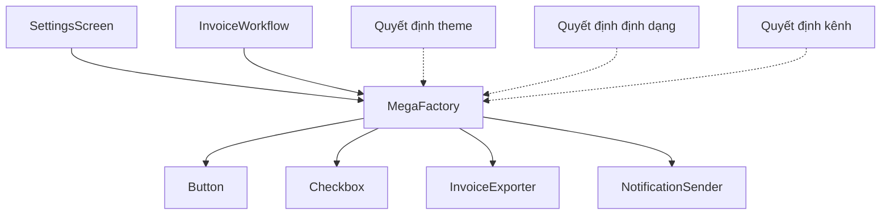
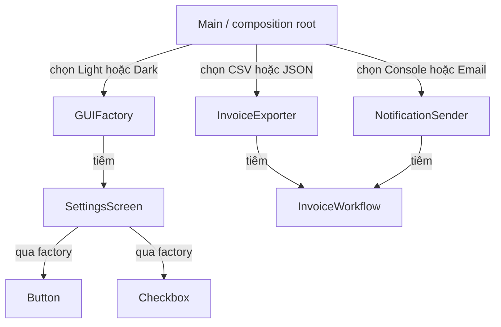

# Dùng một factory khổng lồ cho các sản phẩm không có quan hệ tương thích

## 1. Nhận diện lỗi thiết kế

**Abstract Factory** thuộc nhóm *Creational Design Patterns* giúp tạo **một họ gồm nhiều loại sản phẩm liên quan** mà client không cần biết các lớp hiện thực. Điểm quan trọng là những sản phẩm trong cùng một họ có **mối quan hệ tương thích hoặc quy tắc phối hợp cụ thể**, chẳng hạn `LightButton` và `LightCheckbox` đều tuân theo Light theme.

Một lỗi phổ biến là thấy ứng dụng có nhiều đối tượng cần tạo rồi đưa tất cả phương thức khởi tạo vào **một interface factory khổng lồ**:

```java
// Ví dụ minh họa thiết kế có vấn đề; các kiểu trả về sẽ được giải thích bên dưới.
interface MegaFactory {
    Button createButton();
    Checkbox createCheckbox();
    InvoiceExporter createInvoiceExporter();
    NotificationSender createNotificationSender();
}
```

Thoạt nhìn, `MegaFactory` có vẻ giúp “tập trung việc tạo đối tượng”. Nhưng nó đang trộn ba quyết định độc lập:

1. **Giao diện**: Light hay Dark, cần nhất quán giữa `Button` và `Checkbox`.
2. **Xuất hóa đơn**: CSV hay JSON, tùy hệ thống nhận dữ liệu.
3. **Gửi thông báo**: console hay email, tùy kênh liên lạc.

Không có quy tắc nào bắt buộc hóa đơn CSV phải đi với nút Light, hoặc thông báo email phải đi với checkbox Dark. Vì vậy, đưa cả ba nhóm vào cùng một factory làm giảm tính gắn kết (*cohesion*) và tạo ra phụ thuộc không cần thiết.

**Phân biệt quan trọng:** Nhiều phương thức `create...` **không tự động là dấu hiệu sai**. Một factory có mười phương thức vẫn có thể hợp lý nếu chúng cùng biểu diễn một họ tương thích. Lỗi là **gom các sản phẩm không có mối quan hệ cần được bảo đảm bởi cùng một factory**.

## 2. Ví dụ: ba nhu cầu thực sự độc lập

Giả sử một ứng dụng bán hàng trên máy tính có màn hình cài đặt và quy trình xuất hóa đơn:

| Trục thay đổi | Các lựa chọn | Điều cần giữ nhất quán |
| --- | --- | --- |
| Theme giao diện | Light, Dark | Các component GUI cùng một theme. |
| Định dạng hóa đơn | CSV, JSON | Dữ liệu đầu ra đúng định dạng mà bên nhận yêu cầu. |
| Kênh thông báo | Console, Email | Nội dung được gửi qua kênh cấu hình. |

Ở đây chỉ **`Button` và `Checkbox` tạo thành một họ sản phẩm UI**. `InvoiceExporter` và `NotificationSender` có hợp đồng riêng; chúng không cần cùng theme với giao diện, cũng không cần thuộc một “họ” với nhau.

Một thiết kế trộn lẫn có thể đặt tên concrete factory theo cả ba lựa chọn:

```text
LightCsvConsoleFactory
LightCsvEmailFactory
LightJsonConsoleFactory
LightJsonEmailFactory
DarkCsvConsoleFactory
DarkCsvEmailFactory
DarkJsonConsoleFactory
DarkJsonEmailFactory
```

Với 2 theme × 2 định dạng × 2 kênh, có **8 tổ hợp cấu hình**. Nếu mỗi tổ hợp bị biểu diễn bằng một concrete factory riêng, ta có nguy cơ cần 8 lớp dù chỉ có hai loại GUI, hai exporter và hai notifier.

Đây là **nguy cơ bùng nổ tổ hợp trong cách triển khai này**, không phải quy luật rằng mọi interface factory lớn đều bắt buộc sinh đúng 8 lớp. Vẫn có thể viết một factory với nhiều nhánh điều kiện, nhưng khi đó nó phải hiểu cả ba trục cấu hình độc lập và thường trở thành một điểm sửa đổi tập trung.

## 3. Vì sao “mega factory” gây khó bảo trì?

### 3.1. Kéo các trách nhiệm không liên quan vào cùng hợp đồng

Một client chỉ cần tạo nút và checkbox vẫn phải phụ thuộc vào interface có cả phương thức xuất hóa đơn và gửi thông báo. Khi bổ sung một định dạng hóa đơn mới hoặc thay đổi chữ ký `createInvoiceExporter()`, những concrete factory vốn chỉ khác nhau ở theme cũng có nguy cơ phải sửa.

Đây là một dấu hiệu vi phạm tinh thần **Interface Segregation Principle (ISP)**: client phải biết một hợp đồng rộng hơn nhu cầu của nó. Đồng thời, factory dễ phải thay đổi vì nhiều lý do khác nhau, gây sức ép lên **Single Responsibility Principle (SRP)**.

### 3.2. Tạo quan hệ phụ thuộc giả giữa các trục lựa chọn

Nếu theme đổi từ Light sang Dark, phương thức tạo exporter vẫn nên cho ra cùng định dạng CSV đang dùng. Nhưng trong thiết kế gom tất cả vào một concrete factory, thay factory để đổi theme có thể vô tình đổi luôn định dạng hoặc kênh thông báo.

Điều đó không chỉ làm tăng số lớp mà còn khiến cấu hình dễ bị sai: một quyết định thuộc UI có thể ảnh hưởng đến nghiệp vụ hóa đơn.

### 3.3. Mở rộng nhỏ có thể gây sửa đổi diện rộng

Giả sử hệ thống thêm định dạng XML. Với `MegaFactory`, tất cả implementation có thể cần thêm logic hoặc nhánh cấu hình cho XML, ngay cả lớp chuyên tạo GUI Light/Dark. Trong thiết kế tách đúng, chỉ nhóm xuất hóa đơn và điểm lựa chọn exporter cần thay đổi.

Khả năng mở rộng của Abstract Factory thường tốt khi thêm **một họ sản phẩm mới cho cùng các loại product đã định nghĩa**. Nó kém thuận lợi khi thêm **loại product mới**, vì cần cập nhật toàn bộ concrete factory. Nếu các loại product mới còn không liên quan nhau, chi phí này càng khó biện minh.

### 3.4. Kiểm thử trở nên cồng kềnh

Để kiểm tra một màn hình chỉ sử dụng `Button` và `Checkbox`, fake `MegaFactory` vẫn phải cung cấp implementation cho `createInvoiceExporter()` và `createNotificationSender()` hoặc dùng stub không có ý nghĩa. Kiểm thử có thể bị kéo theo những phụ thuộc của các subsystem không liên quan.

Khi các mảng chức năng được tách, test UI chỉ cần fake `GUIFactory`; test hóa đơn chỉ cần fake `InvoiceExporter`; test thông báo chỉ cần fake `NotificationSender`.

## 4. Sơ đồ so sánh trước và sau

### Trước: các client phụ thuộc vào một factory rộng



Trong sơ đồ này, các client có nhu cầu khác nhau cùng phụ thuộc vào một interface rất rộng. Việc chọn ba nhóm sản phẩm bị đẩy vào cùng một nơi.

### Sau: factory chỉ bao phủ họ GUI có quan hệ tương thích



- `GUIFactory` vẫn là Abstract Factory vì cung cấp **cặp sản phẩm cùng theme**.
- `InvoiceExporter` và `NotificationSender` là các interface chiến lược hoặc cổng phụ thuộc thông thường, được client nhận qua constructor.
- `Main` chọn và lắp ghép phụ thuộc; nó không cần trở thành một `MegaFactory` khác.

Chuyển công việc khởi tạo vào composition root là một quyết định lắp ghép. Việc có một nơi lắp ghép nhiều subsystem **không đồng nghĩa** nơi đó phải công bố một interface Abstract Factory chung cho tất cả subsystem.

## 5. Refactor theo từng bước

Để thay đổi một factory lớn đang tồn tại, nên đi từ **quan hệ giữa các sản phẩm** chứ không tách máy móc theo số lượng phương thức.

**Bước 1 — Liệt kê các phương thức tạo sản phẩm.** Ghi rõ client nào dùng từng phương thức và điều kiện nào quyết định concrete product cần tạo.

| Phương thức cũ | Client dùng | Quy tắc chọn |
| --- | --- | --- |
| `createButton()` | Màn hình cài đặt | Light/Dark |
| `createCheckbox()` | Màn hình cài đặt | Light/Dark |
| `createInvoiceExporter()` | Quy trình xuất hóa đơn | CSV/JSON |
| `createNotificationSender()` | Quy trình thông báo | Console/Email |

**Bước 2 — Tìm bất biến tương thích thật sự.** Nút và checkbox phải cùng theme. Không có ràng buộc tương thích tương tự giữa theme với định dạng hóa đơn hay kênh thông báo.

**Bước 3 — Giữ một Abstract Factory cho họ GUI.** `GUIFactory` chỉ khai báo `createButton()` và `createCheckbox()`. Concrete factory Light/Dark chịu trách nhiệm tạo đúng hai product cùng theme.

**Bước 4 — Tiêm trực tiếp các phụ thuộc độc lập.** Quy trình hóa đơn nhận `InvoiceExporter` và `NotificationSender`. Nếu cần chọn implementation khi khởi chạy, composition root hoặc DI container hiện có thực hiện điều đó.

**Bước 5 — Chuyển dần các client và loại bỏ hợp đồng cũ.** Khi mọi client đã dùng interface phù hợp và không còn chỗ tham chiếu `MegaFactory`, xóa interface/implementation cũ, tránh giữ hai cách khởi tạo song song không cần thiết.

**Bước 6 — Kiểm tra thay đổi độc lập.** Đổi Light ↔ Dark phải không đổi định dạng hóa đơn hoặc kênh thông báo; đổi CSV ↔ JSON không được buộc sửa `SettingsScreen`.

## 6. Ví dụ Java hoàn chỉnh sau refactor

Để quan sát trực tiếp tính độc lập của ba trục, ví dụ dưới đây dùng Java thuần (JDK 8+), không cần Spring hay thư viện giao diện. Mọi lớp được khai báo trong **một tệp `Main.java`**; chỉ `Main` là lớp `public`.

Chúng ta dùng chuỗi để mô phỏng UI, xuất dữ liệu và thông báo. `CsvInvoiceExporter`, `JsonInvoiceExporter` chỉ tạo **nội dung dạng text**; `EmailNotificationSender` chỉ in mô phỏng ra console, **không thực sự gửi email**.

```java
// Main.java
import java.util.Objects;

// -------------------- Họ sản phẩm GUI --------------------
interface Button {
    String render(String label);
}

interface Checkbox {
    String render(String label, boolean checked);
}

interface GUIFactory {
    Button createButton();
    Checkbox createCheckbox();
}

final class LightButton implements Button {
    @Override
    public String render(String label) {
        return "[Light] Button: [" + label + "]";
    }
}

final class LightCheckbox implements Checkbox {
    @Override
    public String render(String label, boolean checked) {
        return "[Light] Checkbox: [" + (checked ? "x" : " ") + "] " + label;
    }
}

final class DarkButton implements Button {
    @Override
    public String render(String label) {
        return "[Dark] Button: <" + label + ">";
    }
}

final class DarkCheckbox implements Checkbox {
    @Override
    public String render(String label, boolean checked) {
        return "[Dark] Checkbox: <" + (checked ? "x" : " ") + "> " + label;
    }
}

final class LightGUIFactory implements GUIFactory {
    @Override
    public Button createButton() {
        return new LightButton();
    }

    @Override
    public Checkbox createCheckbox() {
        return new LightCheckbox();
    }
}

final class DarkGUIFactory implements GUIFactory {
    @Override
    public Button createButton() {
        return new DarkButton();
    }

    @Override
    public Checkbox createCheckbox() {
        return new DarkCheckbox();
    }
}

// -------------------- Nghiệp vụ hóa đơn --------------------
final class Invoice {
    private final String id;
    private final long totalVnd;

    Invoice(String id, long totalVnd) {
        this.id = Objects.requireNonNull(id, "id");
        if (totalVnd < 0) {
            throw new IllegalArgumentException("totalVnd must be nonnegative");
        }
        this.totalVnd = totalVnd;
    }

    String id() {
        return id;
    }

    long totalVnd() {
        return totalVnd;
    }
}

// Đây là phụ thuộc độc lập; không phải một phần của họ UI.
interface InvoiceExporter {
    String export(Invoice invoice);
}

final class CsvInvoiceExporter implements InvoiceExporter {
    @Override
    public String export(Invoice invoice) {
        // Dữ liệu demo có ID cố định; sản phẩm thật cần escape CSV đúng chuẩn.
        return "invoiceId,totalVnd\n"
                + invoice.id() + "," + invoice.totalVnd();
    }
}

final class JsonInvoiceExporter implements InvoiceExporter {
    @Override
    public String export(Invoice invoice) {
        // ID demo không chứa ký tự đặc biệt; bản thật cần thư viện escape JSON.
        return "{\"invoiceId\":\"" + invoice.id()
                + "\",\"totalVnd\":" + invoice.totalVnd() + "}";
    }
}

// -------------------- Kênh thông báo --------------------
// Một phụ thuộc độc lập nữa, không gắn với họ Light/Dark.
interface NotificationSender {
    void send(String message);
}

final class ConsoleNotificationSender implements NotificationSender {
    @Override
    public void send(String message) {
        System.out.println("Console -> " + message);
    }
}

final class EmailNotificationSender implements NotificationSender {
    @Override
    public void send(String message) {
        System.out.println("Email simulation -> " + message);
    }
}

// -------------------- Hai client độc lập --------------------
final class SettingsScreen {
    private final Button saveButton;
    private final Checkbox receiveInvoice;

    SettingsScreen(GUIFactory factory) {
        Objects.requireNonNull(factory, "factory");
        saveButton = factory.createButton();
        receiveInvoice = factory.createCheckbox();
    }

    void show() {
        System.out.println(saveButton.render("Save"));
        System.out.println(receiveInvoice.render("Receive invoice", true));
    }
}

final class InvoiceWorkflow {
    private final InvoiceExporter exporter;
    private final NotificationSender sender;

    InvoiceWorkflow(InvoiceExporter exporter, NotificationSender sender) {
        this.exporter = Objects.requireNonNull(exporter, "exporter");
        this.sender = Objects.requireNonNull(sender, "sender");
    }

    void process(Invoice invoice) {
        String content = exporter.export(invoice);
        sender.send(content);
    }
}

// -------------------- Composition root --------------------
public class Main {
    public static void main(String[] args) {
        String theme = args.length > 0 ? args[0] : "light";
        String format = args.length > 1 ? args[1] : "csv";
        String channel = args.length > 2 ? args[2] : "console";

        GUIFactory guiFactory = chooseTheme(theme);
        InvoiceExporter exporter = chooseExporter(format);
        NotificationSender sender = chooseSender(channel);

        new SettingsScreen(guiFactory).show();
        new InvoiceWorkflow(exporter, sender)
                .process(new Invoice("INV-001", 120_000L));
    }

    private static GUIFactory chooseTheme(String theme) {
        if ("light".equalsIgnoreCase(theme)) {
            return new LightGUIFactory();
        }
        if ("dark".equalsIgnoreCase(theme)) {
            return new DarkGUIFactory();
        }
        throw new IllegalArgumentException("Unknown theme: " + theme);
    }

    private static InvoiceExporter chooseExporter(String format) {
        if ("csv".equalsIgnoreCase(format)) {
            return new CsvInvoiceExporter();
        }
        if ("json".equalsIgnoreCase(format)) {
            return new JsonInvoiceExporter();
        }
        throw new IllegalArgumentException("Unknown format: " + format);
    }

    private static NotificationSender chooseSender(String channel) {
        if ("console".equalsIgnoreCase(channel)) {
            return new ConsoleNotificationSender();
        }
        if ("email".equalsIgnoreCase(channel)) {
            return new EmailNotificationSender();
        }
        throw new IllegalArgumentException("Unknown channel: " + channel);
    }
}
```

### 6.1. Chạy ví dụ

Lưu đoạn mã thành `Main.java` và dùng JDK:

```bash
javac Main.java
java Main light csv console
```

Đầu ra mong đợi:

```text
[Light] Button: [Save]
[Light] Checkbox: [x] Receive invoice
Console -> invoiceId,totalVnd
INV-001,120000
```

Chọn **theme Dark, định dạng JSON, kênh email mô phỏng**:

```bash
java Main dark json email
```

Đầu ra mong đợi:

```text
[Dark] Button: <Save>
[Dark] Checkbox: <x> Receive invoice
Email simulation -> {"invoiceId":"INV-001","totalVnd":120000}
```

Các lựa chọn có thể thay đổi riêng:

```bash
# Chỉ đổi giao diện, giữ CSV và console.
java Main dark csv console

# Chỉ đổi định dạng, giữ Light và console.
java Main light json console

# Chỉ đổi kênh, giữ Light và CSV.
java Main light csv email
```

Trong tất cả các trường hợp, `SettingsScreen` không cần biết CSV hay JSON; `InvoiceWorkflow` không cần biết Light hay Dark. `GUIFactory` chỉ bao phủ cặp sản phẩm cần cùng theme.

### 6.2. Tại sao đây vẫn là Abstract Factory?

`GUIFactory` cung cấp **hai loại product**: `Button` và `Checkbox`. Hai concrete factory `LightGUIFactory` và `DarkGUIFactory` cài đặt cách tạo một **họ GUI tương thích**.

Ngược lại, `InvoiceExporter` là một interface thực hiện một trách nhiệm xuất dữ liệu; `NotificationSender` là interface thực hiện gửi thông báo. Ta không phải bọc mỗi interface trong một “abstract factory” chỉ để có thể lựa chọn implementation.

Các phương thức `chooseTheme`, `chooseExporter` và `chooseSender` thuộc `Main`, được dùng **để lắp ghép**. Chúng không biến `Main` thành một Abstract Factory đa sản phẩm; các hàm này chọn ba phụ thuộc **độc lập** ở ranh giới ứng dụng.

### 6.3. Cách thay đổi sau refactor

| Yêu cầu mới | Thành phần cần xem xét | Thành phần không phải sửa do thay đổi này |
| --- | --- | --- |
| Thêm Solar theme với nút/checkbox tương thích. | `SolarButton`, `SolarCheckbox`, `SolarGUIFactory`, lựa chọn theme ở `Main`. | `InvoiceExporter`, `NotificationSender`, `InvoiceWorkflow`. |
| Thêm định dạng XML. | Một implementation `InvoiceExporter`, lựa chọn format ở `Main`. | Các concrete `GUIFactory` và `SettingsScreen`. |
| Thêm kênh SMS. | Một implementation `NotificationSender`, lựa chọn channel ở `Main`. | Các product Light/Dark và `InvoiceExporter`. |
| Thêm loại thành phần GUI `Slider`. | `GUIFactory`, hai concrete factory và các concrete slider tương ứng. | `InvoiceExporter` và `NotificationSender`. |

Hàng cuối là một đánh đổi thực sự của Abstract Factory: thêm **loại sản phẩm mới vào họ GUI** đòi hỏi cập nhật hợp đồng factory và mọi concrete factory, trong khi thêm **họ GUI mới** thường giữ nguyên client hiện hữu.

## 7. Khi nào một factory có nhiều phương thức vẫn hợp lý?

Không nên áp dụng quy tắc cứng “factory có hơn hai phương thức là sai”. Hãy xem **tính liên quan và bất biến cần bảo đảm**:

- `LightGUIFactory` tạo `LightButton`, `LightCheckbox` và `LightMenu`: cả ba cùng giao diện sáng, có lý do rõ ràng để tạo chung.
- Một factory cho bộ tài liệu xuất khẩu có thể cung cấp chứng từ, nhãn và mã vận đơn **theo cùng tiêu chuẩn quốc gia** nếu chúng thật sự cần phối hợp tương thích.
- Một factory tạo đối tượng định dạng tùy ý và một service gửi email hoàn toàn độc lập **thường không cùng một họ** chỉ vì hai đối tượng đều cần khởi tạo.

Cũng cần phân biệt **Abstract Factory với composition root hoặc façade**. Một lớp khởi tạo ứng dụng có thể hợp pháp tạo nhiều service không liên quan để nối chúng với nhau. Một façade có thể điều phối nhiều subsystem để cung cấp một thao tác tiện lợi. Chúng không tự động là một Abstract Factory, và không nhất thiết phải bị tách chỉ vì số lượng đối tượng được sử dụng.

Một giao diện factory lớn có thể được giữ tạm thời nếu đang là API tương thích ngược cho khách hàng cũ, nhưng nên đánh giá chi phí triển khai mới. Nếu tách API, có thể dùng adapter ngắn hạn khi di trú rồi loại bỏ khi không còn client nào phụ thuộc; tránh duy trì lâu dài hai cấu trúc tạo sản phẩm song song.

## 8. Cách rà soát một factory lớn trong code review

Trước khi chấp nhận hoặc bác bỏ một thiết kế, hỏi cụ thể:

1. **Họ sản phẩm là gì?** Có mô tả được bằng một quy tắc tương thích không, chẳng hạn “cùng theme Light”?
2. **Mỗi product có cần cùng họ với các product còn lại không?** Nếu lấy product A từ factory này và product B từ factory khác, quy tắc nào bị phá vỡ?
3. **Các quyết định chọn implementation có độc lập không?** Chọn theme có thực sự kéo theo thay đổi exporter hoặc notifier không?
4. **Client nào dùng phương thức nào?** Có client phải phụ thuộc vào một interface mà phần lớn phương thức không liên quan không?
5. **Thêm một định dạng hoặc kênh mới phải sửa bao nhiêu concrete factory?** Có việc sửa đổi bị lan sang các nhóm nghiệp vụ không liên quan không?
6. **Có đang tạo nhiều lớp cho từng tổ hợp lựa chọn?** Nếu có, các trục nên được cấu hình hoặc tiêm tách biệt thế nào?
7. **Ai là composition root?** Có thể lắp ghép factory và các service riêng mà không đưa toàn bộ chúng vào một hợp đồng Abstract Factory không?

### Bài tự luyện tập

**Tình huống A:** Một `DocumentFactory` tạo `PdfHeader`, `PdfBody`, `PdfFooter` tương thích theo chuẩn PDF nội bộ; một concrete factory khác tạo cả ba theo chuẩn HTML. Các phương thức này có nên cùng factory không?

**Gợi ý:** Có thể hợp lý nếu ba phần thực sự phải đồng nhất theo định dạng và việc tạo chúng cần phối hợp. Hãy nêu quy tắc “cùng chuẩn tài liệu” thay vì chỉ nhìn số phương thức.

**Tình huống B:** Một `ApplicationFactory` tạo `LightButton`, `CsvExporter` và `EmailSender`. Thêm `DarkButton` có buộc exporter chuyển thành JSON không?

**Gợi ý:** Không có ràng buộc như vậy từ yêu cầu. Ba lựa chọn là độc lập; hãy giữ Abstract Factory cho các component GUI cùng theme và tiêm riêng exporter/sender.

**Tình huống C:** Một `MegaFactory` có 20 phương thức, nhưng cả 20 product phải thuộc cùng phiên bản giao thức để kết nối với một hệ thống bên ngoài. Có nên tách bằng mọi giá không?

**Gợi ý:** Không. Nếu tồn tại bất biến tương thích thật sự theo phiên bản, một factory theo họ sản phẩm có thể phù hợp. Cần cân nhắc thêm cấu trúc interface con để giảm phụ thuộc cho từng client, nhưng tách phải giữ được quy tắc phối hợp.

## 9. Ghi nhớ khi áp dụng

Abstract Factory mạnh khi nó **đóng gói một quyết định tạo họ sản phẩm tương thích**. Nó trở thành gánh nặng khi chỉ được dùng như “kho chứa mọi phương thức `new`” của ứng dụng.

Trong ví dụ, **Light/Dark** là một trục phải được áp dụng nhất quán cho cả `Button` và `Checkbox`, nên `GUIFactory` có trách nhiệm rõ ràng. **CSV/JSON** và **Console/Email** là hai trục độc lập; các client có thể nhận chúng qua những interface nhỏ với constructor injection. Thiết kế này giúp thay đổi từng khả năng mà không làm các subsystem khác phải sửa theo, đồng thời giữ đúng ý nghĩa của Abstract Factory trong Java.
