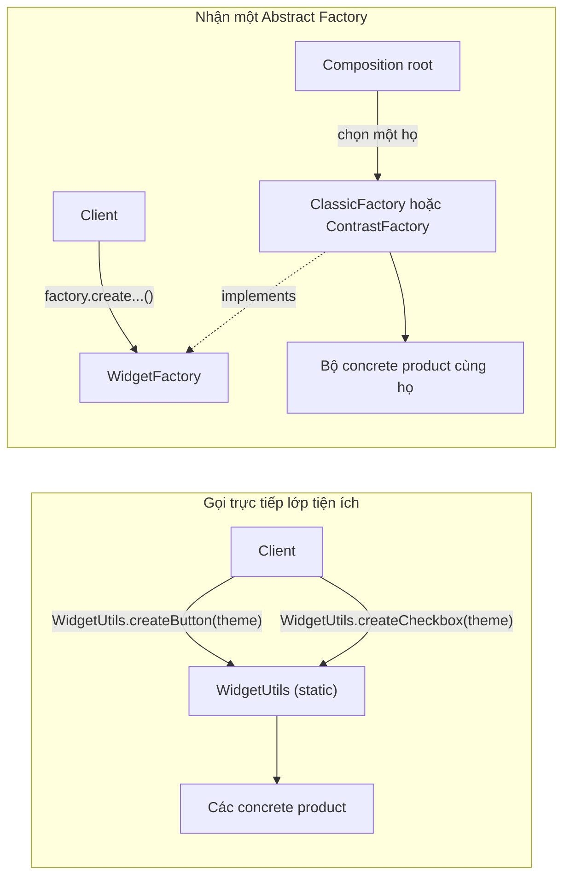

# Nhầm Abstract Factory với một lớp gom các phương thức static tạo đối tượng

## 1. Nhầm lẫn xuất phát từ đâu?

Khi mới học **Abstract Factory**, nhiều người nhận thấy mẫu này có các phương thức như `createButton()` và `createCheckbox()`, rồi kết luận: “Chỉ cần viết một class có các hàm `static create...` để tạo đối tượng là đã áp dụng Abstract Factory”.

Ví dụ, ứng dụng có hai kiểu giao diện: **Classic** và **High Contrast** (tương phản cao). Mỗi kiểu gồm một nút bấm và một ô chọn tương ứng:

| Vai trò sản phẩm | Họ Classic | Họ High Contrast |
| --- | --- | --- |
| `Button` | `ClassicButton` | `ContrastButton` |
| `Checkbox` | `ClassicCheckbox` | `ContrastCheckbox` |

Lập trình viên có thể tạo một lớp tiện ích:

```java
final class WidgetUtils {
    static Button createButton(Theme theme) {
        return theme == Theme.CLASSIC
                ? new ClassicButton()
                : new ContrastButton();
    }

    static Checkbox createCheckbox(Theme theme) {
        return theme == Theme.CLASSIC
                ? new ClassicCheckbox()
                : new ContrastCheckbox();
    }
}
```

Đoạn mã trên **có thể tạo đúng các sản phẩm** và có thể hoàn toàn phù hợp với ứng dụng đơn giản. Tuy nhiên, riêng việc gom các hàm tạo vào một lớp `static` **chưa thể hiện đầy đủ cơ chế của Abstract Factory**: một *hợp đồng tạo nhiều vai trò sản phẩm*, được các *concrete factory* hiện thực khác nhau, để client có thể sử dụng một factory đã chọn mà không phải mang theo quyết định về họ tại từng lời gọi.

Khác biệt trọng tâm nằm ở **ranh giới phụ thuộc và khả năng thay thế cả bộ sản phẩm**, chứ không nằm ở việc tên phương thức có chữ `create`, tên lớp có chữ `Factory` hay sử dụng từ khóa `static`.

## 2. Phân biệt ba khái niệm thường cùng được gọi là “factory”

### 2.1. Phương thức tạo tĩnh (static factory method)

Trong Java, một phương thức `static` có thể trả về đối tượng thay cho việc client gọi constructor trực tiếp:

```java
class UserId {
    private final String value;

    private UserId(String value) {
        this.value = value;
    }

    static UserId of(String value) {
        if (value == null || value.isEmpty()) {
            throw new IllegalArgumentException("User ID is required");
        }
        return new UserId(value);
    }
}
```

`UserId.of(...)` là một **static factory method** trong cách đặt tên API Java. Nó giúp kiểm tra đầu vào và đặt tên rõ cho thao tác tạo một đối tượng. **Chỉ có một phương thức `static` như vậy không đồng nghĩa với mẫu GoF Abstract Factory**.

### 2.2. Lớp tiện ích gom các phương thức tạo

`WidgetUtils.createButton(theme)` và `WidgetUtils.createCheckbox(theme)` tập trung các lệnh `new` vào một nơi. Cách này có thể giảm mã lặp và dễ gọi ở quy mô nhỏ, nhưng client thường:

- Gọi trực tiếp lớp tiện ích cụ thể `WidgetUtils`.
- Chọn hoặc truyền `theme` riêng cho từng thao tác tạo.
- Không có một đối tượng `WidgetFactory` đại diện cho **quyết định chọn cả họ** mà client có thể nhận qua constructor.

Nếu mọi nơi đều truyền cùng `theme` và thực hiện đúng, hệ thống vẫn có thể cho kết quả nhất quán. Lỗi không phải do `static` tự nó sai, mà do **kiến trúc chưa buộc các sản phẩm liên quan đi qua cùng một lựa chọn họ**.

### 2.3. Abstract Factory theo GoF

Abstract Factory công bố một *interface hoặc lớp trừu tượng* cho các thao tác tạo nhiều vai trò sản phẩm liên quan, chẳng hạn:

```java
interface WidgetFactory {
    Button createButton();
    Checkbox createCheckbox();
}
```

Các factory cụ thể hiện thực cùng hợp đồng:

```java
final class ClassicFactory implements WidgetFactory {
    public Button createButton() {
        return new ClassicButton();
    }

    public Checkbox createCheckbox() {
        return new ClassicCheckbox();
    }
}

final class ContrastFactory implements WidgetFactory {
    public Button createButton() {
        return new ContrastButton();
    }

    public Checkbox createCheckbox() {
        return new ContrastCheckbox();
    }
}
```

Client nhận một `WidgetFactory` và yêu cầu cả `Button` lẫn `Checkbox` từ **chính đối tượng factory đó**. Khi đổi `ClassicFactory` thành `ContrastFactory`, cách client gọi hai phương thức không thay đổi.

## 3. Bảng so sánh: tạo được đối tượng và quản lý được cả họ

| Tiêu chí | Lớp tiện ích các phương thức `static` | Abstract Factory |
| --- | --- | --- |
| Mục đích trực tiếp | Gom logic khởi tạo và cung cấp API gọi đơn giản | Trừu tượng hóa **tập thao tác tạo các vai trò sản phẩm cùng họ** |
| Điểm phụ thuộc của client | Thường gọi tên lớp cụ thể như `WidgetUtils` | Phụ thuộc `WidgetFactory` |
| Chọn biến thể | Thường truyền `theme` trong từng lời gọi hoặc đọc cấu hình bên trong | Chọn **concrete factory** một lần cho một ngữ cảnh sử dụng |
| Khả năng thay thế hành vi tạo | Có thể cần sửa lời gọi, cấu hình hoặc dùng wrapper | Truyền một triển khai `WidgetFactory` khác qua đa hình |
| Đảm bảo cùng họ | Phụ thuộc sự nhất quán của mọi lời gọi `static` | Tập trung lựa chọn họ trong một factory; triển khai vẫn phải đúng |
| Thêm họ mới | Có thể phải mở rộng nhánh trong lớp tiện ích | Thêm concrete products và một concrete factory mới; hợp đồng thường giữ nguyên |
| Kiểm thử client độc lập với việc tạo sản phẩm | Thường cần giả lập hoặc tách điểm gọi tiện ích | Truyền `FakeFactory` hoặc `StubFactory` qua interface |
| Phù hợp khi | Cơ chế tạo đơn giản, ít biến thể, không có nhu cầu thay cả họ | Nhiều vai trò sản phẩm có biến thể đồng bộ và client cần cách tạo ổn định |

**Không suy luận quá mức:** Abstract Factory cũng không có phép màu kiểm tra tương thích ở thời gian biên dịch. `ClassicFactory` vẫn có thể bị viết sai để trả về `ContrastCheckbox`. Trách nhiệm ánh xạ đúng họ thuộc về concrete factory và cần kiểm thử.

## 4. Vì sao `static` không thay thế được đa hình của factory?

Trong Java, phương thức `static` thuộc về **lớp khai báo**, được gọi như `WidgetUtils.createButton()`. Phương thức `static` không hiện thực hay ghi đè một **phương thức instance trừu tượng** của interface theo cơ chế đa hình thông thường.

Ngược lại, với hợp đồng:

```java
interface WidgetFactory {
    Button createButton();
}
```

biến `WidgetFactory factory` có thể tham chiếu đến `ClassicFactory`, `ContrastFactory` hoặc một `StubFactory` trong kiểm thử. Lời gọi `factory.createButton()` được định tuyến theo đối tượng triển khai thực tế.

Điều này tạo ra một ranh giới thiết kế:

- **Mã khởi động** biết cần chọn factory nào.
- **Client** biết rằng nó có thể tạo những vai trò sản phẩm nào, không cần biết có những concrete factory nào.
- **Concrete factory** biết constructor hoặc quy trình tạo các concrete product thuộc họ mình.



Trong nhánh `static`, tham số `theme` có thể bị truyền khác nhau giữa hai lời gọi; trong nhánh Abstract Factory, client làm việc thông qua một đối tượng factory đã được chọn cho cả bộ. **Vẫn cần giả định rằng factory được giữ ổn định trong lần tạo và mỗi concrete factory thực hiện đúng hợp đồng.**

## 5. Ví dụ Java hoàn chỉnh: từ tiện ích static đến Abstract Factory

Chương trình sau minh họa cả hai hướng tạo trên cùng các concrete product. Các phương thức `render()` trả về chuỗi để có thể chạy mà không cần thư viện giao diện.

```java
// Lưu thành StaticVsAbstractFactoryDemo.java
public class StaticVsAbstractFactoryDemo {
    enum Theme { CLASSIC, CONTRAST }

    // Hợp đồng của các vai trò sản phẩm.
    interface Button {
        String render();
    }

    interface Checkbox {
        String render();
    }

    // Hai concrete product thuộc họ Classic.
    static final class ClassicButton implements Button {
        public String render() { return "Classic button"; }
    }

    static final class ClassicCheckbox implements Checkbox {
        public String render() { return "Classic checkbox"; }
    }

    // Hai concrete product thuộc họ High Contrast.
    static final class ContrastButton implements Button {
        public String render() { return "Contrast button"; }
    }

    static final class ContrastCheckbox implements Checkbox {
        public String render() { return "Contrast checkbox"; }
    }

    // Cách 1: lớp tiện ích static nhận lựa chọn ở từng lời gọi.
    static final class WidgetUtils {
        private WidgetUtils() { }

        static Button createButton(Theme theme) {
            return theme == Theme.CLASSIC
                    ? new ClassicButton()
                    : new ContrastButton();
        }

        static Checkbox createCheckbox(Theme theme) {
            return theme == Theme.CLASSIC
                    ? new ClassicCheckbox()
                    : new ContrastCheckbox();
        }
    }

    // Cách 2: hợp đồng Abstract Factory.
    interface WidgetFactory {
        Button createButton();
        Checkbox createCheckbox();
    }

    // ConcreteFactory cho toàn bộ họ Classic.
    static final class ClassicFactory implements WidgetFactory {
        public Button createButton() {
            return new ClassicButton();
        }

        public Checkbox createCheckbox() {
            return new ClassicCheckbox();
        }
    }

    // ConcreteFactory cho toàn bộ họ High Contrast.
    static final class ContrastFactory implements WidgetFactory {
        public Button createButton() {
            return new ContrastButton();
        }

        public Checkbox createCheckbox() {
            return new ContrastCheckbox();
        }
    }

    // Client chỉ phụ thuộc vào hợp đồng factory và sản phẩm.
    static final class SettingsScreen {
        private final Button button;
        private final Checkbox checkbox;

        SettingsScreen(WidgetFactory factory) {
            if (factory == null) {
                throw new IllegalArgumentException("factory required");
            }
            this.button = factory.createButton();
            this.checkbox = factory.createCheckbox();
        }

        String render() {
            return button.render() + " | " + checkbox.render();
        }
    }

    // Có thể dùng static để CHỌN và trả về một Abstract Factory.
    // Chọn ở ngoài SettingsScreen, sau đó truyền instance vào client.
    static final class WidgetFactories {
        private WidgetFactories() { }

        static WidgetFactory forTheme(Theme theme) {
            if (theme == Theme.CLASSIC) {
                return new ClassicFactory();
            }
            if (theme == Theme.CONTRAST) {
                return new ContrastFactory();
            }
            throw new IllegalArgumentException("Unknown theme: " + theme);
        }
    }

    // Factory giả phục vụ kiểm thử client, không cần tạo widget thật.
    static final class StubFactory implements WidgetFactory {
        public Button createButton() {
            return new Button() {
                public String render() { return "Stub button"; }
            };
        }

        public Checkbox createCheckbox() {
            return new Checkbox() {
                public String render() { return "Stub checkbox"; }
            };
        }
    }

    public static void main(String[] args) {
        SettingsScreen classic =
                new SettingsScreen(WidgetFactories.forTheme(Theme.CLASSIC));
        SettingsScreen contrast =
                new SettingsScreen(WidgetFactories.forTheme(Theme.CONTRAST));

        System.out.println(classic.render());
        System.out.println(contrast.render());

        // Static helper cho phép truyền hai theme khác nhau.
        Button button = WidgetUtils.createButton(Theme.CLASSIC);
        Checkbox checkbox = WidgetUtils.createCheckbox(Theme.CONTRAST);
        System.out.println(button.render() + " | " + checkbox.render());

        // Client được kiểm thử nhờ thay thế factory qua interface.
        System.out.println(new SettingsScreen(new StubFactory()).render());
    }
}
```

Biên dịch và chạy với JDK:

```bash
javac StaticVsAbstractFactoryDemo.java
java StaticVsAbstractFactoryDemo
```

Kết quả dự kiến:

```text
Classic button | Classic checkbox
Contrast button | Contrast checkbox
Classic button | Contrast checkbox
Stub button | Stub checkbox
```

### Đọc kết quả theo trách nhiệm thiết kế

1. Hai dòng đầu: `SettingsScreen` dùng **một** `WidgetFactory` cho hai sản phẩm. Client không đổi khi chọn Classic hoặc High Contrast.
2. Dòng thứ ba: hai lời gọi `WidgetUtils` đều hợp lệ về kiểu Java, nhưng truyền hai tham số `Theme` khác nhau nên **trộn hai họ**. Điều này không chứng minh rằng mọi static helper đều trộn họ; nó chỉ cho thấy API không gói lựa chọn họ vào một đối tượng được chia sẻ.
3. Dòng cuối: client được chạy với `StubFactory` mà không cần khởi tạo widget thật. Đây là một lợi ích của việc phụ thuộc vào interface.
4. `WidgetFactories.forTheme(...)` **vẫn là phương thức static hợp lý**: nó chọn một concrete factory ở ranh giới khởi động rồi trả về `WidgetFactory`. Phương thức này bổ trợ cho Abstract Factory, không thay thế hợp đồng đó.

Trong chương trình này, tính nhất quán đến từ việc `ClassicFactory` và `ContrastFactory` thực hiện đúng ánh xạ các sản phẩm. Nếu một factory tự trả sai họ, việc client nhận qua interface vẫn không ngăn lỗi đó. Cần test các triển khai.

## 6. Khi nào lớp static trở thành dấu hiệu thiết kế bất ổn?

### 6.1. Client liên tục mang theo điều kiện chọn họ

```java
Button b = WidgetUtils.createButton(config.theme());
Checkbox c = WidgetUtils.createCheckbox(config.theme());
```

Nếu chỉ có hai lời gọi trong một nơi, đây có thể là lựa chọn đủ đơn giản. Nhưng nếu nhiều màn hình, component và service đều lặp lại `config.theme()`, mỗi lần thêm biến thể lại phải kiểm tra mọi đường gọi. Quan hệ “hai sản phẩm cùng họ” trở thành **quy ước thủ công trải rộng**.

Với Abstract Factory, mã khởi động quyết định một lần:

```java
WidgetFactory chosen = WidgetFactories.forTheme(config.theme());
SettingsScreen screen = new SettingsScreen(chosen);
```

Client không còn phải biết nguồn cấu hình `theme` hoặc tự lặp lại điều kiện chọn họ. Lưu ý: nếu cấu hình thay đổi khi màn hình đang chạy, cần quy định tạo lại màn hình hoặc cập nhật bộ sản phẩm theo chính sách nhất quán, thay vì thay riêng một widget.

### 6.2. Lớp tiện ích phát triển thành “siêu factory” nhiều nhánh

Khi thêm `Dialog`, `Menu`, `Tooltip` và nhiều biến thể như Desktop, Mobile, Kiosk, một lớp `UiFactoryUtils` có thể tích lũy hàng loạt `switch` theo môi trường. Mỗi khi bổ sung biến thể, nhóm phát triển phải sửa nhiều phương thức trong cùng một lớp lớn.

Một `WidgetFactory` với các concrete factory theo họ có thể phân tách những nhánh này:

- Thêm **họ mới**: tạo một concrete factory mới triển khai các vai trò hiện có.
- Thêm **vai trò sản phẩm mới**: bổ sung một phương thức vào interface và cập nhật các concrete factory liên quan.

Đây là **đánh đổi**: Abstract Factory giúp việc thêm họ tương đối rõ ràng nhưng thêm một vai trò mới có thể tốn công hơn. Nếu danh mục vai trò thay đổi thường xuyên, cần cân nhắc phân chia interface theo những nhóm thực sự đi cùng nhau.

### 6.3. Static helper đọc cấu hình toàn cục có thể thay đổi

Ví dụ:

```java
Button b = WidgetUtils.createButton(AppSettings.currentTheme());
// Theme đổi ở nơi khác trước lần tạo kế tiếp.
Checkbox c = WidgetUtils.createCheckbox(AppSettings.currentTheme());
```

Khi hai lần truy cập lấy hai giá trị khác nhau, một client có thể giữ hai sản phẩm khác họ. Nếu chính helper đọc trạng thái toàn cục bên trong mỗi phương thức, nguy cơ còn khó nhìn thấy hơn.

Có thể giảm rủi ro đơn giản bằng cách **chốt cấu hình** trước khi tạo cả bộ, kể cả khi vẫn dùng static helper. Abstract Factory cung cấp một ranh giới mạnh hơn cho trường hợp hệ thống cần truyền quyết định họ tới nhiều client: chọn factory đã cấu hình và để các client dùng factory đó.

### 6.4. Kiểm thử phải phụ thuộc vào sản phẩm thật

Khi client tự gọi `WidgetUtils.createButton(...)` bên trong mã nghiệp vụ, một bài test có thể phải chịu cả logic khởi tạo thật, tài nguyên thật hoặc cần cơ chế đặc biệt để giả lập phương thức static. Java có các công cụ hỗ trợ mock static trong một số trường hợp, nên **không đúng khi nói static hoàn toàn không thể kiểm thử**.

Vấn đề kiến trúc là điểm phụ thuộc bị cố định trong client. Khi client nhận `WidgetFactory`, có thể dùng `StubFactory` hoặc fake implementation thông thường để tập trung kiểm tra hành vi client, tách khỏi chi tiết khởi tạo.

## 7. Static factory method và Abstract Factory có thể phối hợp

Việc có từ khóa `static` trong hệ thống **không phải dấu hiệu cần loại bỏ**. Những cách phối hợp hợp lệ gồm:

| Cách dùng `static` | Đánh giá |
| --- | --- |
| `WidgetFactories.forTheme(theme)` trả về một `WidgetFactory` | Hữu ích để chọn concrete factory ở **composition root** |
| `ClassicButton.of(label)` được `ClassicFactory` gọi bên trong | Hữu ích để tạo một concrete product có kiểm tra đầu vào |
| `WidgetUtils.createButton(theme)` dùng trong chương trình nhỏ | Có thể đủ đơn giản nếu không cần thay thế cả họ qua interface |
| Client tự gọi hàng loạt `WidgetUtils.create...(globalTheme)` | Cần đánh giá lại khi quyết định họ bị lặp và dễ không đồng nhất |
| Interface `WidgetFactory` chứa helper `static forTheme(...)` bên cạnh hai phương thức instance | Cú pháp Java hợp lệ; helper tĩnh dùng để chọn factory, các phương thức instance vẫn cung cấp cơ chế đa hình |

Ví dụ, một interface cũng có thể công bố phương thức hỗ trợ tĩnh:

```java
interface WidgetFactory {
    Button createButton();
    Checkbox createCheckbox();

    static WidgetFactory classic() {
        return new ClassicFactory();
    }
}
```

Ở đây, `classic()` là **static factory method trả về một đối tượng factory**. Mẫu Abstract Factory vẫn nằm ở **các phương thức instance** `createButton()`, `createCheckbox()` và khả năng các concrete factory hiện thực cùng một hợp đồng.

Điều không hợp lệ là cố cho một phương thức `static createButton()` thay thế triển khai instance `createButton()` được interface yêu cầu. Java không coi phương thức static là override của phương thức instance.

## 8. Quy trình chuyển từ một lớp static lớn sang Abstract Factory

Không cần “đập đi xây lại” mọi nơi gọi static helper trong một lần. Có thể chuyển theo các bước có ranh giới rõ:

1. **Liệt kê vai trò sản phẩm:** ví dụ `Button`, `Checkbox`, `Menu`; xác định sản phẩm nào thực sự phải thuộc cùng một họ.
2. **Xác định các họ:** ví dụ Classic/High Contrast, và tạo bảng ánh xạ từng vai trò sang concrete product theo họ.
3. **Công bố interface factory:** định nghĩa các phương thức tạo trả về **kiểu sản phẩm trừu tượng**.
4. **Tách concrete factory:** chuyển các nhánh khởi tạo liên quan tới từng họ vào các triển khai riêng. Có thể tạm thời gọi lại helper cũ bên trong factory nếu nó đã đúng hành vi và không phụ thuộc vào trạng thái toàn cục thay đổi.
5. **Chọn factory ở biên hệ thống:** một `static forTheme(...)`, DI container hoặc composition root tạo factory, sau đó inject vào client.
6. **Dần thay các lời gọi của client:** client sử dụng `WidgetFactory` đã nhận; bỏ các nhánh chọn họ không còn cần thiết. Không thay đổi logic nghiệp vụ ngoài phạm vi khởi tạo.
7. **Kiểm thử từng họ và client:** với mỗi factory, tạo đủ các vai trò, xác minh cùng họ và tương thích; dùng fake factory để kiểm thử client độc lập.
8. **Dọn các đường cũ khi không còn caller:** xóa các phương thức tiện ích trùng lặp, tránh giữ hai cơ chế tạo song song mà không có quy định.

Ví dụ bảng kiểm chuyển đổi:

| Trước khi chuyển | Sau khi chuyển |
| --- | --- |
| `WidgetUtils.createButton(theme)` ở nhiều client | Client gọi `factory.createButton()` |
| `WidgetUtils.createCheckbox(theme)` với theme đọc lại | Client gọi `factory.createCheckbox()` trên cùng instance |
| Các nhánh `if/switch` nằm rải rác trong static utils | Ánh xạ cho từng họ nằm trong concrete factory |
| Test client tạo widget thật | Test client có thể truyền `StubFactory` |

Nếu ứng dụng chỉ có **một loại sản phẩm**, không có nhu cầu tạo một tập vai trò thuộc cùng biến thể, việc thêm Abstract Factory có thể là quá mức. Một constructor, static factory method hoặc Factory Method đơn giản có thể phù hợp hơn.

## 9. Những nhầm lẫn liên quan cần tránh

### “Chỉ cần tên lớp là `AbstractFactory` thì đúng mẫu”

Tên lớp không chứng minh cấu trúc. Một class `AbstractFactory` đầy phương thức `static`, không có hợp đồng cho client, không có các triển khai đại diện cho từng họ, có thể chỉ là lớp tiện ích được đặt tên lại.

### “Bất kỳ lớp có nhiều phương thức tạo đều là Abstract Factory”

Một class có `createUser()`, `createReport()`, `createLogger()` chưa chắc là Abstract Factory. Cần xem những vai trò này có **thuộc một họ sản phẩm liên quan và cần thay đồng bộ** hay chỉ là tập các constructor tiện tay được gom vào một nơi.

### “Một factory duy nhất không có nhiều họ cũng luôn sai”

Abstract Factory hữu ích nhất khi có các họ thay thế. Nhưng một interface factory có thể được dùng trước khi xuất hiện nhiều triển khai nếu cần một ranh giới tạo sản phẩm rõ ràng, phục vụ test hoặc chuẩn bị biến thể được dự báo có cơ sở. Không nên tạo cả hệ thống trừu tượng chỉ dựa trên một khả năng mơ hồ.

### “Dùng Abstract Factory sẽ tự bảo đảm tính tương thích”

`ClassicFactory` vẫn có thể trả về `ContrastCheckbox` nếu lập trình viên viết sai. Interface Java chỉ kiểm tra vai trò sản phẩm (`Checkbox`), không tự xác nhận sản phẩm có đúng họ. Cần hợp đồng, kiểm thử các concrete factory và các đường cập nhật sản phẩm trong client.

### “Mọi static method đều phải thay bằng interface”

Các utility không mang trạng thái, bộ parser, validation đơn giản hoặc static method tạo một đối tượng vẫn có chỗ dùng rõ ràng. Abstract Factory giải quyết **vấn đề thay cả họ sản phẩm qua một trừu tượng**, không phải là quy tắc cấm `static`.

## 10. Cách tự đánh giá một thiết kế

Hãy xét đoạn mã đang làm việc và trả lời:

1. Client cần **bao nhiêu vai trò sản phẩm**? Chúng có cần tương thích như một bộ không?
2. Có **nhiều họ triển khai** phải chọn cùng nhau không, hay khác biệt chỉ là vài tham số?
3. Client có phải biết một `enum` của các họ hoặc gọi tên lớp tiện ích cụ thể ở mọi nơi không?
4. Có thể cấp cho client một đối tượng `WidgetFactory` khác mà **không sửa mã client** không?
5. Mỗi concrete factory có trả về **đúng toàn bộ họ sản phẩm** và được kiểm thử không?
6. Một phương thức `static` chỉ dùng để **chọn factory** hay đang chứa toàn bộ các nhánh tạo từng sản phẩm và được mọi client gọi trực tiếp?

Nếu những sản phẩm có liên quan cần thay cùng nhau, các nhánh tạo bị rải rác và client nên giữ nguyên quy trình, **Abstract Factory là một ứng viên phù hợp**. Nếu chỉ muốn đặt tên dễ hiểu cho việc tạo một sản phẩm đơn giản, **static factory method** có thể là lựa chọn gọn hơn.

## Ghi nhớ

**Một lớp gom nhiều phương thức `static create...` không tự trở thành Abstract Factory.** Cốt lõi của Abstract Factory là **hợp đồng tạo các vai trò sản phẩm thuộc một họ**, các concrete factory **có thể thay thế qua đa hình** và client **phụ thuộc vào hợp đồng thay vì lớp tạo cụ thể**. Phương thức `static` vẫn hữu ích để chọn một factory hoặc tạo một sản phẩm bên trong factory. Hãy chọn kiến trúc dựa trên nhu cầu **thay cả họ và giữ client ổn định**, không dựa trên tên phương thức hay từ khóa `static`.
