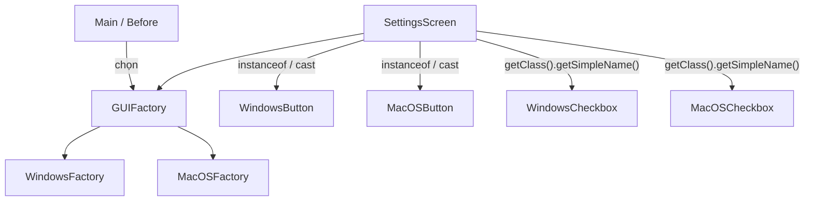
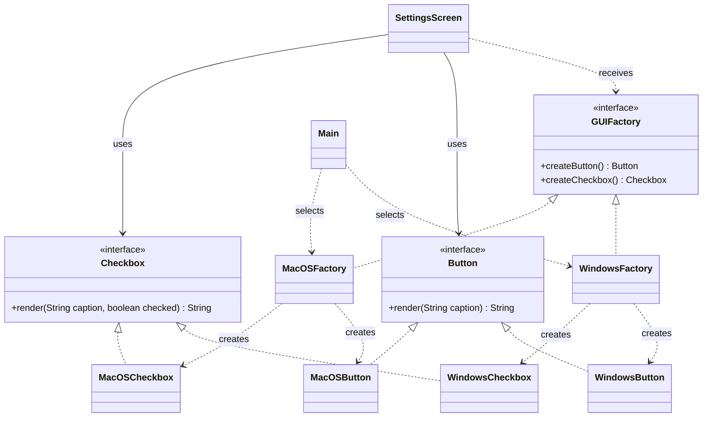

# Ép kiểu, dùng instanceof hoặc truy vấn tên lớp để chọn hành vi trong client

## 1. Dấu hiệu nhận biết lỗi

Trong **Abstract Factory** — mẫu thiết kế thuộc nhóm *Creational Design Patterns* — client yêu cầu các loại sản phẩm liên quan thông qua một factory trừu tượng, rồi sử dụng chúng qua **interface sản phẩm**. Chẳng hạn, `GUIFactory` cung cấp `Button` và `Checkbox` của cùng một họ Windows hoặc macOS. Mục tiêu là mã client không phải biết các tên lớp `WindowsButton`, `MacOSButton`, `WindowsCheckbox` hay `MacOSCheckbox`.

Một lỗi thường gặp là chương trình đã dùng factory nhưng client vẫn **kiểm tra kiểu cụ thể để quyết định phải làm gì**:

```java
// Ví dụ minh họa anti-pattern, chưa phải đoạn mã độc lập.
Button button = factory.createButton();

if (button instanceof WindowsButton) {
    ((WindowsButton) button).drawWindows("Save");
} else if (button instanceof MacOSButton) {
    ((MacOSButton) button).drawMacOS("Save");
}
```

Hoặc một biến thể còn dễ hỏng hơn:

```java
String className = checkbox.getClass().getSimpleName();
if ("WindowsCheckbox".equals(className)) {
    // Xử lý Windows.
} else if ("MacOSCheckbox".equals(className)) {
    // Xử lý macOS.
}
```

Các nhánh này khiến client **biết cụ thể họ sản phẩm** dù nhận đối tượng qua interface. Khi thêm một họ Linux, client rất có thể phải sửa để thêm nhánh `LinuxButton` và `LinuxCheckbox`. Khi đó lợi ích thay thế họ sản phẩm của Abstract Factory gần như không còn.

> **Nguyên tắc:** Client cần yêu cầu **hành vi** từ abstraction, thay vì hỏi đối tượng “anh thuộc lớp nào?” rồi tự quyết định hành vi. Những trường hợp kiểm tra kiểu có chủ đích vẫn tồn tại, nhưng phải có lý do rõ ràng và được đặt ở ranh giới phù hợp.

## 2. Vì sao ba cách kiểm tra kiểu đều có vấn đề?

| Kỹ thuật | Mục đích thường thấy | Rủi ro khi dùng để chọn hành vi trong client |
| --- | --- | --- |
| Ép kiểu xuống (*downcast*): `(WindowsButton) button` | Truy cập phương thức chỉ có ở concrete class. | Gắn client với lớp cụ thể; ép sai kiểu gây `ClassCastException`. |
| Kiểm tra `instanceof` | Phân nhánh trước khi ép kiểu hoặc chọn phương thức cho từng biến thể. | Client phải biết từng họ; thêm họ mới thường buộc thêm nhánh và có thể bỏ sót trường hợp. |
| `getClass()`, `getSimpleName()` hoặc so sánh tên lớp | Dùng thông tin lớp runtime để điều khiển xử lý. | Phụ thuộc tên, chi tiết hiện thực và lớp wrapper/proxy; đổi tên hoặc thay cách tạo đối tượng có thể làm sai nhánh. |

Ba cách có thể khác nhau về **độ an toàn khi chạy**, nhưng cùng có một điểm yếu nếu sử dụng cho mục đích trên: **chọn hành vi dựa vào danh tính implementation thay vì hợp đồng của product**.

### 2.1. `instanceof` không tự bảo đảm một thiết kế tốt

`instanceof` có thể tránh ép kiểu nhầm ở một nhánh đơn giản, nhưng không tự bảo đảm client xử lý đủ mọi biến thể. Ví dụ:

```java
if (button instanceof WindowsButton) {
    // ...
} else if (button instanceof MacOSButton) {
    // ...
}
// Nếu thêm LinuxButton mà quên nhánh, hành vi có thể bị bỏ qua.
```

Đặc biệt, một nhánh `else` mặc định coi tất cả product chưa biết là Windows hoặc macOS sẽ dễ **xử lý sai âm thầm**. Nếu buộc phải phân loại kiểu tại biên hệ thống, ít nhất phải quy định rõ cách xử lý trường hợp không hỗ trợ.

### 2.2. Ép kiểu có thể làm hỏng tính thay thế

Nếu API công bố kiểu `Button` nhưng client phải ép sang `WindowsButton` mới gọi được hành vi quan trọng, interface `Button` có thể đang thiếu hành vi mà client thực sự cần. Một implementation khác thỏa `Button` vẫn không đáp ứng được mã client vì client giả định lớp cụ thể.

Điều này gây áp lực lên **Dependency Inversion Principle (DIP)** và **Open/Closed Principle (OCP)**: code sử dụng product phụ thuộc lại vào implementation và phải sửa khi thêm biến thể. Nó cũng khiến ý tưởng thay thế các implementation qua cùng một hợp đồng không phát huy tác dụng.

### 2.3. So sánh tên lớp còn mong manh hơn

`getClass().getSimpleName()` trả về **tên lớp runtime**, không phải mã nghiệp vụ hay một giao thức định danh ổn định. Kiểm tra chuỗi tên lớp có thể sai khi:

- Một lớp được đổi tên hoặc di chuyển sang implementation có tên khác.
- Product được bọc bằng decorator/proxy hoặc cung cấp qua một lớp adapter.
- Có lớp con hoặc một implementation mới cùng hành vi nhưng tên khác.
- Code dùng `getClass() == WindowsButton.class`, chỉ khớp **chính xác lớp đó**, không chấp nhận lớp con.

Tương tự, dùng `getClass().getName()` hay tên package để rẽ nhánh không loại bỏ sự phụ thuộc vào chi tiết lớp. Có thể **ghi tên lớp vào log chẩn đoán** nhưng không nên biến chuỗi tên đó thành quy tắc chọn hành vi chính của client.

## 3. Bài toán thực tế: cùng màn hình, hai họ GUI

Một ứng dụng có màn hình cài đặt với hai thành phần:

- `Button` để lưu cài đặt.
- `Checkbox` để bật nhận thông báo.

Windows và macOS có cách biểu diễn khác nhau:

| Họ sản phẩm | Button | Checkbox |
| --- | --- | --- |
| Windows | `WindowsButton` | `WindowsCheckbox` |
| macOS | `MacOSButton` | `MacOSCheckbox` |

Yêu cầu là **một màn hình dùng cùng một họ cho cả nút và ô chọn**. `GUIFactory` có hai phương thức `createButton()` và `createCheckbox()`; các concrete factory quyết định cặp product của từng nền tảng.

Lỗi xảy ra khi factory đã chọn đúng họ, nhưng code màn hình vẫn phải dò từng lớp concrete để thực hiện hai thao tác hiển thị. Trong tình huống này, vấn đề cần sửa nằm ở **hợp đồng product và client**, không nhất thiết nằm ở cách factory chọn product.

## 4. Chương trình trước refactor: factory có, client vẫn dò kiểu

Để thấy lỗi rõ ràng, lưu ví dụ sau vào **`Before.java`**. Mọi lớp phụ trợ được khai báo lồng trong `Before` nên có thể giữ nó cạnh tệp lời giải `Main.java` mà không trùng tên các lớp cùng package.

```java
// Before.java
public class Before {
    // Hợp đồng quá nghèo: client không có hành vi chung để gọi.
    interface Button {}
    interface Checkbox {}

    interface GUIFactory {
        Button createButton();
        Checkbox createCheckbox();
    }

    static final class WindowsButton implements Button {
        String drawWindows(String text) {
            return "Windows Button: [" + text + "]";
        }
    }

    static final class WindowsCheckbox implements Checkbox {
        String drawWindows(String text, boolean checked) {
            return "Windows Checkbox: ["
                    + (checked ? "x" : " ") + "] " + text;
        }
    }

    static final class MacOSButton implements Button {
        String drawMacOS(String text) {
            return "macOS Button: (" + text + ")";
        }
    }

    static final class MacOSCheckbox implements Checkbox {
        String drawMacOS(String text, boolean checked) {
            return "macOS Checkbox: ("
                    + (checked ? "x" : " ") + ") " + text;
        }
    }

    static final class WindowsFactory implements GUIFactory {
        public Button createButton() {
            return new WindowsButton();
        }

        public Checkbox createCheckbox() {
            return new WindowsCheckbox();
        }
    }

    static final class MacOSFactory implements GUIFactory {
        public Button createButton() {
            return new MacOSButton();
        }

        public Checkbox createCheckbox() {
            return new MacOSCheckbox();
        }
    }

    // Client có cả kiểm tra kiểu, ép kiểu và tra tên lớp.
    static final class SettingsScreen {
        private final Button button;
        private final Checkbox checkbox;

        SettingsScreen(GUIFactory factory) {
            button = factory.createButton();
            checkbox = factory.createCheckbox();
        }

        String render() {
            String buttonLine;
            if (button instanceof WindowsButton) {
                buttonLine = ((WindowsButton) button).drawWindows("Save");
            } else if (button instanceof MacOSButton) {
                buttonLine = ((MacOSButton) button).drawMacOS("Save");
            } else {
                throw new IllegalStateException("Unknown Button type");
            }

            String checkboxLine;
            String typeName = checkbox.getClass().getSimpleName();
            if ("WindowsCheckbox".equals(typeName)) {
                checkboxLine = ((WindowsCheckbox) checkbox)
                        .drawWindows("Receive updates", true);
            } else if ("MacOSCheckbox".equals(typeName)) {
                checkboxLine = ((MacOSCheckbox) checkbox)
                        .drawMacOS("Receive updates", true);
            } else {
                throw new IllegalStateException("Unknown Checkbox type");
            }
            return buttonLine + "\n" + checkboxLine;
        }
    }

    public static void main(String[] args) {
        String platform = args.length == 0 ? "windows" : args[0];
        GUIFactory factory;

        if ("windows".equalsIgnoreCase(platform)) {
            factory = new WindowsFactory();
        } else if ("macos".equalsIgnoreCase(platform)) {
            factory = new MacOSFactory();
        } else {
            System.err.println("Unsupported platform: " + platform);
            return;
        }

        System.out.println(new SettingsScreen(factory).render());
    }
}
```

Biên dịch và chạy:

```bash
javac Before.java
java Before windows
java Before macos
```

Đầu ra của Windows:

```text
Windows Button: [Save]
Windows Checkbox: [x] Receive updates
```

Đầu ra của macOS:

```text
macOS Button: (Save)
macOS Checkbox: (x) Receive updates
```

**Chương trình chạy đúng với hai họ hiện tại, nhưng thiết kế vẫn có lỗi.** Khi thêm `LinuxFactory` trả `LinuxButton` và `LinuxCheckbox` hợp lệ, `SettingsScreen.render()` sẽ rơi vào nhánh báo lỗi vì nó không biết các lớp Linux. Đặc biệt, nhánh so sánh tên `WindowsCheckbox`/`MacOSCheckbox` có thể hỏng khi thay bằng proxy hoặc adapter mà không cần thay đổi ý nghĩa của sản phẩm.

Nhìn vào code, ba dấu hiệu cho biết client đang thiếu tính đa hình:

1. `Button` và `Checkbox` là các interface rỗng, không công bố hành vi hiển thị mà client cần.
2. Concrete products có phương thức khác tên (`drawWindows`/`drawMacOS`), buộc client phải biết lớp để gọi.
3. `SettingsScreen` tự đóng vai trò bộ điều phối theo loại sản phẩm, mặc dù factory đã chọn họ sản phẩm ở bước khởi tạo.

## 5. Sửa tận gốc: đưa hành vi chung vào Abstract Product

Client thực sự muốn **render một Button** và **render một Checkbox**. Vì vậy, có thể mở rộng hợp đồng sản phẩm theo chức năng mà client cần:

```java
interface Button {
    String render(String caption);
}

interface Checkbox {
    String render(String caption, boolean checked);
}
```

Mỗi concrete product tự hiện thực `render(...)` theo cách của mình:

```java
final class WindowsButton implements Button {
    @Override
    public String render(String caption) {
        return "Windows Button: [" + caption + "]";
    }
}

final class MacOSButton implements Button {
    @Override
    public String render(String caption) {
        return "macOS Button: (" + caption + ")";
    }
}
```

Client giờ chỉ cần gọi:

```java
String buttonLine = button.render("Save");
String checkboxLine = checkbox.render("Receive updates", true);
```

**Java tự thực hiện phân phối động** (*dynamic dispatch*): cùng lời gọi `render("Save")` trên một biến kiểu `Button` sẽ chạy phương thức của `WindowsButton` hoặc `MacOSButton` tùy đối tượng thực tế. Đó là cơ chế đa hình giúp client không cần `instanceof`.

Điều cần chú ý: **không chuyển nhánh kiểm tra lớp sang nơi khác mà không xét trách nhiệm**. Ví dụ viết một `ButtonRenderer` rồi tiếp tục `if (button instanceof WindowsButton)` chỉ có thể đang di chuyển anti-pattern. Nếu hành vi thật sự thuộc sản phẩm, hãy để product hiện thực. Nếu hành vi thuộc một chính sách nghiệp vụ độc lập, cân nhắc một `Strategy` hoặc service thích hợp thay vì nhồi mọi chính sách vào interface UI.

## 6. Lời giải Java hoàn chỉnh sau refactor

Lưu toàn bộ chương trình dưới đây thành **`Main.java`**. Mã dùng Java 8+, không phụ thuộc framework. Các interface và lớp phụ trợ là kiểu top-level package-private; chỉ `Main` là `public`.

```java
// Main.java
import java.util.Objects;

// Abstract Products: hành vi chung mà client cần.
interface Button {
    String render(String caption);
}

interface Checkbox {
    String render(String caption, boolean checked);
}

// Abstract Factory: mỗi factory cung cấp hai loại product cùng họ.
interface GUIFactory {
    Button createButton();
    Checkbox createCheckbox();
}

// Concrete Products của Windows.
final class WindowsButton implements Button {
    @Override
    public String render(String caption) {
        return "Windows Button: [" + caption + "]";
    }
}

final class WindowsCheckbox implements Checkbox {
    @Override
    public String render(String caption, boolean checked) {
        return "Windows Checkbox: ["
                + (checked ? "x" : " ") + "] " + caption;
    }
}

// Concrete Products của macOS.
final class MacOSButton implements Button {
    @Override
    public String render(String caption) {
        return "macOS Button: (" + caption + ")";
    }
}

final class MacOSCheckbox implements Checkbox {
    @Override
    public String render(String caption, boolean checked) {
        return "macOS Checkbox: ("
                + (checked ? "x" : " ") + ") " + caption;
    }
}

// Concrete Factories: chịu trách nhiệm giữ đúng họ.
final class WindowsFactory implements GUIFactory {
    @Override
    public Button createButton() {
        return new WindowsButton();
    }

    @Override
    public Checkbox createCheckbox() {
        return new WindowsCheckbox();
    }
}

final class MacOSFactory implements GUIFactory {
    @Override
    public Button createButton() {
        return new MacOSButton();
    }

    @Override
    public Checkbox createCheckbox() {
        return new MacOSCheckbox();
    }
}

// Client: nhận factory và sử dụng đúng các abstract products.
final class SettingsScreen {
    private final Button button;
    private final Checkbox checkbox;

    SettingsScreen(GUIFactory factory) {
        Objects.requireNonNull(factory, "factory");
        button = Objects.requireNonNull(factory.createButton(), "button");
        checkbox = Objects.requireNonNull(factory.createCheckbox(), "checkbox");
    }

    String render() {
        return button.render("Save") + "\n"
                + checkbox.render("Receive updates", true);
    }
}

// Composition root: chọn factory ở ranh giới ứng dụng.
public class Main {
    public static void main(String[] args) {
        String platform = args.length == 0 ? "windows" : args[0];
        GUIFactory factory;

        if ("windows".equalsIgnoreCase(platform)) {
            factory = new WindowsFactory();
        } else if ("macos".equalsIgnoreCase(platform)) {
            factory = new MacOSFactory();
        } else {
            System.err.println("Unsupported platform: " + platform);
            return;
        }

        System.out.println(new SettingsScreen(factory).render());
    }
}
```

### 6.1. Chạy và so sánh kết quả

```bash
javac Before.java Main.java
java Before windows
java Main windows
java Before macos
java Main macos
```

`java Main windows` trả về:

```text
Windows Button: [Save]
Windows Checkbox: [x] Receive updates
```

`java Main macos` trả về:

```text
macOS Button: (Save)
macOS Checkbox: (x) Receive updates
```

Đầu ra của hai trường hợp hợp lệ **giống chương trình trước refactor**, trong khi `SettingsScreen` không còn `instanceof`, ép kiểu cụ thể hoặc truy vấn tên lớp để chọn hành vi. Mục tiêu của refactor là **giữ hành vi bên ngoài và cải thiện chiều phụ thuộc trong mã**.

### 6.2. Vai trò nào thay đổi?

| Thành phần | Trước refactor | Sau refactor |
| --- | --- | --- |
| `GUIFactory` | Đã quyết định họ, tạo product cụ thể. | Tiếp tục làm đúng trách nhiệm đó, không cần biết cách client hiển thị. |
| `Button`, `Checkbox` | Interface rỗng, chưa diễn đạt hành vi. | Công bố `render(...)` mà client cần. |
| Concrete Product | Có các phương thức riêng cho từng nền tảng. | Mỗi implementation cung cấp cùng một phương thức theo hợp đồng chung. |
| `SettingsScreen` | Kiểm tra concrete type và ép kiểu để gọi hành vi. | Gọi trực tiếp `Button.render(...)` và `Checkbox.render(...)`. |
| `Main` | Chọn một concrete factory theo cấu hình. | Vẫn chọn factory tại composition root. |

Việc `Main` biết `WindowsFactory` và `MacOSFactory` là hợp lý: **nơi lắp ghép** cần chọn implementation. Điều gây lỗi là **client nghiệp vụ** biết cụ thể `WindowsButton`/`MacOSButton` và phải phân nhánh theo loại đối tượng trả về.

## 7. Quan hệ phụ thuộc trước và sau

### Trước: client biết trực tiếp các concrete product



Sơ đồ rút gọn nhấn mạnh rằng `SettingsScreen` phụ thuộc đồng thời vào **factory abstraction** và **các concrete product**. Vì thế, chỉ việc tạo một `GUIFactory` là chưa đủ để có thiết kế theo đúng tinh thần Abstract Factory.

### Sau: client chỉ phụ thuộc vào interface



Với sơ đồ sau, khi thay bằng một concrete factory khác thực hiện `GUIFactory` và các concrete products khác thực hiện `Button`/`Checkbox`, client vẫn gọi `render(...)` theo hợp đồng đã có. **Không tồn tại mũi tên phụ thuộc tĩnh từ `SettingsScreen` tới các product Windows/macOS.**

### 7.1. Tính nhất quán của họ và đa hình là hai yêu cầu khác nhau

Sửa việc kiểm tra kiểu trong client **không tự bảo đảm** factory luôn cấp cùng một họ product. Ví dụ nếu `WindowsFactory.createCheckbox()` trả về `MacOSCheckbox`, cả hai product vẫn có thể gọi `render(...)` thành công, nhưng màn hình bị trộn phong cách.

Vì vậy cần hai kiểm tra riêng:

1. **Tại client:** các lời gọi thuộc abstraction, không chứa nhánh chọn theo concrete product.
2. **Tại concrete factory:** các phương thức cấp sản phẩm cùng họ đã cam kết.

Hai điều kiện cùng cần thiết để đạt mục tiêu của Abstract Factory.

## 8. Khi hành vi không thật sự thuộc interface sản phẩm

Không nên áp dụng máy móc quy tắc “thấy `instanceof` là thêm ngay phương thức vào interface”. Cần xác định **ai chịu trách nhiệm với hành vi**.

### Tình huống A: hành vi chung của mọi product

Ví dụ tất cả nút bấm đều cần `render("Save")`. Đưa `render` vào `Button` và cho từng concrete product hiện thực là hợp lý.

### Tình huống B: chính sách nghiệp vụ độc lập với biến thể UI

Giả sử chính sách “nút Save có được bật hay không?” phụ thuộc vào quyền người dùng, trạng thái đơn hàng hoặc dữ liệu form. Chính sách đó có thể đặt trong một service/`Strategy` riêng, sau đó client truyền trạng thái được tính cho `Button`. Không nên buộc từng `WindowsButton`, `MacOSButton` tự truy cập phân quyền hoặc gọi repository chỉ để loại bỏ một nhánh điều kiện.

```java
// Ví dụ ý tưởng: chính sách độc lập với các lớp Windows/macOS.
interface SavePolicy {
    boolean canSave(UserContext user, FormState form);
}

// Client có thể hỏi SavePolicy và truyền kết quả cho product.
// UserContext và FormState là kiểu miền nghiệp vụ minh họa;
// đoạn này không thuộc chương trình Main.java ở mục 6.
```

### Tình huống C: chỉ một số product có năng lực đặc biệt

Ví dụ chỉ một số implementation hỗ trợ haptic feedback. Không nên thêm `vibrate()` vào `Button` nếu phần lớn product không có khả năng này. Có thể:

- Tách interface năng lực riêng (`HapticFeedback`) và chỉ cung cấp năng lực ở biên phù hợp.
- Dùng một adapter/service tương ứng với nền tảng, được chọn khi lắp ghép ứng dụng.
- Xem lại xem hành vi đó thực sự thuộc product UI hay thuộc một service của hệ điều hành.

`instanceof HapticFeedback` tại một ranh giới tích hợp có thể là phép kiểm tra năng lực **có chủ đích**, nhưng việc rải nó vào mọi client vẫn khiến logic phụ thuộc vào loại implementation. Quan trọng là đưa quyết định về đúng nơi sở hữu quy tắc và công bố hợp đồng rõ ràng.

### Tình huống D: cần xử lý một tập biến thể đóng

Trong một bài toán khác, các kiểu dữ liệu có thể tạo thành **một tập biến thể đóng** (ví dụ các trường hợp của một `sealed` hierarchy trong Java hiện đại) và tác vụ chủ yếu là phân tích chúng. Khi đó, phân nhánh theo kiểu bằng pattern matching hoặc `switch` tại một tầng xử lý chuyên trách có thể có lý do thiết kế. Đổi lại, thêm biến thể mới sẽ tác động đến tầng xử lý đó.

Abstract Factory thường phù hợp với họ sản phẩm **có thể mở rộng**, nơi client mong muốn dùng các khả năng chung của product. Không nên lấy sự tồn tại của công cụ pattern matching làm lý do mặc định cho client phân nhánh theo concrete product.

## 9. Khi nào `instanceof` hoặc thông tin kiểu là hợp lý?

Không phải mọi phép kiểm tra kiểu đều là lỗi. Cần xem **nó nằm ở đâu, nhằm mục đích gì và có gây phụ thuộc nghiệp vụ không**.

| Tình huống | Có thể hợp lý? | Giải thích |
| --- | --- | --- |
| Unit test của `WindowsFactory` xác nhận trả `WindowsButton`. | Có. | Test implementation cụ thể được phép kiểm chứng hợp đồng họ sản phẩm. |
| Ghi tên lớp vào log để chẩn đoán sự cố. | Có. | Thông tin tên lớp không điều khiển hành vi nghiệp vụ. |
| Adapter nhận object từ thư viện cũ không có interface phù hợp. | Có điều kiện. | Phân loại kiểu một lần tại biên, chuyển sang mô hình interface nội bộ rồi để client dùng đa hình. |
| Xử lý một cấu trúc dữ liệu có tập biến thể đóng, có yêu cầu xử lý riêng từng kiểu. | Có điều kiện. | Cần chấp nhận chi phí cập nhật khi thêm biến thể và đặt logic ở nơi chuyên trách. |
| Mỗi màn hình `if (button instanceof WindowsButton)` để chọn cách hiển thị. | Thường không. | Client phụ thuộc trực tiếp vào concrete product, làm mất lợi ích thay thế họ. |
| `getClass().getSimpleName()` để quyết định gửi thanh toán hay tạo giao diện. | Thường không. | Tên lớp không phải giao thức nghiệp vụ ổn định, dễ hỏng khi refactor/proxy. |

Một phép ép kiểu ở **biên tích hợp** không đồng nghĩa toàn bộ thiết kế sai; câu hỏi là sau khi qua biên, client có còn phải biết các lớp cụ thể để thực hiện hành vi thông thường không.

## 10. Kiểm tra hành vi và ràng buộc kiến trúc

Có thể tự kiểm tra factory và client bằng mã Java không cần JUnit. Hãy lưu đoạn sau trong **`RefactorCheck.java`** cạnh `Main.java`:

```java
// RefactorCheck.java
public class RefactorCheck {
    public static void main(String[] args) {
        GUIFactory windows = new WindowsFactory();
        GUIFactory macos = new MacOSFactory();

        // Kiểm tra ràng buộc họ sản phẩm.
        if (!(windows.createButton() instanceof WindowsButton)
                || !(windows.createCheckbox() instanceof WindowsCheckbox)) {
            throw new AssertionError("Windows factory mixed families");
        }
        if (!(macos.createButton() instanceof MacOSButton)
                || !(macos.createCheckbox() instanceof MacOSCheckbox)) {
            throw new AssertionError("macOS factory mixed families");
        }

        // Kiểm tra client dùng được hai implementation khác nhau.
        assertEqual(
                "Windows Button: [Save]\n"
                        + "Windows Checkbox: [x] Receive updates",
                new SettingsScreen(windows).render());

        assertEqual(
                "macOS Button: (Save)\n"
                        + "macOS Checkbox: (x) Receive updates",
                new SettingsScreen(macos).render());

        // Fake factory: không cần biết lớp GUI thực tế.
        GUIFactory fake = new GUIFactory() {
            public Button createButton() {
                return caption -> "Fake button: " + caption;
            }

            public Checkbox createCheckbox() {
                return (caption, checked) ->
                        "Fake checkbox: " + caption + "=" + checked;
            }
        };
        assertEqual(
                "Fake button: Save\nFake checkbox: Receive updates=true",
                new SettingsScreen(fake).render());

        System.out.println("Refactor checks: PASS");
    }

    private static void assertEqual(String expected, String actual) {
        if (!expected.equals(actual)) {
            throw new AssertionError(
                    "Expected <" + expected + "> but was <" + actual + ">");
        }
    }
}
```

Chạy:

```bash
javac Main.java RefactorCheck.java
java RefactorCheck
```

Kết quả mong đợi:

```text
Refactor checks: PASS
```

Đoạn test **có dùng `instanceof` để kiểm tra concrete factory**. Điều này không mâu thuẫn với mục tiêu bài học vì test đang kiểm tra **họ sản phẩm cụ thể**, còn client nghiệp vụ `SettingsScreen` không có nhánh `instanceof` và dùng được cả một fake factory bất kỳ.

Muốn kiểm tra phụ thuộc kiến trúc, hãy đọc mã `SettingsScreen` để bảo đảm nó chỉ tham chiếu `GUIFactory`, `Button`, `Checkbox`. Kiểm tra đầu ra đúng là cần thiết nhưng **chưa đủ**: chương trình `Before` cũng cho ra kết quả đúng ở hai nền tảng mà vẫn bị phụ thuộc chặt vào lớp cụ thể.

## 11. Checklist cho code review

Khi thấy client dùng ép kiểu hoặc truy vấn loại sản phẩm, hãy kiểm tra theo thứ tự:

1. **Client thực sự muốn làm gì?** Có một hành vi chung mà mỗi product đều có thể cung cấp, như `render(...)`, không?
2. **Interface product đã mô tả đủ hành vi cần thiết chưa?** Client phải ép kiểu vì hợp đồng bị thiếu, hay vì tác vụ thật sự chỉ dành cho một năng lực đặc biệt?
3. **Concrete factory đã chọn đúng họ chưa?** Đừng dùng client để bù cho việc factory tạo sai product.
4. **Nhánh chọn kiểu có lặp lại ở nhiều client không?** Nếu có, rất có thể đang thiếu đa hình hoặc một abstraction phù hợp.
5. **Tên lớp có đang được dùng như mã nghiệp vụ không?** Nếu cần định danh miền nghiệp vụ, hãy mô hình hóa thành dữ liệu/hợp đồng rõ ràng.
6. **Nhánh có xử lý được implementation mới không?** Thêm họ Linux có buộc sửa `SettingsScreen` không?
7. **Quyết định này thuộc product, policy hay tầng tích hợp?** Đặt hành vi ở nơi có trách nhiệm thay đổi phù hợp.
8. **Test nào xác nhận thành công?** Có cả kiểm tra đầu ra, hợp đồng họ sản phẩm và khả năng dùng fake factory không?

### Bài tập tự đánh giá

**Bài 1 — Thêm họ Linux.** Viết `LinuxButton`, `LinuxCheckbox` và `LinuxFactory` thực hiện các interface đã có. Sửa điểm chọn factory trong `Main` để hỗ trợ `linux`. Mã `SettingsScreen` có cần thay đổi không?

*Đáp án định hướng:* Không. `SettingsScreen` chỉ gọi `render(...)` của hai interface. Chỉ bổ sung các concrete product/factory và cấu hình lựa chọn tại composition root. Đây là một cách kiểm tra trực tiếp lợi ích đa hình.

**Bài 2 — Phân biệt test với client.** Tại sao `instanceof WindowsButton` có thể hợp lý trong `RefactorCheck` nhưng lại không phù hợp nếu xuất hiện trong `SettingsScreen.render()`?

*Đáp án định hướng:* Test kiểm tra đúng hợp đồng của concrete factory; client thực hiện nghiệp vụ thường ngày và phải làm việc được với các implementation hợp lệ mà không biết lớp cụ thể.

**Bài 3 — Tên lớp trong log.** Một đoạn code ghi `logger.info(button.getClass().getSimpleName())` nhưng vẫn gọi `button.render(...)` để hiển thị. Có nhất thiết phải sửa không?

*Đáp án định hướng:* Không nhất thiết. Nếu tên lớp chỉ dùng để chẩn đoán và không quyết định hành vi, đó không phải lỗi phân nhánh theo concrete type. Cần lưu ý giới hạn của tên runtime khi dùng cho log hoặc telemetry.

**Bài 4 — Hành vi chỉ có ở một số product.** Giả sử chỉ một loại nút hỗ trợ hiệu ứng rung. Có nên thêm `vibrate()` bắt buộc vào `Button` của tất cả theme?

*Đáp án định hướng:* Chưa chắc. Hãy cân nhắc interface năng lực, adapter hoặc service chuyên trách. Một abstraction tốt không ép mọi product phải hỗ trợ một hành vi vô nghĩa với chúng.

**Bài 5 — Factory trộn họ.** Đổi `WindowsFactory.createCheckbox()` thành `new MacOSCheckbox()`. Chương trình sau refactor vẫn có thể chạy không? Vì sao vẫn sai?

*Đáp án định hướng:* Có thể chạy vì kiểu trả về là `Checkbox` hợp lệ. Nhưng factory phá vỡ cam kết cấp một bộ sản phẩm Windows đồng nhất. Cần kiểm tra hợp đồng factory riêng với việc client gọi đa hình đúng.

## 12. Điều cần ghi nhớ

**Dùng Abstract Factory để tạo product mà client vẫn ép kiểu, dùng `instanceof` hoặc so sánh tên lớp để chọn cách xử lý là dấu hiệu thiết kế chưa đạt mục tiêu.** Factory chỉ giải quyết khâu tạo và lựa chọn **họ sản phẩm**; để client độc lập với implementation, các abstract product còn phải công bố **hành vi phù hợp** và concrete product phải tự hiện thực hành vi đó.

Hãy dựa vào trách nhiệm để quyết định cách sửa: **đưa hành vi chung vào product interface**, **đưa chính sách độc lập vào một abstraction thích hợp** hoặc **giữ phân loại kiểu tại biên tích hợp nếu thật sự cần**. Sau refactor, client nên tiếp tục hoạt động khi thay một concrete factory hợp lệ, và test phải xác nhận cả tính nhất quán họ lẫn khả năng thay thế sản phẩm.
