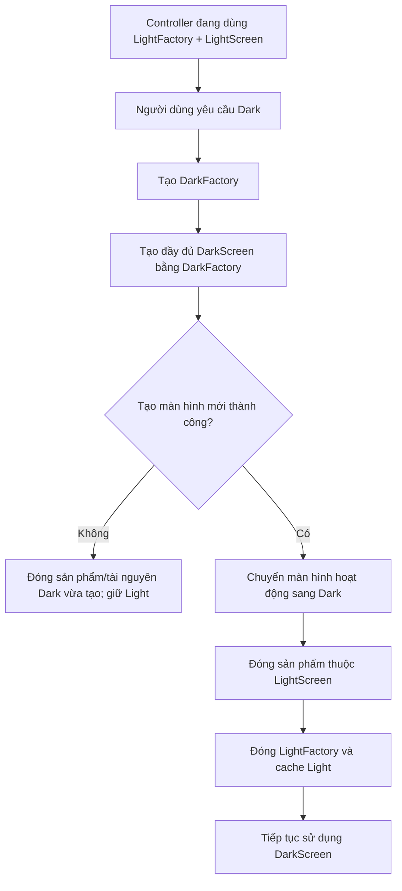

# Đổi factory nhưng giữ sản phẩm cũ, cache sai phạm vi hoặc bỏ sót đóng tài nguyên

Trong module `SOFTWARE_DESIGN_DESIGN_PATTERN_CREATIONAL_ABSTRACT_FACTORY` — **Học về abstract factory trong design pattern** — ta sử dụng **Abstract Factory** để tạo các đối tượng thuộc một **họ sản phẩm** thống nhất. Chẳng hạn, `LightFactory` tạo `LightButton` và `LightDialog`, còn `DarkFactory` tạo bộ thành phần tương ứng của theme Dark. Thiết kế này giúp client không phụ thuộc trực tiếp vào tên lớp cụ thể.

Tuy nhiên, khi ứng dụng **thay factory trong lúc chạy**, một nhóm lỗi có thể phát sinh dù cấu trúc interface hoàn toàn đúng: giữ lại sản phẩm đã được tạo bởi factory cũ, tái sử dụng cache qua sai phạm vi hoặc quên giải phóng những tài nguyên mà factory/sản phẩm sở hữu. Bài thuộc chương **Lỗi thường gặp**, tập trung vào **vòng đời và quyền sở hữu** của factory, sản phẩm và tài nguyên trong các tình huống này.

> Abstract Factory quy định **cách yêu cầu tạo một họ sản phẩm**. Mẫu thiết kế không tự động đổi những đối tượng đã tạo, không tự xóa cache và không tự đóng tài nguyên. Các trách nhiệm về vòng đời cần được thiết kế rõ ràng.

## 1. Tình huống: chuyển giao diện Light sang Dark

Một màn hình cài đặt có hai loại sản phẩm:

| Loại sản phẩm | Họ Light | Họ Dark |
| --- | --- | --- |
| `Button` | `LightButton` | `DarkButton` |
| `Dialog` | `LightDialog` | `DarkDialog` |
| Factory | `LightFactory` | `DarkFactory` |
| Tài nguyên giao diện | Icon, font, style dành cho Light | Icon, font, style dành cho Dark |

Khi khởi động, ứng dụng lấy một factory từ cấu hình và tạo màn hình:

```java
UiFactory factory = new LightFactory();
Button saveButton = factory.createButton();
Dialog confirmDialog = factory.createDialog();
```

Đến lúc người dùng đổi sang Dark, nếu chỉ thay biến `factory`:

```java
factory = new DarkFactory(); // Chỉ thay nơi tạo sản phẩm trong tương lai.

// Hai sản phẩm này vẫn được tạo từ factory Light trước đó.
saveButton.render("Lưu");
confirmDialog.render("Xác nhận?");
```

Ta vẫn nhìn thấy thành phần Light. Nếu factory cũ đã bị đóng tài nguyên (ví dụ bộ icon, font hoặc session native), sản phẩm Light còn giữ tham chiếu tới tài nguyên đó còn có thể **lỗi khi sử dụng**.

Chuyển factory là thay **cấu hình tạo đối tượng cho những lần tạo sau**; các object đã tồn tại không tự biến đổi thành concrete product của họ mới.

## 2. Ba lỗi thường đi cùng nhau

### 2.1. Đổi factory nhưng giữ sản phẩm cũ

Ví dụ một màn hình lưu `Button` và `Dialog` vào trường của lớp. Khi người dùng đổi theme, controller thay `currentFactory` nhưng không dựng lại màn hình:

```java
// Phác thảo mã lỗi; giả định các lớp đã tồn tại.
class SettingsControllerWithStaleProducts {
    UiFactory currentFactory = new LightFactory();
    Button save = currentFactory.createButton();
    Dialog confirm = currentFactory.createDialog();

    void switchToDark() {
        currentFactory = new DarkFactory();
        // save và confirm vẫn là sản phẩm Light.
    }
}
```

Hậu quả có thể là **trộn họ**: nút đã tạo sẵn vẫn thuộc Light, còn dialog được tạo sau khi chuyển factory thuộc Dark. Khi có trạng thái người dùng, việc dựng lại cần giữ dữ liệu phù hợp (ví dụ giá trị ô nhập, vị trí cuộn, focus) thay vì vô ý làm mất chúng.

### 2.2. Cache không gắn với họ hoặc vòng đời

Giả sử một hệ thống dùng cache toàn cục cho icon:

```java
// Phác thảo lỗi: cache dùng duy nhất tên icon làm khóa.
static final Map<String, Icon> ICONS = new HashMap<>();

Icon getIcon(String name, Theme theme) {
    return ICONS.computeIfAbsent(name,
            key -> loadIcon(theme, key));
}
```

Lần đầu lấy icon `"save"` ở Light, cache chứa bản Light. Khi đổi sang Dark, yêu cầu icon `"save"` sẽ **trả lại icon Light** vì khóa không chứa theme. Đoạn phác thảo giả định đã có `Map`, `Icon`, `Theme` và hàm `loadIcon`; đây là ví dụ nhận diện lỗi, không phải chương trình độc lập.

Hai hướng sửa tùy nhu cầu:

- **Cache trong phạm vi của factory:** mỗi `LightFactory`/`DarkFactory` có cache riêng, được đóng/xóa khi factory hết vòng đời.
- **Cache dùng chung có khóa đầy đủ:** khóa ít nhất phải phân biệt các yếu tố tác động đến kết quả, như theme, phiên bản asset, độ phân giải và môi trường; đồng thời có cơ chế quản lý vòng đời/giải phóng thích hợp.

Chỉ thêm theme vào khóa **chưa đủ** nếu asset còn phụ thuộc scale, locale, quyền truy cập hoặc những yếu tố khác. Không nên chia sẻ resource native qua những phiên làm việc không tương thích.

### 2.3. Đóng thiếu, đóng quá sớm hoặc đóng hai lần

Concrete factory có thể nắm giữ một pool kết nối, bộ ảnh, font, context native, listener hoặc thread phụ trợ. Sản phẩm cũng có thể sở hữu subscription hay handle riêng. Nếu chuyển factory nhưng không đóng đối tượng cũ, tài nguyên có thể bị rò rỉ. Ngược lại, **đóng factory trước khi hoàn tất dùng/đóng các sản phẩm cũ** có thể khiến chúng truy cập tài nguyên đã bị giải phóng.

| Sai sót | Triệu chứng có thể gặp | Quy tắc khắc phục |
| --- | --- | --- |
| Không đóng màn hình/sản phẩm cũ | Listener vẫn nhận sự kiện, bộ nhớ hoặc handle tăng dần | Đặt điểm dọn dẹp khi màn hình kết thúc |
| Không đóng tài nguyên factory cũ | Cache, kết nối hoặc context bị giữ lại | Xác định người sở hữu factory và đóng khi không còn dùng |
| Đóng factory trong khi sản phẩm vẫn hoạt động | Lỗi `IllegalStateException`, handle đã đóng hoặc UI lỗi | Dừng sử dụng, đóng sản phẩm trước khi đóng tài nguyên chung |
| Đóng tài nguyên dùng chung bởi nhiều màn hình quá sớm | Màn hình khác bị hỏng | Phạm vi sở hữu phải khớp phạm vi sử dụng, hoặc dùng cơ chế chia sẻ có quản lý |
| Đóng nhiều lần nhưng API không hỗ trợ | Ngoại lệ hoặc thao tác giải phóng lặp | Thiết kế thao tác close idempotent khi hợp lý và quy định rõ owner |

**Lưu ý:** không phải tất cả product đều cần `close()`. Đối tượng dữ liệu thuần không giữ tài nguyên có thể không cần dọn dẹp. Với tài nguyên native, network, file handle hoặc đăng ký sự kiện, cần tuân theo lifecycle của thư viện đang dùng.

## 3. Xác định quyền sở hữu trước khi chuyển factory

Một thiết kế dễ kiểm tra cần trả lời: **ai tạo, ai sử dụng, ai đóng** đối với từng loại đối tượng?

| Đối tượng | Người tạo | Người sở hữu trong ví dụ | Khi nào đóng? |
| --- | --- | --- | --- |
| `UiFactory` | Controller/composition root | Controller | Khi thay factory hoặc kết thúc ứng dụng |
| `Button`, `Dialog` | Factory tạo; màn hình nhận | Màn hình | Khi màn hình bị thay hoặc kết thúc |
| Cache icon/style | Factory hoặc đối tượng tài nguyên của factory | Factory | Cùng vòng đời factory |
| Trạng thái người dùng | Logic màn hình/controller | Controller hoặc state model | Giữ lại theo yêu cầu khi thay theme |

Trong ví dụ này, **factory tạo sản phẩm nhưng không sở hữu vòng đời từng sản phẩm** sau khi bàn giao cho màn hình. Factory **sở hữu tài nguyên dùng chung**. Vì vậy, thứ tự dọn dẹp là: **màn hình đóng sản phẩm của mình → controller đóng factory và tài nguyên chung**.

Nếu cùng một factory được **nhiều màn hình chia sẻ**, không thể để một màn hình tùy ý đóng factory khi nó biến mất. Khi đó factory cần vòng đời rộng hơn các màn hình sử dụng hoặc phải dùng một cơ chế quản lý số tham chiếu/tài nguyên phù hợp.



Ta chuẩn bị **factory và màn hình mới trước khi hủy bản cũ**, nhờ đó nếu bước tạo mới thất bại, vẫn có thể tiếp tục dùng màn hình cũ. Trong ứng dụng GUI thật, việc chuyển cây widget và khôi phục trạng thái có thể cần được thực hiện trên **UI thread**; tùy framework sẽ có cách kích hoạt UI mới và rollback riêng.

## 4. Ví dụ Java hoàn chỉnh: quản lý factory, cache và cleanup

Ví dụ dưới đây **mô phỏng** tài nguyên giao diện bằng `ThemeResources`, cache asset bằng `Map`, và sản phẩm bằng chuỗi. Mọi thao tác giả định diễn ra tuần tự trên một luồng, nên `HashMap` và các cờ `closed` không có đồng bộ. Mục tiêu là làm rõ **quyền sở hữu** và **vòng đời**; khi dùng tài nguyên thật phải tuân thủ quy tắc thread và cách dispose của toolkit.

Lưu thành `FactoryLifecyclePitfallsDemo.java`:

```java
import java.util.HashMap;
import java.util.Map;
import java.util.Objects;

public class FactoryLifecyclePitfallsDemo {
    enum Theme {
        LIGHT, DARK
    }

    // Tài nguyên chung của đúng một instance factory.
    static final class ThemeResources implements AutoCloseable {
        private final Theme theme;
        private final Map<String, String> assetCache = new HashMap<>();
        private boolean closed;

        ThemeResources(Theme theme) {
            this.theme = Objects.requireNonNull(theme, "theme");
        }

        Theme theme() {
            return theme;
        }

        String asset(String name) {
            if (closed) {
                throw new IllegalStateException("ThemeResources đã đóng");
            }
            return assetCache.computeIfAbsent(name,
                    key -> theme.name() + "/" + key);
        }

        @Override
        public void close() {
            if (!closed) {
                closed = true;
                assetCache.clear();
            }
        }
    }

    // Các hợp đồng sản phẩm chung.
    interface UiProduct extends AutoCloseable {
        Theme theme();
        boolean isClosed();
        @Override
        void close();
    }

    interface Button extends UiProduct {
        String render(String label);
    }

    interface Dialog extends UiProduct {
        String render(String question);
    }

    interface UiFactory extends AutoCloseable {
        Theme theme();
        Button createButton();
        Dialog createDialog();
        @Override
        void close();
    }

    // Product có lifecycle riêng nhưng dùng asset từ tài nguyên factory.
    static abstract class ProductBase implements UiProduct {
        private final ThemeResources resources;
        private boolean closed;

        ProductBase(ThemeResources resources) {
            this.resources = Objects.requireNonNull(
                    resources, "resources");
        }

        @Override
        public Theme theme() {
            return resources.theme();
        }

        @Override
        public boolean isClosed() {
            return closed;
        }

        protected final String asset(String name) {
            if (closed) {
                throw new IllegalStateException("Product đã đóng");
            }
            return resources.asset(name);
        }

        @Override
        public void close() {
            closed = true; // Idempotent trong mô phỏng này.
        }
    }

    // Concrete products của hai họ.
    static final class LightButton extends ProductBase implements Button {
        LightButton(ThemeResources resources) {
            super(resources);
        }

        @Override
        public String render(String label) {
            return "[LIGHT] Button: " + label
                    + " [asset=" + asset("button") + "]";
        }
    }

    static final class LightDialog extends ProductBase implements Dialog {
        LightDialog(ThemeResources resources) {
            super(resources);
        }

        @Override
        public String render(String question) {
            return "[LIGHT] Dialog: " + question
                    + " [asset=" + asset("dialog") + "]";
        }
    }

    static final class DarkButton extends ProductBase implements Button {
        DarkButton(ThemeResources resources) {
            super(resources);
        }

        @Override
        public String render(String label) {
            return "[DARK] Button: " + label
                    + " [asset=" + asset("button") + "]";
        }
    }

    static final class DarkDialog extends ProductBase implements Dialog {
        DarkDialog(ThemeResources resources) {
            super(resources);
        }

        @Override
        public String render(String question) {
            return "[DARK] Dialog: " + question
                    + " [asset=" + asset("dialog") + "]";
        }
    }

    // Chỉ một factory sở hữu ThemeResources của chính nó.
    static abstract class ThemeFactory implements UiFactory {
        private final ThemeResources resources;
        private boolean closed;

        ThemeFactory(Theme theme) {
            resources = new ThemeResources(theme);
        }

        @Override
        public final Theme theme() {
            return resources.theme();
        }

        protected final ThemeResources resources() {
            if (closed) {
                throw new IllegalStateException("Factory đã đóng");
            }
            return resources;
        }

        @Override
        public final void close() {
            if (!closed) {
                closed = true;
                resources.close();
            }
        }
    }

    static final class LightFactory extends ThemeFactory {
        LightFactory() {
            super(Theme.LIGHT);
        }

        @Override
        public Button createButton() {
            return new LightButton(resources());
        }

        @Override
        public Dialog createDialog() {
            return new LightDialog(resources());
        }
    }

    static final class DarkFactory extends ThemeFactory {
        DarkFactory() {
            super(Theme.DARK);
        }

        @Override
        public Button createButton() {
            return new DarkButton(resources());
        }

        @Override
        public Dialog createDialog() {
            return new DarkDialog(resources());
        }
    }

    // Màn hình sở hữu các sản phẩm do factory bàn giao.
    static final class SettingsScreen implements AutoCloseable {
        private final Button button;
        private final Dialog dialog;
        private boolean closed;

        SettingsScreen(UiFactory factory) {
            Objects.requireNonNull(factory, "factory");
            Button newButton = Objects.requireNonNull(
                    factory.createButton(), "button");
            Dialog newDialog;
            try {
                newDialog = Objects.requireNonNull(
                        factory.createDialog(), "dialog");
            } catch (RuntimeException failure) {
                newButton.close();
                throw failure;
            }
            this.button = newButton;
            this.dialog = newDialog;
        }

        String render() {
            if (closed) {
                throw new IllegalStateException("Screen đã đóng");
            }
            if (button.theme() != dialog.theme()) {
                throw new IllegalStateException(
                        "Button và Dialog khác họ");
            }
            return button.render("Lưu") + "\n"
                    + dialog.render("Xác nhận?");
        }

        // Chỉ hỗ trợ minh họa kiểm tra vòng đời trong main.
        Button buttonForDiagnostics() {
            return button;
        }

        @Override
        public void close() {
            if (!closed) {
                closed = true;
                dialog.close();
                button.close();
            }
        }
    }

    // Controller là chủ sở hữu của factory và màn hình đang hoạt động.
    static final class ThemeController implements AutoCloseable {
        private UiFactory factory;
        private SettingsScreen screen;
        private boolean closed;

        ThemeController(UiFactory initialFactory) {
            switchTo(initialFactory);
        }

        void switchTo(UiFactory nextFactory) {
            if (closed) {
                throw new IllegalStateException("Controller đã đóng");
            }
            Objects.requireNonNull(nextFactory, "nextFactory");
            if (nextFactory == factory) {
                return;
            }

            // Chuẩn bị bộ sản phẩm mới; thất bại thì dọn tài nguyên mới.
            SettingsScreen replacement;
            try {
                replacement = new SettingsScreen(nextFactory);
            } catch (RuntimeException failure) {
                nextFactory.close();
                throw failure;
            }

            SettingsScreen oldScreen = screen;
            UiFactory oldFactory = factory;
            screen = replacement;
            factory = nextFactory;

            // Đóng sản phẩm cũ trước tài nguyên chung của factory cũ.
            if (oldScreen != null) {
                oldScreen.close();
            }
            if (oldFactory != null) {
                oldFactory.close();
            }
        }

        String render() {
            if (closed) {
                throw new IllegalStateException("Controller đã đóng");
            }
            return screen.render();
        }

        Button buttonForDiagnostics() {
            return screen.buttonForDiagnostics();
        }

        @Override
        public void close() {
            if (!closed) {
                closed = true;
                if (screen != null) {
                    screen.close();
                }
                if (factory != null) {
                    factory.close();
                }
            }
        }
    }

    public static void main(String[] args) {
        try (ThemeController controller =
                     new ThemeController(new LightFactory())) {
            System.out.println(controller.render());

            Button oldButton = controller.buttonForDiagnostics();
            controller.switchTo(new DarkFactory());
            System.out.println(controller.render());

            if (!oldButton.isClosed()) {
                throw new AssertionError("Sản phẩm cũ chưa được đóng");
            }

            boolean rejected = false;
            try {
                oldButton.render("Thử lại");
            } catch (IllegalStateException expected) {
                rejected = true;
            }
            if (!rejected) {
                throw new AssertionError(
                        "Sản phẩm đã đóng vẫn còn sử dụng được");
            }
        }
        System.out.println(
                "PASS: đóng sản phẩm cũ và giữ cache theo từng factory");
    }
}
```

Biên dịch và chạy trong thư mục chứa file:

```bash
javac -encoding UTF-8 FactoryLifecyclePitfallsDemo.java
java FactoryLifecyclePitfallsDemo
```

Đầu ra dự kiến:

```text
[LIGHT] Button: Lưu [asset=LIGHT/button]
[LIGHT] Dialog: Xác nhận? [asset=LIGHT/dialog]
[DARK] Button: Lưu [asset=DARK/button]
[DARK] Dialog: Xác nhận? [asset=DARK/dialog]
PASS: đóng sản phẩm cũ và giữ cache theo từng factory
```

Quan sát ba kết quả quan trọng:

1. **Không trộn họ khi đổi:** hai dòng mới đều thuộc Dark vì màn hình được tạo lại từ `DarkFactory`. Hai sản phẩm cũ không được tái sử dụng trong màn hình Dark.
2. **Cache đúng phạm vi:** mỗi `ThemeResources` chứa `assetCache` của factory tương ứng. Cùng khóa `"button"` cho ra `LIGHT/button` ở Light và `DARK/button` ở Dark.
3. **Đóng tài nguyên theo thứ tự:** controller đóng `SettingsScreen` cũ (sản phẩm) rồi đóng `LightFactory` cũ (cache/tài nguyên dùng chung). `oldButton.isClosed()` và việc gọi `oldButton.render()` sau chuyển đổi cho thấy sản phẩm cũ đã bị vô hiệu hóa.

Mẫu mã này **minh họa trong môi trường tuần tự, không có lỗi phát sinh từ `close()`**. Khi sử dụng tài nguyên thật, thao tác đóng có thể thất bại; cần bảo đảm cleanup tiếp tục với các tài nguyên còn lại (chẳng hạn `try/finally`, cơ chế ghi nhận lỗi và các exception bị suppressed). Với framework GUI, việc đóng widget còn phải theo luồng/lifecycle do framework yêu cầu.

## 5. Cache đúng phạm vi và khóa

Một cách suy nghĩ hữu ích là hỏi hai câu cho **mỗi cache**: “Kết quả phụ thuộc những đầu vào nào?” và “Tài nguyên được giữ trong bao lâu?”.

| Loại dữ liệu được cache | Phạm vi thường phù hợp | Lưu ý |
| --- | --- | --- |
| Icon/style chỉ dành cho một theme | Factory/theme session | Xóa hoặc đóng khi theme session kết thúc |
| Asset bất biến dùng chung mọi theme | Cache chia sẻ theo ứng dụng | Chứng minh asset không phụ thuộc theme và không có vòng đời ngắn hơn |
| Asset phụ thuộc theme, locale, DPI, phiên bản | Cache dùng chung với khóa đầy đủ hoặc cache từng session | Tránh khóa chỉ gồm tên; xử lý invalidation/version |
| Widget chứa focus, listener hoặc trạng thái người dùng | Thường thuộc màn hình/thành phần sở hữu | Không xem là asset có thể dùng chung tùy ý |
| Kết nối/pool dùng bởi nhiều client | Scope ứng dụng hoặc service quản lý riêng | Không để một màn hình đóng khi client khác còn dùng |

Ví dụ một khóa cache dùng chung đầy đủ có thể là một kiểu dữ liệu riêng:

```java
// Phác thảo: một asset phụ thuộc theme và scale.
record AssetKey(Theme theme, String name, int scale) {}
```

`record` yêu cầu Java 16 trở lên; nếu dự án dùng Java thấp hơn, thay bằng class bất biến có `equals()` và `hashCode()` đúng. Ví dụ hoàn chỉnh ở mục 4 không dùng `record`.

Cũng cần tránh cache dựa trên **đối tượng factory đã đóng**. Một khóa chứa `factory` không biến một resource đã bị đóng thành hợp lệ. Nếu tài nguyên có giới hạn sử dụng hoặc phụ thuộc context, hãy cache trong scope của owner và giải phóng đúng lúc.

## 6. Đừng để thay theme làm mất trạng thái người dùng

Ví dụ code chủ yếu tạo lại `Button` và `Dialog` nên chưa lưu dữ liệu tương tác. Trong ứng dụng thật, màn hình có thể có ô nhập, trạng thái checkbox, tab đang chọn hoặc vị trí cuộn. Trước khi thay factory và màn hình, cần xác định **trạng thái nào phải sống lâu hơn widget**.

Một cách thiết kế là đặt trạng thái vào model độc lập giao diện:

```java
// Minh họa cấu trúc; không nằm trong ví dụ tự chạy ở mục 4.
final class SettingsState {
    String displayName;
    boolean notificationsEnabled;
}

// Khi đổi theme:
// 1. Giữ SettingsState đang sử dụng.
// 2. Tạo factory và các widget mới.
// 3. Bind/khôi phục state cho các widget mới.
// 4. Chuyển UI đang hiển thị, rồi dispose widget và factory cũ.
```

Nếu UI framework hỗ trợ theme động, có thể **thay style tại chỗ** mà không cần tạo lại toàn bộ widget. Khi đó vẫn phải xác định tài nguyên style cũ có cần giải phóng không và cache có được invalidation đúng không. Abstract Factory là một phương án tổ chức **khởi tạo**, không bắt buộc mọi ứng dụng đổi theme phải hủy dựng toàn bộ màn hình.

## 7. Kiểm chứng vòng đời thay vì chỉ kiểm tra giao diện

Kiểm thử “nhìn có vẻ Dark” không đủ để phát hiện rò rỉ. Nên kiểm tra theo nhiều lớp:

| Kiểm tra | Cách thực hiện | Điều cần đạt |
| --- | --- | --- |
| Sản phẩm sau khi chuyển | Gọi factory mới và quan sát cả Button, Dialog | Mọi product của màn hình mới thuộc một họ |
| Sản phẩm cũ | Giữ tham chiếu phục vụ test rồi thử dùng sau dispose | Theo hợp đồng lifecycle, sản phẩm đã đóng không còn hoạt động |
| Cache | Đổi Light → Dark → Light, truy cập cùng tên asset | Asset thuộc đúng theme/phiên bản, không trả dữ liệu stale |
| Đếm đóng/mở resource | Instrument constructor và `close()` | Số resource đang sống trở về mức dự kiến |
| Lỗi khi tạo màn hình mới | Cố ý cho `createDialog()` ném ngoại lệ | Dọn phần mới đã tạo, giữ màn hình cũ hoạt động |
| Lỗi khi đóng | Mô phỏng exception trong cleanup | Vẫn cố đóng các tài nguyên khác, không bỏ sót |
| Tương tác trễ | Mô phỏng callback/task hoàn thành sau đổi theme | Callback cũ không tác động vào màn hình đã đóng |
| Trạng thái người dùng | Nhập dữ liệu rồi đổi theme | Dữ liệu được khôi phục theo yêu cầu nghiệp vụ |

### Chú ý đến lỗi giữa chừng khi tạo sản phẩm

Trong `SettingsScreen` của ví dụ, nếu `createButton()` thành công nhưng `createDialog()` thất bại, constructor đóng button vừa tạo trước khi ném lại lỗi. Sau đó `ThemeController.switchTo()` đóng factory dự kiến chuyển sang, trong khi màn hình đang hoạt động **chưa bị thay**. Nếu không quản lý trường hợp này, có thể rò rỉ những sản phẩm/tài nguyên đã tạo một phần.

Khi factory mở nhiều tài nguyên trong constructor, bản thân factory cũng phải có cách cleanup nếu khởi tạo **chưa hoàn tất**. Với GUI thật, thao tác “tạo màn hình rồi mới gắn lên cây UI” cũng cần tuân thủ giới hạn của framework.

### Chú ý callback bất đồng bộ

Giả sử màn hình Light gửi yêu cầu tải avatar, sau đó người dùng đổi sang Dark. Khi callback của màn hình Light chạy muộn, nó không nên cập nhật widget đã đóng hoặc giữ tham chiếu ngăn widget cũ được giải phóng. Có thể:

- Hủy subscription/tác vụ liên quan trong `close()` khi API hỗ trợ.
- Kiểm tra trạng thái đã đóng hoặc mã phiên bản (generation) trước khi cập nhật.
- Đưa dữ liệu có vòng đời dài vào model/controller độc lập màn hình, rồi chỉ render lên widget đang hoạt động.

Trong một hệ thống đa luồng, cần thêm đồng bộ hoặc điều phối trên một luồng thích hợp. `ThemeController` minh họa ở mục 4 **không an toàn cho truy cập đồng thời**; đừng dùng trực tiếp để quản lý widget từ nhiều thread.

## 8. Các lỗi sửa một phần và cách nhận biết

**“Chỉ cần thay tham chiếu factory.”** Cách này chỉ ảnh hưởng các lời gọi tạo sản phẩm về sau. Hãy xác định sản phẩm nào đã tồn tại và chọn cơ chế cập nhật hoặc dựng lại chúng.

**“Đặt tất cả asset trong static cache là nhanh nhất.”** Nếu khóa không đủ hoặc không có invalidation, bộ nhớ và dữ liệu từ họ cũ có thể bị giữ lại. Chỉ dùng cache toàn cục khi có cơ chế quản lý scope rõ ràng.

**“Đóng factory ngay sau khi createButton().”** Nếu product dùng resource do factory sở hữu, đóng ngay khiến product không còn sử dụng an toàn. Phải xác định hợp đồng ownership; thời gian sống của resource dùng chung phải bao trùm thời gian sử dụng của các product phụ thuộc.

**“Factory phải tự đóng hết sản phẩm từng tạo.”** Không phải lúc nào cũng đúng. Nếu màn hình sở hữu product, factory không nên âm thầm đóng các object mà màn hình vẫn dùng. Nếu factory sở hữu resource chung, vẫn phải có cơ chế dừng sử dụng và giải phóng resource này khi đúng thời điểm.

**“Đã dùng `AutoCloseable` thì chắc chắn không rò rỉ.”** Interface chỉ đưa ra phương thức đóng; người sở hữu vẫn phải gọi đúng lúc. Dùng `try-with-resources` khi phạm vi lexical phù hợp, và cơ chế lifecycle của framework cho đối tượng có vòng đời phức tạp.

**“Mỗi lần chuyển theme đều hủy toàn bộ ứng dụng.”** Đây có thể là xử lý quá mức. Chỉ những tài nguyên phụ thuộc theme hoặc session cũ mới cần cập nhật/đóng; resource dùng chung độc lập theme có thể tiếp tục sống nếu có người sở hữu phù hợp.

## 9. Bài tập thực hành

**Bài tập 1 — Phát hiện sản phẩm cũ.** Tạo một `SettingsScreen` bằng `LightFactory`, sau đó gán biến factory mới bằng `DarkFactory` nhưng không dựng lại màn hình. Dự đoán kết quả render và giải thích sự khác nhau giữa *tham chiếu factory mới* với *product đã được tạo*.

**Bài tập 2 — Cache sai phạm vi.** Viết một cache `Map<String, String>` dùng chung cho cả Light/Dark và chỉ khóa theo tên asset. Gọi `getIcon("save", LIGHT)` rồi `getIcon("save", DARK)`, ghi nhận sai sót. Sửa bằng cache theo factory hoặc khóa có theme và kiểm tra lại.

**Bài tập 3 — Đo resource leak.** Thêm bộ đếm số `ThemeResources` đang hoạt động: tăng khi tạo và giảm đúng một lần khi đóng. Lặp 100 lần chuyển Light/Dark, rồi đóng controller. Số tài nguyên còn hoạt động phải trở về 0. Tránh gọi đóng trùng khiến bộ đếm âm.

**Bài tập 4 — Lỗi khi tạo màn hình mới.** Tạo một factory cố ý ném exception trong `createDialog()`. Đảm bảo button mới đã tạo được đóng, factory mới được đóng và `ThemeController` vẫn render được màn hình cũ.

**Bài tập 5 — Xử lý trạng thái và tác vụ trễ.** Mô phỏng một ô nhập tên và một callback tải dữ liệu hoàn thành sau khi chuyển theme. Thiết kế model độc lập widget, cơ chế hủy hoặc kiểm tra generation để callback cũ không cập nhật màn hình đã đóng.

**Câu hỏi tự đánh giá:** Ai là người sở hữu các product, ai sở hữu tài nguyên của factory? Thứ tự đóng nào là an toàn khi chúng phụ thuộc nhau? Khi nào cache cần chứa theme trong khóa, và khi nào nên đặt cache trong một factory? Vì sao biên dịch thành công và thay factory đúng vẫn chưa chứng minh không bị rò rỉ?

## Kết luận

Ba lỗi **giữ sản phẩm cũ sau khi đổi factory**, **cache sai phạm vi** và **bỏ sót đóng tài nguyên** đều xuất phát từ việc chưa quản lý rõ **vòng đời của các đối tượng do Abstract Factory tạo ra**. Hãy xác định quyền sở hữu, chuẩn bị bộ sản phẩm mới trước khi thay thế bộ cũ, đóng sản phẩm trước tài nguyên chung mà chúng phụ thuộc, và đặt cache theo đúng khóa/phạm vi sử dụng. Khi có trạng thái người dùng hoặc tác vụ bất đồng bộ, phải bổ sung cơ chế bảo toàn dữ liệu và ngăn thao tác trễ lên đối tượng đã đóng. Abstract Factory giúp tạo đúng họ; còn **an toàn vòng đời và giải phóng tài nguyên** cần được đảm bảo bằng thiết kế và kiểm thử riêng.
