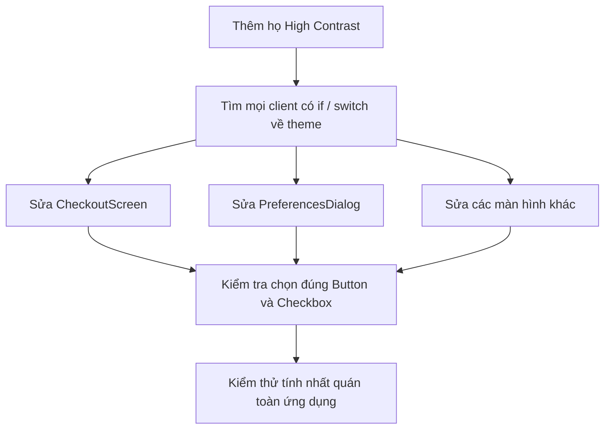
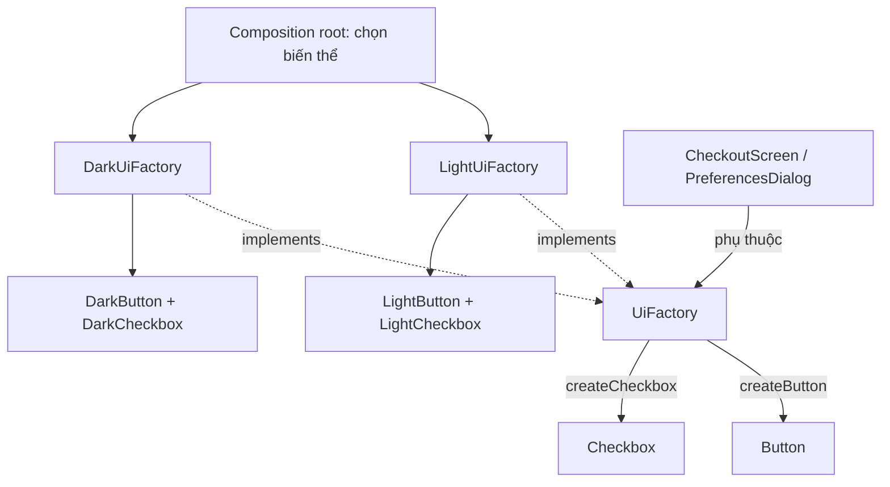

# Sự lan rộng của new, tên lớp cụ thể và điều kiện if hoặc switch trong mã khách

## 1. Nhận diện bài toán trong Abstract Factory

Khi học **Abstract Factory** (mẫu thiết kế khởi tạo một họ đối tượng có liên quan), dấu hiệu đầu tiên thường không nằm ở tên một mẫu thiết kế, mà nằm trong **mã khách** (*client code*): lớp chịu trách nhiệm thực hiện một công việc lại phải biết quá nhiều về **cách chọn và tạo đối tượng cụ thể**.

Ví dụ, ứng dụng có hai bộ thành phần giao diện:

- Họ **Light** gồm `LightButton` và `LightCheckbox`.
- Họ **Dark** gồm `DarkButton` và `DarkCheckbox`.

Một màn hình thanh toán cần cả nút bấm và ô chọn; hộp thoại thiết lập cũng cần cả hai. Yêu cầu là mỗi màn hình phải dùng các thành phần **thuộc cùng một họ**. Nếu màn hình nào cũng tự tạo bằng `new`, ghi trực tiếp tên lớp `Light*`/`Dark*` và phân nhánh theo chủ đề `light`/`dark`, dấu hiệu thiết kế bắt đầu xuất hiện.

Điều cần nhận ra không phải là “có `new` thì sai” hay “có `if` thì phải dùng Abstract Factory”. Vấn đề là **quyết định chọn một họ sản phẩm đang bị lặp lại ở nhiều client**, trong khi mỗi client chỉ cần sử dụng các sản phẩm được tạo ra.

## 2. Biểu hiện trong mã nguồn

Hãy giả sử các lớp `LightButton`, `DarkButton` thực hiện giao diện `Button`; các lớp `LightCheckbox`, `DarkCheckbox` thực hiện giao diện `Checkbox`.

Hai lớp client hiện có thể viết như sau (đoạn mã tập trung vào phần khởi tạo, các trường và phương thức còn lại được lược bỏ):

```java
class CheckoutScreen {
    private final Button payButton;
    private final Checkbox acceptTerms;

    CheckoutScreen(String theme) {
        if ("dark".equals(theme)) {
            payButton = new DarkButton();
            acceptTerms = new DarkCheckbox();
        } else {
            payButton = new LightButton();
            acceptTerms = new LightCheckbox();
        }
    }
}

class PreferencesDialog {
    private final Button saveButton;
    private final Checkbox notifications;

    PreferencesDialog(String theme) {
        switch (theme) {
            case "dark" -> {
                saveButton = new DarkButton();
                notifications = new DarkCheckbox();
            }
            case "light" -> {
                saveButton = new LightButton();
                notifications = new LightCheckbox();
            }
            default -> throw new IllegalArgumentException(
                "Theme không hỗ trợ: " + theme
            );
        }
    }
}
```

Cả hai client đều đang thực hiện **hai công việc riêng**:

1. Quyết định thành phần cần thuộc họ giao diện nào.
2. Sử dụng các thành phần đó để phục vụ màn hình hoặc hộp thoại.

Công việc thứ nhất xuất hiện ở nhiều lớp; đây là nơi thay đổi lan rộng khi ứng dụng bổ sung biến thể.

### Ba dấu hiệu cần đặc biệt chú ý

| Dấu hiệu | Cách nhìn trong mã | Vì sao đáng quan tâm |
| --- | --- | --- |
| `new` xuất hiện khắp các client | Nhiều màn hình có `new LightButton()`, `new DarkCheckbox()` | Client đang tự chịu trách nhiệm lắp ráp các họ sản phẩm |
| Tên lớp cụ thể bị nhắc lại | Client biết cả `LightButton`, `DarkButton`, `LightCheckbox`, `DarkCheckbox` | Một họ mới sẽ tác động đến nhiều lớp sử dụng |
| Cùng một nhánh `if`/`switch` được lặp | Mỗi màn hình phân biệt `light` và `dark` | Quy tắc chọn họ dễ phân kỳ và bị bỏ sót khi sửa |

Trong ví dụ, `CheckoutScreen` ngầm hiểu mọi giá trị khác `dark` là `light`, nhưng `PreferencesDialog` lại từ chối giá trị không hợp lệ. Sự khác biệt nhỏ này đã làm hành vi không nhất quán khi cấu hình bị gõ sai như `drak`.

Ngay cả khi cả hai lớp đều kiểm tra đầu vào đúng, mỗi lần thêm biến thể mới vẫn phải sửa nhiều vị trí.

## 3. Từ dấu hiệu cục bộ đến chi phí thay đổi

Giả sử nhóm phát triển muốn thêm giao diện **High Contrast**, gồm `HighContrastButton` và `HighContrastCheckbox`.

Nếu giữ thiết kế cũ, cần tìm mọi client có nhánh theo `theme`, bổ sung `case "high-contrast"` hoặc `else if`, sau đó tạo đúng các lớp tương ứng ở từng vị trí. Khi còn một màn hình chưa được sửa, chức năng đó có thể báo lỗi hoặc tự rơi về giao diện mặc định.

Một chuỗi thay đổi dễ gặp:



Các hệ quả kỹ thuật thường thấy:

- **Liên kết chặt (*tight coupling*):** các client phụ thuộc vào tên và constructor của nhiều concrete class, thay vì chỉ phụ thuộc vào hành vi cần dùng.
- **Sửa đổi lan rộng:** một họ sản phẩm mới làm thay đổi nhiều client dù logic nghiệp vụ của chúng không đổi.
- **Nguy cơ trộn họ:** một nhánh có thể tạo `DarkButton` nhưng lại vô tình tạo `LightCheckbox`. Các đối tượng riêng lẻ vẫn hợp lệ về kiểu dữ liệu, song không còn cùng biến thể.
- **Quy tắc phân nhánh không đồng nhất:** màn hình này có mặc định, màn hình kia báo lỗi; nơi khác có thể hỗ trợ tên biến thể viết hoa còn nơi khác không.
- **Khó kiểm thử cô lập:** để kiểm thử client, bài test phải quan tâm đến các lớp cụ thể hoặc đến mọi nhánh lựa chọn, thay vì cấp một bộ đối tượng thay thế đơn giản.

Đây là triệu chứng của **sự lẫn lộn giữa quyết định kiến tạo và logic sử dụng**. Abstract Factory giải quyết phần quyết định kiến tạo một *họ* sản phẩm và giúp client chỉ cần phụ thuộc vào hợp đồng chung.

### Phép kiểm tra bằng câu hỏi “nếu thay đổi…”

Khi đọc mã, thử đặt các câu hỏi:

1. **Nếu thêm họ sản phẩm thứ ba**, bao nhiêu client phải sửa?
2. **Nếu đổi constructor của một concrete product**, bao nhiêu màn hình bị ảnh hưởng?
3. **Nếu phải bảo đảm Button và Checkbox tương thích**, hiện tại ai chịu trách nhiệm kiểm soát?
4. **Nếu cần kiểm thử client độc lập**, có dễ truyền vào một bộ sản phẩm giả lập không?
5. **Nếu bổ sung loại sản phẩm khác** như `Menu`, những họ nào phải tạo phiên bản tương ứng?

Nếu câu trả lời liên tục là “phải sửa nhiều client” và các sản phẩm **được chọn theo cùng một biến thể**, đó là tín hiệu mạnh để cân nhắc Abstract Factory.

## 4. Tách “chọn họ” khỏi “sử dụng họ”

Một cách tổ chức phù hợp là:

- **Abstract products:** `Button`, `Checkbox` mô tả khả năng chung của từng loại sản phẩm.
- **Concrete products:** `LightButton`, `LightCheckbox`, `DarkButton`, `DarkCheckbox` thực hiện hành vi của từng biến thể.
- **Abstract factory:** `UiFactory` khai báo phương thức tạo các sản phẩm liên quan.
- **Concrete factories:** `LightUiFactory` tạo cả họ Light; `DarkUiFactory` tạo cả họ Dark.
- **Client:** `CheckoutScreen`, `PreferencesDialog` chỉ gọi các phương thức trên `UiFactory`.
- **Composition root:** nơi khởi tạo ứng dụng chọn một concrete factory rồi cung cấp nó cho các client.



Dấu `new` và việc lựa chọn biến thể **vẫn tồn tại**, nhưng được gom vào vị trí có trách nhiệm kiến tạo. Client không cần biết tên concrete product; nhờ đó các quyết định mới ít lan vào mã sử dụng.

## 5. Ví dụ Java 17: từ client tự tạo đến nhận factory

Ví dụ hoàn chỉnh dưới đây sử dụng kết quả chuỗi để mô phỏng cách hiển thị thành phần. Lưu thành `FactoryRecognitionDemo.java` và biên dịch bằng JDK 17 trở lên.

```java
public final class FactoryRecognitionDemo {

    // 1. Abstract products
    interface Button {
        String render();
    }

    interface Checkbox {
        String render();
    }

    // 2. Concrete products của họ Light
    static final class LightButton implements Button {
        @Override
        public String render() {
            return "Light Button";
        }
    }

    static final class LightCheckbox implements Checkbox {
        @Override
        public String render() {
            return "Light Checkbox";
        }
    }

    // Concrete products của họ Dark
    static final class DarkButton implements Button {
        @Override
        public String render() {
            return "Dark Button";
        }
    }

    static final class DarkCheckbox implements Checkbox {
        @Override
        public String render() {
            return "Dark Checkbox";
        }
    }

    // 3. Abstract factory: hợp đồng cho cả họ sản phẩm
    interface UiFactory {
        Button createButton();
        Checkbox createCheckbox();
    }

    // 4. Concrete factories
    static final class LightUiFactory implements UiFactory {
        @Override
        public Button createButton() {
            return new LightButton();
        }

        @Override
        public Checkbox createCheckbox() {
            return new LightCheckbox();
        }
    }

    static final class DarkUiFactory implements UiFactory {
        @Override
        public Button createButton() {
            return new DarkButton();
        }

        @Override
        public Checkbox createCheckbox() {
            return new DarkCheckbox();
        }
    }

    // 5. Client chỉ sử dụng hợp đồng chung
    static final class CheckoutScreen {
        private final Button payButton;
        private final Checkbox acceptTerms;

        CheckoutScreen(UiFactory factory) {
            this.payButton = factory.createButton();
            this.acceptTerms = factory.createCheckbox();
        }

        void show() {
            System.out.println("Checkout: "
                    + payButton.render() + ", " + acceptTerms.render());
        }
    }

    static final class PreferencesDialog {
        private final Button saveButton;
        private final Checkbox notifications;

        PreferencesDialog(UiFactory factory) {
            this.saveButton = factory.createButton();
            this.notifications = factory.createCheckbox();
        }

        void show() {
            System.out.println("Preferences: "
                    + saveButton.render() + ", " + notifications.render());
        }
    }

    // 6. Chọn factory tại điểm khởi tạo ứng dụng
    public static void main(String[] args) {
        if (args.length > 1) {
            throw new IllegalArgumentException(
                    "Chỉ nhận tối đa một tham số theme");
        }

        String theme = args.length == 0 ? "light" : args[0];
        UiFactory factory = switch (theme) {
            case "light" -> new LightUiFactory();
            case "dark" -> new DarkUiFactory();
            default -> throw new IllegalArgumentException(
                    "Theme không hỗ trợ: " + theme);
        };

        new CheckoutScreen(factory).show();
        new PreferencesDialog(factory).show();
    }
}
```

Chạy thử:

```bash
javac -encoding UTF-8 FactoryRecognitionDemo.java
java FactoryRecognitionDemo dark
```

Kết quả:

```text
Checkout: Dark Button, Dark Checkbox
Preferences: Dark Button, Dark Checkbox
```

Điểm khác biệt quan trọng là hai client **không hề nhận tham số `theme`**. Chúng chỉ nhận `UiFactory`, gọi hai phương thức tạo sản phẩm và dùng các đối tượng được trả về. Cùng một factory được truyền cho cả hai client nên họ sản phẩm được chọn nhất quán trong ví dụ.

Thử tìm các từ khóa `new LightButton`, `new DarkCheckbox`, `case "dark"`:

- Chúng chỉ xuất hiện tại nơi **triển khai concrete factory** hoặc **chọn factory**.
- Chúng không xuất hiện trong `CheckoutScreen` hay `PreferencesDialog`.

Sự thay đổi này là mục tiêu của quá trình tái cấu trúc: đưa kiến thức về biến thể ra khỏi client.

## 6. Khi thêm biến thể, phần nào thực sự cần sửa?

Giả sử bổ sung bộ **High Contrast**. Với Abstract Factory, có thể:

1. Tạo `HighContrastButton` và `HighContrastCheckbox` thực hiện `Button` và `Checkbox`.
2. Tạo `HighContrastUiFactory implements UiFactory`, trả về đúng hai concrete product mới.
3. Bổ sung trường hợp chọn `HighContrastUiFactory` ở điểm khởi tạo.

`CheckoutScreen` và `PreferencesDialog` **không cần thay đổi** nếu hợp đồng `UiFactory` vẫn đáp ứng nhu cầu của chúng.

Điều này không có nghĩa là thêm biến thể sẽ không phải sửa dòng mã nào. Phần ánh xạ cấu hình sang factory vẫn cần biết đến biến thể mới; nếu có nhiều họ, có thể cân nhắc một registry factory phù hợp. Lợi ích là **phạm vi sửa đổi được tập trung** và ít tác động đến nghiệp vụ sử dụng các sản phẩm.

Cũng cần phân biệt hai chiều mở rộng:

| Thay đổi | Tác động thường gặp với Abstract Factory |
| --- | --- |
| **Thêm họ sản phẩm** (`HighContrast`) | Thêm các concrete product/factory và cập nhật chỗ chọn factory; client thường giữ nguyên |
| **Thêm loại sản phẩm** (`Slider` bên cạnh `Button`/`Checkbox`) | Cần bổ sung `createSlider()` vào abstract factory và triển khai nó ở mọi concrete factory; client nào dùng `Slider` cũng cần mã sử dụng tương ứng |

Abstract Factory thường thuận tiện khi cần **thêm họ sản phẩm**, nhưng có chi phí khi thường xuyên thêm **loại sản phẩm**. Nhận diện đúng trục biến đổi giúp tránh áp dụng mẫu thiết kế theo thói quen.

## 7. Có `new` hoặc `if` chưa chắc đã cần Abstract Factory

Không nên tự động áp dụng mẫu này chỉ vì nhìn thấy một từ khóa:

| Tình huống quan sát | Cách xử lý có thể phù hợp hơn |
| --- | --- |
| Client tạo một đối tượng đơn giản, không có biến thể và không lặp ở nhiều nơi | Giữ `new` trực tiếp có thể rõ ràng và đủ tốt |
| Chỉ cần tạo **một loại sản phẩm** với nhiều cách khởi tạo | Xem xét simple factory, factory method, `Supplier` hoặc constructor injection |
| `if` dùng để quyết định nghiệp vụ, không quyết định họ đối tượng | Giữ điều kiện ở đúng nơi xử lý nghiệp vụ |
| Họ sản phẩm có nhiều thành phần tương thích và nhiều client cùng lựa chọn | Abstract Factory là ứng viên mạnh |
| Chỉ khác màu sắc, nhãn hoặc vài giá trị cấu hình, không khác loại sản phẩm | Một cấu hình kiểu dữ liệu hoặc theme object có thể đơn giản hơn |

Chẳng hạn:

```java
// Quy tắc nghiệp vụ: không phải dấu hiệu của Abstract Factory.
if (invoice.isOverdue()) {
    sendReminder(invoice);
}

// Khởi tạo đơn giản trong phạm vi một lớp: chưa có vấn đề lan rộng.
Money total = new Money(amount, currency);
```

Tương tự, chuyển toàn bộ `new` ra khỏi chương trình là bất khả thi và không cần thiết. Mẫu thiết kế chỉ **đặt việc tạo sản phẩm ở nơi chịu trách nhiệm phù hợp**. Một `switch` tập trung tại composition root để chọn `UiFactory` thường là thiết kế dễ hiểu hơn nhiều `switch` lặp trong client.

## 8. Quy trình nhận diện và cải tiến mã hiện hữu

Khi gặp nhiều nhánh tạo đối tượng, có thể tiến hành theo thứ tự:

1. **Liệt kê các loại sản phẩm:** ví dụ `Button` và `Checkbox`.
2. **Liệt kê các họ tương thích:** ví dụ Light và Dark, rồi lập ma trận cho biết mỗi họ có đầy đủ sản phẩm nào.
3. **Tìm nơi lặp quyết định lựa chọn:** các `if`/`switch` theo cùng tham số, đi cùng `new ConcreteClass()` trong nhiều client.
4. **Xác định ranh giới trách nhiệm:** client dùng sản phẩm; factory tạo họ sản phẩm; điểm khởi tạo quyết định chọn factory.
5. **Đưa các interface sản phẩm và interface factory vào thiết kế:** chỉ trừu tượng hóa những hành vi client thực sự cần.
6. **Tạo từng concrete factory và chuyển client sang nhận factory:** ưu tiên constructor injection để thấy rõ dependency.
7. **Kiểm tra lại hành vi:** với từng biến thể, các sản phẩm được tạo phải cùng họ; cấu hình sai phải được xử lý thống nhất; client không còn trực tiếp nhắc tên concrete product.

Các câu hỏi để xác nhận tái cấu trúc đã đạt mục đích:

- Thêm một họ mới có còn đòi hỏi sửa `CheckoutScreen` và `PreferencesDialog` không?
- Client có thể nhận một `UiFactory` giả lập trong bài kiểm thử không?
- Một concrete factory có luôn tạo ra cả `Button` và `Checkbox` thuộc đúng biến thể của nó không?
- Quy tắc chọn biến thể có được quyết định tại một vị trí rõ ràng không?

### Bài tập tự kiểm tra

Một ứng dụng báo cáo hỗ trợ hai họ đầu ra:

- `PdfExportFactory` tạo `PdfDocument` và `PdfChart`.
- `HtmlExportFactory` tạo `HtmlDocument` và `HtmlChart`.

Hiện tại `InvoiceReport` và `SalesReport` đều nhận `format`, sau đó dùng `if` để tự `new` từng loại document và chart.

Hãy xác định **client**, **hai loại abstract product**, **hai họ concrete product**, **abstract factory** và **nơi chọn concrete factory**. Sau đó tự trả lời: khi bổ sung định dạng `Markdown` với cả document và chart, những lớp nào nên thay đổi và những lớp nào nên giữ nguyên?

Gợi ý: phần xây dựng nội dung báo cáo chỉ nên dùng hợp đồng của document và chart. Quyết định “PDF hay HTML” thuộc về điểm lựa chọn factory, còn việc tạo các thành phần tương thích của từng định dạng thuộc về concrete factory.

---

**Kết luận:** tín hiệu quan trọng nhất của bài toán này là **nhiều client cùng biết tên các concrete class và cùng lặp logic chọn một họ đối tượng liên quan**. Abstract Factory tập trung việc khởi tạo họ sản phẩm, giúp client chỉ phụ thuộc vào các abstraction và giảm phạm vi sửa đổi khi thêm biến thể.
