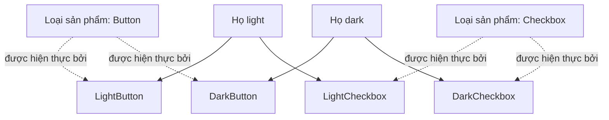
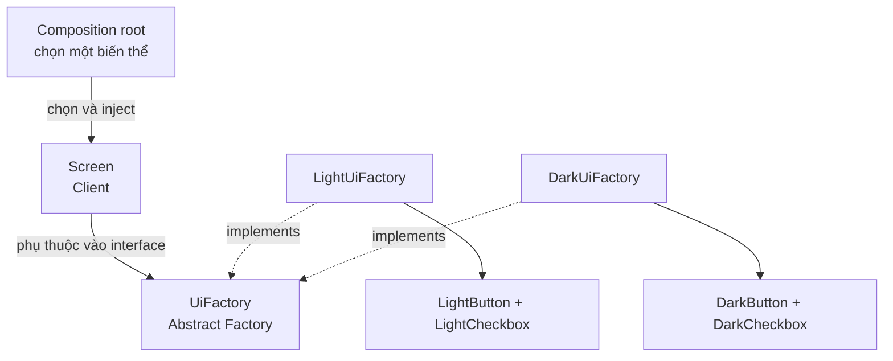

# Rủi ro khi khởi tạo và kết hợp sản phẩm thuộc các họ khác nhau

Khi học **Abstract Factory** trong nhóm **Creational Design Pattern**, một câu hỏi quan trọng không chỉ là *làm thế nào để tạo đối tượng*, mà còn là: **điều gì xảy ra nếu ứng dụng tạo ra nhiều đối tượng đều hợp lệ riêng lẻ nhưng không tương thích khi sử dụng cùng nhau?** Đây là vấn đề cần nhận diện trước khi quyết định có sử dụng Abstract Factory hay không.

Trong chương **Nhận diện bài toán**, bài học này tập trung vào rủi ro khi một hệ thống phải tạo **nhiều loại sản phẩm liên quan** và vô tình kết hợp sản phẩm thuộc **những họ khác nhau**. Ta sẽ phân biệt lỗi biên dịch với lỗi hành vi, tìm nguyên nhân dẫn đến trộn họ và xác định dấu hiệu cho thấy Abstract Factory là một lựa chọn phù hợp.

## 1. Hiểu đúng khái niệm "họ sản phẩm"

Một **họ sản phẩm (product family)** là nhóm các đối tượng thuộc **những loại sản phẩm khác nhau** nhưng được thiết kế để phối hợp trong cùng một biến thể, nền tảng, giao thức hoặc ngữ cảnh.

Ví dụ, một ứng dụng có hai giao diện sáng và tối. Mỗi giao diện cung cấp hai loại thành phần:

| Loại sản phẩm | Họ `light` | Họ `dark` |
| --- | --- | --- |
| `Button` | `LightButton` | `DarkButton` |
| `Checkbox` | `LightCheckbox` | `DarkCheckbox` |
| Bộ sản phẩm tương thích | `LightButton` + `LightCheckbox` | `DarkButton` + `DarkCheckbox` |

`LightButton` và `DarkButton` là **hai biến thể của cùng loại sản phẩm**. Còn `LightButton` và `LightCheckbox` là **hai sản phẩm khác loại nhưng cùng một họ**. Sự phân biệt này quyết định cách nhận diện Abstract Factory.



Trong ứng dụng thực, tính tương thích có thể là:

- **Trực quan:** cùng theme, kích thước, cách hiển thị trạng thái hoặc quy tắc accessibility.
- **Giao thức:** cùng phiên bản API, định dạng thông điệp, quy ước xác thực hoặc cơ chế mã hóa.
- **Dữ liệu:** dùng chung dialect SQL, cấu trúc khóa, schema hoặc quy tắc serialization.
- **Môi trường hoạt động:** cùng nhà cung cấp dịch vụ, vùng triển khai, tenant hoặc phiên bản tích hợp.

Không phải mọi cặp sản phẩm khác họ đều chắc chắn lỗi. **Rủi ro xuất hiện khi yêu cầu hệ thống đặt ra một bất biến tương thích mà cách khởi tạo hiện tại không bảo đảm.** Vì vậy, trước khi áp dụng pattern, cần xác định cụ thể những tổ hợp nào được phép sử dụng cùng nhau.

## 2. Lỗi nguy hiểm: từng đối tượng đúng interface nhưng cả bộ lại sai

Giả sử cả bốn lớp giao diện đều triển khai đúng `Button` hoặc `Checkbox`. Về mặt kiểu dữ liệu, Java cho phép đoạn mã:

```java
Button saveButton = new DarkButton();
Checkbox rememberMe = new LightCheckbox();

renderForm(saveButton, rememberMe);
```

Đây là một **đoạn minh họa độc lập về lỗi thiết kế**; phần sau có chương trình Java hoàn chỉnh để chạy. Mỗi biến có kiểu interface đúng, nhưng màn hình đang trộn nút của theme tối với checkbox của theme sáng. Trình biên dịch Java bình thường không biết yêu cầu *hai sản phẩm phải cùng theme*.

Điều đáng chú ý là phần lớn lỗi trộn họ **không phát sinh tại constructor**. Constructor có thể chạy thành công, nhưng bất nhất chỉ xuất hiện sau đó khi ghép giao diện, truyền dữ liệu, kết nối dịch vụ hoặc xử lý một luồng nghiệp vụ.

| Lớp rủi ro | Khi trộn họ, điều gì có thể xảy ra? | Dấu hiệu thường thấy |
| --- | --- | --- |
| Không nhất quán hiển thị | Màu sắc, kích thước, hành vi tương tác khác nhau trên cùng màn hình | UI có thành phần sáng và tối lẫn nhau |
| Không tương thích giao thức | Bộ mã hóa của phiên bản A tạo thông điệp mà bộ giải mã B không hiểu | Request lỗi, deserialize thất bại, thông điệp bị từ chối |
| Sai lệch dữ liệu | Query builder tạo cú pháp SQL không phù hợp với database driver | Lỗi SQL chỉ xảy ra khi thực thi câu lệnh |
| Sai ngữ cảnh dịch vụ | Bộ lưu trữ và bộ phát sự kiện trỏ tới hai môi trường/tenant khác nhau | Dữ liệu đã lưu nhưng downstream không thấy sự kiện mong đợi |
| Khó phát hiện bằng test đơn lẻ | Mỗi class vượt qua unit test riêng nhưng tổ hợp không đúng | Lỗi chỉ xuất hiện khi chạy luồng tích hợp |
| Khó bảo trì và mở rộng | Mỗi loại sản phẩm có nhánh chọn biến thể riêng | Thêm biến thể mới phải sửa nhiều vị trí, dễ bỏ sót |

Rủi ro trộn họ thường nghiêm trọng hơn lỗi giao diện nếu nó ảnh hưởng tới **định tuyến dữ liệu, môi trường triển khai hoặc tính nhất quán của một giao dịch**. Mức độ ảnh hưởng phụ thuộc yêu cầu cụ thể, không phải do tên pattern quyết định.

## 3. Vì sao ứng dụng dễ tạo sản phẩm khác họ?

Một số nguyên nhân lặp lại trong dự án thực tế:

### 3.1. Mỗi nơi tự chọn biến thể

```java
// Service A chọn nút theo cấu hình hiện tại.
Button button = isDarkMode() ? new DarkButton() : new LightButton();

// Service B có điều kiện riêng, có thể dùng cấu hình cũ.
Checkbox checkbox = useLegacyTheme() ? new LightCheckbox() : new DarkCheckbox();
```

Các biểu thức chỉ mang tính minh họa, không phải chương trình Java độc lập. Khi hai nhánh điều kiện không xuất phát từ cùng một quyết định, tổ hợp cuối cùng có thể sai. Kể cả khi ban đầu chúng sử dụng cùng một biến, những lần sửa sau này có thể làm chúng lệch nhau.

### 3.2. Client khởi tạo trực tiếp class cụ thể

Nếu lớp `ProfileScreen` tự viết `new LightCheckbox()` nhưng nhận `Button` theo theme do người dùng chọn, nó đang ghép hai nguồn lựa chọn khác nhau. Việc khai báo hai interface không tự ngăn client gọi constructor của các triển khai cụ thể.

### 3.3. Thay đổi cấu hình từng phần

Khi người dùng chuyển từ theme sáng sang tối, ứng dụng có thể tạo lại `Button` nhưng giữ `Checkbox` cũ trong cache. Lúc này cả hai đối tượng đều được tạo hợp lệ **ở hai thời điểm khác nhau**, nhưng không còn tương thích trong cùng một màn hình.

Tương tự, với ứng dụng nhiều tenant, một factory có trạng thái toàn cục bị thay đổi trong lúc hai request đồng thời xử lý có thể khiến sản phẩm của tenant A và tenant B bị kết hợp nhầm. **Phạm vi cấu hình** là một phần của yêu cầu tương thích, không chỉ tên loại class.

### 3.4. Kiểm thử từng sản phẩm nhưng không kiểm thử cả bộ

`LightButtonTest` và `DarkCheckboxTest` đều có thể thành công. Điều còn thiếu là phép kiểm tra rằng một luồng hoặc một factory đã chọn **tạo ra đúng tất cả loại sản phẩm của cùng họ**.

## 4. Ví dụ Java 17: thấy được kết quả trộn họ

Ví dụ sau dùng chuỗi để mô phỏng giao diện, giúp quan sát lỗi mà không cần thư viện UI. Lưu toàn bộ nội dung vào `FamilyMismatchDemo.java`:

```java
public class FamilyMismatchDemo {
    interface Button {
        String render();
    }

    interface Checkbox {
        String render();
    }

    interface UiFactory {
        Button createButton();

        Checkbox createCheckbox();
    }

    static final class LightButton implements Button {
        @Override
        public String render() {
            return "LIGHT button: Save";
        }
    }

    static final class LightCheckbox implements Checkbox {
        @Override
        public String render() {
            return "LIGHT checkbox: Remember";
        }
    }

    static final class DarkButton implements Button {
        @Override
        public String render() {
            return "DARK button: Save";
        }
    }

    static final class DarkCheckbox implements Checkbox {
        @Override
        public String render() {
            return "DARK checkbox: Remember";
        }
    }

    static final class LightUiFactory implements UiFactory {
        @Override
        public Button createButton() {
            return new LightButton();
        }

        @Override
        public Checkbox createCheckbox() {
            return new LightCheckbox();
        }
    }

    static final class DarkUiFactory implements UiFactory {
        @Override
        public Button createButton() {
            return new DarkButton();
        }

        @Override
        public Checkbox createCheckbox() {
            return new DarkCheckbox();
        }
    }

    // Hàm này không kiểm tra hai sản phẩm có cùng họ hay không.
    static String renderUnchecked(Button button, Checkbox checkbox) {
        return button.render() + " | " + checkbox.render();
    }

    // Client đúng hướng: chỉ biết interface factory và product.
    static final class Screen {
        private final UiFactory factory;

        Screen(UiFactory factory) {
            this.factory = java.util.Objects.requireNonNull(factory);
        }

        String render() {
            Button button = factory.createButton();
            Checkbox checkbox = factory.createCheckbox();
            return renderUnchecked(button, checkbox);
        }
    }

    public static void main(String[] args) {
        // Cách sai: ghép thủ công các sản phẩm thuộc hai họ.
        System.out.println("Mixed family:");
        System.out.println(renderUnchecked(new DarkButton(), new LightCheckbox()));

        // Cách đúng: chọn một factory, để factory tạo trọn bộ.
        UiFactory selectedFactory = new DarkUiFactory();
        System.out.println("Consistent family:");
        System.out.println(new Screen(selectedFactory).render());
    }
}
```

Biên dịch và chạy bằng JDK 17 trở lên:

```bash
javac -encoding UTF-8 FamilyMismatchDemo.java
java FamilyMismatchDemo
```

Kết quả:

```text
Mixed family:
DARK button: Save | LIGHT checkbox: Remember
Consistent family:
DARK button: Save | DARK checkbox: Remember
```

Hai trường hợp đều **biên dịch thành công** vì `Button` và `Checkbox` là các kiểu hợp lệ. Khác biệt nằm ở cách tạo bộ đối tượng:

1. Trường hợp thứ nhất: mã khởi tạo hai concrete product độc lập, nên có thể kết hợp khác họ.
2. Trường hợp thứ hai: `Screen` chỉ nhận `UiFactory`; `DarkUiFactory` chịu trách nhiệm tạo cả `DarkButton` và `DarkCheckbox`.

Trong dự án thật, `LightButton` và `DarkButton` nên được đặt trong các package triển khai phù hợp. Client không cần import các lớp này; chỉ lớp lắp ráp cấu hình mới cần biết concrete factory nào được chọn.

## 5. Abstract Factory giảm rủi ro bằng cách nào?

Trong ví dụ trên, `UiFactory` là **Abstract Factory**; `LightUiFactory` và `DarkUiFactory` là hai **Concrete Factory**. Mỗi factory định nghĩa cách tạo các loại sản phẩm của đúng một họ.



Quy trình thiết kế thường là:

1. **Định nghĩa các loại sản phẩm cần hoạt động cùng nhau.** Ví dụ `Button`, `Checkbox`.
2. **Xác định những biến thể/họ hợp lệ.** Ví dụ `light`, `dark`.
3. **Khai báo một Abstract Factory** có phương thức tạo từng loại sản phẩm cần được thay cùng nhau.
4. **Tạo một Concrete Factory cho mỗi họ**, bảo đảm mọi phương thức trong factory trả về sản phẩm tương thích với họ đó.
5. **Chọn factory tại điểm lắp ráp** dựa trên cấu hình, sau đó truyền qua interface vào mã sử dụng.

Lợi ích trực tiếp là thay quyết định từ *"nút lấy class nào và checkbox lấy class nào?"* thành **"màn hình này dùng factory của họ nào?"**. Client không còn cần nhiều nhánh điều kiện để phối hợp sản phẩm.

Tuy nhiên, cần phân biệt **giảm rủi ro bằng thiết kế** với **bảo đảm tuyệt đối bởi hệ thống kiểu**. Một lập trình viên vẫn có thể viết sai bên trong `DarkUiFactory`:

```java
// Sai logic nhưng Java vẫn chấp nhận kiểu trả về Checkbox.
@Override
public Checkbox createCheckbox() {
    return new LightCheckbox();
}
```

`LightCheckbox` vẫn triển khai `Checkbox`, nên đoạn mã đó có thể biên dịch nếu class nằm trong phạm vi truy cập. Abstract Factory **gom trách nhiệm bảo đảm tính tương thích** vào một vị trí dễ kiểm soát; nó không tự động chứng minh mọi cặp sản phẩm cùng họ. Để kiểm soát chặt hơn, ta cần quy tắc truy cập, kiểm thử và khi phù hợp có thể dùng thêm mô hình kiểu dữ liệu hoặc ràng buộc cấu hình.

## 6. Nhận diện rủi ro trong hệ thống thực

Ví dụ UI dễ thấy bằng mắt, nhưng dấu hiệu tương tự xuất hiện trong các hệ thống khác:

| Bối cảnh | Các loại sản phẩm trong một họ | Hậu quả có thể xảy ra khi trộn họ |
| --- | --- | --- |
| Giao diện đa nền tảng | `Button` và `Dialog` theo Windows/macOS | Kết hợp thành phần có hành vi, quy ước phím tắt hoặc hiển thị không nhất quán |
| Hỗ trợ nhiều hệ quản trị CSDL | `Connection` và `SqlQueryBuilder` theo PostgreSQL/SQL Server | Query builder tạo cú pháp không đúng với engine mà connection đang sử dụng |
| Tích hợp nhiều phiên bản giao thức | `MessageEncoder` và `MessageDecoder` theo version | Bộ giải mã không đọc được dữ liệu do bộ mã hóa phiên bản khác tạo ra |
| Triển khai nhiều môi trường cloud | `BlobStorage` và `EventPublisher` theo provider hoặc môi trường | Tệp và sự kiện được gửi tới nơi không thuộc cùng luồng xử lý kỳ vọng |
| Nhiều tenant hoặc vùng triển khai | Client ghi dữ liệu và client phát lệnh cùng context | Dữ liệu đi lệch tenant/vùng nếu cấu hình bị ghép sai |

Những ví dụ này **chỉ gợi ý bất biến cần kiểm tra**, không mặc định mọi sản phẩm của các provider khác nhau đều bất tương thích. Chẳng hạn một bộ mã hóa có thể cố ý hỗ trợ nhiều phiên bản; một API trung gian có thể tương thích với nhiều backend. Cần xem xét **hợp đồng thực tế** trước khi kết luận phải gom thành một họ duy nhất.

Một cách tự kiểm tra yêu cầu là điền ma trận tổ hợp:

| | `LightCheckbox` | `DarkCheckbox` |
| --- | --- | --- |
| `LightButton` | Hợp lệ | Không mong muốn nếu màn hình yêu cầu theme thống nhất |
| `DarkButton` | Không mong muốn nếu màn hình yêu cầu theme thống nhất | Hợp lệ |

Ma trận này chuyển một khái niệm trừu tượng (*"sản phẩm cùng họ"*) thành **quy tắc có thể đánh giá**. Với kết nối CSDL hoặc giao thức, ta có thể tạo ma trận tương tự và xác định tổ hợp nào được hệ thống chính thức hỗ trợ.

## 7. Phân biệt rủi ro trộn họ với lỗi khởi tạo thông thường

Abstract Factory giải quyết một loại vấn đề khá cụ thể. Không nên áp dụng chỉ vì dự án có nhiều class hoặc nhiều constructor.

| Dấu hiệu quan sát | Vấn đề có thực sự là kết hợp sản phẩm theo họ? | Gợi ý |
| --- | --- | --- |
| Một `ReportExporter` chỉ cần chọn giữa PDF và CSV | Không nhất thiết; có thể chỉ chọn **một loại sản phẩm** | Factory Method, một factory đơn giản hoặc dependency injection có thể đủ |
| Giao diện phải thay đồng thời `Button`, `Dialog`, `Checkbox` theo nền tảng | Có: một biến thể chi phối nhiều loại sản phẩm | Cân nhắc Abstract Factory |
| Một service cần một đối tượng phức tạp với nhiều trường tùy chọn | Trọng tâm là **cấu hình một đối tượng**, không phải chọn họ | Builder có thể phù hợp hơn |
| Mỗi sản phẩm lựa chọn độc lập, mọi tổ hợp đều hợp lệ | Không có bất biến cùng họ | Tránh gom chúng vào một factory quá lớn |
| Nhiều sản phẩm chia sẻ version/provider và phối hợp trong một workflow | Có thể có; cần xác định ma trận tương thích | Xem Abstract Factory cùng kiểm thử tích hợp |

Ba câu hỏi quan trọng khi nhận diện:

1. **Có ít nhất hai loại sản phẩm khác nhau** cần được tạo theo một lựa chọn chung không?
2. **Có tổ hợp sản phẩm bị cấm hoặc không mong muốn** dù từng sản phẩm đều hợp lệ riêng không?
3. **Việc chọn từng sản phẩm đang bị phân tán** trong nhiều client hoặc thay đổi không đồng bộ không?

Nếu cả ba đều đúng, bài toán khởi tạo theo họ trở nên rõ ràng. Nếu chỉ có một sản phẩm hoặc mọi tổ hợp đều hợp lệ, Abstract Factory có thể tạo ra lớp trừu tượng không cần thiết.

## 8. Kiểm thử bất biến "cùng họ" như thế nào?

Kiểm thử chỉ từng product class sẽ bỏ sót lỗi ghép. Nên kiểm tra ở **ranh giới factory** và ở **luồng sử dụng sản phẩm cùng nhau**.

### 8.1. Kiểm tra hành vi tổ hợp của mỗi Concrete Factory

Với ví dụ `FamilyMismatchDemo`, một kiểm tra JUnit 5 có thể khẳng định kết quả của màn hình theo từng họ. Nếu lưu test trong cùng phạm vi truy cập phù hợp với các lớp ví dụ:

```java
import org.junit.jupiter.api.Test;

import static org.junit.jupiter.api.Assertions.assertEquals;

class FamilyMismatchDemoTest {
    @Test
    void darkFactoryBuildsConsistentScreen() {
        var factory = new FamilyMismatchDemo.DarkUiFactory();
        var screen = new FamilyMismatchDemo.Screen(factory);

        assertEquals(
                "DARK button: Save | DARK checkbox: Remember",
                screen.render());
    }

    @Test
    void lightFactoryBuildsConsistentScreen() {
        var factory = new FamilyMismatchDemo.LightUiFactory();
        var screen = new FamilyMismatchDemo.Screen(factory);

        assertEquals(
                "LIGHT button: Save | LIGHT checkbox: Remember",
                screen.render());
    }
}
```

Đây là bài test minh họa cho ví dụ chuỗi, với dependency JUnit Jupiter được cấu hình sẵn. Trong ứng dụng thật, nên kiểm tra **hành vi hoặc khả năng tương tác quan trọng** của bộ sản phẩm; không nên chỉ dựa vào tên class hay chuỗi `LIGHT`/`DARK`.

### 8.2. Kiểm tra các tổ hợp bị cấm

Với hệ thống nhiều provider, định nghĩa các *invariant* có thể kiểm thử: driver kết nối và query builder dùng cùng dialect; encoder và decoder giao tiếp được; client lưu trữ và phát sự kiện dùng đúng tenant/môi trường. Test tích hợp có thể chạy lần lượt cho từng biến thể hợp lệ.

### 8.3. Kiểm tra ranh giới phụ thuộc

Khi quy mô code tăng, có thể đặt các concrete product trong package riêng, chỉ cho client truy cập qua interface và hạn chế import concrete class. Các công cụ như ArchUnit hoặc tách module build có thể giúp phát hiện client vô tình gọi `new ConcreteProduct()`.

Điều này ngăn **nhiều đường khởi tạo tùy tiện**, nhưng vẫn cần test tính tương thích bên trong từng concrete factory. Hạn chế import và kiểm thử hai mục tiêu bổ sung cho nhau.

## 9. Những rủi ro còn tồn tại dù đã dùng Abstract Factory

Abstract Factory không thay thế việc quản lý cấu hình và vòng đời đối tượng. Cần chú ý:

- **Concrete Factory triển khai sai:** một phương thức trả về sản phẩm khác họ do copy/paste. Cần kiểm thử từng factory và review ma trận tương thích.
- **Factory được chọn theo ngữ cảnh sai:** ứng dụng chọn `AwsFactory` nhưng yêu cầu thuộc tenant chạy GCP. Cần ánh xạ cấu hình tại điểm lắp ráp phù hợp với phạm vi xử lý.
- **Thay biến thể khi sản phẩm cũ còn tồn tại:** thay `Button` nhưng giữ `Checkbox` trong cache vẫn có thể trộn họ. Khi chuyển theme/provider, cần tái tạo hoặc điều phối thay thế cả bộ liên quan.
- **Trạng thái dùng chung không an toàn:** một factory singleton lưu biến `currentTenant` và bị nhiều request thay đổi đồng thời có thể làm lẫn dữ liệu. Nên truyền ngữ cảnh bất biến hoặc chọn factory theo request/tenant khi cần.
- **Giao diện factory phình to:** càng thêm nhiều loại sản phẩm, mọi concrete factory càng phải triển khai thêm phương thức. Chỉ nhóm các loại sản phẩm có yêu cầu thay đổi cùng nhau.

Điểm cốt lõi là **một factory duy nhất cho một ngữ cảnh sử dụng**, với trách nhiệm tạo đúng họ, chứ không phải mặc nhiên dùng một thể hiện factory duy nhất cho toàn hệ thống trong mọi trường hợp.

## 10. Bài tập nhận diện nhanh và checklist

Xem tình huống sau:

> Ứng dụng dùng `DbConnection` và `SqlQueryBuilder`. `ConnectionService` chọn PostgreSQL theo `DB_TYPE`, còn `QueryService` luôn khởi tạo `SqlServerQueryBuilder` do trước đây hệ thống chỉ chạy SQL Server. Hai service cùng chạy ổn trong một số truy vấn đơn giản, nhưng lỗi xuất hiện khi thêm câu lệnh phân trang.

**Phân tích:** Đây là dấu hiệu trộn họ vì một luồng truy vấn đang sử dụng connection và query builder theo hai dialect khác nhau. Truy vấn đơn giản chạy được không chứng minh hai sản phẩm tương thích trong mọi trường hợp. Nên định nghĩa `DatabaseFactory` tạo cả `DbConnection` và `SqlQueryBuilder`, chọn một concrete factory tại điểm lắp ráp rồi kiểm tra các truy vấn quan trọng theo từng hệ quản trị được hỗ trợ.

Khi đánh giá một bài toán, có thể rà soát:

- [ ] Đã xác định ít nhất hai **loại sản phẩm** cần phối hợp trong một ngữ cảnh.
- [ ] Đã liệt kê các **họ sản phẩm** và tổ hợp nào được phép/không được phép.
- [ ] Đã nhận diện chỗ client trực tiếp `new` concrete product hoặc chứa điều kiện lựa chọn trùng lặp.
- [ ] Đã cân nhắc rủi ro về tương thích giao thức, hiển thị, dữ liệu, tenant và môi trường.
- [ ] Có một cách chọn **cùng một họ** cho tất cả loại sản phẩm liên quan.
- [ ] Có kiểm thử ở cấp **tổ hợp/factory** bên cạnh kiểm thử từng sản phẩm.
- [ ] Đã xác định rõ scope và vòng đời khi biến thể có thể thay đổi theo request, tenant hoặc thời gian.
- [ ] Không gom những loại sản phẩm độc lập thành một họ chỉ vì chúng có thể được tạo bằng factory.

**Ghi nhớ:** Một tập các đối tượng đều thỏa interface vẫn có thể tạo thành **một tổ hợp sai về nghiệp vụ hoặc kỹ thuật**. Rủi ro đó là tín hiệu quan trọng để cân nhắc Abstract Factory: quyết định chọn biến thể **một lần cho một ngữ cảnh**, giao cho một concrete factory tạo **trọn họ sản phẩm tương thích**, rồi để client làm việc qua hợp đồng chung. Cấu trúc này làm giảm khả năng trộn họ và giúp xác định rõ nơi cần kiểm thử bất biến tương thích.
